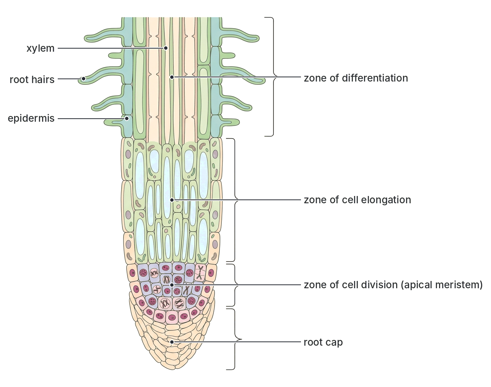
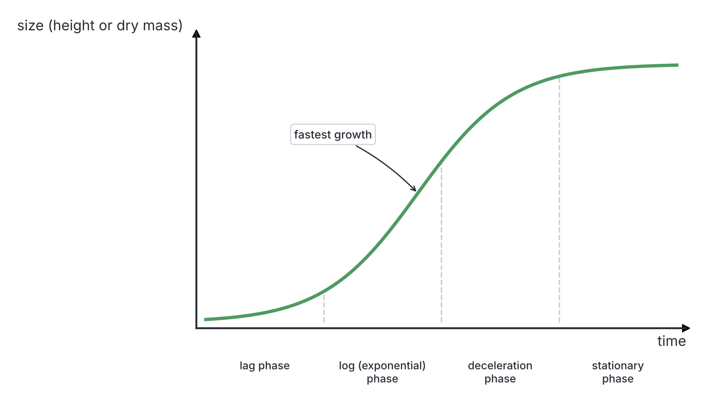
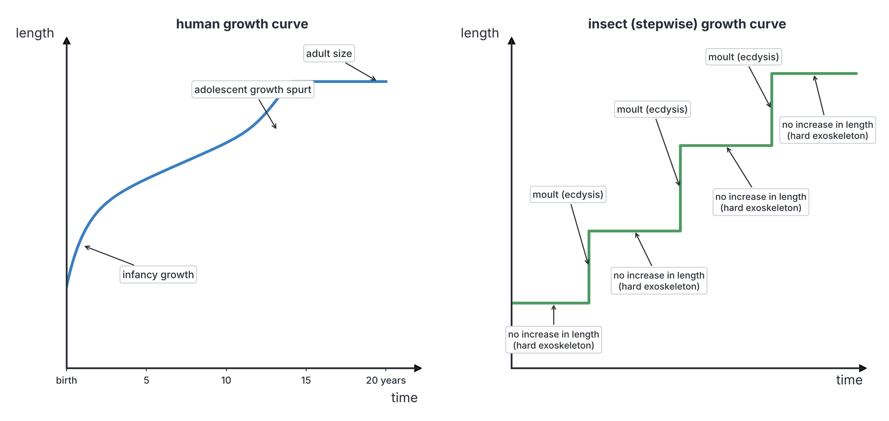
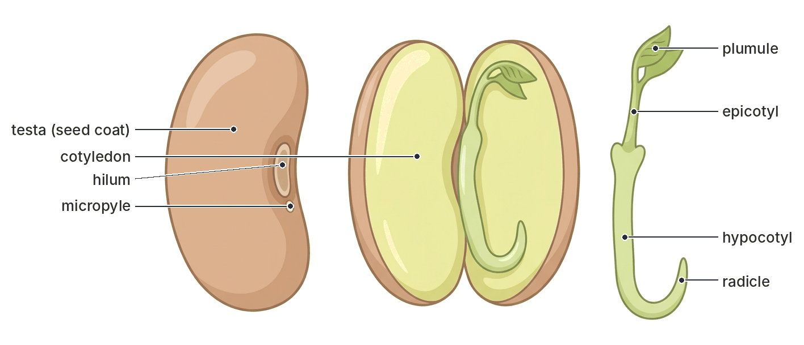
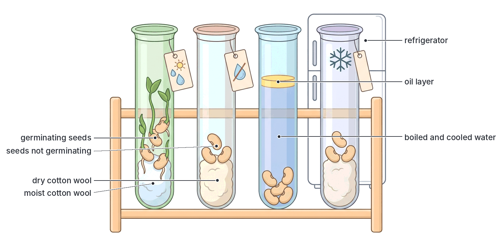
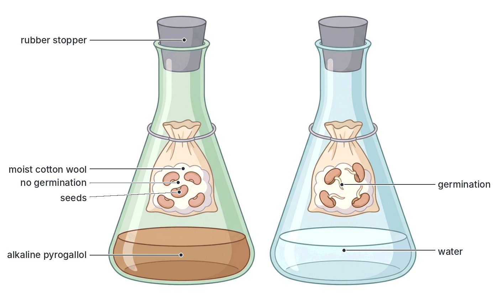
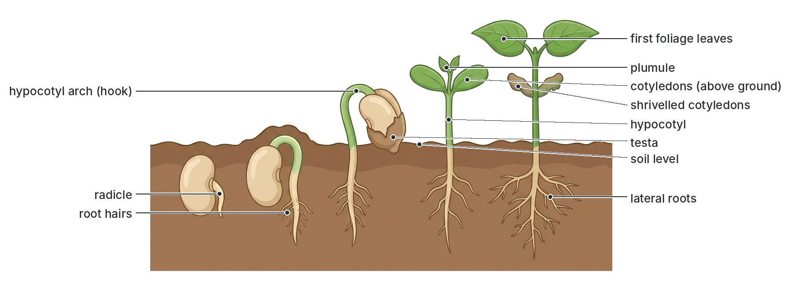
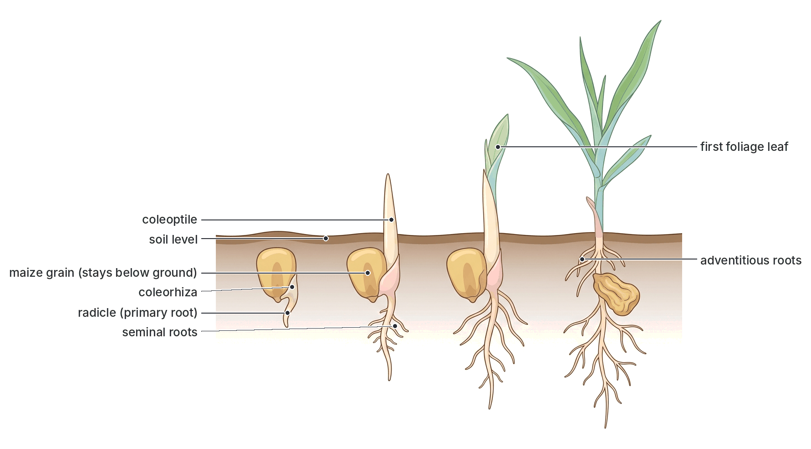
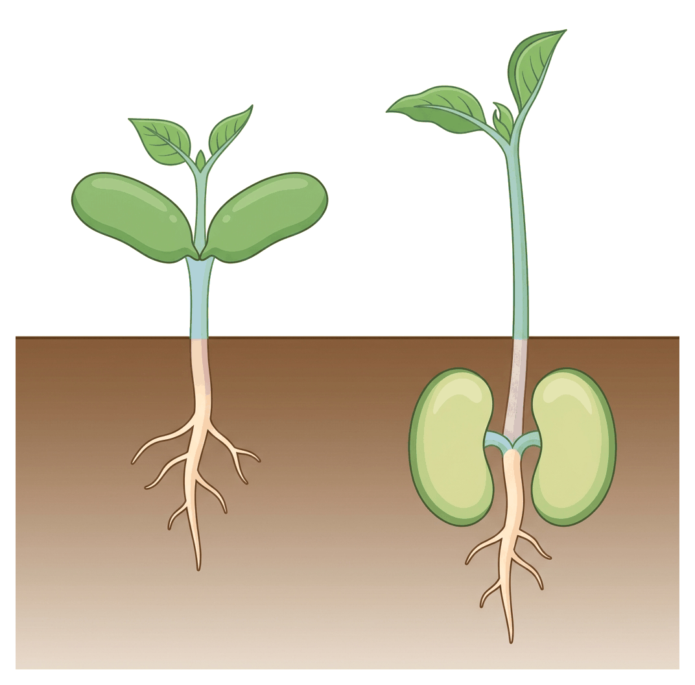

# JAMB Biology Notes: Growth

## What JAMB expects

This topic is Section B, Topic 8 of the JAMB Biology syllabus: Form and Functions – Growth. This file covers the whole topic. It has two content items:

- a. Meaning of growth.
- b. Germination of seeds and conditions necessary for germination of seeds.

By the end of these notes, you should be able to:

1. Apply the knowledge of the conditions necessary for germination to plant growth (objective i).
2. Differentiate between epigeal and hypogeal germination (objective ii).

The seed itself is the product of sexual reproduction in flowering plants; how it forms from the ovule is explained in `B7b-reproduction-in-flowering-plants.md`. Plant growth hormones (auxins, gibberellins, cytokinins and others) are covered in the Co-ordination and Control topic (B9).

## The meaning of growth

### What is growth?

**Growth** is a **permanent (irreversible) increase in the size, mass or volume of an organism** (or of one of its parts), usually together with an increase in the number of its cells.

Key points in this definition:

- **Permanent:** a temporary increase does not count. A dry seed that swells when it absorbs water, or a cell that swells by taking in water and then shrinks again, has not truly grown. A person who gains weight after a large meal and loses it again has not grown.
- **Increase in dry mass:** true growth involves making **new living material (protoplasm)** from food. This is why biologists say that the most reliable measure of growth is an increase in **dry mass** (mass after all water is removed).
- **From within:** living things grow by taking in food and turning it into new cells and tissues **inside** the body (this is called growth by **intussusception**). Non-living things such as crystals or stalagmites only get bigger by adding material to their **outside surface** (growth by **accretion**). This is a key difference between living and non-living things (see `A1-living-organisms.md`).

### The three processes that make up growth

Growth at the cell level involves three processes, which happen one after the other:

1. **Cell division:** cells divide by **mitosis** to make more cells. This increases the **number** of cells.
2. **Cell enlargement (cell expansion):** the new cells take in water and food and increase in **size**. In plants, cells grow mainly by absorbing water into a large vacuole, which is why plant cells can enlarge very quickly.
3. **Cell differentiation (specialisation):** the new cells change their structure to do particular jobs, becoming, for example, xylem vessels, root hair cells, muscle cells or nerve cells.

Growth needs **raw materials** (food, water and minerals) and **energy** from respiration to build new protoplasm.

### Growth and development

Growth is closely linked to **development**, but the two are not the same.

- **Growth** is an increase in **size or mass** (a change in **quantity**).
- **Development** is the series of **changes in form, structure and complexity** that an organism goes through during its life, such as the formation of new organs, the change from larva to adult, or the change from a seed to a flowering plant (a change in **quality**).

| Feature | Growth | Development |
| --- | --- | --- |
| Meaning | A permanent increase in size, mass or volume | A progressive change in form, structure and complexity |
| Type of change | Quantitative (can be measured: height, mass) | Qualitative (new structures and functions appear) |
| Main cell process | Cell division and cell enlargement | Cell differentiation and organisation |
| How it is shown | Measuring height, length, mass, area | Describing stages (e.g. egg, larva, pupa, adult) |
| Can occur without the other? | Yes, e.g. a mature leaf getting bigger without new structures | Yes, e.g. a caterpillar changing into a pupa with little or no increase in size |
| Examples | A maize seedling increasing in height; a baby gaining weight | A tadpole developing legs and losing its tail; a plant forming flowers; a child reaching puberty |

Growth and development usually happen together. **Metamorphosis** in insects and frogs is an example of development (see `A2c-evolution-animals.md`).

### Where growth happens

#### In plants

Plant growth takes place only in special regions of actively dividing cells called **meristems**:

- **Apical meristems** at the **tips of roots and shoots** produce growth in **length**. This is **primary growth**.
- **Lateral meristems** (the **vascular cambium** and **cork cambium**) produce growth in **thickness (girth)**. This is **secondary growth**.
- **Intercalary meristems** at the bases of leaves and internodes in grasses (such as maize, guinea grass and bamboo) allow growth from the base. This is why lawns and pastures regrow after mowing or grazing.

Because meristems keep working, many plants (especially trees) keep growing throughout their lives. This is called **indeterminate (open) growth**.

#### Primary growth (brief)

**Primary growth** is the increase in **length** of roots and shoots, produced by the **apical meristems**. Behind the root tip there are three zones:

1. **Zone of cell division** (just behind the protective root cap), where cells divide by mitosis.
2. **Zone of cell elongation**, where the new cells absorb water and grow longer, pushing the root tip forward through the soil.
3. **Zone of cell differentiation (maturation)**, where cells become specialised, for example into root hairs, xylem and phloem.

All flowering plants show primary growth.

#### Secondary growth (brief)

**Secondary growth** is the increase in **thickness (girth)** of stems and roots, produced by the **vascular cambium** (which forms new xylem on its inside and new phloem on its outside) and the **cork cambium** (which forms bark). It happens mainly in **dicotyledonous** trees and shrubs, such as mango, iroko, mahogany and Flamboyant. The yearly bands of xylem it forms can show as **growth rings**, although in the tropics rings form in response to wet and dry seasons and are less regular than in temperate countries. Most **monocotyledons** (maize, grasses) do **not** have true secondary growth. The internal details of secondary thickening are covered in `B1-internal-structure.md`.

| Feature | Primary growth | Secondary growth |
| --- | --- | --- |
| Increase in | Length (height of shoot, depth of root) | Thickness (girth) |
| Produced by | Apical meristems (and intercalary meristems in grasses) | Lateral meristems: vascular cambium and cork cambium |
| Occurs in | All flowering plants | Mainly dicot trees and shrubs (and gymnosperms) |
| Tissues formed | Primary tissues (primary xylem, primary phloem, epidermis, cortex) | Secondary xylem (wood), secondary phloem, cork (bark) |
| Example | A maize plant growing taller | A mango tree trunk getting thicker |

#### In animals

In most animals, growth takes place **all over the body** (it is **diffuse**), although some parts grow faster than others at different ages. Most animals stop growing when they reach their adult size. This is called **determinate (closed) growth**. In mammals, the long bones grow in length at their **growth plates** (cartilage near the ends of the bones), which harden into bone after puberty, so growth in height stops.

### Measuring growth

Growth can be measured in several ways:

| Measurement | How it is done | Advantages | Disadvantages |
| --- | --- | --- | --- |
| **Height or length** | Measure a seedling's shoot with a ruler, or a child's height with a measuring board | Quick and easy; the organism is not harmed | Only measures one direction; ignores growth in thickness, branches or roots |
| **Fresh (wet) mass** | Weigh the living organism | Easy; the organism is not harmed | Affected by water content, which changes with time of day, watering, a meal, etc. |
| **Dry mass** | Dry samples in an oven at about 100–110 °C until the mass stops falling, then weigh | **Most reliable** measure of true growth (new living material) | **Destroys** (kills) the organism, so many identical samples are needed, one for each day |
| **Area** | Measure leaf area, e.g. by tracing on graph paper | Useful for leaves | Only one organ |
| **Number of cells or individuals** | Count cells (e.g. yeast) or count a population | Useful for microorganisms and populations | Not useful for large organisms |

**Growth rate** is the **increase in size or mass per unit time** (for example, cm per day). A graph of size against time is an **absolute growth curve**; a graph of growth rate against time is a **growth rate curve**.

### Growth curves

When the size (or mass) of an organism or population is plotted against time, the graph is a **growth curve**.

#### The sigmoid (S-shaped) growth curve

Most organisms (and populations, and the parts of organisms such as leaves and fruits) show an **S-shaped**, or **sigmoid**, growth curve. It has four phases:

1. **Lag phase (slow start):** growth is slow at first. In a seedling, the seed is just starting to use its food store and has few cells dividing. In a population, there are few individuals to reproduce.
2. **Log (exponential, grand) phase (rapid growth):** growth becomes very fast. More and more cells are dividing, and in a plant the leaves are now photosynthesising. This is the steepest part of the curve.
3. **Deceleration (slowing) phase:** growth slows down as the organism approaches its mature size, or as limiting factors (food, space, light) begin to act.
4. **Stationary (plateau, maturity) phase:** growth stops; the organism has reached its maximum size. The curve becomes flat. In annual plants, this is followed by **senescence** (ageing) and death after seeding, so the dry mass may then fall.

#### Human growth

Humans show a modified S-shaped pattern with **two periods of rapid growth**:

- **Infancy** (birth to about 2 years): very rapid growth.
- **Childhood:** slower, steady growth.
- **Adolescence (puberty):** a second **growth spurt**, which usually begins about two years earlier in girls than in boys, so girls of 11 or 12 are often taller than boys of the same age.
- **Adulthood:** growth in height stops at about 16–18 years in girls and about 18–21 in boys (this varies between individuals).

Different parts of the body grow at different rates. A newborn baby's head is about a quarter of its body length; in an adult it is about one-eighth.

#### Stepwise (intermittent) growth in arthropods

Insects and other **arthropods** have a hard, non-living **exoskeleton** that cannot stretch. They grow by **moulting** (**ecdysis**): the old exoskeleton is shed, the animal quickly swells (by taking in water or air) before the new soft exoskeleton hardens, and then its size stays the same until the next moult. Their growth curve (for length) therefore looks like a **staircase** of steps. (Their dry mass, however, increases more smoothly between moults.)

#### Growth curve of a germinating seed (dry mass)

When a seed germinates, its **dry mass at first falls**, because the stored food is being used up in respiration (which releases carbon (IV) oxide, CO₂, and water, which are lost). The seedling's dry mass only **starts to rise** once its first green leaves are photosynthesising and making more food than it uses. The **fresh mass**, by contrast, rises from the start, because the seed absorbs water.

[IMAGE: Line graph with "days after sowing" on the horizontal axis (0 to 20) and "mass" on the vertical axis. Two curves: a blue curve for fresh mass rising steadily from day 0; and a green curve for dry mass that falls slightly from day 0 to a low point at about day 7, then rises steadily after. Add a small marker at the low point labelled "first leaves begin photosynthesis". Labels: fresh mass (water absorbed), dry mass, dry mass falls (food used in respiration), dry mass rises (photosynthesis). Clean flat textbook style, white background.]

### Factors affecting growth

Growth is affected by **internal** factors (inside the organism) and **external** (environmental) factors.

#### Internal factors

| Factor | How it affects growth |
| --- | --- |
| **Genes (heredity)** | Set the maximum possible size and shape. A dwarf variety of maize or coconut stays short even when well fed; children of tall parents tend to be tall |
| **Hormones in plants** | **Auxins** cause cell elongation; **gibberellins** cause stem elongation and break dormancy of seeds; **cytokinins** promote cell division; **abscisic acid** slows growth and keeps seeds dormant; **ethylene** affects ripening (details in B9) |
| **Hormones in animals** | **Growth hormone** (from the pituitary) controls the growth of bones and muscles; too much in childhood causes gigantism and too little causes dwarfism. **Thyroxine** (from the thyroid) controls metabolism and development; shortage in children causes **cretinism**. Sex hormones cause the growth spurt at puberty |
| **Age** | Young organisms grow faster than old ones |
| **Health** | Diseases and parasites (for example hookworm or malaria in children) slow growth |

#### External factors

| Factor | How it affects growth |
| --- | --- |
| **Food (nutrition) and mineral salts** | Animals need a balanced diet, especially protein, for growth; malnutrition (e.g. kwashiorkor) stunts children. Plants need mineral salts (nitrogen, phosphorus, potassium, magnesium and others) from the soil; nitrogen shortage causes stunting and yellow leaves |
| **Water** | Needed for cell enlargement, photosynthesis, transport and all reactions. Drought stunts plants |
| **Light** | Needed for photosynthesis. Plants in the dark become **etiolated**: long, thin, weak, pale yellow stems with small leaves. Day length also controls flowering in many plants |
| **Temperature** | Growth depends on enzymes, which work best at a suitable (optimum) temperature. Too cold slows growth; too hot destroys enzymes |
| **Oxygen** | Needed for aerobic respiration, which provides energy for growth; waterlogged soils lack oxygen, so roots grow poorly |
| **Carbon (IV) oxide** | Raw material for photosynthesis in plants |
| **Soil pH and structure** | Affect the availability of minerals and root penetration |
| **Pests, diseases and competition** | Weeds compete with crops for light, water and nutrients; pests and diseases damage tissues |

## Germination of seeds

**Germination** is the process by which the **embryo in a seed starts to grow** and develops into a **seedling** that can make its own food. It begins when the dormant seed absorbs water and ends when the seedling becomes independent of its food store (when its first leaves start photosynthesising).

Before looking at germination, you need to know the structure of a seed.

### Structure of a bean seed (a dicotyledonous seed)

A **bean seed** (for example a cowpea or a kidney bean) is a **non-endospermic (exalbuminous) seed**: the food is stored in its two large **cotyledons**, and there is no separate endosperm.

**External features:**

- **Testa:** the tough seed coat that protects the embryo from injury, drying out, fungi and bacteria. (It develops from the integuments of the ovule.)
- **Hilum:** an oval scar on the concave side, where the seed was attached to the pod by its stalk (funicle).
- **Micropyle:** a tiny pore near one end of the hilum. **Water enters** the seed mainly through it at the start of germination, and the **radicle grows out** near it.
- **Tegmen:** a thin inner seed coat under the testa (not always visible).

**Internal features** (seen when the soaked seed is opened):

- **Two cotyledons (seed leaves):** large, fleshy, and full of **stored food** (mainly starch and protein). They make up most of the seed.
- **Embryo axis:** the small young plant between the cotyledons, consisting of:
  - **Radicle:** the embryonic **root**, which points towards the micropyle.
  - **Plumule:** the embryonic **shoot**, with tiny folded first leaves, lying between the cotyledons.
  - **Hypocotyl:** the short region of the axis **between the radicle and the point where the cotyledons are attached**.
  - **Epicotyl:** the short region of the axis **between the cotyledons and the plumule**.

### Structure of a maize grain (a monocotyledonous fruit)

A **maize grain** is actually a **fruit**, a **caryopsis**, in which the fruit wall (pericarp) is **fused** to the seed coat (testa). It is an **endospermic (albuminous) seed**: most of its food is stored in the **endosperm**.

**External features:**

- **Pericarp fused with testa:** the thin, tough, shiny outer covering.
- **Silk (style) scar:** a tiny point at the top of the grain where the style (the "silk") was attached. This scar shows that the grain is a fruit.
- **Point of attachment:** at the narrow base, where the grain was attached to the cob.
- **Embryo region:** a paler, oval area on one flat face of the grain, where the embryo lies.

**Internal features** (seen in a longitudinal section through the embryo region):

- **Endosperm:** the large food store, mainly **starch**. It is divided into a hard, horny outer part and a soft, floury inner part.
- **Aleurone layer:** a thin layer of protein-rich cells just inside the pericarp, around the endosperm. During germination it produces the **enzymes** that digest the endosperm.
- **Scutellum:** the **single cotyledon**, a shield-shaped structure pressed against the endosperm. It **absorbs digested food** from the endosperm and passes it to the embryo. (It also secretes some enzymes.)
- **Plumule** (embryonic shoot), protected by a sheath called the **coleoptile**.
- **Radicle** (embryonic root), protected by a sheath called the **coleorhiza**.

[IMAGE: Two views of a maize grain side by side. 1. External view of a whole maize grain (flattened, wedge-shaped, yellow) showing the paler oval embryo area on one face, the silk scar at the top and the point of attachment at the narrow base. 2. Longitudinal section through the embryo region showing the thin pericarp fused with testa around the outside, the thin aleurone layer just inside it, the large endosperm filling most of the grain (horny and floury parts shown in slightly different shades of yellow), the shield-shaped scutellum pressed against the endosperm, the plumule enclosed by the coleoptile pointing upward, and the radicle enclosed by the coleorhiza pointing downward. Labels: silk (style) scar, pericarp fused with testa, aleurone layer, endosperm, scutellum (cotyledon), coleoptile, plumule, radicle, coleorhiza, point of attachment. Soft yellow and cream colours with a light green embryo. Clean flat textbook style, white background.]

### Bean seed and maize grain compared

| Feature | Bean seed | Maize grain |
| --- | --- | --- |
| What it is | A true seed | A fruit (caryopsis) containing one seed |
| Class of plant | Dicotyledon | Monocotyledon |
| Number of cotyledons | Two | One (the scutellum) |
| Main food store | The cotyledons | The endosperm |
| Endosperm | Absent (non-endospermic, exalbuminous) | Present (endospermic, albuminous) |
| Outer covering | Testa only | Pericarp fused with testa |
| Scars | One (hilum) | Silk (style) scar and point of attachment |
| Micropyle | Present | Not visible (covered by the pericarp) |
| Protective sheaths | No sheaths on plumule and radicle | Coleoptile around the plumule; coleorhiza around the radicle |
| Type of germination | Epigeal | Usually described as hypogeal (see note later) |

## Conditions necessary for germination

A seed will only germinate if **three external conditions** are present and the seed itself is **viable** and **not dormant**.

### 1. Water

Water is the first need of a germinating seed. A dry seed contains only about 10–15% water, which keeps it dormant. During germination, the seed absorbs a lot of water, first by **imbibition** (soaking into the testa and cell walls), mainly through the **micropyle**, and then by osmosis.

**Why water is needed:**

1. It **softens the testa** and makes it swell and split, so the radicle and plumule can come out.
2. It **activates the enzymes** in the seed (such as amylase, proteases and lipases) and provides the medium in which they work.
3. It is used in the **hydrolysis** (digestion) of stored food: starch to sugars, proteins to amino acids, fats to fatty acids and glycerol.
4. It **dissolves** the digested food and **transports** it to the growing points of the embryo.
5. It makes the new cells **enlarge** (expand), causing the radicle and plumule to grow.
6. In some seeds, it **washes out chemical inhibitors** that keep the seed dormant.

**But too much water is harmful:** waterlogged soil drives out air, so the seed lacks oxygen and may rot.

### 2. Oxygen (air)

Germinating seeds are very active. They respire **aerobically** to release the **energy** needed for cell division, the building of new cells and the transport of materials. Aerobic respiration requires **oxygen**.

- Seeds sown too deep, in compacted soil, or in waterlogged soil do not get enough oxygen and fail to germinate or germinate poorly.
- A few seeds (such as rice) can begin germination with very little oxygen, using anaerobic respiration for a while, which is why rice can be sown in flooded fields.

### 3. Suitable (optimum) temperature

The chemical reactions of germination are controlled by **enzymes**, and enzymes work best within a certain temperature range.

- **Too cold:** enzymes work very slowly, so germination is slow or does not happen.
- **Optimum (suitable) temperature:** germination is fastest. Most tropical crop seeds germinate best at warm temperatures of roughly 25–35 °C, which are normal in Nigerian soils during the planting season.
- **Too hot:** enzymes are **denatured** (destroyed) and the embryo is killed.

Each species has its own **minimum**, **optimum** and **maximum** temperature for germination. Seeds of temperate crops (such as wheat) germinate at cooler temperatures than tropical crops.

### 4. Viability

A **viable** seed is one that is **alive**: it has a living, healthy, fully formed embryo and enough stored food. A seed that is **not viable** will not germinate, even if water, oxygen and warmth are all present.

**Seeds lose their viability if:**

- they are **too old** (stored for too long; each species keeps its viability for a different length of time);
- they were stored in **damp or hot** conditions (they may start respiring, use up their food, or be attacked by fungi);
- they have been **damaged** by insects (such as bean weevils, which bore into cowpea seeds in storage), fungi, or rough handling;
- they were **harvested before they were mature**;
- they have been **boiled, roasted or fried** (the embryo is killed).

### 5. Dormancy must be broken

**Dormancy** is a state in which a **viable** seed **does not germinate** even when water, oxygen and a suitable temperature are present. It is a resting period that helps the seed survive unfavourable seasons (such as the dry season) and prevents it from germinating inside the fruit or too soon.

**Causes of dormancy and how it is broken:**

| Cause of dormancy | How it is broken (naturally or by farmers) |
| --- | --- |
| **Hard, impermeable testa** that does not let in water or oxygen (common in many legumes, such as some *Crotalaria*, *Leucaena* and *Acacia* seeds) | **Scarification:** scratching, filing or nicking the testa; soaking in hot water; treating with acid; naturally by soil microbes, fire, or passing through an animal's gut |
| **Chemical inhibitors** in the seed or fruit (such as abscisic acid) | Washing out by rain or soaking in water; breakdown with time; the hormone **gibberellin** counteracts inhibitors |
| **Immature embryo** (the embryo is not fully developed when the seed is shed) | A period of after-ripening (storage) so the embryo can mature |
| **Need for a period of cold** (in many temperate seeds) | **Stratification:** keeping the moist seeds cold for some weeks |
| **Need for light** (in some small seeds) | Exposure to light (see below) |

### Light: a condition for some seeds only

**Light is not a general requirement for germination.** Most crop seeds, such as beans, cowpea and maize, germinate equally well in light or in darkness (they are normally buried in soil). However:

- Some seeds **need light** to germinate, for example some varieties of **lettuce**, **tobacco** and many small-seeded weeds. This prevents tiny seeds, with little stored food, from germinating when they are buried too deep to reach the light.
- Some seeds are **inhibited by light** and germinate better in darkness.

**Light is, however, needed after germination** for the seedling to grow normally and photosynthesise. Seedlings grown in the dark become **etiolated** (tall, thin, weak and pale yellow).

**Textbook variation:** some textbooks list only three conditions for germination (water, oxygen and a suitable temperature); others add viability and freedom from dormancy as conditions of the seed itself. Some older books list light as a condition; most modern books say that light is needed by only a few kinds of seed and is not a general requirement. For JAMB, the **three essential external conditions** are **water, oxygen (air) and a suitable temperature**.

### Experiments to show the conditions necessary for germination

These experiments use the idea of a **controlled experiment**: several set-ups are made that are identical except for **one** factor, and a **control** set-up has all the conditions. Comparing each set-up with the control shows whether that one factor is necessary.

#### Experiment: to show that water, oxygen and a suitable temperature are necessary for germination

**Aim:** to show that water, oxygen and a suitable temperature are necessary for the germination of seeds.

**Materials:** four test tubes (or small flasks) labelled A, B, C and D; dry cotton wool; viable bean or maize seeds (the same kind, of similar size); tap water; boiled and cooled water; a little vegetable oil; a refrigerator; a rack in a warm room.

**Method:**

1. Place a layer of cotton wool at the bottom of each test tube, and put about four similar seeds on it.
2. **Tube A (control):** moisten the cotton wool with tap water. Leave the tube open to the air (or plugged loosely with cotton wool) at room temperature (about 25–30 °C). This tube has **water, oxygen and a suitable temperature**.
3. **Tube B (no water):** leave the cotton wool **dry**. Keep it at room temperature, open to air. This tube has oxygen and warmth but **no water**.
4. **Tube C (no oxygen):** fill the tube with water that has been **boiled and then cooled** (boiling drives out dissolved oxygen), so the seeds are covered, then pour a thin layer of **oil** on top to stop oxygen from the air dissolving back in. Keep it at room temperature. This tube has water and warmth but **no oxygen**.
5. **Tube D (low temperature):** moisten the cotton wool, leave it open to air, and place it in a **refrigerator** (about 4 °C). This tube has water and oxygen but **no suitable temperature**.
6. Leave all four tubes for about **three to five days**, and keep the cotton wool in A and D moist.

**Observation:**

| Tube | Conditions present | Condition missing | Result |
| --- | --- | --- | --- |
| A (control) | Water, oxygen, suitable temperature | None | Seeds **germinate** |
| B | Oxygen, suitable temperature | Water | Seeds do not germinate |
| C | Water, suitable temperature | Oxygen | Seeds do not germinate (they may swell but do not grow) |
| D | Water, oxygen | Suitable temperature | Seeds do not germinate (or germinate very slowly) |

**Conclusion:** seeds germinate only when **water, oxygen and a suitable temperature** are all present. Each of the three conditions is necessary.

**Why tube A is the control:** it has all the conditions, so it shows that the seeds were **viable** and that, in the other tubes, failure to germinate was caused by the **one missing condition**, not by dead seeds.

#### Alternative set-up for oxygen: alkaline pyrogallol

Another way to remove oxygen is to set up two **sealed** flasks, each with moist cotton wool and seeds hanging above a solution:

- **Flask 1 (experiment):** contains **alkaline pyrogallol** (pyrogallic acid in sodium or potassium hydroxide solution), which **absorbs oxygen** from the air in the flask.
- **Flask 2 (control):** contains **water** (or sodium hydroxide alone) instead of alkaline pyrogallol, so oxygen remains.

After a few days, the seeds in the control flask germinate, but those in the pyrogallol flask do not, showing that **oxygen is necessary**. (Alkaline pyrogallol is caustic, so it must be handled carefully, and the seeds must not touch it.)

#### Experiment: to show that only viable seeds germinate

**Aim:** to show that a seed must be alive (viable) to germinate.

**Method:** take two sets of similar seeds. **Boil** one set for about ten minutes to kill the embryos, and let them cool. Place each set on moist cotton wool in a dish, at room temperature and open to air.

**Observation:** the unboiled seeds germinate; the boiled seeds do not (they may later rot, as fungi and bacteria attack them).

**Conclusion:** seeds must be **viable** (have a living embryo) to germinate. The unboiled seeds are the control.

#### Experiment: to investigate whether light is necessary for germination

**Aim:** to find out whether light is needed for the germination of bean or maize seeds.

**Method:** set up two dishes of seeds on moist cotton wool, both at room temperature and open to air. Place one in a **dark cupboard** (or cover it with a light-proof box) and leave the other in the **light** (the control).

**Observation:** seeds in **both** dishes germinate. After some days, the seedlings in the dark are tall, thin and **pale yellow (etiolated)**, while those in the light are short, sturdy and green.

**Conclusion:** light is **not necessary for the germination** of bean and maize seeds, but it **is necessary for the normal growth of the seedling** (for chlorophyll formation and photosynthesis).

#### Testing the percentage germination (viability test)

Farmers and seed companies test seed batches before sowing:

1. Count out a sample of seeds, for example **100**, from the batch.
2. Place them on moist cotton wool, blotting paper or sand, in warm, airy conditions.
3. After a set number of days, count how many have germinated.
4. **Percentage germination = (number of seeds that germinated ÷ total number of seeds tested) × 100.**

For example, if 85 out of 100 seeds germinate, the percentage germination is 85%. A batch with a low percentage should not be used, or more seeds should be sown per hole.

## Applying the conditions for germination to plant growth and farming

**Objective i: apply the knowledge of the conditions necessary for germination on plant growth.**

Farmers and gardeners use their knowledge of the conditions for germination to make sure their seeds germinate well and produce strong, healthy crops.

### Providing water

- **Planting at the start of the rainy season:** in Nigeria, most crops (maize, guinea corn, millet, cowpea, groundnut, melon) are sown when the rains are established (roughly March to May in the south and May to July in the north), when the soil is moist enough for germination. Planting too early, after a "false start" to the rains, can cause seeds to germinate and then die in a dry spell.
- **Irrigation and watering:** in the dry season, or in dry areas such as the far north, crops are irrigated (for example, the dry-season farming of tomatoes and onions along rivers in Kano and Sokoto). Nursery beds are watered regularly.
- **Mulching:** covering the soil with dry grass or leaves reduces evaporation and keeps the soil moist (and cooler) for germinating seeds.
- **Soaking seeds** before planting: some seeds with hard coats are soaked in water overnight to speed up germination.

### Providing oxygen

- **Tilling (ploughing and harrowing)** loosens the soil and creates air spaces, so oxygen can reach the seeds.
- **Making ridges and mounds** (used for yam, cassava and maize in many parts of Nigeria) improves drainage and aeration.
- **Drainage:** avoiding **waterlogged** soils, which lack oxygen and cause seeds to rot (except for crops like rice that tolerate it).
- **Correct planting depth:** seeds sown **too deep** may lack oxygen and use up their stored food before the shoot reaches the light. Sowing too shallow exposes seeds to drying, birds and rodents. Large seeds (such as maize and beans) are usually sown deeper (a few centimetres) than very small seeds (such as tomato, pepper and amaranth/*tete*), which are sown very shallowly.

### Providing a suitable temperature

- Sowing at the **right season**, when the soil is warm but not scorching.
- **Mulching and shading** nursery beds to protect seeds and seedlings from the intense heat of the dry-season sun.
- Seeds should not be left in **hot** places (such as in direct sun or near fires), which can kill the embryos.

### Ensuring viability

- Use **good, certified seeds** from reliable sources (for example improved varieties from agricultural research institutes and seed companies).
- **Select healthy, mature, undamaged seeds**; discard shrivelled, broken or insect-bored seeds. A simple method: seeds that **float** when placed in water are often empty or damaged and are thrown away.
- **Store seeds properly:** dry them well and keep them in a **cool, dry, airtight** place, protected from insects (for example by using hermetic or airtight bags and containers, or approved seed treatments), to stop them from respiring, sprouting or being attacked by weevils and fungi.
- **Test the percentage germination** before planting, and adjust the seed rate.
- **Seed dressing:** coating seeds with approved fungicides or insecticides protects them from soil pests and diseases while they germinate.

### Breaking dormancy

- **Scarification** or **hot-water treatment** of hard-coated seeds (such as some legumes and tree seeds) before sowing.
- Treating seeds with **gibberellins** in some cases (for example, in the malting of barley and sorghum for brewing, gibberellin is used to speed up germination).

### Other applications to plant growth

- **Nursery practice:** small-seeded crops such as tomato, pepper, cabbage, oil palm and cocoa are first germinated in **nurseries**, where water, shade, temperature and soil can be controlled, and the healthy seedlings are later **transplanted** to the field.
- **Correct spacing and seed rate:** avoids overcrowding and competition after germination.
- **Weed control:** removing weeds after germination reduces competition for light, water and nutrients.
- **Fertiliser and manure application:** after germination, when the seedling's food store is used up, it needs mineral salts from the soil.
- **Malting:** brewers deliberately germinate sorghum or barley grains (providing water, air and warmth) so that enzymes convert starch to sugars, then dry the grains (this is how malt for drinks such as *pito* and *burukutu* is made).

## Types of germination

There are two main types of germination, depending on whether the cotyledons are carried **above** the ground or remain **below** it.

### Epigeal germination

In **epigeal germination** ("epi" = above, "geo" = earth), the **cotyledons are carried above the soil**. This happens because the **hypocotyl** (the part of the axis below the cotyledons) **grows rapidly**.

**Examples:** bean (*Phaseolus*), **cowpea**, castor oil, pawpaw, cotton, sunflower, pumpkin and melon, onion.

#### Stages of epigeal germination in a bean seed

1. **Imbibition:** the seed absorbs water, mainly through the micropyle, and swells. Enzymes become active and start digesting the food in the cotyledons.
2. **Emergence of the radicle:** the testa splits near the micropyle and the **radicle** grows out first. It grows **downwards** (positively geotropic) and forms the primary root, which soon produces root hairs and lateral roots that anchor the seedling and absorb water.
3. **Hypocotyl arch:** the **hypocotyl** elongates rapidly and grows upwards in the shape of a **hook (arch)**. The arch pushes up through the soil first, **pulling the cotyledons** (with the plumule between them) up behind it. In this way the delicate plumule is **protected** from damage by soil particles: it is dragged up backwards, sheltered between the cotyledons.
4. **Straightening:** once above ground, the hypocotyl **straightens** in the light. The testa usually falls off.
5. **Cotyledons above ground:** the cotyledons open out, turn **green** and carry out some **photosynthesis** for a short time, while also supplying their stored food to the seedling.
6. **Growth of the plumule:** the **plumule** grows up between the cotyledons, and its first **foliage leaves** expand and begin photosynthesis.
7. **Independence:** as their food is used up, the cotyledons **shrivel** and eventually **fall off**. The seedling now makes all its own food by photosynthesis.

### Hypogeal germination

In **hypogeal germination** ("hypo" = below), the **cotyledons remain below the soil**. This happens because the **epicotyl** (the part of the axis above the cotyledons) **elongates**, while the hypocotyl stays short.

**Examples:** **maize** (and other cereals such as rice, millet and sorghum), broad bean (*Vicia faba*), garden pea (*Pisum sativum*), mango, coconut, and oil palm.

#### Stages of hypogeal germination in a maize grain

1. **Imbibition:** the grain absorbs water through the pericarp and swells.
2. **Food mobilisation begins:** the embryo releases the hormone **gibberellin**, which stimulates the **aleurone layer** to produce enzymes (especially amylase) that digest the starchy **endosperm**. The **scutellum** absorbs the digested food and passes it to the growing embryo (see "Food mobilisation" below).
3. **Emergence of the radicle:** the **coleorhiza** pushes through the pericarp, then the **radicle** breaks out of the coleorhiza and grows downwards to form the primary root. Soon, a few **seminal roots** also grow out from the base of the embryo.
4. **Emergence of the coleoptile:** the **coleoptile**, a pointed, protective sheath around the plumule, grows **straight up** through the soil. Its tough, pointed tip protects the delicate young leaves as they push through the soil.
5. **First leaves:** once the coleoptile reaches the light, it stops growing, and the first green **foliage leaves** of the plumule break out through its tip and start photosynthesising.
6. **Root system develops:** later, **adventitious roots** grow from the lower nodes of the stem (including **prop roots** above ground in maize), forming the **fibrous root system** typical of monocots. The primary root does not remain the main root.
7. **The grain stays below the soil:** throughout, the grain (with the scutellum and the remaining endosperm) remains **underground**, where it gradually shrivels as its food is used up.

### Epigeal and hypogeal germination compared

**Objective ii: differentiate between epigeal and hypogeal germination.**

| Feature | Epigeal germination | Hypogeal germination |
| --- | --- | --- |
| Position of the cotyledons | Carried **above** the soil | Remain **below** the soil |
| Part of the axis that elongates rapidly | **Hypocotyl** | **Epicotyl** (in dicots such as broad bean); the coleoptile and first internode in maize |
| How the plumule is protected as it comes through the soil | Pulled up between the cotyledons by the **hypocotyl arch** | Protected by the **epicotyl arch** (in broad bean) or by the **coleoptile** (in maize) |
| Cotyledons turn green and photosynthesise? | Yes, for a short time | No (they stay underground in the dark) |
| Fate of the cotyledons | Shrivel and fall off after their food is used | Shrivel and rot in the soil |
| First part to break through the soil | The hypocotyl arch | The epicotyl arch or the coleoptile |
| Examples | Bean (*Phaseolus*), cowpea, castor oil, pawpaw, cotton, melon, sunflower, onion | Maize, rice, millet, sorghum, broad bean, garden pea, mango, coconut |

**Textbook variation (maize):** most school textbooks and JAMB questions give **maize** as the standard example of **hypogeal** germination, because the grain (with its cotyledon, the scutellum) stays below the soil. However, some textbooks point out that the terms epigeal and hypogeal were defined for **dicotyledonous** seeds, where they describe whether the **hypocotyl** or the **epicotyl** elongates. In maize, the single cotyledon never leaves the grain, and the shoot is carried up by the coleoptile and the first internode (called the **mesocotyl**), not by a true epicotyl. For this reason, some books do not classify cereals strictly as hypogeal, or describe them separately. **For JAMB, treat maize germination as hypogeal.**

**Textbook variation (groundnut):** groundnut is classed as **epigeal** in most textbooks, but its cotyledons often rise only to about soil level, so a few books describe it as intermediate.

### Food mobilisation during germination

**Food mobilisation** is the **breakdown (digestion) of the insoluble food stored in the seed** into soluble forms, and its **transport to the growing points** of the embryo (the radicle and plumule), where it is used for respiration (energy) and for building new cells.

The stored food in seeds is in an **insoluble** form (so that it does not dissolve or leak out, and does not draw water into the dry seed by osmosis). It must be converted into **soluble** forms that can move in the water of the seedling.

**Step by step (maize grain):**

1. The grain absorbs water.
2. The **embryo** releases the plant hormone **gibberellin** (gibberellic acid).
3. Gibberellin diffuses to the **aleurone layer**, stimulating its cells to make and release **hydrolytic enzymes**, especially **amylase** (and proteases).
4. **Amylase** digests the **starch** in the endosperm to **maltose**, and maltose is further broken down to **glucose** (by maltase). **Proteases** break down **proteins** to **amino acids**.
5. The **scutellum** absorbs the soluble sugars and amino acids and passes them to the embryo.
6. The soluble food is **transported** to the growing radicle and plumule.

**In the bean seed**, the same kinds of enzymes in the **cotyledons** digest the stored starch and protein, and the products pass along the embryo axis to the growing points.

**In oily seeds** (such as groundnut, melon (egusi), castor oil, sunflower and oil palm kernel), stored **fats and oils** are digested by **lipases** to **fatty acids and glycerol**, which are then converted to sugars for transport and respiration.

| Stored food | Enzyme | Soluble products | Used for |
| --- | --- | --- | --- |
| Starch | Amylase (then maltase) | Maltose, then glucose | Respiration (energy); making cellulose for new cell walls |
| Proteins | Proteases | Amino acids | Making new proteins (enzymes, protoplasm) for new cells |
| Fats and oils | Lipases | Fatty acids and glycerol | Respiration; converted to sugars |

**What the mobilised food is used for:**

1. **Respiration** to release **energy** for cell division and growth. (This is why a germinating seed loses dry mass at first, and why germinating seeds give off heat and CO₂.)
2. **Building new cells:** glucose is used to make cellulose for cell walls; amino acids are used to make new proteins for the protoplasm of new cells.

**Experiment idea (starch test):** if you test a soaked but ungerminated maize grain and a germinating maize grain (cut in half) with **iodine solution**, the ungerminated endosperm turns **blue-black** strongly (lots of starch). In the germinating grain, the region near the scutellum stains less, and a test with **Benedict's or Fehling's solution** shows more **reducing sugar**, showing that starch is being converted to sugar.

[IMAGE: Flow diagram of food mobilisation in a germinating maize grain, drawn as a longitudinal section of the grain with arrows. Show the embryo with an arrow labelled "gibberellin" going to the aleurone layer; from the aleurone layer arrows labelled "amylase" and "protease" going into the endosperm; inside the endosperm show "starch → maltose → glucose" and "protein → amino acids"; then arrows carrying sugars and amino acids from the endosperm across the scutellum into the growing plumule and radicle. Labels: embryo, gibberellin, aleurone layer, enzymes (amylase, protease), endosperm (starch), soluble sugars and amino acids, scutellum (absorbs food), growing plumule, growing radicle. Soft yellow endosperm, light green embryo, blue arrows. Clean flat textbook style, white background.]

## Key terms

| Term | Meaning |
| --- | --- |
| Growth | A permanent increase in size, mass or volume of an organism |
| Development | Progressive changes in the form, structure and complexity of an organism |
| Differentiation | The process by which cells become specialised for particular functions |
| Dry mass | The mass of an organism after all water has been removed; the best measure of growth |
| Meristem | A region of actively dividing cells in a plant |
| Primary growth | Increase in length of roots and shoots, produced by apical meristems |
| Secondary growth | Increase in thickness of stems and roots, produced by the cambium |
| Sigmoid curve | An S-shaped growth curve with lag, log, deceleration and stationary phases |
| Ecdysis (moulting) | Shedding of the exoskeleton by arthropods, allowing growth in steps |
| Etiolation | Abnormal growth in the dark: long, thin, weak, pale stems |
| Germination | The process by which the embryo in a seed begins to grow into a seedling |
| Imbibition | The soaking up of water by the dry seed coat and cell walls |
| Viability | The ability of a seed to germinate because it has a living embryo |
| Dormancy | A resting state in which a viable seed does not germinate even under suitable conditions |
| Scarification | Scratching or softening a hard testa to break dormancy |
| Testa | The seed coat |
| Hilum | The scar on a seed where it was attached to the fruit |
| Micropyle | The tiny pore in the testa through which water enters |
| Cotyledon | A seed leaf; stores or absorbs food |
| Radicle | The embryonic root |
| Plumule | The embryonic shoot |
| Hypocotyl | The part of the embryo axis below the cotyledons |
| Epicotyl | The part of the embryo axis above the cotyledons |
| Endosperm | The food-storage tissue in seeds such as maize |
| Aleurone layer | The protein-rich layer around the endosperm that produces digestive enzymes during germination |
| Scutellum | The single cotyledon of a cereal grain; absorbs food from the endosperm |
| Coleoptile | The protective sheath around the plumule of a cereal |
| Coleorhiza | The protective sheath around the radicle of a cereal |
| Epigeal germination | Germination in which the cotyledons are carried above ground |
| Hypogeal germination | Germination in which the cotyledons remain below ground |
| Food mobilisation | Digestion of stored food in a seed and its transport to the growing points |
| Percentage germination | The number of seeds that germinate out of 100 tested |

## Exam tips and common mistakes

- **Growth must be permanent.** Swelling of a seed by imbibition, or a cell taking in water, is not growth on its own.
- **Dry mass is the best measure of growth** but it kills the organism; fresh mass is easy but unreliable because water content changes.
- **The three essential conditions** for germination are **water, oxygen and a suitable temperature**. Light is **not** generally needed for germination, but it **is** needed for normal seedling growth.
- **Carbon (IV) oxide is not a condition for germination.** It is a product of respiration in germinating seeds. Don't choose it as a condition.
- **Soil is not a condition for germination:** seeds germinate on moist cotton wool. Soil only provides water, air and support.
- **Boiled and cooled water + oil layer = no oxygen.** Boiling drives out dissolved oxygen; the oil stops it from dissolving back. Alkaline pyrogallol absorbs oxygen.
- **Identify the control:** in a germination experiment it is the set-up with **all** the conditions. Its job is to show the seeds were viable.
- **Dry mass falls before it rises** in a germinating seed, because food is used up in respiration before photosynthesis begins.
- **Epigeal: hypocotyl elongates; hypogeal: epicotyl elongates.** Remember "epi-geal, hypo-cotyl" go together (the opposites pair up).
- **Standard examples:** epigeal = bean, cowpea, castor oil; hypogeal = maize, broad bean, pea, mango.
- **The maize grain is a fruit,** with a silk scar; its food store is the endosperm and its cotyledon is the scutellum.
- **Gibberellin triggers amylase production in the aleurone layer** of cereal grains.
- **In a bean seed, food is stored in the cotyledons,** not in an endosperm.

## Quick summary

1. Growth is a permanent increase in size or dry mass, brought about by cell division, cell enlargement and cell differentiation; development is the change in form and complexity that goes with it.
2. Growth is measured by height, fresh mass, dry mass (most reliable) or area. Most organisms show an S-shaped (sigmoid) growth curve with lag, log, deceleration and stationary phases; arthropods grow in steps by moulting.
3. Plants grow at meristems: apical meristems give primary growth (length) and the cambium gives secondary growth (thickness). Growth is affected by genes, hormones, food, water, light, temperature and oxygen.
4. Germination is the growth of the embryo into a seedling. It needs water, oxygen and a suitable temperature, and the seed must be viable and not dormant. Light is needed by only a few seeds, though all seedlings need it to grow normally.
5. Controlled experiments (with all conditions present in the control) show that each condition is necessary; farmers apply this by sowing at the start of the rains, tilling, avoiding waterlogging, sowing at the right depth, storing seeds dry and cool, and testing percentage germination.
6. In epigeal germination (bean, cowpea), the hypocotyl elongates and carries the cotyledons above ground; in hypogeal germination (maize, broad bean, pea), the epicotyl (or coleoptile in maize) elongates and the cotyledons stay below ground.
7. During germination, stored starch, proteins and fats are digested by amylase, proteases and lipases (triggered by gibberellin in cereals) into soluble sugars, amino acids, fatty acids and glycerol, which are moved to the growing points for respiration and building new cells.

## Practice questions

**1. Which of the following is the most reliable measure of growth in a plant?**

- A. Increase in height
- B. Increase in fresh mass
- C. Increase in dry mass
- D. Increase in number of leaves

**Answer: C.** Dry mass measures the actual new living material made, without the effect of changing water content.

**2. In an experiment, bean seeds were placed in boiled and cooled water covered with a layer of oil. The seeds did not germinate because they lacked**

- A. oxygen
- B. water
- C. light
- D. a suitable temperature

**Answer: A.** Boiling removes dissolved oxygen, and the oil layer stops oxygen from dissolving back, so the seeds could not respire aerobically.

**3. Which of the following is NOT a condition necessary for the germination of most seeds?**

- A. Water
- B. Oxygen
- C. Suitable temperature
- D. Light

**Answer: D.** Most seeds, such as bean and maize, germinate in the dark. Light is needed later for the seedling's normal growth.

**4. In epigeal germination, the cotyledons are brought above the ground by the rapid growth of the**

- A. epicotyl
- B. hypocotyl
- C. radicle
- D. plumule

**Answer: B.** The hypocotyl elongates and forms an arch that pulls the cotyledons up above the soil.

**5. Which of these seeds shows hypogeal germination?**

- A. Maize
- B. Cowpea
- C. Castor oil
- D. Pawpaw

**Answer: A.** In maize, the grain stays below the soil. Cowpea, castor oil and pawpaw show epigeal germination.

**6. The dry mass of a germinating seed decreases during the first few days because**

- A. the seed absorbs water
- B. the testa falls off
- C. stored food is used up in respiration
- D. the seed photosynthesises

**Answer: C.** Before the first leaves can photosynthesise, the seedling respires its stored food, losing CO₂ and water, so its dry mass falls.

**7. In a germinating maize grain, the enzyme amylase is produced by the**

- A. scutellum
- B. coleoptile
- C. pericarp
- D. aleurone layer

**Answer: D.** Gibberellin from the embryo stimulates the aleurone layer to produce amylase, which digests the starch in the endosperm.

**8. The structure that protects the plumule of a maize seedling as it grows through the soil is the**

- A. coleorhiza
- B. coleoptile
- C. scutellum
- D. testa

**Answer: B.** The coleoptile is a pointed sheath around the plumule. The coleorhiza protects the radicle.

**9. A farmer tested 200 cowpea seeds and 150 germinated. The percentage germination is**

- A. 50%
- B. 60%
- C. 75%
- D. 150%

**Answer: C.** (150 ÷ 200) × 100 = 75%.

**10. Farmers make ridges and avoid waterlogged soils mainly to ensure that germinating seeds get enough**

- A. light
- B. carbon (IV) oxide
- C. mineral salts
- D. oxygen

**Answer: D.** Waterlogged soils lack air, so seeds cannot respire aerobically; ridges and drainage improve aeration.
