# JAMB Biology Notes: Co-ordination and Control (Part 1): Nervous Co-ordination

## What JAMB expects

This topic is Section B, Topic 9 of the JAMB Biology syllabus: Form and Functions – Co-ordination and control. The topic is large, so it is split into four files:

- `B9a-nervous-coordination.md` (this file): content item a (nervous co-ordination), objectives i to iii.
- `B9b-sense-organs.md`: content item b (the sense organs), objectives iv and v.
- `B9c-hormonal-control.md`: content item c (hormonal control in animals and plants), objectives vi to viii.
- `B9d-homeostasis.md`: content item d (homeostasis), objective ix.

The syllabus content covered in this file is **a. Nervous coordination**:

- i. The components, structure and functions of the central nervous system.
- ii. The components and functions of the peripheral nervous system.
- iii. Mechanism of transmission of impulses.
- iv. Reflex action.

By the end of these notes, you should be able to:

1. Apply the knowledge of the structure and function of the central nervous system in the co-ordination of body functions in organisms (objective i).
2. Illustrate reflex actions such as blinking of the eyes, knee jerk, etc. (objective ii).
3. Differentiate between reflex and voluntary actions, as well as conditioned reflexes such as salivation, riding a bicycle and swimming (objective iii).

**Note on the syllabus wording:** the syllabus calls riding a bicycle and swimming "conditioned reflexes". Many Nigerian textbooks follow this, but many biologists would call them **learned skills** or **habits** that have become automatic through practice. Both views are explained in the section on conditioned reflexes.

## What is co-ordination?

**Co-ordination** is the way the different parts of an organism **work together** in a controlled and organised way, so that the organism responds correctly to changes around it and inside it.

Every living thing shows **irritability** (sensitivity): it can detect a **stimulus** (a change in its environment) and make a **response**. In animals, the chain of events is:

**Stimulus → receptor → co-ordinator → effector → response**

- **Stimulus:** a change in the internal or external environment, such as light, sound, heat, touch, a chemical, or a change in blood sugar.
- **Receptor:** a cell or sense organ that detects the stimulus (for example, the eye detects light; see `B9b-sense-organs.md`).
- **Co-ordinator:** the part that receives information from receptors, "decides" what to do and sends instructions. In animals, this is mainly the **central nervous system** (brain and spinal cord).
- **Effector:** the part that carries out the response: a **muscle** (which contracts) or a **gland** (which secretes).
- **Response:** the action that results, for example moving the hand away from a hot pot.

Animals have **two systems of co-ordination**:

1. The **nervous system**, which sends fast electrical messages (**nerve impulses**) along nerve cells. It is covered in this file.
2. The **endocrine (hormonal) system**, which sends chemical messages (**hormones**) in the blood. It is covered in `B9c-hormonal-control.md`.

### Nervous and hormonal co-ordination compared

| Feature | Nervous co-ordination | Hormonal (endocrine) co-ordination |
| --- | --- | --- |
| Nature of message | Electrical impulses (with chemicals at synapses) | Chemical messengers (hormones) |
| Route | Along nerve cells (neurones) | In the blood |
| Speed | Very fast (milliseconds) | Slower (seconds to days) |
| Duration of effect | Short-lived | Usually longer-lasting |
| Target | Precise: specific muscles or glands | Widespread: any cells with the right receptors |
| Examples | Withdrawing the hand from heat; blinking | Growth; puberty; control of blood sugar |

## The nervous system: an overview

The nervous system of a mammal is made of **nerve cells (neurones)** and supporting cells. It has two main divisions:

1. **The central nervous system (CNS):** the **brain** and the **spinal cord**. It is the main co-ordinating centre.
2. **The peripheral nervous system (PNS):** all the **nerves** outside the brain and spinal cord, which connect the CNS to every part of the body: the **cranial nerves** and the **spinal nerves**, together with their branches and ganglia.

The PNS is further divided by function into:

- the **somatic nervous system**, which controls voluntary actions of skeletal muscles and carries sensations from the skin and sense organs; and
- the **autonomic nervous system**, which controls involuntary actions of internal organs. It has two parts: the **sympathetic** and **parasympathetic** systems.

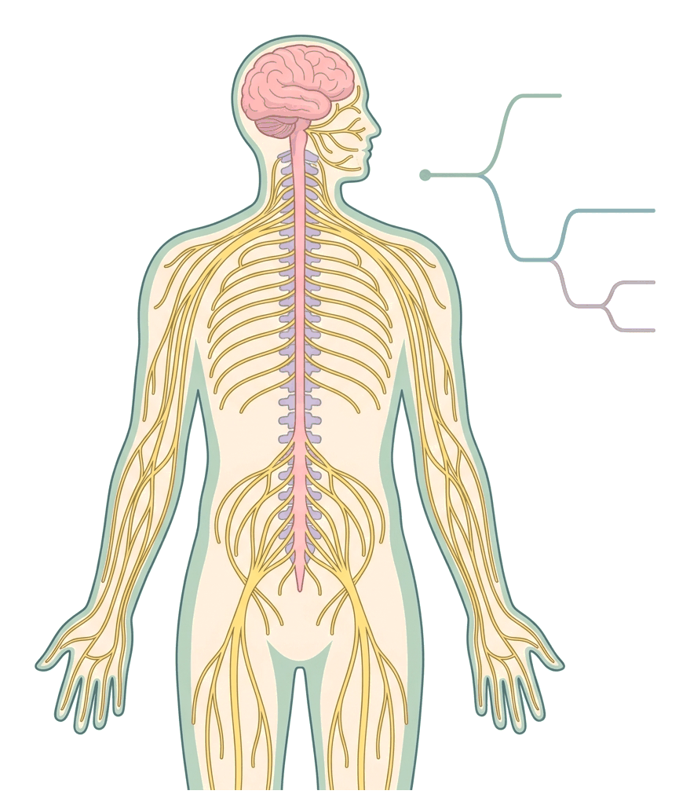

## Nerve cells (neurones)

Before studying the CNS and PNS, you need to know the cell they are made of. A **neurone** (nerve cell) is a cell specialised to **carry nerve impulses**. The human nervous system contains tens of billions of neurones.

### Structure of a neurone

A typical neurone (a **motor neurone** is usually drawn) has:

| Part | Structure | Function |
| --- | --- | --- |
| **Cell body (cyton or soma)** | Contains the **nucleus**, cytoplasm and many ribosomes (seen as dark **Nissl granules**) | Controls the cell; makes proteins and neurotransmitters; keeps the neurone alive |
| **Dendrites** (and dendrons) | Short, branched threads extending from the cell body. (A dendron is a larger process that divides into dendrites) | **Receive** impulses from other neurones or receptors and carry them **towards** the cell body |
| **Axon** | A single, long, thin fibre (in some neurones over a metre long, e.g. from the spinal cord to the toes) | Carries impulses **away from** the cell body |
| **Myelin sheath** | A fatty, white insulating layer wrapped around the axon, formed by **Schwann cells** in the PNS | **Insulates** the axon and greatly **speeds up** the impulse |
| **Nodes of Ranvier** | Small gaps in the myelin sheath, at regular intervals | The impulse "jumps" from node to node, which makes it faster |
| **Schwann cells** | Cells wrapped around the axon, with their own nuclei | Make the myelin sheath; help repair damaged nerve fibres in the PNS |
| **Axon terminals (nerve endings)** | Fine branches at the end of the axon, ending in swellings called **synaptic knobs** (end bulbs) | Pass the impulse to the next neurone, a muscle or a gland, by releasing a neurotransmitter |

**Key fact:** impulses travel in **one direction** through a neurone: **dendrites → cell body → axon → axon terminals**.

**Speed of impulses:** impulses travel much faster along **myelinated** axons (up to about 100 m/s or more in large ones) than along **non-myelinated** axons (often only about 0.5–2 m/s). This is because in myelinated axons the impulse jumps from node to node (**saltatory conduction**). The disease **multiple sclerosis** damages myelin and slows or blocks impulses.

**Textbook variation:** some textbooks use "dendron" for the long fibre that carries impulses towards the cell body in a sensory neurone; others call it a dendrite or an axon. Figures for the speed of impulses also vary between books.

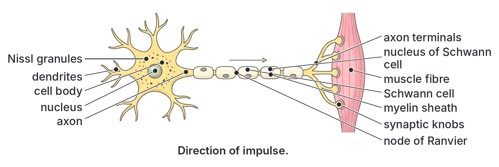

### Types of neurones

There are three types of neurones, according to their function:

#### 1. Sensory neurones (afferent neurones)

- Carry impulses **from receptors** (sense organs or sensory nerve endings) **to the CNS**.
- The cell body lies **outside** the spinal cord, in a swelling on the **dorsal root** of the spinal nerve, called the **dorsal root ganglion**. It sits on a short side branch, part-way along the fibre.
- They have a long fibre (dendron) from the receptor to the cell body, and a shorter axon from the cell body into the spinal cord.

#### 2. Relay neurones (intermediate, association or interneurones)

- Found **only inside the CNS** (brain and spinal cord).
- Carry impulses **from sensory neurones to motor neurones**, and to and from the brain.
- They are short, with many branches, and usually have no myelin sheath.
- They make up the great majority of neurones in the brain.

#### 3. Motor neurones (efferent neurones)

- Carry impulses **from the CNS to effectors** (muscles and glands).
- The cell body lies **inside the CNS** (in the grey matter of the spinal cord or brain), with many dendrites, and a long axon running out to the effector.
- Where a motor neurone meets a muscle fibre, the junction is called a **neuromuscular junction** (motor end plate).

#### The three types compared

| Feature | Sensory neurone | Relay neurone | Motor neurone |
| --- | --- | --- | --- |
| Other names | Afferent neurone | Intermediate, association neurone, interneurone | Efferent neurone |
| Direction of impulse | Receptor → CNS | Sensory neurone → motor neurone (within the CNS) | CNS → effector |
| Position of cell body | Outside the CNS, in the dorsal root ganglion | Inside the CNS | Inside the CNS (grey matter) |
| Position of cell body along the fibre | To one side, on a short branch | Central | At one end (start of the axon) |
| Length | Long | Short | Long |
| Myelin sheath | Usually present | Usually absent | Usually present |
| Connected to | Receptors at one end | Other neurones only | Muscles or glands at one end |

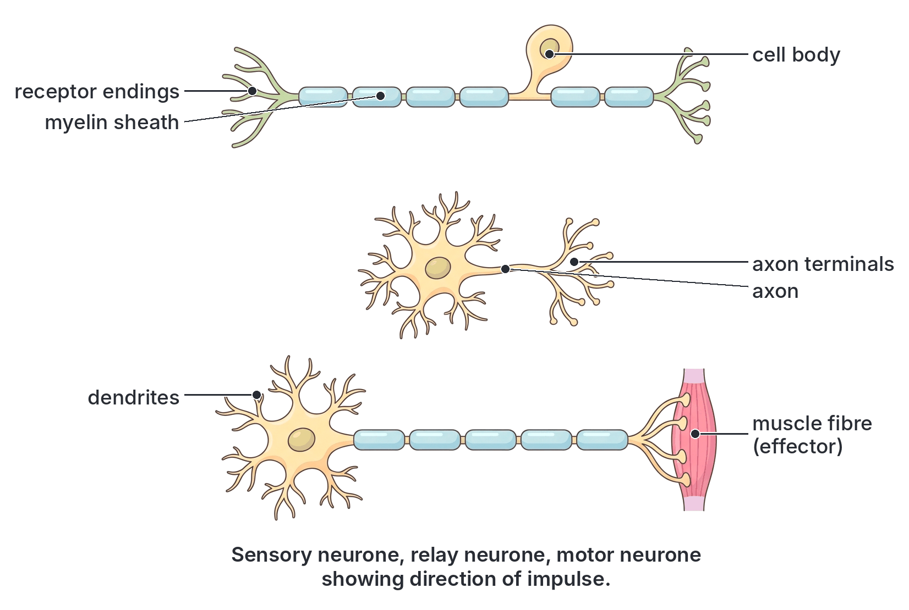

### Neurones and nerves

A **nerve** is **not** the same as a neurone. A **nerve** is a **bundle of many nerve fibres** (axons and dendrons of many neurones), held together and wrapped in connective tissue, like many wires inside one electric cable. Nerves are of three kinds:

- **Sensory nerves:** contain only sensory fibres (e.g. the **optic nerve** from the eye).
- **Motor nerves:** contain only motor fibres (e.g. the oculomotor nerve to some eye muscles).
- **Mixed nerves:** contain both sensory and motor fibres. **All spinal nerves** are mixed nerves.

### Grey matter and white matter

- **Grey matter** is made mainly of **cell bodies** of neurones, dendrites and relay neurones (without myelin), so it looks grey.
- **White matter** is made mainly of **myelinated axons** (nerve fibres), which look white because of the fatty myelin.

| Feature | Grey matter | White matter |
| --- | --- | --- |
| Made mainly of | Cell bodies, dendrites, relay neurones and synapses | Myelinated nerve fibres (axons) |
| Colour | Grey | White (because of myelin) |
| Function | Processing and co-ordination of information; synapses | Conducting impulses between different parts of the CNS |
| Position in the cerebrum | Outside (the cerebral cortex) | Inside |
| Position in the spinal cord | Inside (H- or butterfly-shaped) | Outside |

## The central nervous system (CNS)

**Objective i: apply the knowledge of the structure and function of the central nervous system in the coordination of body functions in organisms.**

The CNS is made up of the **brain** and the **spinal cord**. Its functions are to:

1. **Receive** impulses from receptors all over the body (through sensory neurones).
2. **Interpret** (make sense of) this information, compare it with stored memories and **decide** on a response.
3. **Send** impulses to effectors (muscles and glands) through motor neurones, to bring about the response.
4. **Store** information as memory, and carry out thought, learning and reasoning (in the brain).
5. **Co-ordinate** the activities of all body organs so that they work together.

### Protection of the CNS

The CNS is very delicate, and damaged neurones in the CNS usually cannot be replaced. It is protected by:

1. **Bone:** the brain is enclosed in the **cranium** (the brain box of the skull); the spinal cord runs through the **neural canal** of the **vertebral column** (backbone).
2. **The meninges:** three membranes that surround the brain and spinal cord:
   - **Dura mater:** the tough, thick **outer** membrane, lining the inside of the skull and vertebral canal.
   - **Arachnoid mater:** the thin, delicate, web-like **middle** membrane.
   - **Pia mater:** the very thin **inner** membrane, closely covering the surface of the brain and spinal cord and carrying many blood vessels that supply them.
3. **Cerebrospinal fluid (CSF):** a clear, watery fluid found in the space between the arachnoid and pia mater (the **subarachnoid space**), in the cavities (**ventricles**) inside the brain and in the **central canal** of the spinal cord. CSF:
   - acts as a **shock absorber** (cushion), protecting the brain from blows and jolts;
   - helps **support** the brain (the brain "floats" in it, which reduces its effective weight);
   - carries **nutrients** and oxygen to, and removes some **wastes** from, the nervous tissue;
   - helps keep the environment of the brain stable.

**Meningitis** is inflammation of the meninges, usually caused by bacteria or viruses. Bacterial (cerebrospinal) meningitis causes fever, severe headache, a stiff neck and sometimes death or deafness. Northern Nigeria is part of the African "**meningitis belt**", where epidemics occur in the hot, dry season. Doctors diagnose it by testing a sample of CSF taken from the lower back (a lumbar puncture). Vaccination helps prevent it.

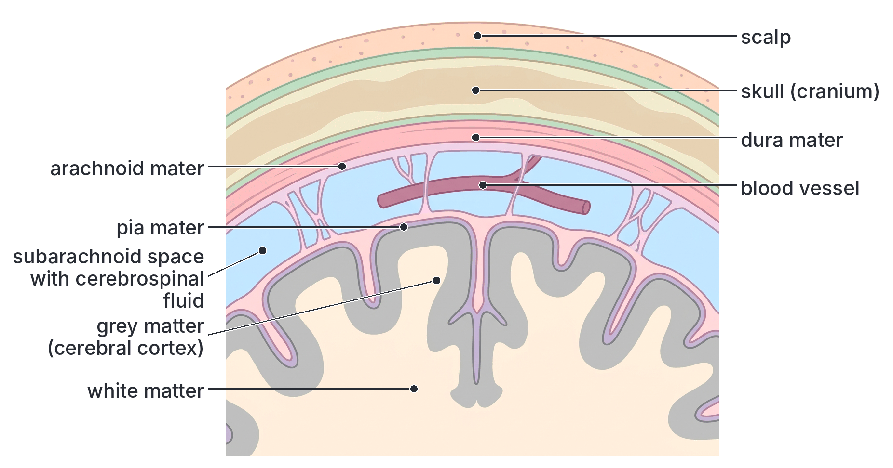

### The brain

The human brain weighs about **1.3–1.4 kg** in an adult. It is divided into three main regions: the **forebrain**, the **midbrain** and the **hindbrain**.

| Region | Main parts |
| --- | --- |
| **Forebrain** | Cerebrum (two cerebral hemispheres), thalamus, hypothalamus (with the pituitary gland attached below it) |
| **Midbrain** | A short region connecting the forebrain and hindbrain |
| **Hindbrain** | Cerebellum, pons, medulla oblongata |

The midbrain, pons and medulla oblongata together form the **brainstem**, which connects the brain to the spinal cord.

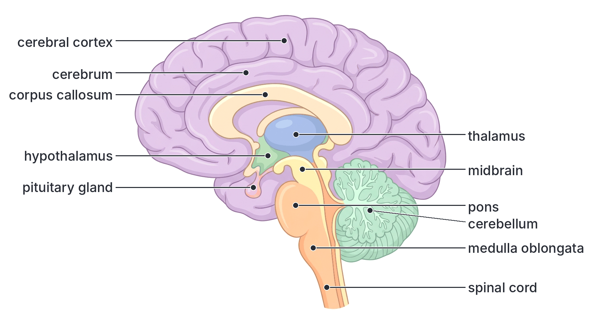

#### The cerebrum

**Structure:**

- The **largest** part of the human brain, making up most of its mass.
- Divided into **two cerebral hemispheres** (left and right), joined by a thick band of nerve fibres called the **corpus callosum**.
- Its outer layer, the **cerebral cortex**, is **grey matter**, and it is deeply **folded** (with ridges and grooves). The folds greatly increase the surface area, allowing more neurones to fit inside the skull. Inside the cortex is white matter.
- Each hemisphere is divided into four **lobes**: **frontal** (front), **parietal** (top), **temporal** (side) and **occipital** (back).

**Functions:** the cerebrum is the centre of **conscious** and **voluntary** activities and **higher mental functions**:

1. **Intelligence, thinking, reasoning, judgement and decision-making.**
2. **Memory and learning.**
3. **Voluntary movements:** sending impulses to skeletal muscles for actions such as walking, writing and talking (from the **motor areas** at the back of the frontal lobe).
4. **Interpreting sensations** (from the **sensory areas**): touch, pain, heat and pressure (parietal lobe); **sight** (occipital lobe); **hearing** (temporal lobe); smell and taste.
5. **Speech and language.**
6. **Emotions, personality and imagination** (with other parts of the brain).

**Crossed control:** the **left** cerebral hemisphere controls the **right** side of the body, and the **right** hemisphere controls the **left** side. This is why a **stroke** (damage to the brain from a blocked or burst blood vessel) on the left side of the brain may paralyse the right side of the body.

| Area (lobe) | Main function |
| --- | --- |
| Frontal lobe | Thinking, planning, reasoning, personality, voluntary movement (motor area), speech production |
| Parietal lobe | Sensations of touch, pain, temperature and pressure from the skin (sensory area) |
| Temporal lobe | Hearing, understanding language, memory |
| Occipital lobe | Sight (vision) |

**Textbook variation:** some school textbooks give simplified lists of functions for each lobe; in reality many abilities (such as memory and language) involve several areas working together.

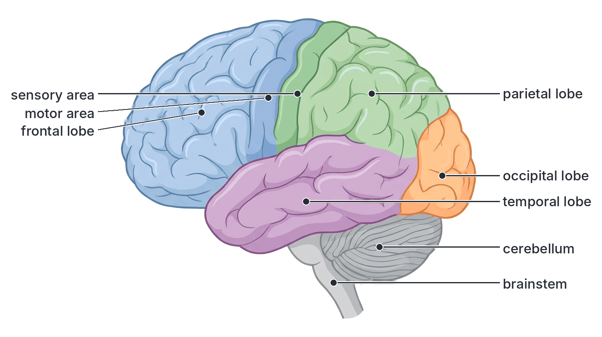

#### The thalamus

**Structure:** two egg-shaped masses of grey matter deep in the centre of the forebrain, below the cerebrum.

**Functions:**

1. Acts as a **relay station**: almost all sensory impulses (except smell) pass through the thalamus, which sorts them and sends them on to the correct sensory area of the cerebral cortex.
2. Involved in **consciousness**, alertness, sleep and the awareness of pain.

#### The hypothalamus

**Structure:** a small region of the forebrain just **below the thalamus**, above the pituitary gland, to which it is connected by a short stalk.

**Functions:** it is the main centre for controlling the body's **internal environment (homeostasis)**:

1. **Body temperature regulation:** it acts as the body's "thermostat", detecting the temperature of the blood and starting sweating, shivering, vasodilation or vasoconstriction (see `B9d-homeostasis.md`).
2. **Water balance (osmoregulation):** it detects the water content of the blood and controls thirst and the release of **antidiuretic hormone (ADH)**.
3. **Hunger and thirst** (appetite and satiety).
4. **Sleep and waking** cycles.
5. **Emotions** such as anger and fear, and sexual behaviour.
6. **Control of the autonomic nervous system**, for example heart rate and blood pressure changes during fear.
7. **Control of the pituitary gland:** it links the nervous system with the endocrine system.

#### The pituitary link

The **pituitary gland** (about the size of a pea) hangs from the hypothalamus by a short stalk. It is often called the "**master gland**" because its hormones control many other endocrine glands, but it is itself controlled by the **hypothalamus**:

- The hypothalamus makes **releasing hormones** that travel in small blood vessels to the **anterior pituitary** and make it release (or stop releasing) its hormones, such as growth hormone, thyroid-stimulating hormone (TSH), FSH and LH.
- The hypothalamus also makes **ADH** and **oxytocin**, which pass down nerve fibres to the **posterior pituitary**, where they are stored and released into the blood.

This **hypothalamus–pituitary link** is where **nervous co-ordination and hormonal co-ordination meet**. The hormones of the pituitary are covered in `B9c-hormonal-control.md`.

#### The midbrain

**Structure:** a short part of the brainstem between the forebrain and the pons.

**Functions:** relays impulses between the forebrain and hindbrain, and contains centres for some **visual and auditory reflexes**, such as turning the head and eyes towards a sudden sound or movement, and adjusting the size of the pupil. In fish, amphibians and birds, the midbrain is large, with big **optic lobes** that process sight.

#### The cerebellum

**Structure:** the second largest part of the brain, at the **back**, below the cerebrum. It has two hemispheres with a finely folded grey outer layer, and white matter inside in a tree-like pattern.

**Functions:**

1. Maintains **balance (equilibrium)** and **posture**, using information from the **ears** (balance organs), eyes, muscles and joints.
2. **Co-ordinates muscular movements**, making them smooth, accurate and well-timed. The cerebrum starts a voluntary movement; the cerebellum fine-tunes it.
3. Controls **skilled movements** that have been learned through practice, such as **riding a bicycle**, **swimming**, dancing, typing and playing football, so that they can be done smoothly without thinking about each step.

**Effects of damage:** a person with a damaged cerebellum moves in a jerky, unsteady way and may stagger and fall. **Alcohol** affects the cerebellum, which is one reason why drunk people stagger and lose balance, and why drink-driving is dangerous.

#### The pons

**Structure:** a rounded swelling on the front of the brainstem, above the medulla oblongata. Its name means "**bridge**".

**Functions:**

1. Acts as a **bridge (relay)** carrying impulses between the cerebrum, cerebellum, medulla and spinal cord, and between the two sides of the cerebellum.
2. Works with the medulla to help **regulate breathing** (the rhythm of breathing).
3. Contains centres for some cranial nerve reflexes, for example parts of the **blinking (corneal) reflex** and chewing.

#### The medulla oblongata

**Structure:** the lowest part of the brain, at the base of the brainstem, continuous with the **spinal cord** below.

**Functions:** controls vital **involuntary (automatic)** activities of the body, which go on without our thinking about them:

1. **Heartbeat** (the cardiac centre controls the rate and strength of the heartbeat).
2. **Breathing** (the respiratory centre controls the rate and depth of breathing, for example making us breathe faster during exercise when the CO₂ level in the blood rises).
3. **Blood pressure** (the vasomotor centre controls the diameter of blood vessels).
4. Reflexes such as **swallowing**, **coughing**, **sneezing**, **vomiting** and **salivation**.
5. Carries (relays) all impulses passing between the spinal cord and the brain.

Because the medulla controls the heartbeat and breathing, **damage to it is usually fatal**. This is why a heavy blow to the base of the skull is so dangerous.

#### Summary of the parts of the brain

| Part | Region | Main functions |
| --- | --- | --- |
| **Cerebrum** | Forebrain | Intelligence, thinking, memory, learning, reasoning, voluntary movement, speech, interpreting sensations (sight, hearing, touch, taste, smell), emotions |
| **Thalamus** | Forebrain | Relays sensory impulses to the cerebral cortex; awareness and consciousness |
| **Hypothalamus** | Forebrain | Controls body temperature, water balance, hunger, thirst, sleep, emotions; controls the pituitary gland and autonomic nervous system |
| **Pituitary gland** | Attached below the hypothalamus | The "master" endocrine gland, controlled by the hypothalamus |
| **Midbrain** | Midbrain | Relay; visual and auditory reflexes |
| **Cerebellum** | Hindbrain | Balance, posture, co-ordination of muscle movements; skilled movements |
| **Pons** | Hindbrain | Relay ("bridge"); helps regulate breathing |
| **Medulla oblongata** | Hindbrain | Controls heartbeat, breathing, blood pressure; swallowing, coughing, sneezing, vomiting reflexes |

### The spinal cord

**Structure:**

- A long, cylindrical cord of nervous tissue, about 45 cm long in an adult, running from the **medulla oblongata** down through the **neural canal** of the vertebral column. In adults it ends at about the level of the first or second lumbar vertebra; below that, a bundle of nerve roots continues down the canal.
- It is protected by the **vertebrae**, the **meninges** and **CSF**.
- In **transverse section**, it shows:
  - a central **H-shaped** (or butterfly-shaped) area of **grey matter** (cell bodies of motor and relay neurones, and synapses), with **dorsal horns** (towards the back) and **ventral horns** (towards the front);
  - an outer region of **white matter** (myelinated nerve fibres running up and down the cord, to and from the brain);
  - a tiny **central canal** in the middle, filled with CSF.
- **31 pairs of spinal nerves** branch off the cord, one pair between each pair of vertebrae. Each spinal nerve joins the cord by two **roots**:
  - a **dorsal root** (at the back), carrying **sensory** fibres **into** the cord; it has a swelling, the **dorsal root ganglion**, containing the cell bodies of sensory neurones;
  - a **ventral root** (at the front), carrying **motor** fibres **out of** the cord.
  The two roots join just outside the cord to form the **mixed** spinal nerve.

**Functions of the spinal cord:**

1. **Conducts impulses** up to the brain (sensory information) and down from the brain to the body (motor instructions) through its white matter. It is the main pathway linking the brain with the body below the neck.
2. Acts as the **centre for spinal reflex actions**, such as the knee jerk and withdrawing the hand from a hot object. These responses are co-ordinated in the grey matter **without** needing the brain, which makes them very fast.
3. Co-ordinates some simple rhythmic activities, such as parts of the walking movement.

**Effects of damage:** if the spinal cord is cut or crushed (for example in a road accident or a fall from a tree or building), impulses cannot pass between the brain and the body below the injury. The person loses feeling and voluntary movement below the injury (**paralysis**): paralysis of both legs (paraplegia) after injury in the lower back, or of all four limbs (quadriplegia) after injury in the neck.

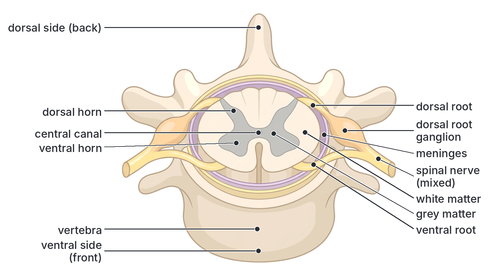

### Applying the structure and functions of the CNS to the co-ordination of body functions

The CNS co-ordinates body functions by **receiving information, processing it and sending out instructions**, so that all parts of the body act together. Here are examples of how the parts work together in everyday life, and what happens when the CNS is damaged.

#### Examples of co-ordination by the CNS

1. **Crossing a busy road in Lagos:** the eyes and ears send impulses to the cerebrum, which recognises the cars and their speed (occipital and temporal lobes), remembers the rules of the road (memory) and decides when it is safe to cross (frontal lobe). It sends impulses to the leg muscles (motor area). The cerebellum keeps you balanced and makes your steps smooth. The medulla speeds up your heartbeat and breathing as you hurry.
2. **Playing football:** the cerebrum decides where to kick the ball, the cerebellum co-ordinates the precise movements of many muscles and keeps balance, and the medulla adjusts breathing and heart rate to supply more oxygen to the working muscles.
3. **Eating a meal:** the cerebrum controls the voluntary act of putting food in the mouth and chewing; the medulla controls the reflexes of salivation and swallowing; the hypothalamus signals when you are full.
4. **On a hot afternoon in Maiduguri:** the hypothalamus detects the rise in blood temperature and starts sweating and the widening of skin blood vessels; it also makes you feel thirsty and causes the release of ADH to save water.
5. **During sleep:** the cerebrum is less active, but the medulla keeps the heart beating and breathing going, and spinal reflexes still work.

#### Effects of damage or drugs on the CNS

| Cause | Part affected | Result |
| --- | --- | --- |
| **Stroke** (blocked or burst blood vessel) | Part of the cerebrum | Paralysis or loss of feeling on the **opposite** side of the body; loss of speech or memory, depending on the area |
| **Head injury** (e.g. motorcycle accident without a helmet) | Cerebrum, cerebellum or brainstem | Unconsciousness, loss of memory, paralysis, loss of balance; death if the medulla is damaged |
| **Spinal cord injury** | Spinal cord | Paralysis and loss of feeling below the level of the injury |
| **Alcohol** | Cerebrum and cerebellum | Slow reactions, poor judgement, loss of balance and staggering; dangerous when driving |
| **Hard drugs and drug abuse** (e.g. cannabis, cocaine, tramadol and codeine misuse) | Various parts of the brain | Changes in mood and behaviour, poor memory and concentration, addiction; some can cause mental illness |
| **Meningitis** | Meninges | Fever, stiff neck, headache; may cause deafness, brain damage or death |
| **Lack of oxygen** for a few minutes | Brain | Brain cells die; brain damage or death |

#### Keeping the nervous system healthy

- Wear **helmets** on motorcycles (okada) and bicycles, and **seat belts** in vehicles, to protect the head and spine.
- Avoid **alcohol and drug abuse**, and never drive after drinking.
- Eat a **balanced diet**; the nervous system needs, for example, vitamin B1 (thiamine), whose lack causes beriberi, a disease that damages nerves, and iodine for thyroxine, which is needed for brain development in children.
- Get enough **sleep and rest**.
- Get **vaccinated** against meningitis and other infections where available.

## The peripheral nervous system (PNS)

The **peripheral nervous system** is made up of all the **nerves** and **ganglia** (clusters of nerve cell bodies) **outside the CNS**. It connects the CNS with receptors and effectors in every part of the body.

**Functions of the PNS:**

1. Carries **sensory impulses from receptors to the CNS**.
2. Carries **motor impulses from the CNS to effectors** (muscles and glands).

### Components of the PNS by structure

#### Cranial nerves

- There are **12 pairs** of cranial nerves in humans.
- They arise directly from the **brain** (mostly from the brainstem) and pass through holes in the skull.
- They serve mainly the **head and neck**: the sense organs (eyes, ears, nose, tongue), and the muscles of the face, jaws, eyes and throat. One pair, the **vagus nerves**, runs down into the chest and abdomen to supply the **heart, lungs and gut**.
- Some are **sensory** only (for example the **olfactory** nerve from the nose, the **optic** nerve from the eye and the **auditory** (vestibulocochlear) nerve from the ear); some are mainly **motor** (for example the nerves to the eye muscles); and some are **mixed** (for example the facial and vagus nerves).

#### Spinal nerves

- There are **31 pairs** of spinal nerves in humans, arising from the **spinal cord**: 8 cervical (neck), 12 thoracic (chest), 5 lumbar (lower back), 5 sacral and 1 coccygeal pair.
- **All spinal nerves are mixed nerves**: each contains sensory fibres (entering by the dorsal root) and motor fibres (leaving by the ventral root).
- They serve the **trunk and limbs**.

| Feature | Cranial nerves | Spinal nerves |
| --- | --- | --- |
| Number of pairs (human) | 12 | 31 |
| Arise from | The brain | The spinal cord |
| Pass out through | Openings in the skull | Gaps between vertebrae |
| Type | Sensory, motor or mixed | All mixed |
| Main areas served | Head, neck, sense organs; the vagus also serves the heart, lungs and gut | Trunk and limbs |

### Components of the PNS by function

#### The somatic nervous system

- Controls **voluntary** actions: contraction of **skeletal (striated) muscles**, such as those of the arms, legs and face.
- Also carries sensory impulses from the **skin, sense organs, muscles and joints** to the CNS.
- One motor neurone runs directly from the CNS to the muscle.
- It also carries out **spinal reflexes** involving skeletal muscles (such as the knee jerk), even though these are involuntary.

#### The autonomic nervous system

- Controls **involuntary** actions of the internal organs: **smooth muscle** (in the gut, blood vessels, bladder, iris and bronchioles), **cardiac muscle** (heart) and **glands** (sweat, salivary and digestive glands, and the adrenal medulla).
- Works automatically, without conscious control. It is controlled mainly by the **hypothalamus** and **medulla oblongata**.
- Its motor pathways use **two neurones** in series, which meet at a **ganglion** outside the CNS.
- It has two divisions, the **sympathetic** and **parasympathetic** nervous systems. Most internal organs receive nerves from both, and the two usually have **opposite (antagonistic) effects**, which allows fine control (like the accelerator and brake of a car).

##### The sympathetic nervous system

- Prepares the body for **action and emergencies**: the "**fight or flight**" response, for example when a dog chases you, or before an important exam.
- Its nerves leave the spinal cord in the **thoracic and lumbar** regions.
- Its ganglia form a **chain close to the spinal cord**, so its first neurones are short and the second ones long.
- Its nerve endings mostly release the neurotransmitter **noradrenaline** at the organs. It also makes the **adrenal medulla** release **adrenaline** into the blood, which reinforces its effects.

##### The parasympathetic nervous system

- Controls the body during **rest**: the "**rest and digest**" response. It conserves energy and restores the body after stress.
- Its nerves leave the CNS from the **brain** (in cranial nerves, especially the **vagus**) and the **sacral** (lowest) region of the spinal cord.
- Its ganglia are **close to or inside the organs**, so its first neurones are long and the second ones short.
- Its nerve endings release the neurotransmitter **acetylcholine**.

##### Sympathetic and parasympathetic systems compared

| Feature | Sympathetic nervous system | Parasympathetic nervous system |
| --- | --- | --- |
| General effect | Prepares the body for action ("fight or flight"); uses energy | Calms the body and conserves energy ("rest and digest") |
| Where nerves leave the CNS | Thoracic and lumbar regions of the spinal cord | Brain (cranial nerves, e.g. vagus) and sacral region of the spinal cord |
| Position of ganglia | In a chain close to the spinal cord | Near or inside the target organs |
| Neurotransmitter at the organ | Mainly noradrenaline | Acetylcholine |
| Heartbeat | Faster and stronger | Slower |
| Blood pressure | Raised | Lowered |
| Pupils of the eye | Dilated (widened) | Constricted (narrowed) |
| Bronchioles | Dilated (more air to the lungs) | Constricted |
| Breathing rate | Increased | Decreased |
| Salivation | Reduced (thick saliva; dry mouth) | Increased (watery saliva) |
| Digestion (peristalsis and digestive juices) | Slowed down (inhibited) | Speeded up (stimulated) |
| Blood vessels to skeletal muscles | Dilated (more blood to muscles) | Little effect |
| Blood vessels to the gut and skin | Constricted | Dilated (to the gut) |
| Liver | Converts glycogen to glucose (more sugar in the blood) | Promotes storage of glycogen |
| Urinary bladder | Relaxed (urination inhibited) | Contracted (urination promoted) |
| Sweating | Increased | No main effect |
| Adrenal medulla | Stimulated to release adrenaline | No effect |

**Example:** if a snake suddenly appears on a farm path, your sympathetic system makes your heart race, your pupils widen, your breathing quicken and your mouth go dry, and sends blood and glucose to your muscles, so that you can run. When the danger is over, your parasympathetic system slows your heart and breathing back to normal and restarts digestion.

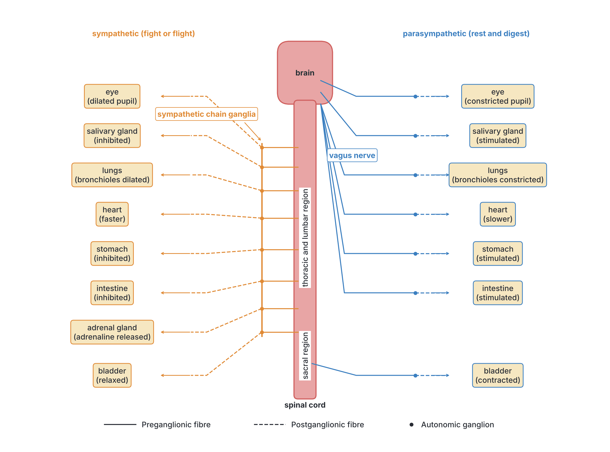

#### Somatic and autonomic nervous systems compared

| Feature | Somatic nervous system | Autonomic nervous system |
| --- | --- | --- |
| Control | Mainly voluntary (conscious) | Involuntary (automatic) |
| Effectors | Skeletal (striated) muscles | Smooth muscle, cardiac muscle and glands |
| Number of motor neurones from CNS to effector | One | Two, with a ganglion between them |
| Divisions | None | Sympathetic and parasympathetic |
| Examples | Walking, writing, kicking a ball; knee jerk reflex | Heartbeat, peristalsis, sweating, pupil size, secretion of digestive juices |

## Transmission of nerve impulses

A **nerve impulse** is a wave of **electrical change** that travels along a neurone. It is not an electric current like that in a wire; it is caused by the movement of charged particles (**ions**), mainly **sodium ions (Na⁺)** and **potassium ions (K⁺)**, across the cell membrane of the neurone.

### 1. The resting potential (a neurone at rest)

When a neurone is not carrying an impulse, it is said to be **at rest**, but it is not inactive:

1. The membrane contains **sodium–potassium pumps**, which use energy from ATP (from respiration) to **pump sodium ions out** of the neurone and **potassium ions in** (three sodium ions out for every two potassium ions in).
2. The membrane at rest also lets some potassium ions **leak back out** more easily than sodium ions can leak in.
3. As a result, there are more positive ions outside than inside. The **inside of the neurone is negative** compared with the outside.
4. This difference in charge across the membrane, about **−70 millivolts** (mV) inside, is called the **resting potential**. The membrane is said to be **polarised**.

### 2. The action potential (the impulse)

When a neurone is **stimulated** strongly enough (the stimulus reaches the **threshold**):

1. **Depolarisation:** **sodium channels** in the membrane open, and **sodium ions rush into** the neurone. The inside quickly becomes **positive** (to about +30 to +40 mV) compared with the outside. This sudden reversal of charge is the **action potential**.
2. **Repolarisation:** almost immediately, the sodium channels close and **potassium channels open**. **Potassium ions flow out**, so the inside becomes **negative** again.
3. **Recovery (refractory period):** for a very short time (about a millisecond or two) the section of membrane cannot be stimulated again. The sodium–potassium pump restores the original distribution of ions. The refractory period makes sure the impulse travels **only forwards**, not backwards, and limits how frequently impulses can pass.

### 3. Propagation (how the impulse travels along the neurone)

The action potential at one point causes local electrical currents that **depolarise the next part** of the membrane, opening its sodium channels. So the action potential moves along the axon like a **wave**, or like a line of falling dominoes, from one end of the neurone to the other.

- In **myelinated** axons, ions can only cross the membrane at the **nodes of Ranvier**, so the impulse **jumps from node to node** (**saltatory conduction**), which is much faster.
- In **non-myelinated** axons, the impulse travels continuously along the membrane, more slowly.

### The all-or-nothing law

An impulse is either produced **fully** or **not at all**. If a stimulus is below the threshold, no impulse is produced. If it reaches the threshold, a full-sized impulse is produced; a stronger stimulus does **not** make a bigger impulse. Instead, a stronger stimulus causes **more impulses per second** and stimulates **more neurones**, which is how the brain tells a strong stimulus from a weak one.

**Textbook variation:** textbooks give slightly different values for the resting potential (often −60 to −80 mV, usually −70 mV) and the peak of the action potential (about +30 to +40 mV). JAMB does not normally require the numbers; the key ideas are that **the inside is negative at rest** and that **sodium ions entering** causes the impulse.

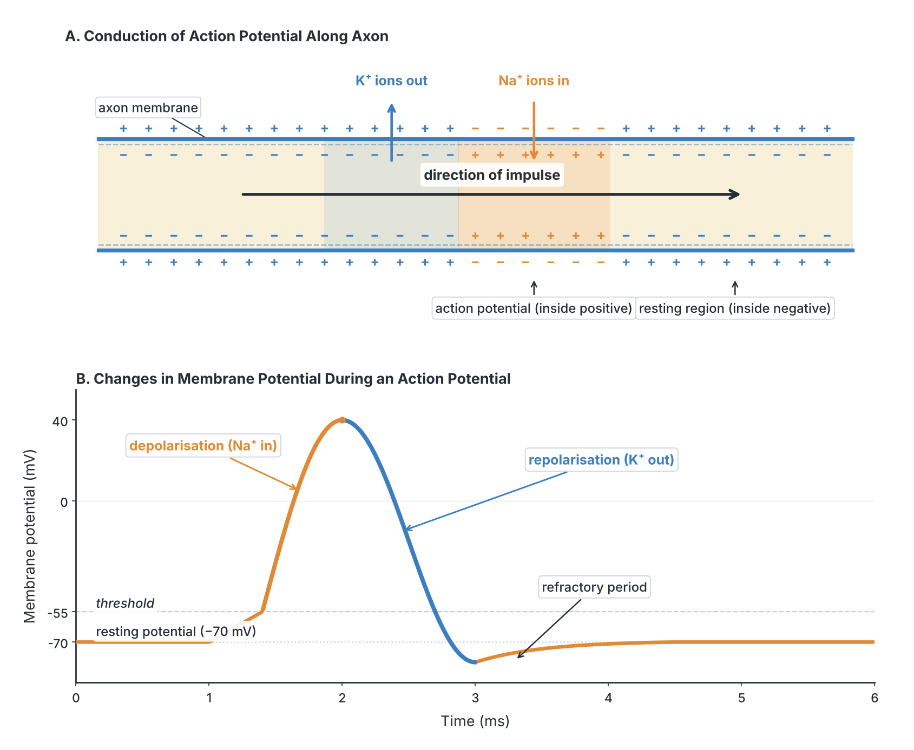

### 4. Transmission across a synapse

Neurones do not touch each other. The junction between the end of one neurone and the next neurone (or a muscle or gland cell) is called a **synapse**. There is a tiny gap between them, the **synaptic cleft** (about 20 nanometres wide). The electrical impulse cannot jump this gap, so it is carried across by a **chemical** called a **neurotransmitter**.

**Structure of a synapse:**

- **Presynaptic neurone:** its axon ends in a swelling, the **synaptic knob**, containing many **mitochondria** (for energy) and tiny sacs called **synaptic vesicles** filled with neurotransmitter.
- **Synaptic cleft:** the narrow gap.
- **Postsynaptic membrane:** the membrane of the next neurone (or muscle), which has **receptor proteins** that the neurotransmitter fits into.

**The main neurotransmitters** are **acetylcholine** (at many synapses and at neuromuscular junctions) and **noradrenaline** (in parts of the sympathetic system and the brain). Others include dopamine and serotonin in the brain.

#### Steps in synaptic transmission

1. An **impulse arrives** at the synaptic knob of the presynaptic neurone.
2. This causes **calcium ions (Ca²⁺)** to enter the synaptic knob.
3. The calcium ions make the **synaptic vesicles move to the presynaptic membrane** and **fuse** with it.
4. The vesicles **release the neurotransmitter** (for example acetylcholine) into the **synaptic cleft**.
5. The neurotransmitter **diffuses across the cleft**.
6. It **binds to receptors** on the **postsynaptic membrane**.
7. This causes **sodium channels** in the postsynaptic membrane to **open**; sodium ions enter, and if enough neurotransmitter arrives, a **new impulse** (action potential) starts in the next neurone (or the muscle contracts).
8. The neurotransmitter is quickly **broken down by an enzyme** in the cleft (acetylcholine is broken down by **acetylcholinesterase** (cholinesterase)) or taken back up into the synaptic knob. This stops the signal, so the next neurone is not stimulated continuously and is ready for the next impulse.
9. The breakdown products are taken back into the synaptic knob and **recycled** to make more neurotransmitter, using energy from the mitochondria.

#### Importance of synapses

1. **One-way transmission:** impulses can cross a synapse in **one direction only**, because only the presynaptic side has vesicles of neurotransmitter and only the postsynaptic side has receptors. This keeps impulses flowing in the right direction through the nervous system.
2. **Connecting neurones:** one neurone can pass impulses to many others, and receive impulses from many others, allowing information to be spread out and combined. This is the basis of decision-making, learning and memory in the brain.
3. **Filtering:** a weak, single impulse may not release enough neurotransmitter to start a new impulse, so unimportant low-level stimuli are filtered out.
4. **Fatigue protection:** if a synapse is stimulated over and over, it can run out of neurotransmitter for a while, protecting effectors from overstimulation.
5. **Sites of drug action:** many drugs and poisons act at synapses. For example, **nicotine** mimics acetylcholine; some insecticides (**organophosphates**) and nerve gases block **acetylcholinesterase**, so acetylcholine builds up and muscles are over-stimulated, leading to twitching, paralysis and death; some painkillers and hard drugs change the release or uptake of neurotransmitters in the brain.

**Synaptic delay:** crossing a synapse takes a short time (around half a millisecond), because the neurotransmitter must be released, diffuse and bind. So the fewer synapses in a pathway, the faster the response.

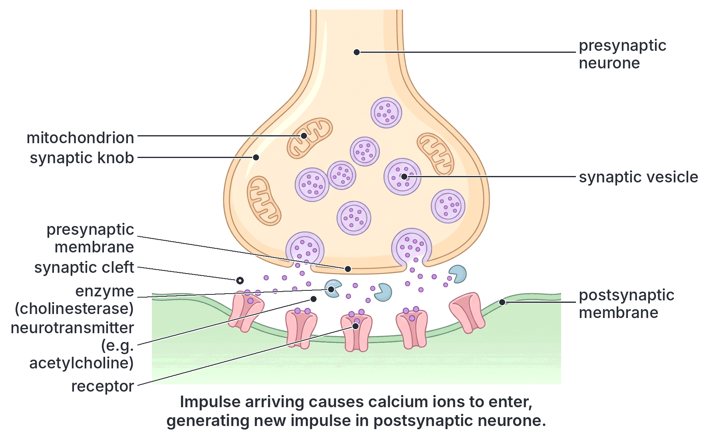

## Reflex action

### What is a reflex action?

A **reflex action** is a **rapid, automatic, involuntary response** to a particular stimulus, which happens **without conscious thought** (without the will of the person). The same stimulus always produces the same response.

**Features of reflex actions:**

1. **Rapid:** they happen very quickly, often in a fraction of a second.
2. **Automatic and involuntary:** they happen without our deciding to do them; we usually cannot stop them.
3. **Inborn (innate):** we are born with them; they do not need to be learned.
4. **Stereotyped:** the same stimulus always gives the same response.
5. **Protective:** most reflexes protect the body from harm (for example, removing the hand from a flame, blinking when dust comes towards the eye, coughing when food goes "the wrong way"), or keep body processes running smoothly (for example swallowing, salivation and pupil size).
6. **Not controlled by the cerebrum:** the response is co-ordinated by the **spinal cord** (spinal reflexes) or the lower parts of the **brain** (cranial reflexes). The cerebrum may be informed afterwards (we feel the pain after we have already moved), but it is not needed for the response.

**Spinal reflexes** are co-ordinated in the spinal cord (for example the knee jerk and withdrawal from a hot object). **Cranial (brain) reflexes** are co-ordinated in the brain, usually in the brainstem (for example blinking, the pupil reflex, coughing, sneezing, swallowing and salivation when food is in the mouth).

### The reflex arc

The pathway taken by the impulses in a reflex action is called a **reflex arc**. A typical (spinal) reflex arc has five parts:

1. **Receptor:** detects the stimulus and starts an impulse (for example, pain and heat receptors in the skin).
2. **Sensory neurone:** carries the impulse from the receptor to the spinal cord, entering through the **dorsal root**. Its cell body is in the **dorsal root ganglion**.
3. **Relay neurone** (in the **grey matter** of the spinal cord): passes the impulse from the sensory neurone to the motor neurone (and also sends impulses up to the brain).
4. **Motor neurone:** carries the impulse out of the spinal cord through the **ventral root** to the effector.
5. **Effector:** a muscle (or gland) that carries out the response.

**Stimulus → receptor → sensory neurone → relay neurone (in CNS) → motor neurone → effector → response**

The reflex arc is the **shortest** pathway between a receptor and an effector, with very few synapses, which is why reflexes are so fast.

[IMAGE: Classic diagram of a spinal reflex arc for withdrawing the hand from a hot object. On the left, a hand touching a hot pot on a flame, with a receptor in the skin of the fingertip. A sensory neurone (drawn in blue) runs from the receptor up the arm into a transverse section of the spinal cord on the right, entering through the dorsal root with its cell body in the dorsal root ganglion. Inside the H-shaped grey matter, a short relay neurone (green) connects to a motor neurone (red), whose cell body is in the ventral horn; the motor neurone leaves through the ventral root and runs back to the biceps muscle of the upper arm. Show a thin branch of the relay pathway going up the white matter towards the brain (with an arrow labelled "to brain"). Arrows along all neurones show the direction of the impulse. Labels: stimulus (heat), receptor in skin, sensory neurone, dorsal root, dorsal root ganglion, relay neurone, grey matter, white matter, motor neurone, ventral root, effector (biceps muscle), response (arm bends, hand withdrawn), synapse, to brain. Clean flat textbook style, white background.]

### Illustrating reflex actions

**Objective ii: illustrate reflex actions such as blinking of the eyes, knee jerk etc.**

#### 1. The knee jerk reflex

The **knee jerk** (patellar reflex) is a **spinal reflex** that doctors use to test whether the nerves and spinal cord are working properly.

**How to demonstrate it:**

1. A person sits on a high chair or table with one leg crossed loosely over the other, so the lower leg hangs freely and the thigh muscles are relaxed.
2. The tester gives a sharp tap with the edge of the hand (or a small rubber hammer) on the **patellar tendon**, just **below the kneecap**.
3. The lower leg **kicks forward** suddenly. The person cannot stop it.

**What happens (step by step):**

1. **Stimulus:** the tap on the patellar tendon **stretches** the large **extensor muscle** at the front of the thigh (the **quadriceps**).
2. **Receptor:** **stretch receptors** (called muscle spindles) in the quadriceps detect the stretch and start impulses.
3. **Sensory neurone:** carries the impulses to the spinal cord (in the lower back, the lumbar region), entering by the dorsal root.
4. **Synapse in the spinal cord:** in the grey matter, the sensory neurone **synapses directly with a motor neurone**.
5. **Motor neurone:** carries impulses out through the ventral root back to the quadriceps.
6. **Effector and response:** the **quadriceps contracts**, so the lower leg is jerked forward (the knee straightens).

**Special feature:** the knee jerk is the simplest reflex arc in the body. It has **only two neurones** (one sensory and one motor) and **only one synapse**, with **no relay neurone**. It is called a **monosynaptic reflex**. This makes it extremely fast. It helps us to keep our posture and balance by automatically correcting the stretch of leg muscles when we stand or walk.

**Textbook variation:** many school textbooks draw the knee jerk with a relay neurone, as in the general reflex arc. Strictly, the knee jerk has **no relay neurone** (it is monosynaptic), whereas the withdrawal reflex does have one. If a JAMB question asks about the general reflex arc, include the relay neurone; if it asks specifically about the knee jerk, remember that it is monosynaptic.

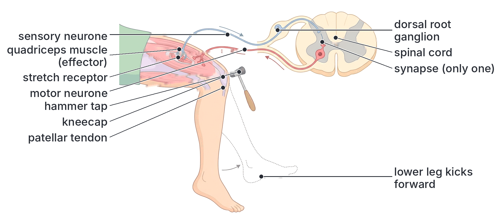

#### 2. Blinking of the eyes

**Blinking** is a **cranial reflex**: it is co-ordinated by the **brain** (in the brainstem), not by the spinal cord. It protects the eye.

**How to demonstrate it:** gently blow a puff of air at a person's eye, or touch the edge of the cornea very lightly with a clean, soft wisp of cotton wool (this is done by doctors; students should only use the puff of air). The eyelids close quickly, and the person cannot stop it.

**What happens (step by step):**

1. **Stimulus:** dust, an insect, a puff of air or a touch reaches the surface of the eye (the **cornea**).
2. **Receptors:** touch and pain receptors (sensory nerve endings) in the **cornea** start impulses.
3. **Sensory neurone:** the impulses travel along a **cranial nerve** (the trigeminal nerve) to the **brainstem** (pons and medulla region).
4. **Relay neurones** in the brainstem pass the impulses to motor neurones.
5. **Motor neurone:** impulses travel along another **cranial nerve** (the facial nerve) to the muscles of the eyelids.
6. **Effector and response:** the ring-shaped **muscles of the eyelids** contract, and the **eyelids close quickly**. Tears are often produced too, which wash away dust.

**Importance:** blinking protects the eye from dust, insects, bright light and injury. We also blink regularly without thinking (spontaneous blinking, roughly every few seconds) to spread tears over the cornea and keep it moist and clean.

**Note:** blinking when an object suddenly **moves towards** the eye (for example, when someone pretends to poke you) involves the eyes seeing the object, so the visual parts of the brain are also involved. It is still involuntary. You can blink **voluntarily** too, for example when you deliberately wink, which is a voluntary action controlled by the cerebrum.

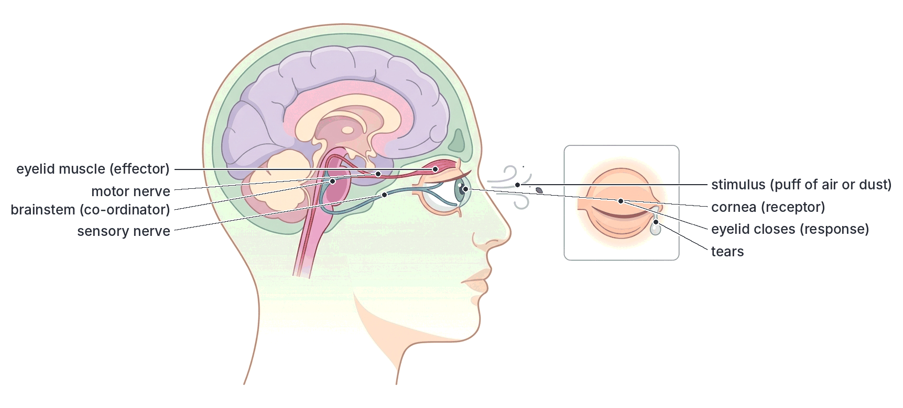

#### 3. Withdrawal of the hand from a hot object

This is a **spinal reflex** with **three neurones** (sensory, relay and motor), so it has two synapses in the spinal cord.

**What happens (step by step):**

1. **Stimulus:** your hand touches a hot pot on the fire or a hot iron.
2. **Receptors:** **heat and pain receptors** in the skin of the fingers start impulses.
3. **Sensory neurone:** carries the impulses up the arm to the **spinal cord** (in the neck region), entering through the dorsal root.
4. **Relay neurone:** in the grey matter, the impulse passes across a synapse to a relay neurone, which passes it across another synapse to a motor neurone.
5. **Motor neurone:** carries impulses out through the ventral root down the arm.
6. **Effector:** the **biceps** (flexor muscle) of the upper arm contracts, and at the same time the triceps relaxes.
7. **Response:** the arm bends at the elbow and the **hand is pulled away** from the heat, in a fraction of a second.
8. **Afterwards:** the relay neurone also sends impulses **up the spinal cord to the brain**, so a moment later you **feel the pain** and become aware of what happened. By then, the hand has already moved. The brain may then make you blow on or cool your fingers, which are voluntary actions.

The same type of reflex makes you pull your foot away if you step on a sharp object such as a thorn or a nail.

#### Other examples of reflex actions

| Reflex | Stimulus | Response | Centre |
| --- | --- | --- | --- |
| Pupil reflex | Bright light shining into the eye | Pupil becomes smaller (constricts) | Brain (midbrain) |
| Coughing | Food, dust or mucus in the windpipe | Forceful blast of air from the lungs | Brain (medulla) |
| Sneezing | Irritation inside the nose (dust, pepper) | Forceful blast of air through the nose | Brain (medulla) |
| Swallowing | Food at the back of the mouth | Food pushed into the oesophagus; epiglottis closes the windpipe | Brain (medulla) |
| Salivation (simple reflex) | Food in the mouth | Saliva flows | Brain (medulla) |
| Breathing faster | More CO₂ in the blood | Faster, deeper breathing | Brain (medulla) |
| Withdrawal | Pain (heat, thorn, pinch) | Limb pulled away | Spinal cord |
| Knee jerk | Tap below the kneecap | Lower leg kicks forward | Spinal cord |
| Grasp reflex (newborn babies) | Object pressed into the palm | Fingers close tightly around it | Spinal cord and brain |

## Reflex actions, voluntary actions and conditioned reflexes

**Objective iii: differentiate between reflex and voluntary actions as well as conditioned reflexes such as salivation, riding a bicycle and swimming.**

### Voluntary actions

A **voluntary action** is an action that is **consciously controlled**: we **decide** to do it, and we can choose when and how to do it or whether to do it at all. Voluntary actions are controlled by the **cerebrum**.

**Examples:** writing, walking to school, picking up a cup, talking, dancing, kicking a ball, deliberately winking, choosing what to eat.

**The pathway of a voluntary action:**

1. A receptor (for example the eye) detects a stimulus (for example, a cup of water on the table) and sends impulses along a sensory neurone to the brain.
2. The **cerebrum** interprets the information, compares it with memories, and **decides** whether and how to act (you are thirsty, so you decide to drink).
3. Impulses pass from the motor area of the cerebrum down through the brain and spinal cord to motor neurones.
4. Motor neurones carry the impulses to the effectors (arm and hand muscles), and you pick up the cup.
5. The cerebellum co-ordinates the movement so that it is smooth and accurate.

Because the impulse passes through the brain and through many synapses, and a decision is made, a voluntary action is **slower** than a reflex action.

### Reflex and voluntary actions compared

| Feature | Reflex action | Voluntary action |
| --- | --- | --- |
| Conscious control | **Involuntary**: no conscious thought or decision | **Voluntary**: under conscious control; a decision is made |
| Co-ordinating centre | Spinal cord or lower brain (brainstem); not the cerebrum | **Cerebrum** (of the brain) |
| Speed | Very **fast** | **Slower** |
| Pathway | Short reflex arc with few synapses | Longer pathway through the brain, with many synapses |
| Learning | Inborn (innate); not learned | Often learned; can be changed by experience |
| Response to the same stimulus | Always the same (stereotyped) | Can vary; the person can choose different responses |
| Can it be stopped? | Usually not | Yes, it can be started, changed or stopped at will |
| Function | Mainly protective and to keep the body running smoothly | To carry out purposeful activities |
| Examples | Knee jerk, blinking, withdrawal from heat, sneezing, coughing | Writing, walking, eating, talking, dancing |

### Conditioned reflexes

A **conditioned reflex** is a reflex-like (automatic) response that is **learned** through **experience**, when an animal or person learns to link a **new stimulus** with the stimulus that normally causes a natural reflex. After learning, the **new stimulus alone** produces the response.

A natural (inborn) reflex is called an **unconditioned (simple) reflex**. A conditioned reflex is built on top of it by **association** and **repetition**.

#### Pavlov's experiment: salivation in dogs

The idea of conditioned reflexes was studied by the Russian scientist **Ivan Pavlov** in the late nineteenth and early twentieth centuries, using dogs.

1. **Before conditioning:** when food (meat powder) was placed in a dog's mouth or shown to it, the dog **salivated**. This is a natural, **unconditioned reflex**. The food is the **unconditioned stimulus**. Ringing a **bell** alone produced **no salivation**; the bell was a **neutral stimulus**.
2. **During conditioning:** Pavlov **rang a bell** (or sounded another signal) **just before** giving the dog food, and repeated this **many times** over several days. The dog salivated each time the food came.
3. **After conditioning:** Pavlov rang the bell **without giving any food**. The dog **still salivated**. The dog had learned to **associate** the sound of the bell with food. The bell had become a **conditioned stimulus**, and salivating at the sound of the bell was a **conditioned reflex**.
4. **Extinction:** if the bell was rung many times without food ever following, the dog gradually **stopped** salivating to the bell. A conditioned reflex fades if it is not **reinforced**.

**Textbook variation:** most textbooks say Pavlov used a **bell**. His published work describes a variety of signals, including a metronome, buzzers and other sounds, as well as lights. The principle is the same whichever signal was used.

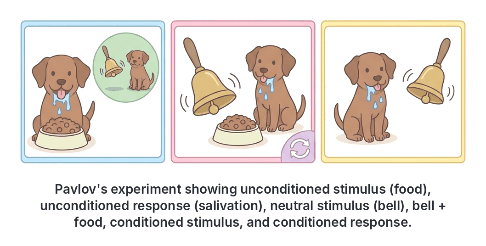

#### Salivation in humans as a conditioned reflex

- Saliva flowing when food is actually **in the mouth** is a **simple (unconditioned) reflex**.
- Saliva flowing at the **sight**, **smell**, or even the **mention** or **thought** of a favourite food, such as **suya**, **jollof rice**, **pepper soup** or **akara**, is a **conditioned reflex**. We have learned, from past experience of eating these foods, to link their sight, smell and name with the taste of food.
- Similarly, a child may salivate on hearing the sound of plates being set out at mealtime, or when a food seller's familiar call is heard on the street.

#### Riding a bicycle and swimming

When a person first learns to **ride a bicycle** or to **swim**, every action is **voluntary** and slow: the learner thinks about each movement (pedalling, steering, balancing; moving the arms and legs, breathing at the right time) and often makes mistakes. With **practice and repetition**, the cerebrum and especially the **cerebellum** store the pattern of movements. Eventually the movements become **automatic**: an experienced cyclist balances and pedals without thinking about it and can talk or look around at the same time, and an experienced swimmer co-ordinates arm strokes, kicks and breathing without conscious effort. If a cyclist starts to fall, the body corrects its balance automatically before the person has time to think.

Other examples of the same kind: **typing**, **driving**, **playing a musical instrument**, **dancing**, **writing**, **dribbling a football**, and carrying a load on the head while walking.

**Textbook variation:** the JAMB syllabus and many Nigerian textbooks call riding a bicycle and swimming **conditioned reflexes**, because they are learned through repetition and then become automatic. However, in strict biological and psychological terms, a **conditioned reflex** (as in Pavlov's dogs) is a response to a **new stimulus** learned by **association** with an unconditioned stimulus. Riding a bicycle and swimming are better described as **learned motor skills** or **habits**, which start as voluntary actions and become automatic through practice. Some textbooks therefore call them "**acquired reflexes**" or "learned habits". **For JAMB, accept that riding a bicycle and swimming are examples of conditioned (learned) reflexes**, while understanding that they are different from Pavlov's type of conditioning.

#### Features of conditioned reflexes

1. They are **learned** (acquired) through experience, not inborn.
2. They need **repetition** (training or practice) to develop.
3. They involve the **cerebrum** (and the cerebellum for skills), because learning and memory are needed.
4. Once learned, they are **automatic**, and do not need conscious thought each time.
5. They can be **lost** (extinguished) if not reinforced or practised (although skills such as cycling are usually remembered for a very long time).
6. They differ from person to person, depending on each person's experience (one person may salivate at the smell of suya, another at the smell of *moi moi*).

#### Importance of conditioned reflexes

- They allow animals and humans to **learn from experience** and respond quickly to signals of food or danger.
- They free the cerebrum from having to think about every step of routine actions, so the mind can attend to other things.
- They are used in the **training of animals** (dogs, horses, circus animals) and in **toilet training** and other habit formation in children.
- They form the basis of many **skills** used in daily life and work.

### Reflex, voluntary and conditioned reflex actions compared

| Feature | Simple (unconditioned) reflex | Voluntary action | Conditioned reflex |
| --- | --- | --- | --- |
| Inborn or learned? | Inborn (innate) | Learned or decided at the moment | Learned (acquired) by experience and repetition |
| Conscious control | None (involuntary) | Full conscious control | Not needed once learned (automatic), but it was learned consciously or by association |
| Main co-ordinating centre | Spinal cord or brainstem | Cerebrum | Cerebrum (and cerebellum for skills) |
| Speed | Very fast | Slowest | Fast |
| Need for practice or training | No | No (but skill improves with practice) | Yes |
| Stimulus | A natural stimulus (e.g. heat, food in the mouth) | Any stimulus, or none (a decision) | A learned (conditioned) stimulus, e.g. a bell, the smell of food |
| Can be lost? | No (permanent) | Not applicable | Yes, if not reinforced (extinction) |
| Same in all members of the species? | Yes | No | No (depends on each individual's experience) |
| Examples | Knee jerk, blinking, withdrawal from heat, salivation when food is in the mouth | Writing, walking, talking, eating | Salivation at the sight or smell of food, or at a bell (Pavlov's dogs); riding a bicycle; swimming |

## Key terms

| Term | Meaning |
| --- | --- |
| Co-ordination | The working together of the different parts of an organism in a controlled way |
| Stimulus | A change in the environment that an organism can detect |
| Receptor | A cell or organ that detects a stimulus |
| Effector | A muscle or gland that carries out a response |
| Central nervous system (CNS) | The brain and spinal cord |
| Peripheral nervous system (PNS) | All the nerves and ganglia outside the brain and spinal cord |
| Neurone | A nerve cell, specialised to carry impulses |
| Axon | The long fibre that carries impulses away from the cell body |
| Dendrite | A short, branched fibre that carries impulses towards the cell body |
| Myelin sheath | The fatty insulating layer around an axon that speeds up impulses |
| Node of Ranvier | A gap in the myelin sheath |
| Sensory neurone | Carries impulses from receptors to the CNS |
| Relay neurone | Connects sensory and motor neurones inside the CNS |
| Motor neurone | Carries impulses from the CNS to effectors |
| Nerve | A bundle of nerve fibres wrapped in connective tissue |
| Grey matter | Nervous tissue made mainly of cell bodies |
| White matter | Nervous tissue made mainly of myelinated nerve fibres |
| Meninges | The three protective membranes around the brain and spinal cord |
| Cerebrospinal fluid | The fluid that cushions and nourishes the brain and spinal cord |
| Cerebrum | The largest part of the brain; controls thought, memory and voluntary actions |
| Cerebellum | The part of the brain that controls balance and co-ordinates movement |
| Medulla oblongata | The part of the brain that controls heartbeat, breathing and blood pressure |
| Hypothalamus | The part of the brain that controls temperature, water balance and the pituitary gland |
| Autonomic nervous system | The part of the PNS that controls involuntary actions of internal organs |
| Sympathetic system | The part of the autonomic system that prepares the body for action ("fight or flight") |
| Parasympathetic system | The part of the autonomic system that calms the body ("rest and digest") |
| Resting potential | The charge across a neurone's membrane at rest (inside negative, about −70 mV) |
| Action potential | The brief reversal of charge across the membrane that forms a nerve impulse |
| Synapse | The junction between two neurones |
| Neurotransmitter | A chemical that carries an impulse across a synapse, e.g. acetylcholine |
| Reflex action | A rapid, automatic, involuntary response to a stimulus |
| Reflex arc | The pathway of impulses in a reflex action |
| Monosynaptic reflex | A reflex with only one synapse, e.g. the knee jerk |
| Voluntary action | An action under conscious control of the cerebrum |
| Conditioned reflex | A learned automatic response to a stimulus that has been associated with a natural stimulus |

## Exam tips and common mistakes

- **Neurone vs nerve:** a neurone is one cell; a nerve is a bundle of fibres from many neurones.
- **Direction of impulses:** dendrite → cell body → axon. Sensory neurones carry impulses **to** the CNS; motor neurones carry them **away from** the CNS.
- **Dorsal root = sensory (in); ventral root = motor (out).** The dorsal root ganglion contains cell bodies of **sensory** neurones.
- **Grey and white matter swap places:** in the cerebrum, grey matter is outside; in the spinal cord, grey matter is inside.
- **Cerebellum = balance and co-ordination.** Don't confuse it with the cerebrum (thinking, voluntary actions).
- **Medulla = heartbeat and breathing.** A question about the "centre controlling heartbeat" or "breathing" is about the medulla oblongata.
- **Hypothalamus = temperature and water balance**, and control of the pituitary.
- **Sympathetic speeds up the heart and dilates the pupil; parasympathetic slows the heart and constricts the pupil.** Digestion is the exception: sympathetic **slows** it.
- **All spinal nerves are mixed** (sensory and motor). There are 31 pairs of spinal nerves and 12 pairs of cranial nerves in humans.
- **The impulse is caused by sodium ions entering** the neurone; at rest the inside is negative.
- **Synapses make impulses one-way.** The neurotransmitter is released from the presynaptic side only.
- **Reflexes are co-ordinated by the spinal cord or brainstem, not the cerebrum.** You feel pain only after the reflex has happened.
- **Knee jerk: no relay neurone** (monosynaptic). Withdrawal from heat: has a relay neurone.
- **Blinking is a cranial (brain) reflex,** not a spinal reflex.
- **Salivation can be either:** food in the mouth = simple reflex; the smell, sight or mention of food = conditioned reflex.
- **Conditioned reflexes are learned and can be lost;** simple reflexes are inborn and permanent.

## Quick summary

1. The nervous system has the central nervous system (brain and spinal cord) and the peripheral nervous system (12 pairs of cranial nerves and 31 pairs of spinal nerves), divided into somatic (voluntary) and autonomic (involuntary) parts. The autonomic system has sympathetic ("fight or flight") and parasympathetic ("rest and digest") divisions with opposite effects.
2. Neurones carry impulses from dendrites through the cell body to the axon; myelin speeds them up. Sensory neurones carry impulses to the CNS, relay neurones connect within it, and motor neurones carry impulses to effectors.
3. The brain and spinal cord are protected by bone, the meninges and cerebrospinal fluid. The cerebrum controls thinking, memory, sensation and voluntary actions; the cerebellum controls balance and co-ordination; the medulla controls heartbeat, breathing and blood pressure; the hypothalamus controls temperature, water balance and the pituitary gland; the thalamus relays sensory impulses; the pons relays impulses and helps control breathing.
4. The spinal cord has inner grey matter and outer white matter; it conducts impulses to and from the brain and is the centre for spinal reflexes. Damage to the CNS causes paralysis, loss of function or death.
5. A nerve impulse is a wave of electrical change: at rest the inside of the neurone is negative; when stimulated, sodium ions rush in (action potential), then potassium ions move out. At a synapse, a neurotransmitter such as acetylcholine diffuses across the cleft to start a new impulse, so impulses travel one way.
6. A reflex action is a rapid, automatic, inborn response co-ordinated by the spinal cord or brainstem through a reflex arc (receptor, sensory neurone, relay neurone, motor neurone, effector). Examples: knee jerk (monosynaptic), blinking (cranial reflex), withdrawal from heat.
7. Voluntary actions are consciously controlled by the cerebrum and are slower. Conditioned reflexes are learned by association and repetition, such as salivating at the sight or smell of food (as in Pavlov's dogs), and, according to the syllabus, riding a bicycle and swimming.

## Practice questions

**1. Which part of the brain controls balance and the co-ordination of muscular movements?**

- A. Cerebrum
- B. Medulla oblongata
- C. Cerebellum
- D. Hypothalamus

**Answer: C.** The cerebellum maintains balance and posture and co-ordinates muscle movements so they are smooth and accurate.

**2. The centres that control heartbeat and breathing are located in the**

- A. medulla oblongata
- B. cerebrum
- C. thalamus
- D. cerebellum

**Answer: A.** The medulla oblongata contains the cardiac, respiratory and vasomotor centres, which control vital involuntary activities.

**3. In the spinal cord, the cell bodies of sensory neurones are found in the**

- A. ventral root
- B. dorsal root ganglion
- C. white matter
- D. central canal

**Answer: B.** Sensory neurones enter the spinal cord through the dorsal root, and their cell bodies lie in the dorsal root ganglion.

**4. Which of the following is an effect of the sympathetic nervous system?**

- A. Slowing of the heartbeat
- B. Constriction of the pupils
- C. Increase in peristalsis
- D. Dilation of the bronchioles

**Answer: D.** The sympathetic system prepares the body for action, so it widens the bronchioles to let more air into the lungs. Options A, B and C are parasympathetic effects.

**5. A nerve impulse is started when**

- A. potassium ions rush into the neurone
- B. sodium ions rush into the neurone
- C. calcium ions leave the synaptic knob
- D. the myelin sheath is broken down

**Answer: B.** When a neurone is stimulated, sodium channels open and sodium ions flow in, making the inside positive: this is the action potential.

**6. Nerve impulses pass across a synapse in one direction only because**

- A. only the presynaptic knob releases neurotransmitter
- B. the synaptic cleft is too wide
- C. the postsynaptic neurone has no myelin
- D. the impulse is electrical

**Answer: A.** Vesicles of neurotransmitter are found only in the presynaptic knob, and receptors only on the postsynaptic membrane, so transmission is one-way.

**7. Which of the following is the correct pathway of a spinal reflex arc?**

- A. Receptor → motor neurone → relay neurone → sensory neurone → effector
- B. Effector → sensory neurone → relay neurone → motor neurone → receptor
- C. Receptor → sensory neurone → relay neurone → motor neurone → effector
- D. Receptor → relay neurone → sensory neurone → effector → motor neurone

**Answer: C.** The impulse passes from the receptor through the sensory, relay and motor neurones to the effector.

**8. The knee jerk reflex differs from the withdrawal reflex in that it**

- A. is controlled by the cerebrum
- B. is a voluntary action
- C. involves the brainstem
- D. has no relay neurone

**Answer: D.** The knee jerk is monosynaptic: the sensory neurone synapses directly with the motor neurone. The withdrawal reflex has a relay neurone.

**9. Which of these is an example of a conditioned reflex?**

- A. Blinking when dust enters the eye
- B. Salivating at the smell of suya
- C. Coughing when food enters the windpipe
- D. Withdrawing the hand from a hot iron

**Answer: B.** Salivating at the smell of a food has been learned by associating the smell with eating it. The others are inborn simple reflexes.

**10. Which of the following describes a voluntary action but NOT a reflex action?**

- A. It is controlled by the cerebrum
- B. It is very rapid
- C. It is inborn
- D. It always gives the same response to the same stimulus

**Answer: A.** Voluntary actions are consciously controlled by the cerebrum. Reflex actions are rapid, inborn and stereotyped.
