# JAMB Biology Notes: The Sense Organs

## What JAMB expects

This topic is Section B, Topic 9 of the JAMB Biology syllabus: Form and Functions – Co-ordination and control. The topic is large, so it is split into four files:

- `B9a-nervous-coordination.md`: content item a (nervous coordination: the central and peripheral nervous systems, transmission of impulses and reflex action), objectives i to iii.
- `B9b-sense-organs.md` (this file): content item b (the sense organs), objectives iv and v.
- `B9c-hormonal-control.md`: content item c (hormonal control in animals and plants), objectives vi to viii.
- `B9d-homeostasis.md`: content item d (homeostasis), objective ix.

The syllabus content covered in this file is **b. The sense organs**:

- i. Skin (tactile)
- ii. Nose (olfactory)
- iii. Tongue (taste)
- iv. Eye (sight)
- v. Ear (auditory)

By the end of these notes, you should be able to:

1. Relate each of the listed sense organs (skin, nose, tongue, eye and ear) to its functions (objective iv).
2. Apply your knowledge of the structure and functions of these sense organs to detect and correct their defects (objective v).

**Note on the syllabus wording:** the syllabus calls the ear the organ of "auditory" sense (hearing). The ear also contains the organs of **balance** (the semicircular canals, utriculus and sacculus). JAMB often asks about balance, so it is covered fully here.

## Receptors and sense organs: the basics

To survive, an organism must detect changes in its surroundings and inside its body. A change that an organism can detect is called a **stimulus** (plural: **stimuli**). Light, sound, heat, cold, touch, pressure and chemicals are all stimuli.

A **receptor** is a cell, or a group of cells, that detects a particular stimulus. A **sense organ** is an organ made of many receptor cells together with other tissues that protect them, support them and help them work well. For example, the eye contains light-sensitive receptor cells (rods and cones) in the retina, but it also has a lens to focus the light, an iris to control how much light enters, and eyelids to protect it.

### How a sense organ works

1. A **stimulus** reaches the sense organ (for example, light enters the eye).
2. The **receptor cells** absorb the energy of the stimulus and change it into electrical signals called **nerve impulses**. (Changing one form of energy into another is called **transduction**, so receptors are sometimes called **transducers**.)
3. **Sensory (afferent) neurones** carry the impulses to the **central nervous system** (brain and spinal cord). (See `B9a-nervous-coordination.md` for how impulses travel.)
4. The **brain** interprets the impulses, and we become aware of a **sensation** (we "see", "hear", "smell", "taste" or "feel").
5. If a response is needed, the brain sends impulses along **motor (efferent) neurones** to **effectors** (muscles or glands), which respond.

An important point: the sensation is made in the **brain**, not in the sense organ. The eye does not "see"; it sends impulses, and the visual area of the brain produces the picture. If the optic nerve is cut, the eye can be perfect but the person is blind.

### Types of receptors

Receptors are grouped by the kind of stimulus they detect.

| Type of receptor | Stimulus detected | Examples |
| --- | --- | --- |
| **Photoreceptors** | Light | Rods and cones in the retina of the eye |
| **Mechanoreceptors** | Touch, pressure, vibration, sound, movement and gravity | Touch and pressure receptors in the skin; hair cells in the cochlea, semicircular canals, utriculus and sacculus |
| **Chemoreceptors** | Chemicals | Olfactory cells in the nose; taste cells in the tongue |
| **Thermoreceptors** | Heat and cold (temperature change) | Heat and cold receptors in the skin; temperature receptors in the hypothalamus |
| **Pain receptors (nociceptors)** | Damage, or stimuli strong enough to cause damage | Free nerve endings in the skin and internal organs |

### Some general features of receptors

- **Specificity:** each type of receptor responds best to one kind of stimulus. Light does not make the ear hear, and sound does not make the eye see.
- **Threshold:** a stimulus must be strong enough (reach a minimum level, the threshold) before receptors send impulses. A very faint sound may not be heard at all.
- **Sensory adaptation:** if a stimulus continues without changing, many receptors gradually send fewer impulses, so we stop noticing it. This is why you stop feeling your clothes or your wristwatch soon after putting them on, and why a smell that was strong when you entered a room (for example, a kitchen where *ogbono* soup is cooking, or a poultry house) seems to fade after a few minutes.
- **Sensitivity depends on number:** the more receptors in an area, the more sensitive it is. The fingertips have far more touch receptors than the back.

## Relating the sense organs to their functions

**Objective iv: relate the listed sense organs with their functions.**

The table below gives an overview. Each organ is then explained in detail.

| Sense organ | Sense | Stimulus | Receptors | Nerve to the brain |
| --- | --- | --- | --- | --- |
| **Skin** | Touch (tactile), pressure, heat, cold, pain | Mechanical contact, temperature change, damage | Meissner's corpuscles, Pacinian corpuscles, Merkel discs, Ruffini endings, Krause end bulbs, free nerve endings | Spinal nerves (and cranial nerves for the face), through the spinal cord to the brain |
| **Nose** | Smell (olfaction) | Chemicals in the air, dissolved in the mucus | Olfactory receptor cells | Olfactory nerve (cranial nerve I) |
| **Tongue** | Taste (gustation) | Chemicals in food, dissolved in saliva | Taste (gustatory) cells in taste buds | Facial (VII) and glossopharyngeal (IX) cranial nerves (the vagus, X, carries a little taste from the throat) |
| **Eye** | Sight (vision) | Light | Rods and cones in the retina | Optic nerve (cranial nerve II) |
| **Ear** | Hearing (auditory) and balance | Sound vibrations; movement and position of the head | Hair cells in the cochlea (hearing), semicircular canals, utriculus and sacculus (balance) | Auditory nerve (vestibulocochlear nerve, cranial nerve VIII) |

**Textbook variation:** some textbooks call the nerve from the ear the "auditory nerve" and others the "vestibulocochlear nerve" or "acoustic nerve". They are the same nerve: its **cochlear branch** carries hearing and its **vestibular branch** carries balance.

## The skin as a sense organ (tactile sense)

The skin covers the whole body and is the **largest organ** of the body. It has several jobs: protection, temperature control, excretion of sweat, making vitamin D in sunlight and storing fat. (Its role in temperature control is covered in `B9d-homeostasis.md`, and its role in excretion in Topic B5.) Here we look at the skin as a **sense organ**. Because it detects touch, the skin's sense is called the **tactile sense** (from the Latin word for "touch").

### Structure of the skin related to sensation

The skin has two main layers, with a fatty layer beneath:

1. **Epidermis:** the thin outer layer.
   - The **cornified layer** (stratum corneum) on the surface is made of dead, flattened cells full of the tough protein **keratin**. It protects the living cells below and is thickest on the palms and soles.
   - The **granular layer** lies below it.
   - The **Malpighian (germinative) layer** at the base is made of living cells that keep dividing to replace the cells lost from the surface. It contains the pigment **melanin**, which gives the skin its colour and protects against ultraviolet light.
   - **Merkel discs** and some **free nerve endings** reach into the lower epidermis.
2. **Dermis:** the thicker inner layer, made of connective tissue. It contains blood capillaries, sweat glands, hair follicles, sebaceous (oil) glands, hair erector muscles and **most of the sense receptors** and nerve fibres.
3. **Subcutaneous fat layer (hypodermis):** below the dermis; stores fat and insulates the body. The large **Pacinian corpuscles** lie deep in the dermis and in this layer.

### Receptors in the skin and what they detect

The skin does not have one big receptor. Instead, it contains millions of tiny receptors of several kinds, scattered through it.

| Receptor | Where found | Structure | What it detects |
| --- | --- | --- | --- |
| **Free nerve endings** | Epidermis and dermis, all over the body | Bare, branched endings of sensory neurones with no covering | **Pain**; also heat, cold and itch |
| **Meissner's corpuscles** | Just under the epidermis, in the small ridges (papillae) of the dermis; very many in the fingertips, palms, lips and soles | Small, oval capsules with a coiled nerve ending inside | **Light touch** (and slow vibration) |
| **Merkel discs** (Merkel's endings) | Base of the epidermis | Disc-shaped nerve endings against special epidermal cells | **Steady light touch and pressure**; help us feel shape and texture |
| **Pacinian corpuscles** | Deep in the dermis and in the subcutaneous layer | Large, onion-like capsules with many layers wrapped around one nerve ending | **Deep pressure** and **vibration** |
| **Ruffini endings** (Ruffini's corpuscles) | Deeper dermis | Spindle-shaped capsules with branched nerve endings | **Stretching** of the skin and steady pressure; older textbooks list them as **heat** receptors |
| **Krause end bulbs** | Dermis, especially of the lips, tongue and genital areas | Small rounded capsules | Listed by many textbooks as **cold** receptors |
| **Hair follicle receptors** (root hair plexus) | Wrapped around the base of each hair follicle | A network of nerve endings | **Movement of hairs**, e.g. an insect crawling on your arm |

**Textbook variation:** older textbooks, including many used in West Africa, teach that **Ruffini endings detect heat** and **Krause end bulbs detect cold**. Modern research shows that most heat and cold sensing is done by **free nerve endings**, and that Ruffini endings mainly sense stretching of the skin; the exact job of Krause end bulbs is still uncertain. For JAMB, if asked, the traditional answers are: Meissner's corpuscle = touch, Pacinian corpuscle = pressure, free nerve endings = pain, Ruffini = heat, Krause = cold. But know that the real picture is less tidy.

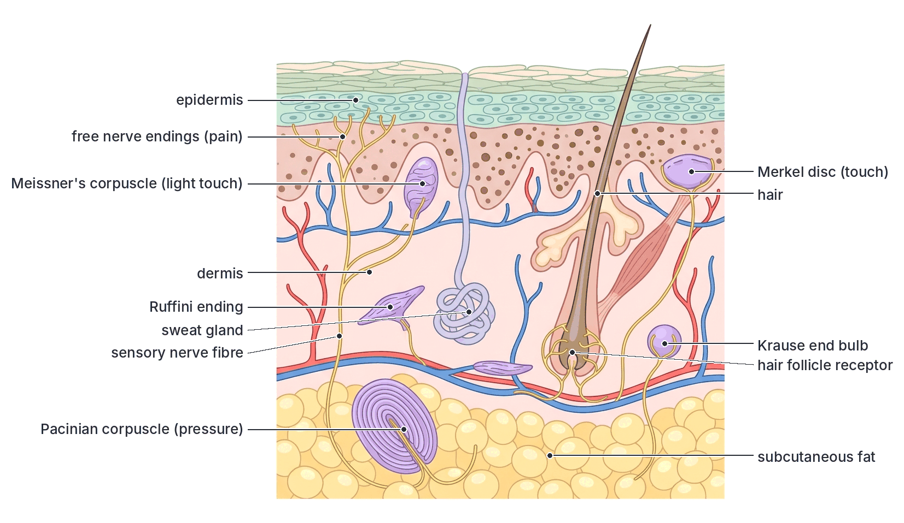

### How the skin detects a stimulus, step by step

Take the example of a mosquito landing on your arm:

1. The mosquito's legs press lightly on the skin and move some hairs.
2. **Hair follicle receptors** and **Meissner's corpuscles** are deformed (squashed or bent) slightly.
3. This change opens channels in the membrane of the nerve ending, and a **nerve impulse** is produced.
4. Sensory neurones carry the impulse to the **spinal cord**, and on up to the **sensory area of the cerebrum** (in the parietal lobe).
5. The brain works out the **type** of sensation (light touch) and its **location** (the left forearm), because each part of the body sends impulses to its own small area of the brain.
6. The brain may send impulses to the muscles of the other hand to slap the mosquito.

If you touch a hot iron, pain receptors and heat receptors are stimulated so strongly that a **reflex action** pulls the hand away before you even feel the pain (see `B9a-nervous-coordination.md`).

### Distribution of receptors: experiments

The receptors are not spread evenly. Areas used for feeling and exploring, such as the **fingertips, lips and tip of the tongue**, have many receptors packed close together. The **back, upper arm and thigh** have few.

**Experiment 1: the two-point discrimination test**

- **Aim:** to show that some parts of the skin are more sensitive to touch than others.
- **Materials:** a pair of compasses with two sharp (but not too sharp) points, or two pins stuck in a cork; a ruler; a blindfold; a partner.
- **Method:**
  1. Blindfold your partner.
  2. Set the points 2 mm apart and touch them gently on your partner's fingertip at the same moment. Ask: "one point or two?"
  3. Repeat, sometimes using only one point, to check that your partner is not guessing.
  4. Increase the gap little by little until your partner can just feel two separate points. Record the distance.
  5. Repeat on the palm, back of the hand, forearm, back of the neck and upper arm.
- **Observation:** on the fingertips and lips, two points can be felt even when they are only 2 to 3 mm apart. On the back and upper arm, the points must be several centimetres apart before two are felt.
- **Conclusion:** the fingertips and lips have many touch receptors close together, so they are very sensitive; the back and upper arm have few receptors far apart.

**Experiment 2: hot and cold spots**

Draw a small grid (about 2 cm × 2 cm) on the back of the hand. Touch each square gently with the tip of a metal rod (or a nail) that has been cooled in iced water, then with one warmed in hot (not boiling) water. Mark where the partner feels "cold" or "warm". Only some spots respond, and there are usually more cold spots than warm spots. This shows that temperature is detected at separate points, not by the whole skin surface.

### Functions of the skin as a sense organ

1. **Protection from injury:** pain and heat receptors warn us of damage, so we pull away from fire, thorns or sharp objects.
2. **Detecting the environment:** we can feel whether surfaces are rough or smooth, hard or soft, wet or dry, even in the dark. Blind people read **Braille** (raised dots) with their very sensitive fingertips.
3. **Detecting temperature:** heat and cold receptors help us avoid burns and cold, and send information that helps the brain control body temperature (see `B9d-homeostasis.md`).
4. **Detecting pressure and vibration:** helps us grip objects with the right force and feel vibrations, such as a phone vibrating in a pocket.
5. **Social contact:** touch is important in bonding between a mother and her baby.

**Note:** sensitive skin receptors also exist in other animals. Cats and rats use their whiskers (special hairs with many nerve endings) to feel their way in the dark.

## The nose: the organ of smell (olfactory sense)

The sense of smell is called **olfaction**, and the nose is the **olfactory organ**. Smell is a **chemical sense**: the receptors detect chemicals (odour molecules) carried in the air.

### Structure of the nose

| Part | Description | Function |
| --- | --- | --- |
| **Nostrils (external nares)** | Two openings at the front | Let air in and out |
| **Nasal hairs** | Coarse hairs just inside the nostrils | Filter out dust and insects |
| **Nasal cavity** | A large space behind the nostrils, divided into two by a wall (the **nasal septum**); its side walls have three curved, shelf-like bones (**turbinates** or conchae) | Warms, moistens and cleans the air; the turbinates make air swirl upwards so some reaches the smell area |
| **Mucous membrane** | Lines the nasal cavity; produces **mucus** | Traps dust and germs; keeps the lining moist; dissolves odour chemicals so they can be detected |
| **Olfactory epithelium** (olfactory region) | A small patch of special lining, about the size of a postage stamp, in the **roof** of each nasal cavity | Contains the smell receptor cells |
| **Olfactory receptor cells** | Long, thin sensory neurones in the olfactory epithelium. Each has fine hair-like **cilia (olfactory hairs)** at its outer end, lying in the mucus | Detect odour chemicals and start nerve impulses |
| **Supporting cells** | Between the receptor cells | Support and protect the receptor cells |
| **Olfactory glands** | Under the epithelium | Make the mucus that covers the olfactory hairs |
| **Cribriform plate** | A thin bone with many tiny holes, part of the **ethmoid bone**, forming the roof of the nasal cavity | Nerve fibres from the receptor cells pass through its holes to the brain |
| **Olfactory bulb** | A swelling of the brain just above the cribriform plate | Receives impulses from the receptor cells and passes them on |
| **Olfactory nerve** (cranial nerve I) | Bundles of nerve fibres from the receptor cells to the olfactory bulb | Carries smell impulses to the brain |

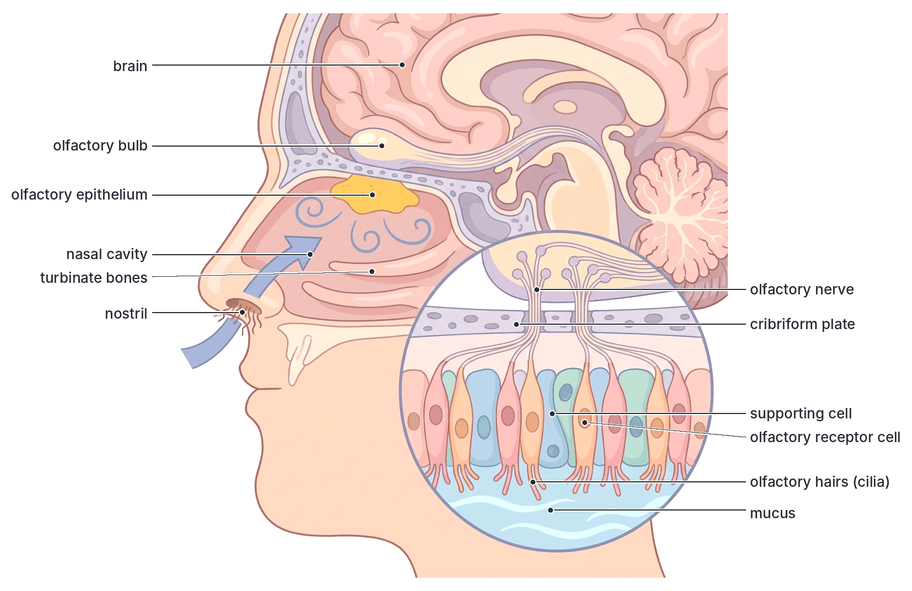

### How we smell, step by step

1. Substances such as frying plantain (*dodo*), *suya*, ripe mango or a gas leak give off tiny **odour molecules** into the air.
2. We breathe in the air through the nostrils. **Sniffing** (short, strong breaths) draws more air up to the roof of the nasal cavity, so we smell better.
3. The odour molecules **dissolve in the mucus** covering the olfactory epithelium. (Substances must be in solution to be smelt; this is why a dry nose smells poorly.)
4. The dissolved molecules bind to **receptor proteins** on the olfactory hairs. Each receptor cell carries one type of receptor protein. Humans have several hundred different types, and dogs have even more.
5. This produces **nerve impulses** in the receptor cells.
6. The impulses pass through the **cribriform plate** along the **olfactory nerve** to the **olfactory bulb**, and then to the **smell centre** of the **cerebrum**.
7. The brain recognises the odour from the **pattern** of receptor types stimulated. In this way, a few hundred receptor types can tell apart a very large number of different smells.

### Smell and taste work together

Much of what we call the "taste" of food is really its **smell**. When food is in the mouth, odour molecules travel up the back of the throat to the nose. Together, taste and smell give the **flavour** of food.

- When you have a **cold or catarrh**, the nasal lining is swollen and covered with thick mucus, so odour molecules cannot reach the olfactory cells. Food then seems tasteless.
- A simple test: hold your nose and eat small pieces of peeled apple, raw potato and onion with your eyes closed. Many people cannot tell them apart until they let go of their nose.

### Functions of the nose as a sense organ

1. **Detecting food** and judging whether it is good to eat: spoilt fish, sour milk and rotten eggs have strong, unpleasant smells that warn us not to eat them.
2. **Warning of danger:** smoke from a fire, a cooking-gas leak (gas suppliers add a strong-smelling chemical to cooking gas so that leaks can be smelt), and poisonous fumes.
3. **Increasing the enjoyment of food:** smell adds to flavour and stimulates the flow of saliva and gastric juice.
4. **In other animals:** smell is used to find food, find mates (many animals release chemical signals called **pheromones**), mark territories and recognise their young. Dogs have a much better sense of smell than humans; **sniffer dogs** are trained to detect drugs, explosives and missing people.

**Note:** smell receptors show strong **sensory adaptation**. After a few minutes in a smelly place, the smell seems to disappear. This can be dangerous: a person may stop noticing a slow gas leak.

## The tongue: the organ of taste (gustatory sense)

The sense of taste is called **gustation**. Like smell, it is a **chemical sense**. The tongue is the main organ of taste, although a few taste buds are also found on the soft palate, the throat (pharynx) and the epiglottis.

### Structure of the tongue

The tongue is a muscular organ attached to the floor of the mouth. Its upper surface is covered with a moist mucous membrane carrying many tiny bumps called **papillae** (singular: papilla). The **taste buds** lie mainly in the walls and on the surfaces of some of these papillae.

| Type of papilla | Shape and position | Taste buds? |
| --- | --- | --- |
| **Filiform papillae** | Tiny, thread-like; the most numerous; all over the front two-thirds; give the tongue its rough, velvety feel | **No.** They grip and move food, and sense touch |
| **Fungiform papillae** | Mushroom-shaped; scattered among the filiform papillae, most numerous at the tip and sides; look like small red dots | Yes, a few on the top of each |
| **Circumvallate (vallate) papillae** | Large, round, each surrounded by a moat-like groove; 8 to 12 of them in a V-shaped row at the back of the tongue | Yes, many, in the walls of the groove |
| **Foliate papillae** | Leaf-like folds on the back edges of the tongue | Yes, in the folds |

### Structure of a taste bud

A **taste bud** is a tiny, barrel- or onion-shaped cluster of cells, buried in the lining of the tongue.

1. **Taste (gustatory) cells:** long receptor cells in the centre of the bud. Each has tiny finger-like **taste hairs** (microvilli) at its top.
2. **Taste pore:** a small opening at the top of the taste bud. The taste hairs stick out into it, so they can touch the saliva.
3. **Supporting cells:** surround the taste cells like the leaves of an onion.
4. **Basal cells:** at the bottom; they divide to replace taste cells. Taste cells wear out and are replaced every one to two weeks or so.
5. **Sensory nerve fibres:** wrap around the bottom of the taste cells and carry impulses away.

The human mouth contains several thousand taste buds. **Textbook variation:** figures range from about 2,000 to 10,000, because the number differs a lot from person to person and falls with age.

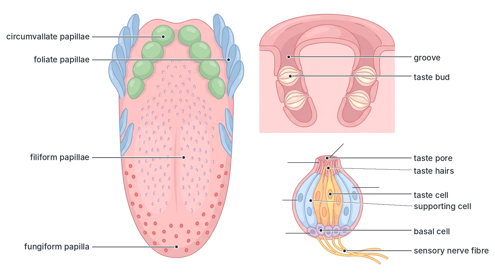

### The basic tastes

Taste cells can detect **five basic tastes**:

| Basic taste | Main substances detected | Nigerian examples | Why it is useful |
| --- | --- | --- | --- |
| **Sweet** | Sugars (glucose, sucrose, fructose) | Sugar cane, honey, ripe banana, *agbalumo* (African star apple) | Signals energy-rich food |
| **Salty** | Sodium ions (common salt) | Salt, salted groundnuts, *kpomo* cooked with salt | Helps us take in the sodium the body needs |
| **Sour** | Acids (hydrogen ions) | Lime, unripe mango, tamarind, *zobo* without sugar | Warns of unripe fruit or spoilt food; signals vitamin C-rich fruit |
| **Bitter** | Many different chemicals, including alkaloids (e.g. quinine, caffeine) | Bitter leaf (*Vernonia*), bitter kola, *dogoyaro* (neem), quinine tablets | Warns of possible poisons, because many poisonous plant chemicals are bitter |
| **Umami** (savoury) | **Glutamate** (e.g. monosodium glutamate, MSG) and some related substances | Meat stock, fish, cheese, mushrooms, tomatoes; many seasoning cubes contain MSG | Signals protein-rich food |

**Umami** is the "fifth taste". It was first described in **1908** by the Japanese chemist **Kikunae Ikeda**, who found that glutamate gives seaweed soup its savoury taste. The word comes from Japanese and means roughly "pleasant savoury taste". Umami receptors on taste cells were identified much later, and umami is now accepted by scientists as a basic taste.

**Textbook variation:** older textbooks list only **four** basic tastes (sweet, salty, sour and bitter). Newer textbooks list **five**, adding umami. Some scientists suggest further basic tastes (for example, the taste of fat), but these are not yet generally accepted. If a JAMB question asks for "the four basic tastes", answer sweet, salty, sour and bitter.

### The "tongue map": an outdated idea

Many textbooks show a **tongue map**, with each taste detected in only one area:

| Area of the tongue | Taste in the old tongue map |
| --- | --- |
| Tip | Sweet |
| Front sides (near the tip) | Salty |
| Back sides | Sour |
| Back | Bitter |

**This map is now known to be wrong.** It came from a German study published in 1901, which found only **small** differences in sensitivity between parts of the tongue. Later writers redrew the results as if each region detected only one taste. Modern research shows that:

- **every** area of the tongue that has taste buds can detect **all** the basic tastes;
- each taste bud contains taste cells for several different tastes;
- there are only small differences in sensitivity from place to place (the back of the tongue is somewhat more sensitive to bitter tastes, which may help us spit out poisons before swallowing).

**For the exam:** JAMB and some older past questions may still use the tongue map. If a question clearly expects it (for example, "which part of the tongue is most sensitive to bitter taste?"), the expected answer is the **back**; for sweet, the **tip**. Remember that this is a simplification, not the full truth.

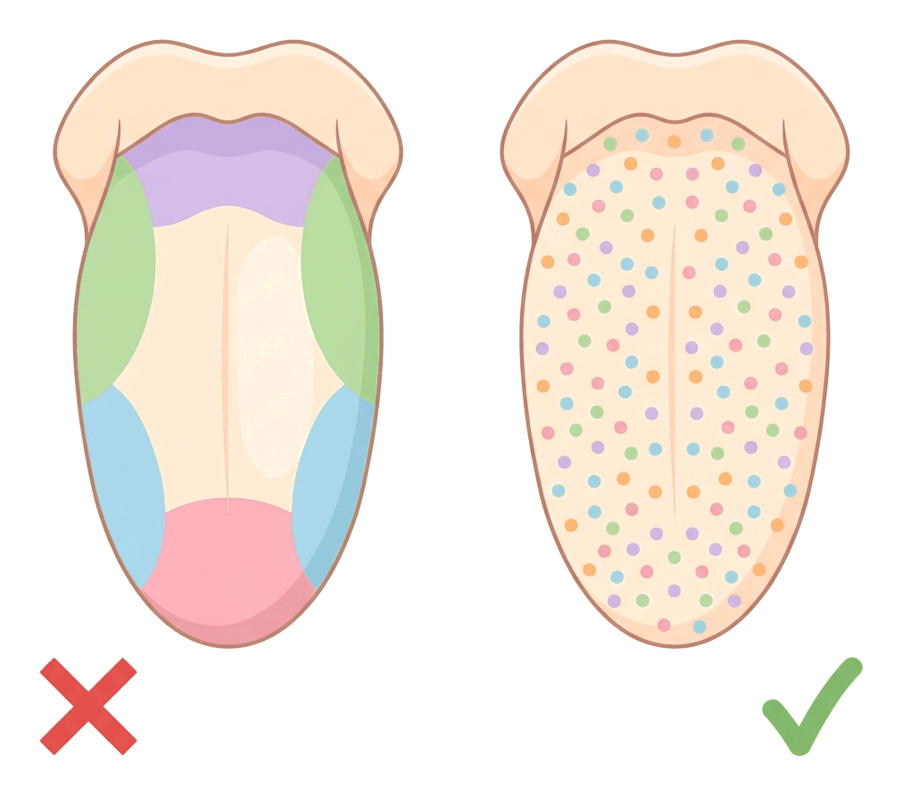

### How we taste, step by step

1. Food is chewed and mixed with **saliva**.
2. Chemicals from the food **dissolve in the saliva**. (Only dissolved substances can be tasted.)
3. The solution enters the **taste pores** and touches the **taste hairs** of the taste cells.
4. The chemicals act on receptors or channels on the taste cells, producing **nerve impulses**.
5. **Sensory nerves** carry the impulses to the brain. Taste from the front two-thirds of the tongue travels in the **facial nerve** (cranial nerve VII); taste from the back one-third travels in the **glossopharyngeal nerve** (cranial nerve IX).
6. The **taste area** of the cerebrum interprets the impulses as a particular taste.
7. The brain combines this with smell, texture and temperature of the food to give its full **flavour**.

**Experiment: substances must dissolve to be tasted**

- **Method:** dry the tip of your tongue very well with a clean tissue or filter paper. Place a few crystals of dry sugar on it and note whether you can taste anything. Then close your mouth and let saliva wet the tongue.
- **Observation:** little or no sweetness is tasted while the tongue is dry; the sweet taste appears once saliva dissolves the sugar.
- **Conclusion:** substances must be in solution before they can stimulate the taste cells.

**Link to Topic D1:** some people can taste the chemical **phenylthiocarbamide (PTC)**, which is very bitter to them, while others cannot taste it at all. This is an inherited **physiological variation** (see the variation notes in Section D).

### Functions of the tongue

As a sense organ, the tongue:

1. Detects the **taste** of food, so we can enjoy good food and reject bitter, sour or spoilt food that may be harmful.
2. **Starts digestion:** pleasant tastes trigger the flow of saliva and gastric juice.
3. Detects the **texture** and **temperature** of food through touch and temperature receptors, so we avoid swallowing bones or very hot food.

The tongue also has other jobs: it mixes food with saliva, rolls it into a ball (**bolus**) and pushes it back for swallowing, cleans the teeth, and is essential for **speech**.

## The eye: the organ of sight

The eye is the organ of **sight (vision)**. Its receptors are **photoreceptors**, sensitive to light. The two eyes sit in bony sockets in the skull called the **orbits**, which protect them.

### Accessory (protective) structures of the eye

| Structure | Description | Function |
| --- | --- | --- |
| **Orbit (eye socket)** | Bony cavity of the skull | Protects most of the eyeball from injury |
| **Eyebrows** | Hairs above the eye | Stop sweat and rain running into the eyes; shade the eyes |
| **Eyelids** | Folds of skin with muscles, which can close over the eye | Protect the eye from dust, strong light and injury; **blinking** spreads tears over the eye. Blinking is a **reflex** when something comes close to the eye (see `B9a-nervous-coordination.md`) |
| **Eyelashes** | Hairs along the edges of the eyelids | Trap dust and small particles; trigger blinking when touched |
| **Conjunctiva** | Thin, transparent membrane covering the front of the white of the eye and lining the inside of the eyelids | Protects the front of the eye; keeps it moist |
| **Tear (lachrymal) glands** | Small glands above the outer corner of each eye | Produce **tears**: a salty fluid that keeps the front of the eye moist, washes away dust and contains **lysozyme**, an enzyme that kills bacteria |
| **Tear ducts** | Small channels at the inner corner of each eye leading into the nose | Drain tears into the nasal cavity (this is why your nose runs when you cry) |
| **Eye muscles (extrinsic muscles)** | Six muscles attached to the outside of each eyeball | Move the eyeball up, down and sideways, so we can look around without moving the head |

**Textbook variation:** many textbooks say the conjunctiva covers the **cornea**. Strictly, the conjunctiva covers the white of the eye and lines the eyelids, and the cornea has its own thin outer layer that is continuous with it. Either description is usually accepted at this level.

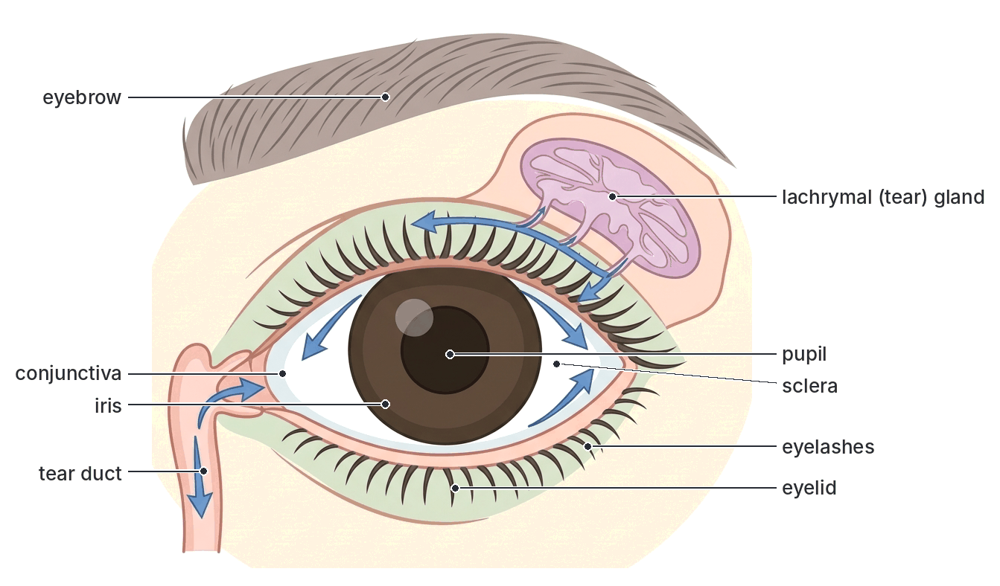

### Internal structure of the eye

The eyeball is a roughly spherical organ, about 2.5 cm across. Its wall has **three layers**, and it is filled with transparent fluids and the lens.

**The three layers of the eye wall:**

1. **Outer layer: sclera and cornea**
   - The **sclera** (sclerotic layer) is the tough, white, fibrous outer coat ("the white of the eye"). It protects the eye and keeps its shape; the eye muscles are attached to it.
   - At the front, the sclera becomes the transparent, curved **cornea**, which lets light in and **bends (refracts) the light** more than any other part of the eye.
2. **Middle layer: choroid, ciliary body and iris**
   - The **choroid** is a dark layer full of **blood vessels** and black pigment (**melanin**). The blood vessels nourish the retina; the black pigment **absorbs stray light**, preventing it from reflecting inside the eye and blurring the image.
   - At the front, the choroid thickens into the **ciliary body**, a ring containing the **ciliary muscles**. The ciliary body also produces the **aqueous humour**.
   - In front of the lens, the choroid becomes the **iris**, a coloured ring of muscle with a hole in the centre, the **pupil**.
3. **Inner layer: retina**
   - The **retina** is the light-sensitive layer lining the back of the eye. It contains the photoreceptors (**rods and cones**) and nerve cells whose fibres join to form the **optic nerve**.

**Parts of the eye and their functions:**

| Part | Description | Function |
| --- | --- | --- |
| **Sclera** | Tough, white, fibrous outer coat | Protects the eye; maintains its shape; gives attachment to eye muscles |
| **Cornea** | Transparent front part of the sclera, curved outwards | Allows light to enter; does most of the **refraction** (bending) of light |
| **Aqueous humour** | Clear, watery fluid in the space between the cornea and the lens | Keeps the front of the eye in shape; helps refract light; nourishes the cornea and lens, which have no blood vessels |
| **Iris** | Coloured ring of muscle (brown in most Nigerians) with **circular** and **radial** muscles | Controls the size of the pupil and so the **amount of light** entering the eye |
| **Pupil** | The hole in the centre of the iris; looks black because light entering it is absorbed inside the eye | Lets light into the eye |
| **Lens** | Transparent, elastic, biconvex (bulging on both sides) structure behind the iris | Fine-focuses light onto the retina; changes shape for near and distant objects (**accommodation**) |
| **Ciliary body and ciliary muscles** | Ring of muscle around the lens | Contract or relax to change the shape of the lens |
| **Suspensory ligaments** | Strong fibres joining the edge of the lens to the ciliary body | Hold the lens in place; pull on it to make it thinner |
| **Vitreous humour** | Clear, jelly-like substance filling the large space behind the lens | Keeps the eyeball firm and round; helps refract light; holds the retina in place |
| **Choroid** | Dark, pigmented layer full of blood vessels, between the sclera and retina | Supplies food and oxygen to the retina; absorbs stray light to prevent reflection inside the eye |
| **Retina** | Inner light-sensitive layer | Contains rods and cones that detect light and produce nerve impulses |
| **Fovea (yellow spot)** | Small pit in the centre of the retina, directly behind the lens; contains only **cones**, packed very closely | Gives the **sharpest, most detailed** colour vision in bright light; the image of whatever we look at directly falls here |
| **Blind spot** | The point where the optic nerve leaves the eye; has **no rods or cones** | Cannot detect light; any image falling here is not seen |
| **Optic nerve** | Bundle of nerve fibres from the retina | Carries impulses from the retina to the brain |

**Textbook variation:** some textbooks use "yellow spot" for the whole small central area (the **macula lutea**) and "fovea" (fovea centralis) for the tiny pit at its centre; others treat the two words as the same thing.

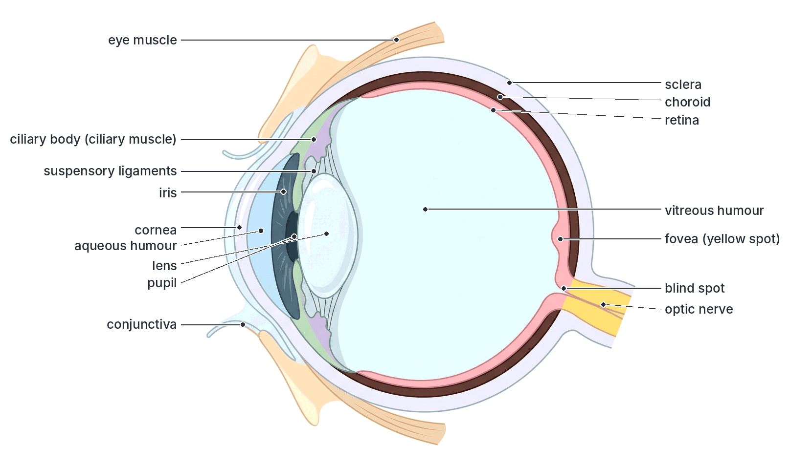

### How an image is formed on the retina (how we see)

1. **Light rays** from an object (for example, a mango tree) enter the eye.
2. The rays pass through the **cornea**, which bends (refracts) them strongly inwards. The cornea does about two-thirds of all the focusing.
3. The rays pass through the **aqueous humour** and the **pupil**. The **iris** controls how much light gets through.
4. The **lens** bends the rays further, adjusting the focus so that the rays meet exactly on the retina. (How the lens does this is explained below under accommodation.)
5. The rays pass through the **vitreous humour** and come to a focus on the **retina**, usually on the **fovea**.
6. The image formed on the retina is **real, inverted (upside down), laterally reversed and smaller (diminished)** than the object, just like the image in a camera.
7. The **rods and cones** absorb the light. Light changes their light-sensitive pigments, and this produces **nerve impulses**.
8. The **optic nerve** carries the impulses to the **visual area** in the **occipital lobe** at the back of the **cerebrum**.
9. The brain **interprets** the impulses. It "turns the image the right way up", combines the images from both eyes, and lets us recognise what we are seeing.

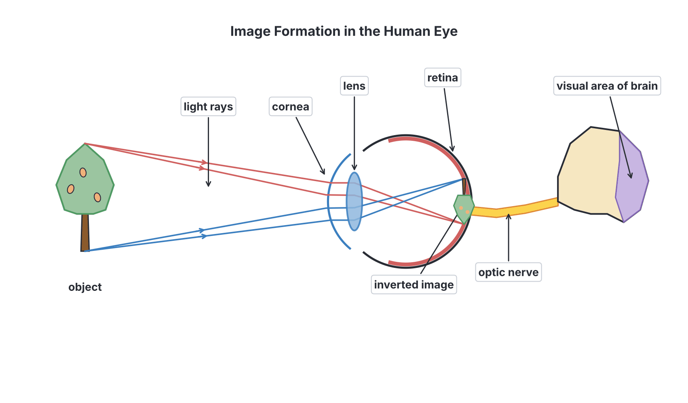

### Accommodation: focusing on near and distant objects

**Accommodation** is the ability of the eye to change the **focal length** of its lens (by changing the lens's shape), so that clear images of both **near** and **distant** objects are formed on the retina.

Light from a **distant** object (more than about 6 metres away) arrives almost **parallel**, so it needs only a little bending. Light from a **near** object is **spreading out (diverging)**, so it must be bent much more. A thin lens bends light less; a fat (more convex) lens bends light more. The lens is elastic: left to itself, it tends to become fat and round. The suspensory ligaments pull it thin.

**Focusing on a distant object (e.g. reading the blackboard from the back of the class):**

1. The **ciliary muscles relax**.
2. The ring of the ciliary body becomes **wider** (larger diameter), and the pressure of the fluids inside the eyeball pushes outwards on the eye wall.
3. The **suspensory ligaments** are pulled **tight (taut)**.
4. The tight ligaments pull on the edge of the lens, making it **thinner** and **less convex** (flatter).
5. The lens now has a **longer focal length** and bends light less.
6. The parallel rays from the distant object are focused on the retina.

**Focusing on a near object (e.g. reading your textbook):**

1. The **ciliary muscles contract**.
2. The ring of the ciliary body becomes **smaller** and moves inwards towards the lens.
3. The **suspensory ligaments slacken** (become loose).
4. The lens, no longer pulled, springs into a **thicker, more convex** (rounder) shape because of its own **elasticity**.
5. The lens now has a **shorter focal length** and bends light more.
6. The diverging rays from the near object are focused on the retina.

| Feature | Distant object | Near object |
| --- | --- | --- |
| Rays entering the eye | Almost parallel | Diverging (spreading out) |
| Ciliary muscles | **Relax** | **Contract** |
| Ciliary body ring | Wider | Narrower |
| Suspensory ligaments | **Tight (taut)** | **Slack (loose)** |
| Shape of lens | **Thin, less convex** | **Thick, more convex** |
| Focal length of lens | Longer | Shorter |
| Bending (refraction) of light | Less | More |

**Near point and far point:** the closest point at which the eye can focus clearly is the **near point**; for a normal young adult, it is usually taken as about **25 cm**. The furthest point that can be seen clearly is the **far point**; for a normal eye it is at **infinity** (very far away). The near point moves further away with age as the lens becomes less elastic (see presbyopia below).

**Tip:** remember "**C**ontract for **C**lose": ciliary muscles contract for close (near) objects. When looking at near objects for a long time (for example, reading for hours), the ciliary muscles stay contracted and the eyes feel tired. Looking into the distance now and then relaxes them.

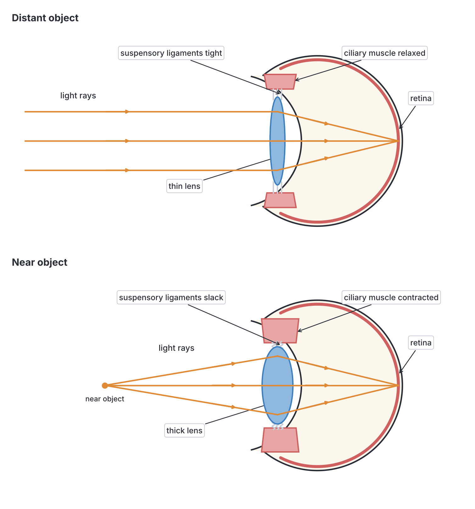

### The pupil reflex: controlling the amount of light

The **iris** controls the size of the pupil, and so the amount of light entering the eye. This is an automatic **reflex action**: we cannot control it by thinking. Its purposes are to:

- **protect the retina** from damage by too much light in bright conditions;
- let in **enough light** to see in dim conditions;
- improve the sharpness of the image (a smaller pupil gives a clearer image, which is why you squint to see better).

The iris contains two sets of muscles:

- **Circular muscles**, arranged in rings around the pupil. When they contract, the pupil becomes **smaller**.
- **Radial muscles**, arranged like the spokes of a bicycle wheel. When they contract, the pupil becomes **larger**.

The two sets of muscles are **antagonistic**: when one contracts, the other relaxes.

**In bright light (e.g. walking out of a dark room into the midday sun):**

1. Bright light falls on the retina.
2. The retina sends impulses along the optic nerve to the brain (a reflex centre in the **midbrain**).
3. The brain sends impulses along motor nerves to the iris.
4. The **circular muscles contract** and the **radial muscles relax**.
5. The **pupil becomes smaller (constricts)**.
6. **Less light** enters the eye, protecting the retina.

**In dim light (e.g. entering a dark room or at night):**

1. Little light falls on the retina.
2. Fewer impulses travel to the brain.
3. The brain sends impulses to the iris.
4. The **radial muscles contract** and the **circular muscles relax**.
5. The **pupil becomes larger (dilates)**.
6. **More light** enters the eye, so we can see better.

| Feature | Bright light | Dim light |
| --- | --- | --- |
| Circular muscles of iris | **Contract** | Relax |
| Radial muscles of iris | Relax | **Contract** |
| Size of pupil | **Small (constricted)** | **Large (dilated)** |
| Amount of light entering | Reduced | Increased |

**Note:** when light is shone into one eye, the pupils of **both** eyes get smaller. Doctors and nurses shine a torch into a patient's eyes to test this reflex, because it shows whether the nerves and brain stem are working (for example, after a head injury).

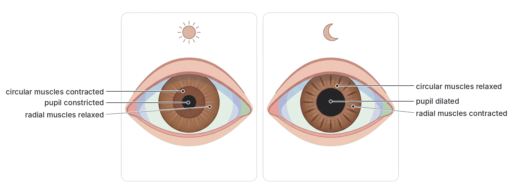

### Rods and cones

The retina contains two types of photoreceptor cells, named after their shapes.

| Feature | Rods | Cones |
| --- | --- | --- |
| Shape of outer segment | Long and rod-shaped | Short and cone-shaped |
| Number (each human eye) | About **120 million** | About **6 million** |
| Distribution | Mostly around the **edges (periphery)** of the retina; **none in the fovea** | Concentrated in the **fovea**; fewer towards the edges |
| Light needed | Very sensitive; work in **dim light** (night vision) | Less sensitive; work in **bright light** (daylight vision) |
| Colour vision | **No**; give black, white and shades of grey | **Yes**; give colour vision |
| Detail (acuity) | Low; many rods share one nerve fibre, so the image is less sharp | High; in the fovea each cone often has its own nerve pathway, so the image is sharp |
| Light-sensitive pigment | **Rhodopsin (visual purple)**, made from **vitamin A** | **Iodopsin**; three kinds of cone each with a slightly different pigment |
| Effect of vitamin A deficiency | Less rhodopsin, so **night blindness** | Less affected |

**How rods work:** light splits (bleaches) **rhodopsin**, and this change starts a nerve impulse. In bright light, most of the rhodopsin is bleached, so the rods stop working. In the dark, rhodopsin is slowly rebuilt using **vitamin A**. This explains **dark adaptation**: when you walk from bright sunlight into a dark cinema or room, you can see very little at first, but after several minutes (up to about 20 to 30 minutes for full adaptation) your rods have rebuilt their rhodopsin and you can see much better.

**How cones give colour vision:** according to the widely accepted **trichromatic theory**, there are three types of cones, sensitive mainly to **red**, **green** and **blue** light. Every colour we see is produced by the brain comparing how strongly each type of cone is stimulated. For example, yellow light stimulates red and green cones about equally. If one type of cone is missing or faulty, a person is **colour blind**.

**Textbook variation:** modern books often call the three cone types **long-wavelength (L)**, **medium-wavelength (M)** and **short-wavelength (S)** cones, because each responds to a range of colours, not one colour. "Red, green and blue cones" is the simpler name used in most school textbooks.

**Rods and cones in other animals:** animals that are active at night (nocturnal), such as owls, bats and bushbabies, have retinas with mostly rods, so they see well in dim light but see little colour. Cats have a reflecting layer behind the retina (the **tapetum lucidum**), which bounces light back through the rods and makes their eyes shine at night when light falls on them. Day-active birds have many cones and excellent colour vision.

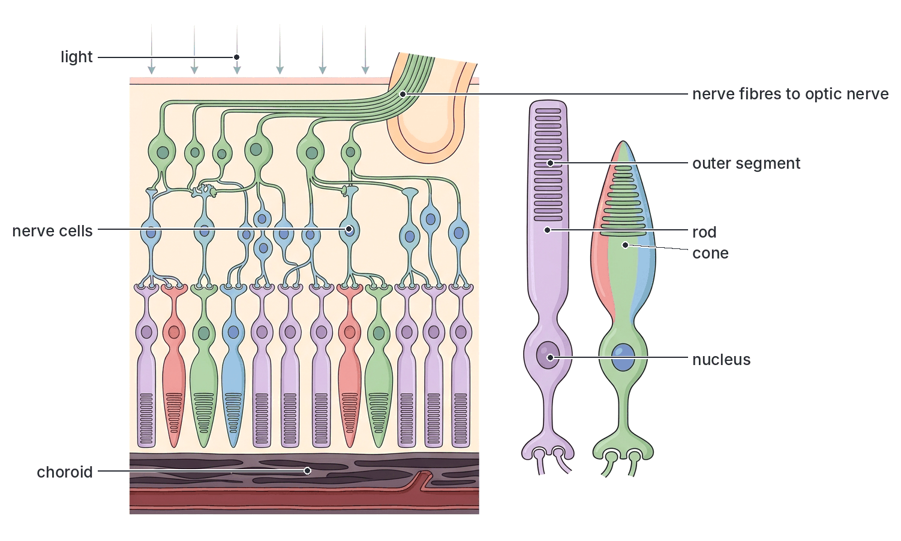

### The blind spot

The **blind spot** is the place where the nerve fibres from all over the retina gather and leave the eye as the **optic nerve**. There are **no rods or cones** here, so an image falling on the blind spot cannot be seen. We do not normally notice it, because the image does not fall on the blind spot of both eyes at the same time, and the brain "fills in" the gap.

**Experiment: demonstrating the blind spot**

- **Materials:** a white card with a small cross (+) on the left and a black dot (●) about 8 cm to its right.
- **Method:**
  1. Hold the card at arm's length in front of you.
  2. Close your **left** eye and look steadily at the **cross** with your right eye.
  3. Slowly bring the card towards your face, keeping your eye fixed on the cross.
- **Observation:** at a certain distance (usually about 20 to 30 cm), the **dot disappears**. As the card comes closer, it reappears.
- **Conclusion:** at that distance, the image of the dot falls on the **blind spot** of the right eye, which has no light-sensitive cells, so it is not seen. This proves there is a part of the retina with no rods or cones.

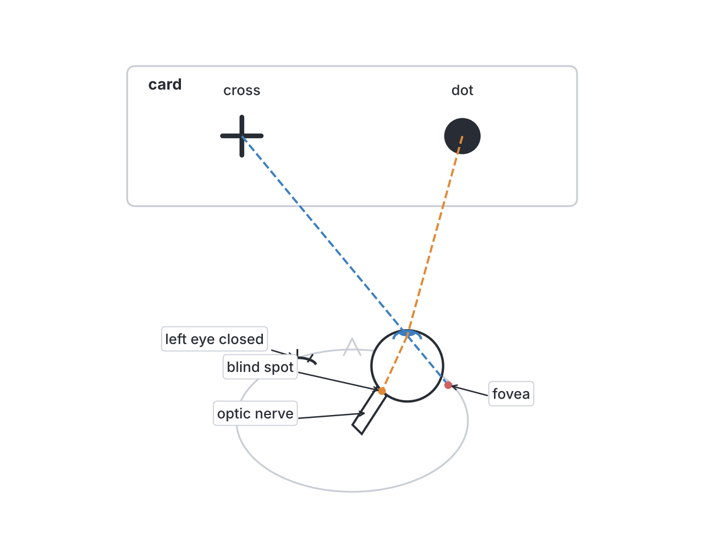

### Binocular vision

Humans have both eyes facing **forwards**, and their fields of view overlap a lot. Each eye sees the object from a slightly different angle, and the brain combines the two images into one three-dimensional picture. This is **binocular (stereoscopic) vision**, and it helps us **judge distance and depth** accurately, for example when catching a ball or threading a needle.

| Feature | Binocular vision | Monocular vision |
| --- | --- | --- |
| Position of eyes | Both at the front of the head | One on each side of the head |
| Overlap of the two fields of view | Large | Small or none |
| Field of view | Narrower | Very wide (almost all round) |
| Judging distance | Very good | Poor |
| Typical animals | Hunters (predators): humans, monkeys, cats, owls, eagles | Hunted animals (prey): rabbits, antelopes, goats, many birds such as the pigeon |
| Advantage | Accurate judging of distance to catch prey, climb or use the hands | Can watch for predators coming from almost any direction |

### Summary of how the eye's structure suits its function

- **Transparent cornea, humours and lens** let light pass and focus it.
- **Elastic lens with ciliary muscles** allows accommodation.
- **Iris with antagonistic muscles** controls light entry.
- **Black choroid** prevents internal reflection that would blur the image.
- **Rods** give vision in dim light; **cones** give colour and detail in bright light.
- **Fovea** packed with cones gives the sharpest vision.
- **Two forward-facing eyes** give binocular vision.

## The ear: the organ of hearing and balance

The ear has **two** separate jobs:

1. **Hearing (auditory sense):** detecting sound.
2. **Balance (equilibrium):** detecting the position and movement of the head, so the body can keep upright and steady.

Both are done by **mechanoreceptors** called **hair cells**, which produce nerve impulses when their tiny hairs (stereocilia) are bent.

The ear has three parts: the **outer (external) ear**, the **middle ear** and the **inner ear**.

### Structure of the ear

| Region | Part | Description | Function |
| --- | --- | --- | --- |
| **Outer ear** | **Pinna (ear flap)** | Flap of skin and elastic **cartilage** on the side of the head | Collects sound waves and directs them into the ear canal. Some mammals (e.g. dogs, goats, rabbits) can turn their pinnae towards a sound |
| Outer ear | **External auditory canal (ear canal, auditory meatus)** | Tube about 2.5 cm long leading inwards; lined with skin with hairs and **wax (cerumen) glands** | Carries sound waves to the eardrum; hairs and wax trap dust and germs and keep the canal from drying out |
| Outer ear / middle ear boundary | **Eardrum (tympanic membrane)** | Thin, tight membrane stretched across the inner end of the ear canal | **Vibrates** when sound waves strike it, passing the vibrations to the ossicles |
| **Middle ear** | **Middle ear cavity (tympanic cavity)** | Small **air-filled** space in the skull bone | Contains the ossicles |
| Middle ear | **Ear ossicles**: **malleus (hammer)**, **incus (anvil)**, **stapes (stirrup)** | Three tiny bones joined in a chain; the malleus touches the eardrum and the stapes fits into the oval window. The stapes is the **smallest bone in the body** | Transmit vibrations from the eardrum to the oval window and **amplify** them (increase their force) |
| Middle ear | **Eustachian tube** | Narrow tube from the middle ear to the back of the throat (pharynx) | Lets air in or out of the middle ear to keep the **air pressure equal on both sides of the eardrum**, so the eardrum can vibrate freely and is not damaged |
| Middle ear / inner ear boundary | **Oval window** | Membrane-covered opening into the inner ear, attached to the stapes | Passes vibrations from the stapes to the fluid of the cochlea |
| Middle ear / inner ear boundary | **Round window** | Membrane-covered opening below the oval window | Bulges outwards when the oval window pushes in, **releasing pressure** so the cochlear fluid can move |
| **Inner ear** | **Cochlea** | Coiled tube, like a snail shell (about two and a half turns), filled with fluids (**perilymph** and **endolymph**); contains the **organ of Corti** | **Hearing**: changes vibrations into nerve impulses |
| Inner ear | **Organ of Corti** | Rows of sensory **hair cells** resting on the **basilar membrane**, with their hairs touching an overhanging **tectorial membrane** | The actual receptor of hearing |
| Inner ear | **Semicircular canals** | Three curved, fluid-filled (endolymph) tubes **at right angles** to each other; each has a swelling, the **ampulla**, at one end | **Balance**: detect **rotation** (turning movements) of the head |
| Inner ear | **Vestibule: utriculus (utricle) and sacculus (saccule)** | Two small fluid-filled sacs between the semicircular canals and the cochlea; contain hair cells under a jelly holding tiny chalky grains (**otoliths**) | **Balance**: detect the **position of the head** relative to gravity and **straight-line** movement |
| Inner ear | **Auditory (vestibulocochlear) nerve** | Cranial nerve VIII, with a cochlear branch and a vestibular branch | Carries impulses for hearing and balance to the brain |

**Textbook variation:** older textbooks often say "utriculus" and "sacculus" (as in the JAMB syllabus); newer ones use "utricle" and "saccule". They mean the same structures.

The whole inner ear (cochlea, vestibule and semicircular canals) is a complicated system of tubes in the skull bone and is called the **labyrinth** (meaning "maze").

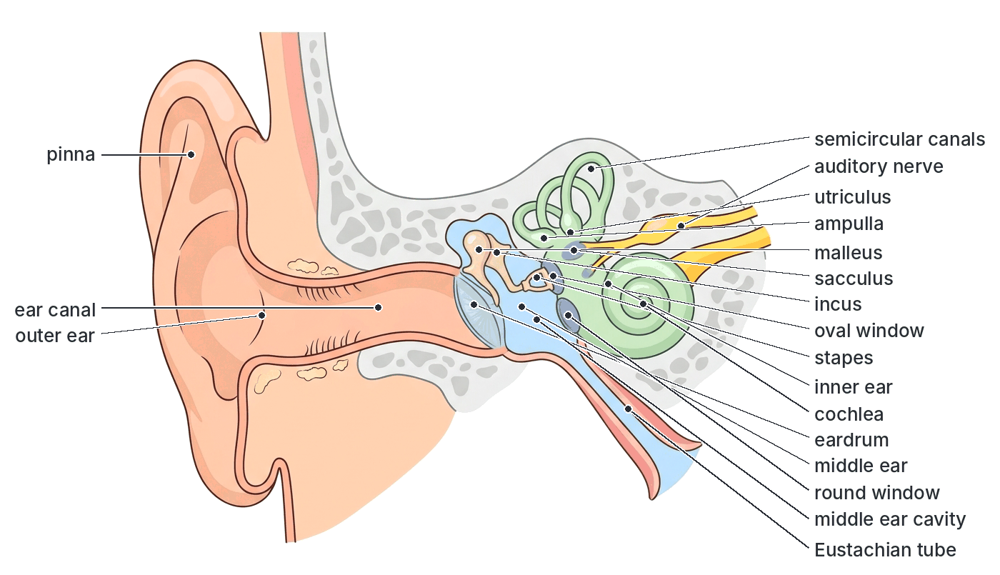

### How we hear, step by step

Sound is a form of energy carried as **vibrations** (waves of pressure) through air, water or solids.

1. **Collection:** the **pinna** collects sound waves and directs them into the **ear canal**.
2. **Eardrum:** the sound waves strike the **eardrum**, making it **vibrate** at the same frequency as the sound.
3. **Ossicles:** the vibrating eardrum moves the **malleus**, which moves the **incus**, which moves the **stapes**. The ossicles act as levers, and because the eardrum is much larger than the oval window, the force of the vibrations is concentrated onto a small area. Together these **amplify** the vibrations (increase their pressure many times; figures of about 20 times are often quoted).
4. **Oval window:** the stapes pushes the **oval window** in and out, setting up pressure waves in the **fluid (perilymph)** of the cochlea.
5. **Round window:** as the oval window moves in, the **round window** bulges out, so the fluid (which cannot be squashed) is free to move.
6. **Basilar membrane:** the pressure waves make the **basilar membrane** vibrate. Different parts vibrate most strongly for different **pitches**: **high-pitched** sounds vibrate the part near the **base** of the cochlea (close to the oval window), and **low-pitched** sounds vibrate the part near the **tip (apex)**.
7. **Hair cells:** as the basilar membrane moves up and down, the hairs of the **hair cells** in the **organ of Corti** rub against the **tectorial membrane** and are **bent**.
8. **Nerve impulses:** the bending of the hairs makes the hair cells produce **nerve impulses**. Loud sounds produce larger vibrations and more impulses.
9. **To the brain:** the **auditory nerve** carries the impulses to the **hearing (auditory) area** in the **temporal lobe** of the **cerebrum**, which interprets them as sounds of a particular pitch and loudness, and recognises speech, music and noises.

**In short:** sound waves → pinna → ear canal → eardrum → malleus → incus → stapes → oval window → cochlear fluid → basilar membrane → hair cells of the organ of Corti → auditory nerve → brain.

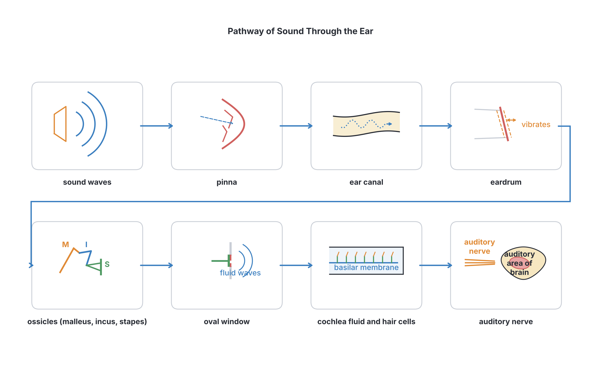

**Pitch and range of hearing:** the **pitch** of a sound depends on its frequency (number of vibrations per second, measured in hertz, Hz). Young people can usually hear sounds from about **20 Hz to 20,000 Hz**. The upper limit falls with age. Dogs can hear much higher sounds than humans, which is why "silent" dog whistles work. Bats produce very high sounds (ultrasound) and listen for the echoes to find insects in the dark (**echolocation**).

**Why we have two ears:** a sound coming from one side reaches the nearer ear slightly earlier and slightly louder. The brain uses these tiny differences to work out the **direction** of the sound.

**The Eustachian tube and pressure:** when you travel in an aeroplane, or quickly up or down a high hill (for example, on the road up to the Obudu or Jos plateaus), the outside air pressure changes. The pressure on the two sides of the eardrum becomes unequal, and the eardrum bulges, so your ears feel "blocked" or painful and hearing is dull. **Swallowing, yawning or chewing** opens the Eustachian tube, air moves in or out of the middle ear, the pressures become equal again, and the ears "pop".

### Balance: semicircular canals, utriculus and sacculus

The part of the inner ear that deals with balance is called the **vestibular apparatus**. It has two parts that work in different ways.

#### 1. The semicircular canals: detecting rotation (dynamic balance)

- There are **three** semicircular canals in each ear, set **at right angles** to one another, like the floor and two walls meeting in the corner of a room. One lies roughly horizontally, and two lie vertically. Because of this, any turning movement of the head, in any direction (nodding "yes", shaking "no", tilting to the side), affects at least one canal.
- Each canal is filled with fluid (**endolymph**) and has a swelling called the **ampulla** at one end.
- Inside each ampulla is a ridge (the **crista**) of **hair cells**, whose hairs are embedded in a jelly-like cap called the **cupula**, which sticks up into the fluid like a swing door.

**How the semicircular canals detect rotation, step by step:**

1. When the head **starts to turn**, the bony canal turns with it.
2. Because of its **inertia**, the fluid (endolymph) inside the canal **lags behind** at first (just as water in a cup stays still when you quickly turn the cup).
3. The lagging fluid pushes against the **cupula**, bending it and the **hairs** of the hair cells.
4. Bending the hairs produces **nerve impulses**, which travel along the **vestibular branch** of the auditory nerve to the **cerebellum** (and other balance centres in the brain).
5. The brain works out the **direction and speed** of the rotation from which canals are stimulated and how strongly.
6. The cerebellum sends impulses to the **muscles** (of the neck, trunk, limbs and eyes) to adjust the body's position and keep balance.

**Why you feel dizzy after spinning:** if you spin round and round (as children do in play) and then stop suddenly, the fluid in the canals **keeps moving** for a few seconds because of its inertia. It bends the cupula in the opposite direction, so the brain gets the message that you are turning, even though you have stopped. You feel **dizzy** and may stagger.

#### 2. The utriculus and sacculus: detecting head position and straight-line movement (static balance)

- The **utriculus** and **sacculus** are two small sacs in the **vestibule** of the inner ear.
- Each contains a patch of **hair cells** (the **macula**). The hairs are embedded in a layer of jelly, on top of which lie many tiny grains of **calcium carbonate** called **otoliths** ("ear stones").
- The otoliths are **heavier** than the surrounding fluid, so they are pulled by **gravity**.

**How the utriculus and sacculus work, step by step:**

1. When the head is **upright**, the otoliths press straight down on the hair cells.
2. When the head is **tilted** (for example, bending forward to pick up a pen), gravity pulls the heavy otoliths and jelly **sideways** over the hair cells.
3. This **bends the hairs** in a particular direction.
4. The hair cells send **nerve impulses** to the brain (cerebellum), showing **which way the head is tilted** relative to gravity.
5. The same thing happens during **straight-line acceleration**: when a car or bus moves off suddenly, the otoliths lag behind and bend the hairs; the brain detects the start or stop of movement.
6. The brain sends impulses to the muscles to adjust posture.

In general, the **utriculus** responds mostly to **horizontal** movement and tilting, and the **sacculus** mostly to **vertical** movement (for example, going up or down in a lift).

| Feature | Semicircular canals | Utriculus and sacculus |
| --- | --- | --- |
| Number | Three in each ear | One of each in each ear |
| Shape | Curved tubes at right angles | Small rounded sacs |
| Receptor area | Crista in the ampulla, with a jelly **cupula** | Macula, with jelly and **otoliths** |
| What moves the hairs | Lagging **fluid** (endolymph) | **Otoliths** pulled by gravity or lagging during acceleration |
| What is detected | **Rotation** (turning) of the head in any plane | **Position (tilt)** of the head relative to gravity and **straight-line** (linear) acceleration |
| Type of balance | Dynamic | Static (and linear movement) |

**Other information used for balance:** the brain also uses information from the **eyes** (what we see) and from stretch receptors in the **muscles and joints**. This is why it is harder to stand on one leg with your eyes closed.

**Motion sickness:** on a rough boat ride, or reading in a moving bus on a bumpy road, the balance organs, the eyes and the muscles may send the brain messages that do not agree. This can cause **motion sickness**: dizziness, sweating, nausea and vomiting.

[IMAGE: Two-part diagram of the balance organs of the inner ear. Left: enlarged view of the three semicircular canals at right angles to each other joined to the vestibule containing the utriculus and sacculus, with the cochlea attached at one side, all in light green. Upper right: an enlarged cut-open ampulla showing the crista of hair cells with their hairs embedded in a tall jelly-like cupula, fluid (endolymph) shown as pale blue, with a curved arrow showing the fluid pushing the cupula sideways. Lower right: an enlarged macula from the utriculus showing a row of hair cells, their hairs in a jelly layer, and small white crystal grains (otoliths) on top; two small versions side by side, one with the head upright (hairs straight) and one with the head tilted (otoliths and jelly slid sideways, hairs bent). Labels: semicircular canals, ampulla, utriculus, sacculus, cochlea, cupula, hair cells, endolymph, otoliths, jelly layer, nerve fibres, head upright, head tilted. Clean flat textbook style, white background.]

### Summary table: sense organs and their functions

| Sense organ | Main function | Key receptors | Key structural features related to function |
| --- | --- | --- | --- |
| Skin | Touch, pressure, temperature, pain | Meissner's and Pacinian corpuscles, Merkel discs, free nerve endings, Ruffini and Krause endings | Receptors spread over the whole body, packed most densely in the fingertips, lips and tongue |
| Nose | Smell | Olfactory cells | Olfactory patch high in the roof of the nasal cavity; mucus to dissolve odour chemicals |
| Tongue | Taste | Taste cells in taste buds | Papillae increase surface area; taste pores open into saliva |
| Eye | Sight | Rods and cones | Cornea and lens focus light; iris controls light; ciliary muscles allow accommodation; choroid absorbs stray light |
| Ear | Hearing and balance | Hair cells | Pinna and eardrum collect and transmit sound; ossicles amplify; cochlea converts to impulses; semicircular canals, utriculus and sacculus detect movement and position |

## Detecting and correcting defects of the sense organs

**Objective v: apply the knowledge of the structure and functions of these sense organs in detecting and correcting their defects.**

When we understand how a sense organ works, we can understand what goes wrong when it fails, how to test for the problem, and how to correct it. This section deals with each organ in turn, starting with the eye, which has the most defects tested by JAMB.

### Lenses used to correct eye defects

Before looking at the defects, you need to know the two main kinds of spectacle (eyeglass) lens.

| Feature | Concave (diverging) lens | Convex (converging) lens |
| --- | --- | --- |
| Shape | **Thinner in the middle**, thicker at the edges (curves inwards, like a cave) | **Thicker in the middle**, thinner at the edges (bulges outwards) |
| Effect on light rays | **Spreads rays out** (diverges them) | **Brings rays together** (converges them) |
| Effect in the eye | Moves the focus **backwards**, further from the lens | Moves the focus **forwards**, nearer to the lens |
| Used to correct | **Myopia** (short-sightedness) | **Hypermetropia** (long-sightedness) and **presbyopia** |
| Power (in dioptres) | Given a **minus** sign, e.g. −2.00 | Given a **plus** sign, e.g. +2.00 |
| Effect on how things look through it | Things look smaller | Things look bigger (it can be used as a magnifying glass) |

A third kind, the **cylindrical lens**, curves more in one direction than in the other. It is used to correct **astigmatism**.

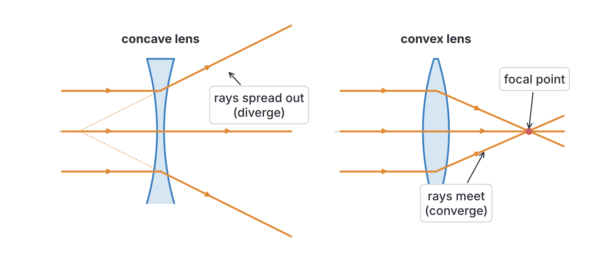

### How eye defects are detected

- **Snellen chart (visual acuity chart):** a chart of letters (or the "E" shape pointing in different directions, for people who cannot read) that get smaller line by line. The person stands at a fixed distance (usually 6 metres) and reads with one eye at a time. Normal vision is recorded as **6/6** (in some countries, 20/20). A person who can read only the large lines may be **short-sighted**.
- **Near-vision (reading) chart:** small print held at reading distance; a person who cannot read it clearly may be **long-sighted** or **presbyopic**.
- **Astigmatism chart:** a "clock face" of lines radiating like spokes; a person with astigmatism sees some lines sharp and black, and others blurred or grey.
- **Ishihara colour plates:** circles of coloured dots containing a number made of dots of a different colour; a colour-blind person cannot see the number, or sees a different one.
- **Eye pressure test (tonometry)** and examination of the optic nerve with an **ophthalmoscope** (a special torch with lenses): used to detect **glaucoma**.
- **Slit lamp and ophthalmoscope examination:** shows cloudiness of the lens (**cataract**) and diseases of the retina.

Eye tests are done by **optometrists** (who test vision and prescribe glasses) and **ophthalmologists** (doctors who specialise in eye diseases and surgery).

### Myopia (short-sightedness)

**What it is:** a person with myopia can see **near objects clearly** but **distant objects are blurred**. For example, a student can read a textbook easily but cannot read the writing on the blackboard from the back of the class.

**Cause:**

- The **eyeball is too long** (from front to back), or
- The **lens (or cornea) is too strongly curved** (too thick and too powerful), so it bends light too much.

**What happens:** light from a **distant** object is focused **in front of the retina**. By the time the rays reach the retina, they have crossed and spread out again, so the image is blurred. Light from near objects (which is diverging) is focused further back, onto the retina, so near objects are clear.

**Correction:**

- **Concave (diverging) lenses** in spectacles or contact lenses. The concave lens spreads the rays out slightly before they enter the eye, so the eye's lens focuses them further back, **exactly on the retina**.
- **Refractive surgery** (for example, laser surgery that reshapes the cornea) is available for some adults.

**Note:** myopia often starts or gets worse in childhood and the teenage years. Research suggests that spending more time outdoors in daylight may help to reduce the risk in children.

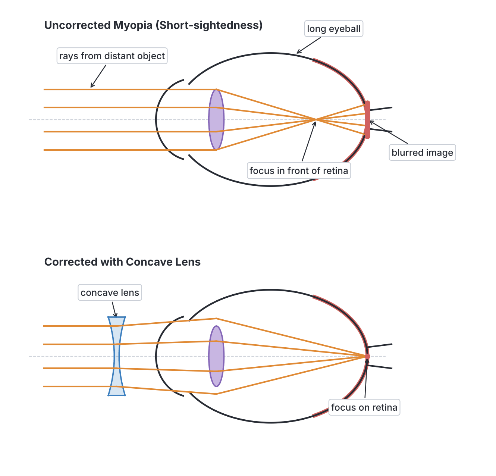

### Hypermetropia (long-sightedness)

**What it is:** a person with hypermetropia (also called **hyperopia**) can see **distant objects clearly** but **near objects are blurred**. Reading a book or threading a needle is difficult; the person may hold the book far away to read it.

**Cause:**

- The **eyeball is too short** (from front to back), or
- The **lens (or cornea) is too weak** (not curved enough), so it does not bend light enough.

**What happens:** light from a **near** object is focused **behind the retina** (the rays have not yet met when they reach the retina), so the image is blurred. Young people with mild hypermetropia can often still see clearly by making the lens fatter (accommodating), but this tires the eyes and may cause headaches.

**Correction:**

- **Convex (converging) lenses**. The convex lens bends the rays inwards slightly before they enter the eye, so the eye's lens brings them to a focus **exactly on the retina**.

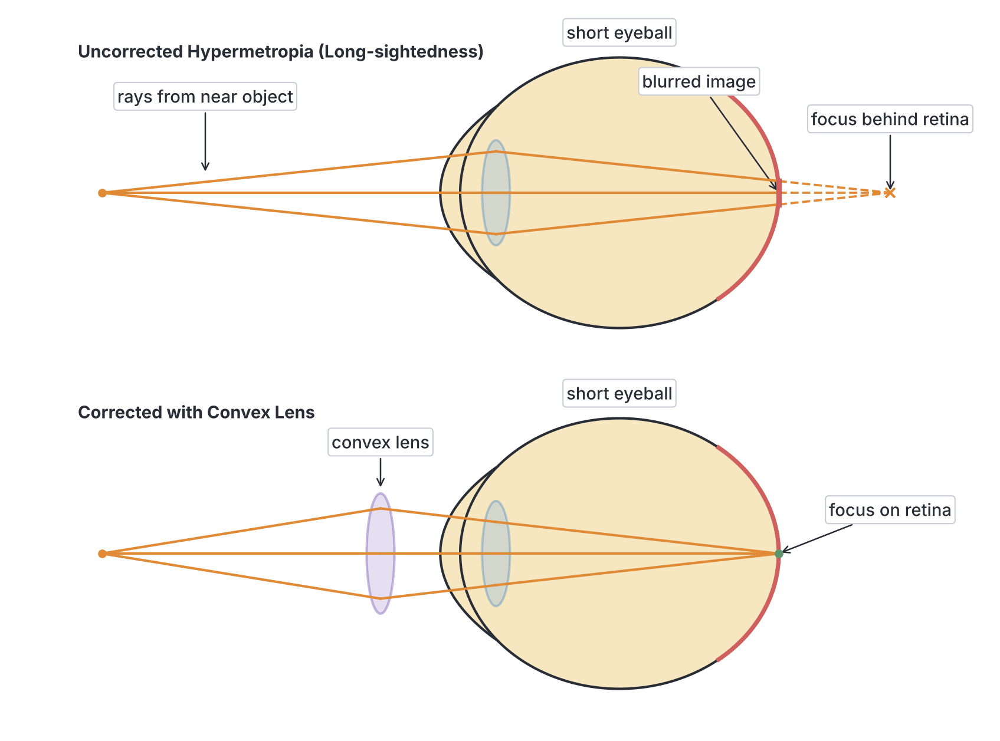

### Myopia and hypermetropia compared

| Feature | Myopia (short-sightedness) | Hypermetropia (long-sightedness) |
| --- | --- | --- |
| Can see clearly | **Near** objects | **Distant** objects |
| Cannot see clearly | **Distant** objects | **Near** objects |
| Shape of eyeball | Too **long** | Too **short** |
| Power of lens/cornea | Too **strong** (too convex) | Too **weak** (not convex enough) |
| Where the image is focused | **In front of** the retina | **Behind** the retina |
| Correcting lens | **Concave (diverging)** | **Convex (converging)** |
| Sign of lens power | Minus (−) | Plus (+) |

**Memory trick:** "**My**opia: **m**inus lens, **m**ust see **m**y book (near)". Or: short-sighted people see a **short** distance; long-sighted people see a **long** distance.

### Presbyopia (old-age long-sightedness)

**What it is:** a gradual loss of the ability to focus on **near objects** that happens to almost everyone with age, usually becoming noticeable from about **40 to 45 years** old. People hold newspapers or phones further and further away to read them ("my arms are getting too short").

**Cause:**

- With age, the **lens becomes harder and less elastic**, so it cannot spring into a fat, rounded shape when the suspensory ligaments slacken.
- The **ciliary muscles** may also become weaker.
- As a result, **accommodation for near objects fails**, and the near point moves further away. Light from near objects is focused **behind** the retina.

**Correction:**

- **Convex lenses** as **reading glasses**.
- People who also have myopia may need **bifocal** lenses (the top part concave, for distant vision; the bottom part convex, for reading) or **varifocal (progressive)** lenses, which change power gradually from top to bottom.

**Difference from hypermetropia:** in hypermetropia, the cause is usually the **shape of the eyeball**, and it can occur at any age, even in children. In presbyopia, the cause is **ageing of the lens**, and the eyeball shape is normal. Both are corrected with convex lenses.

### Astigmatism

**What it is:** blurred or distorted vision at all distances, in which **lines in some directions look sharp while lines in other directions look blurred**. For example, the horizontal lines of a window frame may look clear while the vertical lines look fuzzy.

**Cause:** the **cornea (or sometimes the lens) is unevenly curved**. Instead of being round like a football, it is curved more in one direction than the other, like the back of a spoon or a rugby ball. Light passing through different parts is bent by different amounts, so it cannot all be focused at one point on the retina.

**Detection:** the astigmatism chart ("clock face" of lines); some lines look darker and sharper than others. An optometrist can measure it exactly.

**Correction:**

- **Cylindrical lenses** (or **toric** contact lenses), which are curved more in one direction than the other, to cancel out the uneven curvature of the cornea.
- Laser surgery can reshape the cornea in some adults.

Astigmatism is common and often occurs together with myopia or hypermetropia; a single spectacle lens can correct both.

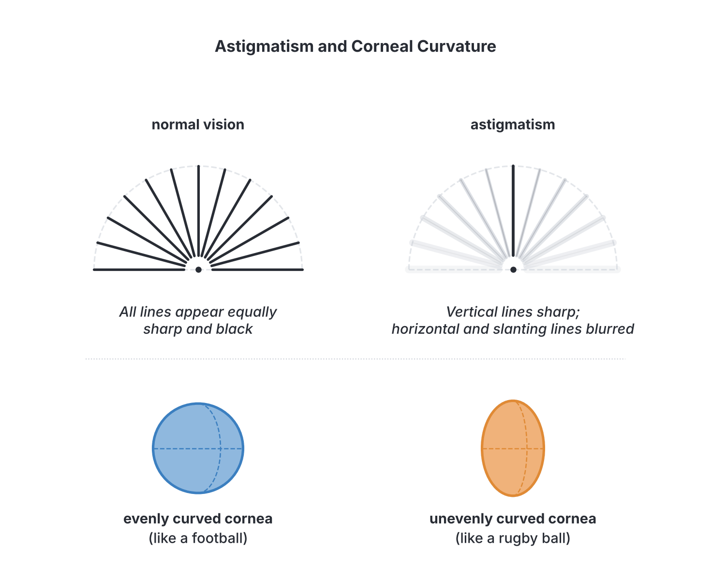

### Cataract

**What it is:** the **lens becomes cloudy (opaque)**, so light cannot pass through it properly. Vision becomes misty or foggy, colours look faded, bright lights cause glare, and night vision is poor. In advanced cataract, the pupil looks **white or greyish** instead of black. Without treatment, it can cause **blindness**.

**Causes and risk factors:**

- **Old age** (the most common cause); the proteins in the lens slowly change and clump together.
- **Diabetes mellitus**.
- Long exposure to the **ultraviolet light** in strong sunlight.
- **Injury** to the eye.
- **Smoking**, and long use of some drugs (e.g. steroids).
- Some babies are born with cataracts (congenital cataract), for example after the mother had **rubella (German measles)** during pregnancy.

**Detection:** examination of the eye with a torch, slit lamp or ophthalmoscope shows the cloudy lens.

**Correction:** cataract **cannot be cured with spectacles or eye drops**. The treatment is **surgery**: the cloudy lens is removed and usually replaced with a clear, artificial plastic lens (an **intraocular lens implant**). The operation is common, quick and very successful. Before artificial lenses were available, people wore very thick convex spectacles after the operation to replace the focusing power of the removed lens.

**In Nigeria:** surveys of blindness in Nigeria have found **cataract** to be the **leading cause of blindness**, especially among older people. Many cases could be cured by surgery. Free eye-surgery outreach programmes are held in many states. Traditional "couching" (pushing the lens back into the eye with a sharp instrument by untrained people) is dangerous and often leads to permanent blindness; it should be avoided.

**Protection:** wearing sunglasses or a wide-brimmed hat in strong sunlight, not smoking, and controlling diabetes reduce the risk.

### Glaucoma

**What it is:** a group of eye diseases in which the **optic nerve is damaged**, usually because of **increased pressure of the fluid inside the eye**.

**Cause:**

1. The **aqueous humour** is made all the time by the ciliary body.
2. Normally, it drains away through a small channel at the angle between the iris and the cornea, so the pressure in the eye stays constant.
3. In glaucoma, the drainage channel is **partly blocked** or works poorly, so the aqueous humour builds up and the **pressure inside the eye rises**.
4. The high pressure slowly **damages the optic nerve** fibres.

**Symptoms:** in the most common type (open-angle glaucoma), there is usually **no pain** and no early warning. **Side (peripheral) vision is lost first**, very slowly, so the person does not notice it until a lot of damage is done. In late stages, only a small central "tunnel" of vision remains, and then total blindness follows. A less common type (closed-angle glaucoma) can come on suddenly, with severe eye pain, red eye, headache, vomiting and blurred vision; this is an emergency.

**Risk factors:** age over 40, a family history of glaucoma, being of **African descent** (people of African origin are at higher risk of open-angle glaucoma and often get it at a younger age), diabetes, and long use of steroid eye drops.

**Detection:** regular eye checks, especially for adults over 40: **eye pressure measurement** (tonometry), examining the **optic nerve** with an ophthalmoscope, and **visual field tests** (checking side vision).

**Correction (control):** damage already done to the optic nerve **cannot be reversed**, so early detection is vital. Treatment aims to **lower the pressure** and stop further loss:

- **Eye drops** (used every day, often for life) that reduce the production of aqueous humour or help it drain.
- **Laser treatment** to improve drainage.
- **Surgery** to make a new drainage channel.

Glaucoma is another major cause of blindness in Nigeria. Because it is silent, it is sometimes called the "silent thief of sight".

### Colour blindness

**What it is:** a person cannot tell certain colours apart. The commonest type is **red-green colour blindness**, in which reds, greens, browns and oranges are confused. Complete colour blindness (seeing only shades of grey) is very rare.

**Cause:**

- One type of **cone** is **missing or faulty**, usually the red-sensitive or green-sensitive cones.
- Most cases are **inherited**. The genes for the red and green cone pigments are carried on the **X chromosome**, and the faulty form is **recessive**. Colour blindness is therefore a **sex-linked** character, and it is **much more common in males** than in females:
  - A male (XY) has only **one** X chromosome. If it carries the faulty gene, he is colour blind.
  - A female (XX) is colour blind only if **both** her X chromosomes carry the faulty gene. If only one does, she has normal vision but is a **carrier** and can pass the gene to her sons.
- This is explained fully, with genetic crosses, in the heredity notes (**Topic D2a**, sex-linked characters).
- A few cases are caused by eye disease, injury or certain drugs.

**Detection:** **Ishihara colour plates** (circles of coloured dots with a hidden number), and arranging coloured objects or wool in order. Colour vision tests are required for some jobs, such as drivers, pilots, electricians (who must tell coloured wires apart) and some members of the armed forces.

**Correction:** inherited colour blindness **cannot be cured**. People learn to cope by using brightness, position and labels (for example, the red light is always at the top of a traffic light). Special tinted glasses help some people tell some colours apart better, but they do not give normal colour vision.

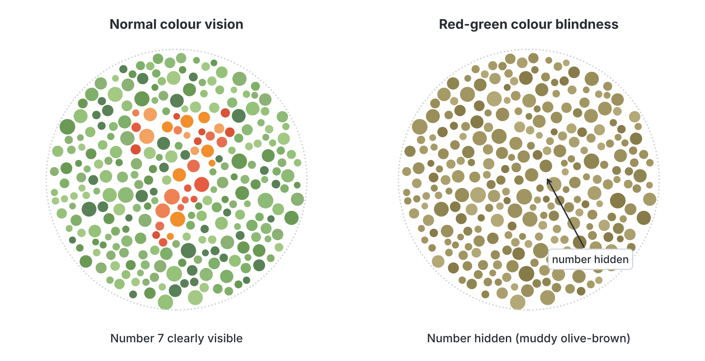

### Night blindness

**What it is:** **night blindness (nyctalopia)** is difficulty seeing in **dim light** or at night, for example being unable to find one's way after sunset, even though vision in daylight is fairly normal.

**Cause:**

- Most often, **lack of vitamin A** in the diet. Vitamin A is needed to make **rhodopsin (visual purple)**, the light-sensitive pigment of the **rods**. Without enough rhodopsin, the rods cannot work in dim light.
- Less often, it is caused by inherited diseases of the retina (such as retinitis pigmentosa) or advanced cataract.

**Detection:** the person reports difficulty seeing at dusk or at night; health workers ask about this, especially among young children and pregnant women. A doctor may also test the blood level of vitamin A.

**Correction and prevention:**

- Eat foods **rich in vitamin A** or in **carotene** (which the body turns into vitamin A): **red palm oil**, **carrots**, liver, eggs, milk, **dark-green leafy vegetables** (e.g. *ugu* (fluted pumpkin leaves), *tete* (amaranth)), yellow and orange fruits such as **mango** and **pawpaw**, and orange-fleshed sweet potato.
- **Vitamin A supplements**, given to young children in many Nigerian immunisation and child-health campaigns.
- Night blindness from vitamin A deficiency is usually **reversible** if treated early.

**Danger:** if vitamin A deficiency continues, it can cause **xerophthalmia** (drying of the conjunctiva and cornea), softening and ulceration of the cornea, and permanent **blindness**. Vitamin A deficiency also weakens the body's resistance to infections such as measles.

### Other common eye problems in Nigeria

- **Conjunctivitis ("Apollo"):** inflammation of the conjunctiva caused by bacteria, viruses or allergy. The eye becomes red, itchy and watery, with a sticky discharge. In Nigeria and Ghana, viral conjunctivitis is popularly called **"Apollo"**, because a large outbreak occurred around the time of the Apollo moon landings (1969 to 1971). It spreads easily by hands, towels and handkerchiefs. Prevention: wash hands, do not share towels; treatment: see a health worker (bacterial conjunctivitis is treated with antibiotic eye drops). Never put urine, breast milk or herbal mixtures in the eyes.
- **River blindness (onchocerciasis):** caused by a parasitic worm (*Onchocerca volvulus*), spread by the bites of **blackflies** (*Simulium*) that breed in fast-flowing rivers. The worms' larvae damage the skin and eyes and can cause blindness. It is controlled by giving the drug **ivermectin** (Mectizan) to whole communities, usually once a year.
- **Trachoma:** a bacterial infection of the eyelids and conjunctiva, spread by flies and poor hygiene; repeated infection scars the eyelids, the eyelashes turn inwards and scratch the cornea, causing blindness. It is controlled by face washing, clean surroundings, antibiotics and surgery.
- **Squint (strabismus):** the two eyes do not point in the same direction. Children with a squint should be taken to an eye specialist early; it can be corrected with glasses, patching the good eye, or surgery.

### Summary table of eye defects

| Defect | Cause | What the person notices | Detection | Correction |
| --- | --- | --- | --- | --- |
| **Myopia** (short-sight) | Eyeball too long or lens too strong; image in front of retina | Distant objects blurred; near objects clear | Snellen chart | **Concave** lenses; laser surgery |
| **Hypermetropia** (long-sight) | Eyeball too short or lens too weak; image behind retina | Near objects blurred; distant objects clear | Near-vision chart; eye test | **Convex** lenses |
| **Presbyopia** | Lens loses elasticity with age; poor accommodation | Difficulty reading small print after about 40 | Near-vision chart | **Convex** reading glasses; bifocals |
| **Astigmatism** | Uneven curvature of cornea or lens | Lines in some directions blurred | Astigmatism (clock-face) chart | **Cylindrical** lenses |
| **Cataract** | Lens becomes cloudy (opaque) | Misty, foggy vision; white pupil | Torch, slit lamp, ophthalmoscope | **Surgery**: remove lens, insert artificial lens |
| **Glaucoma** | Raised pressure in the eye damages the optic nerve | Gradual loss of side vision, often unnoticed | Eye pressure test; optic nerve check; visual field test | **Eye drops**, laser or surgery to lower pressure; damage cannot be reversed |
| **Colour blindness** | Missing or faulty cones; sex-linked inheritance | Cannot tell certain colours (usually red and green) apart | Ishihara plates | **No cure**; coping strategies; tinted lenses help some |
| **Night blindness** | Lack of vitamin A, so too little rhodopsin in rods | Poor vision in dim light | History; vitamin A blood level | **Vitamin A-rich foods**, vitamin A supplements |

### Defects of the ear

#### Types of deafness (hearing loss)

**Deafness** is partial or total loss of hearing. Using what we know about the structure of the ear, deafness is divided into types according to **where** the problem is.

| Feature | Conductive deafness | Sensorineural (nerve) deafness |
| --- | --- | --- |
| Where the problem is | **Outer or middle ear**: sound is not **conducted** (carried) properly to the inner ear | **Inner ear** (cochlea and its hair cells) or the **auditory nerve** or brain |
| Examples of causes | Wax blocking the ear canal; objects in the ear; middle ear infection (**otitis media**) with fluid or pus; a **perforated (torn) eardrum**; stiffening of the ossicles (e.g. the stapes becoming fixed to the oval window, called **otosclerosis**) | **Loud noise** (e.g. generators, factory machines, gunfire, very loud music through earphones or at parties); **ageing** (gradual loss of high-pitched hearing); infections such as **meningitis**, measles and mumps; **rubella** in a pregnant mother; some drugs (e.g. certain antibiotics such as streptomycin given for long periods); head injury; inherited conditions |
| Can it be corrected? | Often **yes**, by treating the cause (removing wax, treating infection, surgery to repair the eardrum or ossicles) | Usually **permanent**; damaged hair cells do not grow back. Hearing aids or cochlear implants can help |
| Effect of a hearing aid | Very helpful | Helpful in mild to moderate cases |

**Mixed deafness** is a combination of both types. Some children are born deaf (**congenital deafness**).

**Detection of deafness:**

- **Simple tests:** whispering words from behind the person; ringing a bell or clapping behind a baby and watching if it turns its head.
- **Tuning fork tests** (the Rinne and Weber tests), which compare hearing through the air with hearing through the bones of the skull. In conductive deafness, sound conducted through the bone is heard better than through the air, because the cochlea itself is working; in sensorineural deafness, both are reduced.
- **Audiometry:** a machine plays sounds of different pitches and loudness through earphones, and the person signals when they hear each one. The results are recorded on a chart (an audiogram).
- **Otoscope (auriscope):** a special torch used to look down the ear canal at the eardrum, to see wax, objects, infection or a hole in the eardrum.
- **Newborn hearing screening** with special machines, so deaf babies can be helped early, which is important for learning to speak.

**Correction and help for deafness:**

1. Treat the cause: remove **wax**, remove **foreign objects** (only by a health worker), treat **ear infections** with antibiotics.
2. **Surgery:** repair a perforated eardrum (**tympanoplasty**); replace a fixed stapes with an artificial one; insert tiny tubes (**grommets**) in the eardrum to drain fluid from the middle ear in children with repeated infections.
3. **Hearing aids:** small electronic devices worn in or behind the ear that **amplify** (make louder) sounds.
4. **Cochlear implants:** for severe sensorineural deafness. An electronic device is placed inside the cochlea; it receives sound from a microphone and directly stimulates the auditory nerve.
5. **Communication support:** **sign language**, lip reading, and special schools for the deaf.

**Prevention of noise-induced deafness:** avoid very loud sounds for long periods (sounds above about 85 decibels, roughly the level of heavy traffic, can damage hearing with long exposure); keep the volume of earphones low; wear **ear protectors (earmuffs or earplugs)** near generators, in factories, at airports and at loud events; do not sit next to loudspeakers at parties and churches.

#### Otitis media (middle ear infection)

**What it is:** infection and inflammation of the **middle ear**, very common in young children.

**Cause and how it develops, step by step:**

1. The child has a **cold, catarrh, sore throat** or tonsillitis.
2. Bacteria or viruses travel from the throat up the **Eustachian tube** to the middle ear. (In young children, the tube is short, wide and nearly horizontal, so germs pass up easily.)
3. The lining of the Eustachian tube swells, so the tube is **blocked** and fluid cannot drain from the middle ear.
4. **Pus and fluid** collect in the middle ear and press on the eardrum.

**Symptoms:** earache, fever, irritability in babies (pulling at the ear, crying), and **reduced hearing** (conductive deafness), because the eardrum and ossicles cannot vibrate freely in fluid.

**Complications:** the pressure may **burst (perforate) the eardrum**, and pus runs out of the ear. If infection keeps returning, it can become **chronic suppurative otitis media** (often called "running ear" or a discharging ear), with lasting hearing loss. Rarely, infection spreads to the bone behind the ear (**mastoiditis**) or to the brain (meningitis or brain abscess).

**Correction and prevention:**

- See a health worker early; **antibiotics** treat bacterial infection, and painkillers relieve pain.
- A perforated eardrum often heals by itself; if not, it can be repaired by surgery.
- Do **not** put oil, herbs, hot water or other substances into a discharging ear.
- Prevention: treat colds and sore throats, breastfeed babies, avoid feeding babies while they lie flat on their backs, avoid exposure to cigarette smoke, and keep up with childhood immunisations.

#### Ear wax (cerumen) and blockage

**Ear wax** is made normally by glands in the skin of the ear canal. It is **useful**: it traps dust and germs, kills some bacteria, and keeps the skin of the canal from drying and cracking. Normally, wax slowly moves out of the ear by itself and does not need to be removed.

**Problem:** sometimes wax builds up and forms a hard plug (**impacted wax**) that **blocks the ear canal**. Sound cannot reach the eardrum properly, causing **conductive deafness**, a feeling of fullness, discomfort, ringing in the ear (tinnitus) or mild dizziness. Pushing **cotton buds, matchsticks, biro covers, hairpins or keys** into the ear often **pushes the wax deeper** and can scratch the canal or **tear the eardrum**.

**Detection:** a health worker looks into the ear with an **otoscope**.

**Correction:** **softening ear drops** (for example, olive oil or sodium bicarbonate drops) for a few days, after which the wax often comes out by itself; if not, a nurse or doctor gently washes it out (**syringing or irrigation**) or removes it with special instruments. Never syringe an ear that has a perforated eardrum.

#### Other ear problems

- **Foreign bodies:** seeds, beads and insects sometimes enter the ear canal, especially in children. They should be removed by a health worker, not poked at.
- **Tinnitus:** ringing, buzzing or hissing in the ears without an outside sound. It may be caused by loud noise, wax, ear infection, ageing or some drugs (including high doses of quinine).
- **Vertigo and balance problems:** damage to the **semicircular canals**, **utriculus or sacculus** (for example by infection of the inner ear) can cause severe **dizziness (vertigo)**, a feeling that the room is spinning, with loss of balance and vomiting.

### Summary table of ear defects

| Defect | Part affected | Cause | Detection | Correction |
| --- | --- | --- | --- | --- |
| **Wax impaction** | Ear canal (outer ear) | Build-up of wax, often pushed deeper by cotton buds | Otoscope | Softening drops; syringing by a health worker |
| **Otitis media** | Middle ear | Infection spreading from the throat along the Eustachian tube | Otoscope (red, bulging eardrum); symptoms | Antibiotics; painkillers; grommets for repeated cases |
| **Perforated eardrum** | Eardrum | Infection, very loud blast, slap on the ear, poking objects into the ear | Otoscope | Often heals itself; surgery (tympanoplasty) |
| **Conductive deafness** | Outer or middle ear | Wax, infection, perforation, fixed ossicles | Tuning fork tests; audiometry | Treat the cause; surgery; hearing aids |
| **Sensorineural deafness** | Cochlea or auditory nerve | Loud noise, ageing, meningitis, rubella, some drugs | Audiometry; tuning fork tests | Usually permanent; hearing aids; cochlear implants; sign language |
| **Vertigo** | Semicircular canals, utriculus, sacculus | Inner ear infection or disease | Balance tests; doctor's examination | Treat the cause; medicines to reduce dizziness |

### Defects of the nose

#### Anosmia (loss of smell)

**What it is:** **anosmia** is the complete loss of the sense of smell. A partial loss is called **hyposmia**.

**Causes:**

- **Blockage** that stops odour molecules reaching the olfactory epithelium: a common **cold**, catarrh, **sinusitis** (inflammation of the air spaces around the nose), allergies, and **nasal polyps** (soft swellings in the nose).
- **Damage to the olfactory cells**: some viral infections (for example, many people lost their sense of smell with **COVID-19**), and breathing in poisonous chemicals.
- **Damage to the olfactory nerve or brain**: a **head injury** can tear the fine nerve fibres where they pass through the cribriform plate; brain tumours.
- **Ageing**: the sense of smell weakens in old age.
- Some people are born without a sense of smell.

**Detection:** the person is asked to identify familiar smells (for example, coffee, orange peel, vanilla, menthol or soap) with the eyes closed, testing one nostril at a time; special scratch-and-sniff test cards are also used.

**Dangers of anosmia:** the person cannot smell **smoke**, a **gas leak** or **spoilt food**, and may lose the enjoyment of food (and therefore appetite), because flavour depends greatly on smell.

**Correction:** treat the cause: anosmia caused by a cold or catarrh usually goes away as the cold clears; sinusitis and allergies are treated with medicines; polyps can be removed by surgery. Smell lost after a viral infection often returns slowly over weeks or months, and "smell training" (sniffing a set of strong smells every day) may help. Smell loss from nerve damage may be permanent. People with anosmia should fit **smoke alarms and gas detectors** at home and check use-by dates on food.

### Defects of the tongue (taste)

- **Ageusia** is the complete loss of taste; **hypogeusia** is reduced taste. Complete loss of all taste is rare, because taste is carried by several nerves.
- **Causes:** loss of smell (food seems tasteless even though the taste buds work), infections (including COVID-19), **dry mouth** (too little saliva to dissolve food chemicals), burns of the tongue by very hot food, **smoking**, some medicines, **zinc** deficiency, ageing and damage to the facial or glossopharyngeal nerves.
- **Detection:** placing drops of sweet (sugar), salty (salt), sour (lemon juice or dilute vinegar) and bitter (e.g. quinine or bitter leaf juice) solutions on different parts of the tongue.
- **Correction:** treat the cause: stop smoking, treat infections, drink enough water, treat dry mouth and good oral hygiene. Taste cells are replaced regularly, so taste damaged by a burn usually recovers within a few weeks.

### Defects of the skin as a sense organ

- **Loss of sensation (numbness)** happens when the sensory nerves of the skin are damaged. The person cannot feel pain, heat or touch in the affected area, so they may burn or cut themselves without noticing, and the wounds can become infected.
- **Leprosy (Hansen's disease):** caused by the bacterium *Mycobacterium leprae*. It damages the nerves of the skin, causing pale or reddish skin patches **with loss of feeling**. Because people cannot feel injuries, they often damage their hands and feet, which can lead to deformities. Detection: testing the patches for loss of feeling (e.g. with a wisp of cotton wool) and skin tests. Treatment: **multidrug therapy (MDT)**, which is given free and cures the infection; early treatment prevents disability.
- **Diabetic neuropathy:** long-term, poorly controlled **diabetes mellitus** damages nerves, especially in the feet. People with diabetes are taught to check their feet daily for wounds they cannot feel.
- **Burns:** deep burns destroy the receptors in the skin, so the burnt area may lose sensation.

**Detection of skin sensitivity:** a doctor tests light touch (with cotton wool), sharp and blunt touch (with a pin and the blunt end of it), temperature (with warm and cold tubes) and vibration (with a tuning fork) on different parts of the skin.

### Caring for the sense organs

| Sense organ | Good practices |
| --- | --- |
| **Eyes** | Eat vitamin A-rich foods; read in good light; do not rub the eyes; wear protective goggles when welding or using grinding machines; wear sunglasses in strong sun; have regular eye tests, especially if the board looks blurred or after age 40; never use un-prescribed eye drops, urine or herbal mixtures in the eyes; see a health worker quickly for eye injuries |
| **Ears** | Do not poke objects into the ears; keep away from very loud noise or use ear protectors; keep earphone volume low; treat colds and sore throats; see a health worker for earache or discharge; never slap anyone on the ear (it can burst the eardrum) |
| **Nose** | Blow the nose gently, one nostril at a time; do not pick the nose or push objects into it; avoid breathing in harmful fumes and smoke |
| **Tongue** | Keep the mouth clean; avoid very hot food and drinks; do not smoke |
| **Skin** | Keep the skin clean; treat cuts and burns; people with diabetes or leprosy should check their skin daily for unnoticed injuries |

## Key terms

| Term | Meaning |
| --- | --- |
| Stimulus | A change in the surroundings or inside the body that can be detected |
| Receptor | A cell or group of cells that detects a particular stimulus |
| Sense organ | An organ containing many receptors and other tissues, specialised to detect a particular stimulus |
| Sensory adaptation | Reduced response of receptors to a stimulus that continues without change |
| Tactile | To do with the sense of touch |
| Olfactory | To do with the sense of smell |
| Gustatory | To do with the sense of taste |
| Taste bud | A cluster of taste cells and supporting cells with a taste pore, found mainly on the tongue |
| Umami | The savoury taste of glutamate, the fifth basic taste |
| Cornea | The transparent front part of the outer coat of the eye; does most of the bending of light |
| Retina | The light-sensitive inner layer of the eye containing rods and cones |
| Rods | Photoreceptors for vision in dim light; contain rhodopsin; give black-and-white vision |
| Cones | Photoreceptors for colour vision and detail in bright light; concentrated in the fovea |
| Rhodopsin (visual purple) | The light-sensitive pigment in rods, made from vitamin A |
| Fovea (yellow spot) | The part of the retina with only cones, giving the sharpest vision |
| Blind spot | The point where the optic nerve leaves the eye; has no rods or cones |
| Accommodation | Changing the shape (focal length) of the lens to focus on near or distant objects |
| Pupil reflex | Automatic change in the size of the pupil in response to light intensity |
| Binocular vision | Vision using both eyes together, giving good judgement of distance |
| Ossicles | The three tiny bones of the middle ear: malleus, incus and stapes |
| Eustachian tube | Tube linking the middle ear to the throat; equalises air pressure on both sides of the eardrum |
| Cochlea | Coiled, fluid-filled tube of the inner ear containing the organ of Corti; the organ of hearing |
| Organ of Corti | The receptor of hearing in the cochlea, made of hair cells on the basilar membrane |
| Semicircular canals | Three fluid-filled canals at right angles in the inner ear that detect rotation of the head |
| Utriculus and sacculus | Sacs in the inner ear with otoliths that detect head position and straight-line movement |
| Otoliths | Tiny grains of calcium carbonate in the utriculus and sacculus |
| Myopia | Short-sightedness; corrected with a concave lens |
| Hypermetropia | Long-sightedness; corrected with a convex lens |
| Presbyopia | Loss of near focusing with age, due to a less elastic lens |
| Astigmatism | Blurred vision due to uneven curvature of the cornea or lens; corrected with a cylindrical lens |
| Cataract | Clouding of the lens of the eye |
| Glaucoma | Damage to the optic nerve, usually caused by raised pressure inside the eye |
| Anosmia | Loss of the sense of smell |
| Otitis media | Infection and inflammation of the middle ear |

## Exam tips and common mistakes

- **The sensation is made in the brain:** sense organs only detect stimuli and send impulses. The visual area is in the occipital lobe; the hearing area is in the temporal lobe.
- **Accommodation:** for **near** objects the ciliary muscles **contract**, suspensory ligaments **slacken** and the lens becomes **thicker**. For **distant** objects it is the opposite. A favourite trick is to say "ciliary muscles relax for near objects": that is wrong.
- **Pupil reflex:** in **bright** light the **circular** muscles contract and the pupil gets smaller; in **dim** light the **radial** muscles contract and the pupil gets bigger.
- **Rods vs cones:** rods = dim light, no colour, rhodopsin, vitamin A, edge of retina; cones = bright light, colour, fovea. There are many more rods than cones.
- **Fovea vs blind spot:** the fovea has the most cones (sharpest vision); the blind spot has **no** receptors at all.
- **The cornea, not the lens, does most of the focusing,** but only the lens can change its focus.
- **Correcting lenses:** myopia = concave; hypermetropia and presbyopia = convex; astigmatism = cylindrical. Cataract needs surgery, not glasses.
- **Where the image falls:** myopia, in front of the retina; hypermetropia, behind the retina.
- **Colour blindness is sex-linked:** more common in males, because males have only one X chromosome.
- **Night blindness is caused by lack of vitamin A,** which is needed for rhodopsin in the rods. Don't confuse it with colour blindness (cones).
- **Ossicles order:** malleus (hammer, touching the eardrum) → incus (anvil) → stapes (stirrup, at the oval window). The stapes is the smallest bone in the body.
- **Eustachian tube:** equalises pressure on the two sides of the eardrum; it does not carry sound.
- **Balance:** semicircular canals detect **rotation**; utriculus and sacculus detect **head position (gravity)** and straight-line movement. The cochlea is for hearing only.
- **Smell and taste need solutions:** odour molecules must dissolve in mucus; food chemicals must dissolve in saliva.
- **Tongue map:** it is outdated (all areas can detect all tastes), but if JAMB asks with the old map in mind, sweet = tip and bitter = back.

## Quick summary

1. Sense organs contain receptors that change stimuli into nerve impulses, which travel along sensory nerves to the brain, where sensations are produced.
2. The skin detects touch, pressure, temperature and pain using different receptors (e.g. Meissner's corpuscles for touch, Pacinian corpuscles for pressure, free nerve endings for pain), packed most densely in the fingertips and lips.
3. The nose (smell) and tongue (taste) are chemical senses: odour chemicals dissolve in nasal mucus and are detected by olfactory cells; food chemicals dissolve in saliva and are detected by taste cells in taste buds; there are five basic tastes, including umami, and the old "tongue map" is outdated.
4. In the eye, the cornea and lens focus light onto the retina; the iris controls the size of the pupil by a reflex; the lens changes shape for near and distant objects (accommodation); rods work in dim light and cones give colour vision.
5. In the ear, sound passes through the pinna, ear canal, eardrum, ossicles and oval window to the cochlea, where hair cells in the organ of Corti send impulses along the auditory nerve; the semicircular canals detect rotation and the utriculus and sacculus detect head position.
6. Myopia is corrected with concave lenses, and hypermetropia and presbyopia with convex lenses; astigmatism needs cylindrical lenses; cataract is treated by surgery; glaucoma by lowering eye pressure; night blindness by vitamin A; colour blindness is inherited and cannot be cured.
7. Deafness may be conductive (outer or middle ear, e.g. wax or otitis media) or sensorineural (cochlea or nerve, e.g. loud noise); anosmia is loss of smell; good care and early testing protect all the sense organs.

## Practice questions

**1. The light-sensitive cells of the eye are found in the**

- A. cornea
- B. retina
- C. choroid
- D. iris

**Answer: B.** The retina contains the rods and cones, which change light into nerve impulses. The cornea refracts light, the choroid absorbs stray light and the iris controls the pupil.

**2. When the eye focuses on a near object, the**

- A. ciliary muscles relax and the lens becomes thinner
- B. suspensory ligaments become tight and the lens becomes thinner
- C. ciliary muscles contract, the suspensory ligaments slacken and the lens becomes more convex
- D. ciliary muscles contract and the lens becomes less convex

**Answer: C.** For near objects, contraction of the ciliary muscles slackens the suspensory ligaments, so the elastic lens becomes thicker and more convex, bending light more.

**3. A student who cannot read the writing on the blackboard from the back of the class, but can read her textbook clearly, should be given spectacles with**

- A. concave lenses
- B. convex lenses
- C. cylindrical lenses
- D. bifocal lenses only

**Answer: A.** She is short-sighted (myopic): images of distant objects form in front of the retina. A concave lens diverges the rays so they focus on the retina.

**4. Which of the following cells would be most active when a person walks along a dark road at night?**

- A. Cones in the fovea
- B. Taste cells
- C. Hair cells of the cochlea
- D. Rods in the retina

**Answer: D.** Rods contain rhodopsin and are very sensitive to dim light, so they give night vision. Cones need bright light.

**5. The part of the ear that detects rotation of the head is the**

- A. cochlea
- B. Eustachian tube
- C. semicircular canal
- D. sacculus

**Answer: C.** The semicircular canals, set at right angles, contain fluid that lags behind and bends the hair cells in the ampulla when the head turns. The sacculus detects head position and straight-line movement.

**6. The main function of the Eustachian tube is to**

- A. equalise the air pressure on both sides of the eardrum
- B. carry sound waves to the inner ear
- C. drain wax from the ear canal
- D. detect the position of the head

**Answer: A.** The Eustachian tube connects the middle ear to the throat, allowing air in or out so that the eardrum can vibrate freely.

**7. In bright light, the pupil of the eye becomes smaller because the**

- A. radial muscles of the iris contract
- B. ciliary muscles contract
- C. suspensory ligaments slacken
- D. circular muscles of the iris contract

**Answer: D.** Contraction of the circular muscles (with relaxation of the radial muscles) constricts the pupil, reducing the light entering the eye.

**8. The correct order in which vibrations pass through the ear ossicles from the eardrum is**

- A. stapes → incus → malleus
- B. malleus → incus → stapes
- C. incus → malleus → stapes
- D. malleus → stapes → incus

**Answer: B.** The malleus touches the eardrum, the incus is in the middle, and the stapes passes the vibrations to the oval window.

**9. A deficiency of vitamin A in the diet is most likely to cause**

- A. colour blindness
- B. astigmatism
- C. night blindness
- D. glaucoma

**Answer: C.** Vitamin A is needed to make rhodopsin, the pigment in the rods. Without it, vision in dim light is poor. Colour blindness is inherited; astigmatism is due to uneven curvature of the cornea; glaucoma is due to raised eye pressure.

**10. Odour molecules can be detected by the olfactory cells only after they have**

- A. dissolved in the mucus of the nasal lining
- B. reached the taste buds of the tongue
- C. passed through the cribriform plate
- D. been warmed by the turbinate bones

**Answer: A.** Smell is a chemical sense: odour chemicals must dissolve in the mucus covering the olfactory hairs before they can stimulate the receptor cells.
