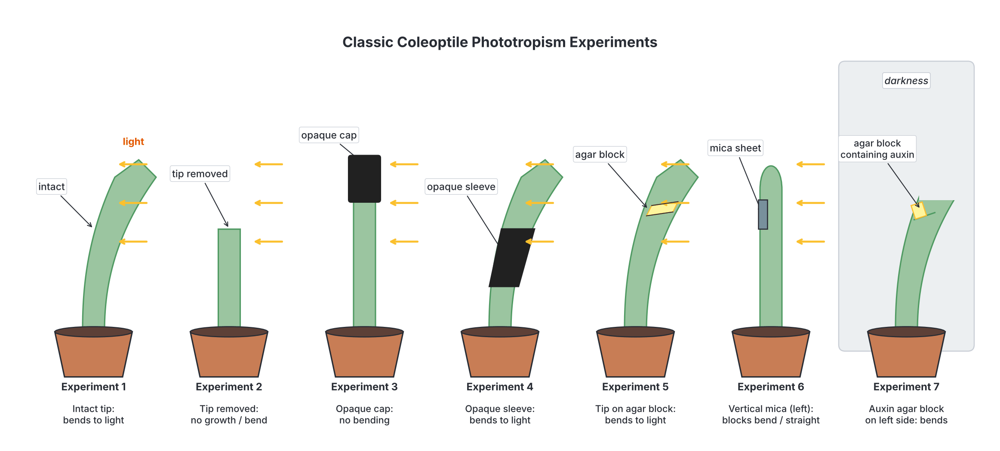

# JAMB Biology Notes: Hormonal Control in Animals and Plants

## What JAMB expects

This topic is Section B, Topic 9 of the JAMB Biology syllabus: Form and Functions – Co-ordination and control. The topic is large, so it is split into four files:

- `B9a-nervous-coordination.md`: content item a (nervous coordination), objectives i to iii.
- `B9b-sense-organs.md`: content item b (the sense organs), objectives iv and v.
- `B9c-hormonal-control.md` (this file): content item c (hormonal control), objectives vi to viii.
- `B9d-homeostasis.md`: content item d (homeostasis), objective ix.

The syllabus content covered in this file is **c. Hormonal control**:

- i. Animal hormonal system: pituitary, thyroid, parathyroid, adrenal gland, pancreas and gonads.
- ii. Plant hormones (phytohormones).

By the end of these notes, you should be able to:

1. State the location of the listed endocrine glands in animals: pituitary, thyroid, parathyroid, adrenal gland, pancreas and gonads (objective vi).
2. Relate the hormone produced by each of these glands to its functions, including the effects of producing too much or too little of each hormone (objective vii).
3. Examine the effects of the various phytohormones (auxins, gibberellins, cytokinins and ethylene, and also abscisic acid) on growth, tropism, flowering, fruit ripening and leaf abscission (objective viii).

**Note on the syllabus wording:** objective viii names four plant hormones "e.g." (as examples). A fifth major plant hormone, **abscisic acid**, is also covered here because it is important in leaf abscission, dormancy and closing of stomata, and textbooks and exam questions often include it.

**Note on homeostasis:** several hormones in this file (ADH, aldosterone, insulin, glucagon, thyroxine and adrenaline) also help keep the internal environment of the body constant. Their roles in **homeostasis**, including the step-by-step control of blood sugar, body temperature and water balance, are explained in `B9d-homeostasis.md`. This file introduces them and covers the glands that make them.

## Coordination by hormones: the basics

Living things must coordinate the activities of their different parts. Animals have two coordinating systems that work together:

1. The **nervous system**, which sends fast electrical impulses along nerves (see `B9a-nervous-coordination.md`).
2. The **endocrine (hormonal) system**, which sends chemical messages in the blood.

Plants have no nervous system. They coordinate their growth and responses mainly by **plant hormones**.

### What is a hormone?

A **hormone** is a **chemical messenger** that is:

- **produced** in small amounts by an **endocrine gland** (or by special cells);
- **released directly into the blood** (in animals);
- **carried** by the blood to other parts of the body;
- able to change the activity of particular organs, called **target organs** (or target cells), which have special **receptors** for that hormone.

The word "hormone" comes from a Greek word meaning "to set in motion" or "to excite". The study of hormones and endocrine glands is called **endocrinology**.

### Characteristics of animal hormones

1. They are made by **endocrine glands** and secreted **straight into the blood**.
2. They are needed only in **very small amounts**.
3. They are carried in the **blood plasma** to all parts of the body, but only **target organs** respond, because only their cells have the right receptors.
4. Their effects are usually **slower** to start than nervous responses, but **last longer**.
5. Many affect **long-term processes**, such as growth, development, metabolism and reproduction.
6. Most are **proteins or peptides** (e.g. insulin, ADH, growth hormone), **amines** made from amino acids (e.g. adrenaline, thyroxine) or **steroids** made from cholesterol (e.g. testosterone, oestrogen, cortisol, aldosterone).
7. After doing their job, they are broken down, mostly in the **liver**, and the products are excreted by the **kidneys**. So their levels must be kept up by continued secretion.
8. Their secretion is usually controlled by **negative feedback** (explained below), so their levels in the blood stay within limits.

### Endocrine and exocrine glands

A **gland** is an organ or group of cells that makes and releases (secretes) useful substances.

| Feature | Endocrine glands | Exocrine glands |
| --- | --- | --- |
| Ducts | **No ducts** (ductless glands) | **Have ducts** (tubes) |
| Where secretion goes | **Directly into the blood** flowing through the gland | Along a duct to a **surface or cavity**, e.g. the gut, mouth or skin |
| What they secrete | **Hormones** | Enzymes, sweat, saliva, mucus, tears, milk, sebum |
| Distance of effect | Often act on organs far away | Act near where the duct opens |
| Blood supply | Very rich, so hormones quickly enter the blood | Usual blood supply |
| Examples | Pituitary, thyroid, parathyroid, adrenal glands | Salivary glands, sweat glands, tear glands, gastric glands |

Some glands are **both** endocrine and exocrine. These are called **mixed (heterocrine) glands**:

- The **pancreas** makes digestive enzymes that pass along the **pancreatic duct** into the duodenum (exocrine) and the hormones **insulin** and **glucagon**, which pass into the blood (endocrine).
- The **testes** make sperm, which leave through the sperm ducts (exocrine), and **testosterone**, which enters the blood (endocrine).
- The **ovaries** release eggs into the oviducts and secrete **oestrogen** and **progesterone** into the blood.

## Location of the endocrine glands

**Objective vi: state the location of the listed endocrine glands in animals.**

The endocrine glands are found in different parts of the body, from the head to the pelvis. Their positions in humans are given below. (Other mammals have the same glands in similar positions.)

| Endocrine gland | Location | Number | Size and shape |
| --- | --- | --- | --- |
| **Pituitary gland** (hypophysis) | At the **base of the brain**, just below the **hypothalamus**, to which it is joined by a short stalk. It sits in a small hollow in a bone of the skull floor (the sphenoid bone), behind the eyes | One | About the size of a **pea** (about 1 cm across); has an **anterior lobe** (front) and a **posterior lobe** (back) |
| **Thyroid gland** | In the **neck**, in front of and on both sides of the **trachea (windpipe)**, just below the **larynx** (voice box, "Adam's apple") | One | Shaped like a **butterfly** or a bow tie: two lobes, one on each side of the trachea, joined by a narrow bridge (the **isthmus**) |
| **Parathyroid glands** | In the neck, **on (or embedded in) the back of the thyroid gland** | Usually **four** (two on each lobe of the thyroid) | Each about the size of a **grain of rice** |
| **Adrenal glands** (suprarenal glands) | In the abdomen, **one on top of each kidney** | **Two** | Small, roughly triangular or cap-shaped; each has an outer **cortex** and an inner **medulla** |
| **Pancreas** (endocrine part: **islets of Langerhans**) | In the **abdomen**, **behind and below the stomach**, lying in the curve (loop) of the **duodenum** | One pancreas; the islets are about a million tiny clusters of cells scattered through it | Long, soft, leaf-shaped organ about 12 to 15 cm long |
| **Gonads: testes** (male) | In the **scrotum**, a sac of skin hanging **outside the abdomen** between the thighs | **Two** | Oval, each about 4 to 5 cm long |
| **Gonads: ovaries** (female) | In the **lower abdomen (pelvic cavity)**, **one on each side of the uterus**, close to the funnel-shaped ends of the oviducts | **Two** | Oval or almond-shaped, each about 3 to 4 cm long |

**Why the testes are outside the abdomen:** sperm are produced best at a temperature about 2 to 3 °C below normal body temperature, so the testes hang in the scrotum. (See the reproduction notes, Topic B7.)

**Other endocrine glands and tissues (not listed in the syllabus, but useful to know):**

- **Hypothalamus:** part of the brain just above the pituitary; makes hormones that control the pituitary, and makes ADH and oxytocin (see below).
- **Pineal gland:** a tiny gland in the brain; makes **melatonin**, which is involved in sleep and daily rhythms.
- **Thymus:** in the chest, behind the breastbone; large in children; helps the development of white blood cells (T-lymphocytes) for immunity.
- **Stomach and duodenum:** their linings make hormones such as **gastrin** and **secretin**, which control the release of digestive juices.
- **Kidneys:** make **erythropoietin**, which stimulates red blood cell production.
- **Placenta:** during pregnancy, makes hormones including **progesterone**, **oestrogen** and **human chorionic gonadotrophin (hCG)** (the hormone detected by pregnancy tests).

[IMAGE: Front view outline of a human body (gender-neutral upper body and abdomen, with a separate small inset of the male and female lower abdomen) showing the positions of the main endocrine glands in distinct soft colours. Show the brain outline with the hypothalamus and the pea-sized pituitary gland hanging below it at the base of the brain, the butterfly-shaped thyroid gland in the neck in front of the trachea below the larynx, four tiny parathyroid glands shown as dots on the back of the thyroid (drawn in a small enlarged inset viewed from behind), the two adrenal glands as small caps on top of each kidney, the pancreas lying behind the stomach in the curve of the duodenum, and in the insets the two ovaries on either side of the uterus (female) and the two testes in the scrotum (male). Organs such as the trachea, stomach, kidneys and uterus drawn faintly in grey for reference. Labels: hypothalamus, pituitary gland, thyroid gland, parathyroid glands, trachea, adrenal glands, kidney, pancreas, stomach, duodenum, ovary, uterus, testis, scrotum. Clean flat textbook style, white background.]

## Hormones of each gland and their functions

**Objective vii: relate the hormone produced by each of these glands to their functions.**

For each gland below, you will find: the hormones it makes, what each hormone does, how its secretion is controlled, and what happens when too much (**over-secretion** or **hypersecretion**) or too little (**under-secretion** or **hyposecretion**) is produced.

### How hormone levels are controlled: negative feedback

Most hormones are controlled by **negative feedback**. This means that when the level of a hormone (or of the substance it controls) rises too high, this rise **switches off** further secretion; when the level falls too low, secretion is **switched on** again. The result is that the level is kept fairly constant, like a thermostat controlling an electric iron.

**Example: control of thyroxine, step by step**

1. The **hypothalamus** detects a fall in the level of **thyroxine** in the blood (for example, when the body's metabolic rate needs to rise in cold weather).
2. The hypothalamus releases a hormone (thyrotrophin-releasing hormone, **TRH**) that travels a short distance in tiny blood vessels to the **anterior pituitary**.
3. The anterior pituitary releases **thyroid-stimulating hormone (TSH)** into the blood.
4. TSH travels to the **thyroid gland** and stimulates it to make and release more **thyroxine**.
5. The level of thyroxine in the blood **rises**.
6. The high level of thyroxine **inhibits** (switches off) the release of TRH by the hypothalamus and TSH by the pituitary.
7. Less TSH is released, so the thyroid releases **less thyroxine**, and the level falls back to normal.
8. If the level falls too low, the cycle begins again.

Because the result (more thyroxine) acts to **reduce** the original signal, this is called **negative** feedback. The same idea controls the levels of many other hormones and is the basis of homeostasis (see `B9d-homeostasis.md`).

[IMAGE: Circular flow diagram of negative feedback control of thyroxine. At the top, a small brain outline with the hypothalamus highlighted; an arrow down to the pea-shaped anterior pituitary; a second arrow down to the butterfly-shaped thyroid gland in the neck; a third arrow from the thyroid to a box representing body cells and blood with small dots for thyroxine; then a long return arrow drawn in red with a minus sign symbol going back up from the blood to the hypothalamus and pituitary to show inhibition. Green arrows for stimulation, red arrow for inhibition. Labels: hypothalamus, TRH, anterior pituitary, TSH, thyroid gland, thyroxine, body cells (metabolic rate increases), high thyroxine inhibits. Clean flat textbook style, white background.]

### 1. The pituitary gland

The pituitary gland is small but very important. It has two main parts, which make or release different hormones:

- The **anterior pituitary** (front lobe) is true glandular tissue. It **makes** its own hormones, under the control of releasing hormones from the hypothalamus.
- The **posterior pituitary** (back lobe) is really an extension of the brain. It **stores and releases** two hormones (ADH and oxytocin) that are **made in the hypothalamus** and carried down nerve fibres in the stalk.

[IMAGE: Side section of the hypothalamus and pituitary gland at the base of the brain. Show the lower part of the brain with the hypothalamus region shaded, the narrow pituitary stalk below it, and the pea-sized pituitary gland sitting in a small cup-shaped hollow of skull bone (sphenoid). Divide the pituitary into a larger front anterior lobe (shaded pink, with tiny blood vessels connecting it to the hypothalamus) and a smaller back posterior lobe (shaded lilac, with yellow nerve fibres running down from nerve cell bodies in the hypothalamus and ending in it). Labels: hypothalamus, pituitary stalk, anterior pituitary, posterior pituitary, blood vessels carrying releasing hormones, nerve fibres carrying ADH and oxytocin, skull bone. Clean flat textbook style, white background.]

#### Hormones of the anterior pituitary

| Hormone | Target | Main functions |
| --- | --- | --- |
| **Growth hormone (GH)**, also called **somatotrophin** or somatotrophic hormone (STH) | Most body tissues, especially **bones and muscles** | Stimulates **growth** of the body: growth of the long bones (at their growth plates), muscle growth and protein synthesis; raises blood sugar and helps the use of fat for energy |
| **Thyroid-stimulating hormone (TSH)**, also called **thyrotrophin** | Thyroid gland | Stimulates the thyroid gland to grow and to make and release **thyroxine** |
| **Adrenocorticotrophic hormone (ACTH)** | Adrenal cortex | Stimulates the adrenal cortex to release its hormones, especially **cortisol**, e.g. during stress |
| **Follicle-stimulating hormone (FSH)** | Ovaries and testes | In females: stimulates the growth of **follicles** (which contain the eggs) in the ovary, and the release of **oestrogen** from them. In males: stimulates **sperm production** in the testes |
| **Luteinising hormone (LH)** | Ovaries and testes | In females: causes **ovulation** (release of the egg) and the formation of the **corpus luteum**, which makes **progesterone**. In males: stimulates the interstitial cells of the testes to make **testosterone** (in males, LH is also called **interstitial cell-stimulating hormone, ICSH**) |
| **Prolactin** (lactogenic hormone, luteotrophic hormone) | Mammary glands (breasts) | Stimulates the **production of milk** after childbirth |

FSH and LH together are called **gonadotrophins**, because they act on the gonads.

#### Hormones released by the posterior pituitary

| Hormone | Target | Main functions |
| --- | --- | --- |
| **Antidiuretic hormone (ADH)**, also called **vasopressin** | **Kidneys** (the distal convoluted tubules and collecting ducts) | Makes the walls of the tubules more **permeable to water**, so more water is **reabsorbed** into the blood and a **small volume of concentrated urine** is produced. It is released when the body is short of water (see `B9d-homeostasis.md`) |
| **Oxytocin** | **Uterus** and **mammary glands** | Causes strong **contractions of the uterus** during **labour (childbirth)**; causes the **ejection (let-down) of milk** from the breasts when the baby sucks |

**Note:** "**diuresis**" means producing a lot of urine. ADH works **against** diuresis (anti-diuretic), so it **reduces** the volume of urine. Doctors and midwives sometimes give oxytocin by drip to start or strengthen labour, or after delivery to make the uterus contract and reduce bleeding.

#### Why the pituitary is called the "master gland"

The pituitary gland is often called the **master gland** of the endocrine system because:

1. Many of its hormones (**TSH, ACTH, FSH and LH**) **control other endocrine glands**: the thyroid, the adrenal cortex, the ovaries and the testes. Hormones that control other glands are called **trophic (tropic) hormones**.
2. It also makes hormones that act directly on the body, such as **growth hormone** and **prolactin**, and releases **ADH** and **oxytocin**.
3. If the pituitary is removed or destroyed, many other glands shrink and stop working properly, and growth, reproduction and metabolism are all disturbed.

**But the pituitary has a "master" too:** the pituitary is itself controlled by the **hypothalamus** of the brain, which sends releasing (and inhibiting) hormones to the anterior pituitary and makes the hormones stored in the posterior pituitary. The hypothalamus receives information from the nervous system, so it is the main **link between the nervous system and the endocrine system**. In addition, the pituitary's output is controlled by negative feedback from the hormones of its target glands.

**Textbook variation:** most school textbooks call the pituitary "the master gland". Many modern textbooks point out that the **hypothalamus** controls the pituitary and could be called the real master. For JAMB, the answer to "the master gland" is the **pituitary gland**.

#### Effects of over- and under-secretion of pituitary hormones

**Gigantism (too much growth hormone in childhood)**

- **Cause:** over-secretion of growth hormone **before the end of puberty**, while the growth plates of the long bones are still open. Usually caused by a non-cancerous tumour of the pituitary.
- **Effects:** the person grows **very tall** (in rare cases, well over 2 metres), with very long arms and legs, large hands and feet. Body proportions are fairly normal. They may have joint pain, heart problems and other health difficulties.
- **Treatment:** surgery to remove the tumour, radiotherapy, or drugs that reduce growth hormone.

**Acromegaly (too much growth hormone in adults)**

- **Cause:** over-secretion of growth hormone **after puberty**, when the long bones can no longer grow in length (the growth plates have closed). Usually caused by a pituitary tumour.
- **Effects:** the person does **not get taller**, but bones that can still thicken, and soft tissues, keep growing. The **hands and feet** become large and broad (rings and shoes no longer fit), the **jaw** grows forward and the lower teeth may become widely spaced, the **nose, lips, tongue, brow ridges and ears** become larger, and the skin thickens. It also causes high blood pressure, high blood sugar and joint pain. The word comes from Greek: "acro" (extremities) + "megaly" (enlargement).
- **Treatment:** as for gigantism.

**Pituitary dwarfism (too little growth hormone in childhood)**

- **Cause:** under-secretion of growth hormone during childhood.
- **Effects:** the child grows very slowly and remains **very short**, but the body is usually **well proportioned**, and **intelligence is normal**. (This is different from cretinism; see the thyroid.)
- **Treatment:** injections of growth hormone (now made by genetically engineered bacteria) during childhood, before the growth plates close, allow the child to grow taller.

**Note:** there are many other causes of short stature, including inherited conditions such as **achondroplasia** (a bone growth disorder, in which the arms and legs are short but the trunk is near normal size), malnutrition and chronic illness. Only short stature caused by lack of growth hormone is called pituitary dwarfism.

**Diabetes insipidus (too little ADH)**

- **Cause:** under-secretion of **ADH**, because of damage to the hypothalamus or posterior pituitary (e.g. by a head injury, tumour or surgery). In a rarer form, the kidneys do not respond to ADH.
- **Effects:** without ADH, the kidney tubules reabsorb little water, so the person passes **very large volumes of dilute, watery urine** (sometimes many litres a day) and feels **very thirsty**, drinking a lot. The urine contains **no glucose**. The person can become dangerously **dehydrated** if water is not available.
- **Treatment:** a synthetic form of ADH (given as a nasal spray or tablets).
- **Name:** "diabetes" means passing a lot of urine; "insipidus" means "tasteless", because the urine is not sweet (compare diabetes mellitus, below).

**Over-secretion of ADH** (which is uncommon, e.g. caused by some tumours or drugs) makes the body keep too much water, so the blood becomes too dilute.

**Other pituitary disorders:** too little FSH and LH causes **delayed puberty** and **infertility**; too much prolactin can cause milk production in a person who is not breastfeeding and can disturb the menstrual cycle; damage to the whole anterior pituitary causes many glands to fail at once.

[IMAGE: Simple side-by-side comparison drawing of three standing figures and a hand, without faces showing distress, in a respectful medical illustration style: a very tall but well-proportioned young person (gigantism), a person of average height, and a short but well-proportioned child-sized adult (pituitary dwarfism); next to them a pair of hands comparing a normal adult hand with a large, broad, thick-fingered hand typical of acromegaly. A height scale in metres runs behind the figures. Labels: gigantism (too much growth hormone in childhood), normal, pituitary dwarfism (too little growth hormone in childhood), normal hand, acromegaly hand (too much growth hormone in adults). Clean flat textbook style, white background.]

### 2. The thyroid gland

The thyroid gland is made of many tiny hollow balls (**follicles**) filled with a jelly that stores the thyroid hormones. It needs **iodine** from the diet to make its main hormones.

#### Hormones of the thyroid

| Hormone | Main functions |
| --- | --- |
| **Thyroxine (T4)** and **triiodothyronine (T3)** (both contain **iodine**; T4 has four iodine atoms and T3 has three) | Control the **basal metabolic rate**: the rate at which cells use oxygen and food to release energy. They increase respiration and **heat production** in cells, so they help keep the body warm. They are needed for normal **growth and development**, especially of the **bones** and the **brain and nervous system** in children. They speed up the heart rate and affect alertness. They also work with growth hormone and help in **metamorphosis** in amphibians (tadpole to frog) |
| **Calcitonin** (made by special C cells between the follicles) | **Lowers the level of calcium** in the blood by encouraging calcium to be stored in bones; it works opposite to parathormone |

**Note:** most textbooks simply say "the thyroid makes thyroxine". Thyroxine (T4) is the main hormone released; much of it is changed in the tissues into T3, which is the more active form.

**Thyroxine and tadpoles:** thyroxine triggers metamorphosis in frogs and toads. Tadpoles given extra thyroxine change into tiny frogs early; tadpoles without a thyroid gland, or kept in water with no iodine, stay as tadpoles and grow into giant tadpoles.

**Control:** thyroxine release is controlled by **TSH** from the anterior pituitary, by negative feedback, as described above.

#### Under-secretion of thyroxine (hypothyroidism)

**Cretinism (in babies and children)**

- **Cause:** too little thyroxine **from birth or early childhood**, because the thyroid gland is missing, does not work properly, or because the mother and child lack **iodine**.
- **Effects:** **stunted growth** (short stature with short, thick limbs, so the body is **not** well proportioned); **severe intellectual disability** (mental retardation) because the brain does not develop normally; delayed teething and walking; a puffy face, a large protruding tongue, a swollen belly (often with an umbilical hernia), dry skin and coarse hair; slow heart rate and low body temperature; delayed sexual development.
- **Correction:** if it is detected **very early** (many countries test all newborn babies) and treated with **thyroxine** tablets, the child can grow and develop normally. Damage to the brain that has already happened cannot be reversed, which is why early treatment is so important. Prevention: enough **iodine** in the mother's diet during pregnancy.

**Myxoedema (in adults)**

- **Cause:** too little thyroxine in **adults**; commonly caused by the immune system attacking the thyroid, by iodine deficiency, or after surgery or treatment of the thyroid.
- **Effects:** **low metabolic rate**, so the person is **tired, slow and sluggish**, both physically and mentally; **gains weight** easily even with a poor appetite; feels **cold** even in warm weather (low heat production); has a **slow heartbeat**; dry, thick, puffy skin (especially of the face and around the eyes), coarse, dry hair that falls out; constipation; a hoarse voice; poor memory; heavy menstrual periods in women.
- **Correction:** **thyroxine** tablets taken daily for life.

#### Goitre

A **goitre** is a **swelling of the thyroid gland**, which shows as a swelling in the front of the neck. It may happen with too little, too much or normal amounts of thyroxine.

**Simple (endemic) goitre: caused by lack of iodine. Step by step:**

1. The diet does not contain enough **iodine**.
2. The thyroid cannot make enough **thyroxine**, so the blood level of thyroxine **falls**.
3. With low thyroxine, the negative feedback "brake" is removed, so the pituitary releases **more and more TSH**.
4. TSH stimulates the thyroid gland to **grow** (its cells multiply and enlarge) as it keeps trying to make thyroxine.
5. The thyroid gland becomes very **enlarged**, forming a **goitre**, which may be large enough to press on the windpipe and gullet, causing difficulty in breathing or swallowing.

The person may also show signs of low thyroxine (like myxoedema), and a pregnant woman lacking iodine may give birth to a child with **cretinism**.

**Where and why it occurs:** simple goitre used to be common (endemic) in areas far from the sea, especially hilly and mountainous inland areas where rain has washed iodine out of the soil, so the crops and water contain little iodine. Seafood and sea salt naturally contain more iodine.

**Prevention and correction:**

- Use **iodised salt** (common salt with small amounts of iodine added). In Nigeria, as in many countries, table salt is required to be iodised, and this has greatly reduced goitre and cretinism.
- Eat iodine-rich foods: **seafood** (fish, crayfish, shrimps, periwinkle), sea salt, milk and eggs.
- Iodine supplements, given by health workers where needed.
- Very large goitres that press on the windpipe may need **surgery**.

**Textbook variation:** some textbooks use "simple goitre", others "endemic goitre", "colloid goitre" or "iodine-deficiency goitre". All refer to the same condition.

#### Over-secretion of thyroxine (hyperthyroidism)

**Exophthalmic goitre (Graves' disease)**

- **Cause:** over-secretion of thyroxine. The most common cause is **Graves' disease**, in which the body's immune system makes antibodies that act like TSH and keep stimulating the thyroid. Other causes include lumps (nodules) in the thyroid that make too much hormone.
- **Effects:**
  - **High metabolic rate:** the person **loses weight** despite a big **appetite**, and always feels **hot** and **sweats** a lot (cannot bear heat).
  - **Fast and sometimes irregular heartbeat** (palpitations).
  - **Nervousness, restlessness, irritability**, anxiety and difficulty sleeping; trembling (tremor) of the hands.
  - **Swelling of the thyroid (goitre)**.
  - In Graves' disease, the **eyeballs bulge forward** (this is called **exophthalmos**), giving a staring look. Hence the name **exophthalmic goitre** ("exophthalmic" means "eyes bulging out").
  - Diarrhoea, light menstrual periods and muscle weakness.
- **Correction:** **anti-thyroid drugs** that reduce thyroxine production, **radioactive iodine** (which is taken up by the thyroid and destroys some of its cells), or **surgery** to remove part of the gland. Other drugs (beta-blockers) control the fast heartbeat and trembling.

**Textbook variation:** older textbooks may call this condition "toxic goitre" or "thyrotoxicosis". Exophthalmos is typical of Graves' disease; hyperthyroidism from other causes usually does not cause bulging eyes.

#### Under- and over-secretion of thyroxine compared

| Feature | Too little thyroxine (hypothyroidism) | Too much thyroxine (hyperthyroidism) |
| --- | --- | --- |
| Conditions | Cretinism (children), myxoedema (adults), simple goitre (iodine deficiency) | Exophthalmic goitre (Graves' disease) |
| Metabolic rate | **Low** | **High** |
| Body weight | Gain, even with poor appetite | Loss, even with large appetite |
| Response to temperature | Feels cold | Feels hot, sweats a lot |
| Heart rate | Slow | Fast |
| Activity and mood | Tired, slow, sluggish, poor memory | Nervous, restless, irritable, trembling |
| Skin and hair | Dry, thick, puffy skin; coarse hair | Warm, moist skin; fine hair |
| Eyes | Puffy around the eyes | May bulge (exophthalmos) |
| Treatment | Thyroxine tablets; iodised salt for iodine deficiency | Anti-thyroid drugs, radioactive iodine, surgery |

[IMAGE: Three-part diagram of the thyroid gland. Left: front view of the neck showing the larynx, the trachea and the butterfly-shaped thyroid gland with its two lobes and the narrow isthmus across the front of the trachea. Middle: back view of the thyroid showing four small oval parathyroid glands, two on each lobe. Right: outline of a person's head and neck in side view with a large rounded swelling in the front of the neck (goitre), drawn respectfully. Labels: larynx, trachea, thyroid gland, left lobe, right lobe, isthmus, parathyroid glands, goitre (enlarged thyroid). Clean flat textbook style, white background.]

### 3. The parathyroid glands

The parathyroid glands are four tiny glands on the back of the thyroid. They are separate glands with a different job from the thyroid.

#### Hormone of the parathyroids

| Hormone | Main functions |
| --- | --- |
| **Parathormone (parathyroid hormone, PTH)** | **Raises the level of calcium** in the blood (and lowers the level of phosphate), by: (1) releasing calcium from the **bones** into the blood; (2) increasing the **reabsorption of calcium by the kidneys**, so less is lost in urine; (3) helping to activate **vitamin D**, which increases the **absorption of calcium from food in the intestine** |

**Why blood calcium matters:** calcium is needed for strong **bones and teeth**, **blood clotting**, **muscle contraction** and the working of **nerves**. Its level in the blood must be kept within narrow limits.

**Control:** the parathyroids are controlled directly by the **level of calcium in the blood** (not by the pituitary): a fall in blood calcium stimulates PTH release; a rise in blood calcium reduces it. **Calcitonin** from the thyroid has the opposite effect to PTH, so the two hormones work as an **antagonistic pair** to keep blood calcium steady.

#### Effects of over- and under-secretion

| Condition | Cause | Effects |
| --- | --- | --- |
| **Under-secretion (hypoparathyroidism)** | Damage to or accidental removal of the parathyroids (e.g. during thyroid surgery) | **Low blood calcium**. Nerves and muscles become over-excitable, causing **tetany**: painful **muscle cramps and spasms**, especially of the hands, feet and face, tingling around the mouth and fingers; in severe cases, spasm of the voice box and convulsions, which can be fatal. Treated with **calcium** and **vitamin D** |
| **Over-secretion (hyperparathyroidism)** | Usually a non-cancerous tumour of one parathyroid gland | **High blood calcium**. Calcium is removed from the **bones**, which become **weak, painful and break easily**; extra calcium in the urine forms **kidney stones**; muscle weakness, tiredness, constipation, thirst and depression. Treated by surgery to remove the overactive gland |

**Textbook variation:** older textbooks sometimes describe parathormone simply as "controlling calcium and phosphate metabolism". The modern description is that it raises blood calcium and lowers blood phosphate.

### 4. The adrenal glands

Each adrenal gland is really two glands in one, with different origins and different hormones:

- The **adrenal cortex** (outer layer) makes **steroid hormones** (corticosteroids). It is controlled by **ACTH** from the pituitary (and, for aldosterone, mainly by the salt and water balance of the blood).
- The **adrenal medulla** (inner core) makes **adrenaline** and **noradrenaline**. It is controlled by **nerves** of the sympathetic nervous system, so it can respond within seconds.

[IMAGE: Diagram of the adrenal gland. Left: a kidney in outline with a small yellowish cap-shaped adrenal gland sitting on its top. Right: an enlarged section cut through the adrenal gland showing the thick outer cortex in light yellow and the inner medulla in reddish-brown, with a blood vessel entering and a vein leaving and a thin yellow nerve fibre entering the medulla. Labels: adrenal gland, kidney, adrenal cortex (aldosterone, cortisol), adrenal medulla (adrenaline), blood vessel, nerve. Clean flat textbook style, white background.]

#### Hormones of the adrenal medulla: adrenaline

**Adrenaline** (called **epinephrine** in American books) is the **"fight or flight" hormone**, also called the **emergency hormone**. It is released within seconds when we are **frightened, angry, excited or stressed**: for example, when a dog chases you, when you are about to write an exam, or when you are playing an important football match.

**How adrenaline prepares the body for action, step by step:**

1. The brain senses danger or stress.
2. Impulses travel along **sympathetic nerves** to the **adrenal medulla**.
3. The adrenal medulla releases **adrenaline** into the blood.
4. Adrenaline is carried to many organs at once and causes these effects:

| Effect of adrenaline | How it helps in an emergency |
| --- | --- |
| **Heart beats faster and more strongly** | More blood, carrying oxygen and glucose, is pumped to the muscles |
| **Breathing becomes faster and deeper**; the **bronchioles widen** (dilate) | More oxygen enters the blood |
| **Liver changes glycogen into glucose**, so **blood sugar rises** | More glucose is available for respiration in muscles, releasing energy |
| Blood vessels to the **skin and gut narrow** (constrict); vessels to the **muscles** and heart widen | Blood is diverted to the muscles, which need it most; the skin becomes **pale** |
| **Pupils dilate** (widen) | More light enters the eye; better vision |
| **Hairs stand up** ("goose pimples") | In furry animals, makes the animal look bigger to an enemy |
| **Digestion and gut movement slow down** | Energy and blood are saved for the muscles; the mouth may feel dry |
| **Metabolic rate and alertness increase**; mental awareness is sharpened | Quicker reactions |
| Sweating increases | Prepares for heat produced by hard muscular work |

All these changes allow the body to **fight** the danger or **run away (flight)** from it. When the danger has passed, adrenaline is quickly broken down, and the body returns to normal.

**Noradrenaline** (norepinephrine) has similar effects; it mainly raises blood pressure by narrowing blood vessels. It is also the chemical released at the ends of most sympathetic nerves.

**Note on adrenaline and temperature:** adrenaline (with thyroxine) can raise heat production in cold conditions. This is explained in `B9d-homeostasis.md`.

**Over-secretion of adrenaline:** a rare tumour of the adrenal medulla can release too much adrenaline, causing attacks of very high blood pressure, pounding heartbeat, headache, sweating and anxiety. Long-term stress, which keeps adrenaline and cortisol high, contributes to high blood pressure. There is no well-known disease caused by lack of adrenaline alone, because the sympathetic nerves can do much of the same work.

**Uses of adrenaline in medicine:** an injection of adrenaline is the emergency treatment for a severe allergic reaction (anaphylaxis), e.g. to a bee sting or to some foods or drugs, and it is used in resuscitation when the heart stops.

#### Hormones of the adrenal cortex

| Hormone (type) | Main functions |
| --- | --- |
| **Aldosterone** (a **mineralocorticoid**) | Acts on the **kidney tubules** to increase the **reabsorption of sodium ions** into the blood (and the loss of potassium ions in urine). Water follows the sodium, so it also helps **keep water in the body** and maintain **blood volume and blood pressure**. Important in salt and water balance (see `B9d-homeostasis.md`) |
| **Cortisol** (hydrocortisone) and related hormones (**glucocorticoids**) | Help the body cope with **long-term stress** (illness, injury, starvation); **raise blood sugar** by making glucose from proteins and fats in the liver; reduce **inflammation** and the immune response (this is why steroid creams and tablets are used for allergies, asthma and swelling) |
| **Small amounts of sex hormones** (mainly androgens, i.e. male-type hormones) | Help the growth of pubic and armpit hair at puberty, especially in females |

**Under-secretion of the adrenal cortex: Addison's disease**

- **Cause:** the adrenal cortex is damaged and makes **too little cortisol and aldosterone**. Causes include the immune system attacking the cortex, and infections such as **tuberculosis**, which was the most common cause in the past and is still an important cause in some countries.
- **Effects:**
  - Lack of **aldosterone**: the kidneys lose too much **sodium (salt) and water** in the urine, so the person becomes **dehydrated**, with **low blood pressure** (feeling dizzy or fainting on standing up) and a **craving for salt**.
  - Lack of **cortisol**: **low blood sugar**, great **tiredness and muscle weakness**, **weight loss**, poor appetite, nausea and vomiting, and poor ability to cope with stress or illness. A sudden severe crisis (an "Addisonian crisis") can be fatal without treatment.
  - **Darkening (bronzing) of the skin**, especially in skin creases, scars, gums and lips. This happens because the pituitary makes extra ACTH (trying to stimulate the failing glands), and this also stimulates the pigment cells of the skin.
- **Correction:** replacement **corticosteroid tablets** (to replace cortisol and aldosterone) taken daily for life.

**Over-secretion of the adrenal cortex**

- **Cushing's syndrome (too much cortisol):** caused by a tumour of the pituitary or adrenal gland, or, most often, by long-term use of high-dose steroid medicines (including some illegal "bleaching" creams that contain strong steroids, which can be absorbed through the skin when used over large areas for long periods). Effects: fat builds up on the **face ("moon face")**, the upper back and the trunk while the arms and legs stay thin; purple stretch marks on the abdomen; **high blood sugar**; **high blood pressure**; thin skin that bruises easily; weak bones and muscles; poor healing of wounds.
- **Too much aldosterone (hyperaldosteronism, Conn's syndrome):** the body keeps too much sodium and water and loses potassium, causing **high blood pressure** and muscle weakness.

### 5. The pancreas: the islets of Langerhans

Most of the pancreas makes digestive enzymes (its exocrine part; see Topic B2, nutrition). Scattered among the enzyme-making cells are tiny clusters of endocrine cells called the **islets of Langerhans** (named after Paul Langerhans, the German scientist who described them in 1869). They are well supplied with blood capillaries and release their hormones straight into the blood.

| Cells of the islets | Hormone | Main functions |
| --- | --- | --- |
| **Beta (β) cells** (the majority) | **Insulin** | **Lowers blood glucose**: makes body cells (especially muscle and fat cells) take up glucose from the blood; makes the **liver and muscles** change glucose into **glycogen** for storage; increases the use of glucose in respiration; makes the liver change excess glucose into fat; slows the making of new glucose |
| **Alpha (α) cells** | **Glucagon** | **Raises blood glucose**: makes the **liver** change **glycogen back into glucose** and release it into the blood; makes the liver make new glucose from amino acids and fats |

Insulin and glucagon are an **antagonistic pair** of hormones: they have opposite effects. Together they keep the **blood glucose level** fairly steady (around 4 to 7 millimoles per litre, or about 70 to 125 milligrams per 100 cm³ of blood, in a healthy person; figures vary slightly between books). The step-by-step control of blood glucose is a key example of homeostasis and is explained in `B9d-homeostasis.md`.

**Textbook variation:** do not confuse **glucagon** (the hormone) with **glycogen** (the storage carbohydrate). They are spelt similarly, and JAMB options often use both.

[IMAGE: Two-part diagram of the pancreas. Left: the pancreas drawn as a long, soft, pinkish-cream organ lying behind and below the stomach (drawn faintly), with its head in the C-shaped curve of the duodenum, and the pancreatic duct joining the duodenum. Right: an enlarged microscope-style view of pancreatic tissue showing many rounded clusters of enzyme-producing cells (acini) in pink around small ducts, and one paler round island of cells in the middle (islet of Langerhans) containing two types of cells shown in two colours (beta cells in purple, alpha cells in green), with red blood capillaries running through the islet. Labels: stomach, pancreas, duodenum, pancreatic duct, enzyme-secreting cells, islet of Langerhans, beta cells (insulin), alpha cells (glucagon), blood capillary. Clean flat textbook style, white background.]

#### Diabetes mellitus (lack of insulin or failure of insulin to work)

**Diabetes mellitus** is a condition in which the **blood glucose level is too high** because the body does not make enough **insulin**, or the body's cells do not respond properly to insulin. ("Mellitus" means "sweet like honey", because the urine contains sugar.)

**Types:**

| Feature | Type 1 diabetes | Type 2 diabetes |
| --- | --- | --- |
| Cause | The immune system destroys the **beta cells**, so **little or no insulin** is made | The body's cells **do not respond well to insulin** (insulin resistance), and the pancreas may not make enough extra insulin to overcome this |
| Usual age at start | Usually children, teenagers and young adults | Usually adults, especially over 40, but now increasingly seen in younger people |
| Risk factors | Inherited tendency; triggers not fully understood | **Being overweight (obesity)**, lack of exercise, unhealthy diet high in sugar and refined starch, family history, older age |
| How common | Less common | **Much more common** (most people with diabetes) |
| Treatment | **Insulin injections** for life, with careful diet | **Healthy diet, weight loss and exercise**, tablets (e.g. metformin); some people later need insulin |

**Signs and symptoms of diabetes mellitus:**

1. **High blood glucose (hyperglycaemia).**
2. **Glucose in the urine (glycosuria):** the kidneys cannot reabsorb all the glucose, so some passes into the urine. (Ants may gather where a person with uncontrolled diabetes has urinated, a sign noticed in many communities.)
3. **Passing large amounts of urine (polyuria)**, often at night, because the glucose in the urine draws water with it.
4. **Great thirst (polydipsia)** because of the water lost.
5. **Great hunger (polyphagia)** but **weight loss**, because the cells cannot use the glucose and the body breaks down fat and protein for energy instead.
6. **Tiredness and weakness**.
7. **Blurred vision**, **slow healing of wounds**, and frequent infections.
8. In severe untreated type 1 diabetes, fat breakdown makes **ketones** (acidic substances), which can be smelt on the breath (a fruity smell) and can cause a dangerous coma (diabetic ketoacidosis).

**Long-term complications** of poorly controlled diabetes: damage to the **eyes** (diabetic retinopathy and cataract), **kidneys** (kidney failure), **nerves** (numb feet, see `B9b-sense-organs.md`), **heart and blood vessels** (heart attack, stroke), and poor circulation, which can lead to foot ulcers and amputation.

**Detection:** testing the **urine for glucose** (Benedict's solution gives a brick-red colour; or test strips), and more accurately, measuring **blood glucose** with a glucometer after an overnight fast or at random, or measuring the **HbA1c** level (which shows average blood sugar over about the last three months).

**Correction and control:** insulin injections (insulin cannot be taken by mouth, because it is a protein and would be digested in the gut); tablets for type 2; a **healthy diet** with less sugar and fewer refined carbohydrates and more vegetables, beans and whole grains; regular **exercise**; keeping a healthy weight; and regular checks.

#### Over-secretion of insulin (hypoglycaemia)

Too much insulin makes the **blood glucose level fall too low** (**hypoglycaemia**). This most often happens when a person with diabetes injects too much insulin, misses a meal, or exercises much more than usual. Rarely, it is caused by an insulin-producing tumour of the pancreas.

- **Effects:** the brain depends on glucose, so it is affected quickly: **shaking, sweating, hunger, fast heartbeat, dizziness, confusion**, unusual behaviour (it can look like drunkenness), **fainting**, **convulsions** and **coma**, which can lead to death.
- **Correction:** if the person is awake, give **sugar** quickly (a sugary drink, glucose tablets, sweets or honey); if unconscious, they need urgent medical help (glucose by drip or a glucagon injection).

#### Diabetes mellitus and diabetes insipidus compared

| Feature | Diabetes mellitus | Diabetes insipidus |
| --- | --- | --- |
| Hormone involved | **Insulin** (lack of it, or cells not responding) | **ADH** (lack of it, or kidneys not responding) |
| Gland involved | **Pancreas** (islets of Langerhans) | **Hypothalamus / posterior pituitary** |
| Blood glucose | **High** | Normal |
| Glucose in urine | **Present** | **Absent** |
| Volume of urine | Large | **Very large**, and very dilute |
| Thirst | Great | Great |
| Treatment | Insulin, tablets, diet and exercise | Synthetic ADH |

### 6. The gonads (testes and ovaries)

The gonads are the **sex organs** that make the **gametes** (sperm and eggs). They are also endocrine glands that make the **sex hormones**. The sex hormones are **steroids**. Their release is controlled by **FSH** and **LH** from the anterior pituitary. At **puberty** (usually around 10 to 14 years in girls and 12 to 16 years in boys, though it varies widely), the pituitary increases its output of FSH and LH, and the gonads begin to make much more sex hormone. (More detail on the menstrual cycle and reproduction is in Topic B7.)

#### The testes: testosterone

**Testosterone** is made by the **interstitial cells** (Leydig cells) found between the sperm-producing tubules (seminiferous tubules) of the testes, under the control of LH (ICSH).

**Functions of testosterone:**

1. Development of the **male reproductive organs** before birth, and their growth at puberty (enlargement of the penis, testes and scrotum).
2. Together with FSH, stimulates **sperm production**.
3. Development of the **male secondary sexual characteristics** at puberty:
   - **deepening of the voice**, as the larynx enlarges (the "Adam's apple" becomes noticeable);
   - growth of **facial hair** (beard and moustache), and hair on the chest, armpits and pubic area;
   - growth of **muscles** and **broadening of the shoulders**; increased bone strength;
   - a growth spurt in height;
   - more active **sebaceous glands**, which can cause pimples (acne);
   - **sex drive (libido)**.

#### The ovaries: oestrogen and progesterone

**Oestrogen** (estrogen in American books) is made mainly by the cells of the developing **follicles** in the ovary, under the control of FSH.

**Functions of oestrogen:**

1. Development of the **female secondary sexual characteristics** at puberty:
   - **growth of the breasts**;
   - **widening of the hips** (pelvis);
   - growth of hair in the **armpits and pubic area** (helped by small amounts of androgens from the adrenal glands);
   - fat laid down under the skin of the hips and thighs, giving a rounded figure;
   - the start of **menstruation** and the growth of the reproductive organs.
2. **Repairs and thickens the lining of the uterus** (endometrium) after each menstruation, in the first half of the menstrual cycle.
3. At high levels, helps trigger the surge of **LH** that causes **ovulation**.
4. Helps keep bones strong.

**Progesterone** is made mainly by the **corpus luteum** (the yellow body that forms in the ovary from the empty follicle after ovulation), under the control of LH; during pregnancy, it is made in large amounts by the **placenta**.

**Functions of progesterone:**

1. **Maintains** the thick, blood-rich **lining of the uterus**, ready to receive and nourish an embryo.
2. **Maintains pregnancy**: keeps the uterus lining in place and stops the uterus muscles from contracting too early.
3. **Inhibits FSH and LH** release, so no new follicles develop and no further ovulation happens during pregnancy. (This is the basis of most hormonal contraceptive pills, which contain synthetic forms of progesterone, often with oestrogen.)
4. Prepares the **breasts** for milk production.

If no pregnancy occurs, the corpus luteum breaks down, progesterone falls, the uterus lining breaks down and **menstruation** begins.

#### Effects of over- and under-secretion of sex hormones

| Condition | Effects |
| --- | --- |
| **Too little testosterone** (e.g. if the testes fail to develop or are damaged, or if FSH and LH are lacking) | **Delayed or absent puberty**: high-pitched voice, little facial and body hair, small genitals, weak muscles; **low sperm count** and **infertility**; reduced sex drive. Treated with testosterone injections or gels |
| **Removal of the testes before puberty** (castration) | The male secondary sexual characteristics do not develop. Farmers castrate male animals (e.g. bulls, rams, he-goats and cocks) to make them calmer and easier to handle and to improve the quality of their meat |
| **Too little oestrogen and progesterone** (e.g. if the ovaries fail, or after menopause) | **Delayed or absent puberty** and absent or irregular **menstruation**; **infertility**; thinning of bones (osteoporosis) in later life. At **menopause** (usually around 45 to 55 years), the ovaries stop releasing eggs and make much less oestrogen, so menstruation stops |
| **Too little progesterone in pregnancy** | Can contribute to **miscarriage** |
| **Too much sex hormone in childhood** (e.g. from tumours of the gonads, adrenal glands or pituitary) | **Precocious (early) puberty**: secondary sexual characteristics appear unusually early |
| **Too much testosterone (androgens) in females** (e.g. polycystic ovary syndrome, adrenal tumours) | Excess body and facial hair, acne, irregular periods, difficulty getting pregnant |

**Misuse of hormones:** some athletes and bodybuilders take synthetic testosterone-like drugs (**anabolic steroids**) to build muscle. These are banned in sport and can cause liver damage, heart disease, infertility, shrinking of the testes in men, and deepening of the voice and growth of facial hair in women.

[IMAGE: Two-part labelled diagram of the gonads as endocrine glands. Left: a section through a testis showing coiled seminiferous tubules with small clusters of interstitial cells shaded orange between the tubules, and a small capillary beside them. Right: a section through an ovary showing follicles at different stages of development (small primary follicles, a large mature follicle with a fluid-filled space and an egg), a follicle releasing an egg (ovulation), and a yellow corpus luteum. Labels: testis, seminiferous tubule, interstitial cells (testosterone), blood capillary, ovary, developing follicle (oestrogen), mature follicle, egg released at ovulation, corpus luteum (progesterone). Clean flat textbook style, white background.]

### Summary of the endocrine glands and their hormones

| Gland | Hormone | Main function | Too little | Too much |
| --- | --- | --- | --- | --- |
| **Anterior pituitary** | Growth hormone | Growth of bones and muscles | **Dwarfism** (in children) | **Gigantism** (children); **acromegaly** (adults) |
| Anterior pituitary | TSH | Stimulates thyroid | Low thyroxine | Overactive thyroid |
| Anterior pituitary | ACTH | Stimulates adrenal cortex | Low cortisol | Cushing's disease |
| Anterior pituitary | FSH and LH | Control the gonads, egg and sperm production, ovulation, sex hormones | Delayed puberty, infertility | Early puberty |
| Anterior pituitary | Prolactin | Milk production | Poor milk supply | Milk production when not breastfeeding; menstrual problems |
| **Posterior pituitary** (made in hypothalamus) | ADH | Water reabsorption in kidneys | **Diabetes insipidus** | Water retention, diluted blood |
| Posterior pituitary | Oxytocin | Uterine contraction in labour; milk ejection | Weak labour contractions, poor milk let-down | — |
| **Thyroid** | Thyroxine | Controls metabolic rate, growth and brain development | **Cretinism** (children), **myxoedema** (adults); goitre if from iodine lack | **Exophthalmic goitre** (Graves' disease) |
| Thyroid | Calcitonin | Lowers blood calcium | — | — |
| **Parathyroids** | Parathormone | Raises blood calcium | Low calcium, **tetany** | Weak bones, kidney stones |
| **Adrenal medulla** | Adrenaline | Fight or flight; raises blood sugar, heart rate | — | High blood pressure attacks |
| **Adrenal cortex** | Aldosterone | Sodium and water reabsorption in kidneys | **Addison's disease** (with lack of cortisol) | High blood pressure |
| Adrenal cortex | Cortisol | Stress response, raises blood sugar, reduces inflammation | **Addison's disease** | **Cushing's syndrome** |
| **Pancreas** (β cells) | Insulin | Lowers blood glucose | **Diabetes mellitus** | **Hypoglycaemia** |
| Pancreas (α cells) | Glucagon | Raises blood glucose | Low blood sugar | High blood sugar |
| **Testes** | Testosterone | Male sex organs and secondary sexual characteristics; sperm production | Delayed puberty, infertility | Early puberty in boys |
| **Ovaries** | Oestrogen | Female secondary sexual characteristics; repair of uterus lining | Delayed puberty, absent periods, infertility | Early puberty in girls |
| Ovaries (corpus luteum) | Progesterone | Maintains uterus lining and pregnancy | Miscarriage, irregular periods | — |

### Nervous and hormonal control compared

The nervous and endocrine systems both coordinate the body, but they work in different ways. They also work together: the **hypothalamus** links them, and the **adrenal medulla** is controlled by nerves.

| Feature | Nervous control | Hormonal (endocrine) control |
| --- | --- | --- |
| Nature of the message | **Electrical** impulses (with chemicals at synapses) | **Chemical** messengers (hormones) |
| Pathway | Along **nerve fibres (neurones)** | In the **blood** (bloodstream) |
| Speed of transmission | **Very fast** (impulses travel up to about 100 metres per second or more) | **Slower** (depends on blood flow; seconds to hours) |
| Speed of response | **Immediate** (within milliseconds) | Usually **slower** to start (adrenaline is an exception, acting within seconds) |
| Duration of effect | **Short-lived**: stops when the impulses stop | **Long-lasting**: continues while the hormone is in the blood |
| Area affected | **Localised**: only the particular muscles or glands the nerve reaches | Often **widespread**: any organ with receptors for the hormone, anywhere in the body |
| Effectors | Muscles and glands | Target organs and tissues (almost any cells) |
| Type of processes controlled | Rapid responses: reflexes, movement, speech | Long-term processes: growth, metabolism, development, reproduction, water and salt balance |
| Voluntary or involuntary | Can be **voluntary** or involuntary | Always **involuntary** |
| Origin of the message | Receptors and the central nervous system | Endocrine glands |
| Example | Pulling your hand away from a hot pot; the pupil reflex | Growth of the body; puberty; control of blood sugar by insulin |

**Memory aid:** nerves are like a **telephone call**: fast, to one person, over quickly. Hormones are like a **radio broadcast**: slower to arrive, heard everywhere, but only by those "tuned in" (target cells with receptors), and they may keep playing for a long time.

## Plant hormones (phytohormones)

**Objective viii: examine the effects of various phytohormones (e.g. auxins, gibberellin, cytokinin, and ethylene) on growth, tropism, flowering, fruit ripening and leaf abscission.**

Plants have no nervous system and no endocrine glands, yet they respond to light, gravity, water and the seasons. They do this by **plant hormones**, also called **phytohormones**, **plant growth substances** or **plant growth regulators**.

### Characteristics of plant hormones

1. They are **organic chemicals** made in **very small amounts**.
2. They are made in many cells, especially in **actively growing regions**: shoot tips, root tips, young leaves, developing seeds and fruits. There are **no special glands**.
3. They usually **move** to other parts of the plant, where they act. They travel by **diffusion** from cell to cell, by **active transport**, and in the **xylem** and **phloem**.
4. They **control growth and development**: cell division, cell elongation, cell differentiation, germination, flowering, fruiting, ripening, leaf fall and dormancy.
5. Their effects depend on their **concentration**: the same hormone can **stimulate** growth at one concentration and **inhibit** it at another, and different organs (roots, shoots, buds) respond differently.
6. They often **interact**: two hormones may work together (**synergism**) or against each other (**antagonism**). Many plant responses depend on the **balance** between hormones rather than one hormone alone.

**Plant hormones compared with animal hormones:**

| Feature | Plant hormones | Animal hormones |
| --- | --- | --- |
| Where made | In many cells, especially growing regions; no glands | In special **endocrine glands** |
| How transported | By diffusion, active transport, xylem and phloem | In the **blood** |
| Effects | Mostly on **growth and development** | On growth, metabolism, reproduction, behaviour, homeostasis |
| Speed | Generally slow (hours to days) | Seconds (adrenaline) to months (growth hormone) |
| Specific target organs | Act on many tissues; effect depends on concentration and tissue | Usually act on specific target organs |

The five main groups of plant hormones are:

| Hormone group | Main natural example | Main general effect |
| --- | --- | --- |
| **Auxins** | Indole-3-acetic acid (**IAA**) | Growth promoter: **cell elongation** |
| **Gibberellins** | Gibberellic acid (**GA₃**) | Growth promoter: **stem elongation**, germination |
| **Cytokinins** | **Zeatin** | Growth promoter: **cell division** |
| **Ethylene (ethene)** | Ethylene gas, C₂H₄ | **Fruit ripening**, abscission |
| **Abscisic acid** | Abscisic acid (**ABA**) | **Growth inhibitor**: dormancy, closing of stomata |

### 1. Auxins

**Auxins** were the first plant hormones to be discovered. The main natural auxin is **indole-3-acetic acid (IAA)**. Synthetic (man-made) auxins include **indole-3-butyric acid (IBA)**, **naphthaleneacetic acid (NAA)** and **2,4-dichlorophenoxyacetic acid (2,4-D)**.

**Where made:** mainly in the **shoot tips (apical meristems)**, young leaves, and developing seeds and fruits. Auxin moves **downwards** from the shoot tip, from cell to cell, towards the roots.

#### Effects of auxins

1. **Cell elongation (growth):** auxin makes cells in the region just behind the shoot tip **grow longer**. It makes the cell walls more stretchable, so the cells take in water and expand. This is the main way auxin makes stems grow.
2. **Tropisms:** uneven distribution of auxin causes **phototropism** and **geotropism** (see below).
3. **Apical dominance:** auxin made in the **apical (terminal) bud** of a shoot moves down and **inhibits the growth of lateral (side) buds** below it. So the main shoot grows tall and the side branches grow less. If the apical bud is cut off, the side buds grow, and the plant becomes **bushy**. This is why gardeners **trim hedges** (e.g. hedges of *Duranta*, *Ixora* or hibiscus) to make them thick and bushy, and why tobacco farmers remove the top (**topping**) to get bigger leaves. Cytokinins work against auxin here (see below).
4. **Root formation:** auxins stimulate the formation of **roots**, especially **adventitious roots** on stem cuttings and lateral roots.
5. **Fruit development:** auxin from the developing seeds makes the **ovary wall grow** into a fruit. Spraying auxin on unpollinated flowers can make fruits develop **without fertilisation**, producing **seedless (parthenocarpic) fruits** (e.g. seedless tomatoes).
6. **Prevents abscission:** while a leaf or young fruit is healthy and makes plenty of auxin, auxin **prevents it from falling off**. Leaf and fruit fall happen when auxin levels in them drop.
7. **Cell division in the cambium:** auxin (with cytokinin) stimulates the cambium to divide, causing secondary growth (thickening) in stems.
8. **Differentiation of xylem and phloem**, and healing of wounds.
9. **At high concentrations**, auxins **inhibit** growth and can **kill plants**; this is used in weedkillers.

#### Effect of auxin concentration on roots, buds and shoots

Different parts of the plant are sensitive to very different concentrations of auxin:

- **Roots** are the **most sensitive**: they are stimulated by **very low** concentrations, and a concentration that makes stems grow fast actually **inhibits** root growth.
- **Buds** are intermediate.
- **Stems (shoots)** need a **much higher** concentration for best growth.

This difference is important in explaining why roots and shoots respond in opposite ways to gravity.

[IMAGE: Line graph of the effect of auxin concentration on the growth of roots, buds and stems. The x-axis shows auxin concentration increasing from left to right on a logarithmic scale (no numbers needed, just low to high). The y-axis shows growth response, with a horizontal zero line in the middle: above the line is stimulation, below the line is inhibition. Three bell-shaped curves in three colours: the root curve (brown) peaks at the lowest concentration and falls below zero early; the bud curve (green) peaks at a middle concentration; the stem curve (blue) peaks at the highest concentration, at a point where the root curve is well below zero. Labels: auxin concentration, stimulation, inhibition, roots, buds, stems. Clean flat textbook style, white background.]

#### The discovery of auxin: coleoptile experiments

A **coleoptile** is the protective sheath that covers the first leaves of a young grass or cereal seedling (e.g. maize, oat, sorghum, rice). Early scientists used coleoptiles to study how shoots bend towards light.

| Experiment | What was done | Result | Conclusion |
| --- | --- | --- | --- |
| 1 | Coleoptile left **intact** and lit from **one side** | Bends **towards** the light | Shoots are positively phototropic |
| 2 | **Tip cut off**; lit from one side | **No growth and no bending** | The tip is needed for growth and for the response |
| 3 | Tip covered with a **light-proof (opaque) cap**; lit from one side | Grows **straight up**, no bending | The **tip** detects the light |
| 4 | Region **below the tip** covered with an opaque sleeve; tip exposed | **Bends** towards the light | The tip detects light, but the **bending happens below the tip**, so a message must pass down from the tip |
| 5 | Tip cut off and **put back on a thin block of agar or gelatine**; lit from one side | **Bends** towards the light | The message is a **chemical** that can pass through jelly |
| 6 | A thin sheet of **mica** (which chemicals cannot pass) inserted into the **shaded side** just below the tip | **No bending** | The chemical moves down on the **shaded** side |
| 7 | Tips placed on an **agar block** for a while; the block was then placed on **one side** of a decapitated coleoptile **in darkness** | The coleoptile **bends away** from the side carrying the block | The chemical from the tip (later named **auxin**) diffused into the agar; it makes the cells on the side where it is placed **grow faster**, causing bending |

**History:** experiments 1 to 4 are based on those described by **Charles Darwin and his son Francis** in **1880**, using canary grass seedlings. Experiments with gelatine and mica were done by the Danish scientist **Peter Boysen-Jensen** in the early 1910s, and the agar block experiment was carried out by the Dutch scientist **Frits Went** in the 1920s, who named the substance **auxin** (from a Greek word meaning "to grow"). IAA was later identified as the main natural auxin.

#### Auxins and tropisms

A **tropism** is a **growth movement** of part of a plant in response to a stimulus coming from **one direction**. The part grows **towards** the stimulus (a **positive** tropism) or **away** from it (a **negative** tropism). Tropisms are covered in more detail in the support and movement notes (Topic B6); here we focus on how **auxin** causes them.

**Phototropism (response to light), step by step:**

1. Light shines on a shoot from **one side** (for example, a seedling on a windowsill).
2. The **shoot tip** detects the light.
3. **Auxin moves sideways** (laterally) from the **lit side** to the **shaded side** of the tip.
4. Auxin then moves **down** the shoot, so the **shaded side** has **more auxin** than the lit side.
5. The cells on the **shaded side elongate faster** than those on the lit side.
6. The shoot **bends towards the light** (**positive phototropism**).
7. **Advantage:** the leaves get more light for **photosynthesis**.

**Textbook variation:** some older textbooks explain phototropism by saying that light **destroys** auxin on the lit side. The evidence from most experiments supports the **sideways movement** of auxin to the shaded side, which is the explanation given above. Either way, the result is more auxin on the shaded side.

**Geotropism (gravitropism: response to gravity), step by step:**

Consider a young bean seedling laid **horizontally** on its side.

1. **Gravity** causes **auxin to collect on the lower side** of both the shoot and the root. (Gravity is detected by special cells containing heavy starch grains that settle to the bottom.)
2. **In the shoot:** stem cells need a **high** concentration of auxin for best growth, so the extra auxin on the lower side makes the lower cells **elongate faster** than the upper cells. The shoot **bends upwards**, away from gravity. This is **negative geotropism**.
3. **In the root:** root cells are **very sensitive** to auxin, so the high concentration on the lower side **inhibits** the elongation of the lower cells. The upper cells (with less auxin) **grow faster**. The root **bends downwards**, towards gravity. This is **positive geotropism**.
4. **Advantage:** the shoot grows up towards light and air; the root grows down into the soil for anchorage, water and mineral salts.

**Textbook variation:** this "Cholodny–Went" explanation (unequal auxin distribution) is the one given in school textbooks and is correct in outline. Research shows that root geotropism is more complex and involves other hormones as well, but auxin redistribution is still accepted as central.

**Experiment: demonstrating geotropism with a klinostat**

- **Aim:** to show that roots grow towards gravity and shoots away from it.
- **Materials:** two klinostats (a clockwork or electric device with a disc that rotates slowly), bean seedlings with straight roots and shoots, pins, moist cotton wool, two dark boxes.
- **Method:** pin seedlings to the discs of both klinostats with their roots and shoots horizontal, cover with moist cotton wool and place in the dark (to remove the effect of light). Switch on one klinostat so that its disc turns slowly (about one turn every 15 minutes); leave the other still. This still klinostat is the **experimental set-up**; the rotating one is the **control**.
- **Observation (after 1 to 2 days):** on the **stationary** klinostat, the roots have **bent downwards** and the shoots have **bent upwards**. On the **rotating** klinostat, the roots and shoots have continued to grow **straight**, horizontally.
- **Conclusion:** on the rotating klinostat, gravity acts equally on all sides, so auxin is spread evenly and no bending occurs. On the stationary one, gravity acts from one side only, so auxin collects on the lower side and causes bending. Roots are **positively geotropic** and shoots are **negatively geotropic**.

[IMAGE: Two-part diagram showing auxin and tropisms. Left part titled phototropism: a young shoot lit by yellow arrows from the right side, with small orange dots representing auxin concentrated on the left shaded side, longer elongated cells drawn on the shaded side and shorter cells on the lit side, and the shoot bending towards the light. Right part titled geotropism: a bean seedling laid horizontally, with orange auxin dots collected on the lower side of both the shoot and the root; the shoot tip curving upwards and the root tip curving downwards; a grey downward arrow for gravity. Labels: light, shaded side with more auxin, cells elongate more, shoot bends towards light, gravity, auxin collects on lower side, shoot grows upwards (negative geotropism), root grows downwards (positive geotropism). Clean flat textbook style, white background.]

[IMAGE: Klinostat experiment set-up with two klinostats side by side in side view. Left: a klinostat with its disc rotating slowly (shown by a curved arrow), with a bean seedling pinned to the disc, its root and shoot both still growing horizontally and straight. Right: an identical klinostat that is not rotating, with the seedling's root curving downwards and its shoot curving upwards. A small piece of moist cotton wool beside each seedling. Labels: rotating klinostat (control), stationary klinostat, disc, seedling, root grows straight, shoot grows straight, root bends down, shoot bends up, moist cotton wool. Clean flat textbook style, white background.]

### 2. Gibberellins

**Gibberellins** are a large group of related plant hormones; more than a hundred are known. The best known is **gibberellic acid (GA₃)**.

**Discovery:** gibberellins were discovered by Japanese scientists in the first half of the twentieth century while studying the **"foolish seedling" (bakanae) disease of rice**. Rice plants infected by the fungus *Gibberella fujikuroi* grew **abnormally tall and thin**, then fell over. The scientists found that the fungus produced a chemical, which they named **gibberellin**, that caused this growth. It was later found that plants make gibberellins themselves.

**Where made:** young leaves, shoot tips, root tips, and developing seeds and fruits.

#### Effects of gibberellins

1. **Stem elongation:** gibberellins cause **cell elongation and cell division** in the stem, making the **internodes** (stem between leaves) much longer. Applying gibberellin to **dwarf** varieties of plants (e.g. dwarf peas or dwarf maize, which make little gibberellin of their own) makes them grow to normal height.
2. **Seed germination:** gibberellins **break seed dormancy** and stimulate **germination**. In cereal grains (maize, sorghum, rice, barley), when the seed absorbs water, the **embryo** releases gibberellin, which travels to the **aleurone layer** (the outer layer of the endosperm). This makes the aleurone cells produce the enzyme **amylase**, which breaks down the stored **starch** into **sugars** (maltose) to feed the growing embryo. (See the germination notes, Topic B8.)
3. **Breaking bud dormancy:** gibberellins can make dormant buds start growing.
4. **Flowering:** in some plants that need long days to flower, especially those that grow as a flat rosette of leaves (e.g. cabbage, lettuce), gibberellin causes **bolting** (rapid lengthening of the stem) and **flowering**, even under short days.
5. **Fruit development:** gibberellins can cause fruits to develop without fertilisation (**parthenocarpy**) and make fruits grow **larger** (e.g. they are used to make seedless grapes bigger).
6. **Leaf expansion:** they increase leaf size in some plants.

**Interaction with abscisic acid:** gibberellins and abscisic acid have **opposite effects** on seed dormancy: abscisic acid keeps seeds dormant, and gibberellins break dormancy. The balance between them decides when a seed germinates.

[IMAGE: Two-part diagram about gibberellins. Left: two pea plants side by side growing in pots, a short bushy dwarf pea plant labelled as untreated, and a tall pea plant with long internodes that was sprayed with gibberellin. Right: a longitudinal section of a cereal grain (maize or barley style) showing the embryo, the endosperm full of starch and the thin aleurone layer around the edge, with small arrows showing gibberellin moving from the embryo to the aleurone layer, and further arrows showing amylase moving from the aleurone layer into the endosperm, where starch is changed into sugar that moves back to the embryo. Labels: dwarf pea (untreated), dwarf pea treated with gibberellin, long internodes, embryo, gibberellin, aleurone layer, amylase, endosperm (starch to sugar). Clean flat textbook style, white background.]

### 3. Cytokinins

**Cytokinins** are plant hormones that promote **cell division** (the word comes from **cytokinesis**, the division of the cytoplasm). The first natural cytokinin to be identified was **zeatin**, found in young **maize** grains (the name comes from *Zea mays*, the scientific name of maize). **Kinetin** is a cytokinin first obtained in the laboratory. **Coconut water** (coconut milk) is rich in cytokinins, which is why it was used in early plant tissue culture.

**Where made:** mainly in **root tips**; also in developing seeds and fruits. They travel up the plant in the **xylem**.

#### Effects of cytokinins

1. **Cell division:** cytokinins, working **together with auxins**, stimulate **cell division** in meristems, developing fruits and seeds.
2. **Shoot and root formation in tissue culture:** in plant tissue culture, the **ratio** of cytokinin to auxin decides what develops:
   - **high cytokinin : low auxin** → **shoots** (buds) form;
   - **high auxin : low cytokinin** → **roots** form;
   - **roughly equal amounts** → an undifferentiated mass of cells called a **callus** grows.
3. **Break apical dominance:** cytokinins **stimulate the growth of lateral buds**, working **against** auxin. Applying cytokinin to a lateral bud makes it grow even when the apical bud is present.
4. **Delay ageing (senescence) of leaves:** cytokinins keep leaves **green** for longer by slowing the breakdown of chlorophyll and proteins. A detached leaf treated with cytokinin stays green much longer than an untreated one.
5. **Seed germination and breaking dormancy** in some seeds, and **opening of stomata**.
6. **Leaf expansion** and the development of chloroplasts.

### 4. Ethylene (ethene)

**Ethylene** (chemical name **ethene**, C₂H₄) is unusual: it is a **gas**. It is made in most plant tissues, especially in **ripening fruits**, **ageing leaves and flowers**, and **wounded** or stressed tissues. Because it is a gas, it **diffuses through the air** and can affect nearby plants and fruits.

#### Effects of ethylene

1. **Fruit ripening:** ethylene is the main **ripening hormone**. It triggers the changes that make fruits ripe (see below).
2. **Leaf, flower and fruit abscission:** ethylene **promotes the shedding** of leaves, flowers and fruits by stimulating the enzymes that weaken the abscission layer (see leaf abscission below).
3. **Flowering:** ethylene **induces flowering in pineapple** (and some related plants). Farmers spray pineapple fields with ethylene-releasing chemicals (**ethephon**) so that all the plants flower and fruit at the same time, making harvesting easier. In most other plants, ethylene does not cause flowering, and can even inhibit it.
4. **Ageing (senescence)** of flowers and leaves: cut flowers wilt faster when exposed to ethylene.
5. **Inhibits stem elongation** and causes stems to thicken, especially in seedlings growing under soil, helping them push through.
6. **Breaks dormancy** of some seeds and buds, and stimulates the sprouting of some storage organs.
7. **Response to stress:** wounding, flooding or attack by pests increases ethylene production.

#### Fruit ripening by ethylene, step by step

1. As a fruit (e.g. banana, plantain, mango, pawpaw, avocado pear or tomato) reaches full size, it begins to produce a small amount of **ethylene**.
2. Ethylene stimulates the fruit to make **more ethylene** (this is a rare example of **positive feedback**: the effect increases the cause), and the rate of **respiration** rises sharply (this rise is called the **climacteric**).
3. Ethylene switches on genes for **ripening enzymes**:
   - **Amylase and other enzymes** change **starch into sugars**, so the fruit becomes **sweeter** (unripe plantain is starchy; ripe plantain is sweet).
   - **Pectinase and cellulase** break down the **cell walls** and the "glue" between cells, so the fruit becomes **softer**.
   - **Chlorophyll is broken down** and yellow, orange or red pigments appear, so the skin **changes colour** (green banana → yellow; green mango → yellow or red; green tomato → red).
   - **Acids decrease**, so the fruit becomes less sour.
   - **Aroma (scent) chemicals** are produced, giving the fruit its pleasant smell, which attracts animals.
4. The ripe, sweet, soft, brightly coloured and scented fruit attracts animals, which eat it and **disperse the seeds**.

**Climacteric and non-climacteric fruits:** fruits that continue to ripen after being picked, because of a burst of ethylene and respiration, are called **climacteric** fruits (banana, plantain, mango, pawpaw, avocado, tomato, guava). Fruits that do **not** ripen much after picking are called **non-climacteric** (e.g. oranges, pineapple, watermelon, grapes); they must be harvested when ripe.

**Everyday examples of ethylene at work:**

- **One ripe fruit ripens the others:** a ripe or bruised fruit gives off ethylene, which speeds up the ripening of nearby fruits. This is why traders and households put unripe plantain, bananas, mangoes or avocado pears in a **closed sack, basket or polythene bag**, or cover them with leaves, often with an already ripe fruit: the ethylene builds up inside and speeds ripening. It is also why "one bad fruit spoils the whole basket".
- **Keeping fruits separate and well ventilated** slows ripening.

[IMAGE: Sequence of five bananas in a row from left to right showing ripening: hard dark green, light green, green-yellow, bright yellow, and yellow with small brown spots, with small wavy grey arrows representing ethylene gas rising from the riper bananas. Below the row, a simple illustration of a woven basket with a cloth cover containing green plantains and one ripe yellow plantain giving off ethylene arrows. Labels: unripe (hard, green, starchy), ripening, ripe (soft, yellow, sweet), ethylene gas, ripe fruit releases ethylene, covered basket traps ethylene. Clean flat textbook style, white background.]

### 5. Abscisic acid

**Abscisic acid (ABA)** is mainly a **growth inhibitor** and a **stress hormone**. It was given its name because scientists in the 1960s thought it was the main cause of abscission (leaf and fruit fall).

**Where made:** mature leaves (especially when short of water), roots, seeds and fruits.

#### Effects of abscisic acid

1. **Closing of stomata during drought:** when a plant is short of water (e.g. in the dry season or during the harmattan), its roots and leaves make more ABA. ABA causes the **guard cells to lose water**, so the **stomata close**, and **transpiration** (water loss) is reduced. This helps the plant survive drought.
2. **Dormancy of seeds and buds:** ABA keeps seeds **dormant** so they do not germinate at the wrong time (e.g. inside the fruit, or during a short dry-season shower). It helps buds become dormant before an unfavourable season. It works **against gibberellins**.
3. **Inhibits growth:** it slows cell division and elongation in stressful conditions.
4. **Abscission:** ABA can **promote ageing and shedding** of leaves and fruits in some plants.

**Textbook variation:** older textbooks state that abscisic acid is the main hormone that causes leaf abscission (its name reflects this belief). Modern research shows that **ethylene** is the main hormone that directly triggers abscission, and that ABA's role is mostly indirect (it can promote ageing and ethylene production). For JAMB, both ethylene and abscisic acid may be accepted as promoting abscission, while **auxin prevents** abscission.

### Leaf abscission, step by step

**Abscission** is the natural shedding of leaves, flowers or fruits from a plant. Many trees in the Nigerian savanna, such as the silk cotton tree (*Ceiba pentandra*) and teak (*Tectona grandis*), shed their leaves in the **dry season**. This reduces water loss by transpiration when water is scarce. Plants also shed old, damaged or diseased leaves at any time.

1. At the base of the leaf stalk (petiole) there is a zone of small, thin-walled cells called the **abscission zone**.
2. While the leaf is young and healthy, it makes plenty of **auxin**, which flows down the petiole and **prevents abscission**.
3. As the leaf gets **old**, or the plant is stressed (by drought, shorter days or disease), the leaf makes **less auxin**, and the abscission zone becomes more sensitive to **ethylene**.
4. **Ethylene** production increases (abscisic acid may also increase).
5. Ethylene stimulates the cells of the abscission zone to make enzymes (**cellulase** and **pectinase**) that **break down the cell walls** and the middle lamella between cells in a thin **separation layer**.
6. Useful substances (sugars, amino acids and minerals such as nitrogen) are moved out of the leaf into the stem before the leaf falls; the breakdown of chlorophyll makes the leaf turn yellow or brown.
7. The leaf is now held only by the xylem vessels and is easily broken off by **wind** or its own **weight**.
8. A layer of **cork** cells forms on the stem side, sealing the wound and leaving a **leaf scar**, which protects the plant from water loss and infection.

[IMAGE: Longitudinal section through the base of a leaf stalk where it joins a stem, at two stages. Left: a young healthy leaf, with orange dots representing auxin flowing down the petiole and an intact band of small cells in the abscission zone. Right: an old yellowing leaf, with few auxin dots and small grey wavy arrows representing ethylene, the separation layer cells breaking apart, a thin brown layer of cork forming on the stem side, and the leaf starting to fall away. Show the vascular bundle (xylem) running through the petiole into the stem. Labels: stem, petiole, auxin (prevents abscission), abscission zone, ethylene, separation layer breaking down, protective cork layer, leaf scar, vascular bundle. Clean flat textbook style, white background.]

### Effects of the phytohormones on growth, tropism, flowering, fruit ripening and leaf abscission

This table brings together the effects that objective viii asks you to examine.

| Process | Auxins | Gibberellins | Cytokinins | Ethylene | Abscisic acid |
| --- | --- | --- | --- | --- | --- |
| **Growth** | **Promote cell elongation** in stems; promote root formation; apical dominance (inhibit lateral buds); inhibit growth at high concentration | **Promote stem elongation** (long internodes); reverse dwarfism; promote germination | **Promote cell division**; promote lateral bud growth; delay leaf ageing | **Inhibits** stem elongation; makes stems thicker | **Inhibits** growth; causes dormancy |
| **Tropism** | **Main cause** of phototropism and geotropism (unequal distribution causes unequal growth) | Minor role | Minor role | Minor role | Minor role (in roots) |
| **Flowering** | Little effect in most plants (can induce flowering in pineapple) | **Promote flowering** and bolting in long-day rosette plants (e.g. cabbage) | Some effect in some plants | **Induces flowering in pineapple** | Inhibits flowering in some plants |
| **Fruit development and ripening** | **Promote fruit growth**; can cause seedless (parthenocarpic) fruits; prevent early fruit drop | **Promote fruit growth** and parthenocarpy (e.g. seedless grapes) | Promote cell division in young fruits | **Main ripening hormone** (softening, sweetening, colour change) | — |
| **Leaf abscission** | **Prevents** (delays) abscission | — | **Delays** abscission (keeps leaves young) | **Promotes** abscission (main trigger) | **Promotes** (older view: main cause; now seen as indirect) |

**Interactions between hormones:**

| Hormones | Type of interaction | Example |
| --- | --- | --- |
| Auxin and gibberellin | Synergistic (work together) | Both promote stem elongation and fruit growth |
| Auxin and cytokinin | Synergistic and antagonistic | Together promote cell division; opposite effects on lateral buds (auxin inhibits, cytokinin promotes) and on root vs shoot formation in tissue culture |
| Gibberellin and abscisic acid | Antagonistic | Gibberellin breaks seed dormancy; ABA maintains it |
| Auxin and ethylene | Antagonistic in abscission | Auxin prevents abscission; ethylene promotes it |
| Cytokinin and ethylene/ABA | Antagonistic | Cytokinin delays ageing; ethylene and ABA promote it |

### Agricultural and commercial uses of plant hormones

Farmers and horticulturists use natural and synthetic plant hormones (plant growth regulators) to improve crop production.

#### Uses of auxins

1. **Rooting powder for cuttings:** the cut end of a stem cutting is dipped in **rooting powder or solution** containing a synthetic auxin (usually **IBA** or **NAA**) before planting. This stimulates the cutting to form **adventitious roots** quickly. It is used to propagate ornamental plants (e.g. hibiscus, bougainvillea, croton), and some crops and trees that root slowly.
2. **Selective weedkillers (herbicides):** synthetic auxins such as **2,4-D** (2,4-dichlorophenoxyacetic acid) are sprayed on fields of **cereal crops** (maize, rice, sorghum, millet, sugar cane, which are monocots) and on **lawns**.
   - **Broad-leaved weeds** (dicots) absorb more of the chemical through their large, flat leaves and are more sensitive to it. In them, it causes **rapid, uncontrolled, twisted growth**; the plant uses up its food reserves, its tissues are damaged, and it **dies**.
   - **Narrow-leaved cereals and grasses** (monocots) absorb less, are less sensitive and can break the chemical down, so they are **not killed**.
   - Synthetic auxins are not broken down quickly by the plant's own enzymes (unlike natural IAA), so their effect lasts.
   - **Safety:** 2,4-D must be used carefully: spray drift can kill nearby broad-leaved crops (such as cowpea, groundnut, cotton, tomatoes and vegetables), and it can harm people and animals if misused. Users should wear protective clothing, follow the label, and avoid spraying near water sources. **2,4-D** was also one of the two chemicals in the defoliant **Agent Orange** used in the Vietnam War; the serious health harm linked to Agent Orange was caused mainly by a highly toxic contaminant (dioxin) in the other chemical (2,4,5-T), which is now banned in many countries.
3. **Producing seedless (parthenocarpic) fruits:** spraying auxin on flowers, e.g. of **tomatoes**, makes fruits develop without pollination.
4. **Preventing premature fruit drop:** spraying auxins (e.g. NAA) on fruit trees such as **citrus** (oranges) stops fruits from falling before they are ready for harvest. Auxins can also be used to **thin** fruit on overloaded trees, so the remaining fruits grow larger.
5. **Encouraging fruit set** when pollination is poor.
6. **Inducing flowering of pineapple** (some synthetic auxins, such as NAA, are used for this as well as ethylene-releasing chemicals).
7. **Preventing sprouting** of stored potatoes (some auxin-like chemicals).

#### Uses of gibberellins

1. **Malting in brewing:** gibberellin is added to germinating **barley** or **sorghum** grains to speed up the production of **amylase**, which changes starch into sugar (malt) faster. This is used in the brewing of beer and the making of malt drinks. (Sorghum malting is important in Nigeria, where sorghum is used for brewing and for traditional drinks such as *burukutu* and *pito*.)
2. **Increasing fruit size:** e.g. spraying seedless grapes produces larger bunches with bigger grapes.
3. **Producing seedless fruits** (parthenocarpy).
4. **Increasing stem length** of crops such as **sugar cane**, which increases the yield of sugar.
5. **Breaking seed dormancy** so that seeds germinate together and quickly.
6. **Inducing early flowering** and bolting, e.g. in cabbage and lettuce, for seed production.

#### Uses of cytokinins

1. **Plant tissue culture (micropropagation):** small pieces of plant tissue are grown on a sterile nutrient jelly containing **cytokinins and auxins** in the right ratio, to produce **thousands of identical, disease-free plantlets** quickly. This is used to multiply disease-free planting materials of crops such as **yam, cassava, banana and plantain**; the **International Institute of Tropical Agriculture (IITA)** in Ibadan is one centre in Nigeria that uses tissue culture for crop improvement and propagation.
2. **Keeping vegetables and cut flowers fresh:** cytokinins delay ageing, so leafy vegetables stay green longer in storage.
3. **Promoting branching** (bushier plants) in ornamental plants.

#### Uses of ethylene

1. **Controlled ripening of fruits:** fruits such as **bananas** are harvested **green and hard** (so they are not damaged during transport), and then ripened when they reach the market, in special **ripening rooms** where a safe, controlled amount of **ethylene** gas is added. Alternatively, the chemical **ethephon**, which releases ethylene when it breaks down in plant tissue, is used.
2. **Inducing flowering in pineapple** so that all plants in a field flower and fruit together.
3. **Promoting fruit loosening** for easier mechanical harvesting (e.g. of cherries and nuts), and **degreening** citrus fruits (making the skin turn from green to orange).
4. **Delaying ripening (preventing ethylene action):** to keep fruits longer during storage and transport, farmers and traders keep them **cool** and **well ventilated** (so ethylene does not build up), separate ripe from unripe fruits, use chemicals that absorb ethylene (e.g. potassium permanganate sachets), or use chemicals that block ethylene receptors.

#### Uses of abscisic acid

1. Can be used to **induce dormancy** in buds and seeds for storage, and to help plants survive drought by closing stomata. Its use in farming is limited, partly because it is expensive.
2. Plant breeders select crop varieties that respond well to ABA, making them more **drought-tolerant**.

### A warning about calcium carbide ("carbide") ripening

In many Nigerian markets, some traders use **calcium carbide** ("carbide") to ripen fruits such as **bananas, plantain, mango and pawpaw** quickly. This practice is **dangerous** and should be avoided.

**What happens:** calcium carbide reacts with **moisture** (water) in the air or on the fruit to release **acetylene gas (ethyne, C₂H₂)**, not ethylene. Acetylene has a **weak ethylene-like effect** and can trigger ripening, though much less effectively than ethylene.

**Why it is harmful:**

1. **Industrial-grade calcium carbide** (the kind used for welding and sold in markets) is impure. It usually contains traces of **arsenic** and **phosphorus** compounds, which can produce poisonous gases (**arsine** and **phosphine**) and leave toxic residues on the fruit.
2. Exposure to these substances can cause **headache, dizziness, vomiting, diarrhoea, burning sensations, skin and eye irritation**, and, with long exposure, more serious damage to the nervous system and other organs. Arsenic is a known cause of cancer.
3. Acetylene itself, in high concentrations, can affect the nervous system by reducing oxygen supply.
4. Calcium carbide is **flammable** and can **explode** when wet, which is a fire risk in markets and stores.
5. Carbide-ripened fruits often look evenly ripe (uniform yellow skin) on the **outside** but are still **hard, sour and poorly flavoured inside**, and they spoil faster.

**The law and advice:** the **National Agency for Food and Drug Administration and Control (NAFDAC)** has repeatedly warned Nigerians against using calcium carbide to ripen fruits, and many countries ban it for this purpose. It is unsafe and should never be used on food. Safe alternatives are: allowing fruits to ripen **naturally**, keeping unripe fruits in a **closed container with a ripe fruit** (which releases natural ethylene), or using controlled **ethylene** or approved ethephon ripening by trained operators. Consumers should **wash fruits thoroughly** before eating and buy from trusted sellers.

**Signs that a fruit may have been ripened with carbide:** an unusually uniform, bright colour all over, while the stalk or patches stay green; a hard or sour inside despite a ripe-looking skin; little natural aroma; and a shorter shelf life. These signs are not proof, but they are reasons to be careful.

## Key terms

| Term | Meaning |
| --- | --- |
| Hormone | A chemical messenger made in small amounts by an endocrine gland, carried in the blood to target organs, whose activity it changes |
| Endocrine gland | A ductless gland that secretes hormones directly into the blood |
| Exocrine gland | A gland that releases its secretion through a duct |
| Mixed (heterocrine) gland | A gland with both endocrine and exocrine parts, e.g. the pancreas |
| Target organ | An organ whose cells have receptors for, and respond to, a particular hormone |
| Negative feedback | A control system in which a change from the normal level causes responses that bring it back to normal |
| Master gland | The pituitary gland, which controls several other endocrine glands |
| Trophic (tropic) hormone | A hormone that controls another endocrine gland, e.g. TSH, ACTH, FSH, LH |
| Gigantism | Excessive growth in height due to too much growth hormone in childhood |
| Acromegaly | Enlargement of the hands, feet, jaw and face due to too much growth hormone in adults |
| Dwarfism (pituitary) | Short but well-proportioned stature due to too little growth hormone in childhood |
| Cretinism | Stunted growth and intellectual disability due to too little thyroxine from birth or early childhood |
| Myxoedema | Low metabolic rate, weight gain and puffy skin due to too little thyroxine in adults |
| Goitre | Enlargement of the thyroid gland |
| Exophthalmic goitre | Overactive, enlarged thyroid with bulging eyes (Graves' disease) |
| Tetany | Painful muscle spasms caused by low blood calcium |
| Addison's disease | Failure of the adrenal cortex, causing weakness, low blood pressure, salt loss and darkened skin |
| Diabetes mellitus | High blood glucose due to lack of insulin or failure of cells to respond to it |
| Diabetes insipidus | Production of large volumes of dilute urine due to lack of ADH |
| Islets of Langerhans | Groups of endocrine cells in the pancreas that make insulin and glucagon |
| Secondary sexual characteristics | Features that develop at puberty under the influence of sex hormones, other than the sex organs themselves |
| Phytohormone | A plant hormone (plant growth substance) |
| Tropism | A growth movement of part of a plant towards or away from a one-directional stimulus |
| Apical dominance | Inhibition of lateral buds by auxin from the apical bud |
| Parthenocarpy | Development of fruit without fertilisation, giving seedless fruits |
| Abscission | Natural shedding of leaves, flowers or fruits |
| Climacteric | The sharp rise in respiration and ethylene production during the ripening of some fruits |
| Coleoptile | The protective sheath covering the first leaves of a grass or cereal seedling |
| Selective weedkiller | A herbicide, e.g. 2,4-D, that kills broad-leaved weeds but not cereal crops |

## Exam tips and common mistakes

- **Endocrine glands have no ducts:** hormones go straight into the blood. The pancreas, testes and ovaries are both endocrine and exocrine.
- **Master gland = pituitary,** because it controls the thyroid, adrenal cortex and gonads. Remember that the hypothalamus controls the pituitary.
- **Growth hormone disorders:** too much in childhood = **gigantism**; too much in adults = **acromegaly**; too little in childhood = **dwarfism** (well proportioned, normal intelligence).
- **Thyroxine disorders:** too little in children = **cretinism** (stunted and intellectually disabled); too little in adults = **myxoedema**; too much = **exophthalmic goitre**. Simple goitre is due to **lack of iodine**.
- **Don't confuse cretinism with pituitary dwarfism:** both cause short stature, but in cretinism the body is not well proportioned and the brain does not develop normally.
- **Diabetes mellitus vs insipidus:** mellitus = insulin, pancreas, sugar in urine; insipidus = ADH, pituitary, no sugar in urine.
- **Glucagon vs glycogen:** glucagon is a hormone; glycogen is a stored carbohydrate. Insulin changes glucose to glycogen; glucagon changes glycogen to glucose.
- **Adrenaline is the "fight or flight" (emergency) hormone** from the adrenal **medulla**; aldosterone and cortisol come from the adrenal **cortex**.
- **ADH reduces urine volume** (it increases water reabsorption). Lack of ADH means more, not less, urine.
- **Oxytocin** causes contraction of the uterus in labour and milk ejection; **prolactin** causes milk production.
- **Auxin:** made at the shoot tip; causes cell elongation; collects on the shaded side (phototropism) and lower side (geotropism); high concentrations inhibit root growth.
- **Gibberellins** = stem elongation (dwarf plants grow tall), germination and malting; discovered from the "foolish seedling" disease of rice.
- **Cytokinins** = cell division, lateral bud growth, delayed leaf ageing; used with auxin in tissue culture.
- **Ethylene** = a gas; fruit ripening, abscission, pineapple flowering. **Auxin prevents** abscission.
- **Calcium carbide** releases **acetylene**, not ethylene, and is harmful; do not give it as an example of a safe ripening method.

## Quick summary

1. Hormones are chemical messengers made by ductless (endocrine) glands, carried in the blood to target organs, acting slowly but for a long time, and usually controlled by negative feedback.
2. The pituitary (at the base of the brain) is the master gland: it makes growth hormone, TSH, ACTH, FSH, LH and prolactin, and releases ADH and oxytocin; too much growth hormone causes gigantism or acromegaly, too little causes dwarfism, and too little ADH causes diabetes insipidus.
3. The thyroid (in the neck) makes iodine-containing thyroxine, which controls metabolic rate and development; too little causes cretinism or myxoedema, lack of iodine causes simple goitre, and too much causes exophthalmic goitre. The parathyroids (on the thyroid) make parathormone, which raises blood calcium.
4. The adrenal glands (on the kidneys) make adrenaline (fight or flight) in the medulla, and aldosterone and cortisol in the cortex; failure of the cortex causes Addison's disease.
5. The islets of Langerhans in the pancreas make insulin (lowers blood glucose) and glucagon (raises it); lack of insulin causes diabetes mellitus. The testes make testosterone and the ovaries make oestrogen and progesterone, which control secondary sexual characteristics and reproduction.
6. Nervous control is fast, electrical, short-lived and localised; hormonal control is slower, chemical, long-lasting and widespread.
7. Auxins cause cell elongation, tropisms, apical dominance and rooting, and prevent abscission; gibberellins cause stem elongation and germination; cytokinins cause cell division and delay ageing; ethylene ripens fruits, promotes abscission and induces pineapple flowering; abscisic acid causes dormancy and stomatal closure.
8. Plant hormones are used in rooting powders, selective weedkillers (2,4-D), seedless fruits, malting, tissue culture and controlled fruit ripening; calcium carbide (which releases acetylene) is unsafe for ripening fruit.

## Practice questions

**1. Which of the following glands is known as the "master gland"?**

- A. Thyroid gland
- B. Pituitary gland
- C. Adrenal gland
- D. Pancreas

**Answer: B.** The pituitary gland makes trophic hormones (TSH, ACTH, FSH and LH) that control several other endocrine glands.

**2. A person who passes very large volumes of dilute urine that contains no sugar is most likely to be suffering from a deficiency of**

- A. insulin
- B. thyroxine
- C. antidiuretic hormone
- D. adrenaline

**Answer: C.** Lack of ADH (diabetes insipidus) means that little water is reabsorbed in the kidneys, so much dilute urine is passed. Lack of insulin (diabetes mellitus) causes sugar in the urine.

**3. Simple goitre is caused by a lack of**

- A. iodine in the diet
- B. calcium in the diet
- C. growth hormone
- D. vitamin A

**Answer: A.** Without iodine, the thyroid cannot make enough thyroxine; the pituitary then releases more TSH, which makes the thyroid enlarge.

**4. The adrenal glands are located**

- A. at the base of the brain
- B. in the neck, in front of the trachea
- C. in the loop of the duodenum
- D. on top of the kidneys

**Answer: D.** There are two adrenal glands, one on top of each kidney.

**5. An adult whose hands, feet and jaw have become abnormally large is likely to have an over-secretion of**

- A. thyroxine
- B. growth hormone
- C. insulin
- D. testosterone

**Answer: B.** Too much growth hormone after puberty causes acromegaly; the person does not grow taller, but the hands, feet, jaw and face enlarge.

**6. Which of the following is a function of adrenaline?**

- A. It lowers the blood glucose level
- B. It slows down the heartbeat
- C. It increases the rate and force of the heartbeat
- D. It constricts the pupils

**Answer: C.** Adrenaline prepares the body for "fight or flight": it speeds up the heart, raises blood glucose, dilates the pupils and widens the airways.

**7. Insulin is produced by the**

- A. alpha cells of the islets of Langerhans
- B. beta cells of the islets of Langerhans
- C. adrenal cortex
- D. liver

**Answer: B.** Beta cells of the islets of Langerhans in the pancreas make insulin; alpha cells make glucagon.

**8. Hormonal control differs from nervous control in that hormonal control is**

- A. slower and longer-lasting
- B. faster and shorter-lived
- C. carried along neurones
- D. always voluntary

**Answer: A.** Hormones travel in the blood, so their effects are slower to start but last longer and are more widespread. Nervous impulses travel quickly along neurones and their effects are short-lived.

**9. When a shoot is lit from one side, it bends towards the light because**

- A. light speeds up cell division on the lit side
- B. gibberellin collects on the lit side
- C. ethylene is produced on the shaded side
- D. auxin accumulates on the shaded side, causing its cells to elongate more

**Answer: D.** Auxin moves to the shaded side, where it makes the cells elongate faster than on the lit side, so the shoot bends towards the light.

**10. A trader puts unripe plantains in a closed sack with a few ripe ones to make them ripen faster. The plant hormone responsible is**

- A. auxin
- B. cytokinin
- C. ethylene
- D. abscisic acid

**Answer: C.** Ripe fruits release ethylene gas, which builds up in the closed sack and speeds up the ripening of the unripe plantains.
