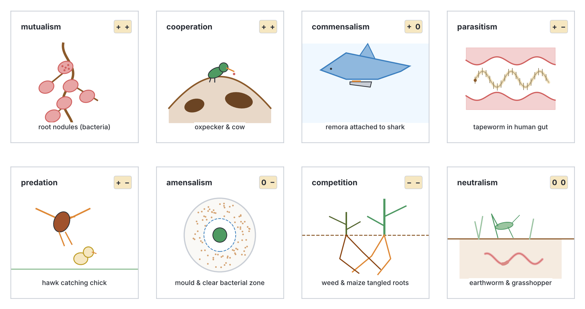
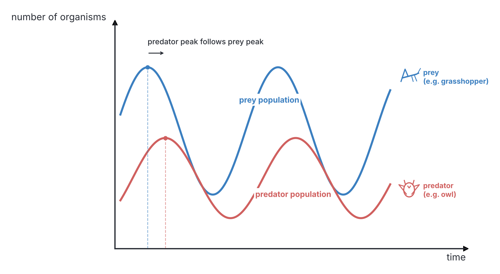
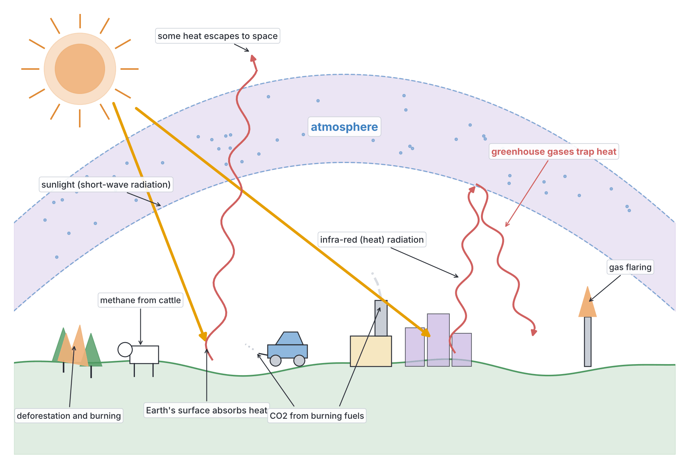
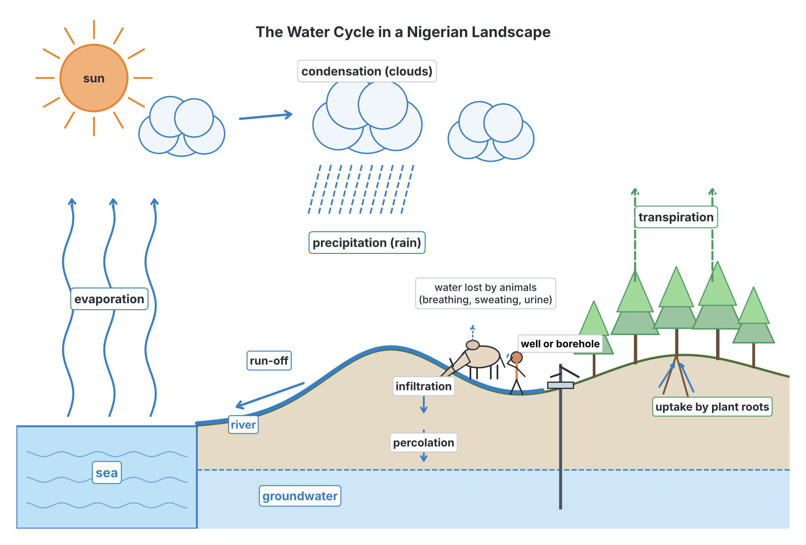

# JAMB Biology Notes: Symbiotic Interactions, Energy Flow and Nutrient Cycling

## What JAMB expects

This topic is Section C, Topic 2 of the JAMB Biology syllabus: Ecology – Symbiotic interactions of plants and animals. It covers:

- Objective i: the different kinds of interactions (associations) between organisms: symbiosis, parasitism, saprophytism, commensalism, mutualism, amensalism, competition, predation and cooperation.
- (a) Energy flow in the ecosystem: food chains, food webs and trophic levels.
- (b) Nutrient cycling in nature:
  - i. carbon cycle
  - ii. water cycle
  - iii. nitrogen cycle

By the end of these notes, you should be able to:

1. Determine appropriate examples of symbiosis, parasitism, saprophytism, commensalism, mutualism, amensalism, competition, predation and cooperation among organisms.
2. Explain the distribution of organisms with food chains and food webs in particular habitats.
3. Define food chains and food webs.
4. Describe the carbon cycle and its significance, including the balance of atmospheric oxygen and carbon (IV) oxide, and global warming.
5. Assess the effects of the water cycle on other nutrient cycles.
6. Relate the roles of bacteria and leguminous plants in the cycling of nitrogen.

**Note on the syllabus wording:** the topic is titled "Symbiotic interactions of plants and animals", but its two content items are about **energy flow** (food chains, food webs and trophic levels) and **nutrient cycling** (carbon, water and nitrogen cycles). The symbiotic interactions themselves appear only in objective i. These notes cover both: first the interactions (objective i), then energy flow (content a, objectives ii and iii), then nutrient cycling (content b, objectives iv to vi). All three areas are commonly examined.

## Interactions between organisms

**Objective i: determine appropriate examples of symbiosis, parasitism, saprophytism, commensalism, mutualism, amensalism, competition, predation and cooperation among organisms.**

In every habitat, organisms affect one another. They may feed on each other, compete for the same food, help each other, or harm each other. The relationship between two organisms of different species that live together or interact is called an **association** or **interaction**.

### A simple way to describe interactions: the +, − and 0 notation

Ecologists describe each interaction by its effect on each of the two partners:

- **+** means the organism **benefits** (gains).
- **−** means the organism is **harmed** (loses).
- **0** means the organism is **not affected** (neither gains nor loses).

| Interaction | Effect on organism A | Effect on organism B | Short description | Example |
| --- | --- | --- | --- | --- |
| **Mutualism** | + | + | Both benefit; often they cannot live apart | *Rhizobium* and legumes; lichens |
| **Cooperation (protocooperation)** | + | + | Both benefit, but they can live apart | Oxpecker and cattle; hermit crab and sea anemone |
| **Commensalism** | + | 0 | One benefits, the other is neither helped nor harmed | Remora and shark |
| **Parasitism** | + (parasite) | − (host) | One lives on or in the other and feeds on it, harming it | Tapeworm in humans; *Loranthus* on trees |
| **Predation** | + (predator) | − (prey) | One kills and eats the other | Hawk and chick; lion and antelope |
| **Amensalism** | 0 | − | One is harmed, the other is not affected | *Penicillium* and bacteria |
| **Competition** | − | − | Both are harmed because they need the same scarce resource | Weeds and crops competing for light and nutrients |
| **Neutralism** | 0 | 0 | Neither affects the other (they live in the same place but do not interact directly) | A grasshopper and an earthworm in the same field |

**Saprophytism** is not shown in the table because it is not an interaction between two living organisms: a **saprophyte** feeds on **dead** organic matter. It is, however, a very important feeding relationship in the ecosystem and is explained below.

**Textbook variation:** some books write amensalism as "− and 0" and others as "0 and −"; the order of the two partners does not matter. Neutralism is not in the JAMB syllabus but appears in many textbooks.

### Symbiosis

**Symbiosis** (from Greek words meaning "living together") is a **close and long-lasting association between two organisms of different species**. The partners are called **symbionts**.

**Textbook variation (important):** the word "symbiosis" is used in two different ways:

1. **Broad meaning (used by most modern biologists):** symbiosis is any close, long-term living together of two different species, whatever its effect. In this sense, **mutualism, commensalism and parasitism are all kinds of symbiosis**.
2. **Narrow meaning (used in many West African school textbooks and older books):** symbiosis means a close association in which **both partners benefit** and often cannot survive apart. In this sense, symbiosis is the **same as mutualism**.

In a JAMB question, read the options carefully. If "symbiosis" is given as an answer where both partners benefit (for example, *Rhizobium* and legumes), and "mutualism" is not one of the options, choose symbiosis. If both appear, the question usually expects **mutualism** for a relationship where both benefit.

**Examples of symbiosis (broad meaning):**

- *Rhizobium* bacteria in the root nodules of legumes (mutualism).
- The alga and fungus in a lichen (mutualism).
- The tapeworm in the human intestine (parasitism).
- The remora attached to a shark (commensalism).

### Mutualism

**Mutualism** is an association between two organisms of different species in which **both partners benefit**. In many cases (called **obligate mutualism**), the partners depend on each other so much that neither can live well, or at all, without the other.

#### Example 1: *Rhizobium* and leguminous plants

- **The partners:** *Rhizobium* is a rod-shaped soil bacterium. Leguminous plants (legumes) include groundnut, cowpea (beans), soya bean, bambara nut, pigeon pea, *Mucuna*, *Centrosema* and trees such as *Gliricidia*.
- **How the association forms:** *Rhizobium* bacteria in the soil enter the **root hairs** of the young legume. The root cells around them divide to form small swellings called **root nodules**, in which the bacteria live and multiply.
- **What the bacteria gain:** shelter, and **carbohydrates** (sugars) made by the plant during photosynthesis, which give them energy.
- **What the plant gains:** the bacteria **fix nitrogen**: they convert nitrogen gas (N₂) from the air in the soil into **ammonia**, which the plant uses to make **amino acids and proteins**. So legumes can grow well even in soils poor in nitrogen.
- **Benefit to farmers:** when the legume dies or its roots decay, the nitrogen compounds are added to the soil, making it more fertile for the next crop. (See the nitrogen cycle below.)

#### Example 2: Lichens

- A **lichen** is a combination of a **fungus** and an **alga** (usually a green alga) or a **blue-green bacterium (cyanobacterium)**, living together so closely that they look like a single organism.
- Lichens grow as grey, green, yellow or orange crusts or leafy patches on tree bark, rocks, old walls and roofs.
- **What the alga gains:** shelter, protection from drying out and strong light, and water and mineral salts absorbed by the fungus.
- **What the fungus gains:** food (sugars) made by the alga through photosynthesis. (If the partner is a cyanobacterium, it can also provide nitrogen compounds.)
- Because of this partnership, lichens can live in harsh places, such as bare rock, where neither partner could live alone. They are often the **pioneer** organisms of succession on bare rock (topic C5), and they are sensitive **indicators of air pollution** (topic C1).

#### Example 3: Termites and cellulose-digesting protozoa

- Termites eat wood, dry grass and leaves, which are made mainly of **cellulose**. Termites cannot make enough of the enzyme needed to digest cellulose themselves.
- In many termites (especially the "lower" termites), the **hindgut** contains large numbers of **flagellated protozoa** (such as *Trichonympha*), together with bacteria, which produce the enzyme **cellulase** and digest the cellulose.
- **What the protozoa gain:** shelter, a constant supply of food (chewed wood), and a warm, moist, oxygen-poor environment.
- **What the termite gains:** digested food (sugars and other products) from the cellulose it could not otherwise use.
- Neither can survive without the other: termites whose protozoa have been killed starve to death even when they are given wood.

**Note:** in the large mound-building termites of Nigeria (*Macrotermes*), the gut contains mainly bacteria rather than protozoa, and these termites also grow **fungus gardens** (*Termitomyces*) that help break down plant material (topic A3). This is also mutualism.

#### Example 4: Ruminants and gut microorganisms

Cattle, goats, sheep and antelopes (ruminants) have bacteria and protozoa in the **rumen** (the first chamber of the stomach) that digest cellulose in grass. The microorganisms get food and a warm home; the animal gets digested food. Similar microorganisms live in the caecum of rabbits and horses.

#### Other examples of mutualism

| Partners | What one gains | What the other gains |
| --- | --- | --- |
| **Mycorrhizal fungi and plant roots** (e.g. in many forest trees and orchids) | Fungus gets sugars from the plant | Plant gets water and mineral salts (especially phosphate) absorbed by the fungal threads |
| **Flowering plants and their pollinators** (bees, butterflies, sunbirds, bats) | Insect, bird or bat gets nectar or pollen as food | Plant is pollinated |
| ***Anabaena* and the water fern *Azolla*** | *Anabaena* gets shelter in the leaf cavities | *Azolla* gets fixed nitrogen (used as a green manure in rice fields) |
| **Bacteria in the human large intestine** (e.g. some strains of *E. coli*) | Bacteria get food and shelter | Humans get some vitamins (such as vitamin K) made by the bacteria, and protection from harmful microbes |

[IMAGE: Three panels showing mutualism. Left: a groundnut plant pulled from the soil showing its roots with many small round pink root nodules, and an enlarged circle showing rod-shaped Rhizobium bacteria inside nodule cells. Middle: a leafy grey-green lichen on a tree trunk, with an enlarged circle of a vertical section showing a layer of green algal cells held among tangled fungal threads. Right: a termite with its hindgut cut open, and an enlarged circle showing a pear-shaped flagellate protozoan covered in many flagella, with small pieces of wood. Labels: "root nodules", "Rhizobium bacteria", "lichen", "algal cells", "fungal threads (hyphae)", "termite", "hindgut", "cellulose-digesting protozoan (e.g. Trichonympha)", "wood particles". Soft greens, pinks and browns. Clean flat textbook style, white background.]

### Cooperation (protocooperation)

**Cooperation** is an association in which both organisms benefit, but the association is **not essential**: each can live on its own. Many textbooks call this **protocooperation** to show that it is a loose, non-obligatory kind of mutualism.

**Examples:**

- **Oxpeckers (tick birds) and cattle, buffalo or rhinoceros:** the bird feeds on ticks and other parasites on the animal's skin; the animal is cleaned of parasites, and the bird's alarm calls may warn it of danger. Both can live apart. (Oxpeckers also sometimes peck at wounds and drink blood, so the relationship is not always purely helpful.)
- **Hermit crab and sea anemone:** the sea anemone lives on the shell of the hermit crab. The anemone's stinging tentacles protect the crab from predators; the anemone is carried to new feeding places and picks up scraps of the crab's food.
- **Cleaner fish and larger fish:** small cleaner fish remove parasites from the skin, gills and mouth of bigger fish, which allow them to do so without eating them.

**Textbook variation: cooperation within a species.** Many textbooks also use "cooperation" for animals of the **same species** working together for the good of the group, such as:

- termites, bees and ants in a colony, where castes share the work (topic A3);
- lions or wild dogs hunting together in packs;
- weaver birds nesting in colonies, where many eyes watch for predators;
- a herd of antelopes or a flock of birds keeping watch together.

JAMB may use the word in either sense. Both involve organisms working together so that each gains.

### Commensalism

**Commensalism** is an association between two organisms of different species in which **one organism (the commensal) benefits**, while **the other (the host) is neither helped nor harmed**. The word comes from Latin for "eating at the same table".

#### Example 1: Remora and shark

- The **remora** (sucker fish) has a sucking disc on top of its head, formed from a modified dorsal fin.
- It attaches itself to a large fish, such as a **shark** (or a turtle, whale or manta ray).
- **What the remora gains:** free **transport** (it saves energy by not swimming), **protection** (few predators attack a fish next to a shark), and **food** (scraps left over when the shark feeds, and possibly parasites from the shark's skin).
- **The shark:** is not noticeably helped or harmed.

**Textbook variation:** because remoras sometimes eat parasites off the shark's skin, a few books describe the relationship as close to mutualism. Most textbooks, and JAMB, give it as the classic example of **commensalism**.

#### Example 2: Cattle egret and cattle

- The **cattle egret** (*Bubulcus ibis*) is a white bird, very common in Nigeria. It walks beside grazing cattle (and also goats, horses and even tractors and lawnmowers).
- As the cattle move through the grass, they disturb insects, such as grasshoppers, which fly up. The egret catches them easily.
- **What the egret gains:** more food with less effort.
- **The cattle:** are usually neither helped nor harmed.

**Textbook variation (important):** different textbooks classify this relationship differently:

- Most books call it **commensalism** (the egret benefits; the cattle are unaffected).
- Some books call it **mutualism** or **cooperation**, because egrets may sometimes eat ticks and flies on the cattle, or warn them of danger.

In practice, cattle egrets mostly eat the insects disturbed by the cattle and rarely remove ticks. If a JAMB question asks for an example of commensalism, cattle egret and cattle is a correct answer. Do not confuse the cattle egret with the **oxpecker**, which does feed on ticks (cooperation).

#### Other examples of commensalism

| Commensal (benefits) | Host (unaffected) | What the commensal gains |
| --- | --- | --- |
| **Epiphytes** such as orchids, some ferns and mosses on tree branches | Tree | Support and a position high up near the light; the epiphyte does not take food from the tree |
| ***Entamoeba coli*** (a harmless amoeba) in the human large intestine | Human | Food from the gut contents. (Do not confuse it with *Entamoeba histolytica*, which causes amoebic dysentery and is a parasite) |
| **Barnacles** on the skin of whales or shells of crabs | Whale or crab | A place to attach, transport to new feeding areas |
| **House mice, cockroaches and house sparrows** living around human homes | Humans | Shelter and scraps of food (although many of them become pests) |
| **Hyenas and vultures** feeding on the leftover kill of lions | Lions | Food scraps |

[IMAGE: Two panels showing commensalism. Left: underwater scene of a grey shark with a slimmer remora fish attached underneath its body by an oval sucker disc on top of the remora's head, with small scraps of food floating nearby. Right: a savanna scene with a brown and white Nigerian cow grazing and a white cattle egret walking beside its legs, catching a grasshopper that has jumped up from the grass. Labels: "shark (host)", "remora (commensal)", "sucker disc", "food scraps", "cow (host)", "cattle egret (commensal)", "grasshopper disturbed by cow". Soft blues, greens and browns. Clean flat textbook style, white background.]

### Parasitism

**Parasitism** is an association in which one organism, the **parasite**, lives **on or in** another organism of a different species, the **host**, and obtains **food** (and often shelter) from it, **harming** the host. A parasite usually does not kill its host quickly, because it depends on the host to stay alive.

#### Kinds of parasites

| Kind | Meaning | Examples |
| --- | --- | --- |
| **Ectoparasite** | Lives **on the outside** of the host | Ticks, lice, fleas, bedbugs, mosquitoes (when feeding), leeches, *Cuscuta* (dodder) on plants |
| **Endoparasite** | Lives **inside** the host's body | Tapeworm, roundworm (*Ascaris*), *Plasmodium* (malaria parasite), *Trypanosoma*, guinea worm, liver fluke |
| **Obligate parasite** | Can live only as a parasite | Tapeworm, *Plasmodium*, viruses |
| **Facultative parasite** | Can live as a parasite or as a saprophyte (on dead matter) | Some fungi, e.g. *Pythium*, which can feed on dead matter or attack seedlings |
| **Total (holo-) parasite** (plants) | Has no chlorophyll; takes all its food from the host | *Cuscuta* (dodder) |
| **Partial (hemi-) parasite** (plants) | Has chlorophyll and makes some of its own food, but takes water and mineral salts from the host | *Loranthus* (mistletoe) |

#### Example 1: The tapeworm (*Taenia*) in humans

- **Host:** humans are the **primary (definitive) host**. The pork tapeworm (*Taenia solium*) uses the pig, and the beef tapeworm (*Taenia saginata*) uses cattle, as the **secondary (intermediate) host**.
- **How humans are infected:** by eating raw or undercooked pork or beef ("suya" that is not well cooked, for example) containing the cyst stage (bladder worm, cysticercus).
- **Where it lives:** in the **small intestine**, attached to the wall by its **scolex** (head), which has **suckers** (and, in the pork tapeworm, **hooks**).
- **How it feeds:** it has **no mouth and no gut**. It absorbs digested food directly through its whole body surface.

**Adaptations of the tapeworm to parasitism:**

1. **Hooks and suckers** on the scolex to attach firmly to the intestine wall so it is not swept away.
2. **Thick cuticle** and production of **anti-enzymes** that protect it from being digested by the host's enzymes.
3. **No gut**: it absorbs ready-digested food over its large, flat body surface.
4. **Hermaphrodite**: each segment (proglottid) has both male and female organs, so it can reproduce even if it is the only tapeworm in the host.
5. **Produces huge numbers of eggs**, which pass out in the host's faeces, increasing the chance that some will reach a new host.
6. **Can respire anaerobically**, since there is little oxygen in the intestine.
7. **Uses a secondary host** (pig or cow) to reach new primary hosts.

**Harm to the host:** loss of digested food, abdominal pain, weight loss, and blockage of the intestine; in the pork tapeworm, cysts may form in human muscles and the brain (cysticercosis), which is dangerous. (The tapeworm's life cycle is described in topic A2c.)

#### Example 2: *Loranthus* (mistletoe) on trees

- *Loranthus* (and related mistletoes such as *Tapinanthus*, very common in Nigeria) is a flowering plant that grows on the branches of trees such as orange, mango, kola, cocoa, shea and cashew.
- Its seeds are spread by birds that eat its sticky fruits and wipe the seeds onto branches.
- The seed germinates on the branch and sends special roots called **haustoria** (singular: haustorium) into the host's stem, connecting with the host's **xylem**.
- **It is a partial parasite (hemiparasite):** it has **green leaves** and makes its own food by **photosynthesis**, but it takes **water and mineral salts** from the host's xylem.
- **Harm to the host:** the branches above the mistletoe get less water and minerals; heavy infestation weakens the tree, reduces fruit yield, and can kill branches or even the whole tree.

#### Example 3: *Cuscuta* (dodder)

- A thin, leafless, yellow or orange twining stem that wraps around other plants (often hedges and garden plants).
- It has **no chlorophyll**, so it is a **total parasite**: its haustoria enter the host's **xylem and phloem**, taking water, mineral salts and manufactured food.

#### Other examples of parasitism

| Parasite | Host | Disease or harm |
| --- | --- | --- |
| *Plasmodium* (carried by the female *Anopheles* mosquito) | Humans | Malaria |
| *Trypanosoma* (carried by the tsetse fly) | Humans and cattle | Sleeping sickness; nagana |
| *Ascaris* (roundworm) | Humans | Intestinal blockage, malnutrition |
| Hookworm | Humans | Anaemia (it feeds on blood from the intestine wall) |
| *Schistosoma* (blood fluke; via water snails) | Humans | Schistosomiasis (bilharzia) |
| Guinea worm (*Dracunculus*) | Humans | Dracunculiasis (guinea worm disease) |
| Ticks, lice, fleas | Mammals and birds | Loss of blood, irritation, spread of diseases |
| Fungi such as rusts and smuts | Cereal crops | Crop diseases |
| Viruses | All living things | Many diseases (e.g. HIV, measles, cassava mosaic) |

**Parasitism compared with predation:**

| Feature | Parasitism | Predation |
| --- | --- | --- |
| Size | Parasite is usually **smaller** than its host | Predator is usually **larger** than (or similar in size to) its prey |
| Effect | Host is harmed, but usually **not killed quickly** | Prey is **killed** and eaten |
| Duration | Long-lasting association | Brief encounter |
| Number fed on | One parasite usually lives on one host for a long time | A predator kills and eats many prey over its life |
| Example | Tapeworm in humans | Hawk eating a chick |

[IMAGE: Two panels showing parasites. Left: a tapeworm with its tiny scolex attached to the wall of a cut-open human small intestine, and an enlarged view of the scolex showing a ring of hooks on the rostellum and four round suckers, with a long ribbon of segments trailing behind. Right: a mango tree branch with a bushy Loranthus mistletoe growing on it, with a cut-away section of the branch showing the mistletoe's haustorium penetrating into the host's wood (xylem). The mistletoe has green leaves and small red tubular flowers. Labels: "small intestine wall", "scolex", "hooks", "suckers", "proglottids (segments)", "host branch (mango)", "Loranthus (partial parasite)", "green leaves (photosynthesis)", "haustorium", "host xylem". Soft pinks, greens and browns. Clean flat textbook style, white background.]

### Saprophytism

**Saprophytism** is the way of life of organisms that obtain their food from **dead and decaying organic matter** (dead plants and animals, faeces, and rotting food). Such organisms are called **saprophytes** (or **saprotrophs**). (Saprophytic nutrition is also covered in topic B2.)

**How a saprophyte feeds (step by step):**

1. It grows on or into the dead material.
2. It secretes **digestive enzymes** onto the food (**extracellular digestion**).
3. The enzymes break down large, insoluble molecules (starch, proteins, fats, cellulose) into small, soluble ones (sugars, amino acids, fatty acids and glycerol).
4. It **absorbs** the soluble products through its cell walls and membranes.

**Examples:**

- **Fungi:** *Rhizopus* (black bread mould) on bread, *Mucor* on food, mushrooms on dead wood and leaf litter, *Penicillium* on oranges.
- **Bacteria:** the bacteria of decay (putrefying bacteria) in soil, compost and rubbish heaps.
- A few flowering plants without chlorophyll that were once described as saprophytes (such as the Indian pipe) actually get their food through fungi; this is a detail beyond JAMB.

**Importance of saprophytes:**

1. They are the main **decomposers**: they break down dead bodies and wastes, which would otherwise pile up.
2. They **recycle nutrients** (carbon, nitrogen, phosphorus) back to the soil and air, where plants can use them again (see the carbon and nitrogen cycles below).
3. They help form **humus**, which makes the soil fertile.
4. Some are useful in industry and food: yeast in baking and brewing, *Penicillium* for penicillin.
5. **Harmful effects:** they spoil food (moulds on bread, fruit and garri), and rot wood, leather, paper and clothing.

**Saprophytism compared with parasitism:**

| Feature | Saprophytism | Parasitism |
| --- | --- | --- |
| Source of food | **Dead** organic matter | A **living** host |
| Effect on other organisms | No living organism is harmed; it recycles nutrients | The host is harmed |
| Digestion | Extracellular: enzymes are secreted onto the food | Parasites often absorb food already digested by the host (e.g. tapeworm) |
| Examples | *Rhizopus*, mushrooms, bacteria of decay | Tapeworm, *Loranthus*, *Plasmodium* |

### Amensalism

**Amensalism** is an association in which **one organism is harmed** (inhibited or killed), while **the other is not affected** (neither gains nor loses).

#### Example 1: *Penicillium* and bacteria

- The mould *Penicillium* produces a substance called **penicillin**, an **antibiotic**.
- Penicillin diffuses into the surroundings and **kills or stops the growth of many bacteria** around the mould.
- The bacteria are harmed, while the *Penicillium* is not noticeably affected. (Some books point out that the mould may gain because there are fewer bacteria competing for food, which makes this close to competition, but it is the standard textbook example of amensalism.)
- This was discovered by **Alexander Fleming** in **1928**, when he noticed that a *Penicillium* mould growing on a dish of *Staphylococcus* bacteria had a **clear zone** around it where no bacteria grew. Penicillin became one of the most important medicines in the world.

#### Other examples of amensalism

- **Large trees shading small plants:** the canopy of a large tree shades the ground so that small, light-demanding plants under it cannot grow. The small plants are harmed; the tree is unaffected.
- **Allelopathy:** some plants release chemicals that stop other plants from growing nearby. For example, the roots and fallen leaves of some *Eucalyptus* trees release chemicals that reduce the growth of other plants under them.
- **Trampling:** cattle or elephants walking on grass and small animals crush them, without gaining anything from it.

[IMAGE: A round Petri dish viewed from above, filled with a pale cream lawn of bacterial growth. In the centre, a blue-green fuzzy Penicillium mould colony, surrounded by a clear circular zone where no bacteria are growing. Labels: "Petri dish", "Penicillium colony", "penicillin diffuses out", "clear zone (bacteria killed)", "bacterial growth". Soft cream, blue-green and grey. Clean flat textbook style, white background.]

### Competition

**Competition** is the interaction between organisms that need the **same resource** when that resource is **in short supply**. Both competitors are harmed, because each gets less than it needs (− −).

**Resources organisms compete for:**

- **Plants:** light, water, mineral salts, space, pollinators.
- **Animals:** food, water, shelter, nesting sites, territory, mates.

**Types of competition:**

| Feature | Intraspecific competition | Interspecific competition |
| --- | --- | --- |
| Between | Members of the **same species** | Members of **different species** |
| Intensity | Usually **more intense**, because the competitors have exactly the same needs | Usually **less intense**, because the needs only partly overlap |
| Examples | Maize seedlings planted too close together; male *Agama* lizards fighting for territory and females; tilapia competing for food in an overcrowded fish pond | Weeds and crops competing for light, water and minerals; lions and hyenas competing for prey; *Tilapia* and catfish competing for food |
| Result | Weak individuals die or fail to breed, so the population is controlled | One species may be driven out of the area (competitive exclusion), or both species divide the resource (niche differentiation) |

Competition is a major cause of **natural selection** and is linked to **succession** (topic C5). Farmers reduce competition by weeding, thinning, spacing crops correctly and applying fertilisers.

### Predation

**Predation** is an interaction in which one animal, the **predator**, **hunts, kills and eats** another animal, the **prey**. The predator benefits (+) and the prey is harmed (−).

**Examples:**

| Predator | Prey |
| --- | --- |
| Hawk, kite, eagle | Chicks, lizards, rats, snakes |
| Lion, leopard | Antelopes, warthogs, buffalo |
| Owl | Rats and mice |
| *Agama* lizard | Insects (ants, grasshoppers, flies) |
| Toad and frog | Insects, worms |
| Snake (e.g. cobra, python) | Rats, toads, birds, eggs |
| Praying mantis, spiders | Other insects |
| Ladybird beetle | Aphids |
| Kingfisher, heron | Fish, frogs |

**Adaptations of predators:** sharp teeth, claws and talons (hawk, lion), keen eyesight (hawk, owl), speed (cheetah), camouflage (praying mantis, leopard's spots), poison (snakes, spiders), pack hunting (wild dogs, lions).

**Adaptations of prey:** speed (antelope), camouflage (grasshopper, stick insect), warning colours and poison (toads, *Zonocerus* grasshopper), hard shells and spines (tortoise, porcupine, pangolin), living in groups with many eyes watching (antelope herds), mimicry.

**The predator–prey cycle:** the numbers of predators and prey often rise and fall in a repeating pattern:

1. When prey are plentiful, predators have plenty of food, so the **predator population rises**.
2. More predators eat more prey, so the **prey population falls**.
3. With less food, many predators starve or fail to breed, so the **predator population falls**.
4. With fewer predators, the **prey population rises again**, and the cycle repeats.

The predator peak usually comes a little **after** the prey peak. In this way, predators help to keep prey populations in check (natural **biological control**). This idea is used in **biological control** of pests: for example, a small wasp was introduced into Nigeria and other African countries to control the cassava mealybug, a serious pest.

### Summary table: examples of each interaction

| Interaction | Definition | Key examples for JAMB |
| --- | --- | --- |
| Symbiosis | Close, long-term association of two different species (broad meaning) or one in which both benefit (narrow meaning) | *Rhizobium* and legumes; lichens |
| Mutualism | Both partners benefit and usually depend on each other | *Rhizobium* and legumes; lichens; termites and cellulose-digesting protozoa; ruminants and rumen bacteria |
| Cooperation | Both benefit, but they can live apart (or members of one species work together) | Oxpecker and cattle; hermit crab and sea anemone; social insects |
| Commensalism | One benefits, the other is unaffected | Remora and shark; cattle egret and cattle; epiphytic orchids on trees; *Entamoeba coli* in the gut |
| Parasitism | One benefits by feeding on a living host, which is harmed | Tapeworm in humans; *Loranthus* on trees; *Cuscuta*; *Plasmodium* |
| Saprophytism | Feeding on dead organic matter | *Rhizopus*, mushrooms, bacteria of decay |
| Amensalism | One is harmed, the other is unaffected | *Penicillium* inhibiting bacteria; large trees shading seedlings |
| Competition | Both are harmed when they need the same scarce resource | Weeds and crops; lions and hyenas; overcrowded maize seedlings |
| Predation | One kills and eats the other | Hawk and chick; lion and antelope; owl and rat |

## Energy flow in the ecosystem

### The sun: the source of energy

Almost all the energy used by living things comes from the **sun**. Energy flows through an ecosystem in this way:

1. **Green plants (producers)** trap a small fraction of the sunlight that falls on them and use it to make food (glucose) by **photosynthesis**. Light energy becomes **chemical energy** stored in food.
2. **Herbivores** eat the plants and obtain some of this chemical energy.
3. **Carnivores** eat the herbivores and obtain some of the energy stored in their bodies.
4. **Decomposers** obtain energy from dead bodies and wastes at every level.
5. At every step, much of the energy is **lost as heat**, mainly through **respiration**. This heat leaves the ecosystem and cannot be used again by living things.

**Key idea:** energy **flows in one direction** through an ecosystem (sun → producers → consumers → heat). It is **not recycled**. Nutrients (carbon, nitrogen, water and minerals), on the other hand, **are recycled** again and again.

**How much sunlight is trapped?** Plants trap only a small percentage of the sunlight falling on them, commonly given as about **1%** (often quoted as 1–2%, and rarely more than about 5% even in the best crops). **Textbook variation:** the exact figure varies between books and between ecosystems; the important point is that most sunlight is reflected, passes through leaves, or heats them, and only a small part is turned into food.

### Trophic levels

A **trophic level** (feeding level) is the position an organism occupies in a food chain, according to how it gets its food.

| Trophic level | Name | What they eat | Examples |
| --- | --- | --- | --- |
| **First (T1)** | **Producers** (autotrophs) | Make their own food by photosynthesis | Grass, trees, maize, *Spirogyra*, phytoplankton |
| **Second (T2)** | **Primary consumers** (herbivores) | Plants | Grasshopper, goat, cow, antelope, grasscutter, caterpillar, water flea, snail |
| **Third (T3)** | **Secondary consumers** (carnivores, or omnivores) | Herbivores | *Agama* lizard, toad, frog, small fish, insect-eating birds |
| **Fourth (T4)** | **Tertiary consumers** (top carnivores) | Secondary consumers | Hawk, snake, lion, large fish such as Nile perch |
| (Fifth) | Quaternary consumers | Tertiary consumers | Eagles, crocodiles (in some chains) |
| (All levels) | **Decomposers** | Dead organisms and wastes from every level | Bacteria and fungi |

**Notes:**

- **Omnivores** (such as humans, pigs, rats and many birds) eat both plants and animals, so they can feed at **more than one trophic level**.
- The **top carnivore** (apex predator) is at the end of the food chain and has no natural predators (for example, the lion or the crocodile).
- Decomposers are not usually given a trophic level number because they feed on material from **all** levels.

### Food chains

**Objective iii: define chains and webs.**

A **food chain** is a **sequence of organisms**, each of which **feeds on the one before it**, showing the **transfer of food (energy)** from the producer through a series of consumers. The arrows in a food chain point **in the direction the energy flows** (from the food to the feeder): "→" means "is eaten by".

**Example:**

grass → grasshopper → *Agama* lizard → hawk

This means: grass is eaten by the grasshopper; the grasshopper is eaten by the lizard; the lizard is eaten by the hawk.

**Features of food chains:**

1. Every food chain **starts with a producer** (a green plant or alga), or with dead organic matter in a detritus chain.
2. Food chains are **short**, usually with only **3 to 5 links** (trophic levels), because energy is lost at each step (see the 10% rule below).
3. Each link is a **trophic level**.
4. The arrows show the direction of **energy flow**, not "eats".

**Common mistake:** writing the arrows the wrong way (hawk → lizard). The arrow must point **from the food to the eater**.

#### Types of food chain

| Feature | Grazing (predator) food chain | Detritus food chain |
| --- | --- | --- |
| Starts with | **Living green plants** (producers) | **Dead organic matter (detritus)**: dead leaves, dead animals, faeces |
| First consumers | Herbivores that eat living plants | **Detritivores** (detritus feeders) such as earthworms, millipedes, termites, woodlice, some insect larvae, and decomposers (bacteria and fungi) |
| Where common | Grasslands (savanna), ponds and the sea | Forest floor, soil, mangrove swamps (where large amounts of leaves fall) |
| Example | grass → grasshopper → toad → snake → hawk | dead leaves → earthworm → shrew (or bird) → hawk |
| Example (water) | phytoplankton → zooplankton → small fish → kingfisher | dead mangrove leaves → bacteria and fungi → crabs → fish → heron |

In most ecosystems, the two types of chain are linked. In a forest, much more energy actually flows through the detritus food chain than through the grazing chain, because most leaves are not eaten while alive but fall and decay.

**Textbook variation:** some books also describe a **parasitic food chain**, in which energy passes from a large host to smaller and smaller parasites (for example, mammal → flea → protozoan in the flea).

### Food webs

A **food web** is a **network of interconnected food chains** in an ecosystem. It shows all the feeding relationships in a community: most organisms eat more than one kind of food and are eaten by more than one kind of predator.

**Why food webs are more realistic than food chains:**

1. Most animals eat **several kinds of food**: a hawk eats lizards, rats, snakes and chicks.
2. Most organisms are **eaten by several predators**: a grasshopper may be eaten by a lizard, a toad, a bird or a praying mantis.
3. Food webs show that the community is **stable**: if one food is scarce, an animal can switch to another.

**What happens when one organism is removed from a food web?** This is a favourite JAMB question. For example, in the savanna food web shown below, if the **snakes** are killed:

- the number of **toads** and **rats** (which snakes eat) is likely to **increase** at first;
- more toads eat more insects, so **grasshoppers** may **decrease**;
- **hawks** may eat more lizards and rats instead, because they have lost one source of food.

The more complex the food web, the more **stable** the community, because there are other pathways for energy if one link is broken.

**A savanna food web (example):**

- grass → grasshopper → *Agama* lizard → hawk
- grass → grasshopper → toad → snake → hawk
- grass → grasshopper → praying mantis → *Agama* lizard
- grass seeds → rat → snake → hawk
- grass seeds → rat → hawk
- grass → antelope → lion
- grass → grasscutter → python
- grass → cow → human

[IMAGE: A savanna food web diagram. At the bottom, grass and grass seeds (producers). Above them, primary consumers: grasshopper, rat, antelope, grasscutter. Above them, secondary consumers: praying mantis, Agama lizard, toad. Above them, tertiary consumers: snake, python. At the top: hawk and lion. Arrows run from each food to each feeder: grass to grasshopper, grass to antelope, grass to grasscutter, grass seeds to rat, grasshopper to Agama lizard, grasshopper to toad, grasshopper to praying mantis, praying mantis to Agama lizard, toad to snake, rat to snake, rat to hawk, Agama lizard to hawk, snake to hawk, grasscutter to python, antelope to lion. A small box at the bottom showing decomposers (bacteria and fungi) with dashed arrows from all organisms. Labels: "producers", "primary consumers", "secondary consumers", "tertiary consumers", "decomposers", and the names of each organism. Soft savanna greens and browns. Clean flat textbook style, white background.]

### Ecological pyramids

An **ecological pyramid** is a diagram that shows the relationship between the trophic levels of a food chain, with the **producers at the base** and each higher trophic level stacked on top. Each bar's width shows the size of that level. There are three types.

#### 1. Pyramid of numbers

A **pyramid of numbers** shows the **number of individual organisms** at each trophic level of a food chain at one time.

- **Usually upright:** there are many producers, fewer herbivores and still fewer carnivores. Example: thousands of grass plants → hundreds of grasshoppers → tens of lizards → one hawk.
- **Can be inverted (upside down) or irregular** when:
  - the producer is **very large**: one large tree (for example, a mango tree) supports thousands of caterpillars, which are eaten by fewer birds. The bar for the tree is very narrow.
  - **parasites** are involved: one dog supports many fleas, and each flea supports many protozoa.
- **Weakness:** it treats all organisms as equal, so one huge tree counts the same as one blade of grass. This is why the pyramid of numbers is the least useful of the three.

#### 2. Pyramid of biomass

A **pyramid of biomass** shows the **total dry mass of living organisms** (biomass) at each trophic level, at one time, usually in grams per square metre (g/m²) or kg per hectare.

- **Usually upright:** the total mass of producers is greater than that of herbivores, which is greater than that of carnivores. The large tree in the example above now gives a wide base, because its biomass is huge.
- **Can be inverted** in some aquatic ecosystems at a particular moment: the tiny phytoplankton reproduce very quickly but are eaten as fast as they grow, so at any one time their total mass may be **less** than that of the zooplankton feeding on them.
- **Weaknesses:** it measures the mass present at one moment, not how fast it is produced; measuring dry mass requires killing organisms; different tissues contain different amounts of energy.

#### 3. Pyramid of energy

A **pyramid of energy** shows the **total amount of energy** flowing through each trophic level **over a period of time**, usually in kilojoules per square metre per year (kJ/m²/year).

- It is **always upright**, never inverted, because energy is **lost** at every transfer, so each level always has less energy than the level below it.
- It is the **most accurate and useful** of the three pyramids, because it shows how efficiently energy is passed on.
- **Weakness:** it is difficult to measure.

[IMAGE: Three ecological pyramids side by side, each with labelled horizontal bars stacked from bottom to top for producers, primary consumers, secondary consumers and tertiary consumers. (1) Upright pyramid of numbers for grass, grasshoppers, lizards, hawk (wide base, narrow top). (2) Inverted pyramid of numbers for one tree (very narrow base bar with a tree icon), many caterpillars (wide bar), fewer birds (narrower bar) and fewer hawks. (3) Upright pyramid of energy with bars getting about ten times narrower at each level, marked 10,000 kJ, 1,000 kJ, 100 kJ, 10 kJ, and small curved arrows showing heat lost at each level. Labels: "pyramid of numbers (upright)", "pyramid of numbers (inverted: one tree)", "pyramid of energy (always upright)", "producers", "primary consumers", "secondary consumers", "tertiary consumers", "heat lost". Soft greens, yellows and oranges. Clean flat textbook style, white background.]

#### The three pyramids compared

| Feature | Pyramid of numbers | Pyramid of biomass | Pyramid of energy |
| --- | --- | --- | --- |
| What it shows | Number of organisms at each level | Total dry mass at each level | Energy flowing through each level over time |
| Units | Number of individuals | g/m² or kg/ha | kJ/m²/year |
| Shape | Usually upright; can be inverted (large producers, parasites) | Usually upright; can be inverted in some aquatic systems | **Always upright** |
| Accuracy | Least accurate | More accurate | Most accurate |
| Time | A single moment | A single moment | Over a period of time |

### Why energy is lost between trophic levels: the 10% rule

Only a small part of the energy in one trophic level is passed on to the next. On average, roughly **10%** of the energy is transferred, and about **90%** is lost. This is called the **10% rule** (or the 10% law), associated with the American ecologist **Raymond Lindeman** (1942).

**Textbook variation:** the 10% figure is only an average and a rule of thumb. Real transfer efficiencies vary from roughly 5% to 20%, depending on the organisms and the ecosystem. Some textbooks give a range instead of a single figure. Use 10% for calculations unless the question gives another figure.

**Where the energy goes (reasons for the loss):**

1. **Respiration:** most of the energy an organism takes in is used in respiration to power its life processes (movement, growth, keeping warm), and is finally lost as **heat**. Warm-blooded animals lose especially large amounts to keep their body temperature constant.
2. **Not all of the organism is eaten:** roots, bones, bark, horns, hair and shells are often left uneaten.
3. **Not all that is eaten is digested:** some food (such as cellulose in plants, and fur and bones in carnivores) passes out undigested in the **faeces**.
4. **Excretion:** some energy is lost in excretory products such as urea.
5. **Not all organisms are eaten:** many die and are used by decomposers instead.

**Worked example:** a field of grass traps 10,000 kJ of energy. Using the 10% rule:

| Trophic level | Organism | Energy available |
| --- | --- | --- |
| Producer | Grass | 10,000 kJ |
| Primary consumer | Grasshopper | 10% of 10,000 = **1,000 kJ** |
| Secondary consumer | Toad | 10% of 1,000 = **100 kJ** |
| Tertiary consumer | Snake | 10% of 100 = **10 kJ** |
| Quaternary consumer | Hawk | 10% of 10 = **1 kJ** |

**Consequences of energy loss:**

1. **Food chains are short.** After four or five transfers, too little energy is left to support another level.
2. **There are fewer top carnivores** than herbivores. Large predators such as lions and eagles need large areas to find enough food, and they are the first to disappear when habitats are reduced.
3. **Feeding humans:** more people can be fed by eating plant food (grains, beans, yams) directly than by feeding the plants to animals and then eating the animals, because about 90% of the energy is lost at the extra step. This is why, in densely populated countries, people eat more plant food.

**Bioaccumulation (biological magnification):** while energy decreases up a food chain, some **poisons that are not broken down or excreted**, such as the insecticide **DDT** and heavy metals like mercury, become **more concentrated** at each trophic level. Top carnivores (such as fish-eating birds and humans) receive the highest doses. This is one reason why such chemicals are dangerous to use in farming.

## The distribution of organisms and food chains in particular habitats

**Objective ii: explain the distribution of organisms with food chains and food webs in particular habitats.**

Organisms are found where their **food** is found. Producers are found where there is enough **light, water and minerals**; herbivores are found where their food plants grow; carnivores are found where their prey lives. Food chains and webs therefore explain **why** particular organisms are found together in a particular habitat, and why they are spread out in layers or zones within it.

### 1. A freshwater pond

**Producers and where they are found:** producers live only where there is light. In a pond these are:

- **Phytoplankton** (microscopic floating algae such as diatoms, *Chlamydomonas* and *Volvox*) in the upper, well-lit water.
- **Filamentous algae** such as *Spirogyra*, floating in green masses.
- **Floating plants** such as water lettuce (*Pistia*), duckweed (*Lemna*) and water hyacinth.
- **Rooted plants** with floating leaves (water lilies, *Nymphaea*) and emergent plants at the edges (sedges, grasses, reeds).

**Consumers:**

- **Zooplankton** (tiny floating animals such as water fleas (*Daphnia*), *Cyclops*, rotifers) feed on phytoplankton.
- **Snails** and **tadpoles** graze on algae and plant leaves.
- **Mosquito larvae** filter tiny organisms and detritus near the surface.
- **Small fish** and **dragonfly nymphs** and **water beetles** feed on zooplankton, larvae and tadpoles.
- **Frogs** eat insects at the edge of the pond.
- **Larger fish** (such as catfish, *Clarias*) and **birds** (kingfisher, heron, egret) feed on fish and frogs.
- **Decomposers** (bacteria and fungi) in the **mud** at the bottom break down dead organisms.

**Pond food chains:**

- phytoplankton → water flea (*Daphnia*) → small fish → kingfisher
- *Spirogyra* → tadpole → dragonfly nymph → small fish → heron
- algae → mosquito larva → small fish → catfish → human
- water lily leaves → snail → duck
- dead plant material → bacteria and detritivores (e.g. worms in the mud) → fish

**How food chains explain distribution in the pond:**

- Producers are in the **surface and shallow edge** waters, where light reaches; so herbivores such as zooplankton, snails and tadpoles are also concentrated there.
- Predatory fish and birds are found where their prey is plentiful (the weedy margins).
- **Decomposers** and **detritivores** are concentrated in the **bottom mud**, where dead material collects.
- In muddy (turbid) water, fewer producers grow, so there are fewer consumers.

[IMAGE: A pond food web drawn over a cross-section of a pond. Surface: floating phytoplankton (shown as tiny green dots), water lettuce, a water lily with a snail on its leaf, mosquito larvae hanging from the surface. Middle water: water fleas, tadpoles, small fish, a dragonfly nymph on a stem. Edge: a frog on the bank and a kingfisher on a branch. Bottom: mud with a catfish and bacteria. Arrows: phytoplankton to water flea, water flea to small fish, small fish to kingfisher, algae to tadpole, tadpole to dragonfly nymph, dragonfly nymph to small fish, algae to mosquito larva, mosquito larva to small fish, small fish to catfish, water lily to snail, mosquito adult to frog. Labels: "phytoplankton", "water lettuce", "water lily", "snail", "mosquito larvae", "water flea (Daphnia)", "tadpole", "dragonfly nymph", "small fish", "catfish", "frog", "kingfisher", "mud with decomposers". Soft blues and greens. Clean flat textbook style, white background.]

### 2. A savanna (grassland) field

**Producers:** grasses (such as spear grass, *Imperata*, and elephant grass, *Pennisetum*, *Andropogon*), shrubs and scattered trees such as shea, locust bean and baobab.

**Consumers and food chains:**

- grass → grasshopper → *Agama* lizard → hawk
- grass → grasshopper → toad → snake → hawk
- grass seeds → rat → snake → hawk
- grass → antelope (e.g. kob, hartebeest) → lion
- grass → grasscutter → python
- grass → cow (Fulani cattle) → human
- dry grass → termites → aardvark (or birds, lizards and humans who eat termites)
- dung → dung beetles → birds

**How food chains explain distribution in the savanna:**

- The plentiful **grass** supports large numbers of **grazing animals** (grasshoppers, antelopes, cattle, grasscutters, termites), so the savanna is home to the large herds of herbivores and their **predators** (lions, leopards, hawks).
- Animals **move with their food**: in the dry season, when grass dries up, herds of antelopes and Fulani cattle move to river valleys and the south, and predators follow them.
- **Birds of prey** gather at **bush fires** to catch fleeing insects and rodents.
- **Termite mounds** are common because there is plenty of dry grass for food.

### 3. A tropical rainforest

**Producers:** tall trees (iroko, mahogany, obeche, silk cotton), climbers (lianas), epiphytes and shade plants on the floor.

**Food chains:**

- leaves → caterpillar → insect-eating bird → hawk (or snake)
- fruits → fruit bat → owl (or snake)
- fruits → monkey → leopard (or crowned eagle)
- fruits and seeds → squirrel → snake
- leaves → leaf-eating beetle → *Agama* lizard → snake
- dead leaves → earthworm → shrew → owl
- dead leaves → millipede → toad → snake
- dead wood → termites → pangolin

**How food chains explain distribution in the forest:**

- The forest has **layers** (strata): the canopy, the middle layers and the forest floor. Different animals live in each layer because their **food is found there**. **Fruit-eaters** (monkeys, hornbills, fruit bats, squirrels) live in the **canopy**, where most fruits, flowers and young leaves are produced. **Detritus feeders** (earthworms, millipedes, termites, snails) and their predators (shrews, toads) live on the **forest floor**, where dead leaves fall.
- Because much of the energy flows through the **detritus food chain**, the forest floor has a rich community of decomposers and detritivores.
- **Predators** (leopards, eagles, snakes) are found wherever their prey is: crowned eagles hunt monkeys in the canopy.

### 4. Other habitats

- **Mangrove swamp:** dead mangrove leaves → bacteria and fungi → crabs and mudskippers → fish → herons. Many fish of the Niger Delta feed and breed among mangrove roots because detritus and small animals are plentiful there.
- **Sea (marine):** phytoplankton → zooplankton → sardines → mackerel → shark.
- **Soil:** dead leaves → earthworms and millipedes → centipedes → toads.

(The organisms of these habitats are described in topic C3.)

## Nutrient cycling in nature

Living things need chemical elements, such as **carbon, hydrogen, oxygen, nitrogen, phosphorus and sulphur**, to build their bodies. The Earth has only a fixed amount of each element; new supplies do not arrive from space. So these elements must be **used again and again**. They pass from the non-living environment (air, water, soil, rocks) into living organisms, along food chains, and back to the environment when organisms respire, excrete, die and decay. This movement is called **nutrient cycling** (or **biogeochemical cycling**).

**Energy flows; nutrients cycle.** Energy enters as sunlight and leaves as heat, but nutrients go round and round.

**Decomposers** (bacteria and fungi) are essential to every nutrient cycle: without them, dead bodies would pile up and the nutrients locked in them would never return to the soil and air.

## The carbon cycle

**Objective iv: describe the carbon cycle and its significance including the balance of atmospheric oxygen and carbon (IV) oxide and global warming.**

Carbon is the basic element of all organic compounds: carbohydrates, fats, proteins and nucleic acids. The main reservoir of carbon available to living things is **carbon (IV) oxide (CO₂)** in the **atmosphere** and dissolved in **water**.

**How much CO₂ is in the air?** About **0.04%** of the atmosphere by volume (roughly 420 parts per million in the mid-2020s). **Textbook variation:** many older textbooks give **0.03%**, which was correct in the mid-1900s. The amount has been rising steadily because of human activities, which is the cause of the concern about global warming.

### Processes of the carbon cycle (step by step)

#### Processes that remove carbon (IV) oxide from the air

1. **Photosynthesis:** green plants on land and algae and phytoplankton in water take in CO₂ and, using light energy, convert it into **glucose** and other organic compounds. Oxygen is released.

   carbon (IV) oxide + water → (light, chlorophyll) → glucose + oxygen

   6CO₂ + 6H₂O → C₆H₁₂O₆ + 6O₂

2. **Dissolving in water:** CO₂ dissolves in the oceans, seas, rivers and lakes. Some is used by water plants for photosynthesis; some is turned into **carbonates and hydrogencarbonates**, which marine animals (snails, oysters, corals, some plankton) use to build shells and skeletons. When they die, their shells settle and, over millions of years, form **limestone** and chalk.

#### Movement of carbon through living things

3. **Feeding:** animals obtain carbon compounds by eating plants (herbivores) or other animals (carnivores). The carbon becomes part of their own carbohydrates, fats and proteins.

#### Processes that return carbon (IV) oxide to the air

4. **Respiration:** all living things (plants, animals and microorganisms) break down food in respiration and release CO₂.

   glucose + oxygen → carbon (IV) oxide + water + energy

5. **Decay (decomposition):** when plants and animals die, and when animals produce faeces and urine, **decomposers** (bacteria and fungi) feed on the remains. Their respiration releases the carbon as CO₂.
6. **Combustion (burning):** burning wood, charcoal, bush and **fossil fuels** (coal, petroleum, natural gas, kerosene, petrol, diesel) releases CO₂ (and carbon (II) oxide, CO, if burning is incomplete).
7. **Other natural sources:** **volcanic eruptions**, and the slow **weathering** of limestone rocks by acid rain, release CO₂.

#### Long-term storage of carbon

8. **Formation of fossil fuels:** when plants and animals die in conditions where decomposers cannot work (for example, in waterlogged, oxygen-poor swamps or at the bottom of the sea), they are buried and slowly changed, by heat and pressure over millions of years, into **coal, crude oil (petroleum) and natural gas**. The carbon is locked away until humans dig it up and burn it. Nigeria's crude oil and gas in the Niger Delta formed in this way, and there is coal at Enugu.
9. **Carbonate rocks** (limestone) store carbon for very long periods.

[IMAGE: A carbon cycle diagram in a landscape setting. Centre top: a cloud labelled carbon (IV) oxide in the air. Left: green trees and grass taking CO2 in (arrow down into the leaves). A goat eating grass and a human. Arrows back up to the air from the plants, the goat and the human. Bottom left: a dead log and dead leaves with mushrooms and bacteria, with an arrow up to the air. Bottom centre: underground layers showing coal and crude oil formed from buried remains, with an arrow up to a factory chimney and a car exhaust and a gas flare releasing CO2. Right: the sea with CO2 dissolving in it (arrow down), phytoplankton and a shellfish, and shells settling to form limestone on the sea floor. A volcano at the far right releasing CO2. Labels: "carbon (IV) oxide in the air (about 0.04%)", "photosynthesis", "respiration (plants)", "feeding", "respiration (animals)", "death", "decay by decomposers (respiration)", "fossil fuels (coal, oil, gas)", "combustion", "gas flaring", "CO2 dissolves in sea", "shells and limestone", "volcano". Soft greens, blues, greys and browns. Clean flat textbook style, white background.]

### Significance of the carbon cycle

1. It **keeps a constant supply of CO₂** for photosynthesis, so plants can keep making food, on which all other organisms depend.
2. It **recycles carbon** from dead organisms back into living organisms; without it, all available carbon would eventually be locked up in dead bodies.
3. It helps to **keep the balance of oxygen and carbon (IV) oxide** in the atmosphere (see below).
4. It helps to **regulate the Earth's temperature**, since CO₂ is a greenhouse gas.
5. It links **energy flow** and **nutrient cycling**: the carbon compounds made in photosynthesis carry the energy through food chains.

### The balance of atmospheric oxygen and carbon (IV) oxide

The atmosphere contains about **21% oxygen** and about **0.04% carbon (IV) oxide** (and about 78% nitrogen). These levels stay roughly constant because two opposite processes balance each other:

| Feature | Photosynthesis | Respiration (and decay and burning) |
| --- | --- | --- |
| Carried out by | Green plants, algae and some bacteria, **only in light** | **All** living things, all the time (day and night); burning by humans |
| Gas taken in | Carbon (IV) oxide | Oxygen |
| Gas given out | Oxygen | Carbon (IV) oxide |
| Effect on the air | Removes CO₂, adds O₂ | Removes O₂, adds CO₂ |

**How the balance is kept:**

1. Plants use CO₂ and give out O₂ in photosynthesis.
2. Animals, plants and decomposers use O₂ and give out CO₂ in respiration.
3. In daylight, plants photosynthesise faster than they respire, so they give out more oxygen than they use. At night, they only respire.
4. Over the whole Earth, the oxygen produced in photosynthesis roughly equals the oxygen used in respiration and decay, and the CO₂ given out roughly equals the CO₂ taken in. So the levels of the two gases stay **roughly constant**.

**How humans upset the balance:**

- **Burning fossil fuels** (in vehicles, generators, power stations and factories) and **gas flaring** add large amounts of CO₂ to the air.
- **Deforestation** removes the trees that would take in CO₂; burning or rotting the cut trees releases even more.
- **Bush burning** releases CO₂ and removes vegetation.

As a result, the amount of CO₂ in the atmosphere has risen steadily since the start of the Industrial Revolution (around 1750), from about 280 parts per million to over 400 parts per million today. Oxygen levels have not changed noticeably for living things, because the atmosphere holds so much more oxygen than CO₂.

**Note:** a well-known experiment shows this balance. A snail and a water plant (such as *Elodea* or another pondweed) are sealed together in a tube of water containing bicarbonate indicator. In the light, the plant takes in the CO₂ produced by both the snail and itself, so the indicator stays red or turns purple (less CO₂). In the dark, both only respire, so CO₂ builds up and the indicator turns yellow.

### The greenhouse effect and global warming

#### The natural greenhouse effect (step by step)

1. **Sunlight** (short-wave radiation) passes through the atmosphere and reaches the Earth's surface.
2. The land and sea **absorb** this energy and warm up.
3. The warm Earth **gives off heat** as **infra-red** (long-wave) radiation back towards space.
4. Some gases in the atmosphere, called **greenhouse gases**, **absorb** much of this infra-red radiation and **re-radiate** it in all directions, including back to the Earth.
5. This **traps heat** in the lower atmosphere, keeping the Earth warm, just as the glass of a greenhouse keeps the inside warm.

The natural greenhouse effect is **good and necessary**: without it, the Earth's average surface temperature would be about −18 °C instead of about 15 °C, and most life could not exist.

**The main greenhouse gases:**

| Gas | Main sources (especially those caused by humans) |
| --- | --- |
| **Carbon (IV) oxide (CO₂)** | Burning fossil fuels, deforestation, bush burning, gas flaring |
| **Methane (CH₄)** | Cattle and other ruminants (from gut fermentation), rice paddies, rubbish dumps (landfills), swamps, leaks from oil and gas production |
| **Water vapour** | Evaporation (it increases as the air warms) |
| **Dinitrogen oxide (nitrous oxide, N₂O)** | Nitrogen fertilisers, denitrification in soils |
| **Chlorofluorocarbons (CFCs)** | Old refrigerators, air conditioners and aerosol sprays (now largely banned because they also damage the ozone layer) |

#### The enhanced greenhouse effect and global warming

When humans add **extra** greenhouse gases to the atmosphere, more heat is trapped. This is called the **enhanced greenhouse effect**. It causes **global warming**: a rise in the average temperature of the Earth's surface. Global warming leads to wider **climate change**: changes in rainfall, winds, seasons and extreme weather.

According to the Intergovernmental Panel on Climate Change (IPCC, 2021), the Earth's average surface temperature in the decade 2011–2020 was about **1.1 °C** higher than in the late 1800s, and human activities are the main cause.

**Effects of global warming in general:**

1. **Melting of ice** on glaciers and at the poles, and **rising sea levels** (water also expands as it warms).
2. **Flooding** of low-lying coastal areas.
3. **Changes in rainfall:** some areas get heavier rain and floods; others get longer droughts.
4. **More extreme weather:** heat waves, storms and floods become more frequent or severe.
5. **Spread of deserts** in dry regions.
6. **Loss of species** that cannot adapt or move fast enough; damage to coral reefs.
7. **Spread of diseases** carried by insects (such as malaria) into new areas as they warm.
8. **Reduced crop yields** in many tropical areas.

**Impacts of climate change in Nigeria:**

- **Desertification in the north:** together with overgrazing and tree-cutting, rising temperatures and less reliable rainfall are helping the Sahara Desert to spread southwards into northern states such as Sokoto, Borno, Yobe, Katsina and Jigawa, reducing farmland and pasture.
- **Shrinking of Lake Chad:** Lake Chad has shrunk greatly since the 1960s. The figure often quoted is about 90% of its former area, though estimates vary and the lake's size changes from year to year. Scientists link the shrinking to droughts, changes in rainfall, and heavy use of water for irrigation, not to global warming alone. Millions of people around the lake depend on it for fishing, farming and herding.
- **Coastal flooding and sea-level rise:** low-lying coastal areas, including **Lagos** and the **Niger Delta**, are at risk from rising sea levels, storm surges and coastal erosion.
- **More severe floods:** Nigeria suffered very severe floods in **2012** and **2022**, which destroyed homes and farms in many states along the Niger and Benue rivers. Heavy rainfall events like these are expected to become more frequent with climate change.
- **Effects on farming and food security:** late or irregular rains, droughts, and heat stress reduce crop and livestock production.
- **Conflict over land and water:** as pasture and water become scarcer in the north, herders move southwards, which has contributed to conflicts between farmers and herders.
- **Health:** heat waves, and changes in the spread of malaria, cholera and meningitis.

**Ways to reduce global warming:**

1. Reduce the burning of fossil fuels; use **renewable energy** (solar, wind, hydroelectric power).
2. **Stop gas flaring** and use the gas instead.
3. **Plant trees** (afforestation and reforestation) and stop deforestation; trees absorb CO₂. Nigeria is part of the African **Great Green Wall** initiative to plant a belt of trees across the Sahel.
4. Reduce bush burning.
5. Use energy efficiently (efficient stoves, vehicles and appliances).
6. Recycle waste and manage landfills to reduce methane.

## The water cycle

**Objective v: assess the effects of water cycle on other nutrient cycles.**

Water is essential for life. It makes up about 70% or more of the body of most organisms, is the medium in which all metabolic reactions take place, is a raw material for photosynthesis, and is the habitat of aquatic organisms. The **water cycle** (hydrological cycle) is the continuous movement of water between the Earth's surface, living organisms and the atmosphere, powered by the **sun's energy**.

### Processes of the water cycle (step by step)

1. **Evaporation:** the sun heats water in oceans, seas, rivers, lakes and the soil, and it changes into **water vapour**, which rises into the air. Most evaporation is from the oceans.
2. **Transpiration:** plants absorb water from the soil through their roots and lose water vapour through the **stomata** of their leaves. A large tree can transpire hundreds of litres of water a day. Together, evaporation and transpiration are called **evapotranspiration**. In the rainforest, transpiration returns a large part of the rainfall to the air, which helps to produce more rain.
3. **Other sources of water vapour:** animals lose water vapour in **breathing** and **sweating**; respiration produces water.
4. **Condensation:** as the warm, moist air rises, it **cools**. The water vapour condenses into tiny droplets of water (or ice crystals) around dust particles, forming **clouds** (and mist, fog or dew near the ground).
5. **Precipitation:** the droplets join to form larger drops, which fall as **rain** (or hail, or snow in cold places). Winds carry clouds over the land before the rain falls.
6. **Infiltration and percolation:** some rainwater soaks into the soil (**infiltration**) and moves down through the soil and rocks (**percolation**) to become **groundwater**, which feeds springs, wells and boreholes.
7. **Run-off:** water that does not soak in flows over the surface into streams and rivers, and finally back to the sea or lakes.
8. **Uptake by organisms:** plants absorb soil water through their roots; animals drink water and get water from their food. Water then returns to the environment through transpiration, excretion (urine), sweating, breathing and decay.

The cycle then repeats.

### Effects of the water cycle on other nutrient cycles

Water is the "carrier" of the other nutrient cycles. Almost every step in the carbon and nitrogen cycles depends on water.

#### Effects on the carbon cycle

1. **Photosynthesis needs water** as a raw material (6CO₂ + 6H₂O → C₆H₁₂O₆ + 6O₂). Where water is scarce (dry season, deserts), photosynthesis slows and less CO₂ is removed from the air.
2. **CO₂ dissolves in rain and in water bodies.** Oceans and lakes absorb large amounts of CO₂; rain containing dissolved CO₂ (a weak acid, carbonic acid) slowly **weathers limestone rocks**, releasing carbon.
3. **Decomposition needs moisture.** Bacteria and fungi work fastest in warm, moist conditions (as in the rainforest), returning carbon quickly to the air. In very dry or waterlogged places, decay is slow, and carbon may be stored in dead matter (peat and, over long periods, coal).
4. **Transport of carbon compounds:** rivers carry dissolved and particulate carbon from the land to the sea.

#### Effects on the nitrogen cycle

1. **Nitrates dissolve in water.** Plants can absorb nitrates and ammonium only when they are **dissolved in soil water**. Without water, plants cannot take up nitrogen.
2. **Rain brings nitrogen from the air:** nitrogen oxides formed by **lightning** dissolve in rainwater and are washed into the soil as **nitric acid**, which forms **nitrates**.
3. **Leaching:** heavy rain washes soluble nitrates **down and out of the soil**, beyond the reach of roots. This is why heavily leached rainforest soils are often poor in nitrogen.
4. **Run-off and eutrophication:** water running off farmland carries fertilisers (nitrates and phosphates) into rivers and lakes, causing **algal blooms** and the death of fish (eutrophication).
5. **Waterlogging and denitrification:** when the soil is **waterlogged**, air is driven out and the soil becomes anaerobic. **Denitrifying bacteria** then become active and convert nitrates into nitrogen gas, which escapes into the air, making the soil poorer. Nitrifying bacteria, which need oxygen, stop working.
6. **Activity of soil bacteria:** nitrogen-fixing, nitrifying and decomposing bacteria all need **moist** soil to be active. In very dry soil, they become inactive.

#### Effects on other mineral cycles (phosphorus, sulphur and others)

1. Water **dissolves minerals** from rocks (weathering) and makes them available to plants.
2. **Erosion and run-off** carry phosphates and other minerals from the land to rivers and the sea, where some settle as sediments and are lost to land organisms for a long time.
3. Sulphur dioxide from gas flaring and burning dissolves in rain to form **acid rain**, which returns sulphur to the soil but can damage plants and lower the pH of soil and water.

#### Summary table: how the water cycle affects other cycles

| Process in the water cycle | Effect on the carbon cycle | Effect on the nitrogen cycle |
| --- | --- | --- |
| Rainfall and soil water | Water supplied for photosynthesis | Brings nitrates from lightning into the soil; dissolves nitrates for uptake |
| Moisture in soil | Speeds up decay, releasing CO₂ | Allows nitrogen-fixing and nitrifying bacteria to work |
| Heavy rain and leaching | Carries dissolved carbon to rivers and the sea | Washes nitrates out of the soil, reducing fertility |
| Run-off | Transports organic matter to rivers and sea | Carries fertilisers to rivers, causing eutrophication |
| Waterlogging | Slows decay, so carbon is stored (peat, coal formation) | Encourages denitrification, so nitrogen is lost to the air |
| Water bodies (oceans, lakes) | Absorb and store large amounts of CO₂ | Habitat of blue-green bacteria that fix nitrogen |

## The nitrogen cycle

**Objective vi: relate the roles of bacteria and leguminous plants in the cycling of nitrogen.**

### Why nitrogen is important and why it must be cycled

- Nitrogen is needed by all living things to make **amino acids, proteins, nucleic acids (DNA and RNA), chlorophyll** and many vitamins and hormones.
- The air contains about **78% nitrogen gas (N₂)**, but **plants and animals cannot use nitrogen gas directly**, because the two nitrogen atoms are joined very strongly (a triple bond).
- Plants take in nitrogen only as **nitrates (NO₃⁻)** and, to some extent, **ammonium ions (NH₄⁺)**, dissolved in soil water.
- Animals get nitrogen only by **eating** plants or other animals (as proteins).

So nitrogen gas must first be converted ("fixed") into compounds that plants can use, and the nitrogen in dead organisms and wastes must be released and converted back into nitrates. **Bacteria** carry out almost every step of these conversions.

### The stages of the nitrogen cycle (step by step)

#### Stage 1: Nitrogen fixation

**Nitrogen fixation** is the conversion of **nitrogen gas (N₂)** from the air into **nitrogen compounds** (ammonia, ammonium compounds or nitrates) that plants can use. It happens in three ways.

**(a) Biological nitrogen fixation (by bacteria)**

Certain bacteria have an enzyme called **nitrogenase**, which converts nitrogen gas into **ammonia (NH₃)**. The ammonia is then built into amino acids. This takes a lot of energy. There are two groups of nitrogen-fixing bacteria:

**i. Free-living nitrogen-fixing bacteria** (living freely in soil or water):

| Organism | Where it lives | Notes |
| --- | --- | --- |
| ***Azotobacter*** | Soil | **Aerobic** (needs oxygen) |
| ***Clostridium*** | Soil | **Anaerobic** (lives where there is little or no oxygen) |
| **Blue-green bacteria (cyanobacteria)**: ***Nostoc*** and ***Anabaena*** | Water, damp soil, flooded rice fields; *Anabaena* also lives inside the leaves of the water fern *Azolla* | They photosynthesise and fix nitrogen in special thick-walled cells called **heterocysts**. They are important in keeping rice fields fertile |

**ii. Symbiotic (mutualistic) nitrogen-fixing bacteria:**

- ***Rhizobium*** lives in the **root nodules of leguminous plants** (see below). This is the most important source of fixed nitrogen in farming.

**(b) Atmospheric (lightning) fixation**

1. The great energy of **lightning** makes nitrogen and oxygen in the air combine to form **nitrogen (II) oxide (NO)**.
2. This combines with more oxygen to form **nitrogen (IV) oxide (NO₂)**.
3. Nitrogen (IV) oxide dissolves in **rainwater** to form dilute **nitric acid**.
4. The nitric acid is washed into the soil, where it reacts with minerals to form **nitrates**, which plants absorb.

Lightning fixes much less nitrogen than bacteria do.

**(c) Industrial fixation**

In the **Haber process**, nitrogen from the air and hydrogen are combined at high temperature and pressure, with a catalyst, to make **ammonia**, which is used to make nitrogen **fertilisers** (such as urea, ammonium sulphate and NPK). In Nigeria, fertiliser plants at Onne and Eleme in Rivers State, among others, make urea from natural gas. Farmers add these fertilisers to the soil.

#### Stage 2: Absorption by plants (assimilation)

Plants absorb **nitrates** (and ammonium) from the soil water through their **root hairs**, by active transport. In the plant, the nitrates are used to make **amino acids**, which are built into **plant proteins** and other nitrogen compounds.

#### Stage 3: Feeding (transfer to animals)

Animals eat plants (or other animals) and **digest** the proteins into **amino acids**, which they absorb and use to build **animal proteins**. In this way, nitrogen passes along food chains.

#### Stage 4: Excretion and death

- Animals **excrete** nitrogenous wastes (**urea** in urine in mammals, **uric acid** in birds, ammonia in many aquatic animals).
- Plants and animals **die**, and their bodies contain proteins and other nitrogen compounds.
- Faeces also contain nitrogen compounds.

#### Stage 5: Ammonification (putrefaction or decay)

**Ammonification** is the conversion of the **nitrogen compounds in dead organisms and wastes** (proteins, urea, uric acid) into **ammonia** or **ammonium compounds**.

- It is carried out by **decomposers**: **putrefying bacteria** (bacteria of decay) and **fungi** (saprophytes).
- They feed on the dead bodies and wastes, breaking proteins down into amino acids and then releasing the nitrogen as ammonia (NH₃), which forms **ammonium ions (NH₄⁺)** in the soil water.
- The decay of protein-rich material is often called **putrefaction** (it produces bad smells). The breakdown of urea to ammonia is done by bacteria with the enzyme urease, which is why stale urine smells of ammonia.

#### Stage 6: Nitrification

**Nitrification** is the conversion of **ammonium compounds into nitrates** by **nitrifying bacteria**. It takes place in **two steps**:

1. ***Nitrosomonas*** oxidises **ammonium (NH₄⁺)** into **nitrites (NO₂⁻)**.
2. ***Nitrobacter*** oxidises **nitrites (NO₂⁻)** into **nitrates (NO₃⁻)**.

**ammonium compounds → (*Nitrosomonas*) → nitrites → (*Nitrobacter*) → nitrates**

**Important facts about nitrifying bacteria:**

- They are **aerobic**: they need **oxygen**, so nitrification happens in **well-aerated** soil. Ploughing, hoeing and good drainage help them.
- They are **chemosynthetic** (chemoautotrophs): they get their energy from these chemical oxidation reactions, not from light, and use it to make their food from carbon (IV) oxide.
- Nitrites are poisonous to plants, but they do not build up in healthy soil because *Nitrobacter* quickly converts them to nitrates.

**Textbook variation:** other nitrifying bacteria (such as *Nitrosococcus* for the first step and *Nitrospira* for the second) are also known, but *Nitrosomonas* and *Nitrobacter* are the examples given in all school textbooks and are the ones JAMB expects.

The nitrates formed are absorbed by plants (back to stage 2), and the cycle continues.

#### Stage 7: Denitrification

**Denitrification** is the conversion of **nitrates** in the soil back into **nitrogen gas (N₂)** (and some dinitrogen oxide, N₂O), which escapes into the air.

- It is carried out by **denitrifying bacteria**, for example ***Pseudomonas*** (such as *Pseudomonas denitrificans*) and ***Thiobacillus denitrificans***.
- These bacteria use nitrates instead of oxygen for their respiration, so they work in **anaerobic** conditions: **waterlogged**, poorly aerated, compacted soils.
- Denitrification **reduces soil fertility**, because it removes nitrates that plants could use. Farmers reduce it by **draining** waterlogged soils and keeping the soil well aerated (ploughing, adding organic matter).
- Denitrification also returns nitrogen to the air, completing the cycle. Without it, the nitrogen of the air would slowly be used up.

[IMAGE: A nitrogen cycle diagram. Top: a cloud labelled "nitrogen gas in the air (78%)" with a lightning bolt and rain. Left: a legume plant (cowpea) with root nodules in the soil, and an arrow from the air into the nodules. A box in the soil for free-living bacteria with arrows from the air. A factory making fertiliser with an arrow to the soil. Centre: soil nitrates, with an arrow up into a maize plant's roots. A goat eating the maize. Arrows from the goat (urine and droppings) and from a dead plant and dead animal down to the soil. Then a chain of boxes in the soil: "dead organisms and wastes" → "ammonium compounds" → "nitrites" → "nitrates", and an arrow from nitrates in waterlogged soil back up to the air. Labels: "nitrogen gas in the air (78%)", "lightning fixation", "nitric acid in rain", "nitrogen fixation by Rhizobium in root nodules", "free-living nitrogen fixers (Azotobacter, Clostridium, Nostoc, Anabaena)", "industrial fixation (fertiliser)", "absorption of nitrates by roots", "plant proteins", "animal proteins (feeding)", "excretion and death", "ammonification by putrefying bacteria and fungi", "ammonium compounds", "nitrification by Nitrosomonas", "nitrites", "nitrification by Nitrobacter", "nitrates", "denitrification by Pseudomonas and Thiobacillus denitrificans (waterlogged soil)". Soft greens, blues and browns. Clean flat textbook style, white background.]

### Summary of the bacteria in the nitrogen cycle

| Process | What happens | Bacteria (and other organisms) involved | Conditions |
| --- | --- | --- | --- |
| **Nitrogen fixation (free-living)** | N₂ → ammonia → amino acids | *Azotobacter* (aerobic), *Clostridium* (anaerobic), blue-green bacteria *Nostoc* and *Anabaena* | Moist soil or water |
| **Nitrogen fixation (symbiotic)** | N₂ → ammonia, passed to the host plant | *Rhizobium* in root nodules of legumes | Inside root nodules |
| **Ammonification (putrefaction)** | Proteins, urea and other wastes → ammonia/ammonium compounds | Putrefying bacteria and fungi (decomposers) | Warm, moist conditions |
| **Nitrification (step 1)** | Ammonium → nitrites | *Nitrosomonas* | Aerobic (well-aerated soil) |
| **Nitrification (step 2)** | Nitrites → nitrates | *Nitrobacter* | Aerobic (well-aerated soil) |
| **Denitrification** | Nitrates → nitrogen gas | *Pseudomonas*, *Thiobacillus denitrificans* | Anaerobic (waterlogged soil) |

**Processes that add nitrates to the soil:** nitrogen fixation (biological, lightning, industrial fertilisers), nitrification, adding manure and compost.

**Processes that remove nitrates from the soil:** absorption by plants (and removal of crops at harvest), denitrification, leaching, soil erosion, and bush burning (which drives nitrogen off as gases).

### The role of leguminous plants and root nodules

**Leguminous plants** (legumes) belong to the pea or bean family (Fabaceae, also called Leguminosae). They produce their seeds in **pods**. Nigerian examples:

- **Crops:** groundnut, cowpea (beans), soya bean, bambara nut, pigeon pea, lima bean, African yam bean.
- **Cover crops and green manure:** *Mucuna*, *Centrosema*, *Pueraria*, *Calopogonium*.
- **Trees:** *Gliricidia*, *Leucaena*, locust bean (*Parkia*), flamboyant, *Acacia*.

#### Root nodules

1. *Rhizobium* bacteria in the soil are attracted to the roots of a young legume.
2. They enter the **root hairs** and travel through an "infection thread" into the **cortex** of the root.
3. The root cells around them are stimulated to **divide**, forming a swelling, the **root nodule**.
4. Inside the nodule, the bacteria multiply and change into a form (bacteroids) that **fixes nitrogen**.
5. Healthy, active nodules are **pink or red** inside, because they contain **leghaemoglobin**, a red pigment similar to haemoglobin. It controls the supply of oxygen to the bacteria, because the nitrogen-fixing enzyme (nitrogenase) is damaged by too much oxygen.
6. The bacteria fix nitrogen and pass **ammonia** (built into amino acids) to the plant; the plant supplies **sugars** to the bacteria. This is **mutualism**.

#### Importance of legumes in the nitrogen cycle and in farming

1. **They add nitrogen to the soil.** When legumes die, or their roots, leaves and nodules decay, the nitrogen compounds they contain are released into the soil (by ammonification and nitrification), so the next crop benefits.
2. **Crop rotation:** farmers grow a legume (for example, groundnut or cowpea) in one season and a cereal (maize, sorghum or millet), which needs much nitrogen, in the next.
3. **Intercropping:** farmers in Nigeria often grow cowpea or groundnut together with maize, millet or sorghum; the legume supplies some nitrogen to the soil.
4. **Green manuring:** a legume cover crop (such as *Mucuna*) is grown and ploughed into the soil while still green, adding organic matter and nitrogen.
5. **Cover crops:** legumes such as *Centrosema* and *Pueraria* are grown under oil palm, rubber and cocoa to protect the soil from erosion and add nitrogen.
6. **Less need for expensive fertilisers**, which saves money and reduces pollution.
7. **Protein-rich food:** because they get plenty of nitrogen, legume seeds are rich in **protein** (beans, groundnut and soya bean are important protein sources in Nigerian diets).

[IMAGE: Two panels. Left: a cowpea (or groundnut) plant pulled from the soil showing its root system with many small round root nodules. Right: an enlarged cut-away section through one root nodule attached to a root, showing the outer layer, root cells packed with tiny rod-shaped Rhizobium bacteria, a pink-red central zone (leghaemoglobin) and a vascular strand connecting to the root. Arrows show nitrogen gas from soil air entering the nodule, and ammonia/amino acids passing to the plant and sugars passing from the plant to the nodule. Labels: "cowpea plant", "root nodules", "root", "nodule cortex", "infected cells with Rhizobium", "pink zone (leghaemoglobin)", "vascular tissue", "N2 from soil air", "ammonia and amino acids to plant", "sugars from plant to bacteria". Soft greens, browns and pinks. Clean flat textbook style, white background.]

### Comparing the three nutrient cycles

| Feature | Carbon cycle | Water cycle | Nitrogen cycle |
| --- | --- | --- | --- |
| Main reservoir | CO₂ in the air and water; carbonate rocks; fossil fuels | Oceans; also ice, groundwater, lakes | Nitrogen gas in the air (78%) |
| Main entry into living things | Photosynthesis by plants | Absorption by roots; drinking | Nitrogen fixation, then absorption of nitrates by roots |
| Main return to environment | Respiration, decay, combustion | Evaporation, transpiration, excretion | Ammonification, nitrification, denitrification |
| Key organisms | Green plants, all respiring organisms, decomposers | Green plants (transpiration) | Bacteria (nitrogen-fixing, putrefying, nitrifying, denitrifying) and legumes |
| Main human effect | Burning fuels and deforestation increase CO₂ (global warming) | Deforestation reduces transpiration and rainfall; dams change river flow | Fertilisers cause eutrophication; burning removes nitrogen |

## Key terms

| Term | Meaning |
| --- | --- |
| Symbiosis | A close, long-term association between two different species (broad meaning); in some books, one in which both benefit |
| Mutualism | An association in which both partners benefit |
| Cooperation (protocooperation) | An association in which both benefit but can live apart; also, members of a species working together |
| Commensalism | An association in which one benefits and the other is unaffected |
| Parasitism | An association in which one organism lives on or in a host and feeds on it, harming it |
| Host | The organism on or in which a parasite lives |
| Saprophyte | An organism that feeds on dead organic matter by extracellular digestion |
| Amensalism | An association in which one organism is harmed and the other is unaffected |
| Competition | Interaction between organisms needing the same scarce resource; both are harmed |
| Predation | One animal (predator) killing and eating another (prey) |
| Trophic level | A feeding level in a food chain |
| Producer | An organism that makes its own food (green plants, algae) |
| Consumer | An organism that feeds on other organisms |
| Decomposer | A bacterium or fungus that breaks down dead organisms and wastes |
| Detritivore | An animal that feeds on dead organic matter (e.g. earthworm, millipede) |
| Food chain | A sequence of organisms, each feeding on the one before, showing the transfer of energy |
| Food web | A network of interconnected food chains |
| Ecological pyramid | A diagram of numbers, biomass or energy at each trophic level |
| Biomass | The total (dry) mass of living organisms |
| 10% rule | About 10% of the energy at one trophic level is passed to the next |
| Greenhouse effect | The trapping of heat in the atmosphere by greenhouse gases |
| Global warming | The rise in the Earth's average temperature caused by the enhanced greenhouse effect |
| Evapotranspiration | Evaporation plus transpiration |
| Nitrogen fixation | Conversion of nitrogen gas into nitrogen compounds that plants can use |
| Ammonification | Conversion of proteins and wastes into ammonia by decomposers |
| Nitrification | Conversion of ammonium to nitrites (*Nitrosomonas*) and nitrites to nitrates (*Nitrobacter*) |
| Denitrification | Conversion of nitrates to nitrogen gas by bacteria in waterlogged soil |
| Root nodule | A swelling on the root of a legume containing nitrogen-fixing *Rhizobium* |
| Leghaemoglobin | A red pigment in root nodules that controls oxygen supply to the bacteria |
| Eutrophication | Over-enrichment of water with nutrients, causing algal blooms and loss of oxygen |

## Exam tips and common mistakes

- **Mutualism (+ +), commensalism (+ 0), parasitism (+ −), amensalism (0 −), competition (− −), predation (+ −).** Learn the signs; JAMB often describes a relationship and asks you to name it.
- **"Symbiosis" has two meanings.** If the options include both "symbiosis" and "mutualism" for a relationship where both benefit, choose mutualism. If only symbiosis is offered, it is the answer.
- **Cattle egret and cattle** is usually commensalism; the **oxpecker**, which eats ticks, is cooperation. **Remora and shark** is commensalism.
- ***Loranthus* is a partial parasite:** it has green leaves and photosynthesises, but takes water and mineral salts from the host's xylem through haustoria. *Cuscuta* is a total parasite.
- **Saprophytes feed on dead matter; parasites feed on living hosts.**
- **Food chain arrows point to the eater** (the direction of energy flow). Food chains always begin with a producer (or with detritus in a detritus chain).
- **The pyramid of energy is never inverted.** Pyramids of numbers can be inverted (one tree, many insects; parasites); pyramids of biomass can be inverted in some aquatic systems.
- **Energy flows; nutrients cycle.** Energy is lost as heat at each trophic level (about 90% lost, about 10% passed on).
- **Nitrosomonas: ammonium → nitrite; Nitrobacter: nitrite → nitrate.** Remember "S before B": *Nitroso-* comes first, *Nitro-b-* second. Both need oxygen.
- **Denitrifying bacteria (*Pseudomonas*, *Thiobacillus denitrificans*) work in waterlogged soils** and reduce soil fertility.
- ***Rhizobium* is symbiotic; *Azotobacter*, *Clostridium*, *Nostoc* and *Anabaena* are free-living** nitrogen fixers.
- **Carbon (IV) oxide in the air:** about 0.04% today (older books say 0.03%). Photosynthesis removes it; respiration, decay and burning add it.
- **The greenhouse effect itself is natural and necessary;** it is the extra (enhanced) effect from human activities that causes global warming.

## Quick summary

1. Organisms interact in many ways: mutualism (*Rhizobium* and legumes, lichens, termites and protozoa), cooperation (oxpecker and cattle), commensalism (remora and shark, cattle egret and cattle), parasitism (tapeworm, *Loranthus*), saprophytism (*Rhizopus*, mushrooms), amensalism (*Penicillium* and bacteria), competition and predation.
2. Energy from the sun is trapped by producers and passed along food chains to consumers; it flows one way and is lost as heat at each step, with only about 10% passed to the next trophic level.
3. A food chain is a sequence of organisms each feeding on the one before; a food web is a network of interconnected food chains. Food chains may be grazing or detritus chains.
4. Pyramids of numbers, biomass and energy show the trophic levels; only the pyramid of energy is always upright.
5. Organisms are distributed in a habitat according to where their food is found, as shown by the food chains of ponds, savanna and forests.
6. In the carbon cycle, photosynthesis removes CO₂ and respiration, decay and combustion return it, keeping the balance of O₂ and CO₂; extra CO₂ from burning fuels and deforestation enhances the greenhouse effect and causes global warming, with serious effects in Nigeria.
7. The water cycle (evaporation, transpiration, condensation, precipitation, run-off, infiltration) carries and controls the other cycles: it dissolves nutrients, leaches nitrates, and supplies water for photosynthesis and decay.
8. In the nitrogen cycle, bacteria fix nitrogen (*Rhizobium* in legume root nodules, *Azotobacter*, *Clostridium*, *Nostoc*, *Anabaena*), decompose wastes into ammonia, nitrify it (*Nitrosomonas*, *Nitrobacter*) and denitrify nitrates (*Pseudomonas*, *Thiobacillus denitrificans*); legumes enrich the soil with nitrogen.

## Practice questions

**1. The association between *Rhizobium* and the roots of leguminous plants is an example of**

- A. parasitism
- B. commensalism
- C. mutualism
- D. amensalism

**Answer: C.** Both partners benefit: the bacteria get sugars and shelter, and the plant gets fixed nitrogen.

**2. In the association between a remora and a shark, the remora benefits while the shark is neither harmed nor helped. This relationship is**

- A. commensalism
- B. parasitism
- C. predation
- D. competition

**Answer: A.** One partner benefits (+) and the other is unaffected (0), which is commensalism.

**3. *Loranthus* growing on an orange tree is described as a partial parasite because it**

- A. obtains all its food from the host
- B. kills the host quickly
- C. photosynthesises but obtains water and mineral salts from the host
- D. feeds on the dead tissues of the host

**Answer: C.** *Loranthus* has green leaves and makes its own food, but its haustoria take water and mineral salts from the host's xylem.

**4. The clear zone around a *Penicillium* colony growing on a culture of bacteria illustrates**

- A. mutualism
- B. amensalism
- C. commensalism
- D. saprophytism

**Answer: B.** The penicillin produced by the mould kills or inhibits the bacteria, while the mould is not affected.

**5. In the food chain grass → grasshopper → toad → snake, the toad is a**

- A. producer
- B. primary consumer
- C. secondary consumer
- D. tertiary consumer

**Answer: C.** The grass is the producer, the grasshopper the primary consumer, the toad the secondary consumer and the snake the tertiary consumer.

**6. Which of the following ecological pyramids can never be inverted?**

- A. Pyramid of numbers
- B. Pyramid of biomass
- C. Pyramid of size
- D. Pyramid of energy

**Answer: D.** Energy is lost at each trophic level, so each level always has less energy than the one below it.

**7. If the producers in a food chain trap 50,000 kJ of energy, about how much energy would reach the secondary consumers, using the 10% rule?**

- A. 5,000 kJ
- B. 500 kJ
- C. 50 kJ
- D. 45,000 kJ

**Answer: B.** Primary consumers receive 10% of 50,000 = 5,000 kJ; secondary consumers receive 10% of 5,000 = 500 kJ.

**8. Which of the following processes adds carbon (IV) oxide to the atmosphere?**

- A. Photosynthesis
- B. Formation of fossil fuels
- C. Combustion of fossil fuels
- D. Dissolving of CO₂ in the sea

**Answer: C.** Burning fossil fuels releases CO₂. Photosynthesis, fossil fuel formation and dissolving in the sea remove carbon from the air.

**9. The conversion of nitrites to nitrates in the soil is carried out by**

- A. *Nitrosomonas*
- B. *Nitrobacter*
- C. *Rhizobium*
- D. *Pseudomonas*

**Answer: B.** *Nitrobacter* oxidises nitrites to nitrates. *Nitrosomonas* converts ammonium to nitrites; *Rhizobium* fixes nitrogen; *Pseudomonas* denitrifies.

**10. Denitrification is most likely to occur in soil that is**

- A. waterlogged
- B. well aerated
- C. sandy and dry
- D. regularly ploughed

**Answer: A.** Denitrifying bacteria are active in anaerobic (oxygen-poor) conditions such as waterlogged soils, where they convert nitrates to nitrogen gas.
