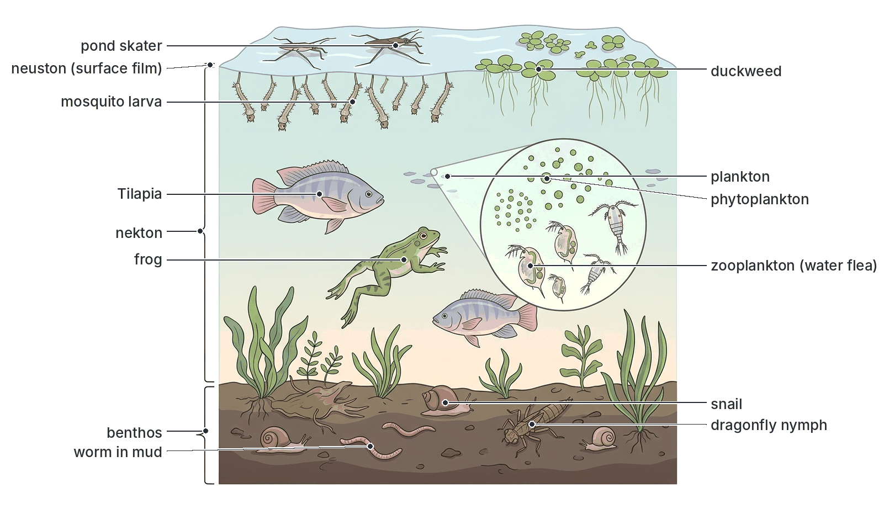
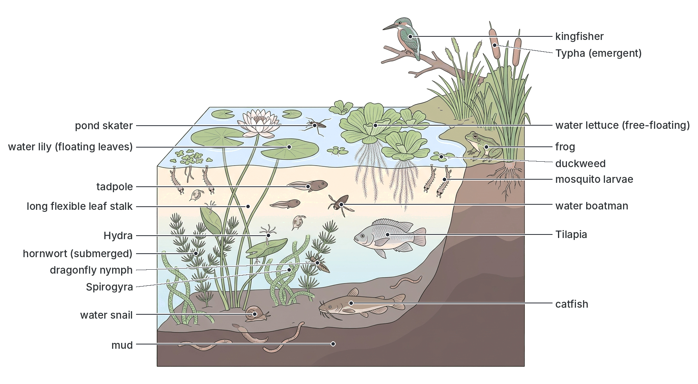
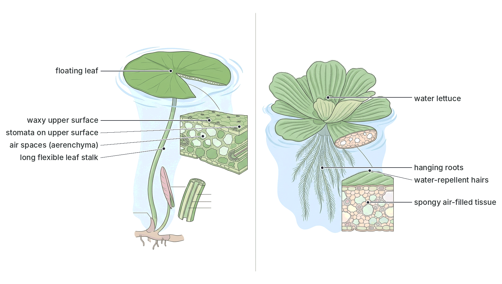
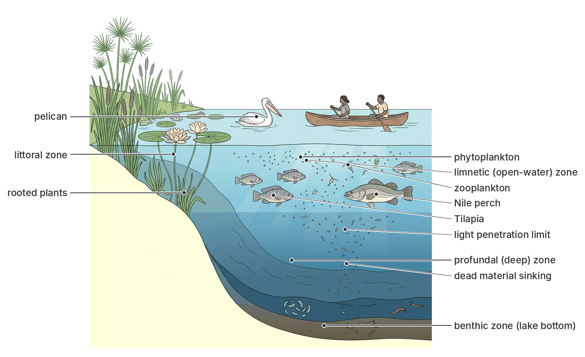
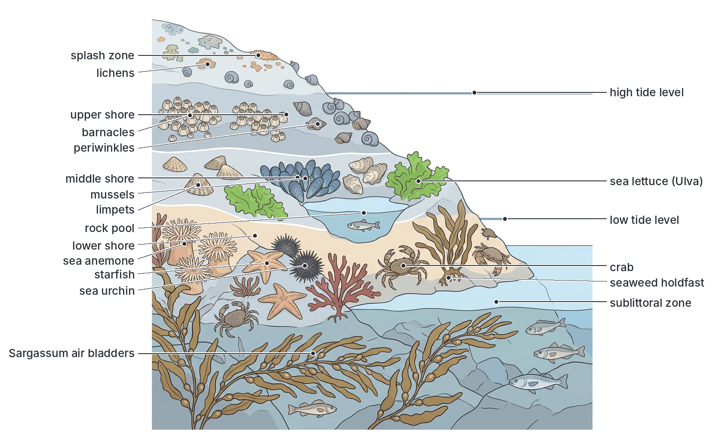
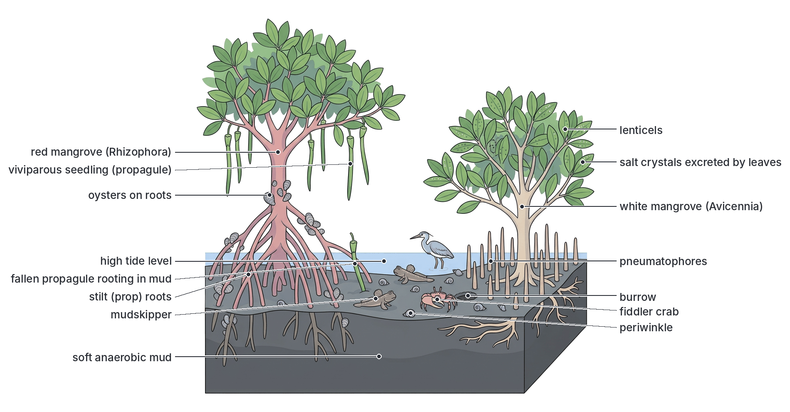
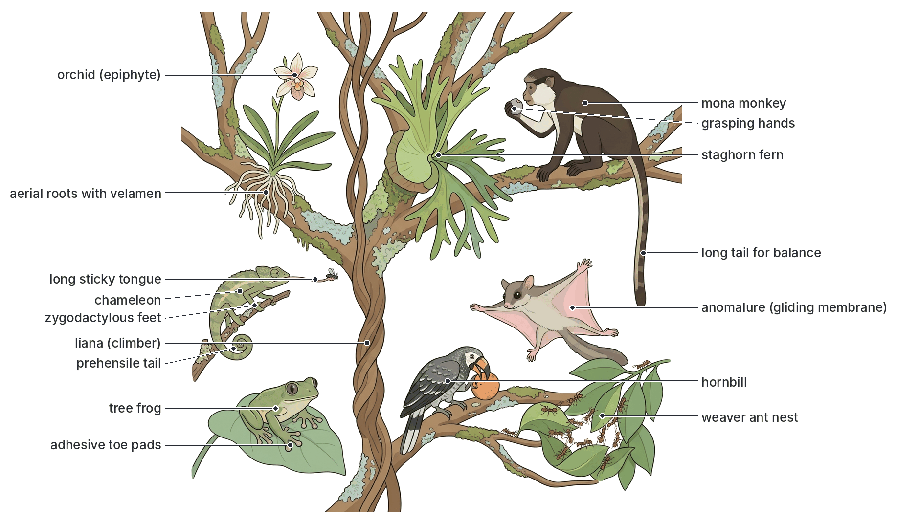
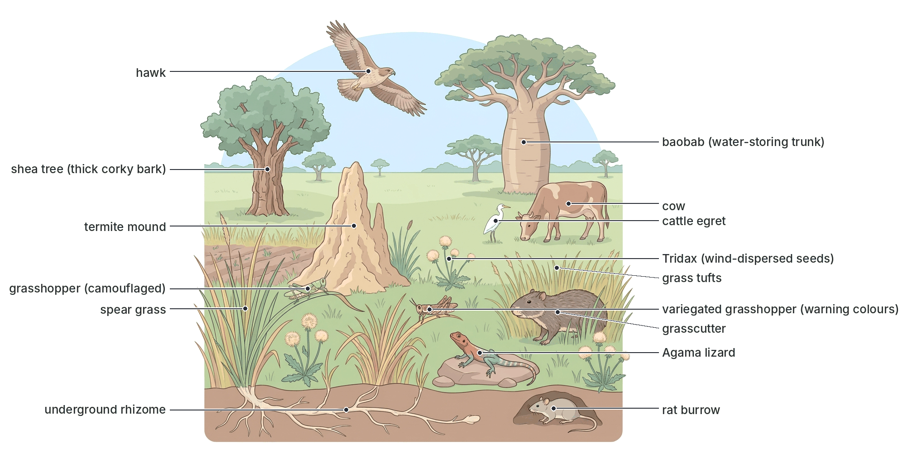
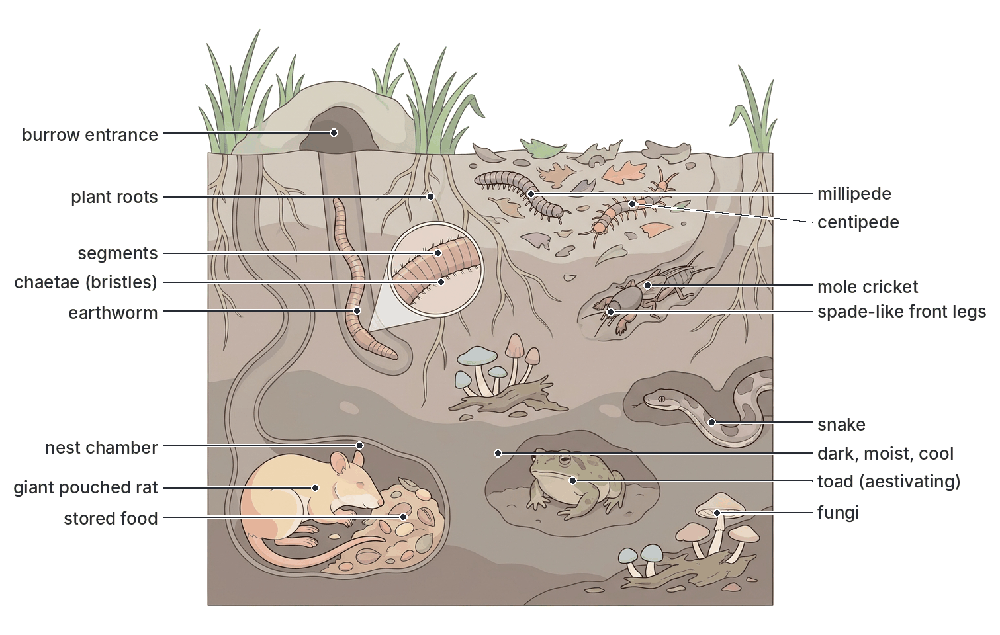

# JAMB Biology Notes: Natural Habitats

## What JAMB expects

This topic is Section C, Topic 3 of the JAMB Biology syllabus: Ecology – Natural habitats. It covers two content items:

- (a) **Aquatic habitats**, for example ponds, streams, lakes, seashores and mangrove swamps.
- (b) **Terrestrial and arboreal habitats**, for example tree-tops, abandoned farmland or a dry grassy (savanna) field, and a burrow or hole.

By the end of these notes, you should be able to:

1. Associate plants and animals with each of these habitats.
2. Relate adaptive features to the habitats in which organisms live.

Each of the eight habitats named in the syllabus has its own section below, describing its features (conditions), its plants, its animals, a typical food chain and the adaptations of its organisms. Two summary sections at the end bring the objectives together: one table that associates plants and animals with each habitat (objective i), and one that relates adaptive features to habitats (objective ii).

**Note on the syllabus wording:** content item (b) opens a bracket "(e.g., tree-tops, ..." that is never closed. Nothing is missing; the list ends with "burrow or hole".

## What is a habitat?

A **habitat** is the natural home of an organism, the place where it lives, feeds, shelters and breeds (topic C1). Each habitat has its own set of **conditions** (light, temperature, water, salinity, oxygen, soil and so on). Only organisms with suitable **adaptations** can live there. An **adaptation** is any feature of structure, function or behaviour that helps an organism to survive and reproduce in its habitat (topic A3).

Habitats are of two broad kinds:

- **Aquatic habitats** (in water): freshwater (ponds, streams, rivers, lakes), marine (seas and seashores) and brackish (estuaries, lagoons, mangrove swamps).
- **Terrestrial habitats** (on land): forests, grasslands (savanna), farmland, deserts, the soil and burrows. **Arboreal** habitats (from Latin *arbor*, "tree") are the trees themselves, especially the tree-tops.

### Aquatic and terrestrial habitats compared

| Condition | Aquatic habitat | Terrestrial habitat |
| --- | --- | --- |
| **Water supply** | Always plentiful; no danger of drying out (except temporary ponds) | Often limited; organisms risk drying out (desiccation) |
| **Support (buoyancy)** | Water supports (buoys up) the body, so organisms need little supporting tissue | Air gives no support; organisms need strong skeletons, woody stems or turgid tissues |
| **Temperature** | Changes slowly and little (water holds heat well) | Changes quickly and greatly between day and night and between seasons |
| **Oxygen** | Low: water holds far less oxygen than air, and it diffuses slowly | Plentiful: air contains about 21% oxygen |
| **Light** | Decreases quickly with depth and turbidity | Plentiful in open places; reduced under trees |
| **Medium for movement** | Dense water resists movement, so streamlined shapes help | Air offers little resistance; gravity is the main problem |
| **Salinity** | Important (fresh, brackish or salt water) | Usually not important, except in salty soils |
| **Typical adaptations** | Gills, fins, streamlined bodies, air spaces in plants, floating leaves | Lungs or tracheae, waterproof skins and cuticles, strong limbs, roots and stems |

## Aquatic habitats: general ideas

### Freshwater, brackish and marine habitats

| Feature | Freshwater | Brackish water | Marine (sea) |
| --- | --- | --- | --- |
| **Salinity** | Very low (less than about 0.5 ‰) | Medium and changing (about 0.5–30 ‰) | High (about 35 ‰ on average) |
| **Examples in Nigeria** | Rivers Niger and Benue, Kainji Lake, Oguta Lake, Lake Chad, ponds and streams | Lagos Lagoon, Lekki Lagoon (partly), the creeks and estuaries of the Niger Delta, mangrove swamps | The Atlantic Ocean (Gulf of Guinea); Bar Beach and other Lagos beaches |
| **Water movement** | Still (ponds, lakes) or flowing (streams, rivers) | Tides mix fresh and salt water | Tides, waves and currents |
| **Osmotic problem for organisms** | Water enters the body by osmosis; organisms must remove excess water | Organisms must cope with changing salinity | Many organisms tend to lose water and gain salt |
| **Typical organisms** | *Spirogyra*, water lily, water lettuce, *Tilapia*, catfish, frogs, mosquito larvae | Mangroves, mudskippers, fiddler crabs, periwinkles, oysters, mullet, shrimps | Seaweeds, barnacles, sea anemones, starfish, crabs, sharks, mackerel, sardines |

**Textbook variation:** the salinity limits for each type of water differ slightly between books; those above are common approximate values.

### Still water and flowing water: lentic and lotic habitats

Freshwater habitats are of two kinds, according to whether the water flows:

| Feature | Lentic (still-water) habitat | Lotic (flowing-water) habitat |
| --- | --- | --- |
| **Meaning** | Standing or still water | Running or flowing water |
| **Examples** | Ponds, lakes, swamps, reservoirs (Kainji Lake, Oguta Lake, Lake Chad) | Streams, springs, rivers (River Niger, River Benue, Ogun River) |
| **Current** | Little or none | Constant, one-way current from source to mouth |
| **Oxygen** | Often lower, especially at the bottom and in warm weather, because there is little mixing | Usually high, because moving water mixes with the air |
| **Temperature** | Can vary between surface and bottom; shallow ponds warm up a lot | More uniform, because water is mixed |
| **Bottom (substratum)** | Soft mud with much organic matter | Rocks, stones, gravel and sand in fast streams; mud in slow rivers |
| **Plankton** | Plentiful | Scarce in fast streams (they are washed away) |
| **Main challenge for organisms** | Low oxygen; drying up of small ponds in the dry season | Being swept away by the current |
| **Typical adaptations** | Breathing air at the surface (mosquito larvae, lungfish); floating leaves | Attachment (suckers, hooks, holdfasts); flattened or streamlined bodies; hiding under stones |

### Ecological groups of aquatic organisms

Aquatic organisms are grouped according to where and how they live in the water:

| Group | Meaning | Examples |
| --- | --- | --- |
| **Plankton** | Small (mostly microscopic) organisms that **float or drift** in the water and are carried by currents; they cannot swim strongly against the water | **Phytoplankton** (plant plankton): diatoms, *Chlamydomonas*, *Volvox*, blue-green bacteria. **Zooplankton** (animal plankton): water fleas (*Daphnia*), *Cyclops*, rotifers, larvae of crabs and fish |
| **Nekton** | Animals that **swim actively** and can move against currents | Fish (*Tilapia*, catfish, sharks), frogs, turtles, crocodiles, whales, squid |
| **Benthos** (benthic organisms) | Organisms that live **on or in the bottom** (mud, sand, rocks) | Snails, worms, crabs, mussels, oysters, starfish, sea anemones, insect larvae under stones, rooted plants |
| **Neuston** | Organisms that live **at or on the surface film** of the water | Pond skaters (water striders), whirligig beetles, mosquito larvae hanging from the surface, duckweed and other free-floating plants (sometimes called pleuston) |

**Importance of plankton:** phytoplankton are the main **producers** of most aquatic ecosystems, especially lakes and the sea. They are eaten by zooplankton, which are eaten by fish. Phytoplankton also produce a large share of the world's oxygen.

**Textbook variation:** some books place free-floating plants such as water lettuce and duckweed in a separate group called **pleuston**; others include them with the neuston. Some books also list **periphyton** (algae and other organisms growing attached to plants and stones).

## Aquatic habitat 1: The pond

### Features (conditions) of a pond

A **pond** is a small, shallow body of **still (lentic) fresh water**. It may be natural, or man-made (for example a fish pond or a borrow pit beside a road).

- **Shallow:** light usually reaches the bottom in clear ponds, so rooted plants can grow across much of it.
- **Still water:** there is little or no current; the water mixes only by wind.
- **Temperature:** the shallow water warms up quickly in the sun and cools at night more than a lake does.
- **Oxygen:** comes from the air and from the photosynthesis of plants. It is highest in the afternoon (after a day of photosynthesis) and lowest before dawn; it can fall very low in warm weather or when much dead matter is decaying.
- **Bottom:** soft mud rich in organic matter (decaying plants and animals).
- **Seasonal changes:** many Nigerian ponds shrink or **dry up** in the dry season and fill again when the rains come.

**Zones of a pond:**

1. **Marginal (littoral) zone:** the shallow water near the edge, with rooted plants.
2. **Open-water (surface and middle) zone:** away from the edge, with plankton, floating plants and swimming animals.
3. **Bottom (benthic) zone:** the mud at the bottom, with decomposers and bottom-living animals.

### Plants of the pond

Pond plants (**hydrophytes**: plants adapted to living in water) are grouped by how they grow:

| Group | Description | Examples |
| --- | --- | --- |
| **Emergent (marginal) plants** | Rooted in mud at the edge, with stems and leaves above the water | Sedges, reeds, *Typha* (bulrush or cattail), grasses, rice-like grasses |
| **Rooted plants with floating leaves** | Rooted in the mud, with leaves floating on the surface on long stalks | Water lily (*Nymphaea*) |
| **Free-floating plants** | Float freely on the surface; roots hang in the water | Water lettuce (*Pistia stratiotes*), duckweed (*Lemna*), water hyacinth (*Eichhornia crassipes*), *Salvinia*, *Azolla* |
| **Submerged plants** | Live completely under water, rooted or unrooted | Hornwort (*Ceratophyllum*), bladderwort (*Utricularia*), *Hydrilla* |
| **Algae** | Simple producers, filamentous or microscopic | *Spirogyra* (green filaments, "pond scum"), *Chlamydomonas*, *Volvox*, diatoms |

### Animals of the pond

- **Protozoa:** *Amoeba*, *Paramecium*, *Euglena* (which also photosynthesises).
- **Cnidaria:** *Hydra*, attached to water plants.
- **Crustaceans:** water fleas (*Daphnia*), *Cyclops*.
- **Insects and their larvae:** mosquito larvae and pupae, dragonfly nymphs, water boatmen, water beetles, pond skaters, mayfly nymphs.
- **Molluscs:** water snails such as *Lymnaea*, *Bulinus* and *Biomphalaria* (the last two can carry the blood fluke that causes schistosomiasis).
- **Worms and leeches** in the mud.
- **Amphibians:** frogs and toads, and their tadpoles.
- **Fish:** *Tilapia*, catfish (*Clarias*), the African lungfish (*Protopterus*) in swampy, seasonal waters.
- **Birds** at the edges: kingfishers, herons, egrets.

### A pond food chain

- phytoplankton → water flea → small fish → kingfisher
- *Spirogyra* → tadpole → dragonfly nymph → *Tilapia* → heron

### Adaptations of pond organisms

**Adaptations of pond plants (hydrophytes):**

1. **Air spaces (aerenchyma)** in stems, leaves and leaf stalks store air for respiration and make the plant **buoyant**, so the leaves float up to the light. Water lettuce, water hyacinth (with swollen, spongy leaf stalks) and water lily all have them.
2. **Little supporting (woody) tissue and little xylem**, because the water supports the plant and water is everywhere.
3. **Thin or absent cuticle** on submerged parts, so they can absorb water, minerals and gases directly over their surface.
4. **Stomata only on the upper surface** of floating leaves (water lily), where they are in contact with the air. Submerged leaves have few or no stomata.
5. **Broad, flat floating leaves** (water lily) catch as much light as possible; a waxy upper surface sheds water so the stomata are not blocked.
6. **Long, flexible leaf stalks** (water lily) allow the leaves to stay at the surface as the water level rises and falls.
7. **Finely divided, ribbon-like or feathery submerged leaves** (hornwort, bladderwort) offer a large surface for absorbing gases and light, and do not tear in moving water.
8. **Reduced roots** in floating plants (duckweed) because water and minerals are absorbed over the whole surface; the roots mainly balance the plant.
9. **Water-repellent hairs** on the leaves of water lettuce trap air and keep the leaves from becoming waterlogged.
10. **Rapid vegetative reproduction** (by runners and budding) in water lettuce, duckweed and water hyacinth lets them quickly cover the surface.
11. **Bladderwort** (*Utricularia*) has small **bladders** that trap tiny animals, which supply extra nitrogen.

**Adaptations of pond animals:**

1. **Gills** for absorbing dissolved oxygen (fish, tadpoles, dragonfly nymphs).
2. **Streamlined bodies, fins and tails** for swimming (fish, tadpoles); a **swim bladder** in bony fish controls buoyancy.
3. **Breathing tube (siphon)** in mosquito larvae, which hang from the surface film and take in air from above. **Mosquito pupae** have breathing trumpets.
4. **Webbed hind feet** in frogs for swimming; **moist skin** through which frogs absorb oxygen.
5. **Oar-like, fringed hind legs** in water boatmen and water beetles for rowing through water.
6. **Water-repellent hairs on the feet** of the pond skater let it walk on the surface film without sinking (using surface tension).
7. **Carrying an air bubble** under the wing cases (water beetles) as an air supply under water.
8. **Contractile vacuoles** in *Amoeba* and *Paramecium* to pump out excess water that enters by osmosis.
9. **Aestivation** in the African lungfish: it survives the drying of its pond by burrowing into the mud and forming a mucus cocoon, breathing air with its lungs (topic A3).
10. **Mouth-brooding** in some *Tilapia*: the parent keeps the eggs and young in its mouth for protection.
11. **Camouflage:** dark backs and pale bellies (countershading) in fish.

## Aquatic habitat 2: The stream

### Features of a stream

A **stream** is a small body of **flowing (lotic) fresh water**. Many small streams join to form rivers.

- **Current:** water flows constantly in one direction. The current is fastest in the middle and near the surface, slower at the edges and near the bottom, and slowest under and behind stones.
- **Oxygen:** usually **high**, because the moving, splashing water constantly mixes with air.
- **Temperature:** cooler and more even than a pond, especially near springs and under trees.
- **Bottom:** in fast stretches, stones, rocks, gravel and sand (mud is washed away); in slow stretches and pools, sand and mud settle.
- **Few plankton:** floating organisms are carried downstream.
- **Seasonal changes:** in Nigeria, streams flow fast and become muddy in the rainy season, and may shrink to pools or dry up in the dry season.

### Plants of the stream

- **Algae attached to stones** (forming a slippery layer), and filamentous algae in slower parts.
- **Mosses and liverworts** on rocks and banks splashed by water.
- **Rooted plants with strong roots** in slower, sheltered parts and along the banks: grasses, sedges, ferns.
- Trees and shrubs on the banks, whose falling leaves are an important source of food (detritus) for stream animals.

### Animals of the stream

- **Insect larvae and nymphs** living on or under stones: mayfly nymphs, stonefly nymphs, caddisfly larvae and **blackfly larvae** (*Simulium*).
- **Snails and freshwater limpets** clinging to stones.
- **Freshwater crabs** and **shrimps** hiding under stones.
- **Leeches** and **flatworms** (planarians) under stones.
- **Fish** that are strong swimmers, such as small barbs and catfish, often resting in pools.
- **Frogs** along the banks.

**Nigerian link:** the blackfly (*Simulium*) breeds in **fast-flowing, well-oxygenated rivers and streams**. The adult female blackfly carries the worm that causes **onchocerciasis (river blindness)**, so this disease is commonest in communities living near fast rivers.

### A stream food chain

- algae on stones → mayfly nymph → small fish → kingfisher
- dead leaves (detritus) → caddisfly larva → freshwater crab → otter (or heron)

### Adaptations of stream organisms

The main problem is **not being washed away** by the current.

1. **Flattened bodies:** mayfly and stonefly nymphs and flatworms are flat, so the current flows over them, and they can cling closely to stones or crawl underneath them.
2. **Suckers, hooks and claws:** blackfly larvae attach to stones with a ring of hooks (a sucker-like disc) at the hind end and spin silk threads; leeches have suckers; freshwater limpets clamp their cone-shaped shells to rocks; insect nymphs have strong claws.
3. **Heavy cases:** some caddisfly larvae build cases of small stones and sand, which weigh them down and protect them.
4. **Hiding under stones** and in the slow water behind them, where the current is weak.
5. **Streamlined bodies and strong swimming muscles** in fish, which allow them to swim against the current; many face upstream to keep oxygen-rich water flowing over their gills.
6. **Algae and mosses** hold firmly to rocks with holdfasts or rhizoids, and have tough, slippery, flexible bodies.
7. **Rooted plants** have strong, spreading roots and flexible stems that bend with the current instead of breaking.
8. Because oxygen is plentiful, many stream animals have small gills and cannot survive in still, poorly oxygenated water.

[IMAGE: Cross-section of a fast-flowing stream with water arrows showing the current. Large stones on the bottom covered in a thin green layer of algae, with mosses on a rock at the edge. On and under the stones: a flattened mayfly nymph, a caddisfly larva in a case made of small stones, blackfly larvae attached by their hind ends with fan-like mouth brushes, a freshwater limpet clamped to a rock, a flatworm, a freshwater crab hiding under a stone. A small fish facing upstream. Trees on the bank dropping leaves. Labels: "current", "algae on stones", "moss", "mayfly nymph (flattened body)", "caddisfly larva in stone case", "blackfly larvae (attached by hooks)", "freshwater limpet", "flatworm", "freshwater crab", "fish facing upstream", "stones and gravel", "fallen leaves". Soft blues, greys and greens. Clean flat textbook style, white background.]

## Aquatic habitat 3: The lake

### Features of a lake

A **lake** is a large, often deep, body of **still (lentic) water**, usually fresh, surrounded by land. Lakes are larger and deeper than ponds, so light does not reach the bottom in the middle, and waves can form on the surface.

**Nigerian lakes:**

| Lake | Location | Notes |
| --- | --- | --- |
| **Lake Chad** | Far north-east (Borno State), shared with Niger, Chad and Cameroon | A large but **very shallow** freshwater lake on the edge of the Sahara; it has shrunk greatly since the 1960s and its size changes with rainfall |
| **Kainji Lake** | Niger and Kwara States, on the River Niger | **Man-made** reservoir formed behind the Kainji Dam (completed in 1968); supports fishing; Kainji Lake National Park is nearby |
| **Oguta Lake** | Imo State | A **natural** freshwater lake, linked to the Niger system by the Orashi River; used for fishing, boating and tourism |
| Others | Jebba Lake (Kwara/Niger), Tiga Lake (Kano), Shiroro Lake (Niger) | Most of Nigeria's other large lakes are reservoirs behind dams |

**Zones of a lake:**

1. **Littoral zone:** the shallow water near the shore, where light reaches the bottom and rooted plants grow (like a pond).
2. **Limnetic (open-water) zone:** the open, well-lit surface water away from the shore, down to the depth where light is too dim for photosynthesis. **Phytoplankton** are the main producers here.
3. **Profundal (deep) zone:** the deep water below the reach of light, found only in deep lakes. There are **no producers**; organisms depend on dead material sinking from above. Oxygen may be low.
4. **Benthic zone:** the bottom of the lake, with mud and decomposers.

### Plants of the lake

- **Phytoplankton** (diatoms, green algae, blue-green bacteria) in the limnetic zone: the main producers.
- **Rooted plants** in the littoral zone: water lilies, reeds, sedges, *Typha*, papyrus (in Lake Chad).
- **Free-floating plants:** water lettuce, water hyacinth, *Salvinia*, which can cover large areas, blocking fishing and boats.

### Animals of the lake

- **Zooplankton:** water fleas, *Cyclops*, rotifers.
- **Fish:** *Tilapia*, Nile perch (*Lates niloticus*), catfish (*Clarias*, *Synodontis*), *Heterotis*, mudfish, *Alestes*. Lake Chad, Kainji Lake and Oguta Lake all support important fisheries.
- **Molluscs and insect larvae** on the bottom and among plants.
- **Reptiles:** crocodiles, monitor lizards, turtles.
- **Mammals:** hippopotamus (in some lakes and rivers), otters.
- **Birds:** pelicans, herons, egrets, kingfishers, ducks, cormorants. Lake Chad and its wetlands are important for migrating water birds.

### A lake food chain

- phytoplankton → zooplankton → small fish (e.g. *Alestes*) → Nile perch → human
- phytoplankton → *Tilapia* → pelican

### Adaptations of lake organisms

- **Phytoplankton** are tiny, with a large surface area and often oil droplets, spines or gas vacuoles that slow sinking, so they stay in the lighted surface water.
- **Zooplankton** move up towards the surface at night to feed and down into deeper, darker water by day to avoid predators.
- **Fish** have gills, fins, streamlined bodies and swim bladders, and countershading for camouflage (dark backs, pale bellies).
- **Bottom-living organisms** of deep, oxygen-poor water may have haemoglobin (as in some midge larvae, called bloodworms), which helps them take up oxygen at low concentrations.
- Lake shore plants have the same adaptations as pond plants (air spaces, floating leaves).

## Aquatic habitat 4: The seashore

### Features of the seashore

The **seashore** is the area where the land meets the sea. It is a **marine** habitat with special conditions:

- **Tides:** twice a day (roughly every 12 hours 25 minutes), the sea rises (high tide) and falls (low tide). Organisms on the shore are **covered by sea water** at high tide and **exposed to the air** at low tide.
- **Exposure at low tide:** exposed organisms face **drying out**, high temperatures from the sun, rain (fresh water lowers salinity), and attack by land predators such as birds.
- **Waves:** strong waves pound the shore, so organisms can be washed away or battered.
- **Salinity:** high (about 35 ‰), but rock pools may become saltier in the sun (evaporation) or less salty in rain.
- **Substratum:** the shore may be **rocky**, **sandy** or **muddy**. Most of Nigeria's coastline (such as Bar Beach, Lekki Beach and Badagry in Lagos State) is **sandy**. Rocky shores are rare in Nigeria; rocky habitats are found on breakwaters and harbour walls (moles), such as those at the Lagos harbour entrance.
- **Plenty of oxygen, light and nutrients** in the shallow water.

### Zonation on the seashore

Because different parts of the shore are covered by the tide for different lengths of time, organisms are arranged in **bands or zones** according to how well they can survive exposure. This arrangement is called **zonation**.

| Zone | Position | Conditions | Typical organisms |
| --- | --- | --- | --- |
| **Splash (spray) zone (supralittoral)** | Above the highest tide | Only wetted by spray and storm waves; very dry; land-like | Lichens, some salt-tolerant plants, periwinkle snails (*Littorina*), sea slaters (sea lice), ghost crabs on sandy beaches |
| **Upper shore (upper intertidal)** | Covered only at the highest tides | Exposed for long periods; very dry and hot at low tide | Barnacles, periwinkles, some tough green and brown seaweeds, limpets |
| **Middle shore (middle intertidal)** | Covered and uncovered twice a day | Moderate exposure | Barnacles, mussels, limpets, oysters, top shells, brown and green seaweeds (e.g. sea lettuce, *Ulva*) |
| **Lower shore (lower intertidal)** | Uncovered only at the lowest tides | Usually wet; little exposure | Sea anemones, starfish, sea urchins, crabs, red and brown seaweeds, sponges |
| **Sublittoral zone** | Below the lowest tide | Always covered by sea water | Large seaweeds, fish, octopus, sea urchins, starfish, corals (in clear tropical seas elsewhere) |

**Textbook variation:** different books divide the shore into slightly different zones and use different names (for example, "littoral zone" for the whole intertidal shore). The idea is the same: organisms that can stand most exposure live highest, and those that need to stay wet live lowest.

**On a sandy beach** such as Bar Beach, there are no rocks to attach to, so most animals **burrow** into the wet sand: ghost crabs, clams and other bivalves, worms (such as lugworms), mole crabs and beach hoppers. Sea birds (gulls and terns) feed on them at low tide.

### Plants of the seashore

- **Seaweeds** (marine algae): green seaweeds such as **sea lettuce** (*Ulva*) and *Enteromorpha*; brown seaweeds such as *Sargassum*; and red seaweeds on the lower shore. (The brown seaweeds *Fucus* and *Laminaria*, often shown in textbooks, grow on cool temperate shores, not in Nigeria.)
- **Phytoplankton** in the sea water.
- On the land side of sandy beaches: creeping **beach plants** such as the goat's-foot morning glory (*Ipomoea pes-caprae*) and coastal grasses, and **coconut palms** behind the beach.

### Animals of the seashore

Barnacles, periwinkles, limpets, mussels, oysters, crabs (ghost crabs, shore crabs, hermit crabs), sea anemones, starfish, sea urchins, sea cucumbers, shrimps, worms, small fish in rock pools, jellyfish washed ashore, and sea birds (gulls, terns).

### A seashore food chain

- phytoplankton → barnacles (filter feeders) → dog whelk (a predatory snail) → sea bird
- seaweed → periwinkle → crab → gull

### Adaptations of seashore organisms

**Seaweeds:**

1. **Holdfast:** a root-like structure that grips the rock firmly so the seaweed is not torn off by waves. (It is not a true root; it does not absorb water.)
2. **Flexible, leathery thallus** that bends with the waves instead of breaking.
3. **Mucilage (slime)** on the surface, which holds water and reduces drying out at low tide.
4. **Air bladders (floats)** in some brown seaweeds, such as *Sargassum*, keep the fronds up near the light when the tide is in.
5. **Extra pigments** (brown and red) in brown and red seaweeds absorb the light that reaches deeper water, so they can live lower down.
6. **Absorption over the whole surface:** no roots, stems or leaves are needed, because the seaweed is bathed in sea water.

**Animals:**

1. **Hard shells** (barnacles, periwinkles, limpets, mussels) protect against waves, drying and predators. Many can **close their shells** tightly at low tide, trapping water inside: barnacles close their plates; periwinkles close the shell opening with an **operculum** (a horny lid); limpets clamp down on the rock.
2. **Firm attachment:** barnacles and oysters **cement** themselves to rocks; mussels attach by strong **byssus threads**; limpets and sea anemones grip with a **muscular foot or disc**; starfish and sea urchins hold on with many **tube feet** (suckers).
3. **Conical or low, rounded shapes** (limpets, barnacles) resist wave action.
4. **Burrowing** into sand or mud (ghost crabs, clams, worms) avoids drying out, waves and predators.
5. **Withdrawing tentacles:** sea anemones pull in their tentacles at low tide and become a blob of jelly to reduce water loss.
6. **Moving with the tide:** crabs and some fish move down the shore or hide in rock pools and crevices at low tide.
7. **Tolerance of salt:** marine animals have body fluids adapted to sea water (osmoregulation).
8. **Ghost crabs** come out mostly at night (nocturnal) and have pale, sand-coloured bodies (camouflage); they run very fast.

## Aquatic habitat 5: The mangrove swamp

### Features of a mangrove swamp

A **mangrove swamp** is a coastal forest of salt-tolerant trees (mangroves) that grows on soft mud in the **brackish** water of estuaries, lagoons and creeks along tropical coasts. Mangrove swamps are found along the coast of Nigeria from Lagos to Calabar, and especially in the **Niger Delta** (in states such as Rivers, Bayelsa, Delta, Akwa Ibom and Cross River). Nigeria's mangrove forest is commonly described as the largest in Africa (and one of the largest in the world), though figures for its area vary between sources.

**Conditions:**

1. **Brackish, salty water:** a mixture of fresh river water and salt sea water, whose salinity changes with tides and seasons.
2. **Tides:** the swamp is flooded at high tide and partly drained at low tide, twice a day.
3. **Soft, waterlogged mud:** deep, unstable mud that gives little support to roots.
4. **Little oxygen in the mud (anaerobic):** the waterlogged mud has almost no air, and it smells of hydrogen sulphide from bacterial decay.
5. **High temperature, high humidity and heavy rainfall** (the Niger Delta is one of the wettest parts of Nigeria).
6. **Rich in nutrients and detritus:** fallen mangrove leaves decay and feed a huge detritus food web.

### Plants of the mangrove swamp

| Plant | Notes |
| --- | --- |
| **Red mangrove** (*Rhizophora*, e.g. *Rhizophora racemosa*) | The commonest mangrove of the Niger Delta. Grows on the seaward, most often flooded edges. Has arching **stilt (prop) roots** and shows **vivipary** |
| **White mangrove** (*Avicennia*, e.g. *Avicennia africana*) | Grows on higher, less often flooded mud. Has many **pneumatophores** (breathing roots) and **salt glands** on its leaves |
| **Other mangroves** (*Laguncularia*, *Conocarpus*) | Grow on the landward side |
| **Nypa palm** (*Nypa fruticans*) | An introduced palm from Asia that has spread widely in the Niger Delta and the Cross River estuary, crowding out native mangroves |
| **Mangrove fern** (*Acrostichum aureum*) | A large fern in disturbed and landward areas |
| **Raphia palms** and freshwater swamp trees | Further inland, where the water is fresh (freshwater swamp forest) |

**Textbook variation:** the common names of mangroves vary. In Nigeria and West Africa, *Avicennia* is often called the **white mangrove**, while in other regions (for example, the Americas) *Avicennia* is called the **black mangrove** and *Laguncularia* the white mangrove. Use the genus names (*Rhizophora*, *Avicennia*) to avoid confusion.

### Animals of the mangrove swamp

- **Mudskipper** (*Periophthalmus*): a fish that spends much time out of water on the mud.
- **Fiddler crabs** (*Uca*) and other crabs living in burrows in the mud.
- **Periwinkles** (the mangrove snail *Tympanotonus fuscatus*, a popular food in the Niger Delta and Lagos, called "isam" in Efik) and other snails.
- **Oysters** (*Crassostrea*) attached to the stilt roots of red mangroves.
- **Shrimps, prawns** and many young fish: mangroves are a **nursery** for fish and shrimps, which later move out to sea.
- **Fish:** mullet, *Tilapia*, catfish.
- **Reptiles:** crocodiles, monitor lizards, snakes.
- **Mammals:** the West African manatee in creeks; monkeys feeding in the canopy; otters.
- **Birds:** herons, egrets, kingfishers.
- **Insects:** mosquitoes, sandflies.

### A mangrove food chain

- dead mangrove leaves → bacteria and fungi (decomposers) → fiddler crab → heron
- phytoplankton → oyster → human
- algae on mud → periwinkle → crab → crocodile (or human)

### Adaptations of mangrove organisms

**Adaptations of mangrove plants:**

1. **Stilt roots (prop roots)** in red mangroves (*Rhizophora*): arching roots grow from the trunk and lower branches down into the mud, like the legs of a stool. They **support** the tree in the soft, unstable mud and against tides and waves. They also have **lenticels** that take in air at low tide.
2. **Pneumatophores (breathing roots)** in white mangroves (*Avicennia*): pencil-like roots that grow **upwards** (negatively geotropic) out of the mud from the horizontal roots below. They stand above the mud surface and are covered with **lenticels** (pores) through which **air (oxygen) enters**. The oxygen passes down through air spaces (aerenchyma) to the roots buried in the **anaerobic mud**, so they can respire.
3. **Vivipary:** in red mangroves, the seed **germinates while the fruit is still on the parent tree**. The seedling grows a long, heavy, pointed, spear-like root and stem (a **propagule**), sometimes 30 cm or more long, which hangs from the tree. When it falls, it may stick upright in the soft mud and grow roots quickly before the tide can wash it away; or it floats and is carried by the water until it lodges in mud elsewhere. This avoids the problem of a small seed germinating in salty, waterlogged mud.
4. **Salt glands:** *Avicennia* has glands on its leaves that **excrete excess salt**; salt crystals can often be seen on the leaf surfaces. Other mangroves, such as *Rhizophora*, **exclude** most of the salt at their roots, or store salt in old leaves that are then shed.
5. **Thick, leathery, waxy, succulent leaves** with a thick cuticle and sunken stomata reduce water loss. (Although they live in water, mangroves have difficulty taking in water from salty mud, because of osmosis, so they conserve it. This is called "physiological drought".)
6. **High concentration of solutes in root cells**, so that water can still enter the roots by osmosis from the salty soil water.
7. **Air spaces (aerenchyma)** in roots and stems carry oxygen down to the submerged parts.

**Adaptations of mangrove animals:**

1. **Mudskipper:**
   - Its **eyes are on top of its head** and can be raised, so it can see above the water or mud like a periscope.
   - Its **pectoral fins** are strong and muscular, used like arms to "skip" and crawl over the mud and climb mangrove roots.
   - It keeps a supply of **water in its large gill chambers** when out of water, and also takes in oxygen through its **moist skin** and the lining of its mouth and throat.
   - It digs **burrows** in the mud, where it hides at high tide and from predators.
2. **Fiddler crab:**
   - Lives in **burrows** in the mud, into which it retreats when the tide comes in or when danger threatens, sealing the entrance.
   - The male has **one very large claw**, which it waves to attract females and threaten rival males.
   - It feeds on algae and detritus sifted from the mud with its small claw and mouthparts.
   - It can tolerate changing salinity and exposure to air.
3. **Oysters and periwinkles:** shells that close tightly at low tide to prevent drying; oysters **cement** themselves to mangrove roots; periwinkles have an **operculum**.
4. **Osmoregulation:** animals of brackish water can tolerate changes in salinity.

## Terrestrial and arboreal habitat 1: Tree-tops

### Features of tree-tops (the arboreal habitat)

The **tree-tops** (the **canopy**) of a forest, or of large trees in the savanna or in towns, form a habitat high above the ground.

- **Light:** bright, the most light in the forest.
- **Temperature:** higher by day and changes more than on the forest floor.
- **Humidity:** lower than on the forest floor, and changes more during the day; drier because of wind and sun.
- **Wind:** stronger than at ground level.
- **Food:** plentiful leaves, buds, flowers, nectar, fruits and seeds, and the insects that feed on them.
- **Danger of falling:** animals must move about on branches high above the ground.
- **No soil:** plants that grow on branches must get water and nutrients from rain, the air and dust.

### Plants of the tree-tops

- **The tree's own canopy** of leaves, flowers and fruits (for example, iroko, obeche, mahogany, silk cotton, mango, African pear (*Dacryodes*), oil palm crowns).
- **Epiphytes:** plants that grow on the branches and trunks of trees without taking food from them (commensals): **orchids**, ferns such as the **staghorn fern** (*Platycerium*), mosses, liverworts and lichens.
- **Climbers and lianas:** woody climbing plants that root in the ground and climb to the canopy, such as rattan palms and *Combretum* climbers.
- **Parasites:** *Loranthus* and other mistletoes (topic C2).

### Animals of the tree-tops

- **Mammals:** monkeys (such as the mona monkey and colobus monkeys), chimpanzees (in a few forests), squirrels, **anomalures** (scaly-tailed "flying" squirrels that glide), the **tree pangolin**, bush babies (galagos), tree hyraxes, fruit bats.
- **Birds:** hornbills, parrots (such as the grey parrot), turacos, weaver birds, sunbirds, pigeons, owls, hawks and eagles (which nest in tall trees).
- **Reptiles:** chameleons, tree snakes (such as the green mamba), some geckos and lizards.
- **Amphibians:** tree frogs.
- **Insects and spiders:** weaver ants (which build nests of leaves), caterpillars, beetles, cicadas, butterflies, stick insects, praying mantises, spiders.

### A tree-top food chain

- leaves → caterpillar → weaver ant (or insect-eating bird) → hawk
- fruits → fruit bat → owl
- fruits → monkey → crowned eagle

### Adaptations of tree-top organisms

**Animals:**

1. **Grasping hands and feet** with **opposable thumbs** or toes (monkeys, chimpanzees, bush babies), which can grip branches firmly.
2. **Long arms and legs** for climbing and leaping from branch to branch (monkeys).
3. **Long tails** for **balance** when running and leaping (monkeys, squirrels). Some animals have a **prehensile tail**, which can wrap around and grip branches like an extra hand: the **chameleon** and the **tree pangolin**. (African monkeys do **not** have prehensile tails; only some South American monkeys do.)
4. **Sharp, curved claws** for gripping bark (squirrels, tree pangolins, leopards, hyraxes).
5. **Forward-facing eyes** with **stereoscopic (binocular) vision**, so monkeys and bush babies can judge distances accurately when jumping. Bush babies have very **large eyes** for seeing at night.
6. **Gliding membranes:** anomalures have a fold of skin between their front and back legs, which they spread out to glide from tree to tree.
7. **Chameleon:**
   - feet with toes fused into two opposing groups (**zygodactylous** feet) that grip branches like tongs;
   - a **prehensile tail**;
   - eyes that **move independently**, so it can look for insects in two directions at once;
   - a long, sticky **tongue** that shoots out to catch insects;
   - **colour change** for camouflage and signalling.
8. **Tree frogs** have **adhesive pads** (sticky discs) on their toes, which let them cling to smooth leaves and bark.
9. **Birds** have **perching feet** that lock around branches (topic A3), wings for flying between trees, and beaks adapted to fruits (hornbills, parrots) or nectar (sunbirds).
10. **Camouflage:** green tree snakes and green caterpillars blend with leaves; stick insects look like twigs.
11. **Light bodies** in canopy animals, so thin branches can support them.

**Plants:**

1. **Epiphytic orchids** have **aerial roots** covered with a spongy, white tissue called **velamen**, which quickly soaks up rainwater and dew. Some roots cling to the bark to hold the plant in place.
2. Many epiphytes have **thick, waxy, succulent leaves** or swollen stems (pseudobulbs in orchids) to **store water**, because they have no soil and can dry out between rains.
3. The **staghorn fern** has special "nest" leaves that collect falling leaves and rainwater, forming a store of humus and moisture.
4. **Tiny, light seeds or spores** (orchids, ferns, mosses) are carried by wind to high branches.
5. **Climbers** have **tendrils, hooks, spines** or twining stems to climb towards the light without having to build thick trunks of their own.
6. **Canopy trees** have tough, often waxy leaves with **drip tips** that shed rainwater quickly, and produce large crops of fruits that attract the animals that disperse their seeds.

## Terrestrial habitat 2: Abandoned farmland or a dry grassy (savanna) field

### Features of the habitat

The syllabus groups two similar open, grassy habitats together:

- **Abandoned farmland:** land that has been cleared, farmed and then left to rest (fallow) or abandoned. It is quickly colonised by weeds, grasses and shrubs. If left long enough, it slowly returns towards the original vegetation by **secondary succession** (topic C5).
- **A dry grassy (savanna) field:** an open field covered mainly with grasses, with scattered shrubs and trees, typical of the Guinea and Sudan savanna of central and northern Nigeria, and also found in school fields and around towns in the south.

**Conditions:**

1. **Open, with high light intensity:** there is no tall canopy, so sunlight reaches the ground.
2. **High temperatures** during the day, especially at ground level, with lower temperatures at night (greater daily range than in a forest).
3. **Seasonal rainfall:** plenty of water in the rainy season; drought in the dry season, when grasses dry up and many plants die back or shed leaves.
4. **Low humidity** in the dry season (especially during the harmattan in the north).
5. **Bush fires** are common in the dry season.
6. **Grazing and trampling** by cattle, goats and wild herbivores.
7. **Soil:** often exposed and easily eroded; on abandoned farmland, the soil may be low in nutrients after years of cropping.

### Plants of abandoned farmland and the savanna field

| Type | Examples |
| --- | --- |
| **Grasses** | Spear grass (*Imperata cylindrica*), guinea grass (*Panicum maximum*), elephant grass (*Pennisetum purpureum*), gamba grass (*Andropogon gayanus*), *Hyparrhenia*, goose grass (*Eleusine indica*) |
| **Weeds and herbs** (common on abandoned farmland) | *Tridax procumbens*, Siam weed (*Chromolaena odorata*), *Aspilia africana*, spurge (*Euphorbia heterophylla*), *Sida* species, wild *Amaranthus*, goat weed (*Ageratum conyzoides*), *Mimosa pudica* (touch-me-not) |
| **Shrubs** | Young shrubs and coppice shoots from old tree stumps |
| **Scattered trees** (savanna) | Shea tree (*Vitellaria paradoxa*), locust bean (*Parkia biglobosa*), baobab (*Adansonia digitata*), *Daniellia oliveri*, *Isoberlinia*, *Acacia*, neem (*Azadirachta indica*, introduced) |

### Animals of abandoned farmland and the savanna field

- **Insects:** grasshoppers (including the variegated grasshopper, *Zonocerus variegatus*), crickets, locusts, butterflies and moths, ants, **termites** (with their mounds), beetles, bees.
- **Spiders** and scorpions.
- **Reptiles:** *Agama* lizards, skinks, monitor lizards, snakes such as the cobra, puff adder and python.
- **Amphibians:** toads.
- **Birds:** weaver birds, finches, bishop birds, guinea fowl, francolins, quails, doves, cattle egrets, kites and hawks.
- **Mammals:** rats and mice, the **grasscutter** (cane rat, *Thryonomys*), ground squirrels, hares, mongooses; in larger savannas, antelopes, warthogs, baboons and their predators (lions, hyenas, jackals); and domestic cattle, sheep and goats grazing.

### A food chain of the savanna field

- grass → grasshopper → *Agama* lizard → hawk
- grass seeds → rat → snake → kite
- grass → grasscutter → python (or human hunter)

### Adaptations of organisms of the savanna field and abandoned farmland

**Adaptations of grasses and savanna plants:**

1. **Underground stems (rhizomes)** and deep, fibrous root systems: spear grass survives fire, drought and grazing because its rhizomes stay alive underground and send up new shoots after the rains or after a fire.
2. **Growing points (meristems) at the base** of the leaves, close to the ground, so grasses can regrow quickly after being grazed or burnt.
3. **Narrow leaves** that roll or fold up in dry weather, reducing water loss.
4. **Dormancy:** above-ground parts die back in the dry season, and seeds remain dormant in the soil until the rains.
5. **Wind pollination and wind dispersal** of seeds, suited to the open, windy habitat.
6. **Fire-resistant trees:** savanna trees such as the shea and locust bean have **thick, corky bark** that protects the living tissue from fire.
7. **Deep tap roots** reach water far below the surface (baobab, *Acacia*).
8. **Deciduous habit:** many savanna trees **shed their leaves** in the dry season to reduce water loss.
9. **Water storage:** the baobab stores large amounts of water in its very thick, soft trunk.
10. **Thorns and spines** (*Acacia*) protect against browsing animals.

**Adaptations of weeds that colonise abandoned farmland:**

1. **Rapid growth and short life cycles:** many weeds flower and set seed within a few weeks.
2. **Very large numbers of seeds**, many with **hairs or parachutes** for wind dispersal (*Tridax*, Siam weed) or **hooks** that cling to animals' fur and people's clothes.
3. **Seeds that remain dormant** in the soil for years and germinate when the soil is disturbed and exposed to light.
4. **Vegetative reproduction:** spear grass spreads by rhizomes; many weeds regrow from pieces of root or stem left after weeding.
5. **Tolerance of poor soils**, full sun and dry conditions.

**Adaptations of animals:**

1. **Camouflage:** grasshoppers are green in the rainy season and often brown in the dry season; many birds (quails, francolins) and the grasscutter are brown and blend with dry grass.
2. **Warning colours** in poisonous species such as the variegated grasshopper (topic A3).
3. **Speed** for escape in the open (antelopes, hares, guinea fowl that run fast).
4. **Burrowing** to escape heat, fire and predators (rats, ground squirrels, snakes, scorpions).
5. **Nocturnal habits** (rats, grasscutters, many snakes) to avoid heat and daytime predators.
6. **Living in groups** (herds of antelopes, flocks of birds) so that many eyes watch for predators.
7. **Jumping hind legs** (grasshoppers, hares) for escape.
8. **Aestivation and migration** in the dry season: some animals become dormant, while others (many birds, and herds of grazing animals) move to wetter areas.
9. **Termites** build hard mounds that protect the colony from heat, drying and predators, and keep a steady temperature and humidity inside (topic A3).
10. **Basking** in lizards (*Agama*) to warm up in the morning.

## Terrestrial habitat 3: Burrow or hole

### Features of a burrow or hole

A **burrow** is a tunnel or hole dug into the ground by an animal to live in. A **hole** may also be a natural opening in the ground, in rocks, in a termite mound, or in a tree trunk. The soil itself, with its many tunnels and spaces, is a closely related habitat.

**Conditions in a burrow:**

1. **Dark:** little or no light, so there are no green plants inside.
2. **Cool and steady temperature:** much cooler than the surface by day, and warmer at night. The temperature changes very little.
3. **High humidity:** the air in a burrow is moist, so animals lose little water. (This is why many desert and savanna animals spend the hot day in burrows.)
4. **Poor ventilation:** the air may contain **less oxygen** and **more carbon (IV) oxide** than outside air.
5. **Protection:** a burrow shelters animals from predators, heat, cold, fire, wind and rain.
6. **Limited space:** animals must be able to move in narrow tunnels.
7. **Food:** usually comes from outside (animals go out to feed, or carry food in) or from roots, humus and dead matter in the soil.

### Organisms of burrows and holes

**Plants:** no green plants live inside burrows, because there is no light. **Fungi** and **bacteria** grow on dead matter and droppings, plant **roots** pass through the soil, and **mosses** may grow at damp, shaded entrances.

**Animals:**

| Group | Examples |
| --- | --- |
| **Annelids** | Earthworms |
| **Arthropods** | Millipedes, centipedes, mole crickets, crickets, beetles and beetle larvae, ants, termites, scorpions, burrowing spiders, woodlice |
| **Molluscs** | Land snails (which bury themselves in the dry season) |
| **Amphibians** | Toads and burrowing frogs |
| **Reptiles** | Snakes (which also use other animals' burrows), skinks, monitor lizards, tortoises |
| **Birds** | Bee-eaters and some kingfishers (which nest in tunnels in earth banks); owls, hornbills, parrots and woodpeckers (which nest in tree holes) |
| **Mammals** | The giant pouched rat (*Cricetomys*), other rats and mice, gerbils (in the north), ground squirrels, the aardvark (ant bear), porcupines, mongooses, hares (in some species); bats roost in holes and caves |

### A food chain of the burrow and soil

- dead leaves → earthworm → shrew (or toad) → snake
- humus and dead leaves → millipede → centipede → toad
- grass seeds stored in a burrow → giant pouched rat → snake

### Adaptations of burrow and soil organisms

**Earthworm:**

1. **Long, thin, cylindrical, segmented body** with a pointed front end, for pushing through the soil.
2. **Chaetae (bristles)** on each segment grip the walls of the burrow, so the worm can move by waves of contraction of its **circular and longitudinal muscles**, and hold on firmly when a bird tries to pull it out.
3. **Moist skin** covered with **mucus**, through which it breathes (gas exchange), and which also lubricates movement through the soil.
4. **No eyes**, but **light-sensitive cells** in the skin so it moves away from light.
5. It **eats soil** as it burrows, digesting the organic matter in it.
6. It comes to the surface mainly at **night** and after rain, when the air is moist.

**Mole cricket:** very strong, broad, **spade-like front legs** for digging; a cylindrical, velvety body that moves easily in tunnels.

**Burrowing mammals (giant rat, aardvark, ground squirrels):**

1. **Strong front limbs with sharp claws** for digging (the aardvark can dig very quickly and breaks open termite mounds with its claws).
2. **Small eyes**, and often **small ears**, which are less important in the dark and protect against soil.
3. **Sensitive whiskers (vibrissae)** and a good sense of smell for finding their way and food in the dark.
4. **Nocturnal habits:** they come out to feed at night, when it is cooler and safer.
5. **Cheek pouches** in the giant pouched rat for carrying food back to store in the burrow.
6. **Short, compact bodies** and fur that does not hold soil, for moving in tunnels.
7. **Tolerance of the higher carbon (IV) oxide** and lower oxygen of burrow air.

**Other adaptations:**

- **Millipedes and centipedes:** long, segmented bodies with many legs, for pushing through soil and leaf litter; they avoid light and dry air.
- **Snakes:** long, limbless, smooth bodies that slide easily through holes.
- **Toads and land snails:** burrow into the soil to aestivate in the dry season (topic A3).
- **Bats** roosting in caves and holes use **echolocation** to find their way in the dark.

## Associating plants and animals with each habitat

**Objective i: associate plants and animals with each of these habitats.**

| Habitat | Type | Typical plants (producers) | Typical animals | Nigerian example |
| --- | --- | --- | --- | --- |
| **Pond** | Aquatic, freshwater, still (lentic) | Water lily, water lettuce, duckweed, hornwort, *Typha*, *Spirogyra*, phytoplankton | *Amoeba*, *Paramecium*, *Hydra*, water flea, mosquito larvae, dragonfly nymph, pond skater, water snail, tadpole, frog, *Tilapia*, catfish | Fish ponds, village ponds and borrow pits |
| **Stream** | Aquatic, freshwater, flowing (lotic) | Algae on stones, mosses, rooted grasses and sedges on banks | Mayfly and stonefly nymphs, caddisfly larvae, blackfly larvae, freshwater limpets, crabs, flatworms, leeches, small fish | Streams in the forest belt and hilly areas, e.g. around the Obudu Plateau |
| **Lake** | Aquatic, freshwater, still (lentic), large and deep | Phytoplankton, water lily, reeds, papyrus, water hyacinth | Zooplankton, *Tilapia*, Nile perch, catfish, crocodiles, hippopotamus, pelicans, herons | Lake Chad, Kainji Lake, Oguta Lake |
| **Seashore** | Aquatic, marine | Seaweeds (sea lettuce, *Sargassum*, red seaweeds), phytoplankton; beach creepers and coconut palms on land | Barnacles, periwinkles, limpets, mussels, oysters, sea anemones, starfish, sea urchins, ghost crabs, gulls | Bar Beach, Lekki Beach and Badagry (sandy); harbour walls (rocky) |
| **Mangrove swamp** | Aquatic, brackish | Red mangrove (*Rhizophora*), white mangrove (*Avicennia*), Nypa palm, mangrove fern | Mudskipper, fiddler crab, periwinkle (*Tympanotonus*), oysters, shrimps, young fish, herons, crocodiles, manatee | Niger Delta, Lagos Lagoon fringes, Cross River estuary |
| **Tree-tops** | Arboreal (terrestrial) | Canopy trees, epiphytic orchids, staghorn fern, mosses, lichens, lianas, *Loranthus* | Monkeys, squirrels, anomalures, tree pangolin, bush baby, fruit bats, hornbills, parrots, chameleon, tree snakes, tree frogs, weaver ants | Rainforests such as Cross River National Park and Okomu National Park |
| **Abandoned farmland / savanna field** | Terrestrial | Spear grass, guinea grass, elephant grass, *Tridax*, Siam weed, *Aspilia*, shea tree, locust bean, baobab | Grasshoppers, crickets, termites, ants, butterflies, *Agama*, snakes, toads, weaver birds, guinea fowl, cattle egret, rats, grasscutter, antelopes | Fallow farmland everywhere; Guinea and Sudan savanna fields of the middle belt and north |
| **Burrow or hole** | Terrestrial (underground) | No green plants inside; fungi, bacteria, roots, mosses at entrance | Earthworms, millipedes, centipedes, mole crickets, ants, termites, scorpions, toads, snakes, giant pouched rat, aardvark, ground squirrels, bee-eaters, bats | Burrows in any field, farm or forest floor |

## Relating adaptive features to habitats

**Objective ii: relate adaptive features to the habitats in which organisms live.**

Each habitat presents its own main problems. The organisms that live there have features that solve those problems.

| Habitat | Main problems (conditions) | Organism | Adaptive feature | How it helps |
| --- | --- | --- | --- | --- |
| **Pond** | Low oxygen; need for light; buoyancy | Water lily | Air spaces; floating leaves with stomata on the upper surface; long flexible stalks | Keeps leaves at the light and in contact with air |
| | | Water lettuce | Water-repellent hairs; spongy leaves; hanging roots | Floats; stays dry on top; absorbs minerals |
| | | Mosquito larva | Breathing siphon | Takes in air from the surface |
| | | Pond skater | Water-repellent hairy feet | Walks on the surface film |
| | | Lungfish | Lungs; aestivation in a mucus cocoon | Survives low oxygen and drying of the pond |
| **Stream** | Strong current | Blackfly larva | Hooks and silk at the hind end | Holds onto stones |
| | | Mayfly nymph | Flattened body; strong claws | Clings to stones; current flows over it |
| | | Caddisfly larva | Case of small stones | Weighs it down |
| | | Fish | Streamlined body; strong muscles | Swims against the current |
| **Lake** | Light only near the surface; deep, dark water | Phytoplankton | Small size, oil droplets, spines | Stay afloat in the lighted surface water |
| | | Zooplankton | Daily vertical migration | Feed at night; avoid predators by day |
| **Seashore** | Waves, tides, exposure and drying at low tide, salt | Seaweeds | Holdfast; flexible thallus; mucilage; air bladders | Resist waves; avoid drying; float to the light |
| | | Barnacle, periwinkle, limpet | Hard shells closed at low tide; cement, operculum, clamping foot | Resist waves and drying |
| | | Starfish | Tube feet | Grip rocks |
| | | Ghost crab, clams, worms | Burrowing | Escape drying, waves and predators |
| **Mangrove swamp** | Salt water; soft, unstable mud; no oxygen in mud; tides | Red mangrove (*Rhizophora*) | Stilt (prop) roots; vivipary | Support in soft mud; seedlings establish quickly |
| | | White mangrove (*Avicennia*) | Pneumatophores with lenticels; salt glands | Roots get oxygen; excess salt removed |
| | | Mangroves in general | Thick, leathery, waxy leaves | Conserve water (physiological drought) |
| | | Mudskipper | Raised eyes; arm-like pectoral fins; water stored in gill chambers; breathing through skin | Lives and moves on mud out of water |
| | | Fiddler crab | Burrows; tolerance of salinity changes | Shelter from tides and predators |
| **Tree-tops** | Height (danger of falling); moving on branches; no soil for plants | Monkey | Grasping hands with opposable thumbs; long limbs and tail; stereoscopic vision | Climbs, balances and leaps accurately |
| | | Chameleon | Zygodactylous feet; prehensile tail; independent eyes; long tongue; colour change | Grips branches; catches insects; hides |
| | | Tree frog | Adhesive toe pads | Clings to smooth leaves |
| | | Anomalure | Gliding membrane | Glides between trees |
| | | Orchid (epiphyte) | Aerial roots with velamen; water-storing leaves and pseudobulbs | Absorbs and stores water without soil |
| | | Climbers | Tendrils, hooks, twining stems | Reach the light |
| **Savanna field / abandoned farmland** | Drought, fire, grazing, open exposure | Grasses | Rhizomes; basal growing points; narrow rolling leaves; dormancy | Regrow after fire and grazing; reduce water loss |
| | | Savanna trees | Thick corky bark; deep roots; leaf fall; thorns; water-storing trunk (baobab) | Survive fire and drought; deter browsers |
| | | Weeds | Rapid growth; many wind-dispersed seeds; seed dormancy | Quickly colonise bare ground |
| | | Grasshopper | Camouflage colours; jumping legs | Hides and escapes predators |
| | | Antelopes, hares | Speed; living in herds | Escape predators in the open |
| **Burrow or hole** | Darkness; narrow space; poor ventilation; digging through soil | Earthworm | Segmented, streamlined body; chaetae; mucus; moist skin | Moves through soil; breathes through skin |
| | | Mole cricket, aardvark | Strong digging forelimbs and claws | Digs burrows quickly |
| | | Giant pouched rat | Small eyes; whiskers; cheek pouches; nocturnal habit | Finds way in the dark; stores food |
| | | Bats | Echolocation | Navigate in dark holes and caves |

## Key terms

| Term | Meaning |
| --- | --- |
| Habitat | The natural home of an organism |
| Aquatic habitat | A habitat in water (fresh, brackish or marine) |
| Terrestrial habitat | A habitat on land |
| Arboreal | Living in trees |
| Lentic | Still-water (ponds, lakes) |
| Lotic | Flowing-water (streams, rivers) |
| Brackish water | A mixture of fresh water and sea water, with medium salinity |
| Plankton | Small organisms that drift in the water |
| Phytoplankton | Plant plankton (microscopic algae), the main aquatic producers |
| Zooplankton | Animal plankton, such as water fleas |
| Nekton | Animals that swim actively in water |
| Benthos | Organisms that live on or in the bottom of a water body |
| Neuston | Organisms that live at or on the surface film of water |
| Hydrophyte | A plant adapted to living in water |
| Aerenchyma | Plant tissue with large air spaces |
| Zonation | The arrangement of organisms in bands or zones, e.g. on a seashore |
| Holdfast | The root-like structure that attaches a seaweed to rock |
| Operculum | A horny lid that closes the shell of a snail such as a periwinkle |
| Pneumatophore | An upward-growing breathing root of mangroves, with lenticels |
| Stilt (prop) root | An arching root from the trunk that supports a mangrove in soft mud |
| Vivipary | Germination of a seed while still attached to the parent plant |
| Salt gland | A gland on a leaf that excretes excess salt |
| Halophyte | A plant adapted to salty conditions |
| Epiphyte | A plant that grows on another plant for support only |
| Velamen | Spongy water-absorbing tissue on the aerial roots of orchids |
| Prehensile tail | A tail that can grip like a hand |
| Chaetae | Bristles on the segments of an earthworm |

## Exam tips and common mistakes

- **Pneumatophores are for breathing (gas exchange); stilt roots are for support.** Pneumatophores grow **upwards** out of the mud and have lenticels.
- **Vivipary** in mangroves means the seed germinates **on the parent tree**; it is not the same as vivipary in animals (giving birth to live young).
- **Mangroves grow in brackish water** of estuaries and lagoons, not in fresh water ponds or the open sea.
- **Lentic = still (ponds, lakes); lotic = flowing (streams, rivers).** A useful memory aid: "lotic" has the "o" of "flowing".
- **Plankton drift; nekton swim; benthos live on the bottom; neuston live on the surface film.**
- **Water lily stomata are on the upper surface** of the leaf, the side in contact with air.
- **Zonation on the seashore** is caused mainly by differences in **exposure** (how long each level is uncovered by the tide).
- **Seaweeds have holdfasts, not roots;** they absorb water and minerals over their whole surface.
- **African monkeys do not have prehensile tails;** the chameleon and tree pangolin do.
- **Epiphytes are not parasites:** orchids use trees only for support. *Loranthus*, which takes water from the host, is a parasite.
- **There are no green plants inside a burrow** because there is no light.
- **Spear grass survives bush burning** because of its underground rhizomes.

## Quick summary

1. A habitat is the natural home of an organism; aquatic habitats include ponds, streams, lakes, seashores and mangrove swamps, while terrestrial and arboreal habitats include tree-tops, abandoned farmland or savanna fields, and burrows or holes.
2. Aquatic habitats may be freshwater, brackish or marine, and still (lentic) or flowing (lotic); aquatic organisms are grouped as plankton, nekton, benthos and neuston.
3. Ponds and lakes have floating, submerged and emergent plants with air spaces and floating leaves, and animals with gills, siphons and swimming structures; Nigerian lakes include Lake Chad, Kainji Lake and Oguta Lake.
4. Stream organisms resist the current with flattened bodies, hooks, suckers and heavy cases; seashore organisms show zonation and resist waves and drying with holdfasts, shells, opercula and burrowing.
5. Mangrove swamps of the Niger Delta have red mangroves with stilt roots and vivipary, and white mangroves with pneumatophores and salt glands; mudskippers and fiddler crabs live on the mud.
6. Tree-top animals have grasping hands, long tails, prehensile tails (chameleon), adhesive pads and gliding membranes; epiphytes have water-absorbing aerial roots.
7. Savanna grasses and weeds of abandoned farmland survive fire, grazing and drought with rhizomes, basal growing points, dormancy and many seeds; burrow animals have digging limbs, small eyes, whiskers and nocturnal habits.

## Practice questions

**1. Which of the following is a lotic habitat?**

- A. Pond
- B. Lake
- C. Stream
- D. Swamp

**Answer: C.** Lotic habitats have flowing water, such as streams and rivers. Ponds, lakes and swamps are lentic (still-water) habitats.

**2. Pneumatophores in mangrove plants are an adaptation for**

- A. support in soft mud
- B. gaseous exchange in waterlogged soil
- C. excretion of salt
- D. storage of food

**Answer: B.** Pneumatophores grow up out of the oxygen-poor mud and take in air through their lenticels, so the buried roots can respire.

**3. The germination of the seeds of *Rhizophora* while still attached to the parent plant is known as**

- A. vivipary
- B. epigeal germination
- C. dormancy
- D. parthenocarpy

**Answer: A.** Vivipary allows the seedling to develop a long propagule that can quickly root in the soft mud of the mangrove swamp.

**4. Organisms that drift freely in water and are carried about by currents are called**

- A. nekton
- B. benthos
- C. neuston
- D. plankton

**Answer: D.** Plankton (phytoplankton and zooplankton) drift with the water; nekton swim actively, benthos live on the bottom and neuston live on the surface film.

**5. The stomata of the floating leaves of a water lily are found**

- A. on the lower surface only
- B. on the upper surface only
- C. on both surfaces equally
- D. on the leaf stalk only

**Answer: B.** The upper surface is in contact with the air, so the stomata there can exchange gases; the lower surface is in contact with water.

**6. Which of the following adaptations helps a seaweed to survive strong wave action on a rocky shore?**

- A. Air bladders
- B. A holdfast
- C. Brown pigments
- D. Thick cuticle with stomata

**Answer: B.** The holdfast grips the rock firmly, so the seaweed is not torn away by waves. (Air bladders keep the fronds afloat; brown pigments help absorb light.)

**7. An animal with a prehensile tail, zygodactylous feet and eyes that move independently is best adapted to life in**

- A. a burrow
- B. a pond
- C. the tree-tops
- D. a sandy seashore

**Answer: C.** These are features of the chameleon, an arboreal animal that grips branches with its feet and tail.

**8. Spear grass (*Imperata cylindrica*) is able to survive annual bush burning in the savanna mainly because it has**

- A. underground rhizomes
- B. broad leaves
- C. a thick cuticle
- D. pneumatophores

**Answer: A.** The rhizomes stay alive underground during the fire and send up new shoots afterwards.

**9. Which of the following animals is most likely to be found in a mangrove swamp?**

- A. Pond skater
- B. Mudskipper
- C. Mole cricket
- D. Chameleon

**Answer: B.** The mudskipper is a fish adapted to living on the mud of mangrove swamps, with raised eyes and arm-like pectoral fins.

**10. Mayfly nymphs living in fast-flowing streams have flattened bodies in order to**

- A. float on the surface
- B. absorb more oxygen through the skin
- C. reduce the force of the current and cling to stones
- D. store air under the body

**Answer: C.** A flat body lets the current flow over the nymph and allows it to press closely against stones or hide underneath them, so it is not swept away.
