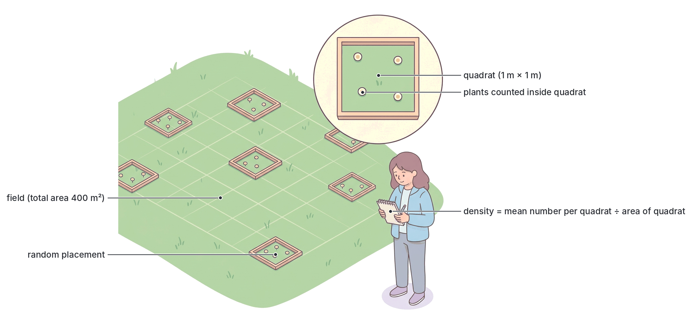
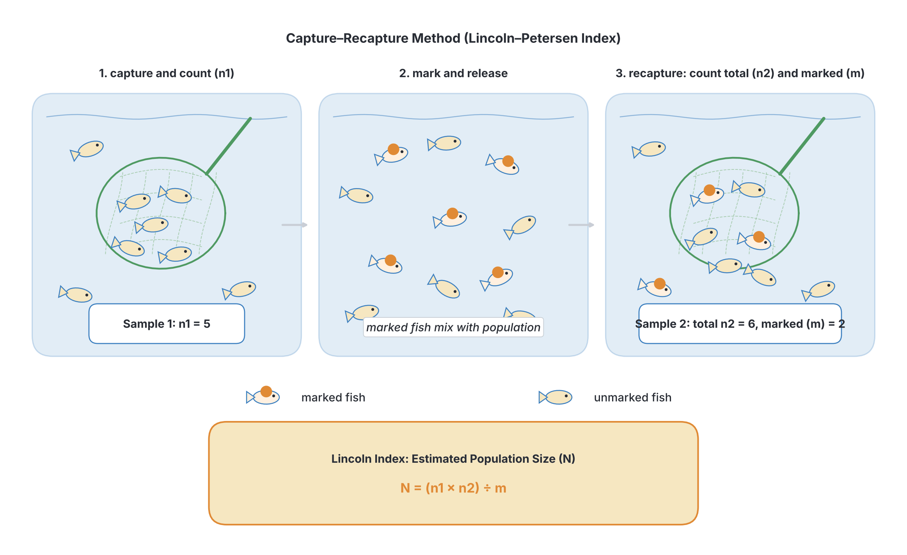
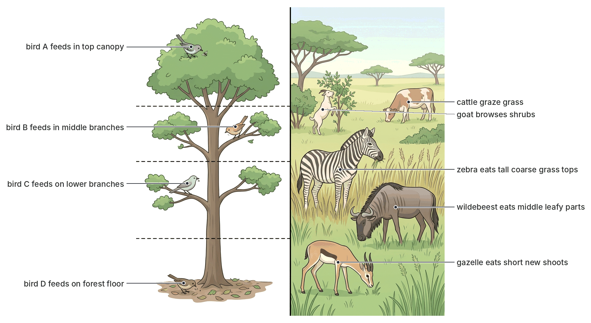
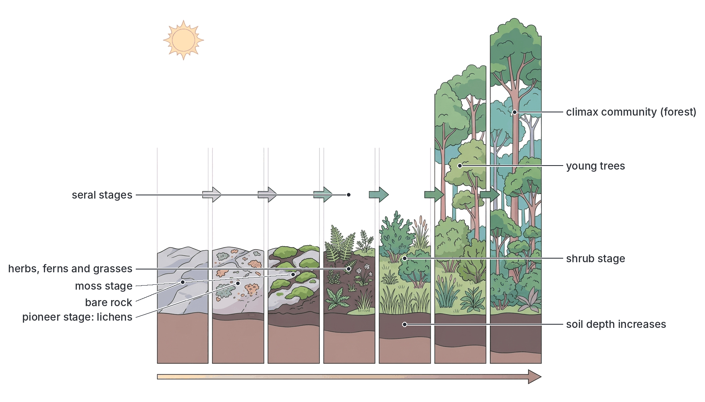
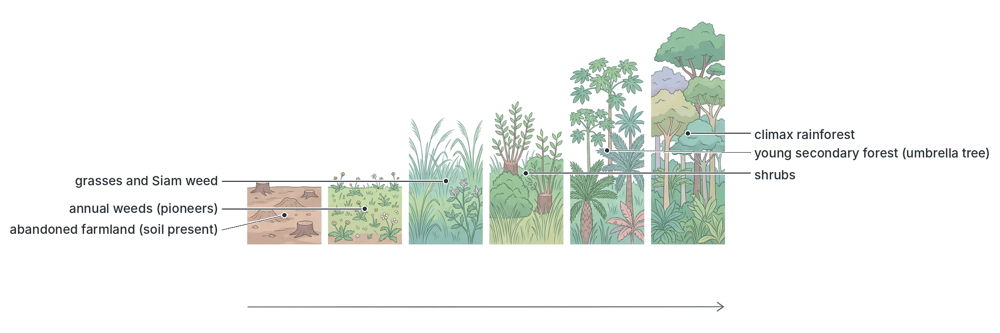
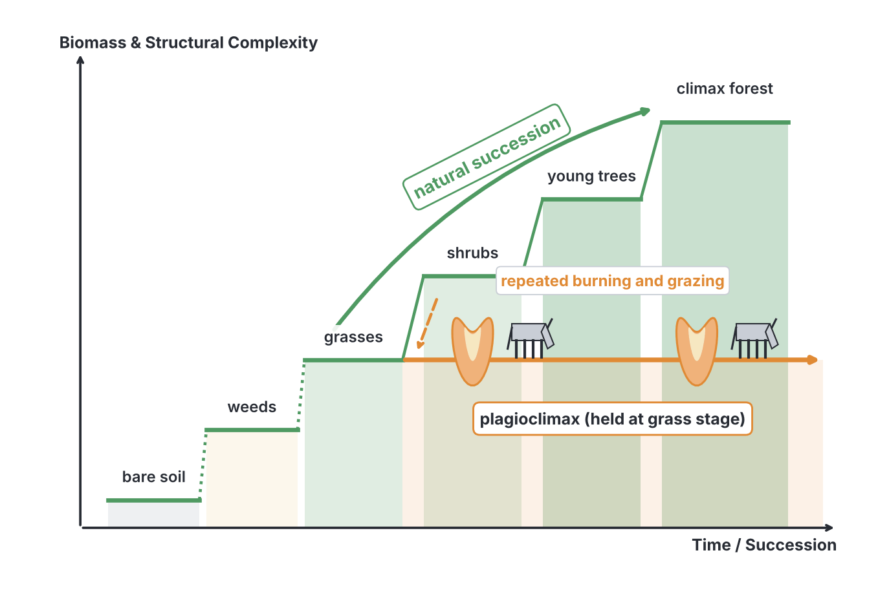

# JAMB Biology Notes: The Ecology of Populations

## What JAMB expects

This topic is Section C, Topic 5 of the JAMB Biology syllabus: Ecology – The ecology of populations. It covers four content items:

- (a) Population density and overcrowding.
- (b) Adaptation for survival:
  - i. factors that bring about competition;
  - ii. intra- and inter-specific competition;
  - iii. relationship between competition and succession.
- (c) Factors affecting population sizes:
  - i. biotic (food, pest, disease, predation, competition and reproductive ability);
  - ii. abiotic (temperature, space, light, rainfall, topography, pressure, pH), etc.
- (d) Ecological succession:
  - i. primary succession;
  - ii. secondary succession.

By the end of these notes, you should be able to:

1. Determine the reasons for rapid changes in human population and the consequences of overcrowding.
2. Compute (calculate) density as the number of organisms per unit area.
3. Relate increase in population, diseases, shortage of food and space to intra- and inter-specific competition.
4. Determine niche differentiation as a means of reducing intra-specific competition.
5. Relate competition to succession.
6. Deduce the effect of the listed biotic and abiotic factors on the size of a population.
7. Determine the interactions between biotic and abiotic factors (for example, drought or scarcity of water leading to food shortage, and lack of space causing an increase in disease rates).
8. Trace the sequence in succession to the climax stage of stability in a plant population.

**Note on the syllabus wording:** objective iv reads "niche differentiation as a means of reducing intra-specific **completion**". "Completion" is a typing error for **competition**. Also note that, in most textbooks, niche differentiation is described mainly as a way of reducing **inter-specific** competition (between different species). It can also reduce **intra-specific** competition (within a species), for example when the young and adults of a species eat different foods. Both are explained in the section on objective iv below.

These notes also cover population growth (the J-shaped and S-shaped growth curves), birth and death rates, immigration and emigration, and age pyramids, which are needed to understand changes in population size.

## What is a population?

A **population** is a group of organisms of the **same species** living together in the same area at the same time and able to interbreed (topic C1). Examples: all the *Tilapia* in a fish pond; all the maize plants in a farm; all the people in Nigeria.

### Characteristics of a population

A population has features that a single organism does not have:

| Characteristic | Meaning |
| --- | --- |
| **Population size** | The total number of individuals in the population |
| **Population density** | The number of individuals per unit area (or volume) |
| **Birth rate (natality)** | The number of new individuals produced (born, hatched or germinated) in a given time, often per 1,000 individuals per year |
| **Death rate (mortality)** | The number of individuals that die in a given time, often per 1,000 individuals per year |
| **Immigration** | Individuals moving **into** the population from elsewhere |
| **Emigration** | Individuals moving **out of** the population to another place |
| **Age structure** | The proportions of individuals of different ages (young, adults, old) |
| **Sex ratio** | The ratio of males to females |
| **Distribution (dispersion)** | How individuals are spread out: clumped (in groups), uniform (evenly spaced) or random |
| **Growth rate** | How fast the population is increasing or decreasing |

### How a population changes in size

The size of a population changes because of four processes. Two **add** individuals, and two **remove** them:

- **Increase:** births and immigration.
- **Decrease:** deaths and emigration.

**Change in population size = (births + immigration) − (deaths + emigration)**

- If births + immigration are **greater** than deaths + emigration, the population **grows**.
- If they are **equal**, the population is **stable**.
- If they are **less**, the population **declines**.

For the whole human population of the world, there is no immigration or emigration, so the change depends only on births and deaths. The difference between the birth rate and the death rate is called the **natural increase**.

**Worked example:** a town of 20,000 people had 900 births, 300 deaths, 200 immigrants and 100 emigrants in a year. Change = (900 + 200) − (300 + 100) = 1,100 − 400 = **+700**. The population grew to 20,700. The growth rate = (700 ÷ 20,000) × 100 = **3.5%** per year.

## Population growth

### Biotic potential and environmental resistance

- **Biotic potential** is the maximum rate at which a population could increase if conditions were perfect, with unlimited food, space and no enemies or disease. Every species has a very high biotic potential. For example, bacteria can divide every 20 minutes or so in ideal conditions; a single pair of houseflies could, in theory, produce millions of descendants in a few months.
- **Environmental resistance** is the sum of all the factors that limit the growth of a population: shortage of food, water and space, predators, parasites, diseases, competition, unfavourable weather and accumulation of wastes.
- **Carrying capacity (K)** is the **maximum population size** that a particular environment can support for a long time with the resources available.

### The S-shaped (sigmoid) growth curve

When a few individuals are introduced into a new, favourable environment (for example, yeast cells in a flask of sugar solution, or a few *Tilapia* put into a new fish pond), the population usually grows in an **S-shaped (sigmoid) curve**, which has these phases:

1. **Lag phase:** growth is **slow** at first. There are only a few individuals; they are adjusting to the new environment, maturing and beginning to reproduce.
2. **Exponential (log) phase:** growth is **very rapid**. Food and space are plentiful, and environmental resistance is low, so each generation is larger than the last and the population doubles at a steady rate.
3. **Deceleration (slowing) phase:** growth **slows down** as food and space become limited, wastes build up, and competition, predation and disease increase. Environmental resistance increases.
4. **Stationary (plateau) phase:** the population **stops growing** and stays roughly constant at the **carrying capacity**. Births + immigration are about equal to deaths + emigration. The population may rise and fall a little around this level.
5. **Death (decline) phase:** in a closed environment such as a flask of yeast, where food runs out and wastes (such as alcohol) accumulate, the population may finally **decline**. This phase is not always shown, and in natural populations it may not happen.

### The J-shaped growth curve

In a **J-shaped curve**, the population grows **exponentially** (faster and faster) and then **crashes** suddenly, instead of levelling off. This happens when a population grows rapidly until it uses up its resources or until a sudden change (such as the end of the rainy season, frost, or a disease outbreak) kills most individuals. Examples: algal blooms in polluted water; some insect pests (such as locusts) that multiply rapidly in good seasons and then die off.

**The human population** of the world, and of Nigeria, has been growing in a way that looks like the steep part of a J-shaped curve, especially over the last 100 years. This raises the question of what the Earth's (or Nigeria's) carrying capacity for humans is.

| Feature | S-shaped (sigmoid) curve | J-shaped curve |
| --- | --- | --- |
| Shape | Slow start, rapid rise, then levelling off | Slow start, very rapid rise, then a sudden crash |
| Effect of environmental resistance | Increases gradually as the population grows | Has little effect until it acts suddenly |
| Final population | Stabilises at the carrying capacity | Falls sharply (crashes) |
| Examples | Yeast in a flask; *Tilapia* in a new pond; most natural populations | Algal blooms; some insect populations; the steep growth of the human population |

[IMAGE: Two population growth graphs side by side, both with "time" on the horizontal axis and "number of individuals (population size)" on the vertical axis. Left: an S-shaped (sigmoid) curve with five shaded and labelled phases from left to right: lag phase (flat start), exponential (log) phase (steep rise), deceleration phase (bending), stationary phase (flat plateau), and a slight downward death phase at the end. A dashed horizontal line at the plateau labelled carrying capacity (K). Right: a J-shaped curve rising slowly and then very steeply, followed by a sudden sharp drop (crash). Labels: "S-shaped (sigmoid) growth curve", "lag phase", "exponential (log) phase", "deceleration phase", "stationary phase", "death phase", "carrying capacity (K)", "J-shaped growth curve", "exponential growth", "population crash", "time", "population size". Soft blue and soft green lines. Clean flat textbook style, white background.]

### Age structure and age pyramids

An **age pyramid** (population pyramid) is a bar graph that shows the number or percentage of people (or other organisms) in each **age group**, with males on one side and females on the other, the youngest at the bottom and the oldest at the top.

| Type of pyramid | Shape | What it shows | Example |
| --- | --- | --- | --- |
| **Expanding (growing, progressive)** | **Broad base**, narrow top (a true pyramid shape) | High birth rate; many young people; high death rate in older groups; population growing rapidly | **Nigeria** and most countries of sub-Saharan Africa |
| **Stable (stationary)** | Fairly straight sides, narrowing only near the top | Birth rate roughly equals death rate; similar numbers in most age groups; population fairly steady | Some countries of Europe and North America in recent decades |
| **Contracting (declining, regressive)** | **Narrower base** than middle | Low birth rate; fewer young people than adults; ageing population; population may decline | Japan, Italy, Germany |

**Nigeria's population is very young:** roughly 40% or more of Nigerians are under 15 years old, according to estimates from the National Population Commission and the United Nations. This means a large number of people will reach childbearing age in the coming years, so the population will keep growing for a long time (population momentum). It also means a large proportion of the population depends on the working-age adults for food, schooling and health care (a high **dependency ratio**).

[IMAGE: Three population (age) pyramids side by side, each a horizontal bar chart with age groups (0–4 at the bottom up to 80+ at the top) on a central vertical axis, males on the left in soft blue and females on the right in soft pink. Left: expanding pyramid with a very broad base and a narrow peak. Middle: stable pyramid with nearly straight vertical sides narrowing only near the top. Right: contracting pyramid with a narrower base than its middle. Labels: "expanding (e.g. Nigeria)", "stable", "contracting (e.g. Japan)", "males", "females", "age group", "high birth rate", "low birth rate", "young people", "old people". Clean flat textbook style, white background.]

## Population density and overcrowding

### Population density

**Population density** is the **number of individuals per unit area** (for land organisms) or **per unit volume** (for organisms in water or air).

**Population density = number of individuals ÷ area (or volume) occupied**

Units: individuals per m², per hectare (ha) or per km² for land organisms; individuals per litre or per m³ for water organisms. (1 hectare = 10,000 m²; 1 km² = 100 ha = 1,000,000 m².)

**Overcrowding** happens when the population density becomes so high that there are **not enough resources** (food, water, space, shelter, light) for all the individuals. Overcrowding increases competition, the spread of diseases and stress (see below).

## Calculating population density

**Objective ii: compute/calculate density as the number of organisms per unit area.**

### Direct calculation

When the total number of organisms and the total area are known, divide the number by the area.

**Worked example 1:** a school farm of 2,500 m² contains 500 maize plants. What is the population density?

- Density = 500 ÷ 2,500 = **0.2 plants per m²** (or 2 plants per 10 m²).

**Worked example 2:** a fish pond of area 200 m² is stocked with 1,000 *Tilapia*. What is the population density?

- Density = 1,000 ÷ 200 = **5 fish per m²**.

**Worked example 3 (human population density):** Nigeria's land area is about **923,768 km²**. The 2006 national census counted **140,431,790** people.

- Density in 2006 = 140,431,790 ÷ 923,768 ≈ **152 people per km²**.

Nigeria has not held a national census since 2006, so all later figures are **estimates and projections**. Estimates for the mid-2020s, for example from the United Nations and the National Population Commission, are roughly **220 to 235 million** people, depending on the source and year. Using 230 million:

- Density ≈ 230,000,000 ÷ 923,768 ≈ **about 250 people per km²**.

**Note:** these are national averages. Population density varies greatly within Nigeria: it is very high in Lagos State and in parts of the south-east (such as Anambra and Imo States) and in the Kano area, and much lower in parts of the middle belt and the far north-east (for example, Niger, Taraba and Borno States).

**Worked example 4 (comparing densities):** Town A has 60,000 people on 20 km²; Town B has 90,000 people on 45 km². Which is more crowded?

- Town A: 60,000 ÷ 20 = 3,000 people per km².
- Town B: 90,000 ÷ 45 = 2,000 people per km².
- **Town A** is more densely populated, even though Town B has more people.

**Worked example 5 (finding the number from the density):** the density of grasshoppers in a field is 4 per m². The field is 50 m by 30 m. How many grasshoppers are in the field?

- Area = 50 × 30 = 1,500 m². Number = density × area = 4 × 1,500 = **6,000 grasshoppers**.

### Estimating density using quadrats

It is usually impossible to count every plant or slow-moving animal in a large area. Instead, ecologists **sample** the population using a **quadrat**: a square frame of known area (commonly 1 m × 1 m = 1 m², or 0.5 m × 0.5 m = 0.25 m², made of wood, metal or string and pegs).

**Method (step by step):**

1. Make a quadrat of known area (e.g. 1 m²).
2. Throw (or place) the quadrat at **random** positions in the area being studied, so the samples are not biased. (A common school method is to stand in the field, close your eyes, and throw the quadrat over your shoulder; a better method uses random numbers to choose coordinates on a grid.)
3. **Count** the number of individuals of the species inside the quadrat. Decide on a rule for plants lying on the edge (for example, count only those touching the top and left sides).
4. Repeat for a number of quadrats (usually 10 or more) to get a reliable average.
5. Calculate the **mean number per quadrat**.
6. Calculate the **density**: mean number per quadrat ÷ area of one quadrat.
7. Estimate the **total population**: density × total area of the field.

**Worked example 6:** a student placed ten 1 m² quadrats at random in a field of area 400 m² and counted the *Tridax* plants: 3, 5, 2, 4, 6, 0, 3, 5, 4, 8.

- Total = 3 + 5 + 2 + 4 + 6 + 0 + 3 + 5 + 4 + 8 = **40** plants in 10 m².
- Mean per quadrat = 40 ÷ 10 = **4 plants per quadrat**.
- Density = 4 ÷ 1 m² = **4 plants per m²**.
- Estimated population in the field = 4 × 400 = **1,600 *Tridax* plants**.

**Worked example 7 (quadrat not 1 m²):** using 0.25 m² quadrats, a student found an average of 3 snails per quadrat. Density = 3 ÷ 0.25 = **12 snails per m²**.

**Uses of quadrats:** estimating the density, frequency and percentage cover of plants and slow-moving or sessile animals (snails, barnacles, limpets). Quadrats placed at regular intervals along a line (a **transect**) show how organisms change across a habitat, for example from the edge of a pond onto dry land, or across a seashore.

**Precautions:** place quadrats randomly; use enough quadrats; count carefully; identify species correctly.

### Estimating population size of moving animals: the capture–recapture method

Quadrats cannot be used for animals that move about (fish, grasshoppers, beetles, rats, lizards). For these, the **capture–recapture method** (also called **mark–release–recapture**, using the **Lincoln index**) is used.

**Method (step by step):**

1. **Capture** a sample of the animals (for example, with a net or trap). Count them: call this number **n₁** (the first sample).
2. **Mark** each animal in a harmless way that will not affect its survival or behaviour (for example, a small spot of non-toxic paint on the underside of a beetle, or a small clip on a fin).
3. **Release** them back into the same place, and allow time for them to **mix** thoroughly with the rest of the population.
4. After a suitable time (for example, a day), **capture a second sample** in the same way. Count the total number caught: **n₂**. Count how many of these are **marked**: **m**.
5. Estimate the total population **N** using the formula:

   **N = (n₁ × n₂) ÷ m**

   (The idea: the proportion of marked animals in the second sample, m ÷ n₂, should equal the proportion of marked animals in the whole population, n₁ ÷ N.)

6. Divide by the area of the habitat to get the **density**.

**Worked example 8:** in a pond, 40 *Tilapia* were caught, marked and released. A week later, 50 *Tilapia* were caught, of which 10 were marked.

- N = (40 × 50) ÷ 10 = 2,000 ÷ 10 = **200 *Tilapia*** in the pond.
- If the pond's area is 100 m², the density = 200 ÷ 100 = **2 *Tilapia* per m²**.

**Assumptions (conditions for the method to be accurate):**

1. The marks do not harm the animals, fall off or make them easier for predators to see.
2. Marked animals mix completely with the unmarked ones.
3. Marked and unmarked animals are equally likely to be caught.
4. There are no significant births, deaths, immigration or emigration between the two samples.

## Reasons for rapid changes in human population and consequences of overcrowding

**Objective i: determine the reasons for rapid changes in human population and the consequences of overcrowding.**

### Nigeria's population: the facts (with care)

- Nigeria is the **most populous country in Africa** and one of the most populous in the world.
- The last national census was held in **2006** and counted **140,431,790** people (National Population Commission). The results were disputed by some states, and no census has been held since.
- All later figures are **estimates and projections**. Estimates for the mid-2020s (for example, from the United Nations and the National Population Commission) are roughly **220 to 235 million**, depending on the source and year.
- The population has been growing at roughly **2.5% per year** in recent decades (estimates vary, from about 2.4% to over 3%). At about 2.5% per year, a population doubles in roughly 28 years.
- The **total fertility rate** (average number of children a woman has in her lifetime) has fallen slowly but is still high: about **5 children per woman** according to recent Nigeria Demographic and Health Surveys (around 5.3 in 2018 and somewhat lower in the 2023–24 survey).
- United Nations projections suggest Nigeria's population could exceed **350 million by 2050**, though projections differ and depend on how fast fertility falls.

**Textbook variation:** textbooks written at different times give very different figures for Nigeria's population (for example, 88.9 million from the 1991 census, 140 million from the 2006 census, and various later estimates). Always say which year and source a figure comes from, and remember that figures after 2006 are estimates.

### Reasons for rapid increase in human population

#### a. High birth rate

1. **Early marriage:** in some communities, girls marry and begin having children at a young age, so they have more children over their lifetime.
2. **Cultural value of large families:** many children are seen as a sign of wealth, status and blessing; some families want several sons.
3. **Children as labour and security:** in farming communities, children help on the farm; parents also expect children to care for them in old age.
4. **Polygamy:** in some families, a man with several wives may have many children.
5. **Religious and cultural beliefs** that discourage contraception.
6. **Low use of family planning:** due to lack of awareness, lack of access, cost or fear of side effects.
7. **Low levels of female education:** studies across many countries show that women with more education tend to marry later and have fewer children.
8. **High infant mortality** (in the past): parents had many children expecting some to die.

#### b. Falling death rate

1. **Improved medical care:** hospitals, trained health workers and better drugs (antibiotics, antimalarials).
2. **Vaccination (immunisation)** against diseases such as measles, polio, tuberculosis, diphtheria, whooping cough and tetanus has saved many children's lives. (Nigeria was certified free of wild polio in **2020**.)
3. **Better sanitation and clean water**, reducing cholera, typhoid and diarrhoea.
4. **Better nutrition** and food supply.
5. **Control of disease vectors**, such as mosquitoes and tsetse flies.
6. **Health education** and better maternal and child health care.

Because the death rate has fallen faster than the birth rate, the population has grown rapidly.

#### c. Immigration

People move into Nigeria from neighbouring countries for trade and work. Within Nigeria, **rural–urban migration** (people moving from villages to cities such as Lagos, Kano, Abuja, Port Harcourt and Ibadan in search of jobs, education and better amenities) causes cities to grow very rapidly.

### Reasons for decrease in human population

- **Wars and conflicts** (for example, the Nigerian Civil War of 1967–1970; insurgency in the north-east).
- **Epidemics:** cholera, meningitis, Lassa fever, HIV/AIDS, COVID-19.
- **Famine and drought.**
- **Natural disasters:** floods, landslides, storms.
- **Emigration:** many people leave Nigeria to live and work abroad.
- **Family planning** and late marriage, which reduce the birth rate.
- **Accidents** and **high maternal and infant mortality** in some areas.

### Consequences of overcrowding

When a population grows faster than the resources and services available, **overcrowding** results, especially in cities. Its consequences include:

| Area | Consequences of overcrowding |
| --- | --- |
| **Housing** | Shortage of houses; high rents; growth of **slums** with poor buildings and many people per room (for example, parts of Makoko and Ajegunle in Lagos) |
| **Health and disease** | Rapid **spread of infectious diseases** passed by close contact, air, water or vectors: tuberculosis, cholera, meningitis, measles, COVID-19, scabies, diarrhoeal diseases. Poor ventilation and sanitation make this worse |
| **Food** | **Food shortage** and high food prices; malnutrition, especially of children |
| **Water and sanitation** | Shortage of clean water; overloaded toilets and drains; open defecation; refuse piling up in streets and drains, which causes **flooding** and breeding of mosquitoes and flies |
| **Employment and economy** | **Unemployment** and underemployment; poverty; more people depending on fewer workers |
| **Social problems** | Crime, armed robbery, drug abuse, prostitution, street children, conflict over land and resources |
| **Services** | Overcrowded schools, hospitals and public transport; shortage of teachers and doctors per person |
| **Environment** | Deforestation, pollution of air, water and land, loss of farmland to buildings, more waste and noise |
| **Transport** | Traffic congestion (the "go-slow" of Lagos) and more accidents |
| **Psychological** | Stress, mental health problems and aggression |

**Ways to reduce the problems:** family planning and child spacing; education, especially of girls; rural development (providing jobs, water, electricity, schools and hospitals in rural areas to reduce rural–urban migration); urban planning and affordable housing; improved sanitation and water supply; increased food production.

### Overcrowding in other organisms

Overcrowding has similar effects in plants and animals:

- **Plants** sown too close together (for example, maize, or seedlings in a nursery) become tall and thin, produce small cobs or fruits, and are more easily attacked by fungal diseases, because they compete for light, water and minerals and the air around them stays humid.
- **Animals** kept in overcrowded conditions (poultry in a crowded pen, fish in an overstocked pond) grow more slowly, fight more, and suffer more disease outbreaks (such as Newcastle disease in poultry).

## Adaptation for survival: competition

### Factors that bring about competition

**Competition** occurs when two or more organisms need the **same resource** and that resource is **in short supply** (topic C2). Competition is one of the most important pressures to which organisms must adapt in order to survive.

**The main factors that bring about competition are:**

1. **Limited food supply:** when food is scarce (for example, grass in the dry season), herbivores compete for it, and carnivores compete for prey.
2. **Limited water:** in dry seasons and dry regions, animals compete at water holes, and plants compete for soil water with their roots.
3. **Limited light:** plants growing close together compete for sunlight; taller plants shade shorter ones.
4. **Limited mineral salts (nutrients)** in the soil: plants compete for nitrates, phosphates and potassium.
5. **Limited space:** for plants to grow, and for animals to live, shelter, feed and breed.
6. **Limited shelter and nesting sites:** for example, birds that nest in tree holes compete for the few holes available.
7. **Mates:** males of many species compete for females (male *Agama* lizards fight; cocks fight).
8. **Territory:** animals compete to hold areas that provide food and breeding sites.
9. **Oxygen** (in water): aquatic animals compete when oxygen is low.
10. **Pollinators and seed dispersers:** plants that flower at the same time may compete for the same insects or birds.
11. **High population density:** the more individuals there are in an area, the scarcer each resource becomes and the fiercer the competition.
12. **Similar needs:** the more alike the needs of two organisms (the more their niches overlap), the more they compete.

### Intra-specific and inter-specific competition

| Feature | Intra-specific competition | Inter-specific competition |
| --- | --- | --- |
| **Meaning** | Competition between individuals of the **same species** | Competition between individuals of **different species** |
| **Needs of competitors** | Exactly the same (same food, same space, same mates) | Overlap only partly |
| **Intensity** | Usually **more intense** | Usually **less intense** |
| **Competition for mates** | Yes | No (different species do not mate with each other) |
| **Examples** | Maize plants in an overcrowded farm competing for light, water and nutrients; *Tilapia* in an overstocked pond competing for food; male *Agama* lizards fighting for territory and females; cocks fighting; seedlings under a parent tree competing with each other | Weeds and crops competing for light, water and minerals; lions and hyenas competing for prey; hawks and owls competing for rats; *Tilapia* and other fish competing for food; cattle and wild antelopes competing for grass |
| **Main results** | Regulates population size (density-dependent); the weakest die or fail to breed; survival of the fittest; spacing out of individuals (territories) | One species may eliminate the other from the area (**competitive exclusion**), or the two species may come to use resources differently (**niche differentiation**); drives succession |

**Results of competition in general:**

1. The **fittest** (best adapted) individuals survive and reproduce, while the less fit die or reproduce less. This is **natural selection** (topic E1).
2. **Population size is controlled**, because competition increases as density rises.
3. Organisms **adapt** in ways that reduce competition (different feeding times, places or foods; territories).
4. One species may **replace** another, which drives **ecological succession**.

### Relating population increase, disease, and shortage of food and space to competition

**Objective iii: relate increase in population, diseases, shortage of food and space with intra- and inter-specific competition.**

These factors are closely linked in a chain of cause and effect:

1. **Increase in population** means more individuals share the same amount of food, water, space and other resources.
2. **Shortage of food and space** follows: there is less food per individual and less room for each individual to live, feed and breed.
3. **Intra-specific competition increases** sharply, because members of the same species need exactly the same resources. Individuals fight over food, territories and mates; weaker ones starve, are driven out (emigrate), or fail to breed.
4. **Inter-specific competition also increases**, because a large population of one species takes resources that other species also use. For example, a large herd of cattle grazes the same grass that wild antelopes need, so the antelopes decline or move away.
5. **Diseases spread** more easily in crowded populations: individuals are close together, so pathogens pass more easily by contact, air, water and vectors; individuals weakened by hunger and stress have lower resistance; and wastes accumulate.
6. As a result, the **death rate rises** and the **birth rate falls**, and the population growth slows or the population falls. This is how competition and disease **regulate population size** (the deceleration and stationary phases of the S-curve).

**Examples:**

- **In a farm:** if maize is planted too densely (high population), each plant gets less light, water and nitrogen (shortage); the plants compete (intra-specific); weeds compete too (inter-specific); the crop becomes weak, more susceptible to diseases such as maize streak and leaf blight, and the yield per plant falls.
- **In a poultry pen:** too many birds in a small space (overcrowding) → shortage of feed, water and space → pecking and fighting (intra-specific competition) → stress and rapid spread of disease (e.g. coccidiosis, Newcastle disease) → deaths and poor egg production.
- **In a fish pond:** overstocking with *Tilapia* → shortage of food and oxygen → competition → stunted fish and outbreaks of disease.
- **In human populations:** rapid population growth in cities → shortage of housing, jobs, food and water → competition for jobs, housing and resources (sometimes conflict) → overcrowding → spread of diseases such as tuberculosis, cholera and meningitis.
- **Between species:** in the savanna, a growing herd of cattle (one species) competes with antelopes, rodents and grasshoppers (other species) for grass, especially in the dry season.

## Niche differentiation as a means of reducing competition

**Objective iv: determine niche differentiation as a means of reducing intra-specific competition.** (The syllabus prints "completion", a typing error for "competition".)

### The niche and competitive exclusion

An organism's **niche** is its role or way of life in the ecosystem: what it eats, where, when and how it feeds, where it lives and breeds (topic C1).

The **competitive exclusion principle** (Gause's principle), named after the Russian biologist **G. F. Gause**, states that **two species with exactly the same niche cannot coexist in the same place for long**. One will always be slightly better at using the resources and will eventually eliminate the other.

Gause showed this in the 1930s with two species of *Paramecium* (*P. aurelia* and *P. caudatum*) grown in the same culture: when they were grown together with one source of food, *P. aurelia* survived and *P. caudatum* died out, although each grew well when grown alone.

### What is niche differentiation?

**Niche differentiation** (also called **resource partitioning**) is the way in which organisms that live in the same habitat **divide up the resources** by using them in slightly different ways: different foods, different parts of the habitat, or different times. Because their niches overlap less, **competition between them is reduced**, and they can all survive together.

Organisms can differentiate their niches by:

1. **Feeding on different foods** (or different sizes of food).
2. **Feeding at different levels or places** in the habitat (spatial separation).
3. **Feeding or being active at different times** (by day or night; in different seasons).
4. **Using different methods of feeding.**
5. **Nesting or breeding in different places or at different times.**

### Examples of niche differentiation between different species (reducing inter-specific competition)

| Example | How the niches differ |
| --- | --- |
| **Birds feeding at different levels of a tree** | In a classic study by the American ecologist Robert MacArthur (1958), five species of very similar insect-eating warblers lived in the same spruce trees in North America. Each fed mainly in a different part of the tree (the tips of the top branches, the middle, near the trunk, the lower branches), so they competed less for insects. Similarly, in Nigerian forests, some birds feed in the canopy, some in the middle layers and some on the forest floor |
| **Grazers on the savanna** | Different grazing animals eat different parts of the vegetation. A classic example from the East African savanna: zebras eat the tall, coarse tops of grasses; wildebeest then eat the leafier middle parts; Thomson's gazelles eat the short, new shoots and herbs close to the ground. On Nigerian rangelands, **cattle graze grasses**, while **goats browse** on shrubs and tree leaves, and **sheep** crop shorter grass and herbs closer to the ground |
| **Browsers at different heights** | Giraffes browse high in trees, antelopes such as kudu and bushbuck lower down, and duikers near the ground |
| **Day and night hunters** | **Hawks** (and kites) hunt rats and lizards **by day**; **owls** hunt rats and mice **at night**. They share the same prey but rarely meet |
| **Fish in a pond or lake** | *Tilapia* feed mainly on algae and plant material; catfish (*Clarias*) feed mainly on animals and detritus near the bottom; other fish feed on zooplankton in open water |
| **Birds with different beaks** | On the same farm, seed-eaters (weaver birds, with short thick beaks), insect-eaters (with thin beaks) and nectar-feeders (sunbirds, with long curved beaks) use different foods. Darwin's finches on the Galápagos Islands are the classic example of closely related species with different beaks for different foods |
| **Plants with different rooting depths** | In mixed cropping, a deep-rooted crop (such as cassava or pigeon pea) and a shallow-rooted crop (such as maize or vegetables) take water and minerals from different soil layers; savanna trees have deep roots, grasses shallow roots |
| **Plants that flower at different times** | They do not compete for the same pollinators |
| **Forest plants in layers** | Shade-tolerant plants on the forest floor use the dim light that sun-loving canopy trees do not need |

### Examples of niche differentiation within a species (reducing intra-specific competition)

Niche differentiation can also reduce competition **between members of the same species**:

1. **Different life stages eat different food and live in different places:**
   - **Butterflies and moths:** the **caterpillar** (larva) eats **leaves**; the **adult** sips **nectar**. Young and adults do not compete.
   - **Frogs and toads:** the **tadpole** lives in **water** and eats **algae**; the **adult** lives mainly on **land** and eats **insects**.
   - **Mosquitoes:** **larvae** live in **water** and filter tiny organisms; **adults** fly and feed on nectar (males) or blood (females).
   - **Houseflies:** **maggots** feed in rubbish and dung; **adults** feed on liquid foods.
2. **Males and females feeding differently:** in some birds, males and females have different beak sizes and feed on different foods. In mosquitoes, only females feed on blood; males feed on nectar.
3. **Territorial behaviour:** each individual or pair holds its own area, so individuals are spaced out and do not compete for the same food and nesting sites (topic A3).
4. **Seed dispersal in plants:** seeds carried away from the parent plant (by wind, animals, water or explosion) do not compete with the parent or with each other for light, water and nutrients.
5. **Migration:** some members of a population move to other areas when food runs short.

## Factors affecting population size

**Objective vi: deduce the effect of these factors on the size of population.**

The size of every population is controlled by **biotic** (living) and **abiotic** (non-living) factors. Each factor affects population size by changing the **birth rate**, the **death rate**, **immigration** or **emigration**.

### Density-dependent and density-independent factors

| Feature | Density-dependent factors | Density-independent factors |
| --- | --- | --- |
| Meaning | Their effect becomes **stronger as the population density increases** | Their effect is the **same whatever the population density** |
| Type | Mostly **biotic** | Mostly **abiotic** |
| Examples | Food supply, competition, disease, predation, parasites, accumulation of wastes | Temperature, rainfall, floods, drought, fire, storms, volcanic eruptions, pollution |
| Effect | Regulate population size around the carrying capacity | Can cause sudden large rises or falls in numbers |

### Biotic factors

#### 1. Food

- **Plentiful food** increases the birth rate (well-fed animals breed more and produce more young), reduces the death rate and attracts immigrants, so the population **increases**.
- **Shortage of food** causes starvation, weakness, lower resistance to disease, reduced breeding and emigration, so the population **decreases**.
- **Examples:** grasscutter and antelope populations rise in the rainy season, when grass is plentiful, and fall in the dry season. Quelea birds and rats multiply when grain crops are abundant. In humans, famine reduces population.

#### 2. Pests

A **pest** is an organism that damages crops, stored food, livestock or human property (for example, locusts, the variegated grasshopper, stem borers, weevils, rats, quelea birds).

- Pests **reduce the population of the organisms they attack** by eating or damaging them: locusts can destroy whole fields of crops; weevils destroy stored beans and maize; stem borers kill maize plants.
- By destroying crops, pests also cause **food shortage** for humans and livestock, indirectly reducing their populations.
- The pest's own population increases when its food (the crop) is plentiful and its natural enemies are few.

#### 3. Disease

Diseases caused by **pathogens** (viruses, bacteria, fungi, protozoa, worms) **increase the death rate** and may reduce the birth rate (by weakening adults or causing infertility), so populations **decrease**.

- **Examples in humans:** malaria, cholera, meningitis, tuberculosis, HIV/AIDS, Lassa fever, measles.
- **Examples in animals:** rinderpest (a viral disease that killed huge numbers of cattle and wild animals in Africa until it was eradicated worldwide in 2011), trypanosomiasis (nagana) in cattle, Newcastle disease in poultry, bird flu.
- **Examples in plants:** cassava mosaic disease, maize streak virus, black pod disease of cocoa.
- Disease is **density-dependent**: it spreads faster in crowded populations.

#### 4. Predation

Predators kill and eat prey, so they **increase the death rate of the prey** and keep prey populations in check.

- When predators are numerous, the prey population **falls**; when prey become scarce, the predator population **falls** too, which allows the prey to **recover** (the predator–prey cycle; topic C2).
- **Examples:** hawks and owls control rat and lizard populations; ladybird beetles control aphids; cats control rats around houses. When snakes and owls are killed by people, rat populations often increase, causing more damage to crops.
- In **biological control**, predators or parasites are deliberately used to reduce pest populations.

#### 5. Competition

Intra- and inter-specific competition for food, water, light, space and mates **increase the death rate** of the weaker competitors, **reduce their birth rate** and may force them to **emigrate**, so population size is **limited** (see the sections above). Weeds reduce crop populations and yields by competition.

#### 6. Reproductive ability (fecundity)

The **reproductive ability** of a species is the number of offspring it can produce and how quickly it can produce them. It depends on:

- the **number of young per birth or per clutch** (a fish or frog lays thousands of eggs; a cow usually has one calf);
- the **number of times it breeds** in a lifetime, and the **age at first breeding**;
- the **length of pregnancy (gestation) or development**;
- the **proportion of young that survive**, which depends on **parental care**.

**Effect on population size:**

- Species with **high reproductive ability** (bacteria, insects, rats, many fish) can **increase very rapidly** when conditions are good, and recover quickly after losses.
- Species with **low reproductive ability** (elephants, gorillas, whales, eagles, humans) increase slowly and recover slowly; they are more easily driven towards extinction by hunting or habitat loss.
- Species that produce **many young** usually give **little parental care**, and most young die; species that produce **few young** usually give **much care**, and more young survive.

### Abiotic factors

#### 1. Temperature

- Every species has an **optimum temperature** range. Within it, enzymes work well, organisms grow and reproduce rapidly, and the population increases.
- **Very high or very low temperatures** slow growth, stop reproduction, cause dormancy (aestivation, hibernation) or kill organisms, so the population decreases.
- **Examples:** insect populations (mosquitoes, houseflies) increase rapidly in warm weather; very hot, dry weather in the north kills seedlings and reduces fish in shallow ponds (warm water holds less oxygen); harmattan cold reduces the activity of reptiles and insects.

#### 2. Space

- Organisms need **space** to live, feed, shelter, grow and breed. Plants need space for their roots and leaves; animals need space for territories and nests.
- **Limited space** leads to overcrowding, more competition, stress, aggression and spread of disease, so the death rate rises and the birth rate falls; individuals may emigrate. The population is limited.
- **Plenty of space** allows the population to increase.
- **Examples:** overcrowded poultry pens; overstocked fish ponds; crowded city slums.

#### 3. Light

- **Light** is needed by plants for **photosynthesis**. Where light is plentiful (open fields), plant populations are dense; where light is limited (the forest floor; deep or muddy water), only shade-tolerant plants grow and their populations are small.
- Because plants are the producers, light **indirectly** controls the populations of the animals that feed on them.
- **Day length (photoperiod)** controls flowering in many plants and breeding seasons in many animals (especially outside the tropics).
- Light affects the activity of animals: nocturnal animals (bats, owls, rats) are active in darkness.

#### 4. Rainfall

- **Adequate rainfall** supplies water for plants and animals, so plant growth is good, food is plentiful, ponds fill, and many animals breed: populations **increase** in the rainy season (grasses, insects, frogs, mosquitoes).
- **Too little rainfall (drought)** causes water and food shortage, death of plants and animals, and migration, so populations **decrease**.
- **Too much rainfall** causes **floods**, which drown animals, destroy crops and burrows, and wash away soil and nests; but floods also create breeding sites for mosquitoes and snails, whose populations increase.

#### 5. Topography

**Topography** is the shape of the land surface: its height (altitude), slope and aspect.

- **Steep slopes** have thin soils that are easily eroded and dry out quickly, so they support small plant populations.
- **Valleys** collect water and fertile soil, and support dense plant populations (and the animals that feed on them); low-lying areas may be swampy.
- **High altitude** brings low temperatures and low pressure (see below), favouring different species (topic C1).
- The **aspect** (direction a slope faces) affects how much sun and rain it receives.

#### 6. Pressure

- **Atmospheric pressure** falls with altitude, so there is less oxygen in each breath at high altitude. Few large animals live on very high mountains; humans and animals living at high altitude need special adaptations (such as more red blood cells).
- **Water pressure** increases with depth (by about one atmosphere for every 10 m). Only specially adapted organisms can live in the deep sea; most aquatic organisms live in the upper layers of water.
- Changes in pressure also affect the **solubility of gases** in water (for example, the amount of dissolved oxygen).

#### 7. pH

- Each species has an optimum pH range. In **soils**, pH affects the availability of nutrients and the activity of soil organisms: very acidic soils support small populations of earthworms, nitrifying bacteria and many crops, so plant and animal populations are smaller.
- In **water**, very acidic or very alkaline water (from pollution, acid rain or mine drainage) kills fish eggs, young fish and many invertebrates, reducing their populations.
- **Examples:** liming acidic farm soils increases crop yields and earthworm populations; acid rain linked to gas flaring can reduce plant and fish populations.

### Summary table: effect of each factor on population size

| Factor | Type | Increases population when... | Decreases population when... |
| --- | --- | --- | --- |
| Food | Biotic | Plentiful | Scarce (starvation, low breeding) |
| Pests | Biotic | Pests are controlled | Pests destroy food or hosts |
| Disease | Biotic | Disease is absent or controlled | Disease spreads (higher death rate) |
| Predation | Biotic | Predators are few (for the prey) | Predators are many |
| Competition | Biotic | Competition is low | Competition is intense |
| Reproductive ability | Biotic | High (many young, frequent breeding) | Low (few young, slow breeding) |
| Temperature | Abiotic | Near the optimum | Too high or too low |
| Space | Abiotic | Plentiful | Limited (overcrowding) |
| Light | Abiotic | Adequate (for plants) | Too little (shading, deep water) |
| Rainfall | Abiotic | Adequate | Drought or flooding |
| Topography | Abiotic | Gentle slopes, valleys with fertile soil | Steep, eroded slopes; very high altitude |
| Pressure | Abiotic | Suitable for the organism | Too low (high altitude) or too high (deep water) for the organism |
| pH | Abiotic | Near the optimum (often near neutral) | Too acidic or too alkaline |

## Interactions between biotic and abiotic factors

**Objective vii: determine the interactions between biotic and abiotic factors (e.g. drought or scarcity of water which leads to food shortage and lack of space which causes increase in disease rates).**

Biotic and abiotic factors do not act separately. A change in an **abiotic** factor often changes **biotic** factors, and living things also change abiotic conditions. The combined effect decides the size of a population.

### Example 1: Drought (abiotic) leads to food shortage (biotic)

1. **Drought** (scarcity of water) occurs when rains fail or the dry season is unusually long, as often happens in the Sudan and Sahel savanna.
2. Plants cannot obtain enough water: they wilt, stop photosynthesising, and die; crops fail; grasses dry up.
3. **Food becomes scarce** for herbivores (cattle, goats, antelopes, grasshoppers) and for people.
4. **Competition** for the remaining food and water increases (intra- and inter-specific).
5. Animals become weak and **more prone to disease**; many die of starvation and thirst; birth rates fall.
6. Herders and animals **migrate** to wetter areas (emigration), which may lead to competition and conflict there.
7. Predators lose their prey, so their populations also decline.
8. The population sizes of plants, herbivores, carnivores and humans all **decrease**. In the Sahel droughts of the 1970s and 1980s, very large numbers of cattle died and many people suffered famine.

### Example 2: Lack of space (abiotic) leads to an increase in disease (biotic)

1. As a population grows, **space becomes limited** (overcrowding).
2. Individuals live **close together**, so **pathogens spread easily** by direct contact, droplets in the air, contaminated food and water, and vectors.
3. Wastes (faeces, urine, refuse) **accumulate** in a small area, contaminating water and food and attracting flies and rats.
4. **Competition** for food and water increases, so individuals are weaker and less able to resist infection; **stress** also lowers resistance.
5. **Disease rates rise**, the death rate increases, and the population falls.
6. **Examples:** cholera outbreaks in overcrowded urban slums and camps for displaced people; tuberculosis and meningitis spreading in crowded rooms and hostels; Newcastle disease and coccidiosis in overcrowded poultry pens; fungal diseases in densely planted crops (the humid air between crowded plants favours fungi).

### Other examples of interactions

| Abiotic factor | Effect on biotic factors | Effect on population |
| --- | --- | --- |
| **Heavy rainfall and flooding** | Creates many pools in which **mosquitoes** and water snails breed | Increase in malaria and schistosomiasis; human population health suffers |
| **Rainy season** | Plenty of grass → more food for herbivores | Herbivore populations increase; then predator populations increase |
| **Warm, humid weather** | Fungi and bacteria grow rapidly | More plant diseases (e.g. black pod of cocoa) and food spoilage |
| **Hot, dry, dusty harmattan** | Favours the spread of the bacteria that cause **cerebrospinal meningitis** | Meningitis outbreaks in northern Nigeria in the dry season |
| **Low light under a forest canopy** | Few plants on the forest floor → little food for ground herbivores | Small populations of ground herbivores; shade-tolerant species dominate |
| **Acidic soil (low pH)** | Fewer earthworms and nitrifying bacteria → less nitrate → poor plant growth | Smaller crop and plant populations |
| **Fire (bush burning)** | Kills plants and slow animals; favours fire-resistant grasses | Fire-sensitive populations fall; grass populations recover quickly |
| **High temperature in a pond** | Less dissolved oxygen; faster decay of organic matter uses more oxygen | Fish die (fish kills); populations fall |

### Biotic factors changing abiotic factors

The interaction works both ways. Living things change abiotic conditions:

- **Trees** shade the ground, lowering temperature and light and raising humidity, which changes which plants and animals can live below them.
- **Plants** add humus to the soil, changing its pH, water-holding capacity and fertility.
- **Earthworms** aerate and drain the soil.
- **Overgrazing** by a large herd removes plant cover, exposing soil to erosion and making the area drier and hotter.
- **Humans** change temperature, pH and water quality through pollution, deforestation and burning (topic C1).

## Relationship between competition and succession

**Objective v: relate competition to succession.**

**Ecological succession** is the gradual, orderly change in the species that make up a community in an area over time, until a stable **climax community** is formed (explained step by step in the next section).

**Competition is the main driving force of succession.** It works like this:

1. **Pioneer species** are the first to colonise a bare area. They are good at surviving harsh conditions (bare rock, full sun, little soil or water) but are usually **poor competitors**.
2. As the pioneers grow, die and decay, they **change the environment**: they form soil, add humus and minerals, hold water, and provide shade.
3. The new conditions allow **other species** to move in. These newcomers are often **taller, bigger and better competitors** for light, water, nutrients and space.
4. The newcomers **compete with the pioneers** and **shade them out** or take their water and nutrients. The pioneers, which need full sunlight and open space, cannot survive in the shade and are **replaced** (inter-specific competition and competitive exclusion).
5. Each new group of species (each **seral stage**) changes the environment again and is in turn **out-competed** and replaced by the next.
6. Finally, the **climax community** is formed. It is made up of the species that are the **best competitors** under the climate of the area (for example, tall trees in the rainforest, which win the competition for light). Because no other species can out-compete them, the climax community remains stable.

**Examples:**

- On abandoned farmland in southern Nigeria, short-lived weeds such as *Tridax* are out-competed by tall grasses such as spear grass and guinea grass, which are later shaded out by shrubs and fast-growing trees, which in turn are replaced by tall forest trees.
- In a forest gap (where a big tree has fallen), light-demanding seedlings grow fast at first, but shade-tolerant trees that grow more slowly eventually overtop and replace them.

**Summary:** competition determines **which species replace which** during succession and **which species form the climax**.

| Stage of succession | Main competitive feature | What happens |
| --- | --- | --- |
| Pioneer stage | Pioneers tolerate harsh conditions, little competition | They colonise and change the environment |
| Intermediate (seral) stages | Taller, faster-growing species compete for light, water and nutrients | Earlier species are shaded out and replaced |
| Climax stage | The best competitors under the local climate dominate | The community becomes stable; species composition changes little |

## Ecological succession

**Objective viii: trace the sequence in succession to the climax stage of stability in plant population.**

### Key terms of succession

| Term | Meaning |
| --- | --- |
| **Ecological succession** | The gradual, orderly and predictable change in the species composition of a community over time, ending in a stable climax community |
| **Pioneer species (pioneer community)** | The first organisms to colonise a bare area (e.g. lichens on bare rock) |
| **Seral stage (sere stage)** | Each intermediate community in the sequence of succession |
| **Sere** | The whole sequence of communities (seral stages) from pioneer to climax |
| **Climax community** | The final, stable, self-perpetuating community, in balance with the climate of the area |
| **Primary succession** | Succession on a **bare area where no life or soil existed before** |
| **Secondary succession** | Succession on an area where **a community existed before but was removed or disturbed**, and **soil remains** |

### General features of succession

1. The **soil** becomes deeper and richer in humus and nutrients.
2. The **number of species** (biodiversity) increases.
3. The **size and height** of plants increase (from lichens and mosses to grasses, shrubs and trees).
4. The total **biomass** increases.
5. **Food webs** become more complex.
6. The community changes the **microclimate**: more shade, higher humidity, cooler temperatures near the ground.
7. The community becomes **more stable** as it approaches the climax.

### Primary succession

**Primary succession** takes place on a **completely bare surface** where there has never been any life or soil, for example:

- **bare rock** (newly exposed rock, cooled volcanic lava, rock faces of inselbergs such as Olumo Rock in Abeokuta or Zuma Rock near Abuja, rock left after a landslide, or a new quarry face);
- **sand dunes** newly formed by wind;
- a **new pond or lake**, or new land formed by silt in a river delta.

It is **very slow**, often taking hundreds to thousands of years, because soil must first be formed.

#### Primary succession on bare rock (step by step)

1. **Bare rock stage:** the rock surface is bare, hot by day, cold at night, dry, and without soil or nutrients. No ordinary plant can grow.
2. **Pioneer stage: crustose lichens.** Spores of lichens (blown by the wind) land on the rock. **Lichens** (fungus + alga partnership; topic C2) can survive drying out and extreme temperatures and need no soil. They cling to the rock and slowly **weather** it: the fungus secretes **acids** that dissolve the rock surface, and the lichens expand and contract with wetting and drying, breaking off tiny particles. When lichens die, they add **organic matter**. Wind-blown dust is trapped. A very thin layer of **soil** begins to form in cracks. (Crustose lichens are followed by leafy and bushy lichens.)
3. **Moss stage.** **Mosses** (and some liverworts) colonise the thin soil. They hold more water and trap more dust, and their dead remains add more humus. The soil becomes deeper and holds more moisture. The mosses shade out and replace many lichens (competition).
4. **Herb and grass stage (ferns, small herbs and grasses).** Seeds and spores of **ferns**, small **herbs** and **grasses** arrive (by wind, animals and water) and germinate in the deeper soil. Their roots break the rock further and hold the soil. They grow taller than the mosses and shade them out. Insects, worms and other small animals move in. Soil becomes deeper and richer.
5. **Shrub stage.** **Shrubs** (woody plants) establish themselves in the deeper soil. They are taller than the grasses and shade them out. More animals (birds, rodents, insects) arrive, adding droppings and dispersing more seeds.
6. **Tree stage (young forest).** Fast-growing, light-demanding **trees** colonise and overtop the shrubs, forming a young woodland. Leaf litter adds much humus; the soil deepens; the ground becomes shaded and humid.
7. **Climax community.** Eventually, the **climax vegetation** of the area develops. In the rainforest zone of southern Nigeria this is **tropical rainforest**; in the savanna zone it is **savanna woodland** (the climax depends on climate, especially rainfall). The climax community is **stable**: it remains much the same as long as the climate does not change and there is no major disturbance.

**Summary sequence:** bare rock → lichens (pioneers) → mosses → ferns, herbs and grasses → shrubs → trees → climax forest (or savanna woodland).

#### Primary succession in water (hydrosere)

Succession can also begin in a **pond or lake** (a **hydrosere**):

1. **Phytoplankton** and submerged plants (algae, hornwort) colonise the water; their dead remains settle as mud.
2. As the pond becomes shallower, **floating-leaved plants** (water lilies) and **free-floating plants** grow.
3. Silt and dead matter build up further; **emergent plants** (reeds, sedges, *Typha*) grow at the edges and spread inwards, trapping more mud.
4. The pond fills up and becomes a **swamp or marsh**, then moist land with grasses and shrubs.
5. Finally, **trees** grow and the area becomes part of the **climax forest** (or savanna woodland) of the region.

[IMAGE: Four cross-sections of the same pond over time, left to right, joined by arrows, showing a hydrosere. (1) Open pond with phytoplankton and submerged plants and a thin layer of mud. (2) Shallower pond with water lilies and floating plants and thicker mud. (3) Mostly filled marsh with reeds, sedges and Typha spreading inwards and a small pool left. (4) Dry land with grasses, shrubs and young trees, and a forest in the background. Labels: "open water with submerged plants", "floating-leaved plants", "mud builds up", "reeds and sedges (marsh)", "grasses and shrubs", "trees (towards climax)", "time". Soft blues, greens and browns. Clean flat textbook style, white background.]

**Textbook variation:** primary succession on dry rock is called a **xerosere** (or lithosere), and succession in water a **hydrosere**. Not all textbooks use these terms.

### Secondary succession

**Secondary succession** takes place on land where a community existed before but has been **removed or disturbed**, while the **soil remains**. Examples:

- **abandoned farmland** (fallow land);
- land cleared by **bush burning**, **lumbering** or **road building**;
- land after **floods** or **storms**;
- a **school field** or compound that is left without weeding.

Because the **soil is already present**, containing humus, nutrients, seeds, spores, roots and soil organisms, secondary succession is **much faster** than primary succession: it may take years to decades rather than centuries.

#### Secondary succession on abandoned farmland in southern Nigeria (step by step)

1. **Bare (cleared) soil:** the farm has been harvested and abandoned; the soil is exposed but still contains seeds, roots and rhizomes.
2. **Pioneer stage: annual weeds.** Fast-growing, short-lived, sun-loving **weeds** appear within weeks: *Tridax procumbens*, goat weed (*Ageratum conyzoides*), spurge (*Euphorbia heterophylla*), wild *Amaranthus*, *Talinum*, and grasses such as goose grass (*Eleusine indica*). They produce huge numbers of seeds, many of them wind-dispersed.
3. **Grass and perennial herb stage.** **Perennial grasses** such as spear grass (*Imperata cylindrica*) and guinea grass (*Panicum maximum*), together with Siam weed (*Chromolaena odorata*) and *Aspilia africana*, grow taller and spread by rhizomes and seeds, shading out the short annual weeds.
4. **Shrub stage.** **Shrubs** and coppice shoots from the old tree stumps grow up through the grasses and shade them out. Animals such as birds and rodents disperse seeds of trees into the area.
5. **Young secondary forest (bush fallow).** Fast-growing, light-demanding **pioneer trees**, such as the **umbrella tree** (*Musanga cecropioides*, very common in southern Nigerian regrowth) and oil palms, form a young forest. Leaf litter builds up the humus again.
6. **Mature secondary forest.** Slower-growing, shade-tolerant forest trees (such as iroko, mahogany and obeche, if their seeds are available) grow up under the pioneer trees and eventually replace them.
7. **Climax community.** If left undisturbed for a long time (many decades), the land returns to **tropical rainforest**, the climax vegetation of the area.

In the **savanna** zone, abandoned farmland passes through similar weed and grass stages and returns to **savanna woodland**. If the land is burnt every year or grazed heavily, succession is held back at the **grass stage** (a **fire climax** or **plagioclimax**; see below).

**Summary sequence:** abandoned farmland → annual weeds → perennial grasses and herbs → shrubs → pioneer trees (young secondary forest) → mature forest → climax rainforest (or savanna woodland).

**Note:** the system of **bush fallowing** used by Nigerian farmers depends on secondary succession: farmland is left to rest so that the regrowing vegetation can restore soil fertility (humus and nutrients) before the land is cleared and farmed again.

### Primary and secondary succession compared

| Feature | Primary succession | Secondary succession |
| --- | --- | --- |
| **Starting point** | A **bare area with no soil** and no previous life (bare rock, new sand dune, new pond, lava) | An area where a community existed before but was **removed or disturbed** (abandoned farmland, burnt bush, cleared forest) |
| **Soil at the start** | **Absent**; must be formed from rock by weathering and organic matter | **Present**, with humus, nutrients, seeds, spores and roots |
| **Pioneer organisms** | **Lichens** (and blue-green bacteria) on rock; algae and submerged plants in water | **Annual weeds** and grasses (e.g. *Tridax*, goat weed, spear grass) |
| **Source of new organisms** | Spores and seeds must arrive from outside | Many come from seeds, roots and rhizomes already in the soil, as well as from outside |
| **Speed** | **Very slow** (hundreds to thousands of years) | **Faster** (years to decades) |
| **Number of seral stages** | More stages (including lichen and moss stages) | Fewer stages (starts at the weed or grass stage) |
| **Examples in Nigeria** | Bare rock surfaces of inselbergs; new sand bars in rivers; volcanic rock elsewhere in the world | Abandoned farms (bush fallow), burnt savanna, logged forest, an unweeded school compound |
| **End point** | Climax community (e.g. rainforest or savanna woodland) | Climax community (e.g. rainforest or savanna woodland) |

### The climax community

The **climax community** is the final, stable stage of succession.

**Features of a climax community:**

1. It is **stable**: its species composition stays more or less the same over a long time.
2. It is in **balance (equilibrium) with the climate** and soil of the area.
3. It is **self-perpetuating**: the young of the dominant species can grow up in the conditions created by the community (for example, shade-tolerant tree seedlings under the forest canopy), so the same species replace themselves.
4. It has the **highest biomass** and usually a high **number of species**, with complex food webs.
5. **Energy input** (photosynthesis) is roughly **balanced** by energy used (respiration), so there is little net growth in total biomass.
6. It is dominated by the species that are the **best competitors** in that environment.

**Climax communities in Nigeria:**

- In the south: **tropical rainforest** (with mangrove forest along the coast).
- In the middle belt and north: **savanna woodland** (Guinea and Sudan savanna).
- On the plateaus: **montane forest and grassland**.

**Plagioclimax (deflected climax):** when human activity or another factor (repeated **bush burning**, heavy **grazing**, regular **cutting** or mowing) continually stops succession from reaching its natural climax, the community is held at an earlier stage. This is called a **plagioclimax** (or **biotic climax**; a **fire climax** if caused by burning). Much of Nigeria's **derived savanna** and some Guinea savanna is maintained by regular bush burning: without the fires, it would gradually turn back into forest. A well-kept lawn or school field is also held at the grass stage by mowing.

## Key terms

| Term | Meaning |
| --- | --- |
| Population | Organisms of the same species living in an area at the same time |
| Population density | The number of individuals per unit area or volume |
| Overcrowding | A population density too high for the available resources |
| Birth rate (natality) | The number of births per unit of population per unit time |
| Death rate (mortality) | The number of deaths per unit of population per unit time |
| Immigration | Movement of individuals into a population |
| Emigration | Movement of individuals out of a population |
| Carrying capacity | The maximum population an environment can support for a long time |
| Biotic potential | The maximum rate of increase of a population under ideal conditions |
| Environmental resistance | All the factors that limit population growth |
| Sigmoid (S-shaped) curve | A growth curve that levels off at the carrying capacity |
| Age pyramid | A graph of the age and sex structure of a population |
| Quadrat | A square frame of known area used for sampling |
| Capture–recapture | A method of estimating the size of a moving animal population: N = (n₁ × n₂) ÷ m |
| Intra-specific competition | Competition between members of the same species |
| Inter-specific competition | Competition between members of different species |
| Competitive exclusion principle | Two species with the same niche cannot coexist for long (Gause's principle) |
| Niche differentiation | Division of resources among organisms so that they compete less |
| Density-dependent factor | A factor whose effect increases with population density (e.g. disease) |
| Density-independent factor | A factor whose effect does not depend on density (e.g. flood) |
| Reproductive ability | The capacity of a species to produce offspring |
| Ecological succession | Gradual, orderly change in a community over time towards a climax |
| Primary succession | Succession on a bare area without soil or previous life |
| Secondary succession | Succession on a disturbed area where soil remains |
| Pioneer species | The first organisms to colonise a bare area |
| Seral stage | An intermediate community in succession |
| Sere | The whole sequence of seral stages |
| Climax community | The final, stable community of succession |
| Plagioclimax | A community held below its natural climax by human activity, fire or grazing |

## Exam tips and common mistakes

- **Density = number ÷ area.** Watch the units: if the quadrat is 0.25 m², divide the mean count by 0.25, not by 1. Convert hectares (10,000 m²) and km² (1,000,000 m²) carefully.
- **Capture–recapture: N = (first catch × second catch) ÷ number marked in the second catch.** Do not divide by the first catch.
- **Population change = (births + immigration) − (deaths + emigration).**
- **Nigeria's population figures after 2006 are estimates.** The 2006 census figure was about 140 million.
- **Intra-specific competition is usually more intense** than inter-specific competition, because members of the same species have identical needs.
- **Niche differentiation reduces competition;** examples include hawks (day) and owls (night) hunting rats, birds feeding at different levels of a tree, and larvae and adults of insects eating different foods.
- **Disease, food shortage and competition are density-dependent;** floods, drought and temperature extremes are usually density-independent.
- **Primary succession starts with no soil (lichens on bare rock); secondary succession starts with soil already present (weeds on abandoned farmland).** Secondary succession is faster.
- **Lichens are the pioneers on bare rock;** they begin soil formation by weathering rock with acids.
- **The climax community is stable** and in balance with the climate; in southern Nigeria it is rainforest; in the north, savanna woodland.
- **Competition drives succession:** later, taller species out-compete earlier species (especially for light).
- **In the S-shaped curve, the population levels off at the carrying capacity;** in the J-shaped curve, it crashes.

## Quick summary

1. A population is a group of organisms of one species in an area; its size changes through births and immigration (increase) and deaths and emigration (decrease).
2. Population density is the number of individuals per unit area; it is calculated directly, estimated with quadrats for plants and sessile animals, or by capture–recapture (N = n₁ × n₂ ÷ m) for moving animals.
3. Nigeria's population (140 million in the 2006 census; estimated at roughly 220–235 million in the mid-2020s) is growing rapidly because of high birth rates and falling death rates; overcrowding causes housing shortage, disease, food shortage, unemployment, crime and pollution.
4. Competition for scarce food, water, light, space and mates may be intra-specific (same species, more intense) or inter-specific (different species); it increases as population increases and links to disease and shortage of food and space.
5. Niche differentiation (using different foods, places or times) reduces competition, for example hawks and owls, birds feeding at different levels, and larvae and adults eating different foods.
6. Population size is affected by biotic factors (food, pests, disease, predation, competition, reproductive ability) and abiotic factors (temperature, space, light, rainfall, topography, pressure, pH), which interact, for example drought leading to food shortage and overcrowding leading to disease.
7. Ecological succession is the orderly change of communities over time to a stable climax: primary succession starts on bare rock with lichens; secondary succession starts on abandoned farmland with weeds; competition drives the replacement of each seral stage.

## Practice questions

**1. In a field of 300 m², a student counted 450 plants of a weed. What is the population density of the weed?**

- A. 0.67 plants per m²
- B. 1.5 plants per m²
- C. 150 plants per m²
- D. 750 plants per m²

**Answer: B.** Density = number ÷ area = 450 ÷ 300 = 1.5 plants per m².

**2. In a capture–recapture study, 60 grasshoppers were caught, marked and released. Later, 40 grasshoppers were caught, of which 12 were marked. The estimated population of grasshoppers is**

- A. 112
- B. 200
- C. 288
- D. 2,400

**Answer: B.** N = (60 × 40) ÷ 12 = 2,400 ÷ 12 = 200.

**3. Which of the following is a likely consequence of overcrowding in a city?**

- A. Fall in the spread of infectious diseases
- B. Increase in the supply of houses
- C. Rapid spread of diseases such as tuberculosis and cholera
- D. Reduction in unemployment

**Answer: C.** Close contact, poor ventilation and poor sanitation in overcrowded places allow diseases to spread rapidly.

**4. Competition between members of the same species is described as**

- A. inter-specific competition
- B. intra-specific competition
- C. amensalism
- D. commensalism

**Answer: B.** Intra-specific competition occurs within a species; inter-specific competition occurs between different species.

**5. Hawks hunt rats by day while owls hunt rats at night. This is an example of**

- A. niche differentiation
- B. predation between hawks and owls
- C. secondary succession
- D. mutualism

**Answer: A.** By hunting at different times, the two predators share the same food with less competition.

**6. Which of the following factors affecting population size is density-independent?**

- A. Disease
- B. Competition for food
- C. Predation
- D. Flooding

**Answer: D.** A flood kills organisms whatever the population density; disease, competition and predation become more severe as density increases.

**7. The first organisms to colonise a bare rock during primary succession are usually**

- A. mosses
- B. ferns
- C. lichens
- D. grasses

**Answer: C.** Lichens can survive on bare rock without soil; they weather the rock and begin soil formation.

**8. Secondary succession differs from primary succession because secondary succession**

- A. begins on an area that has no soil
- B. begins on an area where soil is already present
- C. never reaches a climax
- D. takes much longer to complete

**Answer: B.** Secondary succession begins on disturbed land, such as abandoned farmland, where soil (with seeds and roots) already exists, so it is faster than primary succession.

**9. The correct sequence of primary succession on bare rock is**

- A. lichens → mosses → herbs and grasses → shrubs → trees
- B. mosses → lichens → shrubs → grasses → trees
- C. grasses → lichens → mosses → trees → shrubs
- D. trees → shrubs → grasses → mosses → lichens

**Answer: A.** Lichens form the first soil, mosses follow, then herbs and grasses, shrubs and finally trees forming the climax community.

**10. In a population growth curve, the stage at which the population stops increasing and remains fairly constant is called the**

- A. lag phase
- B. exponential phase
- C. stationary phase
- D. death phase

**Answer: C.** In the stationary (plateau) phase, births plus immigration roughly equal deaths plus emigration, so the population stays near the carrying capacity.
