# JAMB Biology Notes: Soil

## What JAMB expects

This topic is Section C, Topic 6 of the JAMB Biology syllabus: Ecology – Soil. It covers three content items:

- a. Characteristics of different types of soil (sandy, loamy, clayey): (i) soil structure; (ii) porosity, capillarity and humus content.
- b. Components of the soil: (i) inorganic; (ii) organic; (iii) soil organisms; (iv) soil air; (v) soil water.
- c. Soil fertility: (i) loss of soil fertility; (ii) renewal and maintenance of soil fertility.

By the end of these notes, you should be able to:

1. Identify the physical properties of different soil types from simple measurements of particle size, porosity or water retention ability.
2. Determine the amounts of air, water, humus and capillarity in different soil types by experiment.
3. Relate soil characteristics, types and components to the healthy growth of plants.
4. Relate factors such as loss of inorganic matter, compaction, leaching, erosion of the topsoil and repeated cropping with one variety to the loss of soil fertility.
5. Apply knowledge of contour ridging, terracing, mulching, poly-cropping, strip-cropping, organic and inorganic fertilisers, crop rotation, shifting cultivation and similar practices to soil conservation.

**Note on the syllabus wording:** objective iv says "relate such factors as loss of inorganic matter, compaction, leaching, erosion of the top soil and repeated cropping with one variety" but does not finish the sentence. It sits beside content item c.i (loss of soil fertility), so these notes read it as "relate these factors **to the loss of soil fertility**". Objective v ends with "etc.", so other common conservation practices (bush fallow, cover cropping, afforestation, windbreaks, liming and others) are also explained.

To make sense of the soil types, the notes begin with a short section on how soil is formed and what a soil profile looks like.

## What is soil?

**Soil** is the loose, weathered top layer of the Earth's crust in which plants grow. It is a mixture of:

- **mineral (inorganic) particles** of different sizes, made by the breaking down of rocks;
- **organic matter**, including **humus**, from dead and decaying plants and animals;
- **soil water**, with mineral salts dissolved in it (the **soil solution**);
- **soil air**, filling the spaces between particles that are not filled with water;
- **soil organisms**, from bacteria and fungi to earthworms, termites and moles.

Soil is a **living system**, not just "dirt". Every land plant depends on it for **anchorage**, **water**, **mineral salts** and **oxygen** for its roots, and almost every land animal depends on plants. Soil is therefore one of the most important **natural resources** (see `C7d-conservation-parks-and-reserves.md`). In ecology, soil conditions are called **edaphic factors** (see Topic C1).

### Composition of a good soil

A good, fertile loam soil, by volume, is roughly:

| Component | Approximate share by volume |
| --- | --- |
| Mineral (inorganic) particles | About 45% |
| Organic matter (including humus) | About 5% |
| Water | About 25% |
| Air | About 25% |

So about **half** of a good soil is solid, and about **half** is **pore space** shared between air and water. After heavy rain, water fills more of the pores and air is pushed out; in the dry season, air takes more of the space.

**Textbook variation:** these figures are a widely used guide, not fixed values. The share of air and water changes all the time with rainfall and drainage, and the organic matter of many tropical soils is less than 5%.

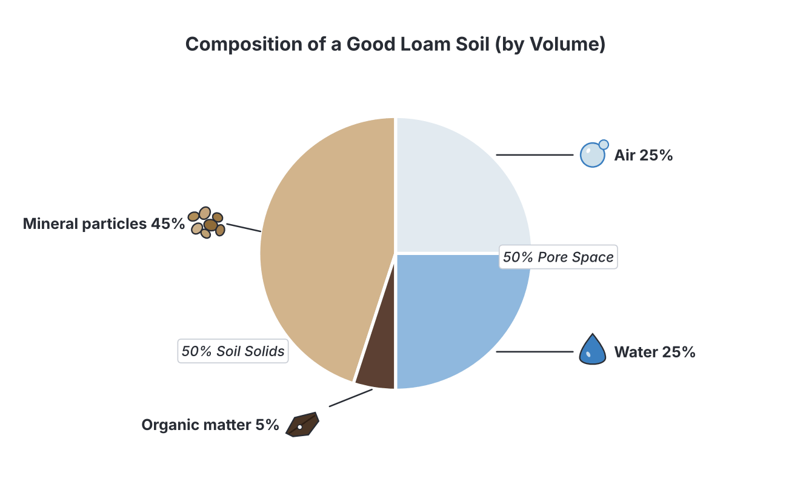

## How soil is formed

Soil forms very slowly, often taking hundreds to thousands of years to form a layer a few centimetres thick. This is why losing topsoil by erosion is so serious: it cannot be replaced in a farmer's lifetime.

### Weathering

**Weathering** is the breaking down of rocks into smaller particles where they lie. There are three kinds:

1. **Physical (mechanical) weathering:** rocks break into pieces without any change in their chemicals.
   - **Temperature changes:** in hot, dry areas such as northern Nigeria, rocks heat up and expand by day and cool and contract at night. Repeated expansion and contraction cracks the outer layers, which peel off (exfoliation). The bare granite rocks (inselbergs) of places like Idanre, Olumo Rock in Abeokuta and the Jos Plateau show this kind of weathering.
   - **Running water and waves** roll stones against each other and wear them down.
   - **Wind** carries sand that rubs against rocks (abrasion), especially in the dry north during the harmattan.
   - **Freezing and thawing** of water in cracks (frost action) is important in cold countries, not in Nigeria.
2. **Chemical weathering:** the minerals in rocks are changed into new substances.
   - **Solution:** some minerals, such as rock salt and limestone, dissolve in water.
   - **Carbonation:** rainwater dissolves carbon (IV) oxide (CO₂) from the air and soil, forming a weak acid (carbonic acid) that slowly dissolves limestone.
   - **Oxidation:** iron in rocks reacts with oxygen and water, forming red and yellow iron oxides. This is why many Nigerian soils are **red or reddish-brown**.
   - **Hydrolysis:** water reacts with minerals such as feldspar in granite to form **clay**.
   - Chemical weathering is fastest in **hot, wet** climates, such as southern Nigeria.
3. **Biological weathering:** living things break rocks.
   - **Plant roots** grow into cracks and widen them.
   - **Lichens and mosses** on bare rock produce weak acids that dissolve the rock surface, and trap dust and dead matter, starting a thin soil (see succession in Topic C5).
   - **Burrowing animals** (earthworms, termites, rodents) bring up and mix rock fragments.
   - **Decaying organisms** release acids and CO₂ that speed up chemical weathering.

### Factors that affect soil formation

1. **Parent rock (parent material):** the rock from which the soil forms decides its minerals. Granite tends to give sandy soils; shale and basalt tend to give clayey soils.
2. **Climate:** temperature and rainfall control the speed of weathering and the amount of leaching.
3. **Living organisms:** plants add organic matter; animals and microorganisms mix it in and break it down.
4. **Topography (relief):** on steep slopes soil is washed away and stays thin; at the bottom of slopes and in valleys it collects and becomes deep.
5. **Time:** older soils are deeper and more weathered.

### The soil profile

If you dig a deep pit or look at a road cutting, you will see that soil is arranged in layers called **horizons**. A vertical section through all the horizons is the **soil profile**.

| Horizon | Name | Description |
| --- | --- | --- |
| **O** | Litter (organic) layer | Fresh and partly decayed leaves, twigs and dead animals on the surface; thick in forests, thin or absent on farmland |
| **A** | **Topsoil** | Dark, because it is rich in **humus**; full of roots and soil organisms; the most fertile layer. Some minerals are washed down out of it (leaching) |
| **B** | **Subsoil** | Lighter in colour, less humus, fewer roots; minerals, clay and iron washed down from the topsoil collect here. In parts of Nigeria, iron-rich subsoil can harden into **laterite** (a hard red layer used for building roads) |
| **C** | Weathered parent material | Broken and partly weathered rock; few roots or organisms |
| **R** (or D) | Bedrock (parent rock) | Solid, unweathered rock |

The **topsoil** is the part that matters most for farming. It is also the part lost first when soil is eroded or when vegetation is removed.

**Textbook variation:** some textbooks label the horizons A, B, C and D, with D as bedrock, and do not show an O horizon; others use O, A, B, C and R. They describe the same layers.

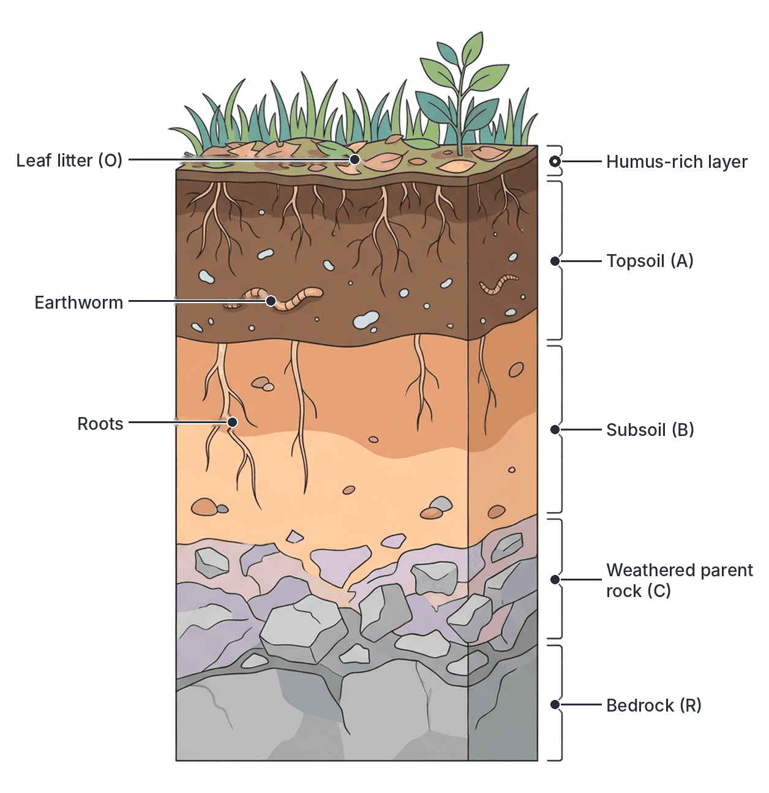

## Soil particles and soil texture

Soil particles are grouped by size. The relative amounts of the different sizes in a soil is called its **soil texture**.

| Particle | Approximate diameter | Feel when rubbed between wet fingers |
| --- | --- | --- |
| **Gravel and stones** | More than 2 mm | Hard, separate stones (not counted as true soil) |
| **Coarse sand** | 0.2 to 2 mm | Very gritty |
| **Fine sand** | 0.02 to 0.2 mm | Gritty |
| **Silt** | 0.002 to 0.02 mm | Smooth and silky, like flour |
| **Clay** | Less than 0.002 mm | Very fine; sticky and plastic when wet; can be rolled into a thread or ring |

**Textbook variation:** the size limits differ between classification systems. The figures above follow the international (Atterberg) scale used in many West African textbooks. The United States (USDA) system puts the silt–sand boundary at 0.05 mm, not 0.02 mm. All systems agree that clay particles are smaller than 0.002 mm and sand particles are the largest of the three.

## Types of soil: sandy, loamy and clayey

**Content item a: characteristics of different types of soil (sandy, loamy, clayey): soil structure; porosity, capillarity and humus content.**

Soils are named after the particles that are most important in them.

### Sandy soil

**Sandy soil** is made up mainly of **sand** particles (often well over two-thirds sand), with little clay and little humus.

- **Particle size:** large particles.
- **Pore spaces:** the large particles leave **large air spaces** between them.
- **Aeration:** very good; roots and soil organisms get plenty of oxygen.
- **Drainage:** water drains through very **quickly**, so the soil **dries out fast** and holds little water.
- **Capillarity:** **low**: water does not rise far up through the large pores.
- **Leaching:** mineral salts are easily washed down out of reach of roots, so sandy soil is usually **poor in nutrients**.
- **Humus content:** usually **low**.
- **Temperature:** warms up quickly in the sun and cools quickly at night.
- **Workability:** light and easy to dig or plough in all seasons ("light soil").
- **Texture test:** feels gritty and falls apart when you try to roll it into a ball.
- **Where found in Nigeria:** much of the far north, such as parts of Sokoto, Kano, Katsina, Jigawa, Yobe and Borno, where wind-blown sands cover the land; sandy coastal ridges and beaches in Lagos and the Niger Delta.
- **Good for:** crops that need good drainage and loose soil, such as **groundnut**, millet, cowpea, cassava and many root crops (tubers can swell easily and are easy to harvest), and coconut on coastal sands. Yields improve greatly when manure is added.

### Clayey soil

**Clayey (clay) soil** is made up mainly of very fine **clay** particles.

- **Particle size:** very small particles that pack closely together.
- **Pore spaces:** many **tiny** spaces between particles.
- **Aeration:** **poor**, especially when wet; roots may lack oxygen.
- **Drainage:** **very slow**; water **lies on the surface** and the soil easily becomes **waterlogged**.
- **Water retention:** **very high**; clay holds a lot of water, but some of it is held so tightly that plants cannot take it up.
- **Capillarity:** **high**: water rises highest (though slowly) through the narrow pores.
- **Mineral salts:** clay particles hold mineral ions on their surfaces, so clay is usually **rich in nutrients** and they are **not easily leached**.
- **Humus content:** variable; often moderate.
- **Temperature:** warms up slowly ("cold soil").
- **Workability:** heavy, **sticky** and plastic when wet; **shrinks and cracks** into hard clods when dry. Hard to dig ("heavy soil").
- **Texture test:** feels smooth and sticky; can be rolled into a long thread and bent into a ring without breaking.
- **Where found in Nigeria:** river floodplains and low-lying wet areas (the **fadama** lands along the Niger, Benue, Sokoto-Rima and Hadejia rivers), swampy parts of the south, and clay pits used for pottery and brick-making.
- **Good for:** **rice** (which grows in flooded fields), sugarcane and some vegetables in fadama land. Clay is also used for making **pots, bricks and mud walls**.

### Loamy soil

**Loamy soil (loam)** is a **mixture** of sand, silt and clay in roughly balanced amounts, with a good amount of **humus**.

- **Particle size:** a mixture of large, medium and small particles.
- **Pore spaces:** a mixture of large and small pores.
- **Aeration:** **good**.
- **Drainage:** **good** but not too fast.
- **Water retention:** **good**: holds enough water for plants without becoming waterlogged.
- **Capillarity:** **moderate**.
- **Mineral salts:** usually **rich**; the clay and humus hold nutrients and the sand stops it becoming too sticky.
- **Humus content:** usually **high**; dark in colour.
- **Structure:** good **crumb structure**.
- **Temperature:** warms up moderately.
- **Workability:** easy to dig and plough.
- **Texture test:** feels soft and slightly gritty; forms a ball that holds together but crumbles when pressed.
- **Where found in Nigeria:** well-managed farmland and forest soils, especially under natural vegetation in the rainforest and Guinea savanna, and good alluvial soils on river banks.
- **Good for:** **most crops**: yam, maize, cocoa, oil palm, vegetables and fruit trees. Loam is the **best soil for agriculture**.

**Textbook variation:** textbooks describe loam in different ways. Some say it has "about equal amounts" of sand, silt and clay; others give a guide of about 40% sand, 40% silt and 20% clay; soil scientists allow a range (for example, loams have roughly 7 to 27% clay). All agree that loam is a balanced mixture with plenty of humus, and that terms such as **sandy loam** and **clay loam** describe loams with more sand or more clay.

### Comparison of sandy, loamy and clayey soils

| Property | Sandy soil | Loamy soil | Clayey soil |
| --- | --- | --- | --- |
| Main particles | Sand (large) | Mixture of sand, silt and clay | Clay (very small) |
| Particle size | Large (0.02–2 mm) | Mixed | Very small (less than 0.002 mm) |
| Size of pore spaces | **Large** | Medium (mixed) | **Very small** |
| Porosity (as JAMB uses it: how easily air and water pass through) | **High** | Moderate | **Low** |
| Aeration | Very good | Good | Poor |
| Drainage (permeability) | **Very fast** | Good, moderate | **Very slow**; waterlogs easily |
| Water retention | **Low** | Moderate to good | **High** |
| Capillarity | **Low** (rises least) | Moderate | **High** (rises highest, but slowly) |
| Humus content | **Low** | **High** | Moderate (variable) |
| Mineral salt content | Low; easily leached | High | High; not easily leached |
| Soil structure | Single-grained, loose; no crumbs | Good crumb structure | Massive or blocky; sticky when wet, hard clods and cracks when dry |
| Temperature | Warms and cools quickly | Moderate | Warms slowly ("cold") |
| Ease of working | Light, easy | Easy | Heavy, difficult |
| Feel | Gritty | Soft, slightly gritty | Smooth and sticky |
| Fertility | Low | **High** (best for farming) | Fairly high, but limited by poor aeration |
| Typical crops | Groundnut, millet, cassava, coconut | Most crops: yam, maize, cocoa, vegetables | Rice, sugarcane |

**Textbook variation (very important for porosity):** in school biology and agriculture textbooks, **porosity** is usually used to mean how freely air and water can pass through a soil. In that sense, sandy soil is called "most porous" and clay "least porous", and this is the answer JAMB expects. In strict soil science, porosity means the **total volume of pore space**. Because clay has a huge number of tiny pores, a clay soil actually has a **larger total pore space** (often about 50% or more) than a sandy soil (often about 35 to 45%), even though its pores are too small for water to drain through quickly. The ability to let water pass through is properly called **permeability**. In the exam, use the textbook meaning: sand = high porosity, good aeration, fast drainage; clay = low porosity, poor aeration, slow drainage.

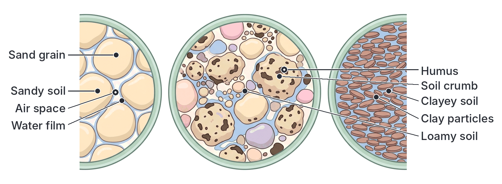

### Soil structure

**Content item a.i: soil structure.**

**Soil texture** and **soil structure** are different:

- **Texture** is the **size** of the individual particles (sand, silt, clay) and their proportions. A farmer cannot change it easily.
- **Structure** is the way the particles are **grouped together** into larger clumps called **aggregates** (or **peds**, or **crumbs**). A farmer can improve or damage it.

Particles are held together in aggregates by **humus**, **clay**, gums and slime made by **bacteria and fungi**, fungal threads, fine roots and the mucus of **earthworms**.

**Main types of soil structure:**

| Type | Description | Effect on plants |
| --- | --- | --- |
| **Crumb (granular)** | Small, rounded, porous aggregates, like breadcrumbs; common in humus-rich topsoils and loams | **Best structure**: good aeration, drainage and water holding; roots grow easily |
| **Single-grained** | Particles do not stick together at all; typical of sandy soil | Loose; drains fast; holds little water or nutrients |
| **Massive** | No visible aggregates; one solid, compact mass; typical of compacted clay | Poor aeration and drainage; roots cannot get through |
| **Platy** | Thin, flat plates lying horizontally, often in compacted soil | Blocks downward movement of water and roots |
| **Blocky** | Angular or rounded blocks; common in clayey subsoils | Moderate; water and roots move along the cracks |
| **Prismatic and columnar** | Tall vertical columns; found in some subsoils, especially in dry areas | Water and roots move down the vertical cracks |

**Why a good crumb structure matters:**

1. Large spaces **between** crumbs let air in and let excess water drain away.
2. Small spaces **inside** crumbs hold water for plants.
3. Roots can push through easily.
4. The soil resists **erosion**, because crumbs are heavier and more stable than single loose particles.

**How structure is improved or damaged:**

- **Improved by:** adding organic manure and compost, mulching, growing grasses and legumes, encouraging earthworms, liming acid soils, and tilling only when the soil is moist (not wet).
- **Damaged by:** loss of humus (from burning and continuous cropping), **compaction** by heavy machinery and trampling animals, ploughing when the soil is too wet, and the hammering of raindrops on bare soil.

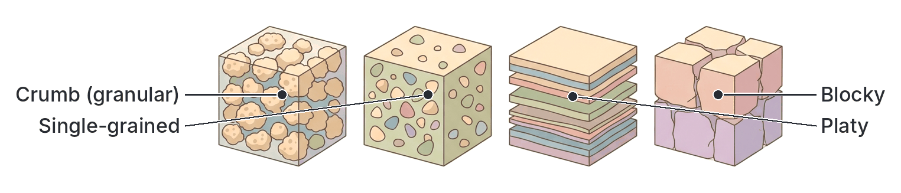

## Physical properties of soil types: simple measurements

**Objective i: identify physical properties of different soil types based on simple measurement of particle size, porosity or water retention ability.**

You can tell soil types apart by three simple sets of tests.

### Experiment 1: Particle size by sedimentation

**Aim:** to show that soil is made up of particles of different sizes, and to find the proportions of each in a soil sample.

**Materials:** a measuring cylinder (or a tall, clear glass jar or bottle with a lid), a fresh soil sample, water, a ruler.

**Method:**

1. Put soil into the measuring cylinder to about **one-quarter** of its height.
2. Add water until the cylinder is about **three-quarters** full.
3. Cover the top with your palm (or the lid) and **shake vigorously** for about two minutes, so that the soil particles separate.
4. Stand the cylinder on a flat bench and leave it **undisturbed** for at least an hour (better, overnight).
5. Observe the layers and measure the thickness of each one with the ruler.

**Observation:**

- The soil settles out in **layers**, with the **largest, heaviest** particles at the bottom and the **smallest** at the top:
  1. **Gravel and stones** (bottom)
  2. **Coarse sand**
  3. **Fine sand**
  4. **Silt**
  5. **Clay** (top of the sediment; some very fine clay stays suspended for a long time, making the water **cloudy**)
- The **water** above the sediment.
- Dark bits of **humus** and other organic matter **float** on the surface of the water.

**Conclusion:** soil contains particles of different sizes. Heavier, larger particles settle faster than smaller ones. Comparing the thickness of the layers shows which type of soil it is: a sandy soil has thick sand layers; a clayey soil has thick fine layers and very cloudy water; a loam has fairly even layers and much floating humus.

**Sample calculation:** if the total sediment is 8.0 cm high and the sand layers together are 5.0 cm, sand makes up about 5.0 ÷ 8.0 × 100 = **62.5%** of the sediment by depth. This gives a rough idea only, because fine particles pack differently from coarse ones.

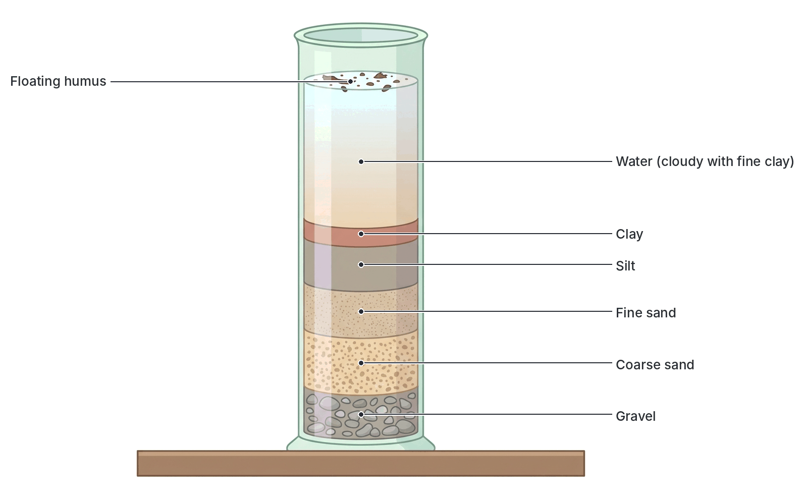

### Experiment 2: Sieving (particle size by sieves)

**Aim:** to separate soil particles by size.

**Method:** dry a soil sample, crush the lumps gently, then shake it through a stack of sieves with mesh openings that get smaller from top to bottom (for example 2 mm, 0.2 mm and 0.02 mm). Weigh the soil left on each sieve.

**Observation:** gravel stays on the top sieve, coarse sand on the next, fine sand on the next, and the fine silt and clay pass through into the pan at the bottom.

**Conclusion:** the mass on each sieve divided by the total mass, × 100, gives the percentage of each particle size. A sandy soil leaves most of its mass on the upper sieves; a clayey soil passes mostly through.

### Experiment 3: Porosity, drainage and water retention (the funnel experiment)

**Aim:** to compare the rate of drainage (porosity) and the water-holding capacity (water retention) of sandy, loamy and clayey soils.

**Materials:** three identical filter funnels, three measuring cylinders, cotton wool (or filter paper), equal masses (or volumes) of **dry** sand, loam and clay, water, a stopwatch.

**Method:**

1. Plug the neck of each funnel loosely with the **same amount of cotton wool**.
2. Place each funnel on a measuring cylinder.
3. Put **equal amounts** (for example 50 g) of dry sandy, loamy and clayey soil in the three funnels.
4. At the same moment, pour **equal volumes** of water (for example 100 cm³) gently onto each soil.
5. Start the stopwatch. Note how quickly water begins to drip through, and record the volume collected in each cylinder after a fixed time (for example 30 minutes), or after dripping stops.

**Control:** pour the same volume of water through a funnel with cotton wool only, to find how much water the cotton wool itself holds. (Wetting the cotton wool first also reduces this error.)

**Typical observations:**

| Soil | Speed at which water passes through | Volume collected after 30 minutes | Water retained (100 cm³ − volume collected) |
| --- | --- | --- | --- |
| Sandy | Very fast; starts dripping almost at once | 80 cm³ | 20 cm³ |
| Loamy | Moderate | 55 cm³ | 45 cm³ |
| Clayey | Very slow; water stays on the surface | 25 cm³ | 75 cm³ |

(These are typical sample figures for illustration. Real values depend on the soil.)

**Conclusion:**

- **Sandy soil** has the **highest porosity** (fastest drainage) and the **lowest water retention**.
- **Clayey soil** has the **lowest porosity** (slowest drainage) and the **highest water retention**.
- **Loamy soil** is **intermediate**: it drains well and still keeps enough water for plants.

**Sources of error:** unequal packing of the soils; soil not equally dry at the start; water poured at different speeds; water evaporating; fine clay blocking the cotton wool.

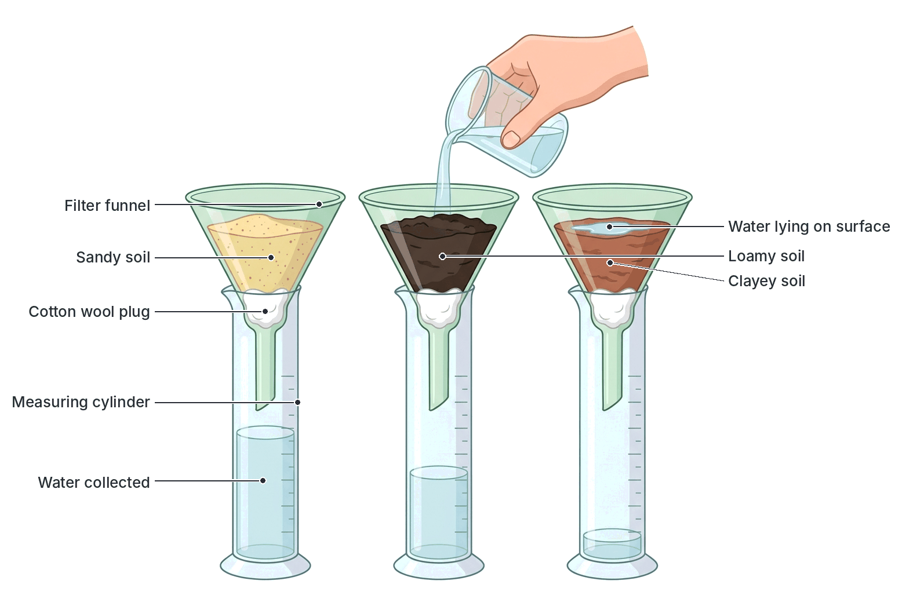

### Experiment 4: Simple field tests (feel test and ribbon test)

These quick tests let a farmer identify a soil without equipment:

1. Take a small handful of soil, moisten it, and rub it between thumb and fingers.
   - **Gritty** → sandy. **Silky or floury** → silty. **Sticky and smooth** → clayey. **Soft, slightly gritty, slightly sticky** → loam.
2. Try to roll it into a ball. Sand falls apart; loam forms a ball that crumbles when pressed; clay forms a firm ball.
3. Squeeze it out between thumb and finger into a ribbon or roll a thread. Clay forms a long ribbon or a thread that can be bent into a ring; loam forms a short ribbon that breaks; sand does not form one at all.

## Determining air, water, humus and capillarity experimentally

**Objective ii: determine the amounts of air, water, humus and capillarity in different soil types experimentally.**

### Experiment 5: Percentage of air in soil

**Aim:** to find the volume (and percentage) of air in a soil sample.

**Principle:** when soil is put into water, water fills its air spaces and the air escapes as bubbles. The total volume of soil + water is therefore **less** than expected, and the difference is the volume of air.

**Materials:** a small empty tin (e.g. a milk or tomato tin) with a few holes punched in its base, a large measuring cylinder, water, a stirring rod.

**Method:**

1. **Find the volume of the tin:** fill the tin with water from the measuring cylinder (holding a finger over the holes, or using a second identical tin without holes) and note how much water it holds. Suppose it is **50 cm³**. This is the volume of the soil sample.
2. Push the tin, open end down, into undisturbed soil until it is completely filled, then dig it out and level the soil with the top of the tin.
3. Put a known volume of water into a large measuring cylinder, for example **100 cm³**.
4. Tip all the soil from the tin into the cylinder. **Stir** with the rod (or shake) to release all the air bubbles.
5. Allow it to settle, then read the new water level.

**Observation:** air bubbles rise from the soil and escape. The new level is **less than** 100 + 50 = 150 cm³.

**Calculation (sample results):**

- Volume of water at start = 100 cm³
- Volume of soil sample (volume of tin) = 50 cm³
- Expected total volume = 100 + 50 = 150 cm³
- Final reading = 138 cm³
- **Volume of air = expected volume − final reading = 150 − 138 = 12 cm³**
- **Percentage of air = (volume of air ÷ volume of soil) × 100 = (12 ÷ 50) × 100 = 24%**

**Conclusion:** soil contains air. When different soils are compared, **sandy soil** contains the **most** air (large pore spaces) and **clayey soil** the **least**, with loam in between.

**Note:** use undisturbed soil, because loosening the soil changes the amount of air in it.

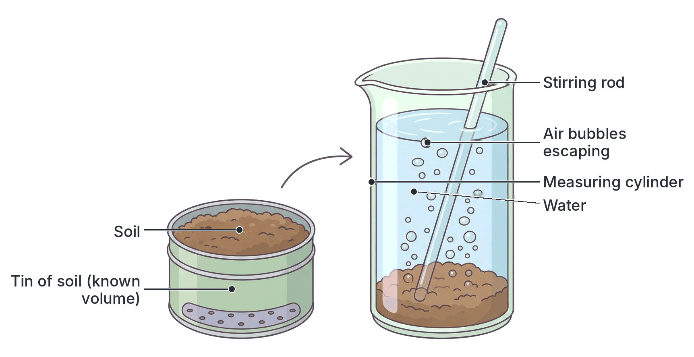

### Experiment 6: Percentage of water in soil

**Aim:** to find the amount of water in a soil sample.

**Materials:** an evaporating dish, a balance, an oven (or a water bath or a gentle flame), a fresh soil sample, a desiccator if available.

**Method:**

1. Weigh the clean, dry evaporating dish: suppose **30.0 g**.
2. Put fresh soil (just collected) into the dish and weigh again: suppose **80.0 g**. Mass of fresh soil = 80.0 − 30.0 = **50.0 g**.
3. Heat the dish and soil **gently** in an oven at about 100–105 °C (just above the boiling point of water). Do not heat strongly, or the humus will burn.
4. Cool (in a desiccator if available, so the soil does not absorb moisture from the air) and weigh.
5. Repeat heating, cooling and weighing until the mass stops changing (**constant mass**). Suppose the final mass of dish + dry soil = **72.0 g**.

**Calculation:**

- Mass of dry soil = 72.0 − 30.0 = 42.0 g
- **Mass of water lost = 50.0 − 42.0 = 8.0 g**
- **Percentage of water = (mass of water ÷ mass of fresh soil) × 100 = (8.0 ÷ 50.0) × 100 = 16%**

**Why heat to constant mass?** It makes sure that **all** the water has been driven off.

**Conclusion:** soil contains water. When the experiment is repeated on different soils collected at the same time, **clayey soil** usually loses the **most** water and **sandy soil** the **least**.

**Textbook variation:** some textbooks calculate the percentage of water using the mass of **dry** soil instead of fresh soil (8.0 ÷ 42.0 × 100 ≈ 19%). Use whichever method the question states; if none is stated, the fresh-soil method above is the usual school method.

### Experiment 7: Percentage of humus (organic matter) in soil

**Aim:** to find the amount of humus in a soil sample.

**Principle:** humus is organic matter; it **burns away** when heated strongly. The mineral particles do not.

**Materials:** a crucible (or tin lid), a balance, a Bunsen burner, a tripod and pipe-clay triangle, the **dry** soil from Experiment 6.

**Method:**

1. Weigh the empty crucible: suppose **20.0 g**.
2. Add the **oven-dried** soil and weigh: suppose **60.0 g**. Mass of dry soil = **40.0 g**.
3. Heat **strongly** until the crucible is red-hot, stirring occasionally. Smoke and a burning smell may be noticed at first, as the organic matter burns.
4. Cool and weigh. Repeat heating, cooling and weighing until the mass is **constant**. Suppose the final mass = **58.0 g**.

**Calculation:**

- Mass of soil after burning = 58.0 − 20.0 = 38.0 g
- **Mass of humus burnt off = 40.0 − 38.0 = 2.0 g**
- **Percentage of humus = (mass lost ÷ mass of dry soil) × 100 = (2.0 ÷ 40.0) × 100 = 5%**

**Observation:** the soil becomes lighter in colour (often reddish or pale), because the dark humus has been burnt.

**Why use dry soil?** If wet soil were used, the loss in mass would include water as well as humus.

**Conclusion:** **loamy soil** usually has the **most** humus; **sandy soil** the **least**.

**Source of error:** strong heating also drives off some water that is chemically bound in clay minerals, so the result can slightly **overestimate** the humus in clayey soils.

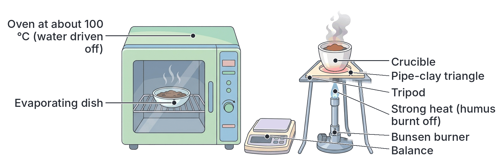

### Experiment 8: Capillarity of soils

**Aim:** to compare how high and how fast water rises through sandy, loamy and clayey soils by **capillarity**.

**What is capillarity?** **Capillarity (capillary action)** is the rise of water upwards through the very narrow spaces between soil particles, against gravity. The narrower the spaces, the higher the water can rise. Capillarity brings water up from the deeper wet soil to the roots, especially in the dry season.

**Materials:** three long, wide glass tubes (all the same size), cotton wool or muslin, a trough (or basin) of water, retort stands and clamps, dry, finely crushed sand, loam and clay, a ruler, a clock.

**Method:**

1. Plug the bottom of each tube with cotton wool (or tie muslin over it).
2. Fill each tube to the same height with one dry soil, tapping gently to pack it evenly.
3. Clamp the tubes upright with their lower ends dipping about 2 cm into the trough of water, all at the same depth.
4. Measure the height of the water (the wet, dark part of the soil) in each tube every few minutes for the first hour, and then after a day or more.

**Typical observations:**

| Soil | Height after 10 minutes | Height after 24 hours | Rate of rise |
| --- | --- | --- | --- |
| Sandy | Highest at first (e.g. 6 cm) | Lowest (e.g. 10 cm) | Fast at first, then stops early |
| Loamy | Medium (e.g. 4 cm) | Medium (e.g. 20 cm) | Moderate |
| Clayey | Lowest at first (e.g. 2 cm) | Highest (e.g. 30 cm or more) | Slow but continues for a long time |

(Sample figures for illustration.)

**Conclusion:**

- Water rises **fastest at first** in **sandy** soil, because its wide spaces offer little resistance, but it **stops at a low height**. Sandy soil has the **lowest capillarity**.
- Water rises **slowly** in **clayey** soil, but eventually reaches the **greatest height**, because its pores are very narrow. Clayey soil has the **highest capillarity**.
- **Loamy** soil is intermediate.

**Exam point:** when JAMB asks which soil has the highest capillarity, the answer is **clay**; the lowest is **sand**. If a question asks only about the first few minutes, sand shows the fastest rise.

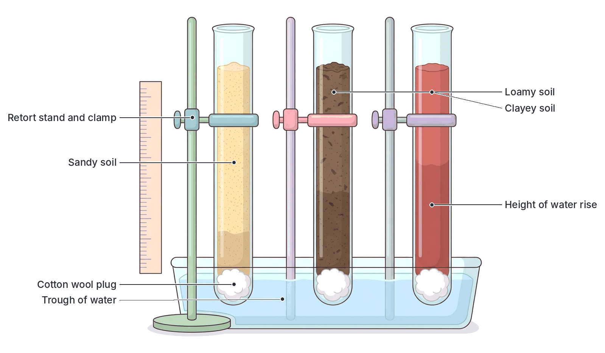

### Other simple experiments on soil components

These show the remaining components of soil.

**Experiment 9: Mineral salts in soil.**

1. Shake some soil with **distilled water** and filter it.
2. Evaporate the clear filtrate to dryness in a clean evaporating dish.
3. **Observation:** a thin white **residue** is left.
4. **Conclusion:** soil water contains **dissolved mineral salts**. Control: evaporate the same volume of distilled water alone; no residue is left.

**Experiment 10: Living organisms (microorganisms) in soil.**

1. Set up two flasks, each with a small dish of **lime water** hanging inside (or connected by a tube), and close them.
2. Flask A contains **fresh soil**. Flask B contains soil that has been **heated strongly** (sterilised) to kill all organisms; this is the **control**.
3. Leave both for a day or two.
4. **Observation:** the lime water in flask A turns **milky**; in flask B it stays **clear** (or goes milky much more slowly).
5. **Conclusion:** fresh soil contains living organisms (mainly microorganisms) that **respire** and give out CO₂.

**Experiment 11: Small animals in soil (Tullgren funnel).**

1. Place fresh soil or leaf litter on a wire gauze inside a funnel.
2. Shine a lamp (light bulb) above it. Put a beaker of alcohol (or water) below the funnel.
3. The heat and light dry the soil from the top, so small animals (mites, springtails, insect larvae, small worms) move **downwards**, away from the heat and dryness, and fall into the beaker.
4. **Conclusion:** soil contains many small animals.

**Experiment 12: Soil pH.**

1. Shake a little soil with distilled water and allow it to settle (or filter).
2. Add a few drops of **universal indicator** (or use pH paper) and compare the colour with the colour chart.
3. Most crops grow best at a pH of about **6 to 7** (slightly acid to neutral). Many soils in the wet south of Nigeria are acidic because of heavy leaching.

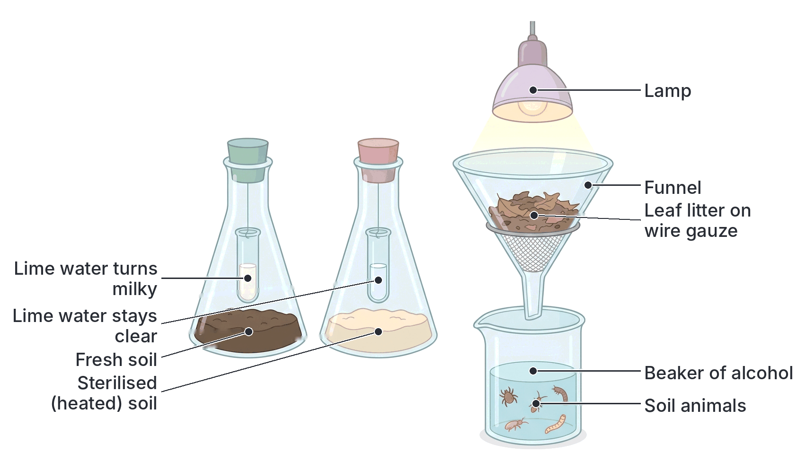

### Summary of results for the three soil types

| Measurement | Sandy | Loamy | Clayey |
| --- | --- | --- | --- |
| Percentage of air | Highest | Medium | Lowest |
| Percentage of water held | Lowest | Medium | Highest |
| Percentage of humus | Lowest | Highest | Medium |
| Capillarity (final height) | Lowest | Medium | Highest |
| Drainage rate (porosity) | Fastest | Medium | Slowest |

## Components of the soil

**Content item b: components of the soil: inorganic, organic, soil organisms, soil air, soil water.**

### Inorganic component

The **inorganic (mineral) component** makes up most of the solid part of the soil.

1. **Mineral particles:** gravel, sand, silt and clay from weathered rock. They form the "skeleton" of the soil, give it its texture, and anchor plant roots.
2. **Mineral salts (nutrients):** dissolved in the soil water as **ions**. Plants absorb them through their root hairs. They are grouped as:
   - **Macronutrients (major elements)**, needed in large amounts: **nitrogen (N)**, **phosphorus (P)**, **potassium (K)**, **calcium (Ca)**, **magnesium (Mg)** and **sulphur (S)**. (Plants also need large amounts of carbon, hydrogen and oxygen, which they get from air and water.)
   - **Micronutrients (trace elements)**, needed in very small amounts: iron (Fe), manganese (Mn), zinc (Zn), copper (Cu), boron (B), molybdenum (Mo) and chlorine (Cl).

**Textbook variation:** some textbooks list iron as a macronutrient; others list it as a micronutrient. Many modern lists also add nickel as a micronutrient. The main macronutrients N, P and K are the same in every textbook.

**Clay and humus as nutrient stores:** clay and humus particles carry negative charges on their surfaces. They hold positive mineral ions (such as K⁺, Ca²⁺, Mg²⁺ and NH₄⁺) loosely, so the ions are not washed away, but can still be released to roots. This is why soils with clay and humus are more fertile than pure sand.

### Organic component

The **organic component** consists of:

1. **Fresh organic matter:** dead leaves, twigs, roots, animal droppings and dead animals.
2. **Humus:** the dark brown or black, sticky, jelly-like (colloidal) material left after decomposers have broken down organic matter. It no longer looks like the original plant or animal.

**How humus forms (humification):**

1. Leaves, stems, roots, dung and dead animals fall onto or into the soil.
2. Soil animals such as earthworms, termites, millipedes and woodlice break them into small pieces.
3. **Decomposers** (bacteria and fungi) feed on the pieces and break down most of the material, releasing CO₂, water and mineral salts (**mineralisation**).
4. The resistant remains form **humus**, which is slowly broken down further over months and years, releasing its nutrients gradually.

In hot, wet climates such as southern Nigeria, decomposition is **very fast**, so humus does not build up much in the soil, and is quickly lost when forest is cleared.

**Importance of humus:**

| Role of humus | How it helps plants |
| --- | --- |
| Supplies nutrients | Releases N, P, S and other nutrients slowly as it decays |
| Holds nutrients | Holds mineral ions on its surface and reduces leaching |
| Holds water | Can hold several times its own weight of water, so sandy soils dry out less |
| Improves structure | Binds particles into crumbs; loosens clay and binds sand |
| Improves aeration and drainage | Crumbs leave spaces for air and water |
| Food for soil organisms | Supports earthworms, bacteria and fungi |
| Buffers pH | Reduces sudden changes in acidity |
| Darkens soil | Dark soil absorbs heat and warms up faster |
| Reduces erosion | Stable crumbs are not easily washed or blown away |

### Soil organisms

Soil is full of life. A single handful of fertile soil may contain millions of microorganisms. Soil organisms include:

**Microorganisms:**

- **Bacteria:**
  - **Decomposers (saprophytes):** break down dead matter, releasing nutrients and forming humus.
  - **Nitrogen-fixing bacteria:** convert nitrogen gas in soil air into nitrogen compounds. Some live free in the soil (e.g. *Azotobacter*, *Clostridium*); others live in the **root nodules of legumes** such as groundnut, cowpea, soya bean and *Centrosema* (e.g. *Rhizobium*). (See the nitrogen cycle in Topic C2.)
  - **Nitrifying bacteria:** convert ammonium compounds into nitrites (*Nitrosomonas*) and nitrites into nitrates (*Nitrobacter*), the form of nitrogen most easily taken up by plants.
  - **Denitrifying bacteria** (e.g. *Pseudomonas*, *Thiobacillus denitrificans*): change nitrates back to nitrogen gas, especially in waterlogged soil with no oxygen. This **reduces** soil fertility.
- **Fungi:** decomposers of tough material such as wood and leaf litter; some form **mycorrhizae** with roots, helping plants absorb water and phosphorus. Some cause plant diseases (e.g. damping-off of seedlings).
- **Actinomycetes:** thread-like bacteria that decompose organic matter and give freshly dug soil its "earthy" smell.
- **Algae and cyanobacteria (blue-green algae):** live on the surface of moist soil; some, such as *Anabaena* and *Nostoc*, fix nitrogen, which is important in rice fields.
- **Protozoa:** feed on bacteria, keeping their numbers in balance and releasing nutrients.

**Larger soil animals:**

| Organism | Effect on soil |
| --- | --- |
| **Earthworms** | Burrow, **aerating** and **draining** the soil; drag leaves underground and mix organic matter into the soil; pass soil through their gut and deposit fine, fertile **worm casts** on the surface, turning over the soil; their mucus helps bind crumbs. Charles Darwin was one of the first scientists to show how important they are |
| **Termites** | Break down dead wood and grass; their tunnels aerate the soil; mound soil is mixed and often richer in clay. But they also damage crops, timber and buildings |
| **Ants** | Tunnel, aerate and mix soil |
| **Millipedes, woodlice, springtails, mites** | Shred dead leaves into small pieces, speeding up decomposition |
| **Nematodes (eelworms)** | Many are harmless decomposers; some, such as root-knot nematodes (*Meloidogyne*), attack the roots of crops like tomato and okra |
| **Insect larvae** | Some decompose matter; others (cutworms, white grubs) eat roots and young plants |
| **Snails and slugs** | Feed on decaying and living plants; the giant African land snail is also eaten in southern Nigeria |
| **Burrowing mammals** (moles, cane rats, giant rats, rabbits) | Dig and mix the soil, bringing subsoil up; some are crop pests |

**Plant roots** are also part of soil life: they bind soil particles (reducing erosion), open channels when they die and decay, and add organic matter.

**Overall importance of soil organisms:**

1. **Decomposition** of dead matter and **recycling** of nutrients.
2. **Formation of humus**.
3. **Nitrogen fixation** and **nitrification** (and, in poor conditions, loss of nitrogen by denitrification).
4. **Aeration and drainage** by burrowing.
5. **Mixing** of the soil layers.
6. Improving **soil structure** (binding particles into crumbs).
7. Some are **harmful**: pests and disease organisms of crops.

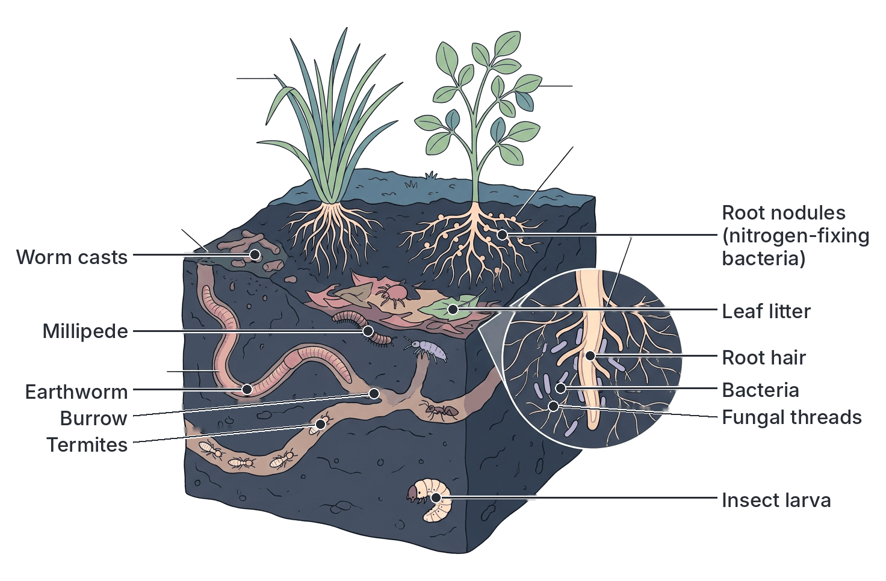

### Soil air

**Soil air** fills the pore spaces not filled by water.

**Composition compared with the atmosphere:**

| Gas | Atmospheric air | Soil air |
| --- | --- | --- |
| Oxygen | About 21% | Slightly **less** (used by roots and organisms in respiration) |
| Carbon (IV) oxide | About 0.04% | Much **more** (often many times higher), from respiration and decay |
| Nitrogen | About 78% | About the same |
| Water vapour | Variable | Usually **saturated** (very humid) |

**Importance of soil air:**

1. **Root respiration:** roots need oxygen to respire aerobically and release energy, which they use to absorb mineral salts by **active transport** and to grow.
2. **Respiration of soil organisms:** earthworms, aerobic bacteria and fungi need oxygen.
3. **Nitrogen fixation:** nitrogen-fixing bacteria use nitrogen gas from soil air.
4. **Germination:** seeds need oxygen to germinate.
5. **Decomposition:** aerobic decomposers break down organic matter faster and without producing harmful substances.
6. **Nitrification:** nitrifying bacteria need oxygen.

**When soil air is lacking (waterlogged or compacted soil):** roots cannot respire properly, so they absorb fewer mineral salts and may die; plants wilt and turn yellow even though the soil is wet; denitrifying bacteria thrive, so nitrate is lost; anaerobic decay produces poisonous substances; and seeds rot instead of germinating. (Rice and mangroves are exceptions: they have air spaces or special roots that supply oxygen.)

**Ways of improving soil aeration:** tillage (ploughing, hoeing, making ridges and mounds), drainage of waterlogged land, adding organic matter, avoiding compaction, and encouraging earthworms.

### Soil water

**Soil water** is the water held in the soil. It carries dissolved mineral salts (the **soil solution**). Its main source is rain (and irrigation).

**Types of soil water:**

| Type | Where it is held | Available to plants? |
| --- | --- | --- |
| **Gravitational (free) water** | Fills the large pores just after heavy rain or irrigation, then **drains downwards** under gravity | Only briefly, before it drains away; it carries nutrients down (leaching) and, if it cannot drain, causes waterlogging |
| **Capillary water** | Held as thin films around particles and in the small pores by surface tension; can move in any direction, including upwards | **Yes**: this is the main water used by plants |
| **Hygroscopic water** | A very thin film held extremely tightly on the surface of each particle | **No**: held too tightly for roots to absorb |

**Two useful terms:**

- **Field capacity:** the amount of water a soil holds after the gravitational water has drained away (usually a day or two after soaking).
- **Permanent wilting point:** the point at which the remaining water is held so tightly that plants cannot absorb it and they wilt permanently.

The water between these two levels is the **available water**. Loam has the most available water; sand has little, because it holds little; clay holds a lot, but much of it is held too tightly.

**Importance of soil water:**

1. Plants absorb it for **photosynthesis** and to keep their cells **turgid** (firm).
2. It **dissolves mineral salts**, so they can be absorbed by roots.
3. It replaces water lost in **transpiration**, which keeps plants cool and moves minerals up the xylem.
4. Seeds need it to **germinate**.
5. It helps chemical **weathering** and soil formation.
6. Soil organisms need moisture to live.
7. It keeps soil temperature from changing too quickly.

**Too little water** causes wilting and poor growth; **too much** drives out soil air and causes waterlogging.

## Soil and the healthy growth of plants

**Objective iii: relate soil characteristics, types and components to the healthy growth of plants.**

A healthy plant needs its roots to be well **anchored**, well supplied with **water**, **mineral salts** and **oxygen**, and growing in soil of the right **pH** and **temperature**, free from pests and poisons. Each soil characteristic and component affects one or more of these needs.

### How soil characteristics affect plant growth

| Soil characteristic | Effect on plant growth |
| --- | --- |
| **Texture (sand, silt, clay)** | Decides how much water and nutrients the soil holds and how well air moves; balanced (loam) gives the best growth |
| **Structure (crumbs)** | Good crumb structure lets roots penetrate easily and gives a good balance of air and water |
| **Porosity and aeration** | Roots need oxygen to respire and absorb minerals; poorly aerated soils give stunted, yellow plants |
| **Drainage** | Good drainage prevents waterlogging and root rot; too-fast drainage causes drought stress |
| **Water retention and capillarity** | Supply water in dry spells; capillarity brings water up from below to the roots |
| **Humus content** | Supplies and holds nutrients, holds water, improves structure, supports soil life |
| **Mineral content** | Supplies the elements needed to build proteins, chlorophyll, ATP and cell walls |
| **pH** | Affects whether nutrients are available. In very acid soils, phosphorus and molybdenum become unavailable and aluminium and manganese can become poisonous; in very alkaline soils, iron, manganese and zinc become unavailable. Most crops prefer pH 6–7 |
| **Depth** | Deep soils allow deep roots, better anchorage and more water and nutrients |
| **Temperature** | Affects germination, root growth and the activity of soil organisms |
| **Soil organisms** | Recycle nutrients, fix nitrogen and improve structure; some are pests |

### How each soil type affects plant growth

- **Sandy soil:** roots spread easily and get plenty of oxygen, but plants suffer from **lack of water** in dry spells and from **nutrient deficiency** because of leaching. Plants grow well only with frequent rain or irrigation and regular manuring. Suitable for crops such as groundnut, millet and cassava.
- **Clayey soil:** holds plenty of water and nutrients, but roots suffer from **lack of oxygen** when wet, the soil is hard for roots to penetrate when dry, and seedlings may struggle to push through the crust. Suitable for water-loving crops such as rice.
- **Loamy soil:** gives the **best balance** of air, water and nutrients, so most crops grow well in it.

### Mineral elements and plant health

Each mineral element has a job in the plant. When it is lacking, the plant shows **deficiency symptoms**. (Mineral nutrition is covered in detail in Section B; this table links it to soil fertility.)

| Element | Main function in the plant | Deficiency symptoms |
| --- | --- | --- |
| **Nitrogen (N)** | Making proteins, chlorophyll and nucleic acids; leafy growth | Stunted growth; **yellowing (chlorosis)**, starting with the older leaves |
| **Phosphorus (P)** | Making ATP and nucleic acids; root growth; flowering, fruiting and seed formation | Poor root growth; stunted plants; dull, dark or **purplish** leaves; delayed maturity |
| **Potassium (K)** | Activates enzymes; controls opening of stomata; helps form starch and sugar; disease resistance | **Scorched, yellow or brown leaf edges** and tips; weak stems; poor fruit and tuber quality |
| **Calcium (Ca)** | Forms the middle lamella of cell walls; growth of root and shoot tips | Poor development of growing points; distorted young leaves; weak roots |
| **Magnesium (Mg)** | Central atom of the **chlorophyll** molecule; activates enzymes | Yellowing **between the veins** of older leaves (interveinal chlorosis) |
| **Sulphur (S)** | Part of some amino acids and proteins | General yellowing of young leaves |
| **Iron (Fe)** | Needed to make chlorophyll (though not part of it) | Yellowing of **young** leaves |

**Healthy plant growth therefore depends on:** a deep, well-structured soil (anchorage and root growth), plenty of humus, adequate available water, good aeration, a full supply of mineral salts, a suitable pH and a healthy population of beneficial soil organisms. Such a soil is called **fertile**.

## Soil fertility

**Content item c: soil fertility: (i) loss of soil fertility; (ii) renewal and maintenance of soil fertility.**

**Soil fertility** is the ability of a soil to supply plants with all the water, mineral nutrients and air they need, in the right amounts and proportions, for healthy growth and good yields.

A **fertile soil** has:

1. Plenty of available **mineral nutrients** in the right balance.
2. A good supply of **humus**.
3. Good **crumb structure**, aeration and drainage.
4. Good **water-holding** capacity.
5. A suitable **pH** (about 6–7 for most crops).
6. Adequate **depth** for roots.
7. Many beneficial **soil organisms**.
8. Freedom from harmful substances, pests and diseases.

**Soil fertility** is not quite the same as **soil productivity**: a fertile soil can still give poor yields if, for example, there is drought or poor farm management.

## Loss of soil fertility

**Objective iv: relate such factors as loss of inorganic matter, compaction, leaching, erosion of the top soil and repeated cropping with one variety (to the loss of soil fertility).**

### 1. Loss of inorganic matter (mineral nutrients)

Mineral salts are lost from the soil in several ways:

- **Crop removal:** every harvest of yam, cassava, maize or grain takes away the nitrogen, phosphorus, potassium and other elements that the plants absorbed. If they are not replaced, the soil becomes poorer every year.
- **Removal or burning of crop residues:** carrying away stalks and leaves, or burning them, means their nutrients do not return to the soil. Burning releases nitrogen and sulphur to the air as gases, and leaves ash that is easily washed or blown away.
- **Bush burning:** destroys the organic matter on the surface and kills soil organisms; the nutrients in the ash are quickly lost in the first heavy rains.
- **Leaching** and **erosion** (see below).
- **Denitrification:** in waterlogged soils, denitrifying bacteria turn nitrates into nitrogen gas, which escapes.

**Effect on fertility:** plants show deficiency symptoms (yellowing, stunting) and yields fall.

### 2. Compaction

**Compaction** is the pressing together of soil particles so that the pore spaces become smaller.

**Causes:**

- Heavy farm machinery (tractors, lorries), especially on wet soil.
- **Trampling** by large herds of cattle, goats and sheep (overgrazing), common on grazing routes and around watering points.
- Repeated tilling at the same depth, which can form a hard layer (a "plough pan") below the surface.
- The hammering of **raindrops** on bare soil, which breaks crumbs and forms a hard surface **crust**.
- Loss of humus, so crumbs fall apart.

**How compaction reduces fertility:**

1. Less **pore space**, so less **air**: roots and soil organisms cannot respire properly.
2. Poor **drainage** and infiltration: rainwater runs off the surface instead of soaking in, causing waterlogging in some places and **erosion** in others, and less water is stored for plants.
3. **Roots cannot penetrate** the hard soil, so they stay shallow and cannot reach water and nutrients deeper down.
4. **Seedlings** cannot push through the crust, so germination and emergence are poor.
5. Fewer earthworms and other beneficial organisms.

### 3. Leaching

**Leaching** is the washing **downwards** of dissolved mineral salts from the topsoil into the subsoil, **beyond the reach of plant roots**, by water draining through the soil.

**How it happens:**

1. Heavy rain falls on the soil.
2. Water soaks in and dissolves soluble nutrients, such as nitrates, potassium, calcium and magnesium.
3. The water drains down through the soil (as gravitational water), carrying the dissolved nutrients with it.
4. The nutrients are deposited deep in the subsoil or carried to groundwater, streams and rivers.

**Leaching is worst where:**

- **Rainfall is heavy**, as in southern Nigeria (the rainforest belt, especially the Niger Delta and the south-east).
- The soil is **sandy** and drains freely.
- The soil is **bare**, with no plant roots to catch the nutrients.
- The soil has **little humus or clay** to hold the nutrients.

**Effects:**

- The topsoil becomes **poor in nutrients**, especially nitrates and bases (calcium, magnesium, potassium).
- The soil becomes more **acidic**, as the basic ions are washed out.
- Iron and aluminium oxides are left behind, giving red, often infertile, soils; in places they form hard **laterite** layers.
- Nutrients washed into rivers and lakes can cause **eutrophication** (see `C7c-pollution-and-sanitation.md`).

### 4. Erosion of the topsoil

**Soil erosion** is the **removal of the topsoil** from one place to another by **water** or **wind**. Because the topsoil is the most fertile layer (rich in humus, nutrients and organisms) and takes centuries to form, erosion is the most serious cause of loss of soil fertility.

**Types of water erosion:**

| Type | What happens |
| --- | --- |
| **Splash erosion** | Raindrops hit bare soil, break up crumbs and splash particles away; the first stage of all water erosion |
| **Sheet erosion** | A thin, even layer of topsoil is washed off a large area by water flowing over the surface; hard to notice until the soil is much poorer |
| **Rill erosion** | Water collects into many small channels (rills) a few centimetres deep, which can be removed by ploughing |
| **Gully erosion** | Rills join and deepen into large, deep channels (gullies) that cannot be ploughed over and keep growing; they can swallow farmland, roads and houses |

**Gully erosion in Nigeria:** gully erosion is a serious problem in south-eastern Nigeria, especially in **Anambra**, **Imo**, **Abia**, **Enugu** and **Ebonyi** States, where deep, loose, sandy soils, heavy rainfall, steep slopes, poor drainage of roads and buildings, and removal of vegetation combine. The **Agulu–Nanka** gullies in Anambra State are among the best-known examples. Gully erosion also occurs in parts of other states, such as Edo, Kogi, Gombe and Kano.

**Wind erosion** is important in the dry, sandy far north of Nigeria, especially in the dry season and harmattan, when strong winds blow fine topsoil from bare, overgrazed or freshly cleared land. It is closely linked with **desertification** (see `C7d-conservation-parks-and-reserves.md`).

**Causes of erosion (human activities that make it worse):**

1. **Deforestation** and clearing of vegetation, leaving soil bare.
2. **Bush burning**.
3. **Overgrazing** by livestock.
4. Ploughing **up and down** slopes instead of across them.
5. Farming steep slopes without terraces.
6. Poor drainage from roads, buildings and paved areas, which concentrates rainwater.
7. Sand and gravel mining, and quarrying.
8. Continuous cropping that destroys soil structure.

**Effects of erosion on fertility:** loss of the humus-rich, nutrient-rich topsoil and its organisms; exposure of the poorer subsoil; loss of soil depth; formation of gullies that destroy farmland; silting of rivers, dams and reservoirs; and flooding downstream.

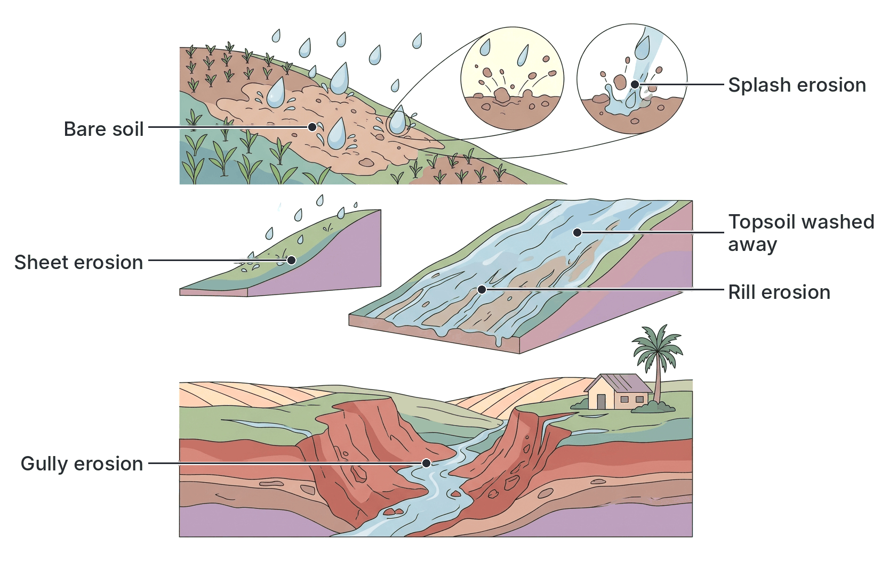

### 5. Repeated cropping with one variety (monocropping)

**Monocropping (monoculture)** is growing **the same crop**, often the same variety, on the same piece of land **season after season**.

**How it reduces fertility:**

1. **Selective exhaustion of nutrients:** the same crop always takes the same nutrients in the same amounts, from the **same depth** of soil (its roots always reach the same layer). Those particular nutrients are used up quickly. For example, repeated maize growing quickly uses up nitrogen.
2. **Build-up of pests and diseases:** the pests and disease organisms of that crop (e.g. nematodes, stem borers, soil-borne fungi and bacteria) survive in the soil and on crop remains and multiply every season because their food plant is always present. Yields fall more and more.
3. **Build-up of weeds** that are adapted to that crop's cultivation.
4. **Loss of humus and structure:** continuous cropping without a fallow or a soil-building crop (such as a legume or grass) reduces organic matter.
5. **No nitrogen is added**, unless the crop is a legume.
6. The soil may be left **bare** at the same time every year, exposing it to erosion.
7. Using **one variety** means all plants have the same weaknesses, so a single disease or pest can destroy the whole crop.

### Other causes of loss of soil fertility

- **Bush burning:** destroys organic matter, kills soil organisms, and leaves soil bare.
- **Overgrazing:** removes plant cover and causes compaction and erosion.
- **Deforestation:** removes the source of leaf litter and humus and exposes soil to rain and sun.
- **Waterlogging:** drives out air and encourages denitrification.
- **Change in soil pH:** leaching and some fertilisers (such as sulphate of ammonia) make soil more acidic; irrigation in dry areas without good drainage can make soils salty (salinisation).
- **Pollution:** oil spills (as in parts of the Niger Delta), heavy metals and other chemicals poison the soil and its organisms (see `C7c-pollution-and-sanitation.md`).
- **Shortening of fallow periods** as population grows, so the soil has no time to recover.

### Summary: factors and how they reduce fertility

| Factor | What it does | Main effect on fertility |
| --- | --- | --- |
| Loss of inorganic matter | Removes mineral nutrients through crops, burning and leaching | Nutrient deficiency, poor yields |
| Compaction | Squeezes out pore spaces | Poor aeration, drainage and root penetration; more run-off and erosion |
| Leaching | Washes soluble nutrients down beyond roots | Nutrient-poor, acidic topsoil |
| Erosion of topsoil | Removes the most fertile layer | Loss of humus, nutrients, organisms and soil depth |
| Repeated cropping with one variety | Takes the same nutrients from the same depth; pests and diseases build up | Nutrient exhaustion; falling yields |

## Renewal, maintenance and conservation of soil fertility

**Objective v: apply the knowledge of the practice of contour ridging, terracing, mulching, poly-cropping, strip-cropping, use of organic and inorganic fertilizers, crop rotation, shifting cultivation, etc. to enhance soil conservation.**

**Soil conservation** means protecting the soil from erosion and from loss of fertility, and keeping it productive for present and future generations. Methods either **protect the soil from erosion**, **add nutrients and organic matter**, or **give the soil time to recover**.

### Contour ridging (contour ploughing)

**What it is:** making ridges (and furrows) **across the slope**, following the **contour lines** (lines joining points of the same height), instead of up and down the slope.

**How it conserves soil:**

1. Each ridge acts as a small **barrier** that slows down water flowing downhill.
2. Water collects in the furrows and **soaks into** the soil instead of running off, which reduces **sheet and rill erosion** and stores more water for crops.
3. Less topsoil and fewer nutrients are carried away.

**Note:** ridges made **up and down** a slope do the opposite: they act as channels that speed up run-off and cause gullies. In Nigeria, yams, cassava and maize are often planted on ridges or mounds; on sloping land, these should be made along the contour.

### Terracing

**What it is:** cutting a steep hillside into a series of **level, step-like platforms** (terraces), each held up by a wall of stones, earth or grass on its outer edge.

**How it conserves soil:**

1. It turns one long, steep slope into many short, **flat** surfaces, so water flows slowly and has little force to carry soil.
2. Water **soaks in** on each level step.
3. The walls **trap** any soil that is washed down.
4. Steep land that could not otherwise be farmed safely can be used.

**In Nigeria:** terracing is used on some hilly and mountainous farmland, for example on parts of the Jos, Mambilla and Obudu plateaus and in the Mandara Mountains area of the north-east. The ancient terraced fields of the **Sukur Cultural Landscape** in Adamawa State are a UNESCO World Heritage Site.

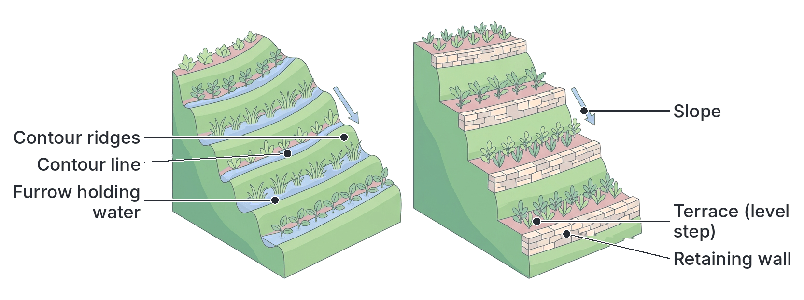

### Mulching

**What it is:** covering the soil surface around crops with a layer of material. **Organic mulches** include dry grass, leaves, straw, crop remains, sawdust and wood shavings. In Nigeria, farmers commonly cover **yam mounds** with dry grass or leaves. **Inorganic mulches** include plastic sheets and gravel.

**How it conserves soil:**

1. **Protects the soil from raindrops**, so crumbs are not broken and splash erosion and crusting are prevented.
2. **Slows down run-off**, so less soil is washed away and more water soaks in.
3. **Reduces evaporation**, so the soil stays moist longer in the dry season.
4. **Keeps soil temperature even**, shading it from the hot sun (and protecting yam setts from scorching).
5. **Suppresses weeds**, which then do not compete for nutrients.
6. Organic mulch **decays** to form **humus**, adding nutrients and improving structure.
7. Encourages **earthworms** and other beneficial organisms.

**Possible disadvantages:** dry mulch can be a fire risk, and it may harbour pests such as termites.

### Poly-cropping (mixed cropping and intercropping)

**What it is:** growing **two or more crops** on the same piece of land **at the same time**.

- **Mixed cropping:** crops are mixed without a regular pattern.
- **Intercropping:** crops are grown in a definite arrangement, e.g. alternate rows.

**Nigerian examples:** yam with maize, melon (egusi), okra and pepper in the south; maize with cassava; sorghum or millet with cowpea or groundnut in the north.

**How it conserves soil:**

1. The ground is **covered** by plants for longer and more completely, protecting the soil from rain and sun, and reducing erosion. Spreading crops such as melon and cowpea act as **cover crops**.
2. Crops with **different rooting depths** take nutrients from **different layers** of the soil, so no single layer is exhausted.
3. **Legumes** (cowpea, groundnut, soya bean) in the mixture **add nitrogen** through their root nodules.
4. The mixture of crops reduces the spread of **pests and diseases**, which often attack only one crop.
5. More crop remains are returned to the soil as organic matter.
6. The farmer is protected against the total failure of one crop.

### Strip-cropping

**What it is:** growing different crops in **long, narrow strips** side by side **across the slope** (along the contour, or across the direction of the wind). Strips of a **row crop** that leaves soil exposed (e.g. maize, cassava, yam) alternate with strips of a **close-growing, soil-protecting crop** (e.g. grass, groundnut, cowpea, melon or other legumes).

**How it conserves soil:**

1. Water running down from a strip of row crops is **slowed and filtered** by the next strip of dense crop, so the soil it carries is **trapped**.
2. Across the wind, the dense strips act as **windbreaks**, reducing wind erosion.
3. If the strips are rotated each year, strip-cropping also gives the benefits of **crop rotation**.
4. Legume strips add nitrogen.

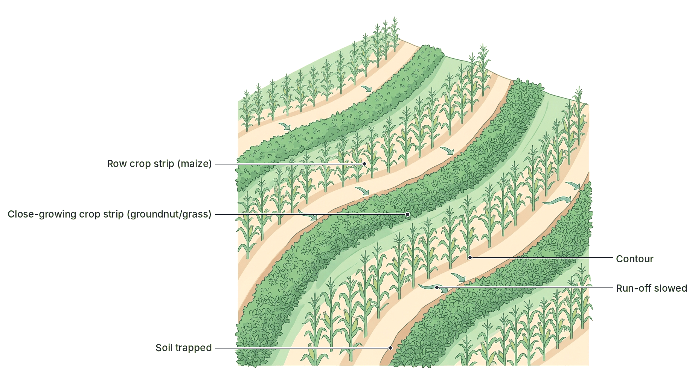

### Use of organic fertilisers (manures)

**Organic fertilisers (manures)** come from the remains or wastes of living things.

| Type | What it is | Nigerian examples |
| --- | --- | --- |
| **Farmyard manure** | A mixture of animal dung, urine and bedding (straw), allowed to rot | Cow dung from Fulani herds (some northern farmers allow herds to graze on harvested fields in exchange for the manure they leave), goat and sheep droppings |
| **Poultry manure** | Droppings of chickens and other birds; rich in nitrogen | From poultry farms; widely used for vegetables |
| **Compost** | Plant and animal waste (leaves, grass, crop remains, kitchen waste, ash, a little soil and manure) piled in layers, kept moist and turned, so that decomposers break it down into humus | Made in pits or heaps on farms and in school gardens |
| **Green manure** | A crop, usually a **legume**, grown and then **ploughed into the soil** while still green and young, where it rots | *Mucuna*, *Crotalaria*, *Centrosema*, cowpea |
| **Others** | Bone meal (phosphorus), blood meal, wood ash (potassium and lime), sewage sludge | — |

**How organic fertilisers maintain and renew fertility:**

1. Add **nutrients** (N, P, K and trace elements), released **slowly** as they decay, so they last longer and are not quickly leached.
2. Add **humus**, which improves **crumb structure**, **water-holding capacity** and **aeration**.
3. Loosen heavy clay and bind loose sand.
4. Feed and increase **soil organisms**.
5. Reduce **erosion** by stabilising crumbs.
6. Buffer soil pH.

**Disadvantages:** bulky to transport and spread; low nutrient content compared with chemical fertilisers, so large amounts are needed; slow to act; uncomposted manure may carry weed seeds and disease organisms, and fresh poultry manure can "burn" plants.

### Use of inorganic fertilisers (chemical fertilisers)

**Inorganic fertilisers** are manufactured chemicals (or mined minerals) that supply plant nutrients in concentrated form.

| Fertiliser | Main nutrient supplied |
| --- | --- |
| **Urea** | Nitrogen (about 46% N) |
| **Sulphate of ammonia (ammonium sulphate)** | Nitrogen (and sulphur) |
| **Calcium ammonium nitrate (CAN)** | Nitrogen |
| **Single superphosphate (SSP)** | Phosphorus (and calcium, sulphur) |
| **Muriate of potash (potassium chloride)** | Potassium |
| **Compound fertilisers (NPK)**, e.g. NPK 15:15:15, NPK 20:10:10 | Nitrogen, phosphorus and potassium together. The numbers give the percentages of N, P₂O₅ and K₂O in the bag |
| **Lime** (calcium carbonate, agricultural lime) | Not a fertiliser in the strict sense; it **raises the pH** of acid soils and adds calcium |

**How inorganic fertilisers maintain and renew fertility:**

1. Quickly replace the specific nutrients removed by crops or lost by leaching.
2. Act **fast**, because the nutrients are soluble and immediately available.
3. Can be matched to the crop's needs and to what the soil lacks (after a soil test).
4. Easy to transport, store and apply in small amounts.
5. Healthier, bigger crops produce more roots and crop remains, which can add organic matter.

**Disadvantages and correct use:**

- They add **no humus** and do not improve soil structure; used alone for many years, they can allow structure to decline.
- They are easily **leached**, especially nitrogen, so they should be applied in split doses at the right time, near the plants, not just before very heavy rain.
- Some (e.g. sulphate of ammonia) make soil more **acidic** over time.
- **Excess** fertiliser can "burn" (scorch) plants, waste money, and wash into rivers and lakes, causing **eutrophication** (see `C7c-pollution-and-sanitation.md`).
- They are expensive and sometimes adulterated or scarce.

**Best practice:** combine organic and inorganic fertilisers (**integrated soil fertility management**): the manure improves structure and humus, and the chemical fertiliser supplies quick nutrients.

### Organic and inorganic fertilisers compared

| Feature | Organic fertilisers (manures) | Inorganic fertilisers |
| --- | --- | --- |
| Source | Plant and animal remains and wastes | Factories or mined minerals |
| Nutrient content | Low, but contains many elements | High, concentrated; specific elements |
| Speed of action | Slow; nutrients released as it decays | Fast; immediately soluble |
| Effect on soil structure | **Improves** structure (adds humus) | **No** direct improvement |
| Effect on soil organisms | Feeds and increases them | Little direct effect (some may harm them if overused) |
| Leaching | Nutrients released slowly; less leaching | Easily leached if overused |
| Bulk | Bulky; difficult to transport | Small amounts needed; easy to transport |
| Lasting effect | Long-lasting (residual effect) | Short-lived |
| Cost | Cheap or free on the farm | Expensive to buy |

### Crop rotation

**What it is:** growing **different crops** on the **same piece of land** in a **planned order** (sequence), season after season or year after year, so that the same crop does not follow itself.

**Principles of a good rotation:**

1. **Deep-rooted** crops alternate with **shallow-rooted** crops, so nutrients are taken from different soil depths.
2. **Legumes** are included to add **nitrogen**.
3. Crops of **different families** follow one another, so their pests and diseases do not build up.
4. **Heavy feeders** (crops that need much nutrient, e.g. yam) come first, when the soil is most fertile (e.g. after a fallow or after manuring); **light feeders** come later.
5. A **cover crop** or **fallow** period may be included to rebuild the soil.

**A sample four-year rotation in southern Nigeria:**

| Year | Crop | Reason |
| --- | --- | --- |
| 1 | **Yam** | Heavy feeder; planted first when the soil is most fertile |
| 2 | **Maize** (with melon) | Cereal; shallow fibrous roots use nutrients from upper layers |
| 3 | **Cowpea or groundnut** | Legume; adds nitrogen through root nodules |
| 4 | **Cassava** | Tolerates poorer soil; deep roots use nutrients from lower layers |
| Then | **Fallow** (or a planted cover crop) | Allows the soil to recover before the cycle begins again |

**How crop rotation conserves and renews fertility:**

1. Prevents **exhaustion** of any one nutrient or soil layer.
2. Legumes **restore nitrogen**.
3. **Breaks the life cycles of pests and diseases**: when their host crop is absent, they starve or die out.
4. Helps control **weeds**.
5. Different crops add different amounts and types of organic matter, and some cover the soil well, reducing erosion.
6. Improves soil structure, especially when grasses and legumes are included.

### Shifting cultivation

**What it is:** a traditional farming system in which a farmer **clears and cultivates** a piece of land (often by slash-and-burn) for a few years until the yields fall, then **abandons** it and **moves to a new piece of land**, sometimes moving the whole homestead. The abandoned land is left to recover naturally and may be farmed again many years later.

**How it conserves soil:**

1. The abandoned land is left to **rest**; natural vegetation grows back.
2. The returning plants **shed leaves**, which rot and **rebuild humus**; deep roots bring up nutrients from the subsoil; legumes add nitrogen.
3. Plant cover **protects** the soil from erosion while it recovers.
4. Soil organisms recover.

**Disadvantages:**

- Needs **a lot of land**; it works only where population is low and there is enough land for long rests (often 10 years or more).
- With rapid **population growth**, rest periods become too short, so soils do not recover and become degraded.
- **Burning** destroys organic matter and soil organisms and leaves the soil bare.
- Clearing new forest causes **deforestation** and loss of wildlife.
- Farms are small and scattered, and it does not encourage investment in the land (permanent crops, buildings, machinery).

### Bush fallowing (land rotation)

**What it is:** a modified form of shifting cultivation in which the farmer lives in a **permanent** village or house and **rotates** cultivation between different plots of land around it. After a few years of cropping, a plot is left to rest under natural "bush" (**fallow**), while another rested plot is cleared and farmed. This is widely practised in Nigeria.

**How it conserves soil:** in the same way as shifting cultivation: the fallow vegetation rebuilds humus and nutrients and protects the soil.

**Shifting cultivation and bush fallowing compared:**

| Feature | Shifting cultivation | Bush fallowing |
| --- | --- | --- |
| Farmer's home | May move with the farm | Stays in one permanent place |
| Land | Farmer moves on to new land | Farmer rotates among plots around the home |
| Fallow length | Usually long | Usually shorter, and getting shorter as population grows |
| Land needed | Very large | Large, but less |
| Soil recovery | Good, if fallow is long | Poor if fallow is too short |

**Improved fallow:** instead of leaving the land to natural bush, farmers can plant fast-growing legumes (such as *Mucuna* or *Pueraria*, or trees such as *Gliricidia* and *Leucaena*) during the fallow. This restores fertility much faster, so a shorter fallow is enough. In **alley cropping** (developed partly at research institutes in Ibadan), crops are grown between rows of such leguminous trees, whose prunings are used as mulch and green manure.

### Cover crops

**What they are:** low, creeping, fast-growing plants (usually **legumes**) grown to **cover the soil surface**, often between the rows of tree crops or during a fallow.

**Examples:** *Centrosema pubescens*, *Pueraria phaseoloides* (tropical kudzu), *Calopogonium*, *Mucuna*, and food crops such as melon (egusi), sweet potato and cowpea. Legume cover crops are commonly grown under young oil palm, rubber, cocoa and citrus plantations.

**How they conserve soil:**

1. The leafy cover **intercepts raindrops**, preventing splash erosion and crusting.
2. Roots **bind** the soil particles together.
3. They **slow run-off** and help water soak in.
4. Legume cover crops **fix nitrogen**.
5. Their dead leaves add **organic matter**.
6. They **suppress weeds** and keep the soil cool and moist.

### Afforestation, reforestation and windbreaks

- **Afforestation** is planting trees on land that has not had forest for a long time (or never had); **reforestation** is replanting trees where a forest has been cut down.
- Trees protect the soil: their canopy breaks the force of rain, their leaf litter forms humus, their roots bind the soil and their deep roots recycle nutrients.
- **Windbreaks and shelterbelts** are rows of trees planted across the direction of the prevailing wind. In northern Nigeria, trees such as neem, eucalyptus and *Acacia* species are planted as shelterbelts to reduce **wind erosion** and slow the advance of the desert (see `C7d-conservation-parks-and-reserves.md`).
- **Agroforestry** combines trees with crops and/or livestock on the same land.

### Other soil conservation and fertility practices

| Practice | How it conserves soil or restores fertility |
| --- | --- |
| **Avoiding bush burning** | Keeps organic matter and soil organisms; keeps soil covered |
| **Controlled grazing and rotational grazing** | Prevents overgrazing, trampling and compaction; keeps grass cover |
| **Liming** | Corrects soil acidity, making nutrients available and improving structure |
| **Drainage of waterlogged land** | Lets air back into the soil; stops denitrification |
| **Irrigation (with proper drainage)** | Supplies water in the dry season; must be drained to avoid salinisation |
| **Minimum (zero) tillage** | Disturbs the soil as little as possible, keeping structure and organic matter |
| **Grass strips, bunds and check dams** | Planted grass strips (e.g. vetiver grass) and small walls of earth or stones across slopes or gullies slow water and trap soil |
| **Returning crop residues** | Ploughing in crop remains instead of burning them adds humus and nutrients |
| **Planting grasses on bare slopes and gully edges** | Roots bind the soil and stop gullies from growing |
| **Proper road and building drainage** | Prevents water from concentrating and starting gullies |

### Summary: conservation methods and how they work

| Method | Main way it protects or renews the soil |
| --- | --- |
| Contour ridging | Ridges across the slope slow run-off; reduces water erosion |
| Terracing | Level steps on steep slopes; slows water and traps soil |
| Mulching | Covers soil; prevents splash erosion, keeps moisture, adds humus |
| Poly-cropping | Better soil cover; uses different soil layers; legumes add N |
| Strip-cropping | Dense strips trap soil washed from row-crop strips; act as windbreaks |
| Organic fertilisers | Add nutrients slowly and add humus; improve structure |
| Inorganic fertilisers | Quickly replace specific nutrients |
| Crop rotation | Prevents nutrient exhaustion; breaks pest cycles; legumes add N |
| Shifting cultivation and bush fallow | Rest periods let natural vegetation rebuild humus and nutrients |
| Cover crops | Protect soil surface; bind soil; fix nitrogen |
| Afforestation and windbreaks | Protect soil from rain and wind; add litter |

## Key terms

| Term | Meaning |
| --- | --- |
| Soil | The loose, weathered top layer of the Earth's crust in which plants grow, made of mineral particles, organic matter, water, air and organisms |
| Weathering | The breaking down of rocks into smaller particles by physical, chemical and biological processes |
| Soil profile | A vertical section through the soil showing its layers (horizons) |
| Topsoil | The upper, dark, humus-rich and most fertile layer of soil |
| Subsoil | The layer below the topsoil, with less humus and where leached materials collect |
| Soil texture | The proportions of particles of different sizes (sand, silt, clay) in a soil |
| Soil structure | The way soil particles are grouped together into aggregates (crumbs) |
| Loam | A soil with a balanced mixture of sand, silt and clay and plenty of humus |
| Porosity | (School use) how freely air and water pass through a soil; (strict use) the total volume of pore spaces |
| Capillarity | The rise of water upwards through narrow spaces between soil particles |
| Water retention | The ability of a soil to hold water |
| Humus | Dark, colloidal, partly decomposed organic matter in soil |
| Leaching | The washing down of dissolved mineral salts beyond the reach of roots |
| Soil erosion | The removal of topsoil by water or wind |
| Compaction | The pressing together of soil particles, reducing pore space |
| Monocropping | Growing the same crop on the same land season after season |
| Soil fertility | The ability of a soil to supply plants with the nutrients, water and air they need for healthy growth |
| Field capacity | The water a soil holds after free water has drained away |
| Gravitational water | Water that drains down through the soil under gravity |
| Capillary water | Water held in small pores and films; the main water used by plants |
| Hygroscopic water | Water held so tightly on soil particles that plants cannot absorb it |
| Contour ridging | Making ridges across a slope along the contour lines |
| Terracing | Cutting a slope into level steps |
| Mulching | Covering the soil surface with a layer of material such as dry grass |
| Strip-cropping | Growing crops in alternate strips across a slope or wind |
| Crop rotation | Growing different crops on the same land in a planned sequence |
| Green manure | A crop, usually a legume, ploughed into the soil while green |
| Cover crop | A low, creeping crop grown to protect the soil surface |
| Bush fallow | Leaving farmland to rest under natural vegetation while other plots are farmed |

## Exam tips and common mistakes

- **Capillarity:** highest in **clay**, lowest in **sand**. Water rises fastest at first in sand but stops at a lower height.
- **Porosity and drainage:** in JAMB, sandy soil has the highest porosity, best aeration and fastest drainage; clay has the lowest. Do not confuse drainage with water retention: sand drains fastest, so it **retains** the least water.
- **Best soil for agriculture:** loam, because it has a balance of air, water, nutrients and humus.
- **Sedimentation order:** gravel at the bottom, then coarse sand, fine sand, silt, clay; humus floats on top; fine clay keeps the water cloudy.
- **Water vs humus experiments:** heat **gently** (about 100 °C) to drive off water; heat **strongly** (red-hot) to burn off humus. Always heat to **constant mass**. Use **dry** soil for the humus experiment.
- **Air experiment:** volume of air = (volume of water + volume of soil) − final volume. Divide by the volume of soil and multiply by 100 for the percentage.
- **Leaching vs erosion:** leaching moves nutrients **down** into the subsoil in solution; erosion **removes** the topsoil itself.
- **Texture vs structure:** texture = particle sizes; structure = how particles are grouped into crumbs. Farmers can improve structure, not texture.
- **Contour ridges go across the slope**, never up and down it.
- **Organic vs inorganic fertilisers:** only organic manures add humus and improve structure; inorganic fertilisers act faster.
- **Legumes** (cowpea, groundnut, *Centrosema*) restore nitrogen through *Rhizobium* in their root nodules; that is why they are used in rotations, cover crops and green manure.
- **Waterlogging** harms plants by removing **soil air**, not by "too much water" alone.

## Quick summary

1. Soil is a mixture of mineral particles, organic matter (humus), water, air and living organisms, formed by the weathering of rock; it is arranged in horizons (topsoil, subsoil, parent rock).
2. Sandy soil has large particles, high porosity, good aeration, fast drainage, low water retention, low capillarity and little humus; clayey soil is the opposite; loam is a balanced mixture with much humus and is best for crops.
3. Simple experiments (sedimentation, funnels, heating to constant mass, displacement of water, capillary tubes) measure particle size, drainage, water, humus, air and capillarity.
4. Inorganic minerals, humus, soil organisms, soil air and soil water each support healthy plant growth by supplying nutrients, water and oxygen, and by keeping a good soil structure.
5. Soil fertility is lost through removal of minerals by crops and burning, compaction, leaching, erosion of the topsoil and repeated cropping with one variety.
6. Contour ridging, terracing, mulching, strip-cropping, cover crops and afforestation protect soil from erosion.
7. Organic and inorganic fertilisers, crop rotation, poly-cropping, shifting cultivation and bush fallowing renew and maintain soil fertility.

## Practice questions

**1. Which of the following soil types has the highest capillarity?**

- A. Sandy soil
- B. Loamy soil
- C. Gravel
- D. Clayey soil

**Answer: D.** Clay has the narrowest pore spaces, so water rises highest through it by capillarity, although it rises slowly.

**2. In a sedimentation experiment, soil is shaken with water in a measuring cylinder and allowed to settle. The material found floating on the surface of the water is**

- A. humus
- B. clay
- C. silt
- D. fine sand

**Answer: A.** Humus is light organic matter and floats. Clay settles last on top of the sediment and keeps the water cloudy.

**3. Equal volumes of water are poured through equal amounts of dry sand, loam and clay in three funnels plugged with cotton wool. Which soil will allow the largest volume of water to pass through in 30 minutes?**

- A. Clay
- B. Sand
- C. Loam
- D. All will be equal

**Answer: B.** Sand has large pore spaces and the highest porosity, so water drains through it fastest and it retains the least.

**4. A tin of soil of volume 40 cm³ was added to 100 cm³ of water in a measuring cylinder and stirred. The final volume was 130 cm³. What is the percentage of air in the soil?**

- A. 10%
- B. 20%
- C. 30%
- D. 25%

**Answer: D.** Volume of air = (100 + 40) − 130 = 10 cm³. Percentage = 10 ÷ 40 × 100 = 25%.

**5. To determine the humus content of a soil sample, the soil should be**

- A. dried, weighed, heated strongly to constant mass and reweighed
- B. weighed fresh, heated gently and reweighed once
- C. shaken with water and allowed to settle
- D. placed in a funnel and water poured through it

**Answer: A.** Dry soil is used so that the loss in mass is due to humus only; strong heating burns off the organic matter, and heating to constant mass ensures all of it is removed.

**6. The washing down of soluble mineral salts from the topsoil beyond the reach of plant roots is called**

- A. erosion
- B. leaching
- C. compaction
- D. capillarity

**Answer: B.** Leaching moves dissolved nutrients downwards; erosion removes the topsoil itself.

**7. Growing the same crop on the same piece of land every year reduces soil fertility mainly because**

- A. it adds too much humus to the soil
- B. it increases soil aeration
- C. the same nutrients are removed from the same soil depth and pests build up
- D. it fixes too much nitrogen

**Answer: C.** Monocropping exhausts the particular nutrients the crop needs from one soil layer and allows its pests and diseases to multiply.

**8. Ridges made across a slope along the contour lines help to conserve soil by**

- A. increasing the speed of run-off
- B. slowing down run-off so that water soaks into the soil
- C. adding nitrogen to the soil
- D. increasing leaching

**Answer: B.** Contour ridges act as barriers to water flowing downhill, reducing erosion and increasing infiltration.

**9. Which of the following is an advantage of organic manure over inorganic fertiliser?**

- A. It acts faster
- B. It contains higher concentrations of nutrients
- C. It is easier to transport
- D. It improves soil structure by adding humus

**Answer: D.** Organic manure adds humus, which binds particles into crumbs and improves water retention and aeration; inorganic fertilisers act faster but add no humus.

**10. In a crop rotation, a leguminous crop such as cowpea is included mainly to**

- A. restore nitrogen to the soil
- B. increase soil acidity
- C. reduce soil aeration
- D. provide shade for other crops

**Answer: A.** Legumes have root nodules containing nitrogen-fixing bacteria (*Rhizobium*), which add nitrogen compounds to the soil.
