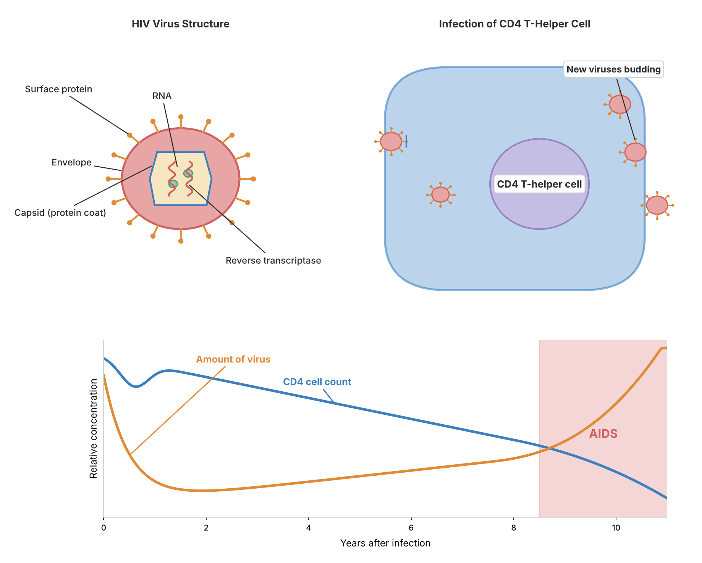
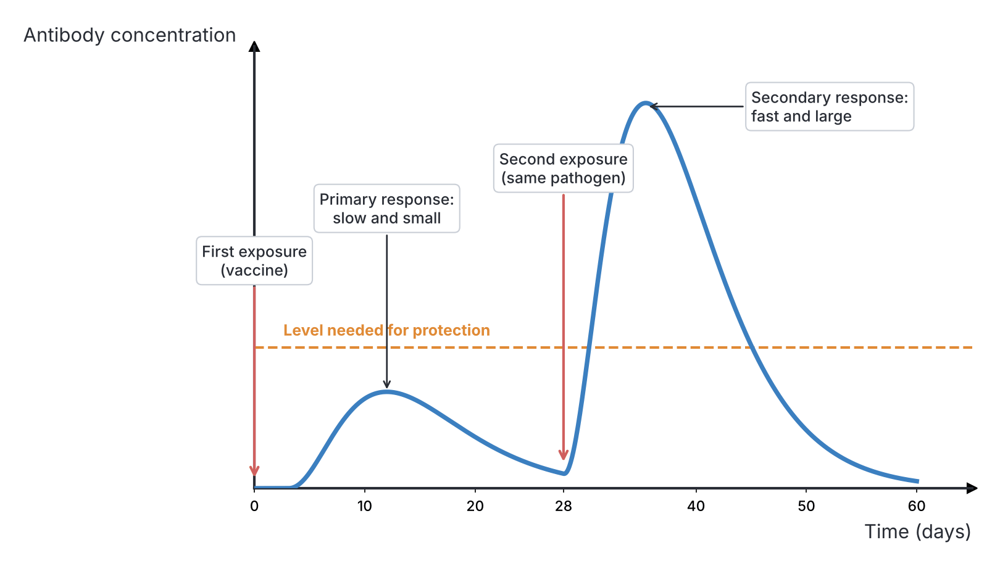

# JAMB Biology Notes: Humans and Environment – Diseases

## What JAMB expects

This topic is Section C, Topic 7 of the JAMB Biology syllabus: Ecology – Humans and Environment. Topic 7 is large, so it is split into four files:

- `C7a-diseases.md` (this file): content item (a), diseases.
- `C7b-drug-abuse.md`: content item (b), drug abuse.
- `C7c-pollution-and-sanitation.md`: content item (c), pollution and its control, and sanitation and sewage.
- `C7d-conservation-parks-and-reserves.md`: content items (d) conservation of natural resources and (e) game reserves and national parks.

This file covers content item (a), diseases:

- (i) Common and endemic diseases.
- (ii) Easily transmissible diseases and disease syndrome such as: poliomyelitis, cholera, tuberculosis, and sexually transmitted diseases/syndrome (gonorrhoea, syphilis, AIDS, etc.).

By the end of these notes, you should be able to:

1. (Objective i) Identify the ecological conditions that favour the spread of common endemic and potentially epidemic diseases, e.g. malaria, meningitis, dracunculiasis, schistosomiasis, onchocerciasis, typhoid fever and cholera.
2. (Objective ii) Relate the biology of the vector or agent of each disease to its spread and control.
3. (Objective vi) Use your knowledge of the causative organisms, mode of transmission and symptoms of the listed diseases to explain their prevention, treatment and control.
4. (Objective vii) Apply the principles of inoculation and vaccination to disease prevention.
5. (Objective xii) Assess the roles and functions of international and national health agencies, e.g. the World Health Organization (WHO), UNICEF, the Red Cross, and the ministries of health and environment.

The other objectives of Topic 7 are covered in the other three files: iii, iv and v in `C7b-drug-abuse.md`; viii, ix, x and xi in `C7c-pollution-and-sanitation.md`; and xiii, xiv, xv and xvi in `C7d-conservation-parks-and-reserves.md`.

**Note on the syllabus wording:** objective i spells the guinea worm disease "drancunculiasis"; the correct spelling is **dracunculiasis** (from the worm's name, *Dracunculus*). The syllabus writes "gonorrhea" (American spelling); these notes use the British spelling **gonorrhoea**. In objective xii, "United Nations International Children Emergency Fund" is the original 1946 name of UNICEF (the United Nations International Children's Emergency Fund); since 1953 its official name has been the **United Nations Children's Fund**, but it is still called UNICEF. "International Red Cross Society (IRCS)" is not the exact name of a single organisation; it refers to the **International Red Cross and Red Crescent Movement**, which includes the International Committee of the Red Cross (ICRC), the International Federation of Red Cross and Red Crescent Societies (IFRC) and national societies such as the **Nigerian Red Cross Society**.

## Basic ideas about disease

A **disease** is any condition that stops the body (or part of it) from working normally, and that usually shows itself by particular signs and symptoms.

- A **symptom** is what the sick person feels and reports (e.g. headache, pain, tiredness).
- A **sign** is what another person (e.g. a doctor or nurse) can observe or measure (e.g. fever, rash, swelling, blood in urine).

### Infectious and non-infectious diseases

| Feature | Infectious (communicable) diseases | Non-infectious (non-communicable) diseases |
| --- | --- | --- |
| Cause | A **pathogen** (germ): virus, bacterium, protozoan, fungus or parasitic worm | Not caused by a pathogen: e.g. poor diet, genes, ageing, lifestyle, environment |
| Can spread from person to person? | **Yes** | **No** |
| Examples | Malaria, cholera, tuberculosis, HIV/AIDS, measles, poliomyelitis | Diabetes, high blood pressure, sickle cell anaemia, kwashiorkor, cancer |

This file deals mainly with **infectious diseases**.

### Important terms

| Term | Meaning | Example |
| --- | --- | --- |
| **Pathogen (causative organism, agent)** | An organism that causes disease | *Plasmodium* causes malaria |
| **Vector** | A living organism (usually an insect) that carries a pathogen from one host to another | Female *Anopheles* mosquito carries *Plasmodium* |
| **Biological vector** | A vector in which the pathogen develops or multiplies | *Anopheles* (for *Plasmodium*); *Simulium* (for *Onchocerca*) |
| **Mechanical vector** | A vector that just carries the pathogen on its body, without the pathogen developing in it | **Housefly** carrying typhoid and cholera bacteria on its legs |
| **Intermediate host** | An organism in which a parasite spends part of its life cycle (usually the larval stages) | *Cyclops* (guinea worm); water snails (schistosomes) |
| **Primary (definitive) host** | The organism in which the parasite becomes adult and reproduces sexually | Humans (for guinea worm and schistosomes); the mosquito is the definitive host of *Plasmodium*, because sexual reproduction happens in it |
| **Reservoir** | A person, animal or place where a pathogen lives and multiplies and from which it spreads | Multimammate rats for Lassa virus; human carriers for typhoid |
| **Carrier** | A person who has the pathogen and can spread it but shows no symptoms | A "healthy" typhoid carrier |
| **Incubation period** | The time between infection and the appearance of the first symptoms | About 10–15 days for falciparum malaria |
| **Endemic disease** | A disease that is **always present** in a particular area or population, at a fairly steady level | Malaria in Nigeria |
| **Epidemic** | A sudden **outbreak** of a disease, affecting many more people than usual in an area at the same time | A cholera outbreak in the rainy season; meningitis outbreaks in the dry season |
| **Pandemic** | An epidemic that spreads across many countries or continents | HIV/AIDS; COVID-19 (declared in 2020) |
| **Sporadic disease** | One that occurs only occasionally, in scattered cases | Rabies cases from dog bites |
| **Notifiable disease** | A disease that health workers must report to the health authorities | Cholera, Lassa fever, meningitis, measles |

### How diseases spread (modes of transmission)

1. **Through the air (droplet and airborne infection):** coughing, sneezing, talking and breathing release droplets containing pathogens. Examples: tuberculosis, meningitis, measles, influenza, COVID-19.
2. **Through contaminated food and water (faecal–oral route):** pathogens in faeces get into food or water. Examples: cholera, typhoid, poliomyelitis, dysentery, guinea worm (water).
3. **Through vectors:** insects carry pathogens. Examples: malaria (mosquito), onchocerciasis (blackfly), yellow fever (*Aedes* mosquito), sleeping sickness (tsetse fly).
4. **Through direct contact:** touching an infected person or their sores. Examples: ringworm, scabies, Ebola (body fluids).
5. **Through sexual contact:** gonorrhoea, syphilis, HIV.
6. **Through blood:** transfusion of infected blood, sharing needles, razors or unsterilised instruments. Examples: HIV, hepatitis B.
7. **From mother to child:** during pregnancy, birth or breastfeeding. Examples: HIV, syphilis, gonorrhoea (at birth).
8. **Through the skin from water or soil:** larvae that bore through the skin. Example: schistosomiasis (cercariae in water); hookworm (larvae in soil).
9. **From animals (zoonoses):** rabies (dog bites), Lassa fever (rats), anthrax.

## Common and endemic diseases

**Content item a(i): common and endemic diseases.**

Many diseases are **endemic** in Nigeria because of its warm, wet climate (good for insect vectors and pathogens), large rural population, limited safe water and sanitation in many areas, crowding in cities, and poverty. Some of these diseases can also flare up into **epidemics** at certain seasons.

| Disease | Endemic or epidemic in Nigeria? | Where and when it is common |
| --- | --- | --- |
| Malaria | **Endemic** all year everywhere; peaks in the rainy season | Whole country, especially rural and poorly drained areas |
| Cerebrospinal meningitis | **Epidemics** in the dry season | Northern states (the meningitis belt) |
| Cholera | Epidemics, often yearly | Rainy season; areas with poor water supply and sanitation, flooded areas, crowded camps |
| Typhoid fever | Endemic | Areas with unsafe water and food |
| Schistosomiasis | Endemic | Near slow-moving fresh water, dams and irrigation schemes, across the country |
| Onchocerciasis | Endemic in some areas | Communities near fast-flowing rivers, especially in the savanna |
| Dracunculiasis | **No longer transmitted**; Nigeria was certified free in 2013 | Formerly in rural communities drinking pond water |
| Tuberculosis | Endemic | Whole country; crowded, poorly ventilated places |
| HIV/AIDS | Endemic | Whole country |
| Lassa fever | Endemic, with seasonal outbreaks (mainly in the dry season) | Several states, including Edo, Ondo and Bauchi; first described in 1969 in Lassa, a town in Borno State |
| Yellow fever | Outbreaks | Spread by *Aedes* mosquitoes; prevented by vaccine |
| Measles | Outbreaks, mainly in unvaccinated children | Whole country, especially the north |

**Why some areas have more disease:**

- **Climate:** warmth and rain favour mosquitoes, snails and blackflies; the dry, dusty harmattan favours meningitis.
- **Water bodies:** ponds, dams, slow streams and fast rivers each support particular vectors and hosts.
- **Poor sanitation:** open defecation and poor waste disposal spread cholera, typhoid and polio.
- **Unsafe water:** drinking untreated pond or stream water spreads cholera, typhoid and (formerly) guinea worm.
- **Overcrowding and poor ventilation:** spread tuberculosis and meningitis.
- **Poverty, malnutrition and low vaccination coverage:** weaken people's resistance.
- **Movement of people:** travel, migration, displacement by conflict and floods, and large gatherings spread outbreaks.

## Ecological conditions that favour the spread of diseases

**Objective i: identify ecological conditions that favour the spread of common endemic and potentially epidemic diseases e.g. malaria, meningitis, drancunculiasis, schistosomiasis, onchocerciasis, typhoid fever and cholera.**

### Malaria

Malaria is spread by female *Anopheles* mosquitoes, which breed in water. Conditions that favour its spread are therefore those that favour mosquitoes and the development of the parasite inside them.

1. **Stagnant or slow-moving water** for breeding: puddles, ponds, swamps, rice fields, blocked gutters, borrow pits, hoof prints, old tyres, tins, broken pots and uncovered water containers. *Anopheles gambiae* prefers small, sunlit, temporary pools of fairly clean water.
2. **The rainy season:** rain creates many new breeding sites, so malaria cases rise during and just after the rains.
3. **Warm temperatures:** mosquitoes develop faster, and the *Plasmodium* parasite can complete its development inside the mosquito only when it is warm enough. Development is fastest at about 25–30 °C and stops at low temperatures.
4. **High humidity:** adult mosquitoes live longer in humid air, so they survive long enough for the parasite to develop (about 10–14 days) and then to bite and infect people.
5. **Low altitude:** lowlands are warmer. On cool high plateaus, such as parts of the Jos, Mambilla and Obudu plateaus, malaria transmission is generally lower.
6. **Bushes and tall grass near houses:** give resting places for adult mosquitoes.
7. **Poor housing:** houses without window nets, with open eaves and gaps, let mosquitoes in.
8. **Large numbers of people without immunity or protection:** young children, pregnant women and visitors from areas without malaria.
9. **Irrigation schemes and dams:** create permanent breeding sites.

### Cerebrospinal meningitis (CSM)

Meningitis is spread from person to person by droplets; it has no vector. Conditions that favour epidemics:

1. **Location in the meningitis belt:** the **African meningitis belt** is a band of semi-arid land across sub-Saharan Africa, stretching roughly from Senegal in the west to Ethiopia in the east. It includes **northern Nigeria** (states such as Sokoto, Kebbi, Zamfara, Katsina, Kano, Jigawa, Yobe and others). Epidemics are much more common here than anywhere else in the world.
2. **The dry season** (roughly December to June, peaking from about February to April): epidemics happen in the hot, dry months and stop when the rains come.
3. **Harmattan dust and very low humidity:** dry, dusty air is thought to damage the lining (mucous membrane) of the nose and throat, making it easier for the bacteria to invade.
4. **Hot weather:** people crowd indoors to escape the heat.
5. **Overcrowding and poor ventilation:** crowded rooms, boarding schools, barracks, prisons, camps for displaced people and large gatherings make droplet spread easier.
6. **Low vaccination coverage** and the arrival of new strains (serogroups) of the bacterium to which people have no immunity.
7. **Poverty, malnutrition and other respiratory infections**, which weaken resistance.

[IMAGE: A simplified map of Africa with a shaded east–west band across the semi-arid region south of the Sahara, from Senegal in the west to Ethiopia in the east, showing the meningitis belt. Nigeria outlined with its northern half inside the band. A small inset sun and dust cloud symbol for the dry harmattan season. Labels: "Meningitis belt", "Sahara Desert", "Nigeria", "Northern Nigeria (inside the belt)", "Dry season: about December to June". Soft earth tones for land, light orange for the belt. Clean flat textbook style, white background.]

### Dracunculiasis (guinea worm disease)

1. **Drinking unfiltered water from ponds, open wells, step wells and slow streams**, where the tiny crustacean *Cyclops* (the intermediate host) lives.
2. **The dry season** (in drier areas) or the **rainy season** (in some wetter areas): transmission peaks when people depend most on ponds; when ponds shrink in the dry season, *Cyclops* becomes concentrated in the remaining water.
3. **Infected people entering the water** to fetch it or to soothe the burning blister on their legs, which lets the female worm release larvae into the water.
4. **Lack of safe water supply** (boreholes, piped water) in rural communities.
5. **Stagnant, warm water** in which *Cyclops* thrives.

### Schistosomiasis (bilharzia)

1. **Slow-moving or still fresh water** (ponds, lakes, dams, irrigation canals, slow rivers, rice fields) with aquatic plants, where the snail intermediate hosts (*Bulinus* and *Biomphalaria*) live.
2. **Dams and irrigation schemes**, which create large areas of calm water ideal for snails.
3. **Frequent contact with water:** swimming, bathing, washing clothes, fishing, farming in irrigated or flooded fields and fetching water. Children who play in water are at highest risk.
4. **Urinating or defecating in or near water**, which puts the eggs into the water.
5. **Warm water and sunshine**, which favour snails and the development of the larvae.
6. **Lack of toilets and safe water.**

### Onchocerciasis (river blindness)

1. **Fast-flowing, well-oxygenated rivers and streams** with rapids and waterfalls, where the blackfly *Simulium* lays its eggs and its larvae live attached to rocks and plants.
2. **Living, farming or working near such rivers:** the female blackflies bite people in riverside villages and farms by day, so the disease is often worst within a few kilometres of the breeding sites. In the past, whole river valleys in West Africa were abandoned because of it.
3. **The rainy season**, when river flow increases and more breeding sites form.
4. **Exposed skin** while working outdoors during the day.

### Typhoid fever

1. **Poor sanitation:** open defecation, overflowing pit latrines and poor sewage disposal, which let faeces contaminate water and food.
2. **Drinking contaminated water** from untreated wells, streams or broken pipes.
3. **Eating contaminated food**, especially food handled by carriers who do not wash their hands, uncovered food, raw vegetables washed in dirty water, and food sold in unhygienic conditions.
4. **Houseflies**, which carry the bacteria from faeces to food.
5. **Overcrowding** and poor housing.
6. **Flooding**, which spreads faecal matter into water sources.
7. **Human carriers** who remain infected after recovering.

### Cholera

1. **Contaminated drinking water:** cholera bacteria from faeces get into wells, streams, rivers and broken water pipes.
2. **Poor sanitation and open defecation.**
3. **The rainy season and floods**, which wash faeces into water sources. In Nigeria, cholera outbreaks often rise in the rainy season.
4. **Overcrowding**, especially in urban slums, markets, motor parks and camps for internally displaced people (for example in parts of the north-east affected by conflict).
5. **Eating contaminated food**, especially raw or undercooked seafood and food prepared with contaminated water.
6. **Houseflies** on uncovered food.
7. **Lack of safe water supply and poor hygiene** (no handwashing with soap).

### Summary of ecological conditions

| Disease | Key ecological conditions |
| --- | --- |
| Malaria | Stagnant water, rainy season, warmth, humidity, bushes near homes, low altitude |
| Meningitis | Meningitis belt (northern Nigeria), dry season, harmattan dust, low humidity, overcrowding |
| Dracunculiasis | Unfiltered pond water with *Cyclops*; infected people wading in drinking water |
| Schistosomiasis | Slow or still fresh water with snails; dams and irrigation; water contact; urinating in water |
| Onchocerciasis | Fast-flowing rivers with rapids; living near rivers |
| Typhoid fever | Poor sanitation, contaminated water and food, flies, carriers |
| Cholera | Contaminated water, poor sanitation, rainy season and floods, overcrowding |

## Vectors and agents: their biology, spread and control

**Objective ii: relate the biology of the vector or agent of each disease with its spread and control.**

To control a disease, we must know exactly how its vector or agent lives, feeds and breeds, so that we can attack it at its weakest point.

### The mosquito (*Anopheles*) and the malaria parasite (*Plasmodium*)

#### Biology of the *Anopheles* mosquito

Mosquitoes are insects (Phylum Arthropoda, Class Insecta, Order Diptera: two-winged flies). The main malaria vectors in Nigeria belong to the *Anopheles gambiae* complex and *Anopheles funestus*.

- **Only the female bites.** She needs a **blood meal** to provide protein for her eggs. The male feeds only on nectar and plant juices.
- She bites mainly at **night** (from dusk to dawn), often indoors.
- Mosquitoes undergo **complete metamorphosis**: **egg → larva → pupa → adult**. Three stages live in **water**.

**Life cycle of *Anopheles*:**

1. **Eggs:** after a blood meal, the female lays about 50–200 eggs, **singly** on the surface of the water. Each egg is boat-shaped with a pair of air-filled **floats** at the sides. They hatch in about 2–3 days.
2. **Larva:** the larva has no breathing tube (siphon). It lies **parallel (horizontal) to the water surface**, breathing air through **spiracles** at the end of its abdomen. It feeds on algae, bacteria and small particles, and moults four times.
3. **Pupa:** comma-shaped and active (it can swim when disturbed), but it does **not feed**. It breathes through two **breathing trumpets** on its back, at the water surface. After about 2–3 days, the pupa's skin splits and the adult emerges.
4. **Adult:** rests on the water surface briefly while its wings dry, then flies off. Males and females mate; the female seeks a blood meal.

The whole cycle from egg to adult takes about **7–14 days** in warm weather (faster in warmer water).

**How to recognise *Anopheles* compared with *Culex* and *Aedes*:**

| Feature | *Anopheles* | *Culex* | *Aedes* |
| --- | --- | --- | --- |
| Disease spread | **Malaria** | Filariasis (elephantiasis) in many areas | **Yellow fever**, dengue, Zika, chikungunya |
| Eggs | Laid **singly**, with **floats** | Laid in **rafts** (groups stuck together) | Laid singly, often on damp surfaces just above the water line; can survive drying |
| Larva position | Lies **parallel** to the water surface; no siphon | Hangs **at an angle** (head down) from a long **siphon** | Hangs at an angle from a short siphon |
| Adult resting position | Body held at an **angle** (about 45°) to the surface, head down, proboscis and body in a straight line | Body **parallel** to the surface (hunched) | Body parallel to the surface |
| Palps of female | About as **long as the proboscis** | Much shorter than the proboscis | Much shorter than the proboscis |
| Wings | Often **spotted** (dark patches) | Plain | Plain; body with **white stripes** on black |
| Biting time | Mainly at night | Mainly at night | Mainly by **day** |

[IMAGE: Life cycle of the Anopheles mosquito arranged in a circle with arrows, with a horizontal water surface line through the lower half of the diagram. 1: small boat-shaped eggs floating singly on the water surface, each with side floats (with a magnified inset of one egg). 2: a larva lying flat and parallel just below the water surface. 3: a comma-shaped pupa with two small breathing trumpets touching the surface. 4: an adult female mosquito emerging from the pupal case. 5: an adult female resting on a surface with her body tilted at an angle, head down. Labels: "Eggs laid singly", "Float", "Larva (parallel to surface)", "Spiracle", "Pupa", "Breathing trumpet", "Adult emerging", "Adult female (rests at an angle)", "Water surface". Clean flat textbook style, white background.]

[IMAGE: Comparison of Anopheles and Culex mosquitoes in three rows with two columns. Left column Anopheles, right column Culex. Row 1: eggs: Anopheles single eggs with floats; Culex eggs stuck together in a raft. Row 2: larvae: Anopheles larva lying parallel just under the water surface; Culex larva hanging head-down at an angle from a long breathing siphon. Row 3: adults at rest on a wall: Anopheles with its body at an angle of about 45 degrees to the wall; Culex with its body parallel to the wall. Labels: "Anopheles", "Culex", "Eggs single with floats", "Egg raft", "Larva parallel to surface", "Larva at an angle", "Siphon", "Adult at an angle", "Adult parallel to surface". Clean flat textbook style, white background.]

#### Biology of *Plasmodium* (the malaria parasite)

*Plasmodium* is a single-celled protozoan (Kingdom Protista; see Topic A2a). Four species commonly infect humans:

| Species | Notes |
| --- | --- |
| ***Plasmodium falciparum*** | The **most dangerous** and by far the most common in Nigeria and most of Africa; causes severe and cerebral malaria |
| ***P. vivax*** | Common in Asia and Latin America; rare in West Africa, because most West Africans lack the red cell receptor it uses to enter cells |
| ***P. malariae*** | Fever every 72 hours (quartan malaria) |
| ***P. ovale*** | Found in West Africa; mild |

**Textbook variation:** a fifth species, *P. knowlesi*, a parasite of monkeys, also infects people in South-East Asia. Older textbooks list only four.

**Life cycle of *Plasmodium*** (it needs two hosts):

*In humans (asexual stages):*

1. An infected female *Anopheles* bites a person and injects saliva containing thread-like **sporozoites**.
2. Within about an hour, the sporozoites travel in the blood to the **liver**. Each enters a liver cell and divides many times (**exo-erythrocytic schizogony**), forming thousands of **merozoites**. This takes about 1–2 weeks and causes no symptoms. (In *P. vivax* and *P. ovale*, some stay dormant in the liver as hypnozoites and can cause relapses months later.)
3. The liver cells burst, releasing merozoites into the blood. Each merozoite enters a **red blood cell**.
4. Inside the red cell, the parasite feeds on haemoglobin (ring stage, then trophozoite) and divides (**erythrocytic schizogony**) to form more merozoites.
5. The red cells **burst together**, releasing merozoites, waste products and toxins. This causes the attacks of **fever and chills**. The new merozoites invade more red cells, and the cycle repeats about every **48 hours** (for *P. falciparum*, *P. vivax* and *P. ovale*) or **72 hours** (*P. malariae*).
6. Some merozoites develop into male and female sexual cells called **gametocytes**, which stay in the blood.

*In the mosquito (sexual stages):*

7. A female *Anopheles* bites the infected person and sucks up gametocytes with the blood.
8. In the mosquito's stomach, the gametocytes become male and female **gametes**, which fuse (**fertilisation**) to form a **zygote**.
9. The zygote becomes a mobile **ookinete**, which bores into the stomach wall and forms an **oocyst** on its outer surface.
10. Inside the oocyst, thousands of **sporozoites** are formed (**sporogony**). The oocyst bursts and the sporozoites travel to the mosquito's **salivary glands**.
11. When the mosquito bites again, the sporozoites are injected into a new person. The development in the mosquito takes about **10–14 days**, depending on temperature.

So: **humans** are the **intermediate host** (asexual reproduction), and the **mosquito** is the **definitive (primary) host** (sexual reproduction) and the **vector**.

**Textbook variation:** some school textbooks call humans the "primary host" of *Plasmodium* simply because the disease affects humans. Strictly, the host in which sexual reproduction occurs (the mosquito) is the definitive host.

[IMAGE: Life cycle of Plasmodium in two halves joined by curved arrows. Left half "In humans": a mosquito biting an arm and injecting sporozoites; sporozoites entering a liver cell; liver cell bursting and releasing merozoites; merozoites entering red blood cells, showing a ring stage, a dividing schizont, and a red cell bursting to release more merozoites; some becoming gametocytes. Right half "In the mosquito": gametocytes taken up in a blood meal, gametes fusing in the stomach, a zygote becoming an ookinete, an oocyst on the stomach wall releasing sporozoites, and sporozoites moving to the salivary glands. Labels: "Sporozoites", "Liver cell", "Merozoites", "Red blood cell", "Ring stage", "Schizont", "Gametocytes", "Gametes fuse", "Ookinete", "Oocyst on stomach wall", "Salivary gland", "Human (intermediate host)", "Mosquito (definitive host)". Clean flat textbook style, white background.]

#### How the biology of the mosquito and *Plasmodium* is used to control malaria

| Biological fact | Control method based on it |
| --- | --- |
| Eggs, larvae and pupae live in **stagnant water** | **Drain** stagnant water; fill puddles, borrow pits and potholes; clear blocked gutters; cover water containers; dispose of tins, tyres and broken pots; this is called **source reduction** |
| Larvae and pupae must come to the **surface to breathe** | Spray **oil or kerosene** on the water surface to block their spiracles and breathing trumpets and suffocate them |
| Larvae are eaten by **fish** | **Biological control:** stock ponds with larva-eating fish such as *Gambusia* (mosquito fish) and *Tilapia*; use the bacterial larvicide *Bacillus thuringiensis israelensis* (Bti) |
| Larvae are killed by insecticides | **Larvicides** in breeding sites |
| Adult females **rest on walls** indoors after feeding | **Indoor residual spraying (IRS)**: spraying long-lasting insecticides on inside walls |
| Females **bite at night**, mostly indoors | **Insecticide-treated nets (ITNs)**, especially long-lasting ones (**LLINs**), over beds; window and door **nets (screens)**; closing doors and windows at dusk |
| Adults **rest in bushes** near homes | **Clear bushes** and cut tall grass around houses |
| Females find hosts by smell and warmth | Insect **repellent** creams and coils; wearing long sleeves in the evening |
| *Plasmodium* multiplies in human blood | Prompt **diagnosis** (rapid diagnostic test or microscope) and **treatment** with effective drugs to kill the parasite, so the person does not infect more mosquitoes |
| The parasite needs **10–14 days** in the mosquito | Anything that shortens mosquito life (nets, sprays) stops the parasite completing its development |
| Some groups are most at risk | **Preventive drugs** for pregnant women (intermittent preventive treatment with sulfadoxine–pyrimethamine) and **seasonal malaria chemoprevention** for young children during the rainy season in the Sahel and Sudan savanna areas |
| The immune system can be trained | **Malaria vaccines** (see the malaria section below) |

### The tiny crustacean *Cyclops* and the guinea worm (*Dracunculus medinensis*)

#### Biology of *Cyclops*

- *Cyclops* is a tiny **crustacean** (Phylum Arthropoda, Class Crustacea, group copepods), about 1–2 mm long, just visible as a moving white speck in water. Its name comes from its **single eye** in the middle of the head, like the one-eyed giant Cyclops of Greek stories.
- It has a pear-shaped body, two pairs of antennae (the first long), and swimming legs. Females carry **two egg sacs** at the sides of the abdomen.
- It lives in **still or slow-moving fresh water**: ponds, pools, open wells and step wells.
- It feeds on small organisms and particles, and **eats the guinea worm larvae** released into the water.
- It is **killed by stomach acid** in humans, which releases the larvae it contains.

[IMAGE: A magnified Cyclops (copepod) viewed from above: pear-shaped segmented body, a single dark eye in the middle of the head, two long first antennae spreading out, short second antennae, swimming legs, a forked tail, and two oval egg sacs at the sides of the abdomen. A small inset of a coiled guinea worm larva inside its body cavity. Labels: "Single eye", "Antenna", "Body segments", "Swimming legs", "Egg sac", "Tail (furca)", "Guinea worm larva inside". Clean flat textbook style, white background.]

#### Life cycle of the guinea worm and how it spreads

*Dracunculus medinensis* is a **nematode (roundworm)** (see Topic A2c).

1. A person drinks **unfiltered pond water** containing *Cyclops* that carry **infective guinea worm larvae**.
2. Stomach acid **kills the *Cyclops*** and releases the larvae.
3. The larvae bore through the wall of the stomach or intestine into the body cavity and connective tissues.
4. They mature over about a year, and male and female worms mate. The male dies.
5. The female grows very long (up to about 60–100 cm, but only about 2 mm thick) and moves, usually down to the **legs or feet**.
6. About a year after infection, the female makes a painful **blister** on the skin, which **burns** intensely. The blister bursts, forming an ulcer.
7. To relieve the burning, the person puts the limb into **water** (a pond or well). On contact with water, the worm pushes part of its body out and releases **hundreds of thousands of larvae** into the water.
8. The larvae are eaten by ***Cyclops***, in which they develop for about two weeks into the infective stage.
9. People drink the water, and the cycle starts again.

**Symptoms:** for about a year there are none. Then: fever, nausea, itching, and a painful, burning blister, usually on the lower leg or foot; the worm emerges slowly over weeks. The wound often becomes infected by bacteria, sometimes leading to tetanus or abscesses, and can leave stiff joints. Sufferers may be unable to walk, farm or go to school for weeks or months, often during the farming season.

**Treatment:** there is **no vaccine and no drug** that kills the worm. The emerging worm is slowly **wound around a small stick**, a few centimetres a day, over days or weeks, taking care not to break it. The wound is cleaned and dressed and pain is relieved. A person does **not** become immune, so can be infected again.

#### How the biology of *Cyclops* and the guinea worm is used for control

| Biological fact | Control method |
| --- | --- |
| Infection is only by **drinking water containing *Cyclops*** | **Filter** drinking water through a fine cloth or a **pipe filter** (a straw-like tube with a filter), which removes *Cyclops*; **boil** drinking water |
| *Cyclops* lives in **ponds and open wells** | Provide **safe water**: boreholes, protected wells and piped water |
| *Cyclops* can be killed by chemicals | Treat ponds with a safe larvicide (temephos, sold as Abate), which kills *Cyclops* |
| Larvae get into water when an infected person's **blister touches water** | Keep people with emerging worms **out of water sources**; dress and bandage the wound; give them water fetched by others |
| One case can infect a whole community | **Surveillance**: find, report and contain every case; educate communities; rewards for reporting cases |

**Dracunculiasis in Nigeria:** Nigeria once had more guinea worm cases than any other country, with hundreds of thousands of cases reported in the late 1980s. Through a national eradication programme (supported by the Carter Center, UNICEF and WHO), which relied on filtering water, providing boreholes, treating ponds and educating communities, transmission was stopped. Nigeria reported its last indigenous case in 2008, and **WHO certified Nigeria free of guinea worm transmission in 2013**. Worldwide, only a handful of human cases are still reported each year, in a few African countries, and guinea worm disease is expected to become only the second human disease (after smallpox) to be eradicated. This shows how knowing the biology of the vector can defeat a disease even without a drug or vaccine.

### Water snails (*Bulinus* and *Biomphalaria*) and schistosomes

#### Biology of the snails

- *Bulinus* and *Biomphalaria* are small **freshwater snails** (Phylum Mollusca, Class Gastropoda).
- ***Bulinus*** has a small, tall, spiral shell that coils to the **left** (its opening is on the left when the shell is held point up and opening facing you). It is the intermediate host of ***Schistosoma haematobium*** (urinary schistosomiasis).
- ***Biomphalaria*** has a **flat, disc-shaped** shell coiled in one plane (like a ram's horn). It is the intermediate host of ***Schistosoma mansoni*** (intestinal schistosomiasis).
- Both live in **still or slow-moving, warm, fresh water** with water plants, on which they feed (they graze algae and plant material). They thrive in dams, irrigation canals, ponds and the edges of lakes and slow rivers.
- They are **hermaphrodites** (each has both male and female organs), so a single snail can start a new population, and they **reproduce rapidly**.
- Some can survive dry periods by burying themselves in mud.

#### Life cycle of *Schistosoma* and how it spreads

*Schistosoma* (blood fluke) is a **flatworm** (Phylum Platyhelminthes, class Trematoda). Unlike most flukes, the sexes are separate: the male has a groove (gynaecophoric canal) in which the long, thin female lives.

1. Adult worms live in pairs in the **veins** around the bladder (*S. haematobium*) or the intestines (*S. mansoni*), where they can live for years.
2. The female lays eggs with sharp **spines**. The eggs work their way through the wall of the bladder or intestine and are passed out in the **urine** (*S. haematobium*) or **faeces** (*S. mansoni*). Many eggs get stuck in the tissues, causing damage.
3. If urine or faeces reach fresh water, the eggs hatch into ciliated larvae called **miracidia**.
4. A miracidium swims and must find the **right snail** within a few hours. It bores into the snail.
5. Inside the snail, it multiplies asexually (as **sporocysts**) for about 4–6 weeks, producing thousands of **cercariae**.
6. **Cercariae** (with **forked tails**) leave the snail, especially in warm, sunny hours, and swim in the water.
7. When a person enters the water, cercariae **bore through the skin** within minutes, losing their tails.
8. They travel in the blood through the lungs to the liver, where they mature, pair up, and move to the veins of the bladder or intestine.

**Symptoms:**

- A **rash or itch** where cercariae entered the skin (swimmer's itch).
- Weeks later, fever, cough and aches (acute schistosomiasis), in some people.
- ***S. haematobium***: **blood in the urine (haematuria)**, especially at the end of urination, and painful urination. Over years: damage and scarring of the bladder and ureters, kidney damage, and increased risk of **bladder cancer**. In girls and women it can damage the reproductive organs (female genital schistosomiasis). In some communities, blood in boys' urine was wrongly thought to be a normal sign of growing up, which delayed treatment.
- ***S. mansoni***: abdominal pain, diarrhoea and **blood in the stool**; over years, an enlarged **liver and spleen**, and swelling of the abdomen.
- In children: **anaemia**, poor growth and poor school performance.

**Treatment:** the drug **praziquantel**, which kills adult worms. It is given to whole groups of school children in endemic areas (**mass drug administration**).

#### How the biology of the snails and schistosomes is used for control

| Biological fact | Control method |
| --- | --- |
| Eggs reach water only in **urine and faeces** | Provide and use **toilets**; do not urinate or defecate in or near water |
| Snails live in **slow, weedy water** | **Clear vegetation** from canals and pond edges; make irrigation canals flow faster; line canals with concrete; drain unnecessary ponds |
| Snails can be killed | **Molluscicides** (snail-killing chemicals, e.g. niclosamide); **biological control** using snail-eating fish, ducks or competitor snails |
| Cercariae enter **through the skin** in water | **Avoid swimming, bathing and wading** in infected water; wear **rubber boots and gloves** when working in water; provide safe water for washing and bathing |
| Cercariae die within about two days if they do not find a host | Store water for **2–3 days** before use, or heat or filter it, so cercariae die |
| Adult worms are killed by a drug | **Praziquantel** for infected people and regular mass treatment of school children |
| Many people do not know how they are infected | **Health education** |

[IMAGE: Life cycle of Schistosoma haematobium shown as a loop. A person urinating near a pond; spiny eggs in urine falling into water; an egg hatching into a ciliated miracidium; the miracidium entering a small left-coiling Bulinus snail among water plants; many fork-tailed cercariae leaving the snail; cercariae penetrating the skin of a child's leg as he wades in the water; adult male and female worms paired together in a blood vessel near the bladder. A small inset showing a Biomphalaria snail with a flat, disc-shaped shell for comparison. Labels: "Eggs in urine", "Egg with spine", "Miracidium", "Bulinus snail (intermediate host)", "Cercariae (forked tail)", "Cercariae enter through skin", "Adult worms in veins of bladder", "Male", "Female", "Biomphalaria (S. mansoni)". Clean flat textbook style, white background.]

### The blackfly (*Simulium*) and *Onchocerca volvulus*

#### Biology of the blackfly

- *Simulium* (blackfly; the main West African vector is *Simulium damnosum*) is a small (about 2–5 mm), dark, **humpbacked** fly with short legs and broad, clear wings.
- It undergoes **complete metamorphosis**.
- The female lays her eggs on rocks, logs and plants at or just below the surface of **fast-flowing, well-oxygenated rivers and streams**, especially at **rapids, waterfalls and spillways of dams**.
- The **larvae** attach themselves to submerged rocks and plants by a ring of hooks at their rear end, and **filter food** from the fast current using fan-like brushes on their heads. They need the high oxygen of fast water.
- The **pupae** develop in slipper-shaped cocoons fixed to rocks in the current, breathing by gill filaments.
- **Adults** emerge and can fly long distances (tens of kilometres, sometimes more, helped by the wind).
- **Only the female bites** (to get blood for her eggs). She bites **during the day**, mostly outdoors, especially on the legs. She does not pierce a blood vessel; her mouthparts **cut the skin**, and she feeds from the small pool of blood (a pool feeder). This is how she picks up and passes on *Onchocerca* larvae, which live in the skin.

#### *Onchocerca volvulus* and how onchocerciasis spreads

*Onchocerca volvulus* is a **filarial nematode (thread-like roundworm)**.

1. An infected female blackfly bites a person and deposits infective **larvae** into the skin.
2. The larvae grow into adults over many months. Adult worms live in **nodules** (lumps) under the skin, often over bony parts such as the hips, ribs and head; females can be up to about 50 cm long and live for over a decade.
3. Females release millions of tiny larvae called **microfilariae** into the skin.
4. A blackfly biting the person takes up microfilariae from the skin.
5. In the fly, they develop into infective larvae in about 1–2 weeks, then move to the mouthparts.
6. The fly bites another person, passing on the infection.

**Symptoms (caused mainly by dying microfilariae, which set off inflammation):**

- **Severe itching** and skin rash.
- **Skin changes:** thickened, rough "lizard skin" or "elephant skin"; patches of lost colour on the shins ("leopard skin"); loss of skin elasticity.
- **Nodules** under the skin.
- **Eye damage:** microfilariae in the eye cause inflammation and scarring of the cornea and other parts, leading to **blindness**, hence the name **river blindness**.

**Treatment:** **ivermectin** (brand name Mectizan), taken **once or twice a year**, kills the microfilariae and stops the itching and eye damage. Since 1987, the drug company Merck has donated it free for as long as needed. It is given through **community-directed treatment with ivermectin (CDTI)**, in which communities choose their own volunteers to distribute it. Nigeria has one of the largest numbers of people at risk of onchocerciasis in the world, so this programme is very important here.

#### How the biology of *Simulium* is used for control

| Biological fact | Control method |
| --- | --- |
| Larvae live **only in fast-flowing rivers** | **Larviciding**: spraying safe insecticides into breeding rivers (often from aircraft) to kill larvae; this was the main method of the West African Onchocerciasis Control Programme (1974–2002) |
| Breeding sites are in specific rapids | Clearing vegetation at breeding sites; careful design of dam spillways |
| Females **bite by day**, outdoors, mainly on the legs | **Protective clothing** (long trousers, long sleeves); **repellents**; avoiding riverbanks at peak biting times |
| Microfilariae in skin infect the fly | **Mass treatment with ivermectin** reduces microfilariae in people, so flies pick up fewer and transmission falls |
| Flies breed near villages | Siting new settlements away from breeding rivers |

[IMAGE: Life cycle of the blackfly Simulium in a fast-flowing rocky river with white water rapids. Eggs laid on a rock at the water line; larvae attached by their rear ends to a submerged rock, waving fan-like head brushes in the current; slipper-shaped pupal cocoons fixed to the rock with gill filaments; a small dark humpbacked adult fly flying above the river and then biting a person's leg on the riverbank. An inset shows a skin nodule containing coiled adult worms, and tiny microfilariae in the skin. Labels: "Fast-flowing river (rapids)", "Eggs", "Larvae attached to rock", "Head fans", "Pupa in cocoon", "Adult blackfly (humpbacked)", "Female bites by day", "Skin nodule with adult worms", "Microfilariae". Clean flat textbook style, white background.]

### The housefly (*Musca domestica*)

#### Biology of the housefly

- The housefly is a two-winged insect (Order Diptera) about 6–7 mm long, with a grey thorax with four dark stripes.
- Its mouthparts are **sponging (lapping)**: it cannot bite or chew. It pours **saliva** and **vomit** onto solid food to dissolve it, then sucks up the liquid with its spongy labella.
- It **defecates** frequently, often while feeding.
- Its legs and body are covered with fine **hairs**, and its feet have **sticky pads** (pulvilli) and claws, which pick up dirt and germs.
- It feeds and breeds on **faeces, rubbish, rotting food and dung**, and then lands on human food.
- It undergoes **complete metamorphosis**:
  1. **Eggs:** white, about 1 mm long, laid in batches of about 100–150 in moist, decaying matter such as faeces, manure and rotting refuse. They hatch in less than a day.
  2. **Larvae (maggots):** white, legless, and headless-looking; they feed on the decaying matter and moult twice, over about 4–7 days.
  3. **Pupa:** the last larval skin hardens into a brown, barrel-shaped case (puparium); the pupa develops inside it for about 3–6 days, often in drier soil near the breeding site.
  4. **Adult:** emerges and can breed within a few days.
- The cycle can be completed in about **7–10 days** in hot weather, so numbers increase very quickly.

#### How the housefly spreads disease

The housefly is a **mechanical vector**. Pathogens do not develop inside it; it carries them from filth to food:

1. On its **hairy legs, body and sticky foot pads**.
2. In its **vomit**, which it pours on food.
3. In its **faeces**, deposited on food.

**Diseases it can spread:** **typhoid fever**, **cholera**, **dysentery** (bacterial and amoebic), diarrhoeal diseases, worm eggs, and eye infections such as conjunctivitis and trachoma.

#### How the biology of the housefly is used for control

| Biological fact | Control method |
| --- | --- |
| Breeds in **faeces, refuse and rotting matter** | **Proper disposal of refuse** in covered bins; regular collection; burying or burning rubbish; use of **latrines with covers**; ending open defecation; composting properly |
| Lands on **uncovered food** | **Cover food** and water; use food covers and fly-proof cupboards; eat freshly cooked hot food |
| Enters houses | **Fly screens** (nets) on windows and doors |
| Adults can be killed | **Insecticide** sprays, fly traps and sticky fly papers |
| Larvae live in manure heaps | Cover manure and compost heaps; turn them so heat kills larvae |
| Spreads germs from hands to mouth | **Wash hands** with soap before eating and after using the toilet; wash fruits and vegetables |

[IMAGE: Life cycle of the housefly in a circle with arrows: a cluster of small white eggs on a heap of refuse; a white legless maggot; a brown barrel-shaped pupal case; an adult housefly. In the centre, a magnified housefly standing on a plate of food, with its hairy legs and sticky foot pads highlighted, small dots showing germs on its legs, and a droplet of vomit on the food. Labels: "Eggs in refuse", "Larva (maggot)", "Pupa (puparium)", "Adult housefly", "Hairy legs carry germs", "Sticky foot pads", "Sponging mouthparts", "Vomit on food". Clean flat textbook style, white background.]

### Agents that spread without a vector

For **meningitis, typhoid and cholera**, there is no insect vector in the true sense (the housefly only helps). The **agent** (the bacterium) itself must be understood:

- **Meningitis bacteria** (*Neisseria meningitidis*) live in the nose and throat. Many healthy people carry them without illness (**carriers**). They spread by **droplets** and close contact and cannot survive long outside the body, so control depends on **vaccination**, early treatment and reducing crowding.
- **Typhoid bacteria** (*Salmonella* Typhi) live only in humans; some recovered people remain **carriers** for years (the bacteria hide in the gall bladder). Control depends on safe water, sanitation, food hygiene, treating carriers and vaccination.
- **Cholera bacteria** (*Vibrio cholerae*) survive in water, so control depends on **safe water**, sanitation and hygiene.

## The listed diseases: causes, transmission, symptoms, prevention, treatment and control

**Objective vi: use the knowledge of the causative organisms, mode of transmission and symptoms of the listed diseases to their prevention - treatment - control.**

This section gives one detailed account of each disease named in the syllabus: the content item (a)(ii) diseases (poliomyelitis, cholera, tuberculosis, gonorrhoea, syphilis and HIV/AIDS) and the objective i diseases (malaria, meningitis, dracunculiasis, schistosomiasis, onchocerciasis and typhoid fever). The master table at the end brings them together.

**Note:** treatments are given here to help you understand how diseases are controlled. They are not medical advice. Medicines should only be taken after diagnosis and prescription by a qualified health worker.

### Malaria

- **Causative organism:** the protozoan ***Plasmodium*** (mainly *P. falciparum* in Nigeria; also *P. malariae* and *P. ovale*).
- **Type of organism:** protozoan (Protista).
- **Mode of transmission:** the **bite of an infected female *Anopheles* mosquito**. Also, less commonly, by transfusion of infected blood and from mother to baby across the placenta.
- **Incubation period:** usually about 7–30 days (often about 10–15 days for *P. falciparum*).
- **Symptoms and signs:**
  1. Repeated attacks of **fever** with **chills and shivering**, followed by **sweating**, as red cells burst.
  2. **Headache**, body and joint pains, tiredness and weakness.
  3. Loss of appetite, nausea and **vomiting**; in children, also diarrhoea and cough.
  4. **Anaemia** (from destruction of red blood cells) and enlarged spleen.
  5. **Severe malaria** (mostly *P. falciparum*, especially in children under five and pregnant women): convulsions, confusion and coma (**cerebral malaria**), severe anaemia, difficulty breathing, dark urine, jaundice, kidney failure and death. In pregnancy, it can cause miscarriage, low birth weight and maternal anaemia.
- **Diagnosis:** **rapid diagnostic test (RDT)** or examination of a stained **blood film under the microscope**. Testing before treatment is recommended, because many fevers are not malaria.
- **Treatment:** **artemisinin-based combination therapies (ACTs)**, such as artemether–lumefantrine or artesunate–amodiaquine, for uncomplicated malaria; injectable **artesunate** for severe malaria. **Chloroquine** is no longer recommended for *P. falciparum* malaria in Nigeria because the parasite has become **resistant** to it. Courses must be completed.
- **Prevention and control:** see the full control table above: sleeping under **insecticide-treated nets**, indoor residual spraying, draining stagnant water and environmental sanitation, clearing bushes, larviciding, window screens, repellents, preventive treatment for pregnant women, **seasonal malaria chemoprevention** for young children in high-risk northern areas during the rains, and prompt treatment of cases.
- **Vaccines:** WHO recommended the first malaria vaccine, **RTS,S/AS01**, for children in high-transmission areas in 2021, and a second, **R21/Matrix-M**, in 2023. Nigeria approved R21 in 2023 and has begun introducing a malaria vaccine for young children in some states. The vaccines reduce, but do not remove, the risk of malaria, so nets and other measures are still needed.
- **Importance in Nigeria:** malaria is endemic throughout Nigeria and is one of the leading causes of death in children under five. WHO reports have for many years shown Nigeria carrying the largest share of the world's malaria cases and deaths (more than a quarter of the global total).

### Cerebrospinal meningitis (CSM)

**Meningitis** is inflammation of the **meninges**, the three membranes that cover the brain and spinal cord. The form that causes large epidemics in the meningitis belt is **cerebrospinal meningitis**, caused by the meningococcus.

- **Causative organism:** mainly the bacterium ***Neisseria meningitidis*** (the **meningococcus**). It has several groups (**serogroups**), such as A, C, W and X; different serogroups have caused different epidemics. Meningitis can also be caused by other bacteria (*Streptococcus pneumoniae*, *Haemophilus influenzae* type b), by viruses and by fungi.
- **Mode of transmission:** **droplets** from the nose and throat of infected people and healthy **carriers**, spread by coughing, sneezing, kissing, sharing utensils and close contact, especially in crowded places.
- **Incubation period:** usually about 2–10 days (often about 4 days).
- **Symptoms and signs:**
  1. Sudden high **fever**.
  2. **Severe headache**.
  3. **Stiff neck** (the person cannot bend the chin to the chest).
  4. **Sensitivity to light (photophobia)**.
  5. Nausea and vomiting.
  6. Confusion, drowsiness, convulsions and coma.
  7. Sometimes a purple or red **rash** that does not fade when pressed (from blood poisoning).
  8. In babies: a **bulging fontanelle** (soft spot), poor feeding, irritability and floppiness.
  - It can kill within hours or a day or two if not treated, and survivors may be left with **deafness**, brain damage, learning problems or loss of limbs.
- **Diagnosis:** by examining the **cerebrospinal fluid** (taken by lumbar puncture).
- **Treatment:** urgent **antibiotics** (for example ceftriaxone), given in hospital. In epidemics, WHO guidelines allow simplified antibiotic treatment.
- **Prevention and control:**
  1. **Vaccination:** a vaccine against serogroup A (MenAfriVac) was introduced across the meningitis belt from 2010 and almost eliminated group A epidemics. In 2024, Nigeria became the first country to introduce a newer vaccine that protects against five serogroups (A, C, W, Y and X). Mass vaccination campaigns are carried out in affected areas during outbreaks.
  2. **Avoiding overcrowding**; good **ventilation** of homes, schools and hostels.
  3. **Early detection and reporting** of cases, and rapid treatment.
  4. Preventive antibiotics for close contacts of cases (in some situations).
  5. **Health education**, especially before the dry season.
  6. Covering the mouth and nose when coughing or sneezing.

### Dracunculiasis (guinea worm disease)

- **Causative organism:** the nematode (roundworm) ***Dracunculus medinensis***.
- **Intermediate host:** the tiny crustacean ***Cyclops***.
- **Mode of transmission:** **drinking unfiltered water** containing *Cyclops* infected with guinea worm larvae. It is **not** spread directly from person to person.
- **Incubation period:** about **one year**.
- **Symptoms:** a painful, burning **blister** (usually on the leg or foot) which bursts as the long female worm comes out; fever, nausea and itching; secondary bacterial infection of the wound; temporary or permanent disability.
- **Treatment:** no drug or vaccine; slowly **winding the worm out on a stick**; cleaning and dressing the wound; pain relief; antibiotics for secondary infection.
- **Prevention and control:** **filtering** water through cloth or pipe filters; **boiling** water; providing **boreholes** and protected wells; treating ponds with temephos; keeping people with blisters out of drinking-water sources; health education; case surveillance.
- **Status:** **WHO certified Nigeria free of guinea worm transmission in 2013**; the disease is close to global eradication.

### Schistosomiasis (bilharzia, bilharziasis)

- **Causative organisms:** blood flukes (flatworms): ***Schistosoma haematobium*** (urinary schistosomiasis) and ***Schistosoma mansoni*** (intestinal schistosomiasis), both found in Nigeria. (*S. intercalatum* also occurs in parts of West and Central Africa.)
- **Intermediate hosts:** freshwater snails: ***Bulinus*** (for *S. haematobium*) and ***Biomphalaria*** (for *S. mansoni*).
- **Mode of transmission:** **cercariae** in infected fresh water **penetrate the skin** of people who swim, bathe, wash, fish or farm in the water.
- **Symptoms:** skin itch at the site of entry; later fever; **blood in urine** and painful urination (*S. haematobium*); abdominal pain, diarrhoea and blood in stools, enlarged liver and spleen (*S. mansoni*); anaemia, tiredness and poor growth in children; bladder damage and bladder cancer after long infection.
- **Diagnosis:** finding the spined **eggs** in urine or stool under the microscope.
- **Treatment:** **praziquantel**.
- **Prevention and control:** use of toilets (no urinating or defecating in water); avoiding contact with infected water; providing safe water; protective boots; killing snails (molluscicides, clearing weeds, biological control); good design and management of dams and irrigation; mass treatment of school children; health education.

### Onchocerciasis (river blindness)

- **Causative organism:** the filarial nematode ***Onchocerca volvulus***.
- **Vector:** the female **blackfly, *Simulium*** (biological vector).
- **Mode of transmission:** the **bite of an infected female blackfly**, which deposits larvae in the skin.
- **Symptoms:** intense itching; skin rashes, thickening and depigmentation ("leopard skin"); **nodules** under the skin; eye lesions leading to **blindness**.
- **Diagnosis:** skin snips examined for microfilariae; finding nodules.
- **Treatment:** **ivermectin**, once or twice a year (kills microfilariae); nodules can also be removed by surgery.
- **Prevention and control:** **community-directed treatment with ivermectin**; **larviciding** of breeding rivers; protective clothing and repellents; avoiding riverbanks where flies bite; settling away from breeding sites.

### Typhoid fever

- **Causative organism:** the bacterium ***Salmonella* Typhi** (in full, *Salmonella enterica* serovar Typhi; older books call it *Salmonella typhi*). A related bacterium, *Salmonella* Paratyphi, causes the milder paratyphoid fever.
- **Mode of transmission:** **faecal–oral**: eating **food** or drinking **water** contaminated with faeces (or urine) of infected people or **carriers**; also carried by **houseflies**; and by unwashed hands of food handlers.
- **Incubation period:** usually about 1–3 weeks.
- **Symptoms and signs:**
  1. **Fever that rises gradually** over several days and stays high (often 39–40 °C).
  2. Headache, weakness, tiredness and body aches.
  3. **Abdominal pain**; **constipation** (common in adults) or diarrhoea (common in children).
  4. Loss of appetite, dry cough.
  5. Sometimes faint pink spots ("rose spots") on the chest or abdomen, and an enlarged spleen.
  6. **Complications** in the second or third week if untreated: **intestinal bleeding** and **perforation** (a hole in the intestine; in Nigeria, typhoid perforation is a well-known cause of emergency surgery), confusion, and death.
- **Diagnosis:** **blood culture** (or stool culture) is the reliable test. **Note:** the Widal test, widely used in Nigeria, is often misleading (it can be positive in people who do not have typhoid), so many people are wrongly told they have "typhoid" and take unnecessary antibiotics. Doctors recommend proper testing.
- **Treatment:** **antibiotics** chosen by a doctor (resistance to older antibiotics such as chloramphenicol, ampicillin and co-trimoxazole, and increasingly to ciprofloxacin, is common); plenty of fluids; rest; nourishing food. Carriers may need long treatment.
- **Prevention and control:**
  1. **Safe drinking water**: boiling, chlorinating or filtering water; protected wells and boreholes.
  2. **Proper disposal of faeces**: toilets, sewage treatment, ending open defecation.
  3. **Food hygiene**: cooking food well and eating it hot; covering food; washing fruits and vegetables with clean water.
  4. **Handwashing** with soap after using the toilet and before handling food.
  5. **Fly control**.
  6. **Screening and treating food handlers** and carriers.
  7. **Typhoid vaccines** (including newer typhoid conjugate vaccines), especially in high-risk areas and outbreaks.

### Cholera

- **Causative organism:** the bacterium ***Vibrio cholerae***, a short, **comma-shaped** rod with a single flagellum. Serogroups O1 and O139 cause epidemics.
- **Mode of transmission:** **faecal–oral**: drinking **water** or eating **food** contaminated with the faeces (or vomit) of infected people; houseflies; dirty hands.
- **Incubation period:** short: from a few hours to about 5 days (often 1–2 days).
- **How it causes illness:** the bacteria multiply in the small intestine and release a **toxin**. The toxin makes the cells lining the intestine pour out huge amounts of **water and salts** into the gut.
- **Symptoms and signs:**
  1. Sudden, painless, **profuse watery diarrhoea**, pale and cloudy with flecks of mucus: "**rice-water stools**". A person can lose many litres of fluid a day.
  2. **Vomiting**.
  3. Rapid **dehydration**: extreme thirst, sunken eyes, dry mouth, wrinkled skin that stays raised when pinched, little or no urine, muscle cramps, weak and rapid pulse, and low blood pressure.
  4. Without treatment, severe cases can die of dehydration and shock **within hours**. Many infected people have only mild symptoms or none, but still pass the bacteria in their faeces.
- **Treatment:**
  1. **Rehydration** is the key treatment. **Oral rehydration solution (ORS)** (a correct mixture of salts and sugar in clean water) replaces lost water and salts; most patients recover with ORS alone. Home-made salt–sugar solution can be used at first if ORS is not available, but it must be mixed in the correct proportions.
  2. **Intravenous fluids** (a "drip") for severe dehydration.
  3. **Antibiotics** for severe cases, to shorten the illness.
  4. **Zinc** supplements for children.
- **Prevention and control:**
  1. **Safe water**: boil, chlorinate or treat drinking water; protect wells and boreholes.
  2. **Sanitation**: use toilets; proper sewage disposal; end open defecation.
  3. **Hygiene**: wash hands with soap after the toilet and before eating; wash fruits and vegetables; cook food thoroughly and eat it hot; cover food against flies.
  4. **Isolation and care** of patients in treatment centres; disinfecting their faeces, vomit, clothes and bedding; safe burial of the dead.
  5. **Oral cholera vaccines**, used in outbreaks and high-risk areas.
  6. **Surveillance** and quick reporting of cases to the NCDC and state health authorities.
- **In Nigeria:** cholera outbreaks happen most years, especially in the rainy season and in areas with poor water and sanitation. One of the worst recent outbreaks was in **2021**, when more than 100,000 suspected cases and over 3,000 deaths were reported.

### Poliomyelitis (polio)

- **Causative organism:** the **poliovirus** (an enterovirus). There are three types of wild poliovirus (types 1, 2 and 3).
- **Mode of transmission:** mainly **faecal–oral**: the virus multiplies in the intestine and is passed out in faeces; others are infected through contaminated water, food or hands. It can also spread by droplets from the throat. It mainly affects **children under five**.
- **Incubation period:** usually about 7–14 days (range about 3–35 days).
- **Symptoms:**
  1. Most infected people (about 70%) have **no symptoms**, but can spread the virus.
  2. Some have mild flu-like illness: fever, sore throat, headache, vomiting and tiredness.
  3. In a small proportion (about 1 in 200 infections), the virus attacks the **motor nerve cells** in the spinal cord and brain stem, causing sudden **floppy (flaccid) paralysis**, usually of the **legs**, and usually on one side. This paralysis is often **permanent**, leaving a thin, weak, deformed limb.
  4. If the muscles of breathing are paralysed, the person can die.
- **Treatment:** there is **no cure**. Treatment is supportive: rest, pain relief, physiotherapy, braces, crutches and corrective surgery; breathing support in severe cases.
- **Prevention and control:**
  1. **Vaccination** is the main method:
     - **Oral polio vaccine (OPV)** (developed by **Albert Sabin**): a **live, weakened (attenuated)** virus given as **drops in the mouth**. It produces immunity in the gut, which stops the spread of the virus in the community. It is cheap and easy to give, so it is used in mass campaigns.
     - **Inactivated polio vaccine (IPV)** (developed by **Jonas Salk**): **killed** virus given by **injection**.
     - Both are part of Nigeria's routine immunisation, and house-to-house campaigns aim to reach every child.
  2. **Sanitation and hygiene**: safe disposal of faeces, safe water and handwashing.
  3. **Surveillance** for acute flaccid paralysis (AFP) in children, and testing of sewage, to find the virus quickly.
- **Polio in Nigeria:** Nigeria was once one of the last countries with wild poliovirus, and vaccination campaigns faced rumours and resistance in some areas, as well as insecurity. Its last case of wild poliovirus was reported in **2016**. After three years without wild polio, Nigeria was declared free of wild poliovirus, and in **August 2020** the whole **WHO African Region was certified free of wild poliovirus**. However, Nigeria still has outbreaks of **circulating vaccine-derived poliovirus** (a rare form that can arise where too few children are vaccinated with the oral vaccine, so the weakened vaccine virus spreads and changes). The answer is to vaccinate **every** child, so the work against polio is not finished.

### Tuberculosis (TB)

- **Causative organism:** the bacterium ***Mycobacterium tuberculosis*** (the tubercle bacillus), discovered by **Robert Koch** in 1882. A related bacterium, *Mycobacterium bovis*, causes TB in cattle and can spread to people through unpasteurised milk.
- **Mode of transmission:** **airborne droplets**: when a person with TB of the lungs **coughs**, sneezes, talks or spits, tiny droplets containing the bacteria float in the air and are breathed in by others. It spreads most easily in **crowded, poorly ventilated** rooms and among people who live closely with a patient. Also by drinking **unpasteurised milk** from infected cows (bovine TB).
- **Infection versus disease:** many people who breathe in TB bacteria do not get ill; the bacteria stay **dormant** (latent TB). They can become active later if the person's immunity becomes weak, especially in people with **HIV**, **malnutrition**, diabetes, or old age.
- **Symptoms (TB of the lungs):**
  1. A **persistent cough lasting two weeks or more**, often with sputum.
  2. **Coughing up blood** (haemoptysis).
  3. **Night sweats**.
  4. **Fever**, especially in the evening.
  5. **Loss of weight** and appetite; tiredness (TB was once called "consumption" because it seems to consume the body).
  6. Chest pain and breathlessness.
  - TB can also affect other organs: lymph nodes, bones and spine, kidneys, brain (TB meningitis).
- **Diagnosis:** testing sputum (by microscopy or by modern rapid molecular tests such as GeneXpert); chest X-ray; skin or blood tests for infection.
- **Treatment:** a combination of **several antibiotics** taken every day for **at least six months** (usually isoniazid, rifampicin, pyrazinamide and ethambutol for the first two months, then isoniazid and rifampicin for four months). Treatment is **free** in Nigeria's public TB programme. Patients must take **all** their drugs for the full period, ideally watched by a health worker or supporter (**DOTS**: directly observed treatment, short-course). Stopping early leads to relapse and to **drug-resistant TB** (multidrug-resistant TB), which is much harder and more expensive to treat.
- **Prevention and control:**
  1. **BCG vaccine** (Bacillus Calmette–Guérin) given to babies at birth; it protects young children well against severe forms of TB, but its protection against TB of the lungs in adults is limited.
  2. **Early detection and complete treatment** of cases, which stops them spreading TB.
  3. **Good ventilation**; avoiding overcrowding.
  4. Covering the mouth when coughing; not spitting anywhere.
  5. **Good nutrition**.
  6. **Pasteurising or boiling milk**; testing and controlling TB in cattle.
  7. Testing people with HIV for TB, and giving preventive treatment where appropriate.
- **In Nigeria:** Nigeria has one of the highest numbers of TB cases in the world and the highest in Africa, and many cases are never diagnosed. Anyone with a cough lasting two weeks or more should be tested.

### Sexually transmitted infections (STIs)

**Sexually transmitted infections (STIs)**, also called sexually transmitted diseases (STDs), are infections passed mainly by **sexual contact** (vaginal, anal or oral sex) with an infected person. Some are also passed through blood or from mother to child.

**Textbook variation:** "STI" is now preferred to "STD", because many infected people have no symptoms of disease but can still pass on the infection. The syllabus says "sexually transmitted disease/syndrome"; "syndrome" refers to AIDS (acquired immune deficiency **syndrome**).

#### Gonorrhoea

- **Causative organism:** the bacterium ***Neisseria gonorrhoeae*** (the gonococcus), a kidney-bean-shaped coccus usually seen in pairs.
- **Mode of transmission:** **sexual contact** with an infected person; from an infected **mother to her baby during birth** (infecting the baby's eyes).
- **Incubation period:** usually about 2–7 days in men (can be longer).
- **Symptoms:**
  - **Men:** **painful, burning urination** and a thick, yellow or greenish **pus discharge** from the penis; sometimes painful, swollen testes.
  - **Women:** often **no symptoms** at all (so they may not know they are infected); or increased vaginal discharge, painful urination, lower abdominal pain and bleeding between periods.
  - **Complications:** in women, **pelvic inflammatory disease (PID)**, which can block the oviducts, causing **infertility** and **ectopic pregnancy**; in men, narrowing of the urethra and infertility. It also increases the risk of getting and passing on HIV.
  - **Newborn babies:** serious eye infection (**ophthalmia neonatorum**), which can cause **blindness**.
- **Diagnosis:** laboratory tests on a swab or urine.
- **Treatment:** **antibiotics** prescribed by a doctor (currently injections such as ceftriaxone in many guidelines). Gonorrhoea has become **resistant** to many antibiotics (such as penicillin and ciprofloxacin), so self-medication is dangerous. Sexual partners must also be tested and treated.
- **Prevention:** see the prevention of STIs below. Newborns are protected by applying antibiotic eye ointment at birth.

#### Syphilis

- **Causative organism:** the bacterium ***Treponema pallidum***, a thin, corkscrew-shaped **spirochaete**.
- **Mode of transmission:** **sexual contact** (contact with sores); from an infected **mother to her baby across the placenta** during pregnancy (**congenital syphilis**); rarely by blood transfusion.
- **Incubation period:** about 3 weeks (range about 10–90 days).
- **Symptoms (in stages):**
  1. **Primary stage:** a single, firm, round, **painless sore (chancre)** where the bacteria entered (on the genitals, anus or mouth), about 3 weeks after infection. It heals by itself in a few weeks, so many people ignore it, but the infection continues.
  2. **Secondary stage** (weeks to months later): a **skin rash**, often on the **palms of the hands and soles of the feet**, which does not itch; fever, sore throat, swollen glands, patchy hair loss and tiredness. These also go away by themselves.
  3. **Latent stage:** no symptoms, possibly for years.
  4. **Tertiary (late) stage** (years later, in some untreated people): damage to the **heart and blood vessels**, **brain and nervous system** (paralysis, madness, blindness), bones and skin (destructive swellings called gummas), and death.
  - **Congenital syphilis:** can cause miscarriage, stillbirth, or a baby born with deformities, deafness or other problems.
- **Diagnosis:** blood tests (e.g. VDRL or RPR tests, and specific treponemal tests). Pregnant women are screened at antenatal clinics.
- **Treatment:** **penicillin** injections (benzathine penicillin) cure syphilis, especially in the early stages. Damage already done in the late stage cannot be reversed.
- **Prevention:** see the prevention of STIs below, plus **screening and treatment of pregnant women** to protect babies.

#### HIV and AIDS

- **Causative organism:** the **human immunodeficiency virus (HIV)**, a **retrovirus** (its genes are made of RNA, and it uses an enzyme, reverse transcriptase, to make DNA copies inside the host cell).
- **AIDS** (**acquired immune deficiency syndrome**) is the late stage of HIV infection, when the immune system has been badly damaged. It is a **syndrome**: a group of signs and symptoms (many caused by other infections) that occur together.
- **How HIV damages the body:** HIV attacks white blood cells called **CD4 T-helper lymphocytes**, which control the immune response. It multiplies inside them and destroys them. Over years, the number of CD4 cells falls, and the body can no longer fight infections. People then get **opportunistic infections** (infections that a healthy immune system would control) and some cancers.
- **Modes of transmission:**
  1. **Unprotected sexual intercourse** with an infected person (the main route in Nigeria).
  2. **Transfusion of infected blood** or blood products that have not been screened.
  3. **Sharing needles, syringes, razors, clippers** or other sharp instruments, and unsterilised instruments used for injections, circumcision, tattooing, ear piercing or traditional scarification.
  4. **Mother-to-child transmission** during pregnancy, childbirth or breastfeeding.
- **HIV is NOT spread by:** shaking hands, hugging, sharing plates, cups or toilets, coughing or sneezing, swimming pools, or **mosquito bites**.
- **Stages and symptoms:**
  1. **Early (acute) infection** (2–4 weeks after infection): some people have a short flu-like illness with fever, sore throat, rash and swollen glands. Others feel nothing.
  2. **Long symptomless stage:** the person looks and feels well, sometimes for **many years** (often about 8–10 years without treatment), but the virus is multiplying and can be passed on. Only an **HIV test** can show the infection.
  3. **AIDS:** severe weight loss ("slim disease"), long-lasting **diarrhoea**, long-lasting **fever**, night sweats, persistent cough, swollen glands, extreme tiredness, and **opportunistic infections** such as **tuberculosis** (the most common cause of death in people with HIV in Africa), pneumonia, oral thrush (candidiasis), and cancers such as **Kaposi's sarcoma**, which causes purple patches on the skin.
- **Diagnosis:** an **HIV blood test** (rapid tests, confirmed in the laboratory). The **window period** is the time soon after infection when the test may still be negative, even though the person is infected.
- **Treatment:** there is **no cure** and no vaccine yet. **Antiretroviral therapy (ART)**: a combination of drugs taken **every day for life**. It stops the virus multiplying, lets the immune system recover, prevents AIDS, and allows people with HIV to live long, healthy lives. A person on ART whose virus is suppressed to undetectable levels **does not pass HIV on through sex** ("undetectable = untransmittable"). ART is provided free in many public facilities in Nigeria.
- **Prevention and control:**
  1. **A**: **Abstinence** from sex (the most certain method for young people).
  2. **B**: **Being faithful** to one uninfected partner.
  3. **C**: correct and consistent use of **condoms**.
  4. **Screening of all blood** before transfusion.
  5. **Not sharing** needles, razors or sharp objects; **sterilising** instruments.
  6. **Prevention of mother-to-child transmission (PMTCT):** HIV testing of all pregnant women and ART for those who are positive, which greatly reduces the chance that the baby is infected.
  7. **Knowing your status:** HIV testing and counselling.
  8. **Pre-exposure prophylaxis (PrEP)** for people at high risk, and **post-exposure prophylaxis (PEP)** (drugs started within 72 hours after possible exposure, e.g. after rape or a needle-stick injury).
  9. Treatment of other STIs, which increase the risk of HIV.
  10. **Fighting stigma and discrimination**, so that people come forward for testing and treatment.
- **In Nigeria:** the **National Agency for the Control of AIDS (NACA)** coordinates the national response. National surveys (for example, the 2018 Nigeria HIV/AIDS Indicator and Impact Survey) found that about 1.4% of adults aged 15–49 were living with HIV. Because Nigeria's population is very large, this still means about two million people, one of the largest numbers in the world.

#### Other sexually transmitted infections (brief)

The syllabus says "etc.", so you should know of these:

| Infection | Cause | Main features |
| --- | --- | --- |
| Chlamydia | Bacterium (*Chlamydia trachomatis*) | Often no symptoms; discharge; a major cause of infertility in women; treated with antibiotics |
| Trichomoniasis | Protozoan (*Trichomonas vaginalis*) | Frothy, smelly discharge and itching; treated with drugs |
| Genital herpes | Virus (herpes simplex) | Painful blisters that keep coming back; no cure, but drugs reduce attacks |
| Genital warts | Virus (human papillomavirus, HPV) | Warts on genitals; some types of HPV cause **cervical cancer**; prevented by HPV vaccine |
| Hepatitis B | Virus | Spread by sex, blood and from mother to child; damages the liver; prevented by vaccine |
| Chancroid | Bacterium (*Haemophilus ducreyi*) | Painful genital ulcers; treated with antibiotics |

#### Prevention and control of STIs (general)

1. **Abstinence** from sex before marriage, and **faithfulness** to one uninfected partner.
2. Correct and consistent use of **condoms**.
3. Avoiding **multiple sexual partners** and casual sex.
4. **Early testing and complete treatment** of infected people **and their partners** at a proper health facility; **no self-medication** (it encourages drug resistance and leaves infections half-treated).
5. **Antenatal screening** and treatment of pregnant women (syphilis, HIV, hepatitis B).
6. Eye ointment for newborn babies.
7. **Vaccination** against hepatitis B and HPV.
8. **Sex education** and health education in schools and communities.
9. Avoiding alcohol and drug abuse, which lead to risky sexual behaviour (see `C7b-drug-abuse.md`).

### Master table of the listed diseases

| Disease | Causative organism (type) | Vector or intermediate host | Mode of transmission | Main symptoms | Treatment | Prevention and control |
| --- | --- | --- | --- | --- | --- | --- |
| **Malaria** | *Plasmodium* (protozoan) | Female *Anopheles* mosquito | Mosquito bite | Fever with chills and sweating, headache, vomiting, anaemia; convulsions and coma in severe malaria | ACTs; injectable artesunate for severe malaria | Treated nets, indoor spraying, draining stagnant water, clearing bushes, larvicides, chemoprevention, vaccines |
| **Cerebrospinal meningitis** | *Neisseria meningitidis* (bacterium) | None | Droplets from nose and throat; close contact | Sudden fever, severe headache, stiff neck, photophobia, vomiting, rash, coma | Antibiotics (e.g. ceftriaxone) | Vaccination, good ventilation, avoid overcrowding, early treatment |
| **Dracunculiasis** | *Dracunculus medinensis* (nematode) | *Cyclops* (intermediate host) | Drinking unfiltered water with infected *Cyclops* | Burning blister on the leg; worm emerges; infection, disability | Winding worm out on a stick; wound care (no drug) | Filtering or boiling water; boreholes; treating ponds; keep patients out of water |
| **Schistosomiasis** | *Schistosoma haematobium*, *S. mansoni* (flatworms) | Snails *Bulinus*, *Biomphalaria* (intermediate hosts) | Cercariae penetrate skin in fresh water | Blood in urine or stool, abdominal pain, anaemia, enlarged liver and spleen | Praziquantel | Toilets, avoid infected water, kill snails, safe water, mass treatment |
| **Onchocerciasis** | *Onchocerca volvulus* (filarial nematode) | Blackfly *Simulium* | Bite of female blackfly | Itching, skin changes, nodules, blindness | Ivermectin | Mass ivermectin, larviciding rivers, protective clothing, repellents |
| **Typhoid fever** | *Salmonella* Typhi (bacterium) | Housefly (mechanical) | Faecal–oral: contaminated food and water; carriers | Gradually rising fever, headache, abdominal pain, constipation or diarrhoea, intestinal perforation | Antibiotics (as prescribed) | Safe water, sanitation, food hygiene, handwashing, fly control, vaccine, treating carriers |
| **Cholera** | *Vibrio cholerae* (bacterium) | Housefly (mechanical) | Faecal–oral: contaminated water and food | Profuse "rice-water" diarrhoea, vomiting, rapid dehydration | ORS, intravenous fluids, antibiotics in severe cases | Safe water, sanitation, hygiene, cover food, oral cholera vaccine, isolation of cases |
| **Poliomyelitis** | Poliovirus (virus) | None (housefly may help) | Faecal–oral; droplets | Often none; fever; sudden floppy paralysis of the legs | No cure; physiotherapy and supportive care | Polio vaccines (OPV and IPV), sanitation, surveillance |
| **Tuberculosis** | *Mycobacterium tuberculosis* (bacterium) | None | Airborne droplets from coughing; unpasteurised milk (bovine TB) | Cough for 2 weeks or more, blood in sputum, night sweats, fever, weight loss | At least 6 months of combined antibiotics (DOTS) | BCG vaccine, early treatment, ventilation, avoid overcrowding, pasteurised milk |
| **Gonorrhoea** | *Neisseria gonorrhoeae* (bacterium) | None | Sexual contact; mother to baby at birth | Painful urination and pus discharge (men); often none in women; infertility; baby's eye infection | Antibiotics (as prescribed) | Abstinence, faithfulness, condoms, treat partners, eye ointment for newborns |
| **Syphilis** | *Treponema pallidum* (spirochaete bacterium) | None | Sexual contact; mother to baby across the placenta | Painless chancre; rash on palms and soles; late heart and brain damage | Penicillin | Abstinence, faithfulness, condoms, antenatal screening |
| **HIV/AIDS** | Human immunodeficiency virus (retrovirus) | None | Sex; infected blood; shared sharp objects; mother to child | Long symptomless period; weight loss, chronic diarrhoea and fever, opportunistic infections (e.g. TB) | No cure; lifelong antiretroviral therapy | ABC, blood screening, no sharing of sharps, PMTCT, testing, PrEP and PEP |

## Inoculation, vaccination and immunity

**Objective vii: apply the principles of inoculation and vaccination on disease prevention.**

### The body's defences in brief

The body defends itself against pathogens in three ways:

1. **Barriers (first line):** the **skin**; **mucus** and **cilia** in the nose and airways; **stomach acid**; **tears** and saliva, which contain the enzyme lysozyme; and the normal harmless bacteria on the skin and in the gut.
2. **Non-specific responses (second line):** **inflammation**, **fever**, and white blood cells called **phagocytes** that engulf and digest any germs.
3. **Specific immune response (third line):** **lymphocytes** recognise particular germs. **B lymphocytes** make **antibodies**; **T lymphocytes** kill infected cells and help control the response. Some become **memory cells**.

### Antigens, antibodies and memory

- An **antigen** is a substance, usually a protein or carbohydrate on the surface of a pathogen (or its toxin), that the body recognises as foreign and that triggers an immune response.
- An **antibody** is a Y-shaped protein made by B lymphocytes (plasma cells) in response to a particular antigen. Each antibody fits **only its own antigen**, like a key in a lock. Antibodies:
  - make pathogens **clump together** (agglutination);
  - **neutralise toxins** (such antibodies are called **antitoxins**);
  - coat pathogens so **phagocytes** can engulf them easily;
  - help destroy pathogens.
- **Memory cells** remain in the body for a long time after an infection. If the same pathogen enters again, they recognise it and quickly produce large amounts of antibody.

**Primary and secondary responses:**

| Feature | Primary response (first exposure) | Secondary response (later exposure to the same antigen) |
| --- | --- | --- |
| Speed | **Slow**: takes days to a week or more | **Fast**: within a day or two |
| Amount of antibody | **Small** | **Much larger** |
| How long antibody stays high | Short | Longer |
| Result | The person may become ill before the infection is controlled | The pathogen is usually destroyed **before** the person becomes ill: the person is **immune** |
| Why | No memory cells yet | **Memory cells** are present |

This is the **principle of vaccination**: give the body its "first exposure" safely, so that a real infection later meets a fast, strong secondary response.

### Inoculation and vaccination

**Inoculation** means introducing a substance (such as a pathogen, a weakened pathogen, or a vaccine) into the body, usually through a cut or scratch in the skin or by injection, to produce immunity. The word was first used for the old practice of **variolation**: deliberately giving healthy people material from the sores of a mild smallpox case, so that they would get a mild form of the disease and become immune. This was practised for centuries in parts of Asia, Africa and the Middle East (including West Africa), before it was introduced to Europe in the early 1700s. It was risky, because some people developed serious smallpox and could spread it.

**Vaccination** is the safer method that replaced it:

- In **1796**, the English doctor **Edward Jenner** noticed that milkmaids who had caught **cowpox** (a mild disease of cows) did not get **smallpox**. He took material from a cowpox sore and inoculated a boy, James Phipps, then later exposed him to smallpox. The boy did not get smallpox. The word "vaccine" comes from the Latin *vacca*, meaning cow.
- In the 1880s, **Louis Pasteur** (France) developed vaccines against chicken cholera, anthrax and **rabies**, and widened the term "vaccination" to all such preparations.
- WHO's worldwide vaccination campaign led to the **eradication of smallpox**, which WHO declared in **1980**. Smallpox is the only human disease eradicated so far.

Today, **inoculation** and **vaccination** are often used to mean the same thing: giving a vaccine to make someone immune. **Immunisation** is the process of making a person immune, usually by vaccination.

**Textbook variation:** some textbooks use "inoculation" to mean any introduction of a substance (including serum or a pathogen in a laboratory), and "vaccination" only for giving a vaccine; others treat the words as the same. Both usages appear in exam questions, so read carefully.

### What is a vaccine?

A **vaccine** is a preparation containing **antigens** from a pathogen (or a harmless form of the pathogen or its toxin), which stimulates the body to make **antibodies and memory cells** against that pathogen, **without causing the disease**.

**Types of vaccine:**

| Type | What it contains | Examples |
| --- | --- | --- |
| **Live attenuated** | Living pathogens that have been **weakened** so they cannot cause disease in healthy people | **BCG** (TB), **oral polio vaccine**, **measles**, **yellow fever** |
| **Inactivated (killed)** | Pathogens **killed** by heat or chemicals | **Inactivated polio vaccine (IPV)**, some typhoid, cholera and rabies vaccines |
| **Toxoid** | Bacterial **toxins** made harmless by chemicals | **Tetanus** and **diphtheria** toxoids |
| **Subunit, recombinant and conjugate** | Only parts of the pathogen (purified proteins or sugars), sometimes joined to a protein carrier | **Hepatitis B**, *Haemophilus influenzae* type b (Hib), pneumococcal (PCV), **HPV**, meningococcal conjugate vaccines, the malaria vaccines |
| **Newer types (mRNA and viral vector)** | Genetic instructions that make body cells produce a pathogen protein | Some **COVID-19** vaccines |

**Ways vaccines are given:** by mouth (oral polio, rotavirus, oral cholera), by injection into the muscle or under the skin, or into the skin (BCG, which leaves a small scar on the left upper arm).

### Principles of vaccination applied to disease prevention

1. **Stimulating immunity without disease:** the vaccine's antigens cause a primary response and memory cells, so a later infection is destroyed before it causes illness.
2. **Specificity:** each vaccine protects only against the disease (or strains) it was made for. The measles vaccine does not protect against polio.
3. **Several doses and boosters:** some vaccines need more than one dose to build strong memory, and **booster** doses later to keep immunity high (e.g. tetanus).
4. **Correct timing:** vaccines are given at ages when children are most at risk and when they respond well. For example, BCG and polio drops are given at birth; measles vaccine is usually given at about 9 months, after the antibodies the baby received from its mother have fallen.
5. **The cold chain:** most vaccines are destroyed by heat, so they must be kept cold (usually between +2 °C and +8 °C) from the factory to the child. Refrigerators, cold boxes and vaccine carriers with ice packs are used. A broken cold chain makes vaccines useless.
6. **Safety:** sterile, single-use needles and syringes ("one needle, one syringe, one child") are used, to avoid spreading HIV and hepatitis.
7. **Herd (community) immunity:** when a large proportion of people in a community are immune, the pathogen cannot easily find new people to infect, so even those who are not vaccinated (such as newborn babies or the very sick) are protected indirectly. If too many people are left unvaccinated, outbreaks return (as with measles).
8. **Mass campaigns and eradication:** vaccinating whole populations quickly can stop transmission completely, as with smallpox and wild polio in Africa.
9. **Record keeping:** each child's vaccinations are recorded on a card, so doses are not missed.

### Types of immunity

**Immunity** is the ability of the body to resist a particular infection.

1. **Innate (natural, inborn) immunity:** the general defences everyone is born with (skin, mucus, stomach acid, phagocytes, inflammation). Also includes resistance of a whole species: for example, humans do not get some diseases of animals. Inherited factors also matter: people with the **sickle cell trait (HbAS)** have some protection against severe falciparum malaria.
2. **Acquired immunity:** gained during life. It can be **active** or **passive**, and each can be **natural** or **artificial**.

| Type | How it is acquired | Example | How long it lasts |
| --- | --- | --- | --- |
| **Natural active** | The body makes its own antibodies after **catching the disease** and recovering | A child who recovers from measles is immune to measles for life | **Long-lasting**, often for life (memory cells) |
| **Artificial active** | The body makes its own antibodies after **vaccination** | Immunity after BCG, polio, measles or yellow fever vaccine | **Long-lasting** (may need boosters) |
| **Natural passive** | **Ready-made antibodies** passed from mother to child across the **placenta** and in **breast milk** (especially colostrum, the first yellowish milk) | A newborn baby protected for its first few months | **Short-lived** (weeks to months), because the antibodies are broken down and no memory cells are made |
| **Artificial passive** | **Ready-made antibodies** (antiserum, antitoxin or immunoglobulin) **injected** into a person | **Anti-venom** after a snakebite; **anti-tetanus serum (ATS)** or tetanus immunoglobulin after a dirty wound; rabies immunoglobulin after a dog bite | **Short-lived** (weeks) but **immediate** |

**Active and passive immunity compared:**

| Feature | Active immunity | Passive immunity |
| --- | --- | --- |
| Who makes the antibodies? | The person's **own** body | **Another** organism (mother, or an animal or human donor) |
| Speed of protection | **Slow** to develop (days to weeks) | **Immediate** |
| Memory cells formed? | **Yes** | **No** |
| Duration | **Long-lasting** | **Short-lived** |
| Use | Prevention in advance (vaccination) | Emergency protection (snakebite, tetanus, rabies) and protection of newborns |

### Immunisation in Nigeria

Routine immunisation in Nigeria is coordinated by the **National Primary Health Care Development Agency (NPHCDA)** with the Federal Ministry of Health and state and local government health services, and supported by WHO, UNICEF and other partners. Vaccines in the national programme are **free** at government health facilities.

In general terms:

- Babies receive their first vaccines **at birth** (including **BCG**, the first dose of **oral polio vaccine** and **hepatitis B**).
- Further doses of several vaccines are given in a series of visits during the **first months of life**, including combination vaccines that protect against diphtheria, whooping cough (pertussis), tetanus, hepatitis B and *Haemophilus influenzae* type b, and vaccines against polio, pneumococcal disease and rotavirus diarrhoea.
- At around **9 months**, children receive vaccines against **measles** and **yellow fever**, with further doses of some vaccines later.
- Pregnant women receive **tetanus-containing vaccine** to protect themselves and their newborns from tetanus.
- Girls aged 9 to 14 are offered the **HPV vaccine**, which protects against the virus that causes most cervical cancer; Nigeria introduced it in 2023.
- Mass **campaigns** are held against polio, measles, meningitis, yellow fever and other diseases.

The exact schedule (which vaccines, how many doses, and at what ages) is updated from time to time as new vaccines are added. Always follow the current schedule on the child's immunisation card or from the health centre. Parents should make sure every child **completes all doses**.

**Barriers to vaccination in Nigeria include:** rumours and mistrust, long distances to clinics, insecurity in some areas, problems with the cold chain and electricity, vaccine stock-outs, and caregivers not returning for later doses.

## International and national health agencies

**Objective xii: assess the roles and functions of international and national health agencies e.g. World Health Organization (WHO), United Nations International Children Emergency Fund (UNICEF), International Red Cross Society (IRCS) and the ministries of health and environment.**

### World Health Organization (WHO)

- **What it is:** the **United Nations agency for health**, founded on **7 April 1948** (now celebrated every year as **World Health Day**). Its headquarters are in **Geneva, Switzerland**. Its **Regional Office for Africa** is in Brazzaville, Republic of the Congo, and it has a country office in Abuja.
- **Aim:** the attainment by all peoples of the highest possible level of health.

**Roles and functions:**

1. **Directs and coordinates** international health work and responds to **disease outbreaks** and health emergencies (for example, it declares Public Health Emergencies of International Concern under the International Health Regulations).
2. **Sets international standards** and guidelines: treatment guidelines (e.g. for malaria, TB and HIV), standards for drinking water quality and safe levels of pollutants, and the list of essential medicines.
3. Leads **disease eradication and control programmes**: smallpox eradication (declared in 1980), the Global Polio Eradication Initiative (with Rotary International, UNICEF and others), guinea worm eradication (with the Carter Center), and programmes against malaria, TB, HIV, onchocerciasis and other neglected tropical diseases.
4. **Certifies** countries and regions free of diseases (e.g. Nigeria free of guinea worm transmission in 2013; the African Region free of wild poliovirus in 2020).
5. Supports **immunisation** programmes and recommends new vaccines (e.g. the malaria vaccines).
6. Collects and publishes **health statistics** and reports (e.g. the World Malaria Report).
7. Gives **technical support** and training to national health systems and health workers.
8. Promotes **research** and health education.
9. Promotes **primary health care** and universal health coverage.

### UNICEF (United Nations Children's Fund)

- **What it is:** a United Nations agency created in **1946**, originally to give emergency help to children after the Second World War (hence its original name, the United Nations International Children's Emergency Fund). It became a permanent UN agency in 1953 and was renamed the United Nations Children's Fund, keeping the letters UNICEF. Its headquarters are in **New York**. It works for children and mothers in developing countries, including Nigeria.

**Roles and functions:**

1. **Child immunisation:** buys and delivers vaccines and **cold-chain equipment** (refrigerators, cold boxes) and supports vaccination campaigns (e.g. polio, measles). UNICEF is one of the largest buyers of vaccines for children in the world.
2. **Child nutrition:** promotes **breastfeeding**; treats severe malnutrition with ready-to-use therapeutic food; supplies vitamin A and other micronutrients.
3. **Maternal and child health:** supports care during pregnancy and childbirth, and newborn care.
4. **Water, sanitation and hygiene (WASH):** drills boreholes, supports latrine building and the end of open defecation, and promotes handwashing; supplies **oral rehydration salts (ORS)** for diarrhoea and cholera.
5. Supplies **insecticide-treated nets** and other essential supplies.
6. **Education:** supports school enrolment, especially of girls, and learning materials.
7. **Child protection:** works against child abuse, child labour, child trafficking, child marriage and the use of children in armed conflict; promotes **children's rights** (the UN Convention on the Rights of the Child).
8. **Emergency relief** for children affected by war, floods, epidemics and displacement (for example, in north-east Nigeria).
9. HIV prevention among children and young people, including prevention of mother-to-child transmission.

### The Red Cross (International Red Cross and Red Crescent Movement)

- **History:** the Red Cross was founded in **1863** in Geneva, following the work of the Swiss businessman **Henry Dunant**, who was shocked by the suffering of wounded soldiers after the Battle of Solferino (1859). The **Geneva Conventions**, international laws that protect wounded soldiers, prisoners of war and civilians in war, grew from this work. Its symbols are the **red cross** and the **red crescent** on a white background.
- **Parts of the Movement:**
  - The **International Committee of the Red Cross (ICRC)**, based in Geneva: works in **armed conflicts**, protecting and assisting victims of war, visiting prisoners of war and detainees, and reuniting separated families.
  - The **International Federation of Red Cross and Red Crescent Societies (IFRC)**: coordinates the national societies in **natural disasters**, epidemics and development work.
  - **National Red Cross and Red Crescent Societies**, such as the **Nigerian Red Cross Society**, which has branches in every state.

**Roles and functions:**

1. **First aid** training and services, and emergency ambulance services at events and accidents.
2. **Disaster relief**: food, shelter, clean water and medical care for victims of floods, fires, building collapses and other disasters.
3. **Care for victims of armed conflict**: wounded people, prisoners and displaced people; tracing and reuniting families.
4. **Blood donation**: encouraging voluntary blood donation.
5. **Epidemic control**: helping in outbreaks of cholera, meningitis and other diseases through community volunteers, health education and safe burials.
6. **Community health** and hygiene education, including HIV prevention.
7. **Humanitarian principles**: the Movement works by principles including humanity, impartiality, neutrality, independence, voluntary service, unity and universality, so it helps all people in need without discrimination.

### The Federal Ministry of Health (and state ministries of health)

The **Federal Ministry of Health** is the government ministry responsible for health policy in Nigeria. (Since 2023, its full name has been the Federal Ministry of Health and Social Welfare.) Each state has a **State Ministry of Health**, and **local governments** run most **primary health care** centres.

**Roles and functions:**

1. **Makes national health policies**, laws and plans, and sets standards for health care.
2. **Runs federal hospitals** (teaching hospitals, federal medical centres) and supports state and local health facilities.
3. Coordinates national programmes against **malaria, TB and leprosy, HIV/AIDS** and other diseases, and **immunisation** through its agencies.
4. **Trains and regulates** health workers (through professional councils).
5. **Disease surveillance** and response to outbreaks (through the NCDC).
6. **Health education** and promotion.
7. Ensures **safe drugs and food** through regulatory agencies (such as NAFDAC; see `C7b-drug-abuse.md`).
8. Collects **health statistics**.
9. Works with international partners (WHO, UNICEF and others).

**Important agencies linked to the Ministry of Health:**

| Agency | Role |
| --- | --- |
| **Nigeria Centre for Disease Control and Prevention (NCDC)** | Set up in 2011; detects, investigates and responds to outbreaks (e.g. cholera, Lassa fever, meningitis, COVID-19); runs national disease surveillance and public health laboratories; publishes situation reports |
| **National Primary Health Care Development Agency (NPHCDA)** | Set up in 1992; develops **primary health care** across Nigeria and runs **routine immunisation** and polio and other vaccination campaigns |
| **National Agency for the Control of AIDS (NACA)** | Coordinates the national response to HIV/AIDS |
| **NAFDAC** | Regulates food, drugs, vaccines, cosmetics and chemicals |

### The Federal Ministry of Environment (and state ministries of environment)

Health depends on a clean environment, so the **Federal Ministry of Environment** and the state ministries (and environmental protection agencies) are also important in disease control.

**Roles and functions related to health:**

1. **Environmental sanitation**: making policies on and supervising the disposal of **solid waste** and **sewage**, and organising sanitation exercises.
2. **Pollution control**: setting and enforcing standards for air, water and soil pollution, through agencies such as the **National Environmental Standards and Regulations Enforcement Agency (NESREA)** (see `C7c-pollution-and-sanitation.md`).
3. **Control of vectors and pests**: supporting the clearing of drains, bushes and breeding sites of mosquitoes, flies and rats.
4. **Flood and erosion control**, which reduces outbreaks of cholera and other water-borne diseases.
5. **Water resources protection** (with the Ministry of Water Resources): protecting sources of drinking water.
6. **Environmental impact assessment** of new projects.
7. **Conservation** of forests, wildlife and other resources, and fighting desertification (see `C7d-conservation-parks-and-reserves.md`).
8. **Public education** on environmental health.

**State environmental sanitation agencies** (such as the waste management authorities in many states) collect refuse, clear drains and enforce sanitation laws. Environmental health officers (sanitary inspectors) inspect homes, markets, food premises and abattoirs.

### Summary of the agencies

| Agency | Level | Main health roles |
| --- | --- | --- |
| WHO | International (UN) | Sets standards; coordinates disease control and eradication; responds to outbreaks; certifies disease-free status; technical support |
| UNICEF | International (UN) | Child immunisation and vaccines, nutrition, ORS, WASH, education, child protection, emergency aid |
| Red Cross and Red Crescent (ICRC, IFRC, Nigerian Red Cross Society) | International and national | First aid, disaster relief, help in conflict, blood donation, epidemic response |
| Federal and state Ministries of Health (with NCDC, NPHCDA, NACA, NAFDAC) | National and state | Health policy, hospitals, disease control programmes, immunisation, surveillance, regulation |
| Federal and state Ministries of Environment (with NESREA and state sanitation agencies) | National and state | Sanitation, waste and sewage management, pollution control, vector control, flood and erosion control |

## Key terms

| Term | Meaning |
| --- | --- |
| Disease | A condition that stops the body or part of it from working normally |
| Pathogen | An organism that causes disease |
| Vector | An organism, usually an insect, that carries a pathogen from one host to another |
| Mechanical vector | A vector that carries a pathogen on its body without the pathogen developing in it, e.g. the housefly |
| Intermediate host | An organism in which a parasite spends part of its life cycle, e.g. *Cyclops*, water snails |
| Carrier | A person who has a pathogen and can spread it but shows no symptoms |
| Endemic disease | A disease always present in an area |
| Epidemic | A sudden outbreak of a disease affecting many people in an area |
| Pandemic | An epidemic that spreads over several countries or continents |
| Incubation period | The time between infection and the first symptoms |
| Meningitis belt | The semi-arid band of Africa south of the Sahara, from Senegal to Ethiopia, where meningitis epidemics are common |
| Haematuria | Blood in the urine, a sign of urinary schistosomiasis |
| Cercaria | The fork-tailed larva of *Schistosoma* that penetrates human skin |
| Microfilariae | Tiny larvae of filarial worms such as *Onchocerca* |
| Rice-water stools | The pale, watery diarrhoea typical of cholera |
| Oral rehydration solution (ORS) | A solution of salts and sugar in water used to treat dehydration |
| Opportunistic infection | An infection that attacks people with weakened immunity, e.g. TB in people with HIV |
| Antiretroviral therapy (ART) | Lifelong drug treatment that controls HIV |
| Antigen | A foreign substance that triggers an immune response |
| Antibody | A protein made by lymphocytes that binds to a specific antigen |
| Vaccine | A preparation of antigens that produces immunity without causing disease |
| Inoculation | Introducing a vaccine or other substance into the body to produce immunity |
| Immunity | The ability of the body to resist a particular infection |
| Active immunity | Immunity in which the body makes its own antibodies (after infection or vaccination) |
| Passive immunity | Immunity from ready-made antibodies received from another source |
| Herd immunity | Indirect protection of unvaccinated people when most of a community is immune |
| Cold chain | The system of keeping vaccines cold from manufacture to use |

## Exam tips and common mistakes

- **Only the female *Anopheles* transmits malaria**; the male feeds on nectar. *Plasmodium* is a protozoan, not a bacterium or virus.
- ***Anopheles* vs *Culex*:** *Anopheles* larvae lie **parallel** to the water surface and adults rest at an **angle**; *Culex* larvae hang at an angle with a siphon and adults rest parallel.
- **Pouring oil on stagnant water** kills mosquito larvae and pupae by blocking their breathing tubes and spiracles.
- **Intermediate hosts:** *Cyclops* (guinea worm), *Bulinus* (*S. haematobium*), *Biomphalaria* (*S. mansoni*). The **blackfly *Simulium*** is a **vector** of onchocerciasis and breeds in **fast-flowing** rivers; snails live in **slow or still** water. Do not mix them up.
- **The housefly is a mechanical vector** (typhoid, cholera, dysentery); it does not bite.
- **Guinea worm is caught by drinking water**, not through the skin. Schistosomiasis is caught **through the skin**.
- **Meningitis** epidemics are a **dry-season** problem of **northern Nigeria** (the meningitis belt); **cholera** outbreaks are commonest in the **rainy season**.
- **The key treatment for cholera is rehydration (ORS)**, not antibiotics alone.
- **Tuberculosis:** cough for two weeks or more, night sweats, weight loss; prevented by **BCG**; treated for at least six months.
- **Polio vaccine:** Sabin = oral, live attenuated; Salk = injected, inactivated.
- **HIV is not spread by mosquitoes**, handshakes or sharing plates. AIDS is a **syndrome**, the late stage of HIV infection.
- **Syphilis** sore (chancre) is **painless**; **gonorrhoea** causes **painful** urination with pus. Both are bacterial; HIV is viral.
- **Active immunity** = your body makes antibodies (long-lasting); **passive** = ready-made antibodies (immediate but short-lived). Vaccination = **artificial active**; anti-venom = **artificial passive**; breast milk antibodies = **natural passive**.
- **UNICEF** is mainly about **children** (vaccines, nutrition, ORS, WASH); **WHO** is about health in general (standards, eradication, outbreaks); the **Red Cross** is about **first aid, disasters and war victims**.
- **Spelling:** dracunculiasis (not "drancunculiasis"); gonorrhoea (British) = gonorrhea (American).

## Quick summary

1. Infectious diseases are caused by pathogens and spread by air, water and food, vectors, contact, sex, blood and from mother to child; endemic diseases are always present, while epidemics are sudden outbreaks.
2. Ecological conditions such as stagnant water and rain (malaria), dry dusty harmattan and crowding in the meningitis belt (meningitis), pond water with *Cyclops* (guinea worm), slow water with snails (schistosomiasis), fast rivers (onchocerciasis), and poor sanitation and unsafe water (typhoid and cholera) favour disease spread.
3. Control methods are based on the biology of vectors and agents: draining water and using nets against *Anopheles*, filtering water against *Cyclops*, killing snails and using toilets against schistosomes, larviciding rivers and ivermectin against *Simulium* and *Onchocerca*, and sanitation and covering food against houseflies.
4. Each listed disease (malaria, meningitis, dracunculiasis, schistosomiasis, onchocerciasis, typhoid, cholera, polio, TB, gonorrhoea, syphilis and HIV/AIDS) has a known cause, mode of transmission and symptoms that guide its prevention, treatment and control.
5. Vaccination gives artificial active immunity by safely producing antibodies and memory cells; immunity can be natural or artificial, active or passive.
6. Nigeria was certified free of guinea worm transmission in 2013, and the WHO African Region was certified free of wild poliovirus in 2020, showing that control programmes work.
7. WHO, UNICEF, the Red Cross Movement, and the ministries of health and environment (with agencies such as NCDC and NPHCDA) each play key roles in preventing and controlling disease.

## Practice questions

**1. Which of the following conditions most favours the spread of cerebrospinal meningitis in northern Nigeria?**

- A. Heavy rainfall and flooding
- B. The hot, dry, dusty season with overcrowding
- C. Fast-flowing rivers
- D. Stagnant ponds with snails

**Answer: B.** Meningitis epidemics occur in the dry season in the meningitis belt; dry, dusty air and overcrowding favour droplet spread of the bacteria.

**2. The larva of the *Anopheles* mosquito can be distinguished from that of *Culex* because it**

- A. lies parallel to the water surface
- B. hangs head down from the surface by a long siphon
- C. lives in fast-flowing water
- D. has breathing trumpets

**Answer: A.** The *Anopheles* larva has no siphon and lies parallel to the surface; the *Culex* larva hangs at an angle from a siphon. Breathing trumpets belong to the pupa.

**3. Dracunculiasis is contracted by**

- A. the bite of an infected blackfly
- B. walking barefoot on soil containing larvae
- C. drinking water containing infected *Cyclops*
- D. bathing in water containing snails

**Answer: C.** Guinea worm larvae develop inside *Cyclops*; people are infected when they drink unfiltered water containing it.

**4. The intermediate host of *Schistosoma haematobium* is**

- A. *Simulium*
- B. *Bulinus*
- C. *Cyclops*
- D. *Anopheles*

**Answer: B.** *Bulinus* snails are the intermediate host of *S. haematobium*; *Biomphalaria* is the host of *S. mansoni*.

**5. The blackfly that transmits onchocerciasis breeds in**

- A. stagnant ponds
- B. rubbish heaps
- C. salt water lagoons
- D. fast-flowing, well-oxygenated rivers

**Answer: D.** *Simulium* larvae attach to rocks in fast-flowing water, which is why onchocerciasis is called river blindness and is common near rapids.

**6. The housefly is described as a mechanical vector of typhoid because it**

- A. carries the bacteria on its body and legs without the bacteria developing in it
- B. injects the bacteria into the blood when it bites
- C. is the intermediate host of the bacteria
- D. allows the bacteria to reproduce sexually inside it

**Answer: A.** The housefly does not bite; it picks up germs from faeces on its hairy legs and sticky pads and deposits them, with vomit and faeces, on food.

**7. The most important immediate treatment for a person with cholera is**

- A. a vaccine injection
- B. antimalarial drugs
- C. rehydration with oral rehydration solution
- D. physiotherapy

**Answer: C.** Cholera kills by severe dehydration; replacing water and salts with ORS (or intravenous fluids) saves most patients.

**8. Which of the following diseases is prevented by the BCG vaccine?**

- A. Poliomyelitis
- B. Tuberculosis
- C. Measles
- D. Gonorrhoea

**Answer: B.** BCG (Bacillus Calmette–Guérin) vaccine is given at birth to protect against tuberculosis, especially severe forms in children.

**9. A person bitten by a snake is given anti-venom. The immunity obtained is**

- A. natural active
- B. artificial active
- C. natural passive
- D. artificial passive

**Answer: D.** Anti-venom contains ready-made antibodies injected into the body: this is artificial passive immunity, which is immediate but short-lived.

**10. The United Nations agency mainly concerned with child immunisation, child nutrition and supplying oral rehydration salts is**

- A. WHO
- B. UNEP
- C. UNICEF
- D. the International Committee of the Red Cross

**Answer: C.** UNICEF (the United Nations Children's Fund) works for children and mothers: vaccines and cold chain, nutrition, ORS, water and sanitation, and child protection.
