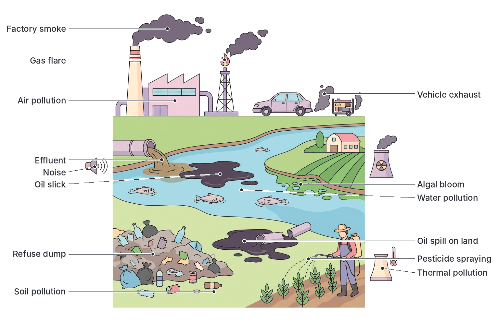
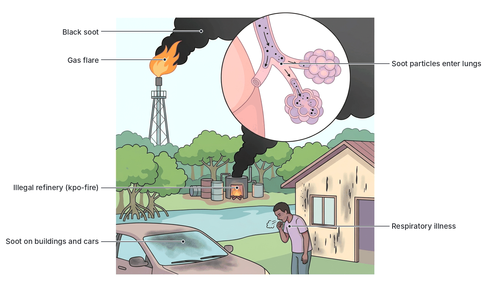
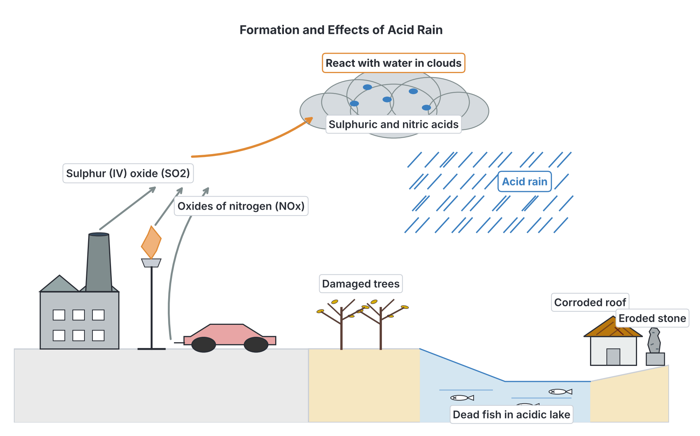
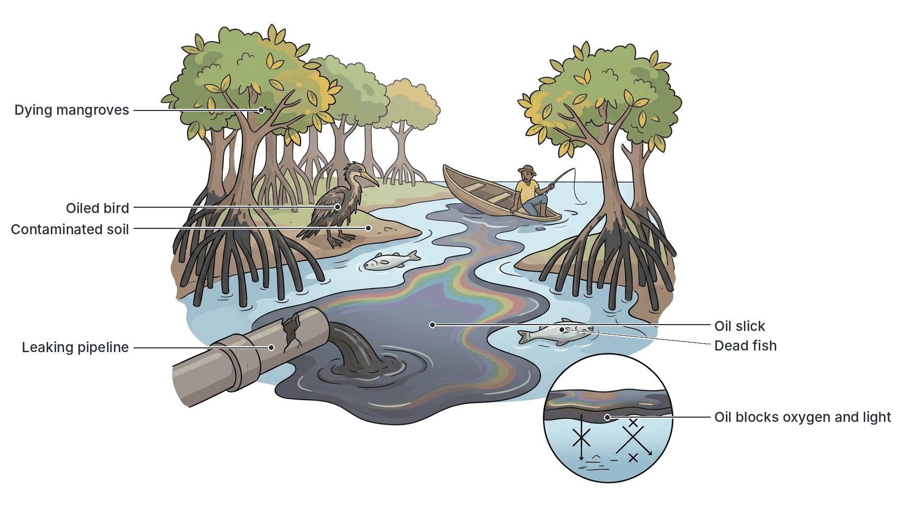
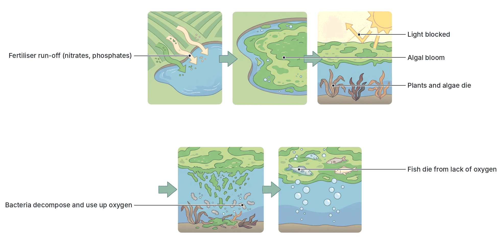
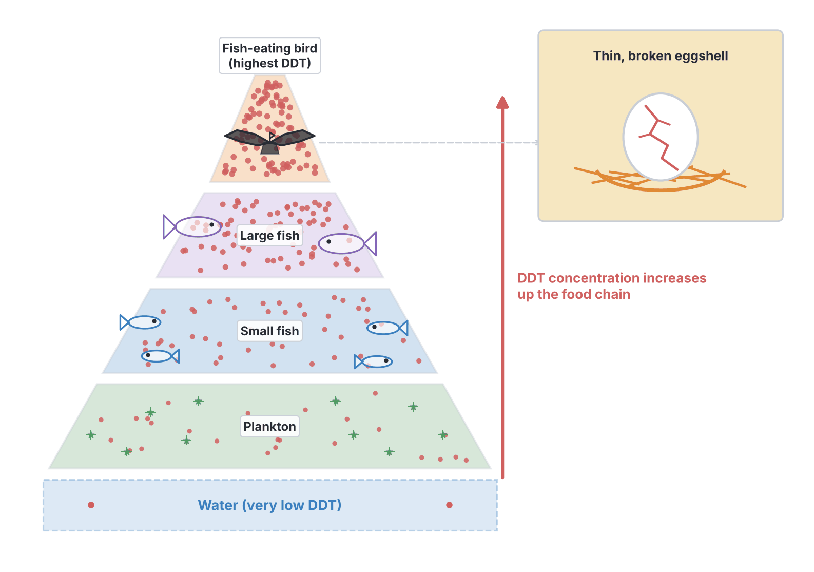
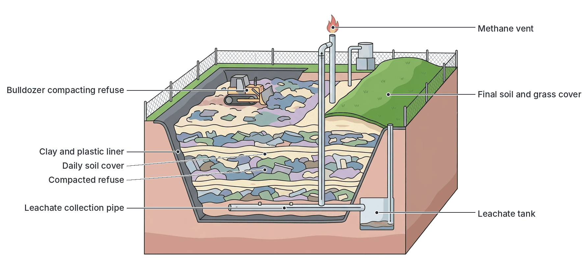
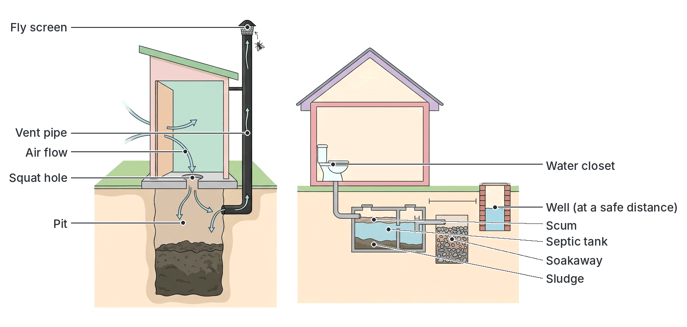
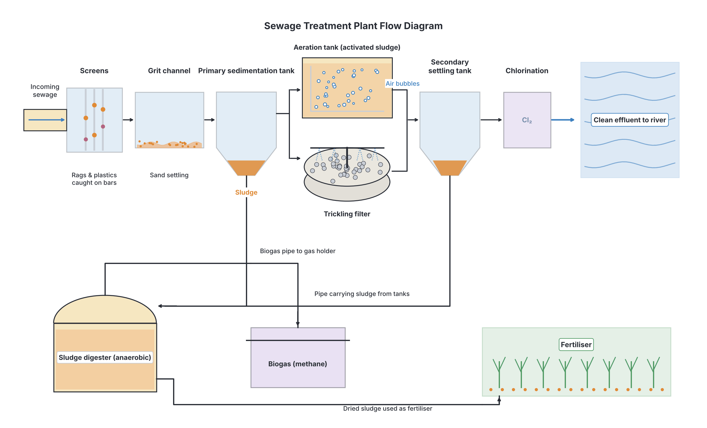

# JAMB Biology Notes: Humans and Environment – Pollution and Sanitation

## What JAMB expects

This topic is Section C, Topic 7 of the JAMB Biology syllabus: Ecology – Humans and Environment. Topic 7 is large, so it is split into four files:

- `C7a-diseases.md`: content item (a), diseases.
- `C7b-drug-abuse.md`: content item (b), drug abuse.
- `C7c-pollution-and-sanitation.md` (this file): content item (c), pollution and its control, and sanitation and sewage.
- `C7d-conservation-parks-and-reserves.md`: content items (d) conservation of natural resources and (e) game reserves and national parks.

This file covers content item (c), pollution and its control:

- (i) Sources, types, effects and methods of control.
- (ii) Sanitation and sewage.

By the end of these notes, you should be able to:

1. (Objective viii) Categorise pollution into air, water and soil pollution (and recognise noise, radioactive and thermal pollution).
2. (Objective ix) Relate the effects of common pollutants to human health and environmental degradation.
3. (Objective x) Determine the methods by which each pollutant may be controlled.
4. (Objective xi) Explain the importance of sanitation, with emphasis on solid waste, sewage disposal, community health and personal hygiene.

## What is pollution?

**Pollution** is the release into the environment (air, water or land) of **harmful substances or forms of energy** (such as heat, noise or radiation) in amounts that **damage living things**, human health, property or the natural balance of the environment.

A **pollutant** is any substance or form of energy that causes pollution. Examples: carbon monoxide, sulphur (IV) oxide, crude oil, sewage, pesticides, plastics, lead, noise and heat.

**Key ideas:**

- Many pollutants are natural substances (e.g. carbon (IV) oxide, nitrates, heat, dust) that become pollutants only when there is **too much** of them in the wrong place.
- **Biodegradable pollutants** can be broken down by decomposers (bacteria and fungi), e.g. sewage, food waste, paper and animal dung. They cause harm mainly when there is more than decomposers can handle.
- **Non-biodegradable pollutants** cannot be broken down (or only extremely slowly), e.g. plastics, glass, DDT and other persistent pesticides, and heavy metals such as lead and mercury. They **build up** in the environment and in food chains.
- **Sources** can be **point sources** (a single identifiable place, such as a factory pipe or a burst oil pipeline) or **non-point (diffuse) sources** (spread out, such as fertiliser washing off many farms or exhaust from many cars).

**Main human causes of pollution:**

1. **Industry**: factory smoke and effluents.
2. **Transport**: exhaust fumes from vehicles, ships and aircraft.
3. **Energy production**: burning fossil fuels (petrol, diesel, kerosene, coal, gas) in power stations and **generators**; **gas flaring** in oil fields.
4. **Oil exploration and production**: oil spills and gas flaring.
5. **Agriculture**: fertilisers, pesticides, animal wastes, bush burning.
6. **Domestic activities**: sewage, refuse, burning of waste, firewood and kerosene smoke in kitchens.
7. **Mining and quarrying**.
8. **Population growth and urbanisation**, which increase waste faster than it can be managed.

## Categories of pollution

**Objective viii: categorize pollution into air, water and soil.**

Pollution is categorised according to the part of the environment that is polluted.

| Category | What is polluted | Main pollutants | Main sources |
| --- | --- | --- | --- |
| **Air pollution** | The atmosphere | Carbon monoxide (CO), carbon (IV) oxide (CO₂), sulphur (IV) oxide (SO₂), oxides of nitrogen (NOx), smoke and soot (particulates), dust, lead compounds, chlorofluorocarbons (CFCs), methane, hydrocarbons | Vehicle exhausts, generators, factories, power stations, gas flaring, bush and refuse burning, illegal refining of crude oil, firewood and kerosene stoves, aerosol sprays, old refrigerators |
| **Water pollution** | Rivers, streams, lakes, lagoons, the sea and underground water | Sewage, crude oil, fertilisers (nitrates and phosphates), pesticides, industrial effluents, heavy metals (lead, mercury, cadmium), detergents, plastics, hot water, silt | Homes, factories, oil spills, farms, mining, abattoirs, dumping of refuse in water bodies, eroded soil |
| **Soil (land) pollution** | The soil and land surface | Solid wastes (refuse, plastics, metal cans, glass), crude oil, pesticides and herbicides, excess fertiliser, heavy metals, industrial wastes, electronic waste, acid rain deposits | Refuse dumps, oil spills, farming, mining, industries, scrap and e-waste yards |

**Other categories** (recognised by many textbooks):

| Category | What it is | Main sources |
| --- | --- | --- |
| **Noise pollution** | Unwanted, loud or prolonged sound that harms health or comfort | Electricity generators, vehicles and horns, aircraft, factories and machinery, loudspeakers at religious centres, parties and markets, music shops |
| **Radioactive (radiation) pollution** | Release of ionising radiation (alpha, beta and gamma radiation, and X-rays) | Nuclear accidents and weapons tests, nuclear waste, careless use of X-ray machines and radioactive materials in hospitals and industry, mining of radioactive ores; natural radon gas |
| **Thermal pollution** | Raising the temperature of water (or air) above normal by releasing heat | Hot water from power stations and factories (used as cooling water) poured into rivers; gas flares heating the surrounding area |

**Textbook variation:** some textbooks treat noise, radiation and thermal pollution as kinds of air or water pollution; others list them as separate categories. The syllabus asks you to categorise pollution into air, water and soil, so learn those three first.

## Effects of common pollutants on human health and the environment

**Objective ix: relate the effects of common pollutants to human health and environmental degradation.**

**Environmental degradation** means the deterioration of the environment: loss or damage of air, water, soil, vegetation, wildlife and ecosystems.

### Air pollutants

#### Carbon monoxide (CO)

- **Source:** **incomplete combustion** of fuels (petrol, diesel, kerosene, charcoal, firewood, gas) when there is not enough oxygen. Main sources: vehicle exhausts, **petrol and diesel generators**, charcoal stoves, cigarette smoke and fires.
- **Effect on health:** CO is a **colourless, odourless, tasteless** and very poisonous gas. It combines with **haemoglobin** in red blood cells to form **carboxyhaemoglobin**. Haemoglobin binds CO about **200 to 250 times more strongly** than oxygen, and the combination is very stable, so the blood carries much less oxygen. The body's tissues, especially the **brain and heart**, are starved of oxygen.
  - Mild poisoning: headache, dizziness, tiredness, nausea.
  - Severe poisoning: confusion, unconsciousness, and **death** by suffocation of the tissues. Survivors may have brain damage.
- **In Nigeria:** many people have died from **CO poisoning** after running **generators inside** houses, shops or closed rooms (or near open windows) while they slept. Because CO cannot be seen or smelled, victims do not realise they are being poisoned.
- **Environmental effect:** it contributes to smog formation; it is slowly converted to CO₂ in the air.

**Textbook variation:** figures for how much more strongly haemoglobin binds CO than O₂ vary between textbooks (often given as about 200, 210, 240 or 250 times). All agree it is very much stronger.

#### Carbon (IV) oxide (CO₂) and other greenhouse gases

- **Sources:** burning of fossil fuels and firewood, **gas flaring**, bush burning, **deforestation** (fewer trees to absorb CO₂, and burning or decaying trees release it). Methane comes from rice fields, cattle, refuse dumps and swamps.
- **Effect:** CO₂ is not poisonous at normal levels, but it is a **greenhouse gas**. Greenhouse gases (CO₂, methane, nitrous oxide, water vapour and CFCs) let sunlight through but trap some of the heat radiated by the Earth, like the glass of a greenhouse. More of these gases means more heat is trapped: **global warming** and **climate change**.
- **Effects of global warming:** rising temperatures; melting of ice caps and glaciers; **rising sea levels**, threatening low-lying coastal areas such as Lagos and the Niger Delta; more extreme weather (floods, droughts, heatwaves, storms); changes in rainfall that affect farming; spread of desert conditions in the Sahel; changes in the distribution of disease vectors; loss of species. (The carbon cycle and global warming are covered in Topic C2.)

#### Sulphur (IV) oxide (SO₂)

- **Source:** burning fuels that contain **sulphur** (coal, diesel, heavy fuel oil, and some crude oil), smelting of metal ores, some industrial processes and gas flaring; also volcanoes (natural).
- **Effect on health:** irritates the eyes, nose, throat and lungs; causes coughing, **bronchitis** and breathing difficulty; worsens **asthma**.
- **Environmental effects:** dissolves in rainwater to form **acid rain** (see below); damages leaves (causing yellowing and death of leaf tissue), and harms **lichens**, which are very sensitive to SO₂ and are used as **indicators** of air pollution (few or no lichens grow on trees in polluted areas).

#### Oxides of nitrogen (NOx: nitrogen (II) oxide and nitrogen (IV) oxide)

- **Source:** the high temperatures inside **vehicle engines**, generators, power stations and furnaces make nitrogen and oxygen in the air combine; also lightning (natural).
- **Effect on health:** irritate the lungs and eyes; cause and worsen **asthma** and bronchitis; reduce resistance to lung infections.
- **Environmental effects:** form **acid rain** (nitric acid); together with hydrocarbons in sunlight, they form **photochemical smog** and ground-level **ozone**, which damage lungs and crops.

#### Smoke, soot and particulates (including the Port Harcourt soot)

- **What they are:** tiny solid particles and droplets in the air: **soot** (unburnt carbon), ash, dust and smoke. The smallest particles (fine particulate matter) are the most dangerous because they penetrate deep into the lungs and even into the blood.
- **Sources:** incomplete burning of fuels in vehicles, generators and factories; **gas flaring**; burning of refuse and **bush burning**; firewood and charcoal cooking fires; **illegal crude oil refining**; quarrying, cement factories and construction; and the natural dust of the **harmattan**.
- **Effects on health:** coughing, **respiratory diseases** (bronchitis, asthma, pneumonia), reduced lung function, **heart disease**, lung cancer, and eye irritation. Smoke from **firewood and kerosene in poorly ventilated kitchens** (household air pollution) is a major cause of lung disease in women and children in Nigeria.
- **Environmental effects:** soot blackens buildings, clothes and leaves; settles on leaves, blocking **stomata** and reducing light for **photosynthesis**; reduces visibility; contaminates water and soil.
- **The Port Harcourt soot:** from about **late 2016**, residents of **Port Harcourt** and other parts of **Rivers State** noticed thick **black soot** settling on floors, cars, clothes and even in their nostrils and sputum. Investigations linked it mainly to the **burning of crude oil** in **illegal (artisanal) refineries** ("kpo-fire"), the burning of seized illegal refineries and stolen oil, together with **gas flaring** and other industrial and vehicle emissions. Health workers reported increases in breathing problems. It became one of the best-known air pollution problems in Nigeria and led to public protests and government task forces.

**Gas flaring:** in the Niger Delta, natural gas that comes up with crude oil has for decades been **burned off** (flared) in huge open flames, instead of being used. Gas flares release CO₂, methane (from incomplete burning), soot, SO₂, NOx and other pollutants, as well as **heat, light and noise**. Nearby communities complain of acid rain, damage to crops, respiratory illness, and constant light and heat. Nigeria has long been among the countries that flare the most gas in the world, and the government has repeatedly set deadlines and programmes to end routine flaring and capture the gas for use.

#### Lead

- **Sources:** formerly **leaded petrol** (lead compounds were added to petrol to improve engine performance; exhaust fumes spread lead into the air, soil and roadside crops); old **lead-based paints**; **recycling of lead-acid batteries** (car and inverter batteries) by unsafe methods; lead mining and the **processing of lead-rich ores**; some cosmetics (e.g. some types of eye powder) and old water pipes; lead-glazed pottery.
- **Effects on health:** lead is a **cumulative poison**: it builds up in the body (in bones, blood and organs). It damages the **brain and nervous system**, especially in **children**, causing **reduced intelligence**, learning and behaviour problems, convulsions, coma and death in high doses. It also causes **anaemia** (it interferes with haemoglobin production), kidney damage, high blood pressure, and harms the unborn baby. There is no known safe level of lead in the blood.
- **Environmental effects:** contaminates soil, water and plants, entering food chains; harms animals.
- **Leaded petrol:** Nigeria stopped using leaded petrol in the early 2000s, and by **2021** leaded petrol for cars had been phased out worldwide, a major success of the United Nations Environment Programme's campaign.
- **The Zamfara lead poisoning outbreak (2010):** in **2010**, a mass **lead poisoning** outbreak was discovered in villages of **Zamfara State**, in north-western Nigeria. Villagers had been **processing gold ore** that was very rich in lead, crushing and grinding it **inside their homes and compounds** to extract gold. The lead dust contaminated homes, soil, water and food. Hundreds of **young children died** (estimates exceed **400**), and many more suffered brain damage, blindness and other disabilities. It was one of the worst lead poisoning outbreaks ever recorded. The response, by Nigerian authorities, Médecins Sans Frontières (Doctors Without Borders), the US Centers for Disease Control and Prevention and others, involved **removing contaminated soil** from villages, **treating children** with drugs that remove lead from the body (chelation therapy), and teaching safer mining practices. Later outbreaks linked to lead in mining areas were also reported in other states, such as Niger State.

#### Chlorofluorocarbons (CFCs) and the ozone layer

- **What they are:** CFCs are man-made gases containing **chlorine, fluorine and carbon**. They were widely used as **coolants (refrigerants)** in refrigerators and air conditioners, as **propellants** in aerosol spray cans, in making foam plastics, and as cleaning solvents.
- **The ozone layer:** **ozone (O₃)** is a form of oxygen. A layer of ozone in the **stratosphere** (roughly 15 to 35 km above the Earth) **absorbs most of the harmful ultraviolet (UV) radiation** from the sun, protecting living things.
- **How CFCs destroy ozone:**
  1. CFCs are very stable, so they drift up slowly into the stratosphere without breaking down.
  2. There, strong UV radiation breaks them, releasing **chlorine atoms**.
  3. Each chlorine atom reacts with ozone, breaking it into oxygen; the chlorine is released again and can destroy many thousands of ozone molecules (a chain reaction).
  4. The ozone layer becomes **thinner**. A large "**ozone hole**" appears each spring over **Antarctica**.
- **Effects of ozone depletion:** more UV radiation reaches the Earth's surface, causing:
  - **Skin cancer** and sunburn;
  - **Cataracts** (clouding of the lens of the eye) and other eye damage;
  - **Weakened immune system**;
  - Damage to **crops** and other plants, reducing yields;
  - Damage to **plankton** in the sea, the base of marine food chains.
- CFCs are also powerful **greenhouse gases**.
- **Control:** the **Montreal Protocol** (1987), an international treaty, phased out the production of CFCs and other ozone-destroying substances. It is considered one of the most successful environmental agreements, and the ozone layer is slowly recovering. Nigeria is a party to it.

[IMAGE: A diagram of the Earth with the atmosphere shown as layers. A thin pale blue band labelled as the ozone layer in the stratosphere. On the left, sunlight arrows with ultraviolet rays are mostly absorbed by a thick part of the ozone layer. On the right, the ozone layer is thinner with a gap (ozone hole), and UV arrows pass through to reach a person, a plant and the sea. Small icons show an old refrigerator and an aerosol can releasing CFC molecules that drift upward, and a magnified inset showing a chlorine atom breaking an ozone molecule (O3) into oxygen (O2). Labels: "Sun", "Ultraviolet radiation", "Ozone layer (stratosphere)", "Ozone hole", "CFCs from refrigerators and aerosols", "Chlorine atom", "Ozone (O3)", "Oxygen (O2)", "Skin cancer", "Cataract", "Crop damage". Clean flat textbook style, white background.]

#### Acid rain

- **How it forms:**
  1. Burning fossil fuels releases **sulphur (IV) oxide** and **oxides of nitrogen** into the air.
  2. These gases react with **water** and oxygen in the clouds.
  3. They form **sulphuric acid** and **nitric acid**.
  4. These fall as **acid rain** (or acid snow, fog or dry acid particles). Normal rain is slightly acidic (about pH 5.6, from dissolved CO₂); acid rain has a lower pH (often 4 to 5, sometimes lower). Winds can carry the gases hundreds of kilometres, so acid rain may fall far from the source.
- **Effects:**
  1. **Lakes and rivers:** water becomes acidic; fish eggs and young fish die; aluminium is released from the soil into the water, poisoning fish (it damages their gills); whole lakes can become lifeless.
  2. **Forests and crops:** damages leaves and roots; leaches nutrients (calcium, magnesium) from the soil and releases poisonous aluminium, so trees weaken and die.
  3. **Soil:** becomes acidic and less fertile (see `C6-soil.md`).
  4. **Buildings and metals:** corrodes **zinc and iron roofing sheets**, metal structures and vehicles, and dissolves limestone and marble buildings and statues. In parts of the Niger Delta near gas flares, people complain of rapid rusting of roofing sheets.
  5. **Human health:** the gases and acid particles irritate the lungs; acidic water can dissolve metals such as lead and copper from pipes into drinking water.

### Water pollutants

#### Oil spills (the Niger Delta and Ogoniland)

- **Sources:** leaks from old and poorly maintained **pipelines**, flow stations and well-heads; **sabotage** of pipelines and **oil theft** ("bunkering"); spills from **illegal refineries**; tanker accidents and the cleaning of ship tanks at sea; blow-outs of oil wells. The **Niger Delta** of southern Nigeria (Rivers, Bayelsa, Delta and other states), where most of Nigeria's oil is produced, has suffered thousands of oil spills over several decades.
- **Effects on the environment:**
  1. Oil **floats** on water as a thin film (**oil slick**), which **cuts off oxygen** from the air and **blocks light**, killing plankton and water plants (so photosynthesis and oxygen supply fall).
  2. Oil **coats the gills** of fish and the bodies of other aquatic animals, suffocating them; fish and shellfish (periwinkles, crabs, oysters) die or become contaminated and unfit to eat.
  3. Oil **coats the feathers of seabirds** and waterbirds, so they lose their waterproofing and insulation, cannot fly or float, become cold and die; they also swallow oil while cleaning themselves.
  4. **Mangrove forests** are killed, because oil coats their breathing roots (pneumatophores) and stilt roots. Mangroves are breeding grounds for many fish and protect the coast from erosion.
  5. Oil **soaks into the soil** of farmland and swamps, killing crops and soil organisms and making the land infertile for many years.
  6. Oil can catch fire, causing explosions and fires.
  7. It contaminates **groundwater** and drinking-water wells.
- **Effects on people:** loss of **fishing and farming livelihoods**, causing poverty and conflict; drinking contaminated water and eating contaminated fish exposes people to poisonous hydrocarbons such as **benzene** (which can cause cancer); skin and eye irritation, breathing problems; destruction of community life.
- **Ogoniland:** Ogoniland is an area of **Rivers State** in the Niger Delta, home of the Ogoni people. In **2011**, the **United Nations Environment Programme (UNEP)** published a major scientific report, the *Environmental Assessment of Ogoniland*. It found widespread and severe **oil contamination** of soils, swamps, creeks, mangroves and groundwater, the result of decades of spills. In some communities, drinking water from wells was contaminated with **benzene** at levels far above WHO guidelines. UNEP said that full clean-up could take **25 to 30 years**. In response, the Federal Government set up the **Hydrocarbon Pollution Remediation Project (HYPREP)** to carry out the clean-up, which formally began in 2016 and is still in progress.

#### Sewage

- **What it is:** waste water from toilets, kitchens and bathrooms, containing **faeces, urine**, food waste, soap and detergents. In many Nigerian towns, sewage flows into open drains, streams and lagoons, or from overflowing septic tanks and pit latrines; **open defecation** also pollutes water.
- **Effects on health:** raw sewage contains **pathogens**, so drinking or bathing in sewage-polluted water spreads **cholera, typhoid fever, dysentery, diarrhoea, hepatitis A, polio** and worm infections (see `C7a-diseases.md`).
- **Effects on the environment:**
  1. **Oxygen depletion:** sewage is food for decomposing **aerobic bacteria**. As they multiply and break down the sewage, they use up the **dissolved oxygen** in the water. The amount of oxygen used by microorganisms to break down the organic matter in a water sample is called its **biochemical oxygen demand (BOD)**. Sewage-polluted water has a **high BOD**.
  2. Fish and other animals that need plenty of oxygen **suffocate and die**; only pollution-tolerant organisms (such as sludge worms, *Tubifex*, and rat-tailed maggots) survive. These organisms can be used as **indicators** of pollution.
  3. Nutrients (nitrates and phosphates) in sewage cause **eutrophication**.
  4. Bad smells (hydrogen sulphide from anaerobic decay), unpleasant appearance, and breeding of flies and mosquitoes.

#### Fertilisers and eutrophication

- **Source:** excess **nitrate and phosphate fertilisers** washed (leached or carried in run-off) from farms into rivers, lakes and lagoons; also **phosphates from detergents**, and nutrients from sewage and animal wastes.
- **Eutrophication** is the over-enrichment of a water body with nutrients, leading to excessive growth of algae and plants and loss of oxygen. It happens step by step:
  1. Nitrates and phosphates enter the water.
  2. They act as fertilisers for **algae** and water plants, which grow and multiply rapidly, forming a thick green layer on the surface (an **algal bloom**). Floating weeds such as **water hyacinth** can also spread rapidly (as in parts of the Lagos lagoon and some rivers).
  3. The algal bloom **blocks sunlight** from reaching plants lower down, which die.
  4. The algae themselves have short lives and soon **die** in large numbers.
  5. **Decomposing bacteria** feed on the dead plants and algae and multiply greatly.
  6. The bacteria use up the **dissolved oxygen** in the water (high BOD).
  7. **Fish and other aerobic animals die** from lack of oxygen.
  8. The water becomes smelly, lifeless and unfit for use; some algal blooms also produce **toxins** harmful to animals and people.
- **Effects on health:** high **nitrate** levels in drinking water are dangerous for babies (they can reduce the blood's ability to carry oxygen, causing "blue baby syndrome"); algal toxins can poison people and livestock.

#### Pesticides, DDT and biomagnification

- **What they are:** **pesticides** are chemicals used to kill pests: **insecticides** (insects), **herbicides** (weeds), **fungicides** (fungi), and **rodenticides** (rats). They are used on farms, in homes, in food stores and against vectors such as mosquitoes.
- **DDT** (dichlorodiphenyltrichloroethane) is a powerful insecticide that was used widely from the 1940s against mosquitoes and crop pests. It is **non-biodegradable** (persistent) and **fat-soluble**, so it stays in the environment for many years and is stored in the **fatty tissues** of animals rather than excreted.
- **Biomagnification (biological magnification, bioaccumulation along the food chain):** the **increase in the concentration** of a persistent pollutant at **each higher trophic level** of a food chain. It happens like this:
  1. A small amount of DDT gets into water or soil (e.g. by spraying or run-off).
  2. **Producers** and tiny organisms (plankton) absorb it; the concentration in them is low.
  3. **Primary consumers** (small fish, insects) eat **large numbers** of these organisms. The DDT from all of them is stored in their fat and **not excreted**, so its concentration in them becomes higher.
  4. **Secondary consumers** (larger fish) eat many small fish, concentrating the DDT further.
  5. **Top predators** (fish-eating birds such as eagles, ospreys and pelicans, and humans) eat many large fish and receive the **highest concentration**, which may be hundreds or thousands of times higher than in the water.
- **Example (illustrative figures):**

| Level in the food chain | DDT concentration (parts per million, ppm) |
| --- | --- |
| Water | 0.00005 |
| Plankton | 0.04 |
| Small fish | 0.5 |
| Large fish | 2 |
| Fish-eating bird | 25 |

(These figures are for illustration only, to show the pattern. They are similar in pattern to values recorded in studies of DDT in an estuary in the USA in the 1960s.)

- **Effects:**
  - **Birds of prey:** DDT (and its breakdown product DDE) made the **eggshells of birds of prey thin**, so eggs broke during incubation; populations of eagles, falcons and pelicans crashed in the 1950s–1970s. This was made famous by **Rachel Carson's** book *Silent Spring* (1962).
  - **Humans:** pesticides can cause poisoning (headache, vomiting, breathing problems, fits and death) in farmers who handle them without protection and in people who eat contaminated food; some are linked to cancers, damage to nerves and the liver, and effects on reproduction. Misuse of pesticides to preserve stored grains and beans, or to catch fish, is dangerous and has caused poisonings in Nigeria.
  - **Environment:** pesticides kill **non-target organisms** such as bees (pollinators), fish, birds, earthworms and the natural enemies of pests; pests can become **resistant**; contamination of water and soil.
- **Current status of DDT:** DDT was banned for agricultural use in most countries from the 1970s onwards, and its use is controlled under the **Stockholm Convention on Persistent Organic Pollutants** (2001). WHO still allows its limited use for **indoor residual spraying against malaria mosquitoes** in some countries where there is no suitable alternative.

#### Industrial effluents and heavy metals

- **Effluents** are liquid wastes from factories (textiles and dyeing, tanneries, breweries, food processing, paint, chemicals, metal works), abattoirs, hospitals and mines. They may contain acids, alkalis, dyes, oils, organic matter and **heavy metals** such as **lead, mercury, cadmium, chromium and arsenic**.
- **Effects:**
  - Heavy metals are **non-biodegradable** and **cumulative**; they build up in the bodies of organisms and are biomagnified along food chains.
  - **Mercury:** damages the brain and nervous system and harms unborn babies. The disaster at **Minamata**, Japan, in the 1950s, where a factory released mercury into the sea and people who ate contaminated fish suffered severe nerve damage and death ("Minamata disease"), is a famous example. Mercury is also used in small-scale gold mining.
  - **Cadmium:** damages the kidneys and bones.
  - **Lead:** see above.
  - Effluents can change the **pH** and **temperature** of water, add organic matter (raising BOD), colour the water and block light, and kill aquatic life.
  - Abattoir wastes (blood, dung and offal) dumped into rivers raise BOD and spread disease.

#### Plastics

- **Sources:** plastic bags ("nylon" bags), **sachet water ("pure water") bags**, bottles, food packs (such as foam take-away packs), and other plastic packaging, thrown away carelessly. Nigeria generates very large amounts of plastic waste, and much of it ends up in drains, rivers, lagoons and the sea.
- **Effects:**
  1. **Non-biodegradable**: plastics last for hundreds of years.
  2. **Block drains and gutters**, causing **flooding** in cities such as Lagos, Port Harcourt and Ibadan during heavy rain; blocked drains also hold stagnant water where **mosquitoes breed**.
  3. Animals (cattle, goats, fish, turtles, seabirds) **swallow** plastic bags, which block their guts and kill them, or get **entangled** in them.
  4. Plastics break down into tiny pieces (**microplastics**), which are found in water, soil, fish, salt and drinking water; their full effects on health are still being studied.
  5. **Burning** plastics releases poisonous gases (including dioxins) and black smoke.
  6. Plastics on farmland stop water and roots from penetrating, and they spoil the appearance of the environment.
- **Control:** reduce use (reusable bags and containers), **reuse**, **recycle** (plastic recycling businesses, buy-back schemes), proper collection and disposal, bans on single-use plastics (some countries and some Nigerian states, such as Lagos, have announced bans on certain single-use plastics such as foam food packs), and use of biodegradable alternatives.

#### Thermal pollution

- **Source:** hot water released from power stations and factories into rivers and lakes.
- **Effects:** warm water **holds less dissolved oxygen**, while it also **speeds up** the metabolism of aquatic animals (so they need more oxygen); fish may die or move away; eggs fail to hatch; algal blooms increase.

#### Silt (sediment)

- **Source:** soil eroded from bare farmland, construction sites, mining and deforested slopes (see `C6-soil.md`).
- **Effects:** makes water **turbid** (cloudy), reducing light for photosynthesis; smothers fish eggs and bottom-dwelling animals; fills up rivers, dams and reservoirs, increasing flooding.

### Soil (land) pollutants

Many pollutants already described also pollute soil:

| Pollutant | Effects on the soil and land |
| --- | --- |
| **Crude oil** | Coats soil particles, blocks soil air, kills soil organisms and crops; land becomes infertile for years |
| **Solid wastes (refuse, plastics, cans, glass)** | Ugly; block drains; breed flies, rats and mosquitoes; spread disease; harmful liquid (**leachate**) from dumps seeps into soil and groundwater; methane and fires at dumps |
| **Pesticides and herbicides** | Kill earthworms and other beneficial soil organisms; persist and enter food chains |
| **Excess fertilisers** | Make soil acidic or salty; leach into water (eutrophication) |
| **Heavy metals** (lead, mercury, cadmium) | Poison soil organisms, crops and people (e.g. Zamfara 2010) |
| **Electronic waste (e-waste)** | Old phones, computers and televisions dumped or burned (e.g. at some scrap markets) release lead, mercury, cadmium and other toxic substances |
| **Acid rain** | Acidifies soil, leaches nutrients |
| **Industrial and hospital wastes** | Chemicals and infectious materials contaminate land |

### Noise pollution

- **Sources:** **generators** (very common in Nigerian homes, offices and shops because of unreliable electricity), heavy traffic and horns, aircraft, factories and machines, **loudspeakers** at churches, mosques, parties and shops, markets and motor parks, construction.
- **Effects on health:**
  1. **Hearing loss**: temporary at first, then **permanent deafness** with long exposure to loud noise (for example, among generator operators, factory workers and people who listen to very loud music through earphones).
  2. **Stress**, irritability, headaches and anxiety.
  3. **Sleep disturbance**, leading to tiredness and poor concentration.
  4. **High blood pressure** and heart disease with long exposure.
  5. Poor learning in schools near noisy roads or airports; communication problems; accidents when warning signals cannot be heard.
- **Effects on animals:** disturb communication, breeding and feeding; drive animals away from their habitats.

### Radioactive pollution

- **Sources:** nuclear power station accidents (for example **Chernobyl**, Ukraine, in 1986, and **Fukushima**, Japan, in 2011), nuclear weapons tests, poor disposal of radioactive waste, careless use of radioactive materials and X-rays in hospitals and industry, mining of radioactive minerals, and natural **radon** gas from some rocks.
- **Effects:** ionising radiation damages cells and their **DNA**, causing **radiation sickness** (nausea, burns, hair loss, damage to the bone marrow and death in high doses), **cancers** (especially leukaemia and thyroid cancer), **mutations** that may be passed to offspring, birth defects and infertility. Radioactive substances can persist for very long periods and enter food chains.

### Summary of pollutants and their effects

| Pollutant | Main effect on human health | Main effect on the environment |
| --- | --- | --- |
| Carbon monoxide | Combines with haemoglobin; headache, unconsciousness, death | Contributes to smog |
| Carbon (IV) oxide | Not directly harmful at normal levels | Greenhouse effect, global warming, climate change |
| Sulphur (IV) oxide | Irritates lungs; bronchitis, asthma | Acid rain; kills lichens; damages leaves |
| Oxides of nitrogen | Irritate lungs; asthma | Acid rain; photochemical smog |
| Smoke and soot | Respiratory and heart disease; lung cancer | Blackens buildings; blocks stomata; reduces photosynthesis |
| Lead | Brain damage (especially children), anaemia, kidney damage, death | Contaminates soil, water and food chains |
| CFCs | Indirectly: skin cancer, cataracts, weak immunity (via ozone loss) | Destroy ozone layer; greenhouse gas |
| Acid rain | Lung irritation; metals dissolved into water | Kills fish and trees; acidifies soil; corrodes roofs and buildings |
| Crude oil | Contaminated water and food; benzene exposure; loss of livelihoods | Kills fish, birds, mangroves and soil organisms; infertile land |
| Sewage | Cholera, typhoid, dysentery and other water-borne diseases | High BOD; oxygen depletion; fish death; eutrophication |
| Fertilisers | Nitrate poisoning of babies; algal toxins | Eutrophication; algal blooms; fish death |
| Pesticides (e.g. DDT) | Poisoning; possible cancers and nerve damage | Kill non-target organisms; biomagnification; thin eggshells |
| Heavy metals | Nerve, kidney and brain damage (e.g. Minamata, Zamfara) | Accumulate in food chains |
| Plastics | Microplastics; toxic smoke when burned | Block drains (floods); kill animals; persist for centuries |
| Noise | Hearing loss, stress, sleeplessness, high blood pressure | Disturbs wildlife |
| Radiation | Cancer, mutations, radiation sickness | Long-lasting contamination |
| Heat (thermal) | — | Reduces dissolved oxygen; kills fish |

## Controlling pollution

**Objective x: determine the methods by which each pollutant may be controlled.**

### General principles of pollution control

1. **Prevention at source:** stop or reduce the pollutant where it is produced (cleaner technology, cleaner fuels).
2. **Reduce, reuse and recycle** waste.
3. **Treatment** of wastes before release (sewage treatment, effluent treatment, filters on chimneys).
4. **Safe disposal** of wastes that cannot be avoided.
5. **Laws and regulations** with standards for each pollutant, monitoring and enforcement, and penalties ("**polluter pays**" principle).
6. **Environmental impact assessment (EIA)** before new projects are approved.
7. **Public education** and community participation.
8. **International agreements** for pollutants that cross borders (e.g. the Montreal Protocol on CFCs, the Paris Agreement on climate change, the Stockholm Convention on persistent pollutants).

### Control methods for each pollutant

| Pollutant | Methods of control |
| --- | --- |
| **Carbon monoxide** | Regular servicing of engines and generators for complete combustion; **catalytic converters** in vehicle exhausts (convert CO to CO₂); **never run generators indoors** or near windows and doors; good ventilation of rooms with stoves; carbon monoxide alarms; use of cleaner energy (grid electricity, solar) |
| **Carbon (IV) oxide and greenhouse gases** | Reduce burning of fossil fuels; use **renewable energy** (solar, wind, hydroelectric power); energy efficiency; **end gas flaring** and use the gas; **afforestation and reforestation** (trees absorb CO₂); stop deforestation and bush burning; capture methane from dumps; international agreements (Paris Agreement) |
| **Sulphur (IV) oxide** | Use low-sulphur fuels; remove sulphur from fuels before use; **scrubbers** in factory chimneys (spray lime or limestone to absorb SO₂); use of renewable energy |
| **Oxides of nitrogen** | **Catalytic converters** in vehicles; better engine design; reduce vehicle use (public transport, cycling, walking); good traffic management |
| **Smoke, soot and particulates** | **Filters and electrostatic precipitators** in chimneys; tall chimneys (spread the smoke but do not remove it); servicing vehicles and generators; banning open burning of refuse and **bush burning**; ending gas flaring; **stopping illegal refining** of crude oil and destroying seized products safely; clean cooking stoves and cooking gas (LPG) instead of firewood and kerosene; good kitchen ventilation; wearing **nose masks** in dusty or smoky conditions; planting trees and grass to reduce dust |
| **Lead** | **Unleaded petrol** (now used worldwide); lead-free paints; safe, licensed recycling of lead-acid batteries; safe mining and ore-processing practices away from homes; removal of contaminated soil (as in Zamfara); medical treatment (chelation) of poisoned people; washing hands and keeping children away from mining and battery sites |
| **CFCs** | **Montreal Protocol**: phase-out of CFCs; use of ozone-friendly coolants and propellants; safe collection and destruction of CFCs from old refrigerators and air conditioners |
| **Acid rain** | Control of SO₂ and NOx at source (as above); **liming** of acid lakes and soils to neutralise acidity; use of renewable energy |
| **Crude oil** | Regular maintenance and replacement of old pipelines; surveillance against pipeline vandalism and oil theft; quick response to spills: **booms** (floating barriers) to contain the oil, **skimmers** to collect it, absorbent materials (e.g. straw, sawdust), **dispersants**, controlled burning; **bioremediation** (using oil-eating bacteria to break down the oil); removal and treatment of contaminated soil; replanting mangroves; enforcement of laws and compensation by polluters (e.g. HYPREP clean-up of Ogoniland) |
| **Sewage** | **Treatment of sewage** before release (see sewage treatment below); proper toilets, septic tanks and soakaways; ending **open defecation**; proper siting of pit latrines away from wells; regular emptying of septic tanks; never discharging raw sewage into rivers and lagoons |
| **Fertilisers** | Apply the **correct amount** at the right time; use organic manure; avoid applying before heavy rain; leave buffer strips of vegetation along rivers; prevent erosion; use phosphate-free detergents; remove excess water weeds (e.g. water hyacinth) mechanically |
| **Pesticides (DDT etc.)** | Ban persistent pesticides (e.g. DDT for farming); use **biodegradable**, less harmful pesticides; use only approved pesticides in the correct dose; **integrated pest management** (combining biological control, crop rotation, resistant varieties and minimal chemicals); **biological control** (natural enemies of pests); wear **protective clothing**; safe storage and disposal of containers; never use pesticides to preserve food or catch fish |
| **Industrial effluents and heavy metals** | Treat effluents before discharge (neutralisation, removal of metals and oils); recycle water in factories; enforce effluent standards (NESREA); locate factories away from water sources and homes; regular monitoring |
| **Plastics** | Reduce, reuse, **recycle**; bans on some single-use plastics; deposit-refund and buy-back schemes; regular refuse collection; clean drains; use of biodegradable packaging; public education |
| **Solid waste** | Proper waste management (see sanitation below) |
| **Noise** | Laws limiting noise levels and hours; silencers on generators and vehicles; placing generators away from homes or in soundproof housing; reliable grid or solar electricity (fewer generators); **ear protectors** for workers; airports and factories sited away from homes; trees as sound barriers; moderate volume of music and loudspeakers |
| **Radiation** | Strict safety rules for nuclear and X-ray facilities; **lead shielding**; protective clothing; limiting exposure time; safe storage and disposal of radioactive waste; monitoring by regulatory bodies (in Nigeria, the Nigerian Nuclear Regulatory Authority) |
| **Thermal pollution** | Cool hot water in **cooling towers** or ponds before release; reuse the heat |
| **Silt** | Soil conservation (afforestation, cover crops, terracing; see `C6-soil.md`); controlling erosion at construction and mining sites |

### Agencies that control pollution in Nigeria

| Agency | Role |
| --- | --- |
| **Federal Ministry of Environment** | Makes national environmental policy; coordinates pollution control, waste management, climate change, desertification and conservation programmes (see `C7d-conservation-parks-and-reserves.md`) |
| **National Environmental Standards and Regulations Enforcement Agency (NESREA)** | Set up in **2007** (replacing functions of the former Federal Environmental Protection Agency, FEPA, which had been set up in 1988 after toxic waste was dumped at **Koko**, in present-day Delta State); sets and **enforces environmental standards** and regulations on air, water, noise, chemicals and waste (except the oil and gas sector) |
| **National Oil Spill Detection and Response Agency (NOSDRA)** | Detects, monitors and responds to **oil spills** |
| **State environmental protection agencies and waste management authorities** | Monitor pollution, collect and dispose of refuse, enforce sanitation laws (e.g. the Lagos State Environmental Protection Agency and the Lagos Waste Management Authority) |
| **Hydrocarbon Pollution Remediation Project (HYPREP)** | Clean-up of oil pollution in Ogoniland |

## Sanitation

**Objective xi: explain the importance of sanitation with emphasis on solid waste, sewage disposal, community health and personal hygiene.**

**Sanitation** means all the measures taken to keep the environment **clean** and to protect people from disease, especially by the safe collection and disposal of **human excreta (faeces and urine)**, **sewage (waste water)** and **solid waste (refuse)**, the provision of **safe water**, and good **hygiene**.

**Why sanitation is important:**

1. **Prevents disease**: most water-borne and filth-borne diseases (cholera, typhoid, dysentery, diarrhoea, polio, hepatitis A, worm infections) are spread from faeces to mouth. Safe sanitation breaks this chain.
2. **Controls vectors and pests**: removes breeding places of **houseflies**, **mosquitoes**, **cockroaches** and **rats** (which spread Lassa fever).
3. **Prevents pollution** of water, soil and air.
4. **Prevents flooding**: clean drains let rainwater flow away.
5. **Improves the appearance** of the environment and removes bad smells.
6. **Protects dignity and safety**, especially of women and girls who would otherwise have to go outside to defecate.
7. **Improves productivity and the economy**: fewer sick days for workers and students; reduced cost of health care; tourism and investment.
8. **Recovers resources**: compost, biogas and recycled materials can be made from waste.

### Solid waste (refuse)

**Solid waste** is any unwanted solid material thrown away: food remains, paper, plastics, metal cans, glass, rags, ashes, garden waste, building rubble, animal dung, and industrial, hospital and electronic waste.

**Types of solid waste:**

| Type | Examples |
| --- | --- |
| **Biodegradable (organic)** | Food remains, vegetable and fruit peels, leaves, paper, animal dung, dead animals |
| **Non-biodegradable** | Plastics, metal cans, glass, rubber, old tyres |
| **Hazardous** | Used batteries, chemicals, paint, pesticide containers, hospital waste (used needles, dressings), electronic waste |

**Dangers of poor solid waste disposal:**

1. Refuse heaps are breeding places for **houseflies, mosquitoes** (water collects in cans, tyres and bottles), **cockroaches and rats**, which spread disease.
2. Bad **smells** and ugly surroundings.
3. **Blocked drains** and **flooding**.
4. **Leachate** (polluted liquid) from dumps contaminates groundwater and wells.
5. Open **burning** of refuse causes air pollution and fires; dumps release methane.
6. Injuries from sharp objects (glass, needles, cans).
7. Pollution of rivers and lagoons when refuse is dumped in them.

**Methods of solid waste disposal:**

| Method | How it is done | Advantages | Disadvantages |
| --- | --- | --- | --- |
| **Open dumping** | Refuse is thrown on open land, roadsides, gutters or water bodies | Cheap and easy | **Unhygienic**: breeds flies, rats and mosquitoes; smells; pollutes water; causes floods; **should be avoided** |
| **Sanitary landfill** | Refuse is spread in layers in a lined pit or low-lying site, **compacted** and **covered with soil** every day; leachate and methane are collected | Hygienic if well managed; reclaims low land; methane can be used as fuel | Needs large land area; leachate can pollute groundwater if not lined; methane risk. (The Olusosun site in Lagos is one of the largest waste disposal sites in Africa; many Nigerian "landfills" are really open dumps) |
| **Burial (controlled tipping)** | Small amounts buried in a pit and covered with soil | Simple; suitable for homes and schools | Not for large amounts; may pollute groundwater |
| **Incineration (burning)** | Refuse burnt at very high temperatures in a special furnace (incinerator) | Greatly reduces volume; destroys pathogens (used for **hospital waste**); heat can produce electricity | Expensive; produces smoke and toxic gases unless filtered; ash must be disposed of |
| **Composting** | Biodegradable waste is piled in heaps or pits and decomposed by bacteria and fungi into **compost** (manure) | Recycles nutrients; produces useful fertiliser; reduces waste | Only for biodegradable waste; needs time and space |
| **Recycling** | Waste materials (plastics, paper, metals, glass) are collected, sorted and processed into new products | Saves raw materials and energy; reduces waste and pollution; creates jobs | Needs sorting and collection systems |
| **Reuse** | Using items again (e.g. bottles, containers, bags) | Reduces waste; saves money | Not possible for all items |
| **Biogas production** | Organic waste and dung decomposed anaerobically in a digester to produce methane gas for cooking and fertiliser | Clean fuel and manure | Needs equipment |

**The "3Rs": Reduce, Reuse, Recycle** is the best approach: produce less waste first, reuse what you can, recycle the rest, and dispose safely of only what remains.

**Good household practice:** keep refuse in **covered bins**; separate waste (organic, plastics, glass, metal); hand it to approved collectors (in many states, licensed private collectors work with state waste agencies); never dump refuse in drains, roadsides or rivers; never burn plastics.

### Sewage and its disposal

**Sewage** is the waste water from homes, schools, hospitals and industries, containing human excreta, urine, waste water from bathing and washing, kitchen waste water and sometimes industrial waste. **Sewerage** is the system of pipes and drains that carries sewage away.

#### Methods of excreta and sewage disposal

| Method | How it works | Notes |
| --- | --- | --- |
| **Pit latrine** | A deep pit dug in the ground, covered with a slab with a hole; excreta collects in the pit and decomposes | Cheap; should be at least about 30 m from any well or water source and downhill from it; the hole should be **covered** to keep out flies; smells |
| **Ventilated improved pit (VIP) latrine** | A pit latrine with a **vent pipe** covered with a fly screen; air flows up the pipe, removing smells; flies are attracted to light at the top of the pipe and trapped by the screen | Fewer smells and flies than a simple pit latrine |
| **Pour-flush latrine** | Water is poured by hand to flush excreta into a pit | Water seal reduces smells and flies |
| **Water closet (flush toilet) with septic tank and soakaway** | Excreta is flushed with water into a **septic tank**, an underground watertight tank where solids settle and are broken down by **anaerobic bacteria**; the liquid flows out into a **soakaway** (a pit filled with stones or gravel), where it soaks into the soil | Common in Nigerian urban homes; the tank must be emptied periodically (by "suck-away" trucks); the soakaway must be far from wells |
| **Central sewerage system with a treatment plant** | Sewage from many buildings flows through underground pipes to a **sewage treatment plant** | Most hygienic for cities; expensive; only a few areas of Nigerian cities have it (e.g. some estates and parts of Lagos and Abuja) |
| **Bucket (pail) latrine** | Excreta collected in a bucket and removed by hand | **Unhygienic**; now discouraged and largely abandoned |
| **Open defecation** | Defecating in bushes, fields, beaches, rivers or open spaces | **Very dangerous** to health; spreads cholera, typhoid, polio and worms; must be ended |

**Open defecation in Nigeria:** a large number of Nigerians still practise open defecation, one of the highest numbers of any country in the world. The Federal Government launched the "**Clean Nigeria: Use the Toilet**" campaign in **2019** to make Nigeria free of open defecation, and many local government areas have been working to be certified "open defecation free" (ODF).

#### Sewage treatment

At a **sewage treatment plant**, sewage is cleaned so that the water released into rivers is safe and the solids are made harmless. The main steps are:

1. **Preliminary treatment (screening and grit removal):**
   - Sewage passes through **screens** (metal bars or grids) that remove large objects such as rags, plastics, sticks and paper. These are removed and buried or burnt.
   - It then flows slowly through **grit channels** (grit chambers), where heavy particles such as **sand and grit** settle out.
2. **Primary treatment (sedimentation):**
   - Sewage flows into large **sedimentation (settling) tanks**, where it stays for some hours.
   - Heavy organic solids sink to the bottom as **sludge** (raw or primary sludge); grease and oil float and are skimmed off.
   - About half or more of the suspended solids are removed.
3. **Secondary treatment (biological treatment):** the liquid still contains dissolved and fine organic matter and pathogens. **Aerobic microorganisms** (bacteria and protozoa) break this down into CO₂, water and mineral salts. Two common methods:
   - **Activated sludge process:** the liquid is mixed with sludge rich in microorganisms in an **aeration tank**, and **air is bubbled** (blown) through it to supply oxygen. Bacteria feed on the organic matter; protozoa feed on the bacteria. The mixture then goes to another settling tank; some of the settled sludge is returned to the aeration tank to keep the microorganisms working.
   - **Trickling (percolating) filter:** the liquid is **sprayed** by rotating arms over a deep bed of **stones or clinker**. The stones are covered by a slimy film of **aerobic bacteria, fungi and protozoa**, which feed on the organic matter as the liquid trickles down. Air passes between the stones to supply oxygen.
4. **Tertiary treatment (final treatment and disinfection):**
   - The treated water (**effluent**) may be filtered through sand and treated to remove remaining nitrates and phosphates (to prevent eutrophication).
   - It is **disinfected** (e.g. by **chlorination** or ultraviolet light) to kill remaining pathogens.
   - The clean effluent is released into a river or the sea, or reused for irrigation.
5. **Sludge treatment (sludge digestion):**
   - The sludge from the settling tanks is pumped into large, closed tanks called **sludge digesters**, where **anaerobic bacteria** break it down over several weeks.
   - This produces **biogas** (mainly **methane**), which can be burnt as fuel to heat the digesters or generate electricity.
   - The digested sludge is dried and can be used as **fertiliser** (manure) on farms, buried in a landfill or incinerated.

**Importance of proper sewage disposal and treatment:**

1. Prevents the spread of **water-borne diseases**.
2. Prevents **pollution** of rivers, lakes, lagoons and groundwater, and protects aquatic life (low BOD, no eutrophication).
3. Removes bad smells and breeding places for flies and mosquitoes.
4. Recovers useful products: **biogas** and **fertiliser**, and reusable water.

### Safe water supply (linked to sanitation)

Sanitation and safe water go together. Water for drinking can be made safe:

- **At home:** by **boiling** (for at least a minute at a rolling boil), **filtering** (through a ceramic candle filter or cloth), adding **chlorine** tablets or solution, or **solar disinfection** (leaving clear plastic bottles of clear water in strong sun for several hours), and storing it in clean, covered containers.
- **Public water treatment:** water from rivers or dams is treated in steps: **screening**, **coagulation** (adding alum so fine particles clump together), **sedimentation**, **filtration** through sand beds, and **chlorination**, before it is piped to homes.
- **Protecting water sources:** wells and boreholes should be covered, lined, raised above the ground, and located away from latrines, soakaways and refuse dumps.

**Note on sachet ("pure") water:** sachet and bottled water should come from producers registered by **NAFDAC** (check the registration number); unregistered water may be unsafe.

### Community health

**Community health** is the health of a whole community and the actions taken together to protect it. Good sanitation is central to it.

**Community health and sanitation activities:**

1. **Environmental sanitation exercises:** cleaning compounds, streets, markets and drains, cutting bushes and filling stagnant pools. In many Nigerian states, regular (for example, monthly or weekly) environmental sanitation days have been held at various times since the 1980s, though their arrangements (and whether movement is restricted) differ between states and have changed over time.
2. **Provision of public toilets**, refuse bins and collection points in markets, motor parks and schools.
3. **Safe community water supply**: boreholes, protected wells and piped water.
4. **Environmental health officers (sanitary inspectors)** inspect homes, markets, abattoirs, food premises and restaurants, check for nuisances such as stagnant water and refuse, and enforce sanitation laws.
5. **Food hygiene control**: inspection of food vendors and slaughterhouses; licensing and medical checks of food handlers.
6. **Vector and pest control**: spraying against mosquitoes, clearing breeding sites, rat control.
7. **Primary health care centres**: immunisation, health education, treatment of common diseases, maternal and child health care (see `C7a-diseases.md`).
8. **Health education**: teaching communities about hygiene, safe water, toilets and handwashing.
9. **Proper burial** of the dead, and safe disposal of dead animals.
10. **Town planning and housing**: avoiding overcrowding and building over drains; providing drainage and green spaces.
11. **Community-led total sanitation**: communities work together to end open defecation by building and using toilets.

### Personal hygiene

**Personal hygiene** is the practice of keeping the body and personal belongings clean to prevent disease and promote good health.

| Practice | How to do it | Why it matters |
| --- | --- | --- |
| **Handwashing** | Wash hands with **soap and clean running water** for about 20 seconds, especially **after using the toilet**, after changing a baby, **before eating**, before preparing food, and after handling refuse or animals | One of the most effective ways of preventing diarrhoea, cholera, typhoid, worms and respiratory infections |
| **Bathing** | Bathe at least once a day (twice in hot weather) with soap and clean water | Removes sweat, dirt and germs; prevents body odour and skin infections such as scabies and ringworm |
| **Care of the teeth and mouth** | Brush teeth at least twice a day (morning and after the last meal at night) with fluoride toothpaste, or a chewing stick; reduce sugary foods and drinks; visit a dentist | Prevents tooth decay, gum disease and bad breath |
| **Care of the hair** | Wash and comb regularly; do not share combs | Prevents lice and fungal infections |
| **Care of the nails** | Keep fingernails and toenails short and clean | Germs and worm eggs collect under long nails |
| **Clean clothing** | Wear clean clothes, especially underwear; wash and dry clothes in the sun; iron clothes (heat kills lice and some fly eggs) | Prevents skin infections and body lice |
| **Care of the feet** | Wash feet daily; wear shoes or sandals | Prevents hookworm (larvae enter bare feet), athlete's foot and injuries |
| **Food hygiene** | Wash fruits and vegetables; cook food thoroughly; eat food hot; cover food; store leftovers properly; drink safe water | Prevents food-borne diseases |
| **Menstrual hygiene** | Use clean pads or cloths, change them regularly, wash and dispose of them properly | Prevents infections and supports girls' school attendance |
| **Respiratory hygiene** | Cover the mouth and nose when coughing or sneezing (into a tissue or the elbow); do not spit carelessly | Prevents TB, meningitis, flu and COVID-19 |
| **Not sharing personal items** | Do not share razors, toothbrushes, towels or combs | Prevents HIV, hepatitis B, skin infections and lice |
| **Rest, exercise and good diet** | Sleep enough; exercise regularly; eat a balanced diet | Builds resistance to disease |
| **Avoiding drug abuse** | See `C7b-drug-abuse.md` | Protects physical and mental health |

## Key terms

| Term | Meaning |
| --- | --- |
| Pollution | The release into the environment of harmful substances or energy in amounts that damage living things or the environment |
| Pollutant | A substance or form of energy that causes pollution |
| Biodegradable | Able to be broken down by decomposers |
| Non-biodegradable | Not able to be broken down by decomposers; persists in the environment |
| Environmental degradation | Deterioration of the environment through damage to air, water, soil, vegetation and wildlife |
| Carboxyhaemoglobin | The stable compound formed when carbon monoxide combines with haemoglobin |
| Greenhouse effect | Trapping of heat in the atmosphere by gases such as CO₂ and methane |
| Global warming | The rise in the Earth's average temperature due to increased greenhouse gases |
| Acid rain | Rain made acidic by sulphur (IV) oxide and oxides of nitrogen |
| Ozone layer | A layer of ozone in the stratosphere that absorbs harmful ultraviolet radiation |
| CFCs | Chlorofluorocarbons: gases that destroy the ozone layer |
| Gas flaring | Burning off natural gas produced with crude oil |
| Oil slick | A layer of oil floating on water after an oil spill |
| Eutrophication | Over-enrichment of water with nutrients, causing algal blooms, oxygen loss and fish death |
| Algal bloom | A rapid, excessive growth of algae in water |
| Biochemical oxygen demand (BOD) | The amount of oxygen used by microorganisms to break down organic matter in water; high in polluted water |
| Biomagnification | Increase in the concentration of a persistent pollutant at each higher level of a food chain |
| Effluent | Liquid waste discharged from factories or sewage works |
| Leachate | Polluted liquid that drains out of a refuse dump |
| Sanitation | Measures to keep the environment clean and prevent disease, especially safe disposal of excreta, sewage and refuse |
| Sewage | Waste water containing human excreta and other wastes |
| Sanitary landfill | A controlled refuse site where waste is compacted and covered with soil daily |
| Incineration | Burning of waste at high temperature in a furnace |
| Composting | Decomposition of organic waste to produce manure |
| Septic tank | An underground tank in which sewage settles and is broken down by anaerobic bacteria |
| Sludge | The solid material that settles out of sewage |
| Activated sludge | Sludge rich in aerobic microorganisms used to treat sewage with air bubbled through it |
| Personal hygiene | Keeping the body and personal items clean to prevent disease |

## Exam tips and common mistakes

- **Carbon monoxide** is dangerous because it combines with haemoglobin to form carboxyhaemoglobin, reducing oxygen transport. Never confuse it with carbon (IV) oxide (CO₂), the main greenhouse gas.
- **Acid rain** comes from **SO₂ and NOx**, not from CO or CO₂ (CO₂ makes rain only very slightly acidic).
- **Ozone depletion** (by CFCs) is different from **global warming** (by greenhouse gases). Ozone loss lets in more **UV** (skin cancer, cataracts); global warming traps **heat**.
- **Eutrophication order:** nutrients → algal bloom → algae die → bacteria decompose and use up oxygen → fish die. It is the **bacteria**, not the algae directly, that use up most of the oxygen.
- **Sewage raises BOD**; clean water has a low BOD.
- **Biomagnification:** the **top predator** has the **highest** concentration of DDT, even though it was never sprayed.
- **Lichens** are indicators of **SO₂** air pollution; sludge worms (*Tubifex*) indicate polluted water.
- **Oil spills** kill aquatic organisms by blocking oxygen and light, coating gills and feathers, and killing mangroves.
- **Sewage treatment:** screening → grit removal → primary sedimentation → biological treatment (aerobic: activated sludge or trickling filter) → disinfection; sludge is digested **anaerobically** to give biogas (methane).
- **Open dumping is not a proper method of refuse disposal.** Sanitary landfill, incineration, composting and recycling are.
- **Handwashing with soap** after the toilet and before eating is one of the most effective ways of preventing faecal–oral diseases.

## Quick summary

1. Pollution is the release of harmful substances or energy into the environment; it is categorised as air, water and soil pollution, with noise, radioactive and thermal pollution also recognised.
2. Air pollutants such as CO (binds haemoglobin), SO₂ and NOx (acid rain, lung disease), smoke and soot (respiratory disease, as with the Port Harcourt soot), lead (brain damage, as in Zamfara in 2010) and CFCs (ozone depletion) harm health and the environment.
3. Water pollutants include oil spills (as in the Niger Delta and Ogoniland), sewage (disease and high BOD), fertilisers (eutrophication), pesticides such as DDT (biomagnification), heavy metals and plastics.
4. Each pollutant can be controlled: catalytic converters, scrubbers and filters, cleaner fuels and renewable energy, ending gas flaring and bush burning, unleaded petrol, the Montreal Protocol, oil spill clean-up, sewage treatment, correct use of fertilisers and pesticides, and the 3Rs for plastics and waste.
5. Sanitation, the safe disposal of excreta, sewage and refuse with safe water and hygiene, prevents disease, controls vectors and protects the environment.
6. Solid waste is best managed by reducing, reusing, recycling, composting, incineration and sanitary landfill; sewage is treated by screening, sedimentation, aerobic biological treatment, disinfection and anaerobic sludge digestion.
7. Community health measures (sanitation exercises, toilets, safe water, sanitary inspection, health education) and personal hygiene (handwashing, bathing, oral care, food hygiene) protect everyone's health.

## Practice questions

**1. Which of the following gases combines with haemoglobin to form a stable compound, reducing the oxygen-carrying capacity of the blood?**

- A. Carbon monoxide
- B. Sulphur (IV) oxide
- C. Nitrogen (IV) oxide
- D. Ozone

**Answer: A.** Carbon monoxide forms carboxyhaemoglobin, which does not carry oxygen; this is why running generators indoors can kill.

**2. Acid rain is formed mainly from**

- A. carbon monoxide and methane
- B. sulphur (IV) oxide and oxides of nitrogen
- C. chlorofluorocarbons and ozone
- D. lead and smoke

**Answer: B.** SO₂ and NOx dissolve in water in the clouds to form sulphuric and nitric acids.

**3. The depletion of the ozone layer by chlorofluorocarbons is likely to lead to an increase in**

- A. acid rain
- B. eutrophication
- C. skin cancer
- D. lead poisoning

**Answer: C.** A thinner ozone layer lets more ultraviolet radiation reach the Earth, causing skin cancer, cataracts and damage to crops.

**4. When fertilisers are washed into a pond, the death of fish that follows is mainly due to**

- A. the fertiliser poisoning the fish directly
- B. increased light in the water
- C. the algae eating the fish
- D. decomposing bacteria using up the dissolved oxygen

**Answer: D.** Nutrients cause an algal bloom; when the algae die, decomposing bacteria multiply and use up the oxygen, so fish suffocate (eutrophication).

**5. In a food chain plankton → small fish → large fish → fish-eating bird, contaminated with DDT, the highest concentration of DDT will be found in the**

- A. plankton
- B. small fish
- C. large fish
- D. fish-eating bird

**Answer: D.** DDT is not broken down or excreted, so it becomes more concentrated at each higher trophic level (biomagnification).

**6. Which of the following is NOT a direct effect of an oil spill on aquatic organisms?**

- A. Increase in dissolved oxygen in the water
- B. Coating of the gills of fish
- C. Loss of waterproofing of birds' feathers
- D. Death of mangrove plants

**Answer: A.** An oil slick reduces, not increases, the dissolved oxygen by preventing oxygen from the air dissolving in the water.

**7. In a sewage treatment plant, the stage in which aerobic bacteria break down dissolved organic matter while air is bubbled through the sewage is the**

- A. screening stage
- B. activated sludge stage
- C. grit removal stage
- D. sludge digestion stage

**Answer: B.** In the activated sludge process, air is supplied so aerobic microorganisms can break down organic matter. Sludge digestion is anaerobic.

**8. Which of the following is the most hygienic method of disposing of hospital wastes such as used dressings?**

- A. Open dumping
- B. Throwing into a river
- C. Incineration
- D. Composting

**Answer: C.** Incineration at high temperature destroys pathogens and reduces the volume of hazardous hospital waste.

**9. The mass lead poisoning outbreak in Zamfara State in 2010 was caused mainly by**

- A. leaded petrol from vehicles
- B. lead-based paints in schools
- C. eating fish from the Niger Delta
- D. processing lead-rich gold ore in homes and villages

**Answer: D.** Villagers crushed and ground lead-rich gold ore in their compounds, spreading lead dust that killed hundreds of children.

**10. Which of the following personal hygiene practices is most effective in preventing cholera and typhoid?**

- A. Washing hands with soap after using the toilet and before eating
- B. Brushing teeth twice a day
- C. Cutting the hair regularly
- D. Wearing shoes

**Answer: A.** Cholera and typhoid are spread by the faecal–oral route, which handwashing with soap interrupts.
