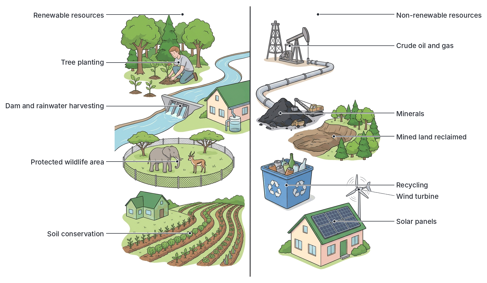
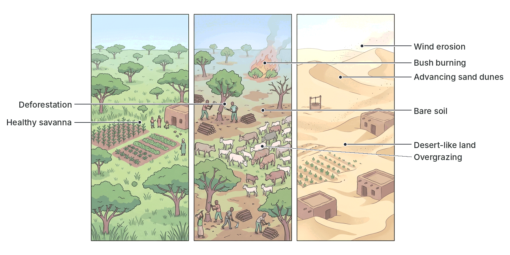
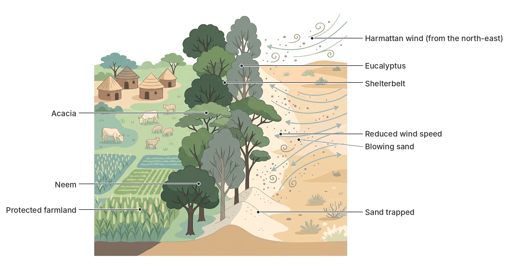
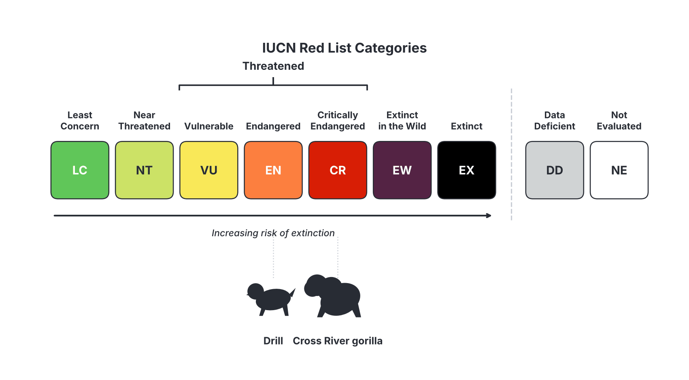
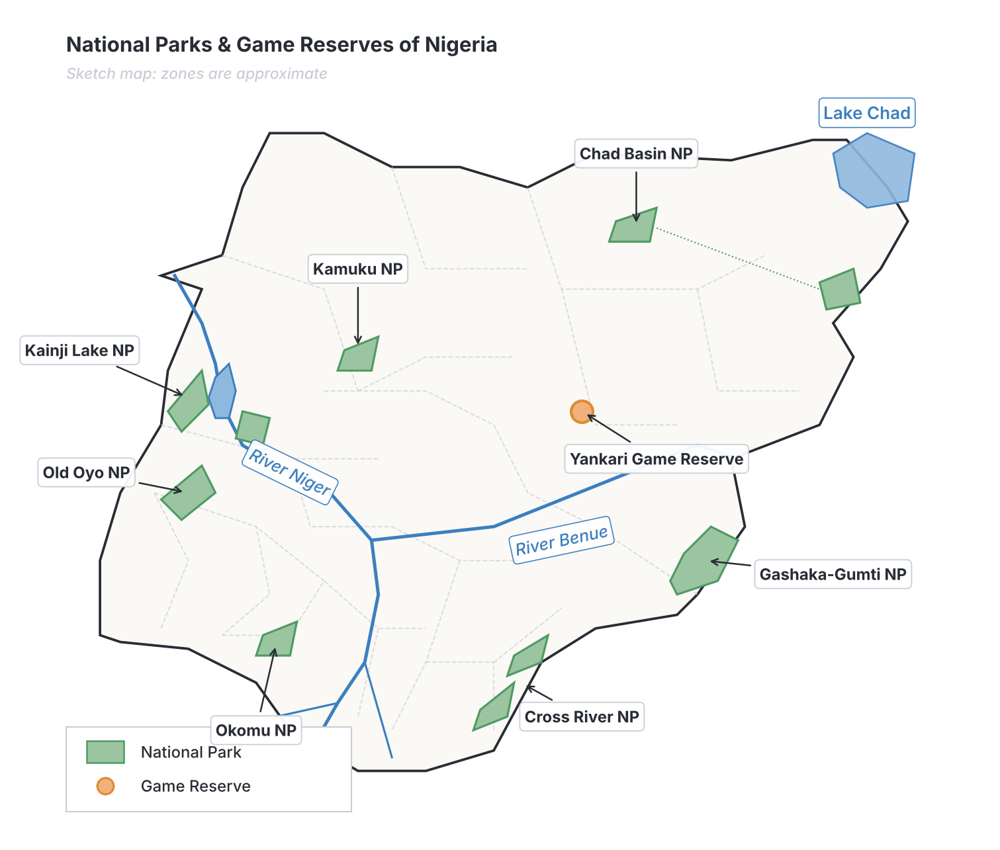

# JAMB Biology Notes: Humans and Environment – Conservation, Game Reserves and National Parks

## What JAMB expects

This topic is Section C, Topic 7 of the JAMB Biology syllabus: Ecology – Humans and Environment. Topic 7 is large, so it is split into four files:

- `C7a-diseases.md`: content item (a), diseases.
- `C7b-drug-abuse.md`: content item (b), drug abuse.
- `C7c-pollution-and-sanitation.md`: content item (c), pollution and its control, and sanitation and sewage.
- `C7d-conservation-parks-and-reserves.md` (this file): content items (d) and (e).

This file covers:

- d. Conservation of natural resources.
- e. Game reserves and national parks.

By the end of these notes, you should be able to:

1. (Objective xiii) Apply the various methods of conservation of both renewable and non-renewable natural resources (soil, water, forests, wildlife, minerals and fossil fuels) to protect the environment for present and future generations.
2. (Objective xiv) Outline the benefits of conserving natural resources, and explain how desertification can be prevented.
3. (Objective xv) Identify the bodies responsible for conservation at national and international levels, e.g. the Nigerian Conservation Foundation (NCF), the Federal Ministry of Environment, the National Park Service of Nigeria, the World Wide Fund for Nature (WWF), the International Union for Conservation of Nature (IUCN) and the United Nations Environment Programme (UNEP), and describe their activities.
4. (Objective xvi) Identify and state the location and importance of game reserves and national parks in Nigeria.

**Note on the syllabus wording:** objective xv names "World Wildlife Foundation (WWF)". There is no organisation with exactly that name. WWF is the **World Wide Fund for Nature**; it was founded as the World Wildlife **Fund**, and it is still called the World Wildlife Fund in the USA and Canada. The syllabus also says "Nigeria National Parks", which means the **National Park Service of Nigeria**. The syllabus writes "United Nations Environmental Programme"; the official name is the United Nations **Environment** Programme.

## Natural resources

A **natural resource** is any material or feature of nature that humans use to meet their needs: for food, water, shelter, energy, raw materials, health, recreation and income. Examples include soil, water, air, sunlight, forests, wildlife, fish, minerals, crude oil and natural gas.

### Types of natural resources

| Type | Meaning | Examples |
| --- | --- | --- |
| **Renewable resources** | Resources that can be **replaced naturally** within a human lifetime, by growth, reproduction or natural cycles, **if they are used wisely** (not faster than they are replaced) | **Forests** and trees, **wildlife**, **fish**, crops and livestock, **soil** (renewed by humus formation and nutrient cycling, though topsoil itself forms very slowly), **fresh water** (renewed by the water cycle) |
| **Non-renewable resources** | Resources that exist in **fixed amounts** and **cannot be replaced** within human time once used up, because they took millions of years to form | **Fossil fuels**: crude oil (petroleum), natural gas, coal; **minerals**: tin, iron ore, gold, limestone, columbite, bitumen, uranium |
| **Inexhaustible (perpetual) resources** | Resources that will not run out however much we use them | **Sunlight** (solar energy), **wind**, tides, air |

**Important:**

- Renewable resources can still be **destroyed** if used faster than they recover. A forest cut down completely, a fish population over-fished, or a species hunted to extinction is not renewed. Soil lost by erosion takes hundreds of years to form again.
- Some minerals (e.g. metals) can be **recycled**, which helps them last longer, but they are still non-renewable. Fossil fuels cannot be recycled, because burning them changes them into CO₂ and water.

**Textbook variation:** some textbooks list soil as renewable (because fertility can be restored) and others as non-renewable (because topsoil forms extremely slowly). Some do not separate inexhaustible resources from renewable ones. In the exam, forests, wildlife and water are renewable; fossil fuels and minerals are non-renewable.

### Nigeria's natural resources

Nigeria is rich in natural resources:

- **Forests**: rainforest in the south, savanna woodland in the middle belt and north, mangrove swamps in the Niger Delta (among the largest in Africa), and montane forest on the Obudu, Mambilla and other highlands (see Topic C4).
- **Wildlife**: primates (Cross River gorilla, chimpanzee, drill, many monkeys), elephants, buffalo, antelopes, hippopotamus, crocodiles, pangolins, and hundreds of bird species.
- **Water**: the Niger and Benue rivers, Lake Chad, the Kainji and other reservoirs, lagoons, creeks and groundwater.
- **Fossil fuels**: crude oil and natural gas (mainly in the Niger Delta and offshore), coal (e.g. Enugu), bitumen (e.g. Ondo State).
- **Minerals**: tin and columbite (Jos Plateau), limestone (used for cement), iron ore (e.g. Itakpe in Kogi State), gold, gypsum, kaolin, marble and others.
- **Soil and land** for agriculture.

## What is conservation?

**Conservation** is the **wise use, careful management and protection** of natural resources, so that they meet the needs of the **present generation** while remaining available for **future generations** (this is the idea of **sustainable use** or **sustainable development**).

Conservation is not the same as simply locking resources away (that is called **preservation**). Conservation allows people to use resources, but in a planned way that prevents waste, damage and exhaustion.

**Why natural resources need conserving (threats):**

1. **Rapid population growth**, which increases demand for land, food, water, wood and energy.
2. **Deforestation** for farmland, firewood, charcoal, timber, roads and settlements.
3. **Over-hunting and poaching** (including the bushmeat trade and illegal trade in ivory, pangolin scales and live animals).
4. **Overfishing**, sometimes with harmful methods (poisons, explosives, fine-mesh nets).
5. **Bush burning**.
6. **Overgrazing**.
7. **Pollution** (see `C7c-pollution-and-sanitation.md`).
8. **Soil erosion and loss of fertility** (see `C6-soil.md`).
9. **Desertification** in the north.
10. **Wasteful use** of energy, water and minerals.
11. **Mining** and oil exploration that destroy land.
12. **Urbanisation** and building over wetlands and forests.
13. **Climate change**.

## Methods of conserving natural resources

**Objective xiii: apply the various methods of conservation of both the renewable and non-renewable natural resources for the protection of our environment for present and future generations.**

### Conservation of soil

Soil conservation is explained in detail in `C6-soil.md`. In summary:

| Method | How it conserves soil |
| --- | --- |
| Contour ridging and contour ploughing | Ridges across the slope slow run-off and reduce erosion |
| Terracing | Level steps on steep slopes trap water and soil |
| Mulching | Covers the soil from rain and sun; adds humus |
| Cover crops (e.g. *Centrosema*, *Pueraria*, melon) | Protect soil surface; bind soil; legumes add nitrogen |
| Crop rotation | Prevents nutrient exhaustion and pest build-up |
| Strip-cropping and poly-cropping | Dense strips trap soil; ground stays covered |
| Organic manure and inorganic fertilisers | Restore nutrients; manure improves structure |
| Bush fallowing and improved fallow | Gives soil time to recover |
| Afforestation, windbreaks and shelterbelts | Protect soil from rain and wind erosion |
| Avoiding bush burning and overgrazing | Keeps plant cover and organic matter |
| Gully control (check dams, grass planting, proper drainage) | Stops gullies from growing |

### Conservation of water

Fresh water is renewed by the **water cycle** (see Topic C2), but supplies are limited, unevenly spread, and easily polluted or wasted.

**Methods:**

1. **Preventing water pollution**: treating sewage and industrial effluents; ending open defecation; controlling fertiliser and pesticide run-off; preventing oil spills (see `C7c-pollution-and-sanitation.md`).
2. **Avoiding waste**: turning off taps; repairing leaking pipes and taps; using only what is needed for washing and bathing; reusing water (e.g. washing water for flushing toilets or watering plants).
3. **Rainwater harvesting**: collecting rainwater from roofs into tanks or underground cisterns for later use.
4. **Building dams and reservoirs** to store water for the dry season, irrigation, domestic use and hydroelectric power (e.g. the Kainji, Jebba, Shiroro, Bakolori and Tiga dams), with care to reduce their harmful effects (displacement of people, schistosomiasis; see `C7a-diseases.md`).
5. **Efficient irrigation**: drip irrigation and other methods that deliver water to plant roots with little waste; irrigating in the cool of the morning or evening.
6. **Protecting watersheds and catchments**: keeping forests and vegetation around rivers and on hillsides, so rainwater soaks into the ground, recharges **groundwater**, and keeps streams flowing all year; preventing siltation.
7. **Protecting wetlands** (such as the Hadejia–Nguru wetlands and the Niger Delta), which store water, recharge groundwater and reduce floods.
8. **Controlling the sinking of boreholes**, so groundwater is not over-used.
9. **Public education** on saving water.

### Conservation of forests

Forests provide timber, firewood, food, medicines, habitat for wildlife, protection of soil and water, rainfall, oxygen and absorption of CO₂. Nigeria has lost a large proportion of its original forest cover, and its rate of deforestation has been among the highest in the world in recent decades.

**Methods:**

1. **Forest reserves:** areas of forest set aside by law, where cutting, farming and hunting are controlled. Nigeria has many forest reserves, most created during the colonial period (e.g. Omo, Okomu, Gambari, Afi River and Sapoba forest reserves). Many have been badly degraded by illegal logging and farming, so better protection is needed.
2. **Afforestation and reforestation:** planting trees on bare land or where forests have been cleared. Common plantation trees in Nigeria include **teak** (*Tectona grandis*), **gmelina** (*Gmelina arborea*), **pine** (on the highlands), **eucalyptus**, and indigenous trees such as **mahogany** (*Khaya*), **obeche** (*Triplochiton scleroxylon*) and **iroko** (*Milicia excelsa*).
3. **Selective (controlled) logging:** cutting only mature trees of a certain size and leaving young trees to grow, instead of clear-felling the whole forest.
4. **Regeneration:** replanting after every felling ("cut one, plant two"); protecting natural seedlings.
5. **The taungya system:** a method used in Nigeria in which farmers are allowed to grow food crops on forest land for a few years while they plant and tend young forest trees among the crops. When the trees grow tall and close their canopy, the farmers move on. The forest gains a well-tended plantation and the farmers get land.
6. **Agroforestry:** growing trees together with crops or livestock on the same land.
7. **Controlling bush burning** and forest fires (fire breaks, education, laws).
8. **Licensing and regulation** of timber felling; ensuring that loggers pay fees and replant.
9. **Use of alternatives to firewood and charcoal**: cooking gas (LPG), improved (fuel-efficient) cookstoves, solar cookers and biogas.
10. **Efficient use and recycling of wood and paper**.
11. **Research** by bodies such as the **Forestry Research Institute of Nigeria (FRIN)** in Ibadan.
12. **Public education** and tree-planting campaigns (e.g. national tree-planting days and school tree-planting).

### Conservation of wildlife

**Wildlife** means the wild (undomesticated) animals and plants living in their natural habitats. Many Nigerian species are threatened by habitat loss and hunting.

**Some threatened species found in Nigeria:**

| Species | Where found in Nigeria | Main threats |
| --- | --- | --- |
| **Cross River gorilla** | Cross River National Park (Okwangwo), Afi Mountain, Mbe Mountains; also across the border in Cameroon. It is the rarest gorilla, with only a few hundred left | Habitat loss, hunting |
| **Nigeria–Cameroon chimpanzee** | Gashaka-Gumti, Cross River and other forests | Habitat loss, hunting |
| **Drill** (a large forest monkey) | Cross River State forests (e.g. Afi Mountain) | Hunting for bushmeat, habitat loss |
| **White-throated monkey (white-throated guenon)** | Okomu National Park and other forests of south-western and southern Nigeria; found only in Nigeria (and possibly Benin) | Habitat loss, hunting |
| **Niger Delta red colobus** | A small area of the Niger Delta; found nowhere else | Habitat loss, hunting |
| **African elephants** (forest and savanna) | Yankari, Okomu, Cross River, Omo, Kainji and a few other areas; numbers in Nigeria are now small | Poaching for ivory, habitat loss, conflict with farmers |
| **Lion** | Kainji Lake and Yankari, in very small numbers | Habitat loss, loss of prey, hunting |
| **Pangolins** | Forests and savannas | Hunted for meat and for their scales, which are illegally exported to Asia |
| **Grey parrot** | Southern forests | Capture for the pet trade, forest loss |
| **Ibadan malimbe** (a bird) | A small area of south-western Nigeria; found only in Nigeria | Forest loss |

**Methods of wildlife conservation:**

1. **Establishing protected areas**: **national parks**, **game reserves**, wildlife sanctuaries and strict nature reserves (see the sections below). This is the most important method, because it protects whole **habitats** (*in situ* conservation).
2. **Laws against poaching** and illegal hunting; closed seasons (periods when hunting is banned, e.g. the breeding season); protecting young and pregnant animals; licensing hunters; banning hunting with fire and poison.
3. **Controlling trade in endangered species**: Nigeria is a member of **CITES** (the Convention on International Trade in Endangered Species of Wild Fauna and Flora, 1973), and has national laws on endangered species. Customs and other agencies seize illegal shipments of ivory and pangolin scales. Nigeria has been identified as a major transit route for illegal wildlife products, so enforcement is very important.
4. **Protecting habitats** outside parks: controlling deforestation, wetland drainage and bush burning.
5. **Captive breeding and *ex situ* conservation**: breeding endangered animals in **zoos**, sanctuaries and breeding centres (e.g. the drill breeding programme of the Drill Ranch at Afi Mountain), and keeping plants in **botanical gardens** and **seed banks** (e.g. the gene bank of the International Institute of Tropical Agriculture in Ibadan), so species can later be returned to the wild.
6. **Domestication and game ranching** of commonly hunted animals (such as the **grasscutter** (cane rat), giant African land snail and some antelopes), which supplies bushmeat without hunting wild populations.
7. **Wildlife education** and involving local communities, so they benefit from conservation (e.g. jobs as park rangers and guides, ecotourism income) and help protect wildlife.
8. **Research and monitoring** of wildlife populations.
9. **Fisheries conservation**: using nets with the correct mesh size (so young fish escape), closed fishing seasons, banning fishing with poisons and explosives, protecting breeding areas such as mangroves, and **fish farming** (aquaculture) to reduce pressure on wild fish.

### Conservation of minerals

Minerals are **non-renewable**, so they must be used **carefully and efficiently**.

**Methods:**

1. **Recycling** of metals (iron and steel scrap, aluminium cans, copper wire, lead from batteries) and of glass. Recycling saves the mineral, saves energy and reduces mining damage.
2. **Reuse** of metal and glass products.
3. **Efficient mining and processing** methods that waste less ore.
4. **Use of substitutes** (alternatives) where possible, e.g. plastics or other materials in place of scarce metals.
5. **Controlled and licensed mining**, ending illegal (artisanal) mining that wastes ore and destroys land (and can cause disasters such as the Zamfara lead poisoning; see `C7c-pollution-and-sanitation.md`).
6. **Reclamation of mined land**: filling mining pits and ponds, replacing topsoil and replanting vegetation. (The old tin mining areas of the Jos Plateau were left with many abandoned mining ponds and spoil heaps that have needed reclamation.)
7. **Exploring for new deposits** and keeping national reserves.
8. **Reducing demand** by avoiding waste.

### Conservation of fossil fuels

Crude oil, natural gas and coal are **non-renewable**. Burning them also causes air pollution and climate change, so conserving them protects the environment in two ways.

**Methods:**

1. **Energy efficiency**: using energy-saving bulbs (LED), switching off lights and appliances when not in use, efficient engines and well-serviced vehicles and generators, good building design (natural ventilation and light).
2. **Using public transport**, car-sharing, walking and cycling instead of many private cars.
3. **Ending gas flaring**: capturing the natural gas produced with crude oil and using it for electricity, cooking gas (LPG), fertiliser production and export, instead of burning it to waste (see `C7c-pollution-and-sanitation.md`).
4. **Stopping oil theft, pipeline vandalism and illegal refining**, which waste large amounts of crude oil and pollute the environment.
5. **Developing renewable and alternative energy sources**:
   - **Solar energy**: solar panels and solar mini-grids, very suitable for Nigeria's sunny climate, especially the north;
   - **Hydroelectric power** (e.g. Kainji, Jebba, Shiroro and Zungeru dams);
   - **Wind energy** (e.g. in parts of the north);
   - **Biogas** from animal dung and organic waste;
   - Cleaner fuels such as natural gas in place of petrol and diesel.
6. **Recycling** of used lubricating oil.
7. **Research** into new technologies and alternatives.
8. **Proper pricing and policies** that discourage waste.

### Summary: conservation methods for each resource

| Resource | Type | Main conservation methods |
| --- | --- | --- |
| Soil | Renewable (slowly) | Contour ridging, terracing, mulching, cover crops, crop rotation, manuring, fallowing, afforestation, no bush burning |
| Water | Renewable | Prevent pollution, avoid waste, rainwater harvesting, dams, efficient irrigation, protect watersheds and wetlands |
| Forests | Renewable | Forest reserves, afforestation and reforestation, selective logging, taungya, agroforestry, fire control, alternatives to firewood |
| Wildlife | Renewable | National parks and game reserves, anti-poaching laws, closed seasons, CITES, captive breeding, game ranching, education |
| Minerals | Non-renewable | Recycling, reuse, efficient mining, substitutes, land reclamation, control of illegal mining |
| Fossil fuels | Non-renewable | Energy efficiency, end gas flaring, stop oil theft, renewable energy (solar, hydro, wind, biogas), public transport |

## Benefits of conserving natural resources

**Objective xiv: outline the benefits of conserving natural resources, prevention of desertification.**

### Benefits of conservation

1. **Sustainable supply for present and future generations**: resources such as forests, fish, wildlife, soil and water remain available for our children and grandchildren.
2. **Food security**: fertile soils, healthy fisheries and pollinators (bees and other insects) ensure continued food production.
3. **Protection of biodiversity**: prevents the **extinction** of plant and animal species, keeping genetic variety that may be needed for new crops, livestock breeds and medicines.
4. **Medicines**: many drugs come from plants and other organisms (for example, the antimalarial drug **quinine** comes from the bark of the *Cinchona* tree, and **artemisinin** from the plant *Artemisia annua*); many local medicinal plants are still being studied.
5. **Ecological balance**: food chains, food webs and nutrient cycles continue to work; predators control pests.
6. **Protection of soil and water**: forests and vegetation prevent erosion, flooding and siltation, and protect water catchments.
7. **Climate regulation**: forests absorb **CO₂** (reducing global warming), release oxygen, and help produce rainfall; mangroves and wetlands store carbon.
8. **Prevention of desertification** (see below).
9. **Economic benefits**: timber and non-timber forest products (fruits, nuts, honey, rattan, chewing sticks, medicinal plants), fisheries, sustainable hunting and game ranching, employment (forest guards, park rangers, guides), and foreign exchange.
10. **Tourism and recreation (ecotourism)**: national parks, game reserves, waterfalls and highlands attract tourists, providing income for local communities and government (e.g. Yankari, Obudu, Gashaka-Gumti).
11. **Education and research**: protected areas serve as outdoor laboratories for students and scientists.
12. **Cultural and aesthetic value**: sacred groves (such as the **Osun-Osogbo Sacred Grove**, a UNESCO World Heritage Site in Osun State), beautiful landscapes and wildlife are part of our heritage.
13. **Less pollution** and better health, as fewer fossil fuels are burned and wastes are reduced.
14. **Reduced conflict** over scarce resources such as land and water (e.g. between farmers and herders).

### Desertification

**Desertification** is the process by which fertile land in **dry areas** (arid, semi-arid and dry sub-humid areas) is turned into **desert-like land**, losing its vegetation, soil fertility and ability to support crops, livestock and people. It is caused mainly by **human activities** combined with **climate** factors such as drought.

**Desertification in Nigeria:** the far northern states, which border the **Sahara** and lie in the **Sahel** and **Sudan savanna** belts, are the most affected. Sand dunes have advanced into farmland and villages in places such as parts of Yobe, Borno, Sokoto, Kebbi, Katsina, Jigawa and Kano States. Lake Chad has shrunk greatly since the 1960s, through drought, reduced rainfall and increased water use. Desertification reduces food production, forces people to migrate southwards, and contributes to conflict over land and water.

**Causes of desertification:**

1. **Deforestation**: cutting trees for firewood, charcoal, building poles and farmland.
2. **Overgrazing** by large herds of cattle, goats, sheep and camels, which removes grass cover and compacts the soil.
3. **Over-cultivation**: continuous cropping without fallow or manure, which exhausts the soil.
4. **Bush burning**.
5. **Poor irrigation practices**, causing salinisation of soil.
6. **Drought** and low, unreliable rainfall; **climate change** raising temperatures.
7. **Wind erosion** of bare soil.
8. **Population growth**, which increases pressure on land.

**Effects of desertification:**

1. Loss of farmland and pasture; crop failure and **famine**.
2. Loss of vegetation and wildlife.
3. **Sand dunes** burying farms, roads, wells and villages.
4. Drying up of rivers, lakes and wells.
5. **Dust storms**.
6. **Migration** of people and herds southwards, causing overcrowding and conflict.
7. Poverty.

### Prevention and control of desertification

1. **Afforestation and reforestation**: planting drought-resistant trees such as **neem** (*Azadirachta indica*), **acacias** (including gum arabic, *Acacia senegal*), **eucalyptus**, **date palm**, **baobab** and **doum palm**.
2. **Shelterbelts and windbreaks**: long rows (belts) of trees and shrubs planted **across the direction of the prevailing wind** (the harmattan, which blows from the north-east). They:
   - **reduce wind speed**, so less topsoil is blown away;
   - **trap moving sand** and stop dunes from advancing;
   - shade the soil and reduce evaporation;
   - provide firewood, fodder and shade.
   Nigeria has planted shelterbelts in its northern states since at least the 1970s.
3. **The Great Green Wall**:
   - The **Great Green Wall for the Sahara and the Sahel** is an **African Union** initiative launched in **2007**. The idea is to restore a belt of land about 8,000 km long across the width of Africa, south of the Sahara, from **Senegal in the west to Djibouti in the east**, by planting trees, restoring degraded land, and supporting sustainable farming and livelihoods. It aims to restore about 100 million hectares of degraded land by 2030.
   - It began as a plan for a continuous line of trees, but it has become a "mosaic" of land restoration projects in many countries.
   - In Nigeria, the **National Agency for the Great Green Wall** (NAGGW), established in **2015**, coordinates the work in the far northern **frontline states** (eleven states, including Sokoto, Kebbi, Zamfara, Katsina, Kano, Jigawa, Yobe and Borno), through tree planting, shelterbelts, orchards, woodlots, water points and land restoration.
   - Progress has been slower than planned because of limited funding, insecurity and the difficulty of keeping young trees alive in a dry climate.
4. **Controlled grazing**: reducing herd sizes to what the land can support, rotational grazing, grazing reserves, and producing fodder crops.
5. **Control of bush burning**.
6. **Improved farming practices**: crop rotation, fallowing, manuring, mulching, agroforestry, and planting drought-resistant crops (e.g. millet, sorghum, cowpea).
7. **Sand dune fixation**: planting grasses and shrubs on dunes and using barriers (fences of millet stalks or palm fronds) to stop sand from moving.
8. **Water conservation**: small dams, rainwater harvesting, and efficient irrigation that does not cause salinisation.
9. **Alternative energy** to reduce the cutting of trees for firewood: cooking gas, kerosene, improved cookstoves, solar cookers, biogas.
10. **Farmer-managed natural regeneration**: protecting and pruning tree stumps and seedlings that grow naturally on farms, which has helped re-green large areas of the Sahel at low cost.
11. **Laws and policies** against indiscriminate tree felling, and public education.
12. **International cooperation**: the **United Nations Convention to Combat Desertification (UNCCD)**, adopted in 1994; World Day to Combat Desertification and Drought is observed on **17 June**.

## Bodies responsible for conservation

**Objective xv: identify the bodies responsible for the conservation of resources at the national and international levels e.g. Nigerian Conservation Foundation (NCF), Federal Ministry of Environment, Nigeria National Parks, World Wildlife Foundation (WWF), International Union for Conservation of Nature (IUCN), United Nations Environmental Programme (UNEP) and their activities.**

### National bodies

#### Nigerian Conservation Foundation (NCF)

- **What it is:** a **non-governmental organisation (NGO)** and Nigeria's leading private conservation charity. It was founded in **1980** (and registered as a charitable trust in 1982) through the efforts of the late **Chief Shafi Lawal Edu**, a businessman and conservationist. Its head office is at the **Lekki Conservation Centre** in Lagos.
- **Links:** it has worked closely with the WWF and is the Nigerian partner of **BirdLife International**.

**Activities:**

1. **Runs the Lekki Conservation Centre** in Lagos, a protected area of coastal wetland and forest, with a long canopy walkway, where visitors can see wildlife such as monkeys, crocodiles, birds and reptiles close to the city. It is used for **conservation education** and recreation.
2. **Conservation of habitats and species**: projects to protect forests, wetlands and endangered species, such as the **Hadejia–Nguru wetlands** in the north, forest areas in the south-west (such as Omo Forest), and the Finima Nature Park on Bonny Island (Rivers State).
3. **Environmental education and awareness**: school conservation clubs, campaigns, publications and public lectures (including the annual Chief S. L. Edu Memorial Lecture).
4. **Bird conservation**: identifying and protecting **Important Bird Areas** and monitoring bird populations.
5. **Promoting sustainable livelihoods** for communities living near protected areas.
6. **Advocacy** for environmental laws and policies, and against wildlife trafficking.
7. **Tree planting** and forest restoration.

#### Federal Ministry of Environment

- **What it is:** the federal government ministry responsible for the environment, created in **1999**. Before that, the **Federal Environmental Protection Agency (FEPA)**, set up in **1988** after toxic waste was dumped at **Koko** (in present-day Delta State), handled environmental protection; FEPA's functions were later absorbed by the ministry. Each state has its own ministry of environment.

**Activities:**

1. **Makes national environmental policy** and laws on conservation, pollution, waste, climate change, forestry, desertification and erosion.
2. **Forestry**: manages forest policy, forest reserves, afforestation and tree-planting programmes, through the Federal Department of Forestry.
3. **Desertification control**: shelterbelts and the Great Green Wall programme (with the National Agency for the Great Green Wall).
4. **Erosion and flood control**: tackling gully erosion, especially in the south-east, through programmes such as the Nigeria Erosion and Watershed Management Project.
5. **Pollution control** and **environmental standards**, through agencies such as **NESREA** (see `C7c-pollution-and-sanitation.md`), and oil spill response through **NOSDRA**.
6. **Environmental impact assessment (EIA)**: approving new projects only after their environmental effects are studied.
7. **Climate change** policy and representing Nigeria in international environmental agreements (e.g. CITES, the Convention on Biological Diversity, UNCCD, the Paris Agreement).
8. **Wildlife and biodiversity conservation**, including control of trade in endangered species.
9. **Public enlightenment** on environmental issues, and supervising environmental sanitation.

#### National Park Service of Nigeria

- **What it is:** a federal government agency that manages Nigeria's **national parks**. It was established under **Decree No. 36 of 1991** (now the National Park Service Act), which created several national parks from existing game reserves and forest reserves. It is headed by a Conservator-General and works under the Federal Ministry of Environment.

**Activities:**

1. **Manages and protects** the national parks and the plants, animals and landscapes in them.
2. **Anti-poaching patrols** by park rangers; arresting and prosecuting poachers, illegal loggers and grazers.
3. **Protects endangered species** and their habitats.
4. **Promotes ecotourism**: providing roads, accommodation, guides and viewing facilities for visitors.
5. **Research and monitoring** of wildlife, often with universities and international partners.
6. **Conservation education** for schools and the public.
7. **Support for communities** around the parks (buffer zone development, employment as rangers and guides), so they benefit from conservation.

### International bodies

#### World Wide Fund for Nature (WWF)

- **What it is:** an international **non-governmental** conservation organisation, founded in **1961** in **Switzerland**, with its international headquarters in **Gland, Switzerland**. Its logo is the **giant panda**. It was originally called the **World Wildlife Fund**; in 1986 it changed its international name to the **World Wide Fund for Nature**, but kept the initials WWF (the USA and Canada still use World Wildlife Fund).

**Activities:**

1. **Funds and carries out conservation projects** in about 100 countries, protecting forests, oceans, fresh water and wildlife.
2. **Protects endangered species**, such as tigers, elephants, rhinos, gorillas, pandas, marine turtles and whales.
3. **Fights illegal wildlife trade** (often through TRAFFIC, a wildlife trade monitoring network it helped set up with IUCN).
4. **Promotes sustainable use** of resources (e.g. sustainable fishing and forestry).
5. **Climate and energy** campaigns, including the annual **Earth Hour**, when people switch off lights for an hour.
6. **Environmental education** and campaigns.
7. **Supports national conservation organisations**: in Nigeria, the WWF has worked with and supported the NCF.

#### International Union for Conservation of Nature (IUCN)

- **What it is:** an international organisation founded in **1948**, with its headquarters in **Gland, Switzerland**. It is unusual because its **members include both governments and non-governmental organisations** (more than a thousand member organisations), and it has networks of thousands of volunteer scientists and experts.

**Activities:**

1. **Publishes the IUCN Red List of Threatened Species**: the world's most comprehensive list of the conservation status of species. Species are assessed and placed in categories:

| IUCN Red List category | Meaning |
| --- | --- |
| **Extinct (EX)** | No individuals remain anywhere |
| **Extinct in the Wild (EW)** | Survives only in captivity or cultivation |
| **Critically Endangered (CR)** | Extremely high risk of extinction in the wild |
| **Endangered (EN)** | Very high risk of extinction in the wild |
| **Vulnerable (VU)** | High risk of extinction in the wild |
| **Near Threatened (NT)** | Close to qualifying as threatened |
| **Least Concern (LC)** | Widespread and abundant |
| **Data Deficient (DD)** | Not enough information to assess |
| **Not Evaluated (NE)** | Not yet assessed |

   "**Threatened**" species are those in the **Critically Endangered, Endangered and Vulnerable** categories. For example, the **Cross River gorilla** is listed as Critically Endangered, and the **drill** as Endangered.
2. **Sets standards** for protected areas (it classifies protected areas into categories, including national parks).
3. **Advises governments** and international agreements (e.g. CITES, the World Heritage Convention, the Convention on Biological Diversity) on conservation.
4. **Supports research** and gathers scientific data on species and ecosystems.
5. **Promotes sustainable development** and nature-based solutions.
6. Helped develop the **World Conservation Strategy** (1980) with UNEP and WWF.

#### United Nations Environment Programme (UNEP)

- **What it is:** the **United Nations** body for the environment, set up in **1972** after the **United Nations Conference on the Human Environment** in **Stockholm**, Sweden. Its headquarters are in **Nairobi, Kenya**, making it one of the few UN agencies with headquarters in Africa. (It is now often called **UN Environment Programme**.)

**Activities:**

1. **Coordinates the environmental work** of the United Nations and helps countries to develop environmental policies and laws.
2. **Monitors and assesses the global environment** and publishes reports such as the *Global Environment Outlook*.
3. **Develops and supports international environmental agreements**, such as the **Montreal Protocol** (on ozone-destroying substances), the Convention on Biological Diversity, CITES (it provides the CITES secretariat), and conventions on hazardous chemicals and wastes.
4. Together with the World Meteorological Organization, set up the **Intergovernmental Panel on Climate Change (IPCC)** in 1988, which assesses the science of climate change.
5. **Leads campaigns**: **World Environment Day** on **5 June** each year; the campaign that ended the use of **leaded petrol** worldwide (2021); campaigns against plastic pollution.
6. **Carries out environmental assessments in member countries**, such as the **Environmental Assessment of Ogoniland** (2011) in Nigeria (see `C7c-pollution-and-sanitation.md`).
7. Supports work on **desertification**, clean energy, sustainable cities and the protection of oceans and forests.

### Other bodies (brief)

| Body | Role |
| --- | --- |
| **UNESCO** (UN Educational, Scientific and Cultural Organization) | Lists **World Heritage Sites** (e.g. the Osun-Osogbo Sacred Grove and the Sukur Cultural Landscape in Nigeria) and **Biosphere Reserves** (e.g. Omo); the Man and the Biosphere Programme |
| **FAO** (Food and Agriculture Organization) | Monitors and advises on forests, fisheries and soils |
| **CITES** | International treaty controlling trade in endangered species |
| **Wildlife Conservation Society (WCS)** | An international NGO that has worked with the Nigerian authorities in Yankari and Cross River areas |
| **National Agency for the Great Green Wall** | Coordinates desertification control in the frontline states |
| **Forestry Research Institute of Nigeria (FRIN)** | Research on forests and tree planting |
| **State ministries of environment and forestry departments** | Manage state forest reserves and game reserves |

### Summary of conservation bodies

| Body | National or international | Type | Key activities |
| --- | --- | --- | --- |
| NCF | National | NGO (founded 1980) | Lekki Conservation Centre; habitat and species projects; education; BirdLife partner |
| Federal Ministry of Environment | National | Government | Environmental policy; forestry; desertification and erosion control; pollution control; EIA |
| National Park Service | National | Government agency (1991) | Manages and protects national parks; anti-poaching; ecotourism; research |
| WWF | International | NGO (founded 1961; HQ Gland) | Conservation projects; endangered species; fights wildlife trade; Earth Hour |
| IUCN | International | Union of governments and NGOs (founded 1948; HQ Gland) | **Red List** of Threatened Species; standards for protected areas; scientific advice |
| UNEP | International | UN programme (founded 1972; HQ Nairobi) | Global environmental policy; treaties (Montreal Protocol); World Environment Day; environmental assessments |

## Game reserves and national parks in Nigeria

**Content item e: game reserves and national parks.**

**Objective xvi: identify and state the location and importance of game reserves and National parks in Nigeria.**

### Definitions

| Type of protected area | Meaning | Who manages it in Nigeria |
| --- | --- | --- |
| **National park** | A large area of land (and water) set aside and **protected by law** by the **national (federal) government** to conserve its wildlife, plants, landscapes and natural features, and for education, research and **tourism**. Hunting, farming, grazing, logging and settlement are not allowed inside it | **National Park Service** (federal) |
| **Game reserve** | An area set aside mainly to **protect wild animals ("game")**, where hunting is banned or strictly controlled (sometimes allowed with a licence); some human activities may be allowed | Usually **state governments** (state ministries of environment, forestry or wildlife departments) |
| **Forest reserve** | Forest set aside by law to protect and manage trees and timber; controlled logging may be allowed | Mostly **state** forestry departments |
| **Wildlife sanctuary** | A smaller area protecting particular species or habitats | Various (government, NGOs, communities) |
| **Strict nature reserve** | An area strictly protected for science, with almost no human use | Government |
| **Zoo / zoological garden** | Wild animals kept in captivity for education, recreation, research and captive breeding (*ex situ* conservation) | Universities, governments, private |

**National parks and game reserves compared:**

| Feature | National park | Game reserve |
| --- | --- | --- |
| Managed by | Federal government (National Park Service) | Usually state government |
| Main aim | Conserve the **whole ecosystem** (plants, animals, landscape) plus tourism, education and research | Mainly protect **game animals** |
| Hunting | **Not allowed** | Banned or controlled (licensed hunting may be allowed in some) |
| Human activities | Farming, grazing, logging and settlement not allowed | Some activities may be allowed |
| Size | Usually large | Varies |
| Examples | Kainji Lake, Cross River, Gashaka-Gumti | Yankari (now a state-managed game reserve), Falgore, Lame-Burra |

**Textbook variation:** the exact meanings of "game reserve", "wildlife sanctuary" and "national park" differ a little between textbooks and between countries. In Nigeria, the key difference is that national parks are federal and more strictly protected.

### The national parks of Nigeria

Nigeria's first national park, **Kainji Lake National Park**, was created in **1979**. More national parks were created under the **National Park Service Decree of 1991** and later. For many years, the generally listed national parks were the **seven** below (after Yankari was returned to Bauchi State; see below).

**Note:** the list of national parks can change. In recent years, the Federal Government has announced plans to create additional national parks from existing forest reserves. Check the current official list of the National Park Service, and use the seven parks below as the standard JAMB answer.

| National park | State(s) | Approximate area | Vegetation | Notable features and wildlife |
| --- | --- | --- | --- | --- |
| **Kainji Lake National Park** | **Niger** and **Kwara** | About 5,300 km² | Guinea (and Sudan) savanna woodland; lake | Nigeria's **first** national park (1979). Has two sectors: the **Borgu** sector (former Borgu Game Reserve) and the **Zugurma** sector, separated by **Kainji Lake** (the reservoir of the Kainji Dam on the River Niger). Wildlife: hippopotamus, roan antelope, kob, hartebeest, buffalo, baboons, crocodiles, many birds, and a small number of lions; fish in the lake. Close to the Kainji Lake Research Institute and New Bussa |
| **Old Oyo National Park** | **Oyo** | About 2,500 km² | Guinea savanna and woodland | Named after **Oyo-Ile (Old Oyo)**, the ancient capital of the Oyo Empire, whose **ruins** lie inside the park. Combines **wildlife and cultural/historical heritage**. Rivers (including the Ogun), rock outcrops; antelopes, monkeys, baboons, birds |
| **Cross River National Park** | **Cross River** | About 4,000 km² | **Tropical rainforest** (including some of Nigeria's largest remaining rainforest) and some montane areas | Two divisions: **Oban** (in the south) and **Okwangwo** (in the north). Okwangwo protects the **Cross River gorilla** (Critically Endangered). Other wildlife: **drill**, chimpanzee, forest elephant (rare), many monkeys, birds and butterflies; many plant species found nowhere else in Nigeria. Borders **Korup National Park** in Cameroon |
| **Gashaka-Gumti National Park** | **Taraba** and **Adamawa** | About 6,400 km² | Guinea savanna, **montane forest** and grassland on the highlands, gallery (riverside) forest | Usually described as Nigeria's **largest** national park. Contains **Chappal Waddi** (Gangirwal), the **highest point in Nigeria** (about 2,400 m). Wildlife: **Nigeria–Cameroon chimpanzee**, buffalo, antelopes, hippopotamus, giant forest hog, many birds. Borders Cameroon |
| **Chad Basin National Park** | **Borno** and **Yobe** | About 2,250 km² | **Sahel and Sudan savanna**, semi-desert, wetlands and oases | Made up of separate sectors, including **Chingurmi–Duguma**, the **Bade–Nguru wetlands** and the **Bulatura oases**. Important for **migratory birds** (wetlands), and dry-land animals such as gazelles, ostrich (historically), patas monkeys and many birds. Helps conserve the Lake Chad basin ecosystem and fight desertification. Insecurity in the north-east has affected it |
| **Okomu National Park** | **Edo** | About 200 km² | **Tropical rainforest** | Usually described as Nigeria's **smallest** national park; part of the larger **Okomu Forest Reserve**. Famous for the **white-throated monkey** (white-throated guenon), which is found almost only in Nigeria. Also forest elephants, chimpanzees (few), forest buffalo, red-capped mangabeys and many birds |
| **Kamuku National Park** | **Kaduna** | About 1,100 km² | Guinea and Sudan savanna woodland | In the Birnin Gwari area of western Kaduna State; formerly a forest and wildlife area that became a national park in the late 1990s. Antelopes, monkeys, birds; historically elephants. Insecurity in the area has affected it |

**Textbook variation:** the areas of the parks differ between sources (depending on whether buffer zones and later changes are included). Use the figures above as rough guides only. Most sources agree that **Gashaka-Gumti** is the largest and **Okomu** the smallest.

### Yankari Game Reserve (formerly Yankari National Park)

- **Location:** **Bauchi State**, in north-eastern Nigeria, in the Sudan and Guinea savanna; covers roughly 2,200 km².
- **History:** Yankari was set aside as a **game reserve** by the government of Northern Nigeria in the 1950s and was opened to visitors in the early 1960s. In **1991** it was upgraded to a **national park** under the new National Park Service. Later (in the mid-2000s) management was **returned to the Bauchi State Government**, so it is now usually called **Yankari Game Reserve**. Since then the state has worked with partners such as the **Wildlife Conservation Society** to protect it. (**Note:** sources give slightly different dates for these changes, and it is still often called "Yankari National Park" in books and the media. For the exam, know that it is in **Bauchi State** and is Nigeria's best-known wildlife park.)
- **Notable features:**
  - The **Wikki Warm Spring**: a crystal-clear natural spring whose water stays warm (about 31 °C) all year round; a major tourist attraction.
  - Other warm springs (e.g. Dimmil, Gwan and Nawulgo) and the **Marshall Caves** (with old rock paintings and carvings).
  - Historical **iron-smelting sites** and the **Dukke Wells**, showing that people lived and worked here long ago.
  - It holds what is believed to be the **largest remaining population of elephants in Nigeria**, as well as **buffalo**, **hippopotamus**, **waterbuck**, **roan antelope**, **hartebeest**, **baboons**, **warthogs**, **crocodiles**, and many birds; lions have been reported in very small numbers.
- **Importance:** wildlife conservation (especially of elephants), **tourism** (one of Nigeria's most visited parks), education and research, and income for Bauchi State and local communities.

### Other game reserves and protected areas in Nigeria

Many states manage game reserves, forest reserves and sanctuaries. Important examples include:

| Protected area | State | Notes |
| --- | --- | --- |
| **Yankari Game Reserve** | Bauchi | See above |
| **Kainji Lake area (Borgu and Zugurma Game Reserves)** | Niger and Kwara | These two former game reserves were joined to form **Kainji Lake National Park** (1979), showing how game reserves have been upgraded to national parks |
| **Okomu Forest Reserve and wildlife sanctuary** | Edo | Okomu began as a **forest reserve**; part of it was made a wildlife sanctuary, and that sanctuary was upgraded to **Okomu National Park** in 1999 |
| **Omo Forest Reserve** | Ogun | A large rainforest reserve with a **strict nature reserve** inside it; recognised as a UNESCO **Biosphere Reserve**. Home to forest elephants, chimpanzees and many endangered plants and birds. Threatened by illegal logging and farming |
| **Falgore Game Reserve** | Kano | Savanna woodland on the Kano River; antelopes, monkeys and birds |
| **Lame-Burra Game Reserve** | Bauchi | Savanna wildlife |
| **Kwiambana Game Reserve** | Zamfara | Savanna wildlife |
| **Sambisa Game Reserve** | Borno | A former game reserve of savanna woodland; became known worldwide as a hideout of insurgents, and its wildlife has suffered greatly |
| **Upper Ogun Game Reserve** | Oyo | Next to Old Oyo National Park |
| **Ifon Game Reserve** | Ondo | Forest–savanna wildlife |
| **Pandam Wildlife Park** | Plateau | Wildlife park in the Jos Plateau area |
| **Afi Mountain Wildlife Sanctuary** | Cross River | Protects drills, chimpanzees and Cross River gorillas; site of the Drill Ranch's release programme and a canopy walkway |
| **Lekki Conservation Centre** | Lagos | Run by the NCF (see above) |
| **Hadejia–Nguru wetlands** | Jigawa and Yobe | Important wetlands for water birds and migratory birds; part lies in the Chad Basin National Park (Bade–Nguru sector) |

**Note:** many game reserves in Nigeria are poorly protected and have lost much of their wildlife through poaching, farming, grazing and insecurity.

### Importance of game reserves and national parks

1. **Conservation of wildlife**: they protect animals and plants, especially **endangered species** such as the Cross River gorilla, chimpanzee, drill, white-throated monkey and elephants, from hunting and habitat loss, and prevent **extinction**.
2. **Conservation of biodiversity and genetic resources**: they keep a wide variety of species and genes, including wild relatives of crops and medicinal plants.
3. **Protection of whole ecosystems and habitats**: rainforest, savanna, montane forest, wetlands and lakes are preserved with their natural food webs and nutrient cycles.
4. **Tourism (ecotourism)**: they attract local and foreign tourists, earning **revenue** for government and **income** for local communities (hotels, guides, transport, crafts).
5. **Employment**: park rangers, guides, researchers, hotel and transport workers.
6. **Education**: students and the public learn about nature in its natural setting (excursions, field trips).
7. **Scientific research**: places for studying animal behaviour, ecology and conservation (e.g. chimpanzee research in Gashaka-Gumti).
8. **Recreation** and enjoyment of nature (e.g. bathing in Wikki Warm Spring, game viewing, bird-watching, hiking).
9. **Protection of soil and water**: forests in parks protect water catchments, prevent erosion, and keep rivers flowing; wetlands reduce floods.
10. **Climate benefits**: forests absorb carbon (IV) oxide and help regulate local climate and rainfall.
11. **Prevention of desertification** (e.g. Chad Basin National Park in the north-east).
12. **Preservation of cultural and historical heritage** (e.g. the ruins of Old Oyo; the Marshall Caves and iron-smelting sites at Yankari).
13. **Restocking**: animals from protected areas can repopulate other areas.
14. **National pride and international cooperation**: some parks border protected areas in neighbouring countries (e.g. Cross River with Korup, Gashaka-Gumti with Cameroon's highlands), encouraging cross-border conservation.

### Problems facing national parks and game reserves in Nigeria

1. **Poaching** for bushmeat, ivory, pangolin scales and live animals.
2. **Encroachment**: farming, grazing, logging and settlements inside protected areas.
3. **Bush burning**.
4. **Insecurity**: bandits and insurgents in some parks and reserves (e.g. Sambisa, Kamuku, parts of Kainji and Chad Basin) endanger rangers and visitors.
5. **Inadequate funding**, staff and equipment.
6. **Poor infrastructure** (roads, accommodation), which limits tourism.
7. **Conflict with local communities** who depend on the land and see little benefit.
8. **Corruption** and weak enforcement of laws.

**Solutions:** more funding and rangers; better equipment; involving and benefiting local communities; education; strong enforcement of laws; improving security; developing ecotourism; and cooperation with international partners.

## Key terms

| Term | Meaning |
| --- | --- |
| Natural resource | Any material or feature of nature that humans use |
| Renewable resource | A resource that can be replaced naturally if used wisely, e.g. forests, wildlife, water |
| Non-renewable resource | A resource that exists in fixed amounts and cannot be replaced, e.g. crude oil, coal, minerals |
| Inexhaustible resource | A resource that will not run out, e.g. sunlight, wind |
| Conservation | The wise use, management and protection of natural resources for present and future generations |
| Preservation | Protecting a resource or area from any use |
| Sustainable use | Using resources in a way that does not exhaust them, so future generations can also use them |
| Biodiversity | The variety of living things (species, genes and ecosystems) in an area |
| Extinction | The complete disappearance of a species |
| Endangered species | A species at very high risk of extinction |
| Afforestation | Planting trees on land that has not had forest |
| Reforestation | Replanting trees where forest has been cut |
| Taungya system | Growing food crops among young forest trees until the trees close their canopy |
| Desertification | The change of fertile dry land into desert-like land |
| Shelterbelt | A belt of trees planted across the wind to reduce wind speed and trap sand |
| Great Green Wall | An African Union initiative to restore land across the Sahel from Senegal to Djibouti |
| Poaching | Illegal hunting or capture of wild animals |
| *In situ* conservation | Conserving species in their natural habitats, e.g. national parks |
| *Ex situ* conservation | Conserving species outside their natural habitats, e.g. zoos, botanical gardens, seed banks |
| National park | A large area protected by the federal government to conserve wildlife and ecosystems, with no hunting or farming |
| Game reserve | An area set aside mainly to protect wild animals, usually managed by a state government |
| Ecotourism | Tourism based on enjoying nature in a way that supports conservation |
| IUCN Red List | The IUCN's list of the conservation status of species |
| NCF | Nigerian Conservation Foundation: Nigeria's leading conservation NGO |
| UNEP | United Nations Environment Programme, headquartered in Nairobi |

## Exam tips and common mistakes

- **Renewable vs non-renewable:** forests, wildlife, fish and water are renewable (if used wisely); crude oil, natural gas, coal and minerals are non-renewable. Sunlight and wind are inexhaustible.
- **Conservation is wise use, not "no use".**
- **WWF** = World Wide Fund for Nature (originally World Wildlife Fund), NGO, panda logo, Gland, 1961. **IUCN** = Red List, Gland, 1948. **UNEP** = UN body, **Nairobi**, 1972, World Environment Day (5 June). **NCF** = Nigerian NGO, Lekki Conservation Centre, founded 1980.
- **Kainji Lake National Park** (Niger and Kwara) was Nigeria's **first** national park (1979).
- **Gashaka-Gumti** (Taraba and Adamawa) is the **largest** national park and contains Chappal Waddi, Nigeria's highest point. **Okomu** (Edo) is the **smallest** and is home to the white-throated monkey.
- **Cross River National Park** (Oban and Okwangwo divisions) protects the **Cross River gorilla** and drill.
- **Yankari** is in **Bauchi State**; it is famous for the **Wikki Warm Spring** and elephants. It was a national park from 1991 but has since been returned to Bauchi State as a game reserve; questions may still call it a national park.
- **Old Oyo National Park** is in **Oyo State** and contains the ruins of the old Oyo Empire capital.
- **Chad Basin National Park** is in **Borno and Yobe** (Sahel/Sudan savanna and wetlands).
- **Shelterbelts** are planted **across** the direction of the wind.
- **The main causes of desertification** are human: deforestation, overgrazing, over-cultivation and bush burning, worsened by drought.

## Quick summary

1. Natural resources are renewable (forests, wildlife, water, soil), non-renewable (crude oil, gas, coal, minerals) or inexhaustible (sunlight, wind); conservation is their wise use and protection for present and future generations.
2. Soil, water, forests and wildlife are conserved by methods such as soil conservation practices, preventing pollution and waste, forest reserves, afforestation, selective logging, the taungya system, protected areas, anti-poaching laws, captive breeding and game ranching.
3. Minerals and fossil fuels are conserved by recycling, efficient use, substitutes, reclaiming mined land, ending gas flaring, stopping oil theft, and using renewable energy such as solar and hydroelectric power.
4. Conservation protects biodiversity, food and water supplies, medicines, the climate and soil, and provides tourism, jobs, education and research.
5. Desertification in northern Nigeria, caused by deforestation, overgrazing, over-cultivation and drought, is fought by afforestation, shelterbelts, the Great Green Wall, controlled grazing, sand dune fixation and alternative fuels.
6. Conservation bodies include the NCF, the Federal Ministry of Environment and the National Park Service in Nigeria, and the WWF, IUCN (Red List) and UNEP internationally.
7. Nigeria's national parks are Kainji Lake, Old Oyo, Cross River, Gashaka-Gumti, Chad Basin, Okomu and Kamuku; Yankari (Bauchi) is a famous game reserve that was once a national park; these areas protect wildlife and ecosystems and support tourism, research and education.

## Practice questions

**1. Which of the following is a non-renewable natural resource?**

- A. Forest
- B. Wildlife
- C. Crude oil
- D. Fresh water

**Answer: C.** Crude oil took millions of years to form and cannot be replaced once used; forests, wildlife and water are renewable if used wisely.

**2. The system in which farmers grow food crops among young forest trees until the trees close their canopy is called**

- A. taungya
- B. shifting cultivation
- C. strip-cropping
- D. bush fallowing

**Answer: A.** The taungya system combines food crop farming with the establishment of forest plantations.

**3. Shelterbelts help to prevent desertification mainly by**

- A. increasing the speed of the wind
- B. adding nitrogen to the soil
- C. providing grazing land for cattle
- D. reducing wind speed and trapping blowing sand

**Answer: D.** Belts of trees planted across the wind slow it down, reducing wind erosion and stopping the advance of sand dunes.

**4. The organisation that publishes the Red List of Threatened Species is the**

- A. UNEP
- B. IUCN
- C. WHO
- D. NCF

**Answer: B.** The International Union for Conservation of Nature publishes the IUCN Red List, which classifies species by their risk of extinction.

**5. The headquarters of the United Nations Environment Programme (UNEP) is in**

- A. Geneva
- B. New York
- C. Nairobi
- D. Gland

**Answer: C.** UNEP was set up in 1972 after the Stockholm Conference and is headquartered in Nairobi, Kenya.

**6. The Lekki Conservation Centre in Lagos is managed by the**

- A. Nigerian Conservation Foundation
- B. National Park Service
- C. World Health Organization
- D. Lagos State Waste Management Authority

**Answer: A.** The NCF, Nigeria's leading conservation NGO, has its headquarters at the Lekki Conservation Centre.

**7. Nigeria's first national park was**

- A. Yankari
- B. Old Oyo
- C. Okomu
- D. Kainji Lake

**Answer: D.** Kainji Lake National Park, in Niger and Kwara States, was created in 1979 from the Borgu and Zugurma game reserves.

**8. The Wikki Warm Spring is found in**

- A. Cross River National Park
- B. Yankari Game Reserve
- C. Kainji Lake National Park
- D. Gashaka-Gumti National Park

**Answer: B.** The Wikki Warm Spring, with water at about 31 °C all year, is the main tourist attraction of Yankari in Bauchi State.

**9. The Cross River gorilla, a critically endangered primate, is protected mainly in**

- A. Chad Basin National Park
- B. Kamuku National Park
- C. Cross River National Park
- D. Old Oyo National Park

**Answer: C.** The Okwangwo division of Cross River National Park (with nearby Afi Mountain) is a key home of the Cross River gorilla.

**10. Which of the following is NOT a benefit of national parks and game reserves?**

- A. Increased poaching of endangered species
- B. Conservation of wildlife and biodiversity
- C. Income from tourism
- D. Opportunities for scientific research

**Answer: A.** National parks and game reserves are set up to reduce, not increase, poaching; the other options are benefits.
