# JAMB Biology Notes: Variation in Population

## What JAMB expects

This topic is Section D, Topic 1 of the JAMB Biology syllabus: Heredity and Variations – Variation in population. It covers three content items:

- **a. Morphological variations** in the physical appearance of individuals:
  - (i) size (height and weight);
  - (ii) colour (skin, eye, hair, coat of animals, scales and feathers);
  - (iii) fingerprints.
- **b. Physiological variation:**
  - (i) ability to roll the tongue;
  - (ii) ability to taste phenylthiocarbamide (PTC);
  - (iii) blood groups.
- **c. Application of discontinuous variation** in crime detection, blood transfusion and determination of paternity.

By the end of these notes, you should be able to:

1. Differentiate between continuous and discontinuous variations, with examples.
2. Relate the role of environmental conditions, habitat and the genetic constitution to variation.
3. Measure the heights and weights of pupils of the same age group.
4. Plot graphs of the frequency distribution of the heights and weights.
5. Observe and record various colour patterns in some plants and animals.
6. Apply the classification of fingerprints in identity detection.
7. Identify some specific examples of physiological variation among the human population.
8. Categorise people according to their physiological variation.
9. Apply the knowledge of blood groups in blood transfusion and the determination of paternity.
10. Use discontinuous variation in crime detection.

**Note on the syllabus wording:** this topic is numbered "(I)" in the syllabus, while the other topics in Section D are numbered "2." and "3.". It is simply the first topic of Section D. How characters are passed on from parents to offspring (genes, chromosomes, Mendel's laws) is covered in the next topic, Heredity (`D2a-heredity-principles.md` and `D2b-applications-of-heredity.md`). This file uses a few genetic words (gene, allele, dominant, recessive); they are explained briefly here and fully in D2a.

## What is variation?

Look around your classroom. Everybody is a human being, so you all share the same basic features: two eyes, a nose, two arms, two legs, the same organs inside. Yet no two of you are exactly alike. Some are tall and some are short; some are dark-skinned and some lighter; some can roll their tongues and some cannot; you have different blood groups and different fingerprints.

**Variation** is the differences in characteristics (traits) between individuals of the same species.

- Variation between members of the **same species** is what this topic is about. For example, the differences between one West African Dwarf goat and another, or between you and your classmates.
- Differences between **different species** (for example, between a goat and a sheep) are much bigger, and are used in classification (Section A).

A **population** is a group of organisms of the same species living in the same place at the same time, for example all the pupils in your school, all the *Tilapia* in a pond, or all the maize plants on a farm. Variation is studied by looking at a characteristic in many members of a population.

**Why variation matters:**

1. It makes each individual unique, so individuals can be identified (fingerprints, DNA, blood groups).
2. It is the raw material for **evolution**: natural selection can only act if individuals differ (see `E1-theories-of-evolution.md`).
3. Some individuals are better suited to a change in their environment (for example, a drought or a new disease), so the population as a whole is more likely to survive.
4. Breeders use variation to select and develop better crops and livestock (see `D2b-applications-of-heredity.md`).

### Two ways of grouping variation

The syllabus groups variation in two different ways. Do not mix them up.

| Way of grouping | The two groups | What the grouping is based on |
| --- | --- | --- |
| By **the kind of feature** | **Morphological** (structural, seen in appearance) and **physiological** (in how the body works or its chemistry) | What sort of characteristic it is |
| By **the pattern of the differences** | **Continuous** and **discontinuous** | Whether there is a smooth range of values or a few clear-cut groups |

A characteristic belongs to one group in each scheme. For example, **height** is morphological and continuous; **blood group** is physiological and discontinuous; **fingerprint pattern** is morphological and discontinuous.

## Morphological variation

**Morphological variation** is variation in the physical appearance (external form or structure) of individuals: things you can see and measure, such as size, shape and colour. The syllabus names three: size, colour and fingerprints.

### Size: height and weight

**Height** and **weight** (more correctly, body **mass**, measured in kilograms) vary greatly between people of the same age and sex. In a class of 15-year-olds, heights may range from under 145 cm to over 175 cm, and every value in between is found.

- Height and weight are controlled by **many genes** acting together (they are **polygenic**), each adding a small amount.
- They are also strongly affected by the **environment**: food (especially protein and energy intake in childhood), disease, exercise, sleep and hormones.
- Because of this, they show **continuous variation**: there is a smooth range from the shortest to the tallest, with most people near the middle (average).

The same is true in other organisms: the height of maize plants on a farm, the mass of yam tubers from one variety, the length of leaves on a mango tree, and the mass of eggs laid by a flock of hens all show continuous variation.

**Note on weight and mass:** scientists say "mass" (in kg) for how much matter is in the body, and "weight" for the force of gravity on it (in newtons). In everyday speech and in the syllabus, "weight" means body mass in kg. Use whichever your question uses.

### Colour

Colour is one of the most obvious morphological variations. The syllabus lists skin, eye, hair, the coat of animals, scales and feathers.

#### Skin colour

- Human skin colour depends mainly on the amount and type of the brown-black pigment **melanin**, made by cells called **melanocytes** in the skin.
- People with darker skin produce more melanin. Melanin protects the skin from harmful **ultraviolet (UV)** rays of the sun. This is why people whose ancestors lived for a long time in sunny regions, such as most of Africa, usually have darker skin.
- Skin colour is controlled by **several genes**, so it shows a **range** of shades (continuous variation). Even within one Nigerian family, brothers and sisters can have different skin shades.
- The **environment** also affects it: skin exposed to the sun becomes darker (tanning), and skin that is covered stays lighter.
- **Albinism** is an exception. A person with albinism (an **albino**) inherits two copies of a recessive allele and cannot make normal amounts of melanin. Their skin and hair are very pale and their eyes are often sensitive to light. Albinism is an "either/or" (discontinuous) condition: a person either has albinism or does not. People with albinism need protection from the sun (hats, long sleeves, sunscreen) because they burn easily and have a high risk of skin cancer.

#### Eye colour

- The coloured part of the eye is the **iris**. Its colour depends on the amount of melanin in it: a lot of melanin gives dark brown eyes; less gives lighter brown, hazel, green, grey or blue eyes.
- Most Nigerians have dark brown eyes, but shades differ from person to person.
- **Textbook variation:** many older textbooks treat eye colour as a simple discontinuous character controlled by one gene, with brown dominant to blue. Modern genetics shows that eye colour is controlled by **several genes** and comes in many shades, so it is better described as **continuous** (or "nearly continuous"). If a JAMB question treats brown as dominant to blue in a simple cross, answer it that way, but know that real eye colour inheritance is more complicated.

#### Hair colour and type

- Hair colour also depends on melanin: black, brown, red, blond and grey hair contain different types and amounts.
- Hair type varies too: tightly coiled (as in most Nigerians), wavy or straight; thick or fine.
- Hair turns grey or white with age as melanin production falls. This is a change in one person over time, not variation between people, but the age at which it starts differs from person to person.
- Dyeing or relaxing hair changes its appearance but not the genes, so it is **not inherited** (see `D2a-heredity-principles.md`).

#### Coat colour of animals

The coat (fur or hair) of mammals varies a lot within one species:

- **Goats:** West African Dwarf goats can be black, brown, white, grey or patched in two or three colours. The Red Sokoto (Maradi) goat is a reddish-brown breed from the north.
- **Cattle:** the White Fulani (Bunaji) is white with black ears and muzzle; the Red Bororo is deep red; N'Dama cattle are usually fawn to brown; within each breed there are smaller differences.
- **Dogs and cats:** black, white, brown, grey, spotted, striped (tabby) or patched (tortoiseshell).
- **Rabbits and guinea pigs:** used in many school genetics examples (black, white, brown, agouti).

Some coat colours fall into a few clear groups (for example, black or white guinea pigs), which is discontinuous variation; others grade smoothly from light to dark.

#### Scales of fish and reptiles

- Fish such as *Tilapia* vary in the colour and pattern of their scales: some are darker, some paler, some have vertical bars; males often become brighter in the breeding season.
- In ornamental fish such as **goldfish** and **koi**, breeders have selected many colour varieties (gold, white, orange, black, spotted) from the same species.
- Snakes and lizards of one species can differ in the colour and pattern of their scales.

#### Feathers of birds

- Local (indigenous) chickens in Nigerian villages show enormous variation in feather colour: black, white, brown, red, speckled, barred, and "frizzled" (curly) or naked-neck types.
- Guinea fowl may be pearl-grey with white spots, white, or lavender.
- Pigeons have many colour forms.
- In many birds, males and females differ in feather colour (for example, the cock and the hen), which is a difference between the sexes rather than between individuals of the same sex.

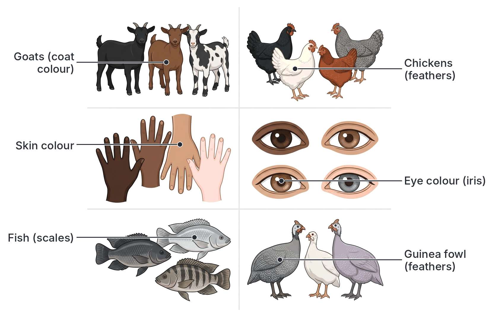

### Fingerprints

A **fingerprint** is the pattern of fine **ridges** (raised lines) and furrows on the skin of the tip of each finger. The ridges are called **friction ridges** or **papillary ridges**; they help us grip objects. Sweat pores open along the ridges, so when you touch a smooth surface you leave an invisible print of sweat and skin oil.

Important facts about fingerprints:

1. **They form before birth.** The ridges develop in the skin of the fetus during the early months of pregnancy and are complete well before birth.
2. **They never change** during life. They grow larger as you grow but keep the same pattern. If the skin is slightly injured, the same pattern grows back. Only a deep wound that damages the lower layer of the skin leaves a permanent scar.
3. **Every person's fingerprints are unique.** No two people have been found with identical fingerprints, not even **identical twins**, who have the same genes. Even your ten fingers each have a different print.
4. **The general pattern type is partly inherited,** but the fine details are shaped by conditions in the womb (such as pressure and the position of the fetus), which is why identical twins still have different prints.

Fingerprints are an example of **morphological** variation. Their **pattern type** (arch, loop, whorl or composite) falls into clear-cut classes, so it is treated as **discontinuous** variation. (The number of ridges on a finger, the "ridge count", is a measurement and varies continuously.)

The classes of fingerprints and their use in identifying people are explained under Objective vi below.

## Physiological variation

**Physiological variation** is variation in the way the body works: its chemistry, its functions and its abilities. Most physiological variations cannot be seen just by looking at a person; you have to test for them. The syllabus names three: tongue rolling, PTC tasting and blood groups.

### Ability to roll the tongue

Some people can curl up the sides of the tongue to form a U-shape or tube when the tongue is pushed out of the mouth. They are called **rollers**. Others cannot do this, however hard they try; they are **non-rollers**.

- This is a clear "can or cannot" difference, so it is used as a simple example of **discontinuous variation**.
- Most school textbooks say tongue rolling is controlled by **one gene**, with the allele for rolling (**R**) **dominant** to the allele for non-rolling (**r**). Rollers would be **RR** or **Rr**; non-rollers would be **rr**.
- In most populations studied, more people can roll their tongues than cannot.

**Textbook variation:** tongue rolling is a classic school example, but modern studies have found that it is **not** a simple one-gene character. Some identical twins differ (one can roll and the other cannot), and some children learn to roll their tongues as they get older. So it is affected by the environment and practice as well as genes. For the exam, use the textbook answer (rolling is dominant), but be aware of this.

### Ability to taste phenylthiocarbamide (PTC)

**Phenylthiocarbamide (PTC)** is a harmless (in the tiny amounts used) chemical. In a test, a small strip of paper soaked in a weak PTC solution is placed on the tongue.

- **Tasters** find it very **bitter**.
- **Non-tasters** taste nothing, or only a very faint taste, like plain paper.

The ability to taste PTC depends mainly on a single gene that codes for a bitter-taste receptor protein on the tongue. The **taster** allele (**T**) is **dominant** to the **non-taster** allele (**t**):

| Genotype | Phenotype |
| --- | --- |
| TT | Taster |
| Tt | Taster |
| tt | Non-taster |

- In most populations studied, tasters are the majority, but the proportion differs between populations.
- Because people are either tasters or non-tasters, it is a classic example of **discontinuous variation**.
- **Note:** the test uses paper with only a tiny amount of PTC. PTC is poisonous in larger amounts, so the test must only be done with properly prepared test papers under a teacher's supervision. Some schools use a related, safer chemical, **PROP** (propylthiouracil), for the same test.

**Textbook variation:** most textbooks treat PTC tasting as a simple dominant/recessive character, as above. In fact, people differ in **how strongly** they taste it, and a few other genes have small effects, but one main gene explains most of the difference between tasters and non-tasters.

### Blood groups

Human blood can be classified into groups according to special substances (**antigens**) found on the surface of the **red blood cells**. The two most important blood group systems are the **ABO system** and the **Rhesus (Rh) system**.

#### The ABO blood group system

The ABO system was discovered by the Austrian scientist **Karl Landsteiner** in **1900–1901**. He found that mixing blood from some people made the red cells clump together, and he worked out why.

There are two kinds of antigen (also called **agglutinogens**) that may be on the red cells: **antigen A** and **antigen B**. In the **plasma**, there may be two kinds of antibody (also called **agglutinins**): **anti-A** (or **a**) and **anti-B** (or **b**).

| Blood group | Antigen (agglutinogen) on red cells | Antibody (agglutinin) in plasma |
| --- | --- | --- |
| **A** | A | anti-B (b) |
| **B** | B | anti-A (a) |
| **AB** | A and B | Neither |
| **O** | Neither | anti-A and anti-B (a and b) |

**The key rule:** a person never has the antibody that matches their own antigen. If they did, their own blood would clump.

If red cells carrying antigen A meet anti-A antibodies, the antibodies stick the cells together into clumps. This clumping is called **agglutination**. In a blood vessel, clumps can block small vessels, and the red cells break open (**haemolysis**), which can kill the person. This is why blood for transfusion must be matched (see Objective ix).

ABO blood groups are controlled by **one gene with three alleles** (**IA**, **IB** and **i**), which is explained in `D2a-heredity-principles.md`. They are not affected by the environment and never change during a person's life, so they show **discontinuous variation**: everyone is A, B, AB or O, with nothing in between.

**ABO groups in Nigeria:** surveys in different parts of Nigeria consistently find that **group O is the most common** (often around half of the people tested), followed by A and B, with **AB the rarest**. The exact percentages differ from study to study and from place to place.

#### The Rhesus (Rh) blood group system

The Rhesus system was discovered in **1940** by **Karl Landsteiner and Alexander Wiener**, using the blood of **rhesus monkeys**, which is how it got its name.

- People whose red cells carry the **Rhesus antigen** (also called the **D antigen**) are **Rhesus positive (Rh+)**.
- People without it are **Rhesus negative (Rh−)**.
- Unlike the ABO system, a Rh− person does **not** normally have anti-Rh antibodies in their plasma. They make them only after Rh+ red cells get into their blood (for example, by a wrong transfusion, or from their baby's blood during childbirth). This is the cause of **haemolytic disease of the newborn**, explained in `D2b-applications-of-heredity.md`.
- Being Rh+ is **dominant** (allele **D**) and Rh− is **recessive** (genotype **dd**).
- In Nigeria, as in most of Africa, the great majority of people are **Rh positive**; Rh-negative people are a small minority (studies often report about 5% or less).

A person's full blood group combines both systems, for example **O positive (O+)**, **A negative (A−)** or **AB positive (AB+)**.

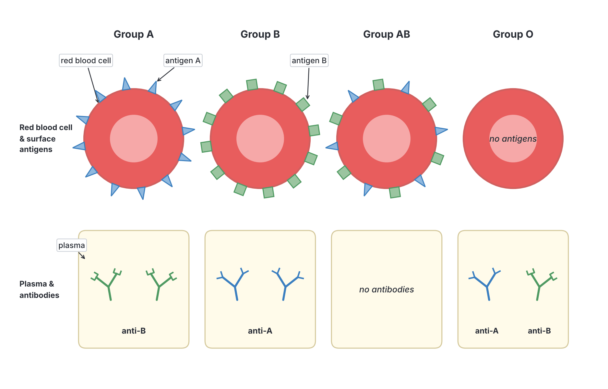

## Continuous and discontinuous variation

**Objective i: differentiate between continuous and discontinuous variations with examples.**

### Continuous variation

**Continuous variation** is variation in which a characteristic shows a **complete range** of values from one extreme to the other, with **no clear-cut groups**. Every value in between can occur.

- **Examples:** height, body weight (mass), skin colour, hand span, foot length, length of leaves on one tree, mass of seeds, milk yield of cows, egg production of hens, intelligence (as measured by tests).
- The characteristic is **measured** (in cm, kg, etc.), not just observed.
- When you plot the number of individuals against the value, you get a smooth, bell-shaped curve called a **normal distribution curve**. Most individuals are near the middle (the **mean** or average); very few are at the extremes (very short or very tall).
- It is usually controlled by **many genes** (it is **polygenic**), each with a small, adding effect.
- It is usually strongly **affected by the environment** (food, climate, disease, exercise, light, soil).

### Discontinuous variation

**Discontinuous variation** (also called **discrete variation**) is variation in which individuals fall into a **small number of distinct, clear-cut groups**, with **no intermediates** in between.

- **Examples:** ABO blood groups (A, B, AB, O), Rhesus factor (+ or −), ability to roll the tongue, ability to taste PTC, sex (male or female), fingerprint pattern type (arch, loop, whorl, composite), albinism, sickle-cell condition (HbAA, HbAS, HbSS), attached or free ear lobes; in plants, tall or dwarf pea plants, round or wrinkled pea seeds, red or white flowers.
- The characteristic is **observed** or **counted** (a "yes/no" or "which group" answer), not measured on a scale.
- When you plot the number of individuals in each group, you get a **bar chart** with separate bars (gaps between them), not a smooth curve.
- It is usually controlled by **one gene** or a few genes, with large effects.
- It is **little or not at all affected by the environment**. Your blood group does not change if you eat more or move to another town.

### Continuous vs discontinuous variation compared

| Feature | Continuous variation | Discontinuous variation |
| --- | --- | --- |
| Range of values | A smooth, complete range from one extreme to the other | A few distinct, separate groups (classes) |
| Intermediates | Many intermediate forms | No intermediates |
| How it is recorded | **Measured** (quantitative), e.g. cm, kg | **Observed or counted** (qualitative), e.g. yes/no, group A/B/AB/O |
| Graph | **Histogram** with touching bars, giving a smooth **bell-shaped (normal) curve** | **Bar chart** with separate bars |
| Genetic control | Many genes (**polygenic**), each with a small effect | One gene or a few genes, each with a large effect |
| Effect of environment | **Large**; environment strongly modifies it | **Small or none** |
| Can an individual's class change? | Yes, e.g. weight goes up and down with diet | No, e.g. blood group stays the same for life |
| Usefulness in identifying people | Poor (many people have the same height) | Good (used in crime detection, paternity, transfusion) |
| Human examples | Height, weight, skin colour, hand span, intelligence | Blood groups, tongue rolling, PTC tasting, sex, fingerprint type, albinism |
| Plant and animal examples | Height of maize plants, length of mango leaves, milk yield, egg mass | Tall or dwarf pea, round or wrinkled seeds, black or white guinea pig coat |

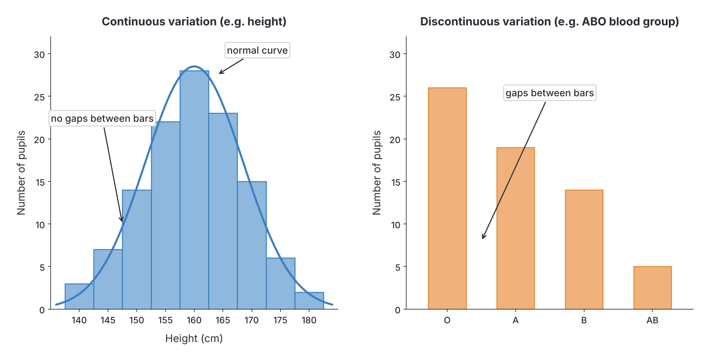

**Memory trick:** **c**ontinuous = **c**urve and **c**entimetres (measured); **d**iscontinuous = **d**istinct groups (counted).

**Textbook variation:** a few characters do not fit neatly. Skin colour and eye colour are listed as continuous in some textbooks and discontinuous in others (see above). Fingerprint **type** is discontinuous, but ridge count is continuous. In the exam, the standard examples are: **continuous** = height, weight, skin colour; **discontinuous** = blood groups, tongue rolling, PTC tasting, sex, fingerprint type.

## Causes of variation: environment, habitat and genetic constitution

**Objective ii: relate the role of environmental conditions, habitat and the genetic constitution to variation.**

Every characteristic of an organism is the result of **two things working together**:

**Phenotype (what the organism is like) = Genotype (its genes) + Environment (its surroundings)**

- The **genotype** (genetic constitution) is the set of genes an organism inherits from its parents. It sets the **potential**: what the organism could become.
- The **environment** includes everything around the organism: food, water, climate, light, temperature, soil, disease, and for humans, education and lifestyle. It decides how much of that potential is reached.
- The **phenotype** is the organism's actual observable characteristics.

Variation caused by genes is **inherited** (heritable) and can be passed to the next generation. Variation caused only by the environment is **acquired** (non-heritable) and is not passed on. This is covered in detail in `D2a-heredity-principles.md`.

### 1. Genetic constitution (genetic causes of variation)

Children of the same parents look different from each other (unless they are identical twins). Genetic variation arises in these ways:

1. **Meiosis: independent assortment.** When gametes (sperm and eggs) are made by meiosis, each gamete receives one chromosome from each pair. Which one of each pair goes into a gamete is random. With 23 pairs of chromosomes in humans, one person can make over 8 million (223) different combinations of chromosomes in their gametes.
2. **Meiosis: crossing over.** During meiosis, matching (homologous) chromosomes swap pieces, creating new combinations of alleles on each chromosome.
3. **Random fertilisation.** Any one of millions of sperm can fertilise the egg, so the combination of genes in the child is a matter of chance.
4. **Mutation.** A **mutation** is a sudden change in a gene or chromosome. It is the only source of completely **new** alleles. Examples include the sickle-cell allele and albinism. Mutations can be caused by radiation (X-rays, ultraviolet light) and some chemicals, or can happen by chance during copying of DNA. (See `E2-evidence-of-evolution.md`.)

Points 1 to 3 shuffle existing alleles into new combinations (**recombination**). Only mutation makes brand-new alleles. **Asexual reproduction** (e.g. planting cassava stem cuttings or yam setts) produces offspring that are genetically identical to the parent (**clones**), so their differences come only from the environment and occasional mutation.

Characteristics controlled **only or mainly by genes** include: ABO and Rhesus blood groups, sex, albinism, sickle-cell condition, PTC tasting, and the colour of pea seeds.

### 2. Environmental conditions

The environment changes how genes are expressed. Examples:

- **Food (nutrition):** a child with genes for tallness will not reach full height without enough protein and energy. Children who suffer **kwashiorkor** (protein deficiency) or long-term undernutrition are often **stunted** (shorter than they should be for their age). Adults who eat too much become overweight.
- **Sunlight:** skin exposed to strong sunlight becomes darker (tanned). Farmers who work in the sun have darker skin on their arms and face than on parts covered by clothes.
- **Exercise:** labourers, athletes and wrestlers develop larger muscles.
- **Disease:** a child who suffers repeated malaria or worm infections may grow more slowly.
- **Temperature:** in the **Himalayan rabbit**, the gene for dark fur only works in cool skin. Its body is white, but its ears, nose, feet and tail (the coolest parts) are black. If an ice pack is kept on a shaved patch of its back, the new fur that grows there is black. The same happens in Siamese cats. This shows clearly that genes and environment work together.
- **Light for plants:** a plant grown in the dark becomes tall, thin and yellow (**etiolated**); the same plant in light is short, sturdy and green.
- **Minerals in the soil:** maize grown in nitrogen-poor soil is shorter and yellower than maize of the same variety grown with fertiliser.
- **Soil pH:** in some *Hydrangea* plants, flowers are blue in acid soil and pink in alkaline soil.

### 3. Habitat

The **habitat** is the particular place where an organism lives. Different habitats provide different conditions, so organisms of the same species in different habitats often look different:

- **Plants in shade and in open sun:** a cocoyam or a tree growing in the shade of the forest has larger, thinner, darker green leaves than one of the same kind growing in full sun.
- **Water and land:** some water plants have two kinds of leaves on the same plant (**heterophylly**). For example, the arrowhead plant (*Sagittaria*) has thin, ribbon-like leaves under water and arrow-shaped leaves above water. The genes are the same; the habitat around each leaf differs.
- **Altitude and climate:** people who have lived all their lives at high altitude (for example, in the Andes or the Himalayas) tend to have more red blood cells than people at sea level. On a smaller scale, plants on the high, cool Jos and Mambilla Plateaux grow differently from the same varieties in the hot lowlands.
- **Fish in different waters:** *Tilapia* in muddy, dark water are usually darker than those in clear water; many fish can change shade to match their background.

### Twins: separating genes from environment

**Identical (monozygotic) twins** come from one fertilised egg that splits into two. They have **exactly the same genes**. **Non-identical (dizygotic or fraternal) twins** come from two eggs fertilised by two sperm, so they are no more alike genetically than other brothers and sisters. Nigeria, especially the Yoruba south-west (around Igbo-Ora in Oyo State, often called the "twin capital of the world"), has one of the highest twinning rates in the world; most of these are non-identical twins.

- Any **difference** between identical twins must be caused by the **environment** (for example, if one twin is better fed or exercises more, they may be heavier).
- Characters that are always the same in identical twins (blood group, sex, eye colour) are controlled by genes.
- Even identical twins have **different fingerprints**, which shows that conditions in the womb affect fingerprint details.

### Summary table: causes of variation

| Cause | How it works | Heritable? | Examples |
| --- | --- | --- | --- |
| **Genetic constitution** | Different alleles inherited from parents; new combinations at meiosis and fertilisation; mutation | Yes | Blood group, sex, albinism, sickle-cell condition, PTC tasting |
| **Environmental conditions** | Food, light, temperature, disease, exercise change how genes are expressed | No | Stunting from malnutrition, sun tanning, larger muscles, etiolated plants |
| **Habitat** | Different conditions in the place where the organism lives | No | Shade leaves vs sun leaves; water and air leaves of *Sagittaria* |
| **Genes and environment together** | Genes set the potential; environment decides how much is reached | Partly | Height, weight, skin colour, crop yield |

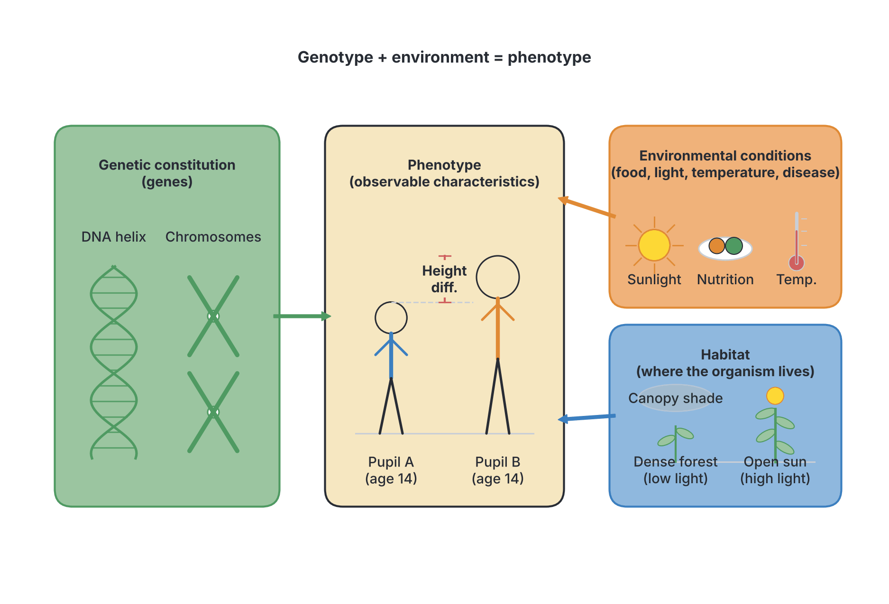

## Measuring heights and weights of pupils

**Objective iii: measure heights and weights of pupils of the same age group.**

To study continuous variation, you need measurements from a large number of individuals. Using pupils of the **same age group** (and, ideally, the same sex) is important: if you mixed 10-year-olds and 17-year-olds, the differences would mainly be due to age, not to natural variation.

### Practical: measuring height

**Aim:** to measure the heights of pupils of the same age group and show that height varies continuously.

**Materials:** a metre rule or measuring tape fixed vertically to a flat wall (or a height-measuring board), a flat ruler or set square (or a book) to rest on the head, a pencil, a notebook or record sheet.

**Method:**

1. Choose at least 30 to 40 pupils of the same age (for example, all 15-year-olds in SS2), and record whether each is male or female.
2. Fix the measuring tape to the wall so that **0 cm is exactly at floor level** and the tape is straight and vertical.
3. Ask each pupil to remove their shoes, caps and any hair ornaments, and to stand **straight** with their **back and heels against the wall**, feet together, looking straight ahead.
4. Place the flat ruler (or book) on top of the head so it is level (horizontal) and touches the wall.
5. Read the height where the bottom of the ruler meets the tape, with your eye **level** with the mark (to avoid parallax error).
6. Record the height to the nearest **centimetre** (or 0.5 cm).
7. Repeat the measurement once more for each pupil and take the average, to reduce errors.

### Practical: measuring weight (body mass)

**Materials:** a bathroom scale or, better, a medical weighing scale, placed on a hard, level floor.

**Method:**

1. Check that the scale reads **zero** before anyone stands on it (adjust it if not).
2. Ask each pupil to remove shoes and heavy items (bags, belts, phones) and wear light clothing.
3. The pupil stands still in the middle of the scale, without holding anything.
4. Read the mass to the nearest **0.5 kg** or **1 kg**, and record it.
5. Use the **same scale** for every pupil, and weigh everyone at about the same time of day (weight changes slightly after meals).

### Sources of error and precautions

| Possible error | Precaution |
| --- | --- |
| Shoes, caps or hairstyles add height | Remove shoes and headgear; press hair down with the ruler |
| Pupil slouching or on tiptoe | Heels, buttocks, shoulders and back of head against the wall |
| Ruler on the head not level | Use a set square against the wall |
| Parallax error in reading the tape | Read with eye level with the mark |
| Scale not at zero | Zero the scale before each use |
| Clothes and items add weight | Light clothing; empty pockets |
| Different scales give different readings | Use one scale for everyone |
| Too few pupils | Measure at least 30 to 40; the more, the smoother the curve |

**Recording:** draw a table with columns for pupil number, sex, age, height (cm) and weight (kg). Do not record names if pupils would rather keep their measurements private; numbers are enough.

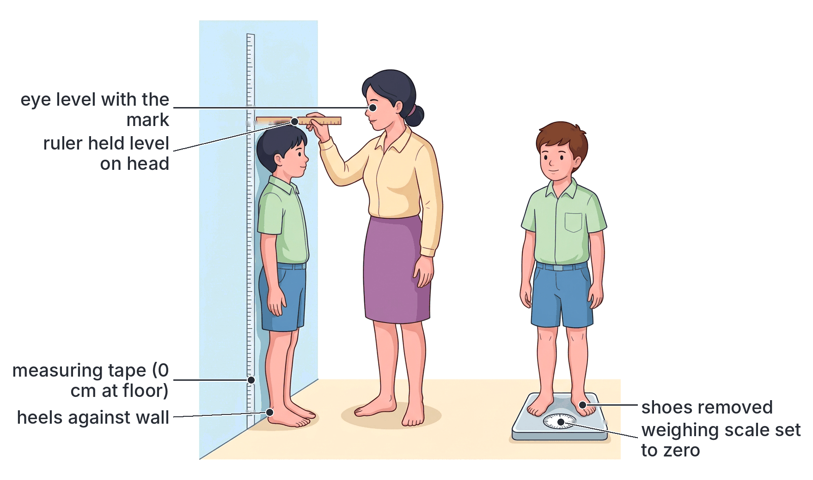

## Plotting frequency distribution graphs of heights and weights

**Objective iv: plot graphs of frequency distribution of the heights and weights.**

A **frequency** is the number of times something occurs: here, the number of pupils whose height (or weight) falls within a certain range. A **frequency distribution** shows how the measurements are spread out.

### Step-by-step method

1. **Find the range.** Look for the smallest and largest measurements.
2. **Choose class intervals.** Divide the range into 6 to 10 equal groups (classes), for example 140–144 cm, 145–149 cm, and so on. The groups must not overlap.
3. **Make a tally chart.** Go through the measurements one by one and put a tally mark (|) beside the class each one falls into. Group the tallies in fives (||||).
4. **Count the frequency** of each class.
5. **Check** that the frequencies add up to the total number of pupils.
6. **Draw the axes.** Put the measurement (height in cm) on the **horizontal (x) axis** and the **frequency (number of pupils)** on the **vertical (y) axis**. Give both axes labels and units, and choose a sensible scale.
7. **Draw a histogram.** For each class, draw a bar whose height equals the frequency. For continuous data, the **bars touch** each other (there are no gaps), because the measurements run smoothly from one class into the next.
8. **Draw the frequency curve.** Mark the midpoint of the top of each bar and join the points with a **smooth curve**. For height and weight, the curve is usually **bell-shaped** and roughly symmetrical: the **normal distribution curve**.
9. **Give the graph a title**, for example "Frequency distribution of heights of 40 SS2 pupils aged 15".

### Worked example: heights

**Invented sample data for practice (not real measurements):** suppose 40 pupils aged 15 years in one school were measured. Their heights were grouped as follows.

| Height class (cm) | Tally | Frequency (number of pupils) |
| --- | --- | --- |
| 140–144 | \| | 1 |
| 145–149 | \|\|\| | 3 |
| 150–154 | \|\|\|\| \| | 6 |
| 155–159 | \|\|\|\| \|\|\|\| | 10 |
| 160–164 | \|\|\|\| \|\|\|\| \| | 11 |
| 165–169 | \|\|\|\| \| | 6 |
| 170–174 | \|\| | 2 |
| 175–179 | \| | 1 |
| **Total** | | **40** |

**Reading the data:**

- **Range:** from the 140–144 cm class to the 175–179 cm class.
- **Modal class** (the class with the highest frequency): **160–164 cm** (11 pupils).
- **Estimated mean:** multiply the midpoint of each class by its frequency, add them up and divide by the total.
  - 142 × 1 = 142; 147 × 3 = 441; 152 × 6 = 912; 157 × 10 = 1,570; 162 × 11 = 1,782; 167 × 6 = 1,002; 172 × 2 = 344; 177 × 1 = 177.
  - Total = 6,370. Mean = 6,370 ÷ 40 ≈ **159.3 cm**.
- Most pupils (27 out of 40) are between 150 and 164 cm. Very few are very short or very tall. This is typical of **continuous variation**.

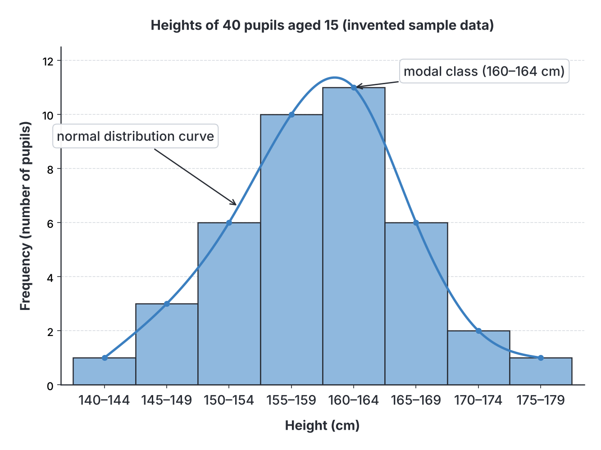

### Worked example: weights

**Invented sample data for practice (not real measurements):** the same 40 pupils were weighed.

| Weight class (kg) | Frequency (number of pupils) |
| --- | --- |
| 35–39 | 2 |
| 40–44 | 5 |
| 45–49 | 9 |
| 50–54 | 12 |
| 55–59 | 7 |
| 60–64 | 4 |
| 65–69 | 1 |
| **Total** | **40** |

- **Modal class:** **50–54 kg** (12 pupils).
- **Estimated mean:** (37 × 2) + (42 × 5) + (47 × 9) + (52 × 12) + (57 × 7) + (62 × 4) + (67 × 1) = 74 + 210 + 423 + 624 + 399 + 248 + 67 = 2,045. Mean = 2,045 ÷ 40 ≈ **51.1 kg**.
- The histogram again rises to a peak in the middle and falls away on both sides, giving a roughly bell-shaped curve. It is slightly **lopsided** (skewed): there is a longer "tail" towards the heavier side. Weight distributions often look like this, because a few people are much heavier than average.

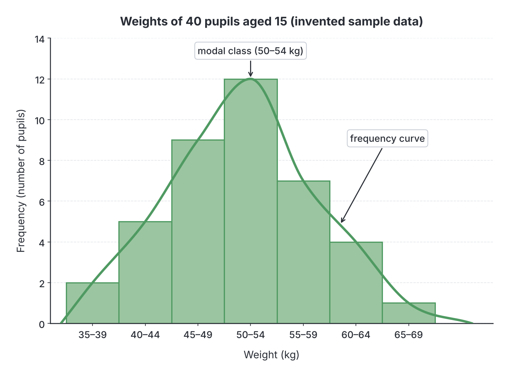

### Features of a normal distribution curve

1. It is **bell-shaped** and roughly **symmetrical** about the middle.
2. The **peak** is at the mean (average), which is also the most common value (the mode) and the middle value (the median).
3. Most individuals lie close to the mean; numbers fall off gradually towards both extremes.
4. The bigger the sample, the smoother the curve.

### Graphs for discontinuous variation

For discontinuous data such as blood groups or tongue rolling, you draw a **bar chart**, not a histogram:

- Each group (A, B, AB, O; or roller, non-roller) gets its own bar.
- The bars are **separate**, with **gaps** between them, because there is nothing in between the groups.
- The order of the bars does not matter.
- No curve is drawn.

| Feature | Histogram (continuous data) | Bar chart (discontinuous data) |
| --- | --- | --- |
| x-axis | A measured scale divided into classes (e.g. cm, kg) | Separate named categories (e.g. blood groups) |
| Bars | Touching, no gaps | Separate, with gaps |
| Curve | A smooth curve can be drawn through the bar tops | No curve |
| Order of bars | Fixed by the scale | Any order |

## Observing and recording colour patterns in plants and animals

**Objective v: observe and record various colour patterns in some plants and animals.**

### Practical: observing colour variation

**Aim:** to observe and record the colour patterns in members of one species of plant or animal, and decide whether the variation is continuous or discontinuous.

**Materials:** a notebook, pencil, coloured pencils, a hand lens; a camera or phone if available. Specimens from around the school and home.

**Method:**

1. Choose one species at a time (do not compare different species).
2. Look at as many individuals as possible (at least 20 if you can).
3. For each individual, record the main colour, any pattern (spots, stripes, patches, bands, speckles) and where it occurs on the body or plant.
4. Sort the individuals into groups of similar colours, and count each group.
5. Draw a bar chart (if there are a few clear groups) or describe the range (if colours grade smoothly).
6. Decide: is the variation **discontinuous** (clear groups) or **continuous** (a smooth range)?

**Example record sheet (filled in with invented sample observations for practice):**

| Species observed | Colour patterns seen | Number in each group | Type of variation |
| --- | --- | --- | --- |
| Village chickens (20 birds) | Black; white; brown/red; speckled | 6; 4; 7; 3 | Several clear groups (discontinuous), with some shading within groups |
| West African Dwarf goats (15) | All black; all brown; black-and-white patched; brown-and-white patched | 5; 3; 4; 3 | Mainly discontinuous |
| Croton (*Codiaeum*) leaves on 10 plants | Green with yellow spots; red, orange and yellow mixed; mostly yellow | 4; 4; 2 | Many patterns; shades grade into each other |
| Hibiscus flowers in the school compound | Red; pink; yellow; white | 9; 5; 3; 2 | Discontinuous between varieties |

### Colour patterns to look for

**In plants:**

- **Leaves:** many ornamental plants have **variegated** leaves (patches of green and white, yellow, red or purple), e.g. croton (*Codiaeum variegatum*), coleus, variegated *Dracaena* and some cassava varieties. The pale patches lack chlorophyll.
- **Flowers:** hibiscus (red, pink, yellow, white), *Bougainvillea* (the coloured parts are **bracts**, not petals: purple, red, orange, white), *Allamanda* (yellow), *Ixora* (red, orange, pink), four-o'clock (*Mirabilis jalapa*: red, pink, white or streaked flowers, sometimes on the same plant), periwinkle (*Catharanthus*: pink or white).
- **Fruits and seeds:** maize grains (white, yellow, red, purple, or mixed on one cob), beans and cowpeas (white, brown, black-eyed, speckled), pepper fruits (green, red, yellow), mango skin colours.

**In animals:**

- Coat colours of goats, sheep, cattle, dogs, cats and rabbits.
- Feather colours and patterns of chickens, guinea fowl, pigeons and ducks.
- Scale colours and patterns of fish (*Tilapia*, catfish) and of lizards and snakes.
- The wings of butterflies and moths of one species.
- The colour of the *Agama* lizard (male, female and young differ; see `A3-adaptations.md`).
- The banding of land snail shells (some have dark bands, others plain shells).

**Precautions:** do not handle animals roughly; do not pick flowers or leaves from other people's plants without permission; wash your hands after handling animals; observe wild animals (lizards, snakes) from a safe distance.

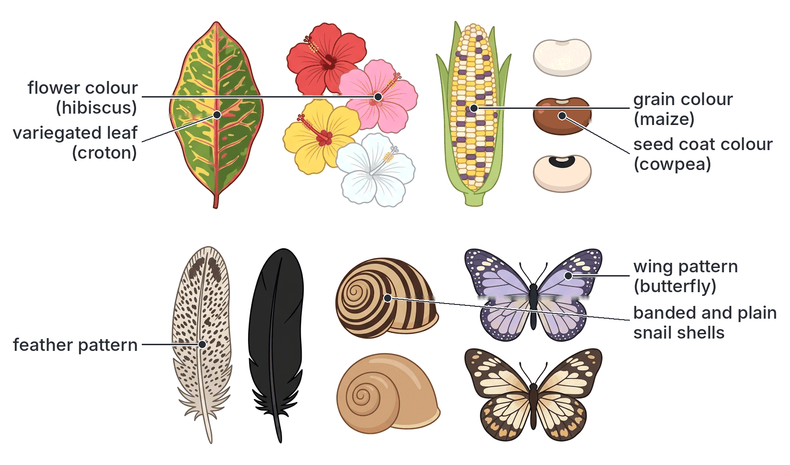

## Classification of fingerprints and identity detection

**Objective vi: apply classification of fingerprints in identity detection.**

### History in brief

- In the late 1800s, scientists such as **Henry Faulds** and **Sir Francis Galton** studied fingerprints. **Galton** showed that fingerprints are unique and do not change during life, and he grouped them into three basic patterns: arches, loops and whorls (1892).
- **Sir Edward Henry**, working in British India, developed a classification system for filing and searching fingerprint records (the **Henry system**). It was adopted by Scotland Yard in 1901 and spread around the world.
- Today, police forces use computer systems (**Automated Fingerprint Identification Systems, AFIS**) that compare a print with millions of stored records in seconds.

### The four classes of fingerprints

| Class | Description | How common (approximately) |
| --- | --- | --- |
| **Arch** | Ridges enter from one side, rise in the middle like a wave or hill, and leave from the other side. No delta and no core. A **tented arch** has a sharp spike in the middle | The **least common** (about 5% of fingerprints) |
| **Loop** | Ridges enter from one side, curve round in a hairpin shape and **leave from the same side** they entered. There is **one delta** (a triangle-shaped meeting point of ridges). In an **ulnar loop** the loop opens towards the little finger; in a **radial loop**, towards the thumb | The **most common** (about 60–65%) |
| **Whorl** | Ridges form **circles, ovals or spirals** around a central point. There are **two deltas**, one on each side | About 30–35% |
| **Composite** (compound) | A **combination** of two or more patterns in one print, e.g. a **double loop** (two loops curling round each other, like the letter S), a **central pocket loop** (a loop with a small whorl in the middle), or an **accidental** (an irregular pattern that fits no other class) | Uncommon |

**Textbook variation:** the percentages differ slightly between sources and between populations. Some classification systems put double loops and central pocket loops under "whorls" and so use only three classes (arches, loops, whorls), as Galton did. Many Nigerian textbooks, like the syllabus, use four classes: arches, loops, whorls and composites (compounds).

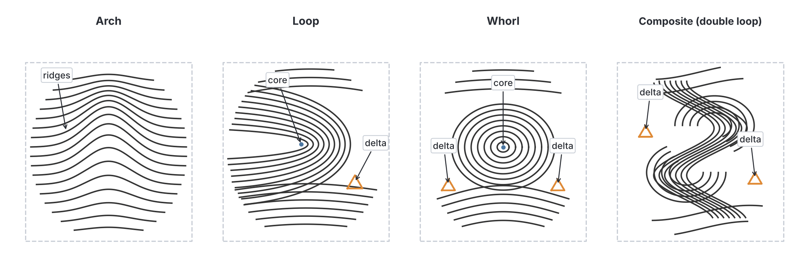

### Features used in identification

Besides the overall class, experts compare the **minutiae** (small details) of the ridges, also called **ridge characteristics** or **Galton details**:

- **Ridge ending:** a ridge that suddenly stops.
- **Bifurcation (fork):** a ridge that splits into two.
- **Dot (island):** a very short ridge.
- **Short ridge**, **enclosure (lake)** and **crossover**.

The number, type and position of these details are unique to each finger. Two prints are judged to come from the same finger only when the class, the ridge count and many minutiae all match exactly, with no unexplained differences.

### How fingerprints are recorded and used

**1. Taking fingerprints (known prints):**

1. Clean and dry the fingers.
2. Roll each fingertip in a thin layer of special black ink (or press it on an inkless pad), from one side of the nail to the other.
3. Roll it onto a fingerprint card in the right box for that finger.
4. Today, prints are usually taken with an **electronic scanner**, which stores them on a computer.

**2. Finding prints at a crime scene (latent prints):**

1. Prints left on smooth surfaces (glass, door handles, phones, weapons) are usually invisible (**latent**).
2. Investigators dust them with a fine powder (black or grey), or use chemicals (e.g. ninhydrin on paper) or special lights to make them visible.
3. The developed print is photographed and "lifted" with clear adhesive tape.

**3. Comparing prints:**

1. The crime-scene print is classified (arch, loop, whorl or composite) and its minutiae are marked.
2. It is compared with the prints of suspects, or searched against a database.
3. If the class and all the details match, the print is said to come from that person.

### Uses of fingerprints in identity detection

1. **Crime detection:** linking a suspect to a crime scene or weapon, or showing that a suspect was not there.
2. **Identification of dead bodies** after accidents, fires, floods or plane crashes, when faces cannot be recognised.
3. **Identity documents and registration:** in Nigeria, fingerprints (biometrics) are captured for the National Identification Number (NIN), the Bank Verification Number (BVN), international passports, the voters' register (the Independent National Electoral Commission uses fingerprint verification at elections), and SIM card registration.
4. **Security and access:** unlocking phones and laptops, door locks, staff attendance systems.
5. **Signing documents by people who cannot write:** a thumbprint is used in place of a signature.
6. **Preventing impersonation**, for example in examinations (JAMB captures candidates' fingerprints at registration and verifies them at the examination centre).

**Why fingerprints are so useful:** they are **unique** to each person, **permanent** (unchanged from before birth until death), **easy to take** cheaply, and fall into **classes** that make filing and searching quick.

## Physiological variations among the human population

**Objective vii: identify some specific examples of physiological variation among human population.**

The syllabus names three examples; others you may meet in textbooks are also listed.

| Physiological variation | The groups people fall into | How it is tested |
| --- | --- | --- |
| **Tongue rolling** | Rollers; non-rollers | Ask the person to stick out the tongue and curl up its sides into a U-shape |
| **PTC tasting** | Tasters (find it bitter); non-tasters | Place a PTC test paper on the tongue for a few seconds |
| **ABO blood group** | A, B, AB, O | Mix a drop of blood with anti-A and anti-B testing sera (see below) |
| **Rhesus factor** | Rh+; Rh− | Mix a drop of blood with anti-D serum |
| **Sickle-cell status (haemoglobin genotype)** | HbAA, HbAS, HbSS (and others such as HbAC, HbSC) | Haemoglobin electrophoresis in a laboratory |
| **Colour blindness** | Normal colour vision; colour blind | Ishihara colour plates (coloured dot patterns with hidden numbers) |
| **Handedness** | Right-handed; left-handed | Which hand the person uses to write and throw (affected by training too) |

### Testing ABO and Rhesus blood groups

**Materials:** a clean glass slide or white tile, anti-A serum, anti-B serum, anti-D serum, a sterile lancet, cotton wool and spirit (alcohol) swab, toothpicks or mixing sticks.

**Method (done by a trained person, wearing gloves):**

1. Clean the fingertip with spirit and allow it to dry.
2. Prick it with a **new, sterile lancet** (never share lancets: blood can carry HIV, hepatitis B and C).
3. Place three separate drops of blood on the slide, labelled A, B and D.
4. Add a drop of anti-A serum to the first, anti-B to the second and anti-D to the third.
5. Mix each with a **separate clean** stick and rock the slide gently.
6. Look for **agglutination** (clumping, which looks like grainy specks) after about one to two minutes.

**Reading the results:**

| Clumps with anti-A? | Clumps with anti-B? | ABO group |
| --- | --- | --- |
| Yes | No | **A** |
| No | Yes | **B** |
| Yes | Yes | **AB** |
| No | No | **O** |

- Clumps with **anti-D** = **Rhesus positive**; no clumps = **Rhesus negative**.

**Why it works:** anti-A serum contains antibodies that clump red cells carrying antigen A; anti-B clumps cells carrying antigen B. So the test tells you which antigens are on the person's red cells.

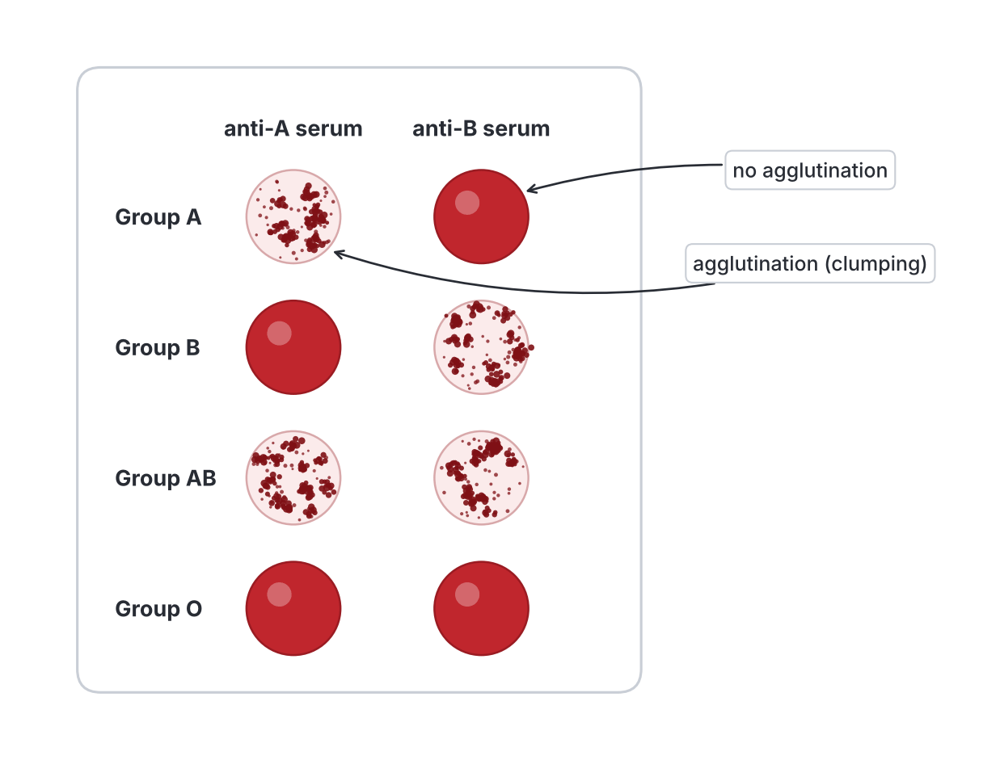

**Safety:** in schools, blood testing must only be done under strict supervision with sterile, single-use lancets, or replaced by a demonstration using simulated blood kits. Never touch another person's blood with bare hands.

## Categorising people according to physiological variation

**Objective viii: categorize people according to their physiological variation.**

Because physiological variations are **discontinuous**, people can be sorted (categorised) into distinct groups. You can do this as a class survey.

### Practical: a class survey of physiological variation

**Aim:** to categorise pupils according to tongue rolling, PTC tasting and blood group.

**Method:**

1. Test each pupil for tongue rolling and record "roller" or "non-roller".
2. Test each pupil with a PTC paper and record "taster" or "non-taster".
3. Record each pupil's ABO blood group and Rhesus factor (from a supervised test, or from a recent hospital record if available).
4. Count the number of pupils in each group, and work out the percentage: percentage = (number in group ÷ total) × 100.
5. Draw a **bar chart** for each characteristic (separate bars with gaps).
6. Note whether any pupils fall "in between" groups (they should not, if the variation is truly discontinuous).

**Results table (invented sample data for practice, 40 pupils):**

| Characteristic | Groups | Number | Percentage |
| --- | --- | --- | --- |
| Tongue rolling | Rollers | 28 | 70% |
| | Non-rollers | 12 | 30% |
| PTC tasting | Tasters | 29 | 72.5% |
| | Non-tasters | 11 | 27.5% |
| ABO blood group | O | 21 | 52.5% |
| | A | 9 | 22.5% |
| | B | 8 | 20% |
| | AB | 2 | 5% |
| Rhesus factor | Rh+ | 38 | 95% |
| | Rh− | 2 | 5% |

**Conclusions from the sample data:**

- Each pupil fits into exactly **one** group for each characteristic; there are no intermediates. This shows **discontinuous** variation.
- The groups are of **unequal size**: for example, rollers outnumber non-rollers, and group O is the largest blood group.
- A person can be in any combination of groups. Knowing that a pupil is a roller tells you nothing about their blood group, because the characters are inherited **independently**.

**Combining categories:** if you record several physiological characters together, people become easier to tell apart. For example, "O+, roller, taster" describes many people, but "AB−, non-roller, non-taster" describes very few. This idea of combining discontinuous characters is the basis of their use in identification (Objectives ix and x).

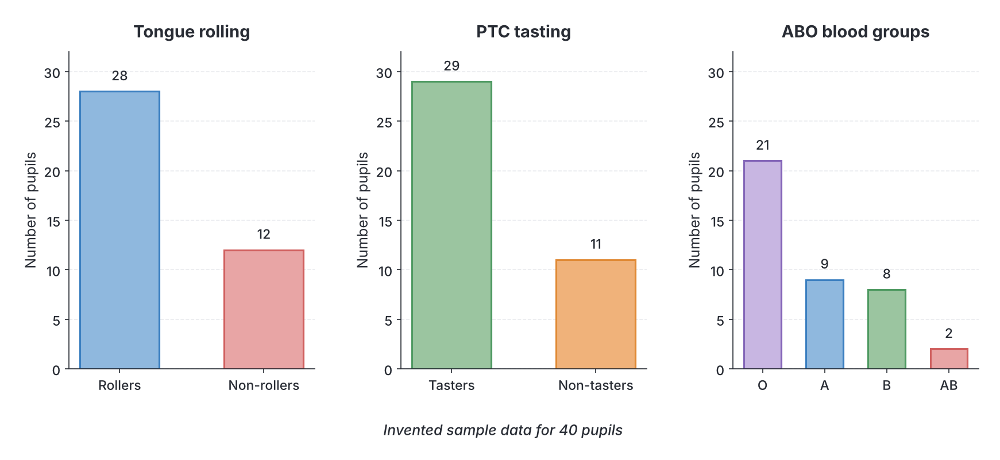

## Blood groups in blood transfusion and paternity

**Objective ix: apply the knowledge of blood groups in blood transfusion and determination of paternity.**

### Blood transfusion

A **blood transfusion** is the transfer of blood (or part of it, such as red cells or plasma) from a healthy person, the **donor**, into the vein of a patient, the **recipient**.

**When transfusion is needed:** severe bleeding after road accidents or gunshot wounds; bleeding during or after childbirth (a leading cause of maternal death in Nigeria); major surgery; severe anaemia, for example from malaria in young children or sickle-cell crisis; some cancers and kidney disease.

#### The rule for safe transfusion

When blood is transfused, the most important thing is the **donor's red cells (antigens)** and the **recipient's plasma (antibodies)**:

**A transfusion is unsafe if the recipient's plasma contains antibodies that match the antigens on the donor's red cells.**

The recipient's antibodies would agglutinate the donor's red cells, causing a **transfusion reaction**: fever, chills, back pain, dark urine, kidney failure, shock and possibly death.

The **donor's antibodies** matter much less in a small, slow transfusion, because they are quickly diluted in the recipient's large blood volume. (This is the old textbook reasoning; see the note on modern practice below.)

#### Compatibility table

✓ = compatible (safe); ✗ = incompatible (agglutination)

| Donor ↓ / Recipient → | A (has anti-B) | B (has anti-A) | AB (no antibodies) | O (has anti-A and anti-B) |
| --- | --- | --- | --- | --- |
| **A** (antigen A) | ✓ | ✗ | ✓ | ✗ |
| **B** (antigen B) | ✗ | ✓ | ✓ | ✗ |
| **AB** (antigens A and B) | ✗ | ✗ | ✓ | ✗ |
| **O** (no antigens) | ✓ | ✓ | ✓ | ✓ |

**The same table as a list:**

| Blood group | Can donate to | Can receive from |
| --- | --- | --- |
| **A** | A, AB | A, O |
| **B** | B, AB | B, O |
| **AB** | AB only | A, B, AB, O (all groups) |
| **O** | A, B, AB, O (all groups) | O only |

#### Universal donor and universal recipient

- **Group O is the universal donor.** Its red cells carry **no A or B antigens**, so they are not agglutinated by any recipient's antibodies.
- **Group AB is the universal recipient.** Its plasma has **no anti-A or anti-B antibodies**, so it does not agglutinate any donor's red cells.

**How to remember:** O has **n**O antigens, so it can be given to anyone; AB has **all** antigens and **no** antibodies, so it can take from anyone.

#### The Rhesus factor in transfusion

- A **Rh− person** must receive only **Rh− blood**. If a Rh− person is given Rh+ blood, the first transfusion usually causes no immediate problem, but their body makes **anti-Rh (anti-D) antibodies**. A second transfusion of Rh+ blood would then be agglutinated, which is dangerous.
- A **Rh+ person** can receive Rh+ or Rh− blood.
- So the true **universal donor is O negative** (no A, no B, no Rh antigen), and the universal recipient is **AB positive**.

**Modern practice (textbook variation):** textbooks teach "universal donor" and "universal recipient" as above, and in emergencies, when there is no time to test, hospitals do give **group O (preferably O negative) red cells**. But in normal practice, hospitals give blood of the **same ABO and Rhesus group** as the patient, and always do a **cross-match** (mixing a little of the donor's red cells with the patient's plasma in the laboratory) before transfusion. Whole group O blood contains anti-A and anti-B antibodies that can harm a group A, B or AB patient if large amounts are given.

#### Screening donated blood

Before donated blood is used, it must be:

1. **Grouped** (ABO and Rhesus).
2. **Screened** for infections that can be passed in blood: **HIV**, **hepatitis B**, **hepatitis C** and **syphilis** (malaria parasites may also be checked).
3. **Cross-matched** with the recipient.
4. Stored in a blood bank in a refrigerator with an anticoagulant.

In Nigeria, the **National Blood Service** coordinates the collection and screening of blood, and voluntary, unpaid donors are encouraged because their blood is safest.

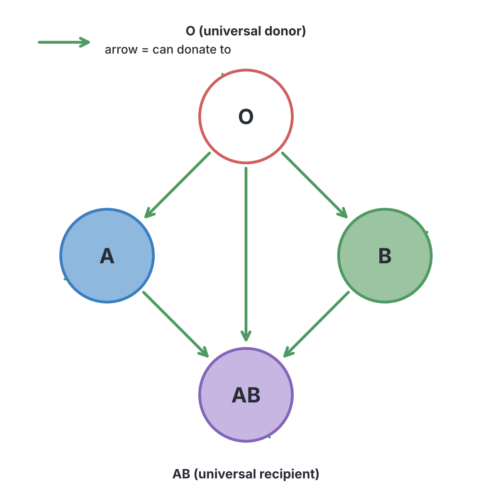

### Determination of paternity

Sometimes there is a dispute about who the father of a child is (for example, in a court case about child support or inheritance, or when babies may have been mixed up in a hospital). Because blood groups are **inherited in a known way** and **never change**, they can help.

#### How ABO blood groups are inherited (in brief)

The ABO blood group is controlled by one gene with three alleles: **IA** and **IB** (both dominant over **i**, and **codominant** with each other) and **i** (recessive). Each parent passes **one** allele to the child. (Full explanation in `D2a-heredity-principles.md`.)

| Blood group (phenotype) | Possible genotypes | Alleles this person can pass on |
| --- | --- | --- |
| A | IAIA or IAi | IA or i |
| B | IBIB or IBi | IB or i |
| AB | IAIB | IA or IB |
| O | ii | i only |

#### The key principle: blood groups can exclude, but cannot prove

- Blood groups can show that a man **cannot** be the father of a child (**exclusion**).
- They **cannot prove** that a particular man **is** the father, because millions of other men have the same blood group.

**How to work out a paternity question:**

1. From the **mother's** and **child's** blood groups, work out which allele the child must have received from the **father**.
2. Check whether the man in question could have that allele.
3. If he cannot, he is **excluded**. If he can, he **may** be the father (but so could any other man with that allele).

#### Worked examples

**Example 1:** a mother is group **A**, the child is group **B**. A man of group **O** is accused of being the father.

- The child (B) has an IB allele. The mother (A) cannot have given IB, so it **must** have come from the father.
- A group O man (ii) has no IB allele.
- **Conclusion:** he **cannot** be the father. He is excluded.

**Example 2:** a mother is group **O**, the child is group **O**. Two men claim to be the father: Mr X is group **AB** and Mr Y is group **A**.

- The child (ii) must have received an **i** from each parent.
- Mr X (IAIB) has no i allele, so he **cannot** be the father.
- Mr Y could be IAi, so he **could** be the father (but this does not prove it).

**Example 3:** a mother is group **B**, the child is group **AB**. Which of these men could be the father: A, B, AB, O?

- The child has IA and IB. The mother (B) gave IB, so the father must have given **IA**.
- Men of group **A** or **AB** could be the father; men of group **B** or **O** cannot.

**Example 4:** a mother is group **AB** and the child is group **O**. Is this possible?

- No. An AB mother can only pass on IA or IB, so she **cannot** have a group O child, whoever the father is. (This would suggest that the baby may have been mixed up with another baby.)

#### Quick reference: possible children's blood groups

| Parents | Possible children | Impossible children |
| --- | --- | --- |
| O × O | O | A, B, AB |
| O × A | A, O | B, AB |
| O × B | B, O | A, AB |
| O × AB | A, B | O, AB |
| A × A | A, O | B, AB |
| A × B | A, B, AB, O | none |
| A × AB | A, B, AB | O |
| B × B | B, O | A, AB |
| B × AB | A, B, AB | O |
| AB × AB | A, B, AB | O |

**Note:** "A, O" for A × A means children can be A or O. Group O children appear only if both group A parents are heterozygous (IAi).

**The Rhesus factor** can add a little more evidence: two Rh− parents (dd × dd) can only have Rh− children, so a Rh+ child of a Rh− mother must have a Rh+ father.

#### Limitations of blood groups in paternity

1. They can only **exclude**, never prove.
2. Many men share the same blood group, so in many cases no one is excluded.
3. Very rare blood group variants can give misleading results.

Today, **DNA testing** has replaced blood grouping for paternity. A child gets half of its DNA from each parent, so the child's DNA pattern must match the mother's and the true father's. DNA tests can **exclude** a man with near certainty and can show that a man **is** the father with a probability usually above 99.9% (see Objective x).

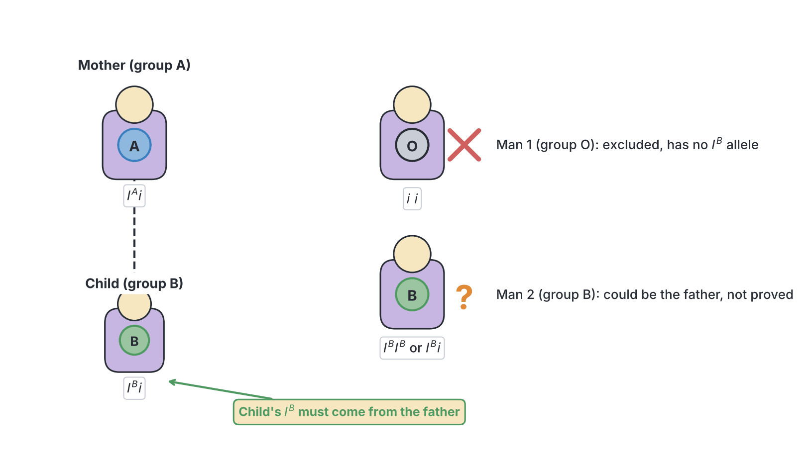

## Discontinuous variation in crime detection

**Objective x: use discontinuous variation in crime detection.**

Crime detection (**forensic science**) uses discontinuous characters because they place a person in a definite group, they **do not change** with time or environment, and some (fingerprints and DNA) are **unique** to one person.

### 1. Fingerprints

- Prints left on a weapon, a window, a car or a safe can be compared with those of suspects or searched in police databases (see Objective vi).
- Because every person's prints are unique and permanent, a full match is strong evidence that the person touched that object.
- A print that **does not** match a suspect can help to clear an innocent person.

### 2. Blood groups

Blood, and other body fluids such as semen and saliva (in most people, called "secretors", blood group antigens are also present in these fluids), may be found at a crime scene or on a suspect's clothes or a weapon.

- The ABO and Rhesus groups of the stain can be tested.
- If a blood stain at the scene is group **AB−**, a suspect who is **O+** **cannot** have left it, so he is excluded as the source.
- If the suspect is also AB−, he **could** have left it, but so could many other people; it is supporting evidence only.
- Blood grouping was widely used before DNA testing, and is still a quick first check.

### 3. DNA fingerprinting (DNA profiling)

Every person (except identical twins) has a unique sequence of **DNA**. DNA fingerprinting compares regions of DNA that vary greatly between people.

- **History:** DNA fingerprinting was invented by the British geneticist **Sir Alec Jeffreys** at the University of Leicester in **1984**. It was first used in a criminal case in England in the late 1980s, where it both freed an innocent suspect and identified the real offender.
- **Sources of DNA:** blood, semen, saliva (on cups, cigarette ends, envelopes), hair with roots, skin cells (under the fingernails of a victim who scratched an attacker), bone and teeth (even from old remains).

**Steps in DNA fingerprinting (simplified):**

1. **Collect** a sample from the crime scene and reference samples from suspects (usually a mouth swab) and the victim.
2. **Extract** DNA from the cells.
3. **Copy (amplify)** the DNA if there is very little, using a method called the **polymerase chain reaction (PCR)**, which makes millions of copies of chosen regions.
4. **Cut or select** the regions that vary between people. These are short sections of DNA repeated many times, side by side; the **number of repeats** differs from person to person (modern tests use **short tandem repeats, STRs**).
5. **Separate** the DNA pieces by size, using **gel electrophoresis** (an electric current pulls DNA through a gel; small pieces move further) or a machine that does the same thing.
6. **Make the pattern visible.** The DNA pieces show up as a series of **bands**, like a supermarket barcode.
7. **Compare** the band pattern from the crime scene with those of the suspects. A **match** in all the regions tested shows, with very high probability, that the sample came from that person. A **mismatch** proves that it did not.

**Uses of DNA fingerprinting:**

- Identifying criminals in cases such as murder, rape, robbery and kidnapping, and **freeing innocent people** who were wrongly convicted.
- **Paternity and maternity testing** (each band in the child must come from the mother or the father).
- **Identifying victims** of disasters (plane crashes, building collapses, bomb blasts) by comparing remains with DNA from relatives.
- Settling **immigration** and **inheritance** disputes about family relationships.
- Identifying wildlife products (for example, ivory or pangolin scales) to fight illegal trade.

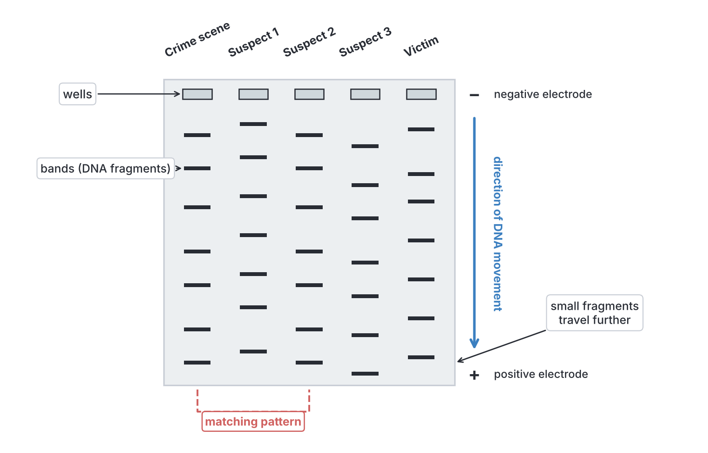

### Comparing the methods

| Method | Type of variation | Can it exclude a suspect? | Can it identify one person? | Notes |
| --- | --- | --- | --- | --- |
| **ABO and Rhesus blood groups** | Discontinuous (a few groups) | Yes | No; many people share each group | Quick and cheap; mainly replaced by DNA |
| **Fingerprints** | Discontinuous (classes) plus unique details | Yes | Yes | Only if a usable print is left; easy to record |
| **DNA fingerprinting** | Discontinuous (bands present or absent) | Yes | Yes, with very high probability (except identical twins) | Works with tiny or old samples; more costly; samples must be protected from contamination |

**Why continuous variation is not useful here:** height, weight and skin colour are shared by very many people and change with time and environment, so they can only give a rough description of a suspect, not firm identification.

## Key terms

| Term | Meaning |
| --- | --- |
| Variation | Differences in characteristics between individuals of the same species |
| Population | A group of organisms of the same species living in the same place at the same time |
| Morphological variation | Variation in physical appearance (size, shape, colour, fingerprints) |
| Physiological variation | Variation in body function or chemistry (blood group, tongue rolling, PTC tasting) |
| Continuous variation | Variation with a smooth range of values and no clear groups, e.g. height |
| Discontinuous (discrete) variation | Variation in which individuals fall into a few distinct groups, e.g. blood group |
| Polygenic | Controlled by many genes |
| Genotype | The genetic make-up of an organism |
| Phenotype | The observable characteristics of an organism, from its genotype and environment |
| Mutation | A sudden, heritable change in a gene or chromosome |
| Frequency | The number of individuals in a particular class or group |
| Histogram | A graph of continuous data in which the bars touch |
| Normal distribution curve | A symmetrical, bell-shaped frequency curve typical of continuous variation |
| Modal class | The class with the highest frequency |
| Fingerprint | The pattern of ridges on the skin of a fingertip |
| Delta | A triangular meeting point of ridges in a fingerprint |
| Minutiae | Small ridge details (endings, forks, dots) used to match fingerprints |
| Agglutinogen (antigen) | A substance on the surface of red blood cells that determines the blood group |
| Agglutinin (antibody) | A substance in the plasma that clumps red cells carrying the matching antigen |
| Agglutination | Clumping of red blood cells |
| Universal donor | Group O, whose red cells have no A or B antigens (O negative in full) |
| Universal recipient | Group AB, whose plasma has no anti-A or anti-B (AB positive in full) |
| Rhesus factor (D antigen) | An antigen on the red cells of Rh-positive people |
| Cross-matching | Testing donor red cells against recipient plasma before transfusion |
| Paternity | Fatherhood: who the biological father of a child is |
| DNA fingerprinting (profiling) | Identifying a person from the pattern of variable regions of their DNA |
| PTC (phenylthiocarbamide) | A chemical that tastes bitter to tasters and has little taste to non-tasters |

## Exam tips and common mistakes

- **Continuous = measured, discontinuous = counted:** height, weight and skin colour are continuous; blood groups, tongue rolling, PTC tasting, sex and fingerprint type are discontinuous.
- **Histogram vs bar chart:** continuous data give a histogram with **touching** bars and a bell-shaped curve; discontinuous data give a bar chart with **gaps** between bars.
- **Environment affects continuous variation most:** a question asking which character is "most affected by the environment" usually wants height, weight or skin colour, not blood group.
- **Antigens on cells, antibodies in plasma:** agglutinogens (A, B) are on red cells; agglutinins (anti-A, anti-B) are in plasma. Group A has antigen A and **anti-B**, not anti-A.
- **Universal donor is O; universal recipient is AB:** do not swap them. In full, the universal donor is O negative.
- **Transfusion rule:** check the **donor's antigens** against the **recipient's antibodies**.
- **Blood groups can only exclude paternity, not prove it:** "the man could be the father" is the strongest conclusion from blood groups alone; DNA testing can confirm it.
- **An AB parent cannot have an O child, and an O parent cannot have an AB child.**
- **Fingerprint classes:** arches, loops, whorls and composites. Loops are the most common, arches the least. Identical twins have different fingerprints.
- **Mutation is the only source of new alleles;** meiosis and fertilisation only reshuffle existing ones.
- **Morphological vs physiological:** fingerprints are morphological; blood groups, PTC tasting and tongue rolling are physiological.

## Quick summary

1. Variation is the differences between individuals of the same species; it can be morphological (size, colour, fingerprints) or physiological (tongue rolling, PTC tasting, blood groups).
2. Continuous variation (height, weight, skin colour) shows a smooth range, is measured, gives a bell-shaped normal curve, is polygenic and is strongly affected by the environment.
3. Discontinuous variation (blood groups, tongue rolling, PTC tasting, sex, fingerprint type) shows a few distinct groups with no intermediates, is controlled by one or a few genes and is little affected by the environment.
4. Variation is caused by genes (independent assortment, crossing over, random fertilisation and mutation), environmental conditions and habitat, usually working together.
5. Heights and weights of same-age pupils are measured carefully, grouped into classes and plotted as a histogram with a frequency curve.
6. Fingerprints (arches, loops, whorls, composites) are unique and permanent, and are used to identify people in crime detection, registration and security.
7. In transfusion, the donor's red-cell antigens must not meet matching antibodies in the recipient's plasma; O is the universal donor and AB the universal recipient, and Rh− people must receive Rh− blood.
8. Blood groups can exclude a man as a child's father but cannot prove paternity; DNA fingerprinting can identify individuals and is now the main method in paternity and crime cases.

## Practice questions

**1. Which of the following is an example of continuous variation in humans?**

- A. Height
- B. Blood group
- C. Ability to roll the tongue
- D. Ability to taste PTC

**Answer: A.** Height shows a complete range of values from short to tall, with no clear-cut groups. The other three fall into distinct groups (discontinuous variation).

**2. A graph of the heights of 100 pupils of the same age would most likely produce**

- A. separate bars with gaps between them
- B. a straight line
- C. a bell-shaped normal distribution curve
- D. two separate peaks

**Answer: C.** Height is a continuous variable; most pupils are near the average and few are very short or very tall, giving a bell-shaped (normal) curve.

**3. Which of the following characters is LEAST affected by the environment?**

- A. Body weight
- B. Skin colour
- C. Height
- D. ABO blood group

**Answer: D.** Blood group is controlled by genes alone and never changes during life. Weight, skin colour and height are all affected by diet, sunlight and other conditions.

**4. A person whose blood has antigen B on the red cells and anti-A in the plasma belongs to blood group**

- A. A
- B. B
- C. AB
- D. O

**Answer: B.** Group B has the B agglutinogen on its red cells and the anti-A agglutinin in its plasma.

**5. A person of blood group O can safely receive blood from a donor of group**

- A. O only
- B. A and O
- C. AB only
- D. A, B, AB and O

**Answer: A.** Group O plasma contains both anti-A and anti-B, which would agglutinate red cells carrying antigen A or B. Only group O red cells (no antigens) are safe.

**6. Group AB is called the universal recipient because**

- A. its red cells have no antigens
- B. its plasma has both anti-A and anti-B
- C. its plasma has no anti-A or anti-B antibodies
- D. it is the most common blood group

**Answer: C.** With no anti-A or anti-B in its plasma, an AB recipient will not agglutinate donor red cells of any ABO group.

**7. A woman of blood group A has a child of blood group B. Which of the following men could NOT be the father?**

- A. A man of group B
- B. A man of group AB
- C. A man of group O
- D. None of them could be excluded

**Answer: C.** The child's IB allele cannot have come from the group A mother, so it must have come from the father. A group O man (ii) has no IB allele, so he is excluded. Men of groups B and AB could have passed on IB.

**8. The fingerprint pattern in which ridges form circles or spirals around a central point, with a delta on each side, is the**

- A. arch
- B. whorl
- C. loop
- D. tented arch

**Answer: B.** Whorls have circular or spiral ridges and two deltas. Loops have one delta and arches have none.

**9. Fingerprints are useful in crime detection mainly because they**

- A. change as a person grows older
- B. are the same in identical twins
- C. are inherited exactly from the father
- D. are unique to each person and do not change throughout life

**Answer: D.** Every person's fingerprints are unique (even identical twins differ) and the pattern stays the same from before birth until death.

**10. Which of the following is a source of new alleles in a population?**

- A. Mutation
- B. Crossing over
- C. Independent assortment
- D. Random fertilisation

**Answer: A.** Mutation is a change in the DNA of a gene and creates new alleles. Crossing over, independent assortment and random fertilisation only produce new combinations of alleles that already exist.
