# JAMB Biology Notes: Heredity (Part 1): Principles of Heredity

## What JAMB expects

This topic is Section D, Topic 2 of the JAMB Biology syllabus: Heredity and Variations – Heredity. It is a big topic, so it is split into two files:

- **This file (`D2a-heredity-principles.md`)** covers how characters are inherited: content items **a, b, c and e**, and objectives **i, ii, iii, iv, v and xi**.
- **`D2b-applications-of-heredity.md`** covers the applications of heredity in agriculture and medicine: content item **d**, and objectives **vi to x** (cross-breeding of crops and livestock, in-breeding and out-breeding, GMOs, gene therapy and biosafety, marriage counselling, and recombinant DNA).

The content items covered in this file are:

- **a. Inheritance of characters in organisms:** (i) heritable characters; (ii) non-heritable characters.
- **b. Chromosomes, the basis of heredity:** (i) structure; (ii) the process of transmission of hereditary characters from parents to offspring.
- **c. Probability in genetics and sex determination.**
- **e. Sex-linked characters,** e.g. baldness, haemophilia, colour blindness.

By the end of these notes, you should be able to:

1. Determine heritable and non-heritable characters, with examples.
2. Illustrate the simple structure of DNA.
3. Illustrate the segregation of genes at meiosis and the recombination of genes at fertilisation, to account for the transmission of characters from parents to offspring.
4. Deduce that segregation of genes occurs during gamete formation, and that recombination of genes at fertilisation is random.
5. Analyse data on cross-breeding experiments.
6. Identify characters that are sex-linked (objective xi).

**Note on the syllabus wording:** the syllabus writes "offsprings"; the usual plural is "offspring". Content item headings mix "a)", "(i)" and "i)" (see the Transcription notes). The variation between individuals that heredity helps to explain is covered in `D1-variation-in-population.md`.

## What is heredity?

Children often look like their parents: a tall father may have tall sons, a mother's dimples may appear in her daughter, and a family may share a blood group. A goat's kids look like goats, and a maize seed grows into a maize plant, never into a sorghum plant.

- **Heredity (inheritance)** is the passing on of characteristics (traits) from parents to their offspring.
- **Genetics** is the branch of biology that studies heredity and variation.
- The units of heredity are called **genes**. They are made of **DNA** and are carried on **chromosomes** in the nucleus of every cell.

The rules of heredity were first worked out by **Gregor Mendel** (1822–1884), an Austrian monk who bred garden peas in the garden of his monastery in Brno (in today's Czech Republic). He published his results in 1866, but their importance was not understood until 1900, when three other scientists (Hugo de Vries, Carl Correns and Erich von Tschermak) independently rediscovered them. Mendel is called the **father of genetics**.

## Heritable and non-heritable characters

**Objective i: determine heritable and non-heritable characters with examples.**

### Heritable (inherited) characters

**Heritable characters** are characteristics controlled by **genes** and passed from parents to offspring through the **gametes** (sperm and egg). They are present in the genes from the moment of fertilisation, even if they appear only later in life.

**Examples in humans:**

- ABO blood group and Rhesus factor.
- Haemoglobin genotype (HbAA, HbAS, HbSS): sickle-cell anaemia.
- Albinism.
- Sex (male or female).
- Eye colour, natural hair colour and texture, natural skin colour.
- Ability to roll the tongue and to taste PTC.
- Shape of the ear lobe (free or attached), dimples, and the general fingerprint pattern type.
- Inherited diseases and conditions: haemophilia, colour blindness, Down syndrome (a chromosome condition), cystic fibrosis.
- The **potential** for height and body build.

**Examples in other organisms:** coat colour of goats and cattle; tall or dwarf pea plants; seed colour of maize and cowpea; disease resistance in cassava varieties; milk yield potential in cattle; number of eggs laid by a breed of hen.

### Non-heritable (acquired) characters

**Non-heritable characters** (also called **acquired characters**) are characteristics that an organism gains during its lifetime because of its **environment**, its activities or accidents. They change only the body (**somatic**) cells, not the genes in the gametes, so they are **not passed on** to the offspring.

**Examples in humans:**

- **Tribal or facial marks** (common in parts of Nigeria in the past): a man and a woman with the same tribal marks do not have children born with those marks.
- **Scars** from wounds, burns, injections or surgery.
- **Loss of a limb** or finger in an accident; a broken tooth.
- **Big muscles** built by exercise, weightlifting or hard labour.
- **Tanned skin** from working in the sun; **bleached skin** from creams.
- **Dyed, relaxed or plaited hair**; **pierced ears**; **tattoos**.
- **Circumcision**.
- **Language, accent, religion, education, skills** (e.g. driving, typing, playing football) and **knowledge**. A child of two university professors must still learn to read.
- **Stunted growth** from malnutrition (kwashiorkor) or disease; obesity from overeating.
- **Immunity** gained from vaccination or from recovering from a disease such as measles. (A mother can pass some antibodies to her baby across the placenta and in breast milk, but these last only a few months and are not inherited in the genes.)

**Examples in other organisms:** a goat that loses its horn in a fight; a cow fattened on good pasture; a plant that grows tall and pale in the dark (etiolation); a tree bent by the wind.

### Heritable and non-heritable characters compared

| Feature | Heritable characters | Non-heritable (acquired) characters |
| --- | --- | --- |
| Cause | Genes (DNA) inherited from parents | Environment, use, training or accident during life |
| Present from | Fertilisation (in the genes) | Gained after birth (or in the womb, from conditions there) |
| Passed to offspring? | **Yes**, through the gametes | **No** |
| Cells affected | Genes in all cells, including gametes | Only body (somatic) cells; the genes in gametes are unchanged |
| Changed by environment? | Expression may be modified, but the gene stays the same | Entirely caused by environment or activity |
| Examples | Blood group, albinism, sickle-cell anaemia, eye colour, sex, haemophilia | Tribal marks, scars, big muscles, language, tanned skin, dyed hair |

**How to decide in an exam:** ask "Is this caused by the genes the person was born with?" If yes, it is heritable. If it was gained during life by what the person did or what happened to them, it is acquired and is not inherited.

**Note:** many characters, such as height, weight and intelligence, are partly heritable and partly affected by the environment (see `D1-variation-in-population.md`). The **potential** is inherited; the amount actually reached depends on food, health and opportunity.

The idea that acquired characters can be inherited was part of **Lamarck's theory** of evolution, and it was tested and rejected by **August Weismann**, who cut off the tails of mice for many generations and found that their young were always born with normal tails. See `E1-theories-of-evolution.md`.

## Chromosomes: the basis of heredity

The **nucleus** of almost every cell contains thread-like structures called **chromosomes**. They carry the **genes**, so they are the physical basis of heredity. ("Chromosome" means "coloured body", because they take up stains strongly.)

### Structure of a chromosome

**Content b(i): structure of chromosomes.**

- Between cell divisions, chromosomes are long, thin and tangled, forming a mass called **chromatin**, and cannot be seen as separate threads.
- Before a cell divides, each chromosome **copies itself** (its DNA replicates) and then coils up tightly, becoming short, thick and visible under a light microscope.
- A chromosome is made of **DNA** wound around **proteins** (mainly proteins called **histones**). The DNA carries the genes; the proteins help to pack it and control which genes are used.

**Parts of a chromosome (as seen just before division):**

| Part | Description |
| --- | --- |
| **Chromatids** | The two identical copies of the chromosome made when the DNA replicates. They lie side by side and are called **sister chromatids**. At cell division they separate, and each becomes a chromosome of a new cell |
| **Centromere** | The narrow region where the two chromatids are held together. Spindle fibres attach here during cell division |
| **Arms** | The parts of the chromatids on either side of the centromere |
| **Genes** | Short sections of the DNA, arranged in a line along the chromosome, each at a fixed position called its **locus** (plural: loci) |
| **Telomeres** | The protective ends of each chromosome |

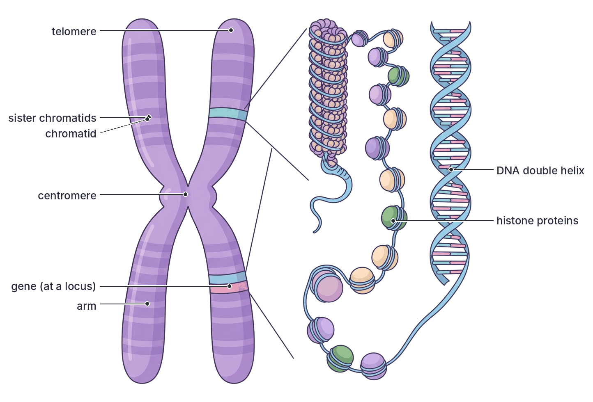

### Chromosome numbers

- Every species has a **fixed number** of chromosomes in each body cell.
- In body cells, chromosomes are found in **pairs**. The two chromosomes of a pair are the same length, have the centromere in the same place and carry genes for the same characters at the same loci. They are called **homologous chromosomes**. One of each pair came from the mother and one from the father.
- A cell with two sets of chromosomes (pairs) is **diploid** (2n). Body (somatic) cells are diploid.
- A cell with only one set (one of each pair) is **haploid** (n). Gametes (sperm and eggs) are haploid.

| Organism | Diploid number (2n) in body cells | Haploid number (n) in gametes |
| --- | --- | --- |
| Human | 46 (23 pairs) | 23 |
| Garden pea | 14 | 7 |
| Maize | 20 | 10 |
| Fruit fly (*Drosophila*) | 8 | 4 |
| Chimpanzee | 48 | 24 |

**Note:** the chromosome number does not tell you how complex an organism is. Some ferns have hundreds of chromosomes, and a dog has 78.

### Autosomes and sex chromosomes

Of the 23 pairs of chromosomes in a human cell:

- **22 pairs are autosomes.** They carry genes for most body characters and are the same in males and females.
- **1 pair is the sex chromosomes,** which decide a person's sex. In females the two sex chromosomes look alike: **XX**. In males they are different: one **X** and one much smaller **Y**: **XY**.

A picture of all the chromosomes of a cell, arranged in pairs by size, is called a **karyotype**. Doctors use karyotypes to detect chromosome conditions such as **Down syndrome** (three copies of chromosome 21).

[IMAGE: A simplified human male karyotype: 22 pairs of purple X-shaped chromosomes arranged in rows in decreasing size, numbered 1 to 22, plus a final pair consisting of one medium X chromosome and one much smaller Y chromosome, highlighted in blue. Labels to add later: "autosomes (pairs 1 to 22)", "sex chromosomes", "X", "Y", "homologous pair", "male karyotype: 46, XY". Clean flat textbook style, white background.]

## The structure of DNA

**Objective ii: illustrate simple structure of DNA.**

**DNA** stands for **deoxyribonucleic acid**. It is the chemical that genes are made of, and it carries the coded instructions for building and running the organism.

### History in brief

The structure of DNA was worked out in **1953** by **James Watson** (American) and **Francis Crick** (British) at Cambridge, England. They used X-ray photographs of DNA made by **Rosalind Franklin** and **Maurice Wilkins** in London. Watson, Crick and Wilkins received the Nobel Prize in 1962; Franklin had died in 1958, and the prize is not given after death.

### Nucleotides: the building blocks of DNA

DNA is a very long molecule made of many small units called **nucleotides** joined in a chain. Each nucleotide has **three parts**:

1. A **sugar** called **deoxyribose** (a sugar with five carbon atoms).
2. A **phosphate group**.
3. A **nitrogenous base**. There are **four** kinds of base in DNA:
   - **Adenine (A)**
   - **Guanine (G)**
   - **Cytosine (C)**
   - **Thymine (T)**

Adenine and guanine are larger, double-ring bases called **purines**; cytosine and thymine are smaller, single-ring bases called **pyrimidines**.

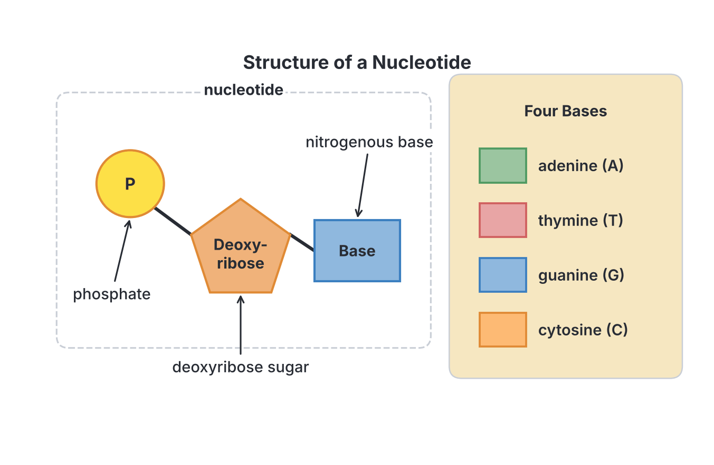

### The double helix

1. The nucleotides are joined into a long **strand**: the sugar of one nucleotide is joined to the phosphate of the next. This makes a **sugar–phosphate backbone**, with the bases sticking out to one side.
2. A DNA molecule has **two strands** lying side by side, like the two sides of a ladder.
3. The bases of one strand pair with the bases of the other strand, forming the **rungs** of the ladder. The two bases of each pair are held together by weak **hydrogen bonds**.
4. The pairing follows a strict rule (**complementary base pairing**):
   - **Adenine always pairs with thymine (A–T)**, joined by two hydrogen bonds.
   - **Guanine always pairs with cytosine (G–C)**, joined by three hydrogen bonds.
   - So a purine always pairs with a pyrimidine, which keeps the ladder the same width all along.
5. The two strands run in **opposite directions** (they are **antiparallel**).
6. The whole ladder is **twisted** into a spiral called a **double helix**, like a twisted rope ladder or a spiral staircase.

**Consequences of base pairing:**

- If you know the sequence of bases on one strand, you can work out the other. For example, if one strand reads **A T G C C A**, the other reads **T A C G G T**.
- In any DNA molecule, the amount of A equals the amount of T, and the amount of G equals the amount of C (**Chargaff's rule**). For example, if 30% of the bases are adenine, then 30% are thymine, and the remaining 40% is shared equally: 20% guanine and 20% cytosine.

[IMAGE: Two views of DNA side by side. Left: an untwisted section of DNA drawn as a straight ladder, with two vertical sugar-phosphate backbones (alternating yellow circles for phosphate and orange pentagons for sugar) and horizontal rungs made of paired coloured bases: A (green) with T (red), G (blue) with C (orange), with dotted lines between each pair for hydrogen bonds; show two dotted lines in A–T pairs and three in G–C pairs. Right: the same molecule twisted into a smooth right-handed double helix with coloured rungs. Labels to add later: "sugar-phosphate backbone", "phosphate", "deoxyribose sugar", "base pair", "A", "T", "G", "C", "hydrogen bonds", "double helix", "two strands run in opposite directions". Clean flat textbook style, white background.]

### How DNA copies itself (replication)

Before a cell divides, its DNA must be copied so that each new cell gets a full set:

1. The hydrogen bonds between the bases break, and the two strands **unzip**.
2. Each strand acts as a **template** (pattern).
3. Free nucleotides in the nucleus pair up with the exposed bases, A with T and G with C, helped by enzymes (DNA polymerase).
4. Two identical DNA molecules are formed, each with one old strand and one new strand. (This is called **semi-conservative** replication.)

This exact copying is why the daughter cells made by mitosis have the same genes as the parent cell. Occasional mistakes in copying cause **mutations** (see `E2-evidence-of-evolution.md`).

### Genes and alleles

- A **gene** is a section of DNA (a particular sequence of bases) on a chromosome that controls a particular characteristic, usually by carrying the code for making one protein. Every three bases (a **triplet** or **codon**) code for one amino acid. The order of bases decides the order of amino acids in the protein, and the protein (often an enzyme) produces the character.
- Example: a gene on chromosome 11 codes for part of **haemoglobin**. A change of a single base in this gene produces sickle-cell haemoglobin.
- **Alleles** are **different forms of the same gene**. They are found at the same locus on homologous chromosomes. For example, the gene for height in peas has two alleles: **T** (tall) and **t** (dwarf). The gene for ABO blood group has three alleles: IA, IB and i.
- Because body cells have two copies of each chromosome, they have **two alleles of each gene**, one from each parent. The two alleles may be the same or different.

### RNA (briefly)

**RNA** (ribonucleic acid) is a second kind of nucleic acid. It helps to use the instructions in DNA to make proteins:

1. In the nucleus, a copy of a gene is made as a strand of **messenger RNA (mRNA)** (this is called **transcription**).
2. The mRNA moves out to the **ribosomes** in the cytoplasm.
3. **Transfer RNA (tRNA)** molecules bring the right amino acids, and the ribosome (which contains **ribosomal RNA, rRNA**) joins them in the order coded by the mRNA, making a protein (**translation**).

| Feature | DNA | RNA |
| --- | --- | --- |
| Full name | Deoxyribonucleic acid | Ribonucleic acid |
| Sugar | Deoxyribose | Ribose |
| Bases | A, T, G, C | A, **U (uracil)**, G, C (uracil replaces thymine) |
| Strands | Two (double helix) | Usually one (single strand) |
| Where found | Mainly in the nucleus (also a little in mitochondria and chloroplasts) | Nucleus, cytoplasm and ribosomes |
| Function | Stores the genetic information; passed on to offspring | Carries and uses the information to make proteins |
| Size | Very long | Much shorter |

## Cell division: mitosis and meiosis

To understand how genes pass from parents to offspring, you need to know the two kinds of cell division. (Cell division is also covered under growth in Section B.)

### Mitosis (in brief)

**Mitosis** is cell division that produces **two daughter cells**, each with the **same number and kind of chromosomes** as the parent cell.

1. Each chromosome copies itself, forming two chromatids.
2. The chromosomes line up in the middle of the cell (on the **equator** of the spindle).
3. The chromatids of each chromosome are pulled apart to opposite ends of the cell.
4. The cell divides into two. Each new cell is diploid and genetically identical to the parent.

Mitosis is used for **growth**, **repair** of damaged tissues (e.g. healing of a wound), replacement of worn-out cells, and **asexual reproduction** (e.g. growing new cassava plants from stem cuttings).

### Meiosis (in brief)

**Meiosis** (reduction division) is cell division that produces **four daughter cells**, each with **half** the number of chromosomes of the parent cell (haploid), and each **genetically different**. It happens in the reproductive organs: the **testes** and **ovaries** in animals, and the **anthers** and **ovules** in flowering plants. It produces the gametes (or, in plants, the spores that give rise to gametes; see `A2b-evolution-plants.md`).

1. Each chromosome copies itself, forming two chromatids.
2. **Homologous chromosomes come together in pairs.** While paired, they may swap pieces of their chromatids (**crossing over**), forming new combinations of alleles.
3. **First division (meiosis I):** the homologous pairs line up on the equator and the **two chromosomes of each pair separate**, one going to each end of the cell. Which way each pair faces is random (**independent assortment**). Two cells are formed, each with **one chromosome from each pair** (haploid).
4. **Second division (meiosis II):** in each of the two cells, the chromatids separate, as in mitosis.
5. Result: **four haploid cells**, all genetically different from each other and from the parent cell.

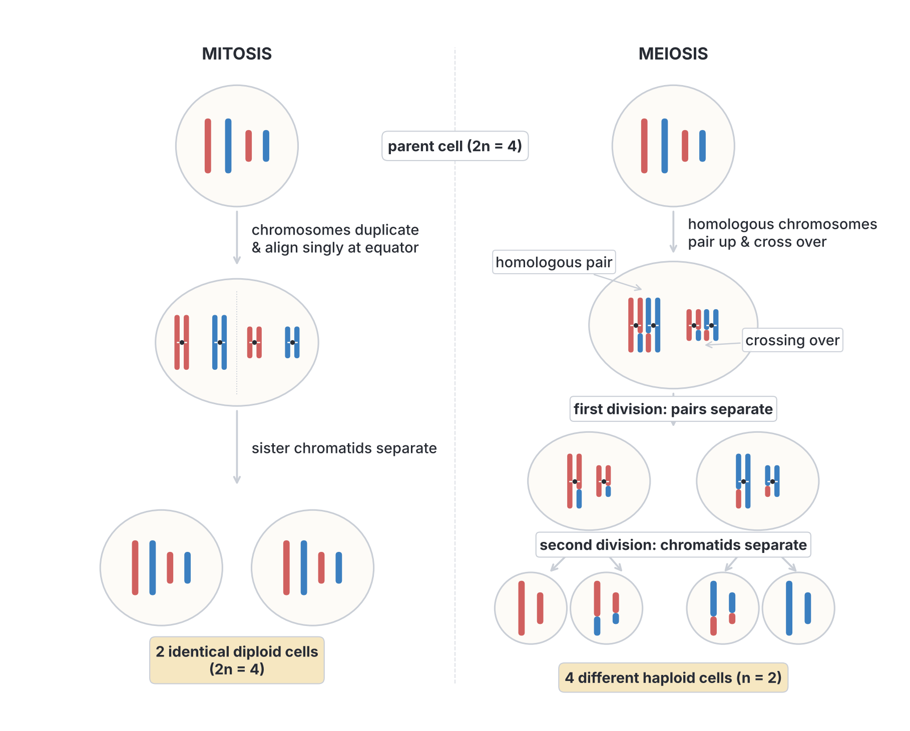

### Mitosis and meiosis compared

| Feature | Mitosis | Meiosis |
| --- | --- | --- |
| Where it occurs | Body (somatic) cells, e.g. root tip, skin, bone marrow | Reproductive organs: testes, ovaries, anthers, ovules |
| Number of divisions | One | Two |
| Number of daughter cells | Two | Four |
| Chromosome number in daughter cells | Same as parent (diploid, 2n) | Half of parent (haploid, n) |
| Pairing of homologous chromosomes | Does not occur | Occurs |
| Crossing over | Does not occur | Occurs |
| Genetic make-up of daughter cells | Identical to each other and to the parent | Different from each other and from the parent |
| Purpose | Growth, repair, replacement, asexual reproduction | Formation of gametes (or spores) for sexual reproduction; produces variation |

**Why meiosis halves the chromosome number:** when a haploid sperm (23 chromosomes) fertilises a haploid egg (23 chromosomes), the zygote gets 46, the normal diploid number. Without meiosis, the number would double in every generation.

## How characters are transmitted from parents to offspring

**Content b(ii): process of transmission of hereditary characters from parents to offspring.**

**Objective iii: illustrate segregation of genes at meiosis and recombination of genes at fertilization to account for the process of transmission of characters from parents to offsprings.**

Characters are passed on in a definite sequence. We will follow one gene with two alleles, **A** and **a**, in a heterozygous father (**Aa**) and a heterozygous mother (**Aa**).

### Step 1: each parent has two alleles

Every body cell of each parent has **two alleles** of the gene, one on each of a pair of homologous chromosomes. In our example, both parents are **Aa**: one chromosome carries **A** and its partner carries **a**.

### Step 2: segregation of alleles at meiosis

When gametes are formed by meiosis, the two homologous chromosomes of each pair **separate (segregate)** into different gametes. So:

- the two alleles of the gene **separate**;
- each gamete receives **only one allele** of each gene: either **A** or **a**, never both;
- half of the gametes carry **A** and half carry **a**.

This is called **segregation of genes**.

### Step 3: recombination of genes at fertilisation

At fertilisation, a male gamete (carrying one allele) fuses with a female gamete (carrying one allele). The zygote now has **two alleles** again, **one from each parent**. This coming together of alleles from two parents is called **recombination** (or **fusion**) of genes.

### Step 4: the zygote develops

The zygote divides by **mitosis** over and over, so every cell of the new organism has the same two alleles. These alleles decide the character of the offspring.

### Putting it together

| Stage | Number of alleles of the gene | Process |
| --- | --- | --- |
| Parent's body cells | Two (e.g. Aa) | — |
| Gametes | One (A or a) | **Segregation** at meiosis |
| Zygote | Two (one from each parent: AA, Aa or aa) | **Recombination** at fertilisation |
| Offspring's body cells | Two (same as zygote) | Mitosis |

[IMAGE: Diagram of transmission of one gene from parents to offspring. Top: a father cell and a mother cell, each showing one pair of homologous chromosomes, one carrying a red band labelled A and the other a white band labelled a. Arrows labelled "meiosis" lead down from each parent to two gamete circles each: sperm with A, sperm with a; eggs with A, eggs with a, each gamete containing a single chromosome. Crossing arrows from gametes lead to four zygote circles at the bottom, each with two chromosomes: AA, Aa, Aa, aa. Labels to add later: "father (Aa)", "mother (Aa)", "segregation of alleles at meiosis", "gametes (one allele each)", "random fertilisation", "recombination of alleles", "zygotes", "AA", "Aa", "Aa", "aa". Clean flat textbook style, white background.]

## Segregation at gamete formation and random recombination

**Objective iv: deduce that segregation of genes occurs during gamete formation and that recombination of genes at fertilization is random in nature.**

### Evidence that segregation occurs during gamete formation

1. **The chromosome number is halved in gametes.** Body cells are diploid (two of each chromosome), but gametes are haploid (one of each). Since genes are carried on chromosomes, a gamete can carry only one allele of each gene.
2. **The behaviour of chromosomes in meiosis matches the behaviour of alleles.** Under the microscope, homologous chromosomes can be seen pairing and then separating to opposite ends of the cell in the first division of meiosis. This is exactly what Mendel predicted for his "factors" (genes) before chromosomes were understood. In the early 1900s, Walter Sutton and Theodor Boveri pointed out this match, which is called the **chromosome theory of inheritance**.
3. **Recessive characters reappear.** A heterozygous tall pea plant (Tt) can produce dwarf offspring (tt). This could happen only if the **t** allele stayed separate and unchanged in the parent and went alone into some of its gametes.
4. **The 1:1 ratio of a test cross.** When a heterozygote (Tt) is crossed with a recessive (tt), half of the offspring are tall and half dwarf. This shows that the heterozygote produces two kinds of gamete, **T** and **t**, in **equal numbers**.

### Evidence that recombination at fertilisation is random

1. Which sperm fertilises an egg is a matter of **chance**: millions of sperm are released, and a sperm carrying **A** is as likely to reach and fertilise the egg as one carrying **a**. Likewise, in plants, any pollen grain may land on a stigma.
2. If fertilisation is random, the chance of each combination can be calculated by multiplying probabilities (see the section on probability). For Aa × Aa:
   - P(AA) = ½ × ½ = ¼
   - P(Aa) = (½ × ½) + (½ × ½) = ½
   - P(aa) = ½ × ½ = ¼
   This gives the **1 AA : 2 Aa : 1 aa** ratio, and a **3 : 1** ratio of dominant to recessive characters.
3. Large breeding experiments (such as Mendel's) give results **very close to these predicted ratios**. If gametes combined in any fixed or preferred way, the ratios would be different.
4. With small numbers of offspring, the actual numbers often differ from the expected ratio, just as tossing a coin 4 times does not always give exactly 2 heads and 2 tails. The larger the number of offspring, the closer the result is to the expected ratio. This behaviour is typical of **chance (random) events**.

**Conclusion:** alleles **segregate** when gametes are formed, and gametes **combine randomly** at fertilisation. Together, these explain the ratios seen in genetic crosses and the variation among brothers and sisters.

## Genetic terms you must know

| Term | Meaning | Example |
| --- | --- | --- |
| **Gene** | A section of DNA that controls a characteristic | The gene for stem height in peas |
| **Allele** | One of two or more alternative forms of a gene, found at the same locus | T (tall) and t (dwarf) |
| **Locus** | The position of a gene on a chromosome | — |
| **Homologous chromosomes** | A matching pair of chromosomes, one from each parent, carrying the same genes | Chromosome 11 from the mother and chromosome 11 from the father |
| **Dominant allele** | An allele that shows its effect even when only one copy is present; written with a capital letter | T (tall) |
| **Recessive allele** | An allele that shows its effect only when two copies are present (no dominant allele); written with a small letter | t (dwarf) |
| **Genotype** | The genetic make-up of an organism (the alleles it has) | TT, Tt or tt |
| **Phenotype** | The observable characteristics, produced by the genotype and the environment | Tall or dwarf |
| **Homozygous** (pure-breeding, true-breeding) | Having two identical alleles of a gene | TT (homozygous dominant) or tt (homozygous recessive) |
| **Heterozygous** (hybrid) | Having two different alleles of a gene | Tt |
| **Carrier** | A heterozygous individual who carries a recessive allele without showing its effect | A person with HbAS (sickle-cell trait) |
| **Monohybrid cross** | A cross involving one pair of contrasting characters | Tall × dwarf |
| **Dihybrid cross** | A cross involving two pairs of contrasting characters | Round yellow × wrinkled green |
| **P generation** | The parents in the first cross | Pure tall × pure dwarf |
| **F₁ (first filial) generation** | The offspring of the P generation | All Tt |
| **F₂ (second filial) generation** | The offspring of crossing F₁ individuals | TT, Tt, tt |
| **Test cross** | Crossing an individual showing the dominant character with a homozygous recessive, to find its genotype | T? × tt |
| **Back cross** | Crossing an F₁ individual with one of its parents (or a parent-type individual) | Tt × TT or Tt × tt |
| **Punnett square** | A grid used to show all the possible combinations of gametes at fertilisation | — |
| **Incomplete dominance** | Neither allele is dominant; the heterozygote is intermediate | Red × white → pink |
| **Codominance** | Both alleles are fully expressed in the heterozygote | Blood group AB |
| **Multiple alleles** | More than two alleles exist for one gene in a population | IA, IB, i |

**Writing alleles:** use the **same letter** for both alleles of a gene, a **capital** for the dominant and a **small** letter for the recessive (T and t, not T and d). Choose letters whose capital and small forms look different (e.g. T/t, B/b, R/r; avoid C/c, O/o, S/s, W/w where they are easily confused in handwriting, unless the question uses them).

## Mendel's experiments with the garden pea

### Why Mendel chose the garden pea (*Pisum sativum*)

1. It is **easy to grow** and grows quickly, so several generations can be studied in a few years.
2. It produces **many seeds (offspring)** from each cross, so results can be counted reliably.
3. It has many pairs of **clear-cut, contrasting characters** (e.g. tall or dwarf, with no in-between), which are easy to observe.
4. Its flowers are normally **self-pollinating** (the petals enclose the stamens and carpel), so **pure-breeding** lines can be kept.
5. It can also be **cross-pollinated by hand** easily: Mendel removed the anthers from a flower before they ripened (**emasculation**) and dusted its stigma with pollen from another chosen plant, then covered the flower to keep out insects.

### Mendel's methods (why he succeeded)

- He started with **pure-breeding** (homozygous) plants, testing them for two years to make sure each always produced offspring like itself.
- He studied **one character at a time** at first.
- He **counted** large numbers of offspring and worked out **ratios** (he used mathematics, which was unusual in biology at the time).
- He kept careful records over many generations (P, F₁, F₂, F₃).

### The seven pairs of characters Mendel studied

| Character | Dominant form | Recessive form |
| --- | --- | --- |
| Stem length | Tall | Dwarf (short) |
| Seed shape | Round (smooth) | Wrinkled |
| Seed (cotyledon) colour | Yellow | Green |
| Flower (seed coat) colour | Purple (violet) | White |
| Pod shape | Inflated (full) | Constricted (pinched) |
| Pod colour (unripe) | Green | Yellow |
| Flower position | Axial (along the stem) | Terminal (at the tip) |

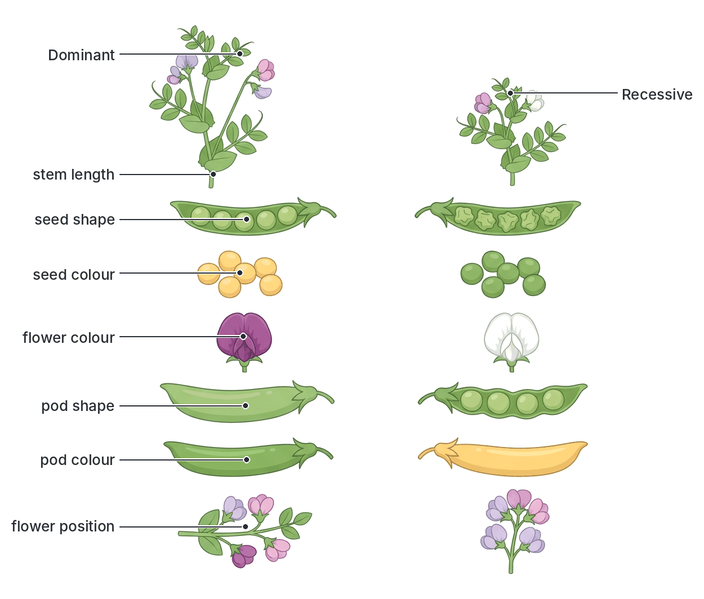

### Mendel's monohybrid experiment: tall × dwarf

1. **P generation:** Mendel crossed pure-breeding **tall** plants with pure-breeding **dwarf** plants.
2. **F₁ generation:** **all** the offspring were **tall**. The dwarf character seemed to have disappeared. He called tall the **dominant** character and dwarf the **recessive** character.
3. He then let the F₁ plants **self-pollinate**.
4. **F₂ generation:** both tall and dwarf plants appeared. He counted **787 tall and 277 dwarf**, a ratio of about **2.84 : 1**, which is close to **3 : 1**.

He got similar results for all seven characters:

| Character | F₂ dominant | F₂ recessive | Ratio |
| --- | --- | --- | --- |
| Stem length | 787 tall | 277 dwarf | 2.84 : 1 |
| Seed shape | 5,474 round | 1,850 wrinkled | 2.96 : 1 |
| Seed colour | 6,022 yellow | 2,001 green | 3.01 : 1 |

Each ratio is close to **3 : 1**.

5. **F₃ generation:** when he self-pollinated the F₂ plants, the **dwarf** plants always bred true (only dwarf offspring). Of the tall F₂ plants, about **one-third bred true** (only tall offspring) and **two-thirds** produced tall and dwarf in a 3 : 1 ratio again. This showed that the F₂ was really **1 pure tall : 2 hybrid tall : 1 pure dwarf**.

### Mendel's explanation

Mendel did not know about genes or chromosomes. He reasoned that:

1. Each character is controlled by a pair of "**factors**" (we now call them **alleles** of a gene).
2. One factor of each pair comes from each parent.
3. One factor may be **dominant** and hide the other, **recessive** factor.
4. The two factors **separate** when gametes are formed, so each gamete gets only one factor.
5. Gametes combine **at random** at fertilisation.

### Mendel's first law: the law of segregation

**Mendel's first law (the law of segregation)** states that: **the characteristics of an organism are controlled by pairs of factors (alleles), and only one factor of each pair is carried in a single gamete.** In other words, the two alleles of a gene **separate (segregate)** during gamete formation, so that each gamete receives only one of them.

**Textbook variation:** textbooks word the law in slightly different ways, but they all contain the same two ideas: alleles come in **pairs**, and the members of a pair **separate into different gametes**.

### Mendel's second law: the law of independent assortment

Mendel also crossed plants that differed in **two** characters (a **dihybrid cross**):

1. **P:** pure **round yellow** seeds (RRYY) × pure **wrinkled green** seeds (rryy).
2. **F₁:** all **round yellow** (RrYy).
3. **F₂** (F₁ selfed): four kinds of seed appeared. Mendel counted **315 round yellow, 108 round green, 101 wrinkled yellow and 32 wrinkled green**, a ratio of about **9 : 3 : 3 : 1**.

Two of the kinds (round green and wrinkled yellow) were **new combinations** not seen in either parent. Mendel explained this by saying the pair of factors for seed shape separated **independently** of the pair for seed colour, so an F₁ plant made four kinds of gametes (RY, Ry, rY, ry) in equal numbers.

**Mendel's second law (the law of independent assortment)** states that: **each member of a pair of factors (alleles) may combine randomly with either member of another pair** when gametes are formed. In other words, different characters are inherited independently of each other.

**Note:** the second law is true for genes on **different** chromosomes. Genes that lie close together on the **same** chromosome tend to be inherited together (they are **linked**) and do not assort independently. JAMB questions on crosses mainly use monohybrid crosses; you should know the 9 : 3 : 3 : 1 ratio and what the second law says.

## Monohybrid crosses step by step

### How to set out a genetic cross

Always follow these steps:

1. **Choose symbols** for the alleles and state which is dominant.
2. **Write the parents' phenotypes and genotypes.**
3. **Write the gametes** each parent can produce (one allele of each gene per gamete). Circle them.
4. **Show fertilisation** using crossing lines or a **Punnett square**.
5. **Write the offspring genotypes and phenotypes.**
6. **State the ratios** (genotypic and phenotypic).

### Cross 1: pure tall × pure dwarf (P to F₁)

- Let **T** = tall (dominant), **t** = dwarf (recessive).

| | Tall parent | Dwarf parent |
| --- | --- | --- |
| Genotype | TT | tt |
| Gametes | T, T | t, t |

Punnett square:

| | **t** | **t** |
| --- | --- | --- |
| **T** | Tt | Tt |
| **T** | Tt | Tt |

- **F₁ genotypes:** all **Tt** (heterozygous).
- **F₁ phenotypes:** all **tall**.

### Cross 2: F₁ × F₁ (Tt × Tt) to give F₂

| | **T** | **t** |
| --- | --- | --- |
| **T** | TT (tall) | Tt (tall) |
| **t** | Tt (tall) | tt (dwarf) |

- **Genotypic ratio:** 1 TT : 2 Tt : 1 tt.
- **Phenotypic ratio:** **3 tall : 1 dwarf**.
- Probability that any one F₂ plant is dwarf = ¼; tall = ¾. Of the tall plants, ⅓ are TT and ⅔ are Tt.

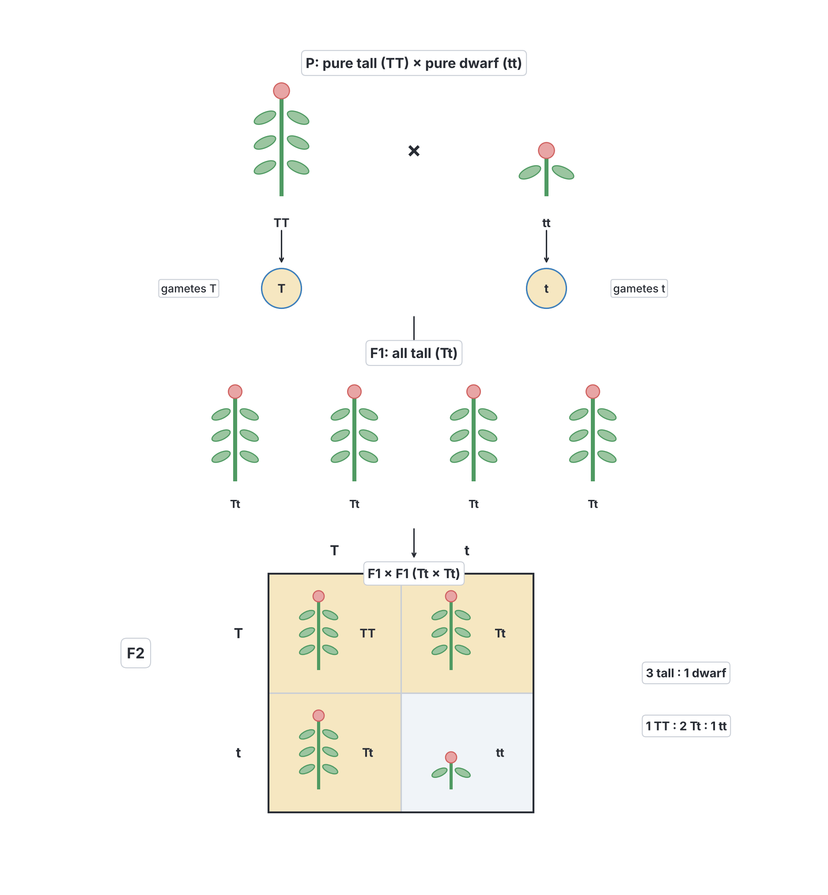

### Cross 3: heterozygote × homozygous recessive (Tt × tt): the 1 : 1 ratio

| | **t** | **t** |
| --- | --- | --- |
| **T** | Tt (tall) | Tt (tall) |
| **t** | tt (dwarf) | tt (dwarf) |

- **Genotypic ratio:** 1 Tt : 1 tt.
- **Phenotypic ratio:** **1 tall : 1 dwarf**.

### Cross 4: homozygous dominant × heterozygote (TT × Tt)

| | **T** | **t** |
| --- | --- | --- |
| **T** | TT | Tt |
| **T** | TT | Tt |

- **Genotypic ratio:** 1 TT : 1 Tt. **Phenotype:** all tall.

### Summary of monohybrid ratios (complete dominance)

| Parents | Offspring genotypes | Offspring phenotypes |
| --- | --- | --- |
| AA × AA | All AA | All dominant |
| AA × aa | All Aa | All dominant |
| AA × Aa | 1 AA : 1 Aa | All dominant |
| Aa × Aa | 1 AA : 2 Aa : 1 aa | **3 dominant : 1 recessive** |
| Aa × aa | 1 Aa : 1 aa | **1 dominant : 1 recessive** |
| aa × aa | All aa | All recessive |

**Use these in reverse:** a 3 : 1 ratio means both parents were heterozygous; a 1 : 1 ratio means one parent was heterozygous and the other homozygous recessive.

### The test cross

A tall pea plant could be **TT** or **Tt**; you cannot tell by looking. To find out, cross it with a **dwarf (tt)** plant (the homozygous recessive). This is a **test cross**.

| If the tall plant is TT | If the tall plant is Tt |
| --- | --- |
| Gametes: T only | Gametes: T and t |
| Offspring: all Tt | Offspring: 1 Tt : 1 tt |
| **All tall** | **Half tall, half dwarf (1 : 1)** |

- If **all** the offspring show the dominant character, the unknown parent is **homozygous dominant** (TT).
- If **any** offspring show the recessive character (about half), the unknown parent is **heterozygous** (Tt).

Why a recessive is used: the homozygous recessive parent gives only recessive alleles, so the offspring's phenotypes directly show which alleles came from the unknown parent. Breeders use test crosses to check that animals or plants are pure-breeding before using them.

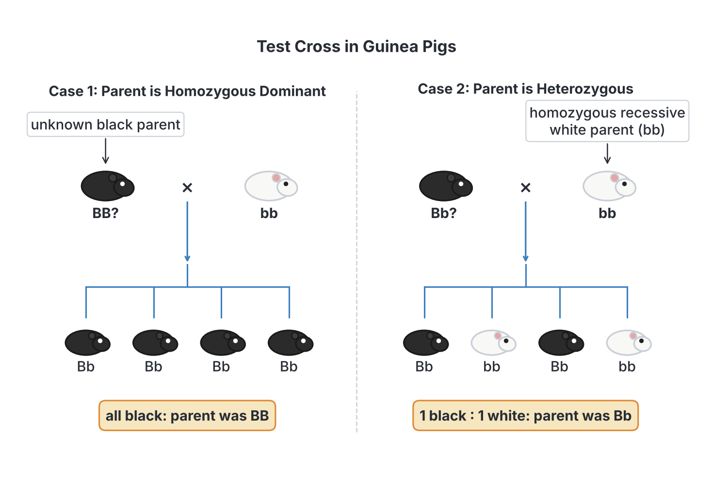

## Incomplete dominance and codominance

In Mendel's peas, one allele was completely dominant. This is not always so.

### Incomplete dominance

In **incomplete dominance**, **neither allele is completely dominant**. The heterozygote has a phenotype **in between** (intermediate between) the two homozygotes.

**Example: flower colour in the four-o'clock plant (*Mirabilis jalapa*)**, a common garden plant in Nigeria.

- Let **R** = allele for red, **W** = allele for white (capital letters for both, since neither is dominant; some books write CR and CW).
- **P:** red (RR) × white (WW).
- **F₁:** all **pink** (RW).
- **F₂ (pink × pink):**

| | **R** | **W** |
| --- | --- | --- |
| **R** | RR (red) | RW (pink) |
| **W** | RW (pink) | WW (white) |

- **Ratio:** **1 red : 2 pink : 1 white**. Here the phenotypic ratio is the **same** as the genotypic ratio (1 : 2 : 1), because each genotype has its own phenotype.

Other examples: flower colour in snapdragons (*Antirrhinum*); feather colour in **Andalusian fowl** (black × white-splashed gives **blue** offspring; blue × blue gives 1 black : 2 blue : 1 white-splashed).

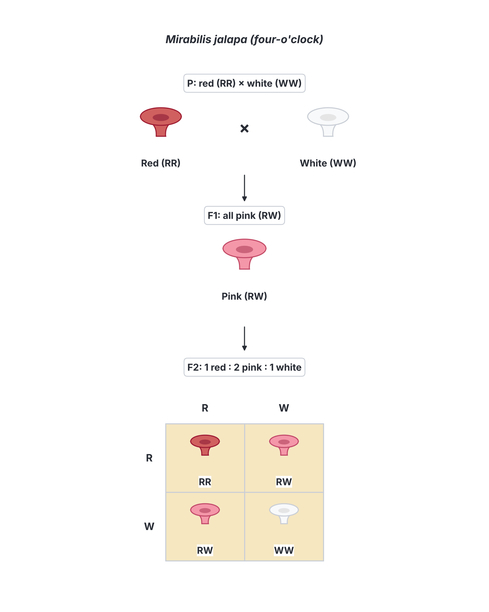

### Codominance

In **codominance**, **both alleles are fully expressed** in the heterozygote, so the heterozygote shows **both** characters at the same time, not a blend.

**Examples:**

- **Blood group AB:** a person with alleles IA and IB has **both** antigen A and antigen B on their red cells.
- **Roan cattle:** in some breeds (e.g. Shorthorn), a cross between a red and a white animal gives a **roan** calf, whose coat has a mixture of **separate red hairs and white hairs**.
- **Sickle-cell trait (HbAS):** at the level of the protein, a carrier makes **both** normal haemoglobin (HbA) and sickle haemoglobin (HbS). (For the disease, HbS is usually treated as recessive; see `D2b-applications-of-heredity.md`.)

### Comparing complete dominance, incomplete dominance and codominance

| Feature | Complete dominance | Incomplete dominance | Codominance |
| --- | --- | --- | --- |
| Heterozygote phenotype | Same as the dominant homozygote | Intermediate (a blend) | Shows both characters fully |
| Example | Tall (Tt) pea is as tall as TT | Pink four-o'clock (RW) | Blood group AB; roan cattle |
| F₂ phenotypic ratio (heterozygote × heterozygote) | 3 : 1 | 1 : 2 : 1 | 1 : 2 : 1 |
| Can genotype be told from phenotype? | Not always (TT and Tt look alike) | Yes | Yes |

**Textbook variation:** some textbooks give roan cattle as an example of incomplete dominance, and some call the pink four-o'clock "blending inheritance". Strictly, roan is codominance (red and white hairs are both present) and the pink flower is incomplete dominance (an intermediate colour). The alleles themselves never blend: two pink plants still produce red and white offspring.

## Inheritance of ABO blood groups

The ABO blood group (see `D1-variation-in-population.md`) is controlled by **one gene with three alleles**: IA, IB and i. A gene with more than two alleles in the population is said to have **multiple alleles**. Each person still carries only **two** of the three.

- **IA** produces antigen A; **IB** produces antigen B; **i** produces no antigen.
- **IA** and **IB** are both **dominant** to **i**.
- **IA** and **IB** are **codominant** with each other.

| Genotype | Blood group (phenotype) |
| --- | --- |
| IAIA | A |
| IAi | A |
| IBIB | B |
| IBi | B |
| IAIB | AB |
| ii | O |

So there are **six genotypes** but only **four phenotypes**.

**Textbook variation:** some textbooks write the alleles simply as **A**, **B** and **O** (giving genotypes such as AO, BO, AB, OO). The meaning is the same: O is recessive, A and B are codominant.

### Worked example: a cross between group A and group B parents

A heterozygous group A father (IAi) and a heterozygous group B mother (IBi):

| | **IB** | **i** |
| --- | --- | --- |
| **IA** | IAIB (AB) | IAi (A) |
| **i** | IBi (B) | ii (O) |

- **Result:** 1 AB : 1 A : 1 B : 1 O. Each child has a ¼ chance of each blood group. This is how two parents can have four children with **four different blood groups**.
- If both parents were homozygous (IAIA × IBIB), all the children would be **AB**.

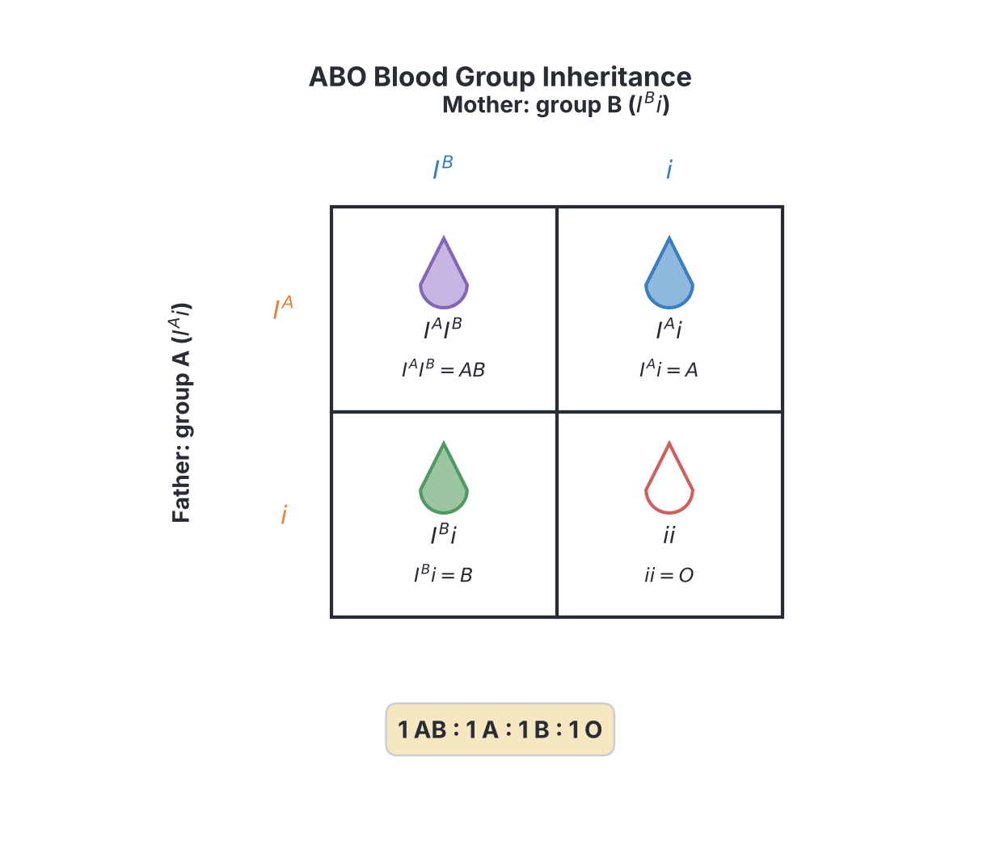

## Probability in genetics

**Content c (part 1): probability in genetics.**

**Probability** is the chance that an event will happen. In genetics, it tells us the chance that a child will have a certain genotype or phenotype.

**Probability = number of ways the event can happen ÷ total number of possible outcomes**

- Probability can be written as a fraction (¼), a decimal (0.25), a percentage (25%) or a ratio (1 in 4).
- A probability of **0** means the event is impossible; **1** means it is certain.

### Coins and gametes

Gametes behave like coins. A heterozygous parent (Aa) is like a coin with **A** on one side and **a** on the other: each gamete has a ½ chance of carrying A and a ½ chance of carrying a.

### Rule 1: the product (multiplication) rule

**The probability of two independent events both happening is the product of their separate probabilities.**

- Example: the chance that an Aa × Aa couple's child is **aa**: the sperm must carry a (½) **and** the egg must carry a (½) = ½ × ½ = **¼**.
- Example: the chance that a couple's first **three** children are all girls = ½ × ½ × ½ = **⅛**.

### Rule 2: the sum (addition) rule

**The probability that one or another of two events (which cannot happen together) will happen is the sum of their probabilities.**

- Example: the chance that an Aa × Aa child is **heterozygous** (Aa): it could get A from the father and a from the mother (¼), **or** a from the father and A from the mother (¼). Total = ¼ + ¼ = **½**.
- Example: the chance that an Aa × Aa child shows the **dominant** character (AA or Aa) = ¼ + ½ = **¾**.

### Each child is an independent event

**"Chance has no memory."** The probability applies to **each** child separately, and the result for one child does not change the chance for the next.

- If a carrier couple (Aa × Aa) already has one child with the recessive condition (aa), the chance that their **next** child will also be aa is **still ¼**, not zero.
- A ratio of 3 : 1 does **not** mean that out of every four children, exactly one will be affected. A family of four could have none, one, two, three or even four affected children.

### Expected numbers

To find the **expected number** of offspring of each kind, multiply the probability by the total number of offspring.

- Example: from a Tt × Tt cross that produces 400 seeds, the expected number of dwarf plants = ¼ × 400 = **100**; tall = ¾ × 400 = **300**.

## Sex determination

**Content c (part 2): sex determination.**

### The XY system in humans

- **Females** have two X chromosomes: **XX**. They are the **homogametic** sex: all their eggs carry an **X** chromosome (22 autosomes + X).
- **Males** have one X and one Y chromosome: **XY**. They are the **heterogametic** sex: half their sperm carry an **X** and half carry a **Y** (22 autosomes + X, or 22 autosomes + Y).
- At fertilisation:
  - an egg (X) + a sperm carrying X → **XX** zygote → **girl**;
  - an egg (X) + a sperm carrying Y → **XY** zygote → **boy**.

| | **X (sperm)** | **Y (sperm)** |
| --- | --- | --- |
| **X (egg)** | XX (female) | XY (male) |
| **X (egg)** | XX (female) | XY (male) |

- **Ratio:** 1 female : 1 male. The **probability** of any child being a boy is **½** (50%), and of being a girl is **½** (50%), for **every** pregnancy.

**The Y chromosome carries a key gene (called SRY) that makes the embryo develop testes**, which then produce male hormones. Without a Y chromosome, the embryo develops as a female.

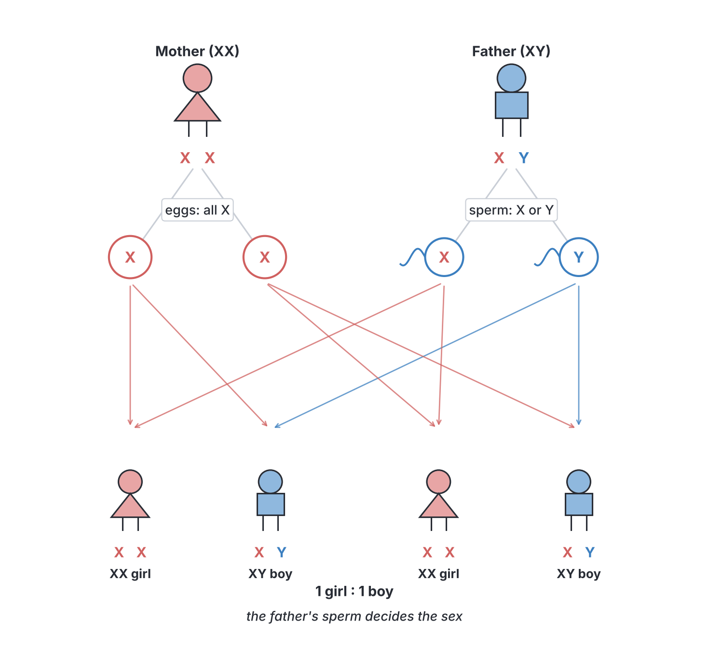

### Who decides the sex of a child?

Since all eggs carry X, the sex of the child depends on **which kind of sperm** fertilises the egg. So, biologically, it is the **father's** sperm that determines the sex of a baby, and it is purely a matter of **chance**.

This is important because, in some families, a woman is wrongly blamed or even sent away for "giving birth to only girls". Genetics shows that the mother cannot control this, and neither can the father: each pregnancy has the same 50 : 50 chance.

**Examples using probability:**

- A couple has three girls. What is the chance that the fourth child is a boy? **½**, the same as for every child.
- What is the chance that a couple's first two children are both boys? ½ × ½ = **¼**.
- What is the chance that a family of two children has one boy and one girl? Boy then girl (¼) or girl then boy (¼) = **½**.

### Other systems of sex determination (for interest)

- In **birds** (and some moths and butterflies), the system is reversed: the **female** is the heterogametic sex (**ZW**) and the male is homogametic (**ZZ**). So in chickens, the **hen's** egg decides the sex of the chick.
- In **grasshoppers**, females are XX and males have only one X (**XO**).
- In some reptiles, such as many turtles and crocodiles, sex is decided by the **temperature** at which the eggs are incubated, not by sex chromosomes.

## Sex-linked characters

**Content e: sex-linked characters, e.g. baldness, haemophilia, colour blindness.**

**Objective xi: identify characters that are sex linked.**

### What is sex linkage?

The **X chromosome** is large and carries many genes (several hundred to over a thousand) that have **nothing to do with sex**, such as genes for blood clotting and colour vision. The **Y chromosome** is small and carries very few genes; it has **no alleles** for most of the genes on the X.

- **Sex-linked genes** are genes carried on the sex chromosomes, usually on the **X chromosome** (X-linked).
- **Sex-linked characters** are characters controlled by sex-linked genes. They show a different pattern of inheritance in males and females.

### Why sex-linked recessive conditions are more common in males

- A **female** has two X chromosomes, so she has **two alleles** of each X-linked gene. If one is a harmful recessive allele, the normal dominant allele on her other X usually covers it. She is then a **carrier**: she does not have the condition but can pass the allele on.
- A **male** has only **one X**. The Y has no matching allele to cover a recessive allele. So if his single X carries the recessive allele, he **shows the condition**.
- A male always gets his **X from his mother** (his father gave him the Y). So X-linked conditions in boys are inherited from their **mothers**.
- A father **cannot** pass an X-linked allele to his **sons**, but he passes it to **all** his **daughters**.
- For a female to show an X-linked recessive condition, she must inherit the allele from **both** parents (her father must have the condition, and her mother must be a carrier or have it too). This is rare.

**Notation:** write the allele as a superscript on the X: e.g. **XH** (normal clotting) and **Xh** (haemophilia). The Y has no allele: write just **Y**.

### Haemophilia

**Haemophilia** ("bleeder's disease") is a condition in which the **blood fails to clot properly**, because the person cannot make enough of a protein needed for clotting (a **clotting factor**). In the most common form (haemophilia A) the missing protein is **factor VIII**; in haemophilia B (sometimes called Christmas disease) it is **factor IX**.

- **Effects:** a small cut or a tooth extraction can bleed for a very long time; bleeding into joints and muscles causes pain, swelling and damage; internal bleeding after injury can be fatal.
- **Treatment:** injections of the missing clotting factor (today often made by recombinant DNA technology; see `D2b-applications-of-heredity.md`). There is no cure in routine use, but treatment allows a near-normal life.
- **History:** Queen Victoria of Britain (1819–1901) was a carrier. Through her children, the allele passed into the royal families of Spain and Russia; her great-grandson Alexei, heir to the Russian throne, had haemophilia. It is sometimes called "the royal disease".

**Genotypes:**

| Genotype | Phenotype |
| --- | --- |
| XHXH | Normal female |
| XHXh | Normal female, **carrier** |
| XhXh | Female with haemophilia (very rare) |
| XHY | Normal male |
| XhY | Male with haemophilia |

**Textbook variation:** some older textbooks say that XhXh is lethal (females with haemophilia die before birth). This is not correct: females with haemophilia do exist, but they are very rare because they need a haemophiliac father and a carrier mother.

#### Cross 1: carrier mother × normal father

- Mother: XHXh (carrier); father: XHY (normal).
- Gametes: mother XH, Xh; father XH, Y.

| | **XH** (father) | **Y** (father) |
| --- | --- | --- |
| **XH** (mother) | XHXH normal girl | XHY normal boy |
| **Xh** (mother) | XHXh carrier girl | XhY haemophiliac boy |

**Results:**

- Of the **daughters**: ½ normal, ½ carriers; **none** has haemophilia.
- Of the **sons**: ½ normal, ½ **haemophiliac**.
- For each child: ¼ normal girl, ¼ carrier girl, ¼ normal boy, ¼ haemophiliac boy.
- Probability that a **son** has haemophilia = ½. Probability that **any child** has haemophilia = ¼.

#### Cross 2: normal mother × haemophiliac father

- Mother: XHXH; father: XhY.

| | **Xh** (father) | **Y** (father) |
| --- | --- | --- |
| **XH** (mother) | XHXh carrier girl | XHY normal boy |
| **XH** (mother) | XHXh carrier girl | XHY normal boy |

**Results:** **all daughters are carriers**; **all sons are normal**. The father's X goes only to his daughters.

#### Cross 3: carrier mother × haemophiliac father

- Mother: XHXh; father: XhY.

| | **Xh** (father) | **Y** (father) |
| --- | --- | --- |
| **XH** (mother) | XHXh carrier girl | XHY normal boy |
| **Xh** (mother) | XhXh haemophiliac girl | XhY haemophiliac boy |

**Results:** daughters: ½ carriers, ½ haemophiliac; sons: ½ normal, ½ haemophiliac. This is the only common way a girl can have haemophilia.

[IMAGE: Haemophilia inheritance diagram for a carrier mother and a normal father. Top: mother icon with chromosome pair X^H (normal X in pink) and X^h (X with a red dot marking the haemophilia allele); father icon with X^H (pink) and Y (blue, shorter). Gametes shown as circles below each parent. A 2 by 2 Punnett grid below with four child icons: normal girl X^H X^H, carrier girl X^H X^h (half-shaded), normal boy X^H Y, haemophiliac boy X^h Y (fully shaded red). Labels to add later: "carrier mother (X^H X^h)", "normal father (X^H Y)", "normal daughter", "carrier daughter", "normal son", "haemophiliac son", "allele for haemophilia on X chromosome", "Y has no matching allele". Clean flat textbook style, white background.]

### Colour blindness

**Colour blindness** (more correctly, **colour vision deficiency**) is a condition in which a person cannot tell certain colours apart. The commonest form is **red–green colour blindness**: the person confuses reds, greens, browns and oranges. It is caused by a fault in one of the light-sensitive pigments of the **cone cells** in the retina, and the genes for these pigments are on the **X chromosome**.

- It is inherited in the **same way as haemophilia** (X-linked recessive).
- It is **much more common in males** than in females. In many populations, it affects several percent of males (figures of up to about 8% are reported in men of northern European ancestry; reported rates in African populations, including Nigerian studies, are generally lower) but well under 1% of females.
- It is detected using the **Ishihara test**: plates of coloured dots with a number hidden in them, which a colour-blind person cannot see (or sees as a different number).
- It is usually not a serious handicap, but it can matter in jobs where colour signals are important (e.g. pilots, some electricians, train drivers), and in reading traffic lights (which is why the lights are always in a fixed order).

**Genotypes:** let **XC** = normal vision, **Xc** = colour blind.

| Genotype | Phenotype |
| --- | --- |
| XCXC | Normal female |
| XCXc | Normal female, carrier |
| XcXc | Colour-blind female |
| XCY | Normal male |
| XcY | Colour-blind male |

#### Cross: colour-blind man × carrier woman

- Father: XcY; mother: XCXc.

| | **Xc** (father) | **Y** (father) |
| --- | --- | --- |
| **XC** (mother) | XCXc carrier girl | XCY normal boy |
| **Xc** (mother) | XcXc colour-blind girl | XcY colour-blind boy |

**Results:** ½ of daughters colour blind, ½ carriers; ½ of sons colour blind, ½ normal. Overall, ½ of all children are colour blind.

#### Cross: colour-blind man × normal (non-carrier) woman

- Father XcY × mother XCXC → all daughters XCXc (carriers, normal vision); all sons XCY (normal). **None** of the children is colour blind, but the condition may reappear in the daughters' sons (it "skips a generation").

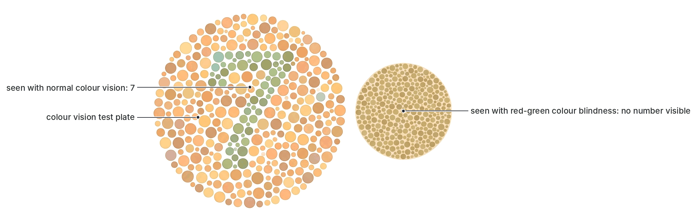

### Baldness

The syllabus lists **baldness** as an example of a sex-linked character, and many West African textbooks describe it this way. The type of baldness meant is **pattern baldness** (male-pattern baldness), in which hair is gradually lost from the temples and the crown of the head, often beginning in early adulthood. It is far more common in men than in women.

**What the textbooks say:** baldness is inherited through a gene that behaves differently in males and females, so it appears mainly in males.

**What modern genetics says (textbook variation):** pattern baldness is **not** a simple sex-linked character like haemophilia.

- It is better described as a **sex-influenced** character: whether the genes show their effect depends on the level of **male hormones** (androgens such as testosterone). Men have high levels, so they are much more likely to go bald.
- It is influenced by **many genes**, including an important one on the **X chromosome** (the gene for the androgen receptor) and many on the **autosomes**. So a man's chance of going bald depends on both sides of his family, not only his mother's.

**The classic "sex-influenced" model** used in many textbooks treats baldness as one autosomal gene, with the allele for baldness (**B**) **dominant in males** but **recessive in females**:

| Genotype | Male | Female |
| --- | --- | --- |
| BB | Bald | Bald (thinning) |
| Bb | Bald | Not bald |
| bb | Not bald | Not bald |

So a man needs only one copy to go bald, while a woman needs two, which is why baldness is much more common in men.

**Difference between sex-linked and sex-influenced:**

| Feature | Sex-linked (X-linked) character | Sex-influenced character |
| --- | --- | --- |
| Where the gene is | On the X chromosome | On an autosome (classic model) |
| Why males and females differ | Males have only one X, so a single recessive allele shows | Sex hormones change whether the allele acts as dominant or recessive |
| Father to son passing? | Not possible (father gives Y to sons) | Possible |
| Examples | Haemophilia, red–green colour blindness | Pattern baldness (classic model) |

**For the exam:** if JAMB lists baldness among sex-linked characters, accept it, since it is in the syllabus. Know that it is more common in males, and if a question asks you to distinguish, describe it as sex-influenced.

### Y-linked characters

A few characters are said to be controlled by genes on the **Y chromosome** (**Y-linked** or **holandric** characters). They would pass **only from father to son**, and never appear in females. Apart from the genes that make a person male (such as SRY) and some genes needed to make sperm, very few are known.

**Textbook variation:** older textbooks often give **hairy ear rims** (hypertrichosis of the ear) as a Y-linked character. Later studies did not confirm this, and it is now doubtful.

### Identifying a sex-linked character

You can suspect that a character is X-linked recessive if:

1. It is **much more common in males** than in females.
2. Affected males are usually born to **unaffected (carrier) mothers**.
3. It is **never passed from father to son**.
4. All daughters of an affected father are **carriers**.
5. It often **skips a generation** (from a grandfather, through a carrier daughter, to a grandson).

**Examples of sex-linked characters:** haemophilia, red–green colour blindness, Duchenne muscular dystrophy (a muscle-wasting disease), and G6PD deficiency (an enzyme deficiency that is fairly common in Nigeria, in which certain drugs, foods such as fava beans, or infections can cause red blood cells to break down). Pattern baldness is often listed too (see above).

## Analysing data from cross-breeding experiments

**Objective v: analyze data on cross-breeding experiments.**

In the exam, you may be given the results of a cross and asked to work out the genotypes of the parents, which character is dominant, the type of inheritance, or the probability of an outcome.

### General method

1. **Find the ratio.** Divide each number by the smallest number (or by the total and multiply by 4 for a 3 : 1 type ratio).
2. **Round to the nearest simple ratio:** 3 : 1, 1 : 1, 1 : 2 : 1, 1 : 1 : 1 : 1, 9 : 3 : 3 : 1, or all one kind.
3. **Match the ratio to the parents' genotypes** (use the table in "Summary of monohybrid ratios").
4. **Decide dominance:** a character that appears in the offspring of two parents who do not show it is **recessive**; a character that appears in all the F₁ of a cross between pure-breeding parents is **dominant**.
5. **Check sex differences** in the results: if one sex is affected far more, consider sex linkage.

### Worked problem 1: finding the ratio

Two purple-flowered pea plants were crossed. The offspring were **705 purple** and **224 white**.

- Ratio = 705 ÷ 224 : 224 ÷ 224 = **3.15 : 1**, which is close to **3 : 1**.
- White appeared in offspring of two purple parents, so **purple is dominant**, white recessive.
- A 3 : 1 ratio means **both parents were heterozygous: Pp × Pp**.
- Expected genotypes among the purple plants: ⅓ PP, ⅔ Pp.

### Worked problem 2: a 1 : 1 ratio

A black guinea pig was mated with a white guinea pig over several litters. They produced **26 black** and **24 white** young. Black is dominant.

- Ratio = 26 : 24 ≈ **1 : 1**.
- The white parent must be **bb** (recessive). For half the young to be white, the black parent must have given **b** to half of them, so it is **Bb**.
- Cross: **Bb × bb** → 1 Bb (black) : 1 bb (white). This is a test cross showing the black parent is heterozygous.

### Worked problem 3: all offspring alike

A tall pea plant was crossed with a dwarf plant. All **96 offspring were tall**.

- If the tall parent were Tt, about half the offspring would be dwarf. Since none are, the tall parent is **TT**.
- Cross: **TT × tt** → all Tt (tall).

### Worked problem 4: a 1 : 2 : 1 ratio

Two plants with pink flowers were crossed. The offspring were **32 red, 65 pink and 31 white**.

- Ratio ≈ **1 : 2 : 1**.
- Three phenotypes in a 1 : 2 : 1 ratio means **incomplete dominance** (or codominance); pink is the heterozygote (**RW**), red is **RR** and white is **WW**.
- If a pink plant is crossed with a white plant: RW × WW → 1 RW (pink) : 1 WW (white).

### Worked problem 5: a recessive character appearing in a family (albinism)

Two parents with normal skin pigmentation have a child with **albinism**.

1. Albinism appeared in a child of two unaffected parents, so the allele for albinism is **recessive** (let **A** = normal, **a** = albinism).
2. The child is **aa**: it received one **a** from each parent. Both parents are normal, so each must be **Aa** (carriers).
3. Cross: **Aa × Aa** → 1 AA : 2 Aa : 1 aa.
4. **Probability that their next child has albinism = ¼** (25%).
5. **Probability that their next child is normal = ¾.**
6. **Probability that a normal child of theirs is a carrier:** among the normal children (AA, Aa, Aa), 2 out of 3 are carriers, so **⅔**.
7. **Probability that their next two children both have albinism** = ¼ × ¼ = **1/16**.

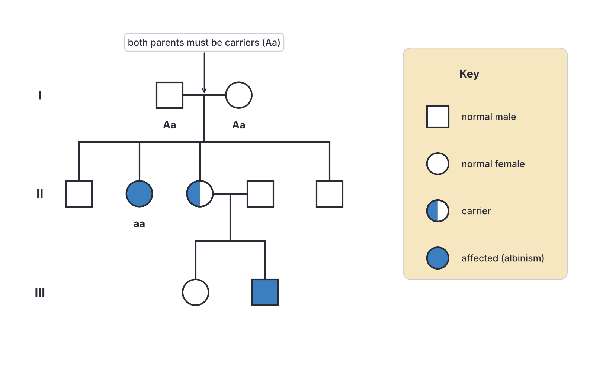

### Worked problem 6: blood groups

A man of blood group **A** and a woman of blood group **B** have a child of blood group **O**.

1. The O child is **ii**, so each parent passed on **i**.
2. So the father is **IAi** and the mother is **IBi**.
3. Their possible children: AB, A, B, O, each with probability **¼**.
4. Probability that their next child is group **AB** = **¼**.

### Worked problem 7: a sex-linked cross

A colour-blind man marries a woman with normal vision whose father was colour blind. What proportion of their sons will be colour blind?

1. The woman's father was XcY, and he gave her his Xc. Her vision is normal, so she is **XCXc** (carrier).
2. The man is **XcY**.
3. Sons get Y from the father and one X from the mother: ½ XCY (normal), ½ XcY (colour blind).
4. **Answer: half (½) of their sons** are expected to be colour blind. (Half of their daughters also: XcXc.)

### Worked problem 8: data showing sex linkage

In a breeding experiment with fruit flies, red-eyed females (pure-breeding) were crossed with white-eyed males. All F₁ flies had red eyes. In the F₂, all the **females** had red eyes, but **half the males** had red eyes and **half had white eyes**.

1. Red is dominant (all F₁ red).
2. The recessive white character appears **only in males** in the F₂, so the gene is likely **X-linked**.
3. Using XR (red) and Xr (white): P = XRXR × XrY; F₁ = XRXr (red females) and XRY (red males); F₂ = XRXR, XRXr (all red females), XRY (red male), XrY (white male).

This is the experiment by which the American geneticist **Thomas Hunt Morgan** (around 1910) showed that genes are carried on chromosomes.

### Worked problem 9: dihybrid data

Pea plants heterozygous for seed shape and seed colour (RrYy) were self-pollinated. They produced 560 seeds. How many would you expect to be wrinkled and green?

1. Expected ratio 9 : 3 : 3 : 1 (total 16 parts).
2. Wrinkled green (rryy) = 1/16 of 560 = **35 seeds**.
3. Round yellow = 9/16 × 560 = 315; round green = 105; wrinkled yellow = 105.

### Common ratios and what they tell you

| Ratio in offspring | What it means |
| --- | --- |
| All one type | Parents homozygous (e.g. AA × aa, or AA × anything) |
| 3 : 1 | Both parents heterozygous (Aa × Aa), complete dominance |
| 1 : 1 | One heterozygous, one homozygous recessive (Aa × aa), a test cross |
| 1 : 2 : 1 | Both heterozygous, with incomplete dominance or codominance |
| 1 : 1 : 1 : 1 (blood groups) | IAi × IBi |
| 9 : 3 : 3 : 1 | Dihybrid cross, both parents heterozygous for both genes |
| Different results in males and females | Sex linkage likely |

## Key terms

| Term | Meaning |
| --- | --- |
| Heredity | The passing on of characteristics from parents to offspring |
| Genetics | The study of heredity and variation |
| Heritable character | A character controlled by genes and passed on through gametes |
| Acquired (non-heritable) character | A character gained during life from the environment or activity, not passed on |
| Chromosome | A thread-like structure of DNA and protein in the nucleus that carries genes |
| Chromatid | One of the two identical copies of a duplicated chromosome |
| Centromere | The point where two sister chromatids are joined |
| Homologous chromosomes | A matching pair of chromosomes, one from each parent |
| Diploid (2n) | Having two sets of chromosomes, as in body cells |
| Haploid (n) | Having one set of chromosomes, as in gametes |
| Autosomes | Chromosomes other than the sex chromosomes |
| Sex chromosomes | The X and Y chromosomes that determine sex |
| DNA | Deoxyribonucleic acid, the double-helix molecule that carries genetic information |
| Nucleotide | A unit of DNA or RNA: a sugar, a phosphate and a base |
| Complementary base pairing | A pairs with T, and G pairs with C |
| Gene | A section of DNA that controls a characteristic |
| Allele | An alternative form of a gene |
| Dominant | An allele that shows its effect in the heterozygote |
| Recessive | An allele that shows its effect only when homozygous |
| Genotype | The alleles an organism has |
| Phenotype | The observable characteristics of an organism |
| Homozygous | Having two identical alleles |
| Heterozygous | Having two different alleles |
| Meiosis | Cell division that halves the chromosome number and forms gametes |
| Mitosis | Cell division that produces two identical diploid cells |
| Segregation | Separation of the two alleles of a gene into different gametes |
| Test cross | Crossing an organism with a homozygous recessive to find its genotype |
| Incomplete dominance | The heterozygote is intermediate between the two homozygotes |
| Codominance | Both alleles are fully expressed in the heterozygote |
| Multiple alleles | More than two alleles of a gene in a population |
| Sex-linked gene | A gene carried on a sex chromosome (usually the X) |
| Carrier | A heterozygote who carries a recessive allele without showing it |

## Exam tips and common mistakes

- **Acquired characters are not inherited:** tribal marks, scars, big muscles, language and dyed hair are not passed on. Only characters controlled by genes are heritable.
- **A–T and G–C:** adenine pairs with thymine and guanine with cytosine. In RNA, uracil replaces thymine. The sugar in DNA is deoxyribose; in RNA it is ribose.
- **Gametes carry one allele of each gene:** a gamete is never "Tt". Write Tt → gametes T and t.
- **3 : 1 is the F₂ phenotypic ratio; 1 : 2 : 1 is the F₂ genotypic ratio** of a monohybrid cross with complete dominance.
- **Test cross = cross with the homozygous recessive.** All dominant offspring → unknown is homozygous; 1 : 1 → heterozygous.
- **Mendel's first law is segregation; the second is independent assortment** (9 : 3 : 3 : 1 in a dihybrid cross).
- **Incomplete dominance vs codominance:** pink four-o'clock flowers = intermediate (incomplete dominance); AB blood group = both shown (codominance).
- **The father's sperm determines a child's sex,** and the chance of a boy or a girl is ½ for every pregnancy.
- **Sex-linked recessive conditions (haemophilia, colour blindness) are commoner in males;** a father cannot pass them to his sons, but all his daughters become carriers.
- **Probability does not remember:** a carrier couple with one affected child still has a ¼ chance of another affected child.
- **Do not confuse mitosis and meiosis:** meiosis = two divisions, four different haploid cells, in the reproductive organs.

## Quick summary

1. Heritable characters are controlled by genes and passed on in gametes (e.g. blood group, albinism, sex); acquired characters (e.g. scars, tribal marks, big muscles) affect only body cells and are not inherited.
2. Chromosomes, made of DNA and protein, carry genes and occur in homologous pairs; humans have 46 (22 pairs of autosomes and XX or XY).
3. DNA is a double helix of two antiparallel strands of nucleotides (deoxyribose, phosphate and a base), with A pairing with T and G with C; a gene is a section of DNA, and alleles are its alternative forms.
4. Alleles segregate at meiosis so each gamete carries one allele of each gene, and gametes combine at random at fertilisation; this is Mendel's first law and explains 3 : 1 and 1 : 1 ratios.
5. Mendel's pea experiments showed dominance, segregation and (with two characters) independent assortment (9 : 3 : 3 : 1); the test cross reveals an unknown genotype.
6. Some alleles show incomplete dominance (pink four-o'clock flowers) or codominance (blood group AB); ABO blood groups are controlled by three alleles.
7. Sex is determined by X and Y chromosomes; the father's sperm decides the sex, with a ½ chance of a boy or girl every time.
8. Sex-linked recessive characters such as haemophilia and red–green colour blindness are carried on the X chromosome and are much commoner in males; baldness is usually described as sex-influenced.

## Practice questions

**1. Which of the following is a non-heritable character?**

- A. Blood group
- B. Albinism
- C. Tribal marks
- D. Colour blindness

**Answer: C.** Tribal marks are acquired during life and do not change the genes in the gametes, so they are not passed on. The others are controlled by genes.

**2. In a DNA molecule, adenine always pairs with**

- A. thymine
- B. guanine
- C. cytosine
- D. uracil

**Answer: A.** Complementary base pairing in DNA is A–T and G–C. Uracil is found in RNA, not DNA.

**3. If 20% of the bases in a DNA molecule are cytosine, what percentage are adenine?**

- A. 20%
- B. 60%
- C. 30%
- D. 40%

**Answer: C.** Cytosine = guanine = 20%, so G + C = 40%. The remaining 60% is shared equally between A and T, so adenine = 30%.

**4. The separation of the two alleles of a gene into different gametes takes place during**

- A. mitosis
- B. fertilisation
- C. germination
- D. meiosis

**Answer: D.** Homologous chromosomes, and the alleles they carry, separate during meiosis, so each gamete receives only one allele of each gene (Mendel's law of segregation).

**5. When two heterozygous tall pea plants (Tt) are crossed, the expected phenotypic ratio of the offspring is**

- A. 1 tall : 1 dwarf
- B. 3 tall : 1 dwarf
- C. 1 tall : 2 dwarf
- D. all tall

**Answer: B.** Tt × Tt gives 1 TT : 2 Tt : 1 tt; TT and Tt are tall, so 3 tall : 1 dwarf.

**6. A black guinea pig crossed with a white guinea pig produced 15 black and 14 white offspring. If black is dominant, the genotypes of the parents were**

- A. Bb × bb
- B. BB × bb
- C. Bb × Bb
- D. BB × Bb

**Answer: A.** A ratio of about 1 : 1 comes from a heterozygote crossed with a homozygous recessive (a test cross).

**7. A cross between red-flowered and white-flowered four-o'clock plants produces all pink offspring. This is an example of**

- A. codominance
- B. sex linkage
- C. incomplete dominance
- D. multiple alleles

**Answer: C.** The heterozygote is intermediate (pink) between the two homozygotes, which is incomplete dominance.

**8. A couple already has three daughters. What is the probability that their next child will be a boy?**

- A. ½
- B. ¼
- C. ⅛
- D. 1

**Answer: A.** Each pregnancy is an independent event. Half of the father's sperm carry Y, so the chance of a boy is ½ every time.

**9. A woman who is a carrier of haemophilia marries a normal man. What proportion of their sons are expected to have haemophilia?**

- A. None
- B. All
- C. One quarter
- D. One half

**Answer: D.** Sons receive their X from the mother. Half of her eggs carry Xh, so half of the sons are expected to be XhY (haemophiliac).

**10. Which of the following statements about red–green colour blindness is correct?**

- A. It is controlled by a gene on the Y chromosome
- B. It is more common in males because males have only one X chromosome
- C. A colour-blind father passes it to all his sons
- D. It is an acquired character

**Answer: B.** The gene is on the X chromosome. Males have only one X, so a single recessive allele shows its effect. A father passes his X to his daughters, not his sons.
