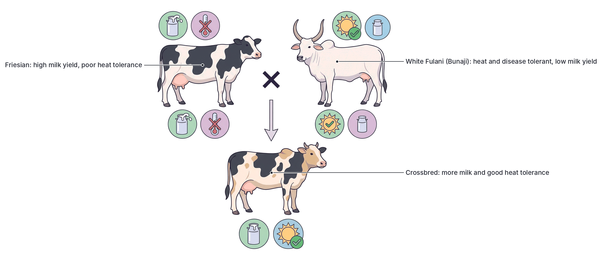
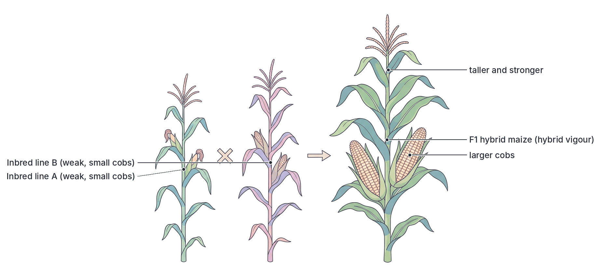
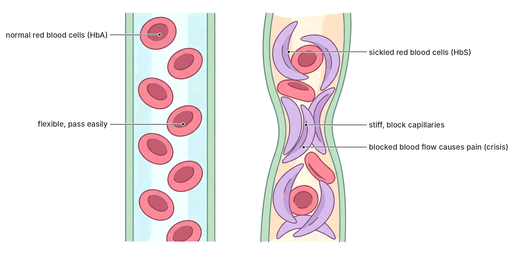
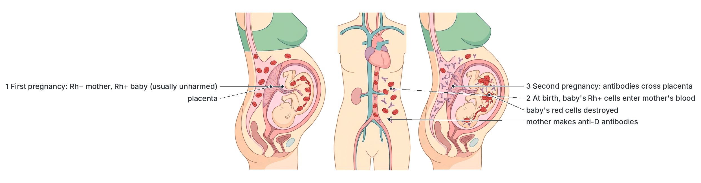
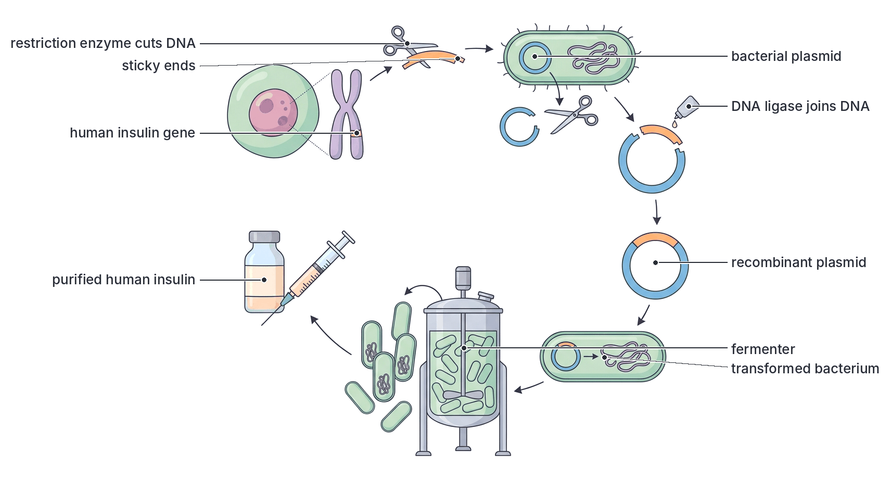
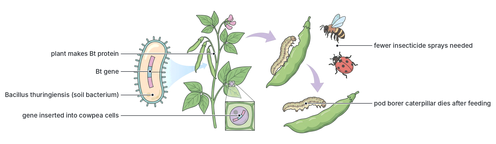
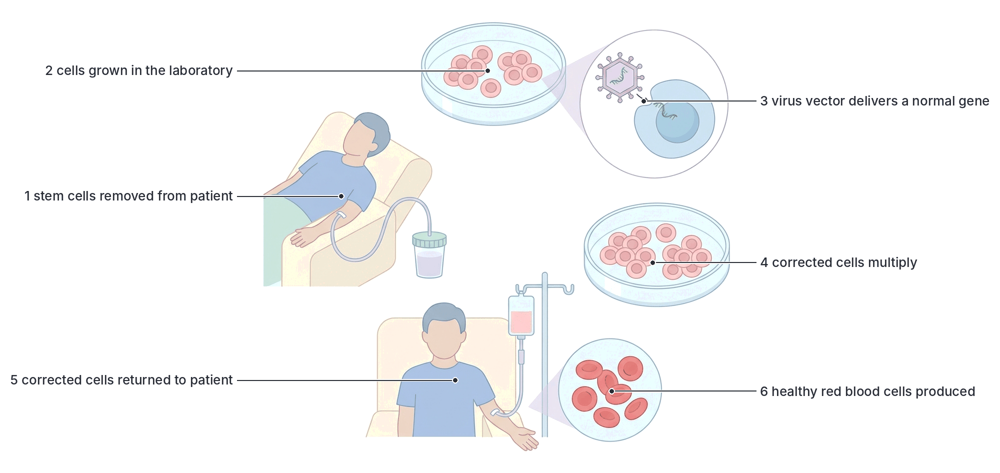

# JAMB Biology Notes: Heredity (Part 2): Applications of Heredity

## What JAMB expects

This topic is Section D, Topic 2 of the JAMB Biology syllabus: Heredity and Variations – Heredity. It is split into two files:

- **`D2a-heredity-principles.md`** covers the principles of heredity: heritable and non-heritable characters, chromosomes and DNA, segregation and recombination, Mendel's laws, monohybrid crosses, probability, sex determination and sex-linked characters (content items a, b, c and e; objectives i to v and xi).
- **This file (`D2b-applications-of-heredity.md`)** covers **content item d: application of the principles of heredity in (i) agriculture and (ii) medicine**, and objectives **vi to x**, with a short note on objective xi.

By the end of these notes, you should be able to:

1. Apply the principles of heredity in the production of new varieties of crops and livestock through cross-breeding (objective vi).
2. Deduce the advantages and disadvantages of out-breeding and in-breeding (objective vii).
3. Analyse, at an elementary level, the contentious issues of genetically modified organisms (GMOs), gene therapy and biosafety (objective viii).
4. Apply the knowledge of heredity in marriage counselling, with particular reference to blood grouping, sickle-cell anaemia and the Rhesus factor (objective ix).
5. Describe the significance of using recombinant DNA materials in the production of important medical products such as insulin, interferon and enzymes (objective x).
6. Identify characters that are sex-linked (objective xi; covered in full in `D2a-heredity-principles.md`).

**Order of sections:** the objectives below follow the syllabus order, except that recombinant DNA (objective x) is explained **before** GMOs and gene therapy (objective viii), because you need to understand how genes are transferred before you can judge the arguments about GMOs.

**Note on the syllabus wording:** the syllabus says "analyze elementarily", meaning "analyse at a simple level"; you are expected to know the main arguments for and against, not technical details. Biotechnology as a whole (including traditional fermentation) is covered in `D3-biotechnology.md`.

## Heredity in agriculture and medicine: an overview

The laws of heredity worked out by Mendel and later geneticists (see `D2a-heredity-principles.md`) are not only of interest in the laboratory. They are used every day:

| Field | Applications of heredity |
| --- | --- |
| **Agriculture** | Breeding higher-yielding, disease-resistant, drought-tolerant and more nutritious crop varieties; breeding livestock that grow faster and produce more milk, meat or eggs; producing hybrid seeds; genetic modification of crops; keeping pure breeds |
| **Medicine** | Genetic (marriage) counselling; testing for sickle-cell, blood groups and Rhesus factor; preventing haemolytic disease of the newborn; diagnosing inherited diseases before or after birth; producing medicines such as insulin by recombinant DNA technology; gene therapy; DNA testing in paternity and forensic cases |

## Producing new varieties of crops and livestock by cross-breeding

**Objective vi: apply the principles of heredity in the production of new varieties of crops and livestock through cross-breeding.**

### Why breed new varieties?

Farmers want plants and animals that:

1. Give **higher yields** (more grain, tubers, fruit, milk, meat or eggs).
2. **Resist diseases and pests** (e.g. cassava mosaic disease, maize streak virus, rice blast, cowpea pod borers; trypanosomiasis in cattle).
3. **Tolerate harsh conditions** (drought, poor soils, heat, flooding).
4. **Mature earlier**, so they can be harvested before the rains end or produce more than one crop a year.
5. Have **better quality**: more nutritious (e.g. higher vitamin A or protein), better taste, better cooking or processing qualities, longer storage life.
6. Are easier to manage (e.g. shorter plants that do not fall over, uniform ripening for machine harvesting).

### The genetic principles behind breeding

1. **Variation exists** within every species (`D1-variation-in-population.md`). Some individuals have useful characters.
2. **Useful characters that are heritable** (controlled by genes) can be passed to the next generation; acquired characters cannot.
3. **Crossing two parents brings their alleles together** in the offspring (recombination at fertilisation). So a cross can combine, in one individual, a good character from each parent: for example, high yield from one parent and disease resistance from the other.
4. **Segregation and independent assortment** in the next generations produce new combinations, some of which may be better than either parent.
5. **Selection** of the best offspring over several generations, and **in-breeding** or **back-crossing**, fix (make homozygous) the desired alleles, so the new variety **breeds true**.

### Methods of crop and livestock improvement

| Method | What it involves | Example |
| --- | --- | --- |
| **Selection (selective breeding)** | Choosing the best individuals as parents for the next generation, over many generations | Farmers saving seed from the best maize cobs; keeping the best-laying hens for breeding |
| **Hybridisation (cross-breeding)** | Crossing two different varieties, breeds or (sometimes) species to combine good characters | Hybrid maize; NERICA rice; Friesian × White Fulani cattle |
| **Back-crossing** | Crossing a hybrid back to one of its parents for several generations, to add one useful gene to an otherwise good variety | Adding a disease-resistance gene to a popular local variety |
| **Mutation breeding** | Using radiation or chemicals to cause mutations, then selecting useful ones | Some varieties of rice, barley and groundnut worldwide |
| **Polyploidy** | Doubling the chromosome number (e.g. with the chemical colchicine), often giving larger plants or fruits | Many seedless or large-fruited varieties; bread wheat is naturally polyploid |
| **Genetic modification (genetic engineering)** | Transferring a specific gene from another organism | Bt cotton; pod borer-resistant cowpea (see objective viii) |
| **Artificial insemination (AI)** | Collecting semen from a superior male and placing it into many females, so one good bull can father thousands of calves | Used widely in dairy cattle improvement |

### Steps in a plant breeding programme by cross-breeding

1. **Set the goal:** for example, a high-yielding cowpea that resists insect pests.
2. **Choose the parents:** collect varieties (including wild relatives and old local varieties, called **landraces**) and pick one with high yield and one with pest resistance.
3. **Make the cross (hybridisation):**
   1. Remove the stamens from the flowers of the female parent before they shed pollen (**emasculation**), to prevent self-pollination.
   2. Cover the flowers with a bag to keep out unwanted pollen.
   3. When the stigma is ready, dust it with pollen from the male parent (**hand pollination**).
   4. Re-cover and label the flowers. Collect the seeds (the F₁).
4. **Grow the F₁ and F₂:** in the F₂ and later generations, the characters **segregate** and recombine, producing many different combinations.
5. **Select:** choose plants that combine high yield with resistance. Grow their seeds and select again, for several generations, until the plants **breed true** (are homozygous for the desired characters).
6. **Test:** grow the new variety in field trials in different places and seasons, and compare it with existing varieties.
7. **Release:** if it performs better, it is officially registered and released, and seed is multiplied and sold to farmers.

The whole process often takes **many years** (commonly 8 to 15 years for a new crop variety).

[IMAGE: A flow chart of a plant breeding programme in seven boxes connected by arrows, top to bottom. Box 1: two parent cowpea plants, one with many pods (high yield) and one with a shield icon (pest resistant). Box 2: a gloved hand removing stamens from a flower with tweezers and then dusting pollen onto the stigma with a brush; a small paper bag over a flower. Box 3: F1 plants. Box 4: F2 plants showing variety (some tall, some short, some with many pods, some damaged by insects). Box 5: a hand selecting the best plants with check marks. Box 6: field trial plots in rows. Box 7: a seed bag with a new variety tag being handed to a farmer. Labels to add later: "1 Choose parents (high yield × pest resistant)", "2 Emasculation and hand pollination", "3 F1 hybrid", "4 F2: characters segregate", "5 Select the best for several generations", "6 Field trials", "7 Release new variety to farmers". Clean flat textbook style, white background.]

### Examples of improved crop varieties

#### Hybrid maize

- **How it is made:** plant breeders first develop **inbred lines** by self-pollinating maize plants for several generations, so each line becomes nearly **homozygous** (pure-breeding). Inbred lines are usually weak and low-yielding (**inbreeding depression**). Two different inbred lines are then **crossed**, and the F₁ seed is sold to farmers as **hybrid maize**.
- **Why it yields well:** the F₁ is **heterozygous** at many genes and shows **hybrid vigour (heterosis)**: it is more vigorous, more uniform and higher-yielding than either parent.
- **The catch:** if farmers save and replant seed from a hybrid crop, the next generation (F₂) **segregates**: the plants are no longer uniform and the yield falls. So farmers must buy **new hybrid seed every season**.
- Hybrid maize was developed in the USA in the early 20th century and greatly increased yields there. In Nigeria, hybrid and improved open-pollinated maize varieties have been developed by national institutes and IITA (see below).

#### Improved cassava

- Cassava is a staple food for millions of Nigerians (garri, fufu, lafun, tapioca), and Nigeria is the world's largest producer.
- In the 1970s, scientists at the **International Institute of Tropical Agriculture (IITA)** in Ibadan developed improved cassava varieties, named **TMS** (Tropical *Manihot* Selection), by crossing local cassava with varieties carrying resistance to **cassava mosaic disease** (a virus disease that causes yellow, twisted leaves and very poor yields). These varieties gave much higher yields than local varieties, and were widely adopted in Nigeria and across Africa.
- More recently (from about 2011), Nigerian research institutes including the **National Root Crops Research Institute (NRCRI), Umudike**, working with IITA, released **yellow-fleshed, pro-vitamin A cassava** varieties, bred to help fight **vitamin A deficiency**, which can cause night blindness and weaken children's immunity. This approach of breeding crops for more nutrients is called **biofortification**.
- Because cassava is grown from **stem cuttings** (vegetative propagation), a good new variety stays the same in every plant grown from it; cross-breeding is used only to create the variety in the first place.

#### Rice (NERICA and FARO varieties)

- **NERICA** ("New Rice for Africa") was developed in the 1990s by the **Africa Rice Center** (formerly called WARDA) by crossing **Asian rice** (*Oryza sativa*, high-yielding) with **African rice** (*Oryza glaberrima*, which tolerates local stresses such as weeds, drought and poor soils). The two species do not cross easily, so special techniques were needed to rescue the hybrid embryos. NERICA varieties are grown in several West African countries, including Nigeria.
- The **National Cereals Research Institute (NCRI), Badeggi**, has released many improved rice varieties named **FARO**.

#### Other examples

- **Drought-tolerant and *Striga*-resistant maize:** IITA and its partners have bred maize varieties that tolerate drought and resist *Striga* (witchweed), a parasitic weed that badly damages maize and sorghum in the savanna.
- **Improved cowpea, groundnut, sorghum and maize:** the **Institute for Agricultural Research (IAR), Ahmadu Bello University, Samaru, Zaria** has released many varieties, often named with the prefix **SAM** (for Samaru), such as SAMPEA (cowpea), SAMNUT (groundnut), SAMSORG (sorghum) and SAMMAZ (maize).
- The **Institute of Agricultural Research and Training (IAR&T), Moor Plantation, Ibadan** (of Obafemi Awolowo University) has developed and tested improved crop varieties and farming practices for south-western Nigeria.

**Note:** the names of particular varieties and the dates of their release change over time as new varieties replace old ones. Check current lists from the research institutes if you need exact names.

### Examples of improved livestock

#### Cattle

Nigeria's cattle are mainly **zebu** breeds (humped cattle) in the north, and a few **humpless** breeds in the south.

| Breed | Description |
| --- | --- |
| **White Fulani (Bunaji)** | Nigeria's most common breed; large, white zebu with long, lyre-shaped horns; used for milk and beef; hardy in hot, dry conditions |
| **Sokoto Gudali** | A heavy, short-horned zebu from the north-west, kept for beef and milk |
| **Red Bororo (Rahaji)** | A tall, deep-red zebu with very long horns, kept by nomadic Fulani herders |
| **N'Dama** and **Muturu** | Small, humpless breeds of the south and middle belt, which are **trypanotolerant**: they resist trypanosomiasis (sleeping sickness of cattle), which is spread by tsetse flies |

**Cross-breeding of cattle:**

- Local zebu breeds are well adapted to heat, ticks, poor grazing and local diseases, but they produce relatively **little milk**.
- Exotic dairy breeds such as the **Friesian (Holstein)** from Europe produce far more milk, but suffer in the tropical heat and from local diseases.
- **Crossing** a Friesian with a White Fulani or Sokoto Gudali produces a **crossbred** that combines higher milk yield (from the Friesian) with greater heat and disease tolerance (from the zebu). In Nigeria, research of this kind has been carried out at the **National Animal Production Research Institute (NAPRI), Shika, Zaria**, among others. Artificial insemination with semen from exotic bulls is often used.
- Crossing trypanotolerant breeds (N'Dama, Muturu) with zebu can combine disease resistance with larger size. The **Keteku** (or Borgu) cattle of western Nigeria are believed to have arisen from crosses between Muturu and zebu.

#### Poultry: broilers and layers

- **Broilers** are chickens bred for **meat**. Modern broiler strains are produced by crossing carefully selected parent lines chosen for very fast growth. They can reach market weight (about 2 kg) in roughly **6 to 8 weeks**, while a local village chicken may take several months to reach a smaller size.
- **Layers** are chickens bred for **eggs**. Commercial layers can lay around **250 to 300 eggs a year**, compared with far fewer (often well under 100) for local hens.
- Commercial broiler and layer chicks are **hybrids**. Like hybrid maize, they do not breed true, so poultry farmers in Nigeria buy new day-old chicks from hatcheries for each batch.
- **Local (indigenous) chickens** grow slowly and lay few eggs, but they are hardy, resist many diseases, find their own food and are good mothers. Breeders cross local chickens with exotic breeds to combine hardiness with better production.

#### Pigs, goats and others

- Exotic pig breeds such as the **Large White** and **Landrace** are crossed with local pigs to improve growth rate and litter size while keeping some hardiness.
- Good West African Dwarf goats and Red Sokoto goats are selected for breeding to improve meat, milk and skins.

### Summary: applying heredity in breeding

| Principle of heredity | How breeders use it |
| --- | --- |
| Characters are controlled by genes | Only select for heritable characters |
| Alleles from two parents combine in the offspring | Cross two parents to combine their good characters |
| Alleles segregate in the F₂ | Expect variation in the F₂; select the best recombinants |
| Homozygous individuals breed true | In-breed and select until the new variety breeds true |
| Heterozygotes may show hybrid vigour | Produce F₁ hybrids (maize, broilers) for high performance |
| Recessive alleles are hidden in carriers | Use test crosses to find carriers of unwanted recessive characters |

## Out-breeding and in-breeding

**Objective vii: deduce advantages and disadvantages of out-breeding and in-breeding.**

### In-breeding

**In-breeding** is the mating of **closely related** individuals: for example, brother × sister, parent × offspring, or cousins. The most extreme form is **self-pollination (selfing)** in plants, where a plant's own pollen fertilises its own ovules.

**What in-breeding does genetically:** related individuals share many of the same alleles (inherited from common ancestors). In-breeding therefore **increases homozygosity**: over generations, more and more genes become homozygous (AA or aa), and the population becomes uniform.

**Inbreeding depression:** most populations carry harmful **recessive alleles** hidden in heterozygous carriers. In-breeding makes it much more likely that two copies of the same harmful recessive allele come together (aa), so the harmful character appears. In-bred plants and animals are often **weaker, smaller, less fertile, slower-growing** and **less resistant to disease** than out-bred ones. This loss of vigour is called **inbreeding depression**.

### In-breeding in humans (consanguineous marriage)

- Marriage between close relatives (such as first cousins) is called **consanguineous marriage**. In some communities it is a custom; in others it is forbidden.
- Because related partners may carry the **same** harmful recessive allele inherited from a shared grandparent, their children have a **higher risk** of recessive genetic disorders, such as **albinism**, **sickle-cell anaemia**, and some rare metabolic and hearing disorders.
- The risk to any one child is still small for first cousins, but it is higher than for unrelated couples. Genetic counselling can help such couples understand their risks.

### Out-breeding

**Out-breeding** is the mating of **unrelated** (or distantly related) individuals. It includes:

- **Out-crossing:** mating unrelated individuals of the same breed or variety.
- **Cross-breeding:** mating individuals of **different breeds or varieties** of the same species (e.g. Friesian × White Fulani cattle).
- **Inter-specific hybridisation:** crossing **different species** (e.g. Asian × African rice to make NERICA; a horse × a donkey gives a **mule**, which is usually sterile).

In plants, **cross-pollination** is a form of out-breeding, and many flowers have features that encourage it (e.g. stamens and stigmas ripening at different times, separate male and female flowers as in maize, or self-incompatibility).

**What out-breeding does genetically:** it brings together **different alleles**, so it **increases heterozygosity** and **genetic variation**. Harmful recessive alleles from one parent are usually covered by normal dominant alleles from the other.

**Hybrid vigour (heterosis):** the offspring of a cross between two unrelated (especially in-bred) lines are often **bigger, stronger, faster-growing, more fertile and more disease-resistant** than either parent. This is called **hybrid vigour** or **heterosis**. Hybrid maize, broiler chickens and mules are examples.

### Advantages and disadvantages compared

| | In-breeding | Out-breeding |
| --- | --- | --- |
| **Definition** | Mating of closely related individuals (including self-pollination) | Mating of unrelated individuals, breeds or varieties (including cross-pollination) |
| **Effect on genes** | Increases homozygosity; reduces variation | Increases heterozygosity; increases variation |
| **Advantages** | 1. Produces **pure (true-breeding) lines** that keep desired characters from generation to generation. 2. **Fixes** good characters in a breed or variety. 3. Produces **uniform** offspring (useful for uniform crops). 4. Brings hidden **harmful recessive alleles** into the open, so carriers can be identified and removed from breeding. 5. Pure in-bred lines are needed as parents for producing hybrids | 1. Produces **hybrid vigour (heterosis)**: higher yield, faster growth, greater fertility. 2. **Combines good characters** from different parents (e.g. high milk yield and heat tolerance). 3. **Hides harmful recessive alleles** (they are covered by dominant alleles), so genetic disorders are less common. 4. Increases **variation**, so the population can **adapt** to new diseases or changing environments. 5. Improves **disease resistance** |
| **Disadvantages** | 1. **Inbreeding depression**: loss of vigour, size, fertility and yield. 2. Harmful recessive characters (and genetic diseases) **appear more often**. 3. **Less variation**, so the population is less able to adapt and may be wiped out by a new disease or pest. 4. In humans, a higher risk of recessive disorders in children of related parents | 1. Offspring are **less uniform**; good characters may be **diluted or lost** in later generations. 2. Hybrids **do not breed true**: F₂ offspring segregate, so new hybrid seed or stock must be bought each time (more costly for farmers). 3. Pure breeds may be **lost** if crossed too much. 4. Unwanted characters from one parent may also be brought in. 5. Crosses between species often give **sterile** offspring (e.g. the mule) |
| **Examples** | Pure-line pea varieties; self-pollinated rice, wheat and cowpea; in-bred maize lines; pedigree breeds of dogs and cattle | Hybrid maize; broiler chickens; Friesian × Bunaji cattle; NERICA rice; mules |

**Balanced view:** breeders usually use **both**. In-breeding creates pure lines with fixed characters; out-breeding (crossing two pure lines) then produces vigorous hybrids.

## Heredity in medicine: marriage counselling

**Objective ix: apply the knowledge of heredity in marriage counselling with particular reference to blood grouping, sickle-cell anaemia and the Rhesus factors.**

**Genetic counselling** (in marriage counselling) is advice given by doctors and trained counsellors to couples who plan to marry or have children, or who already have a child with an inherited condition. Counsellors:

1. Find out the couple's **genotypes** and **blood groups** by testing, and take a **family history** (a pedigree).
2. Work out the **probability** that their children will inherit a particular condition.
3. Explain the results clearly and without judgement, including what the condition means for a child's health and the options available.
4. Leave the **decision** to the couple. A counsellor does not tell people whom to marry; they help them make an informed choice.

In Nigeria, many churches, mosques and families now encourage, and some require, **genotype testing** before marriage, because of sickle-cell disease.

### Sickle-cell anaemia

#### What it is

- Normal adult haemoglobin is **haemoglobin A (HbA)**. A mutation in the gene for one of the protein chains of haemoglobin (the beta chain) produces an abnormal form, **haemoglobin S (HbS)**. This mutation is a change of **one base** in the DNA, which changes **one amino acid** (glutamic acid is replaced by valine) in the protein (see `E2-evidence-of-evolution.md`).
- When the oxygen level in the blood is low, HbS molecules stick together into long rods, which distort the red blood cells into a stiff **sickle** (crescent) shape.

**Effects of sickle-cell anaemia (HbSS):**

1. Sickled cells **block small blood vessels**, causing attacks of severe pain (**sickle-cell crises**) in the bones, joints, chest and abdomen, and damage to organs (e.g. stroke, kidney damage).
2. Sickled cells are **destroyed quickly** (they live only a few weeks instead of about 120 days), causing **chronic anaemia**, tiredness and **jaundice** (yellow eyes).
3. Painful swelling of the hands and feet in young children (**hand–foot syndrome**).
4. The spleen is damaged, so patients are prone to **serious infections**.
5. Delayed growth and, without good care, early death.

**Management:** there is careful medical care that greatly improves life: regular clinic visits; **folic acid**; prevention of malaria (antimalarial drugs and treated nets); vaccines and antibiotics against infections; plenty of fluids; avoiding extreme cold, dehydration and over-exertion; pain relief during crises; blood transfusions when needed; and the drug **hydroxyurea**, which reduces crises. A **bone marrow (stem cell) transplant** from a matched donor can cure the disease, and newer **gene therapy** treatments have been approved in some countries (see objective viii), but both are very expensive and not widely available.

**Nigeria and sickle-cell:** Nigeria has the largest number of people with sickle-cell disease in the world. It is often reported that **about one in four Nigerians is a carrier** (HbAS) and that well over 100,000 babies are born with sickle-cell disease in Nigeria every year. These are estimates and differ between sources and regions.

**Why the sickle-cell allele is common in Africa:** carriers (HbAS) are **more resistant to severe malaria** than people with HbAA. In malaria areas, carriers survive and reproduce more, so the HbS allele has remained common. This is an example of natural selection favouring the heterozygote (**heterozygote advantage**); see `E2-evidence-of-evolution.md`.

#### Genotypes and phenotypes

The haemoglobin genotype is written using the letters of the haemoglobin types, e.g. **AA**, **AS**, **SS** (sometimes HbAA, HbAS, HbSS).

| Genotype | Condition | Health |
| --- | --- | --- |
| **AA** | Normal | Normal |
| **AS** | **Sickle-cell trait (carrier)** | Usually healthy; red cells normally do not sickle except under extreme conditions (e.g. very low oxygen, severe dehydration). Partial protection against severe malaria. Can pass S to children |
| **SS** | **Sickle-cell anaemia** (sickle-cell disease) | Ill, as described above |

Other haemoglobin variants are also common in West Africa, especially **haemoglobin C**: genotypes **AC** (carrier, healthy) and **SC** (a form of sickle-cell disease, usually milder than SS but still serious).

**Is HbS dominant or recessive?** For the **disease**, the S allele behaves as **recessive** (only SS people have sickle-cell anaemia). At the level of the **protein**, A and S are **codominant**, because an AS person makes both HbA and HbS. Most exam questions treat S as recessive for the disease.

#### Crosses for marriage counselling

Each parent passes **one** of their two alleles to each child.

**1. AA × AA:** all children **AA**. No risk.

**2. AA × AS:**

| | **A** | **S** |
| --- | --- | --- |
| **A** | AA | AS |
| **A** | AA | AS |

- ½ AA (normal), ½ AS (carriers). **No child can be SS.** Safe as far as sickle-cell anaemia is concerned.

**3. AS × AS (two carriers):**

| | **A** | **S** |
| --- | --- | --- |
| **A** | AA | AS |
| **S** | AS | SS |

- **¼ (25%) AA** (normal), **½ (50%) AS** (carriers), **¼ (25%) SS** (sickle-cell anaemia).
- For **each** pregnancy, there is a **1 in 4** chance that the child will have sickle-cell anaemia. This chance does not change with the number of children already born: a couple could have several SS children, or none.

[IMAGE: Genetic counselling diagram for two carrier parents. Top: a man and a woman, each with a small badge showing "AS" and a red blood cell icon that is half round and half sickle-shaped. Arrows to gametes: each parent produces one gamete circle marked A (round red cell icon) and one marked S (sickle cell icon). Below, a 2 by 2 Punnett square with four child icons: one child with round red cells (AA), two children with half-round half-sickle cells (AS), and one child with sickle cells (SS) shown resting with a hot-water bottle. Labels to add later: "Father: AS (carrier)", "Mother: AS (carrier)", "gametes A or S", "AA normal (25%)", "AS carrier (50%)", "AS carrier", "SS sickle-cell anaemia (25%)", "chance is the same for every pregnancy". Clean flat textbook style, white background.]

**4. AS × SS:**

| | **S** | **S** |
| --- | --- | --- |
| **A** | AS | AS |
| **S** | SS | SS |

- **½ AS** (carriers), **½ SS** (sickle-cell anaemia). A 50% chance for each child.

**5. AA × SS:** all children **AS** (carriers). None has the disease.

**6. SS × SS:** all children **SS**.

**7. AS × AC:** possible children AA, AC, AS and **SC** (each ¼); there is a ¼ chance of a child with **SC disease**.

#### Summary table for counselling

| Couple's genotypes | Chance of a child with sickle-cell disease (per pregnancy) | Counselling advice |
| --- | --- | --- |
| AA × AA | 0 | No sickle-cell risk |
| AA × AS | 0 (½ carriers) | No risk of disease; children may be carriers |
| AA × SS | 0 (all carriers) | No risk of disease; all children carriers |
| **AS × AS** | **¼ (25%)** | **High risk**: explain risk; options discussed |
| **AS × SS** | **½ (50%)** | **Very high risk** |
| **SS × SS** | **1 (100%)** | All children affected |
| AS × AC | ¼ SC disease | Risk of SC disease |

**Options for at-risk couples** (the decision is theirs):

1. Choose not to marry, or to marry but not have biological children (e.g. adopt).
2. Marry and accept the risk, with good preparation for medical care if a child is affected.
3. **Prenatal diagnosis:** testing a fetus early in pregnancy (from a sample of the placenta or amniotic fluid) to find out if it is SS.
4. **IVF with pre-implantation genetic testing:** embryos are made in the laboratory, tested, and only unaffected embryos are placed in the womb. This is available in some Nigerian fertility centres but is costly.
5. **Newborn screening** and early care for affected babies.

**Advice for everyone:** know your genotype **before** a relationship becomes serious. A simple blood test (**haemoglobin electrophoresis**) shows your genotype. Some quick tests have errors, so it is wise to confirm the result in a reliable laboratory.

### The Rhesus factor and haemolytic disease of the newborn

#### Inheritance of the Rhesus factor

- **Rhesus positive (Rh+)** is dominant (allele **D**); **Rhesus negative (Rh−)** is recessive (**dd**). See `D1-variation-in-population.md`.
- Rh+ people may be **DD** or **Dd**.

| Parents | Children |
| --- | --- |
| DD × dd | All Dd (Rh+) |
| Dd × dd | ½ Dd (Rh+), ½ dd (Rh−) |
| Dd × Dd | ¾ Rh+ (DD or Dd), ¼ Rh− (dd) |
| dd × dd | All dd (Rh−) |

#### The problem: an Rh− mother and an Rh+ baby

**Haemolytic disease of the newborn (HDN)** (also called **erythroblastosis fetalis**) can happen when a **Rhesus-negative mother** carries a **Rhesus-positive baby** (the baby inherited D from an Rh+ father).

**How it happens, step by step:**

1. **First pregnancy:** the mother (dd, Rh−) carries an Rh+ baby. During pregnancy, the blood of mother and baby is normally kept separate by the placenta, so the first baby is **usually born healthy**.
2. **At delivery** (or during a miscarriage, abortion, bleeding or injury in pregnancy), some of the baby's **Rh+ red cells leak into the mother's blood**.
3. The mother's immune system treats the Rh antigen as foreign and **makes anti-Rh (anti-D) antibodies**. She is now **sensitised**. This takes time, so it does not harm the first baby.
4. **Second (or later) pregnancy with another Rh+ baby:** the mother's anti-D antibodies are small enough to **cross the placenta** into the baby's blood.
5. The antibodies **agglutinate and destroy (haemolyse)** the baby's red blood cells.
6. **Effects on the baby:** severe **anaemia**; **jaundice** (from the breakdown of haemoglobin), which can damage the brain; swelling of the body; and in severe cases, death before or soon after birth. The effects tend to get worse with each Rh+ pregnancy.

**When there is no problem:** if the mother is **Rh+**, or if the baby is **Rh−**, HDN from the Rhesus factor does not occur. An Rh+ mother with an Rh− baby is not at risk, because the Rh− baby's cells have no Rh antigen for the mother to react to, and the baby does not make antibodies against the mother.

#### Prevention and treatment

1. **Blood group testing** of all pregnant women at the first antenatal visit, and of the husband if the woman is Rh−.
2. **Anti-D injection (anti-D immunoglobulin):** an Rh− mother is given an injection of **anti-D antibodies** within about **72 hours** after giving birth to an Rh+ baby (and after any miscarriage, abortion or bleeding in pregnancy). In many countries, a dose is also given during pregnancy (around the 28th week). The injected antibodies quickly **destroy any Rh+ fetal cells** in her blood **before her own immune system can respond**, so she does **not** become sensitised. Her next baby is then protected. The injection must be repeated after each Rh+ pregnancy.
3. **Monitoring** of the baby in later pregnancies if the mother is already sensitised.
4. **Treatment of an affected baby:** phototherapy (light treatment) for jaundice; **exchange blood transfusion** (replacing the baby's blood with Rh− donor blood); in severe cases, blood transfusion to the fetus while still in the womb; early delivery.

**Counselling:** an Rh− woman can marry an Rh+ man and have healthy children. What matters is that she knows her Rhesus status, attends antenatal clinic early and receives anti-D at the right times.

### Blood grouping (ABO) in marriage counselling

- **ABO blood groups are not a reason to avoid marriage.** People of any ABO group can marry and have healthy children. (There is a common belief that certain blood groups "do not match" for marriage; for ABO, this is not true.)
- **ABO incompatibility between mother and baby** (most often a group O mother with a group A or B baby) can cause a mild form of haemolytic disease of the newborn, usually only jaundice that responds to phototherapy. Unlike Rhesus disease, it can occur in the first pregnancy but is usually much milder.
- Knowing both partners' blood groups is useful for **emergency transfusions** (e.g. bleeding at childbirth) and in **paternity** questions.
- In counselling, the key blood test results are therefore the **Rhesus factor** (for HDN) and the **haemoglobin genotype** (for sickle-cell).

### Other conditions in genetic counselling

Counsellors may also advise on:

- **Albinism** (autosomal recessive): two carriers (Aa × Aa) have a ¼ chance of an albino child for each pregnancy.
- **Sex-linked conditions** such as **haemophilia** and **G6PD deficiency**: a carrier woman has a ½ chance of passing the allele to each son (see `D2a-heredity-principles.md`).
- **Down syndrome**: the risk rises with the **mother's age**, especially after about 35 years; prenatal tests are available.
- Conditions in the family history (e.g. a relative with an inherited disease).

## Recombinant DNA and medical products

**Objective x: describe the significance of using recombinant DNA materials in the production of important medical products such as insulin, interferon and enzymes.**

### What is recombinant DNA?

**Recombinant DNA** is DNA made by **joining DNA from two different sources**, for example a human gene joined to the DNA of a bacterium. The technology for doing this is called **genetic engineering** (or genetic modification, or recombinant DNA technology). Because the genetic code is the same in all living things, a bacterium can "read" a human gene and make the human protein.

### The tools of genetic engineering

| Tool | What it is | Job |
| --- | --- | --- |
| **Restriction enzymes** ("molecular scissors") | Enzymes, originally from bacteria, that cut DNA at specific base sequences | Cut out the wanted gene and open up the vector, often leaving short single-stranded "**sticky ends**" |
| **DNA ligase** ("molecular glue") | An enzyme that joins pieces of DNA | Seals the gene into the vector |
| **Vector** | A carrier that takes the gene into the host cell. The commonest is a **plasmid**: a small ring of DNA found in bacteria, separate from the main chromosome. Viruses can also be vectors | Carries the gene into the host and lets it be copied |
| **Host cell** | The cell that receives the gene and makes the product, often the bacterium *Escherichia coli* (*E. coli*) or **yeast** | Multiplies quickly and makes large amounts of the protein |

### Steps in producing human insulin by genetic engineering

**Insulin** is a hormone made by the pancreas that lowers blood sugar. People with **diabetes** (especially type 1) cannot make enough and need insulin injections to survive.

1. **Isolate the gene:** the human insulin gene (or a DNA copy of it) is obtained from human cells.
2. **Cut the gene out** with a **restriction enzyme**, leaving sticky ends.
3. **Cut the plasmid:** a plasmid is taken from a bacterium and cut open with the **same** restriction enzyme, giving matching sticky ends.
4. **Insert the gene:** the insulin gene and the opened plasmid are mixed. Their sticky ends pair up, and **DNA ligase** seals them. The plasmid now contains the human gene: it is a **recombinant plasmid** (recombinant DNA).
5. **Put the plasmid into the host:** the recombinant plasmids are taken up by bacteria (this is called **transformation**). The bacteria are now **genetically modified**.
6. **Select** the bacteria that have taken up the gene (often using a marker gene, such as one for resistance to an antibiotic, that is also on the plasmid).
7. **Grow (culture)** the selected bacteria in huge stainless steel tanks called **fermenters**, with nutrients, at the right temperature and pH. The bacteria multiply rapidly (as often as every 20 minutes or so) and each one makes human insulin.
8. **Extract and purify** the insulin from the culture (**downstream processing**), test it and package it for injection.

### Important medical products made by recombinant DNA technology

| Product | What it is | Use | Before genetic engineering |
| --- | --- | --- | --- |
| **Human insulin** | Hormone that lowers blood glucose | Treating **diabetes mellitus**. It was the first genetically engineered medicine approved for human use (1982) | Extracted from the pancreases of slaughtered **pigs and cattle**; supply was limited and some patients reacted to the animal insulin |
| **Interferons** | Proteins that body cells naturally release when infected by viruses; they help other cells resist the virus and stimulate the immune system | Treating some **viral infections** (e.g. hepatitis B and C), some **cancers**, and **multiple sclerosis** | Only tiny amounts could be extracted from human blood cells, at a very high cost |
| **Human growth hormone** (somatotropin) | Hormone from the pituitary gland that controls growth | Treating children who do not grow properly because they lack the hormone (**pituitary dwarfism**) | Extracted from the pituitary glands of **dead people**; some batches transmitted a fatal brain disease (Creutzfeldt–Jakob disease) |
| **Clotting factors** (e.g. factor VIII) | Blood proteins needed for clotting | Treating **haemophilia** | Extracted from donated blood; some batches transmitted HIV and hepatitis |
| **Vaccines** (e.g. **hepatitis B vaccine**) | Only the harmless surface protein of the virus is made, in yeast cells | **Preventing** hepatitis B (part of the routine childhood immunisation schedule in Nigeria); other recombinant vaccines include the HPV vaccine | Made from blood plasma of infected people, in smaller amounts |
| **Erythropoietin (EPO)** | Hormone that stimulates red blood cell production | Treating **anaemia** in kidney failure and some cancers | Not available in useful amounts |
| **Enzymes** | e.g. **chymosin** (rennin), used to curdle milk; **tissue plasminogen activator (tPA)**, which dissolves blood clots | Chymosin: **cheese-making**. tPA: treating **heart attacks and strokes** caused by clots. Many other enzymes for medicine, food and detergents | Chymosin was extracted from the stomachs of calves (rennet) |
| **Monoclonal antibodies** and other proteins | Pure antibodies against a single target | Diagnostic tests and treatment of some cancers and other diseases | — |

### Significance (advantages) of recombinant DNA products

1. **Large, reliable supply:** bacteria and yeast multiply quickly, so large amounts can be made at any time, and the supply does not depend on slaughterhouses or human donors.
2. **Identical to the human product:** human insulin made by bacteria is the same as the body's own insulin, so there are **fewer allergic reactions** than with animal insulin.
3. **Safer:** no risk of passing on diseases from animals or human donors (e.g. Creutzfeldt–Jakob disease from pituitary growth hormone, HIV and hepatitis from blood products).
4. **Purer** and of consistent quality.
5. **Cheaper** in the long run (once the process is set up), so more patients can be treated.
6. **Ethical acceptability:** fewer animals need to be killed, and the product is acceptable to people whose religion or diet forbids pig products (pig insulin was a problem for some Muslim and Jewish patients).
7. **New medicines:** some products (e.g. interferons, EPO, many vaccines) could not be made in useful amounts at all before.

**Limitations:** setting up the process is expensive and needs advanced laboratories; some proteins are hard to make correctly in bacteria (yeast or animal cells are used instead); and products may still be too costly for poor patients.

## GMOs, gene therapy and biosafety: the contentious issues

**Objective viii: analyze elementarily the contentious issues of genetically modified organisms (GMO) and gene therapy and biosafety.**

### Genetically modified organisms (GMOs)

A **genetically modified organism (GMO)** is an organism whose genetic material (DNA) has been changed by **genetic engineering**, usually by adding a gene from another organism (often a different species) in a way that does not happen by natural mating. A GMO that carries a gene from another species is also called **transgenic**. Food made from GMOs is called **GM food**.

**How GM crops differ from conventional breeding:** cross-breeding mixes thousands of genes from two related parents and takes many generations; genetic engineering moves one or a few **specific genes**, even between unrelated species, and is faster.

#### Examples of GMOs

| GMO | Gene added and its source | Benefit claimed |
| --- | --- | --- |
| **Bt cotton, Bt maize, Bt cowpea** | Gene from the soil bacterium ***Bacillus thuringiensis*** (Bt), coding for a protein (Cry protein) that is toxic to certain insect pests (caterpillars such as bollworms, stem borers and pod borers) but harmless to humans and most other animals | The plant **protects itself** from these pests, so farmers need **fewer insecticide sprays** and get higher yields |
| **Herbicide-tolerant crops** (e.g. some soybean and maize) | Bacterial gene that makes the crop resistant to a particular weedkiller | Farmers can spray the weedkiller to kill weeds without killing the crop |
| **Golden Rice** | Genes (from maize and a bacterium) that make the rice grain produce **beta-carotene** (pro-vitamin A), giving it a golden colour | Help reduce **vitamin A deficiency** in rice-eating countries |
| **Virus-resistant papaya** | Gene from the papaya ringspot virus | Saved the papaya industry in Hawaii from a virus disease |
| **GM bacteria and yeast** | Human genes (e.g. insulin) | Medicines (see objective x) |

#### GMOs in Nigeria

- Nigeria established the **National Biosafety Management Agency (NBMA)** by law in **2015** (the National Biosafety Management Agency Act) to regulate GMOs and modern biotechnology.
- In **2018**, Nigeria approved **Bt cotton** for commercial cultivation, to help revive the cotton industry, which suffers heavily from bollworm pests.
- In **2019**, Nigeria approved **pod borer-resistant (PBR) Bt cowpea**, developed by the Institute for Agricultural Research (IAR), Zaria, with partners. It was the first GM food crop approved in Nigeria and was released to farmers (as SAMPEA 20-T) in **2021**. The *Maruca* pod borer is one of the most damaging pests of cowpea (beans), which is a major source of protein in Nigeria.
- In **2024**, Nigerian regulators were reported to have approved the first GM maize variety (TELA maize), bred for insect resistance and drought tolerance.

These approvals have been welcomed by many farmers and scientists, and criticised by some civil-society groups, which shows that GMOs remain **contentious** (debated).

#### The GMO debate: arguments for and against

| Area | Arguments **for** GMOs (benefits) | Arguments **against** GMOs (concerns) |
| --- | --- | --- |
| **Food supply** | Higher yields; less crop loss to pests and drought; can help feed a growing population | Hunger is often caused by poverty, storage losses and poor distribution, not only low yields; GMOs alone will not solve it |
| **Health** | Approved GM foods have been tested and major scientific bodies (e.g. the WHO and many national academies of science) have found them no more risky than conventional foods; crops can be made more nutritious (e.g. Golden Rice); fewer pesticide residues | Fear of unknown long-term effects; possible **allergic reactions** if a gene from an allergenic food is transferred; worries about antibiotic-resistance marker genes |
| **Environment** | Fewer insecticide sprays, which helps beneficial insects and farmers' health; herbicide-tolerant crops allow less ploughing, reducing soil erosion | **Gene flow**: transgenes may spread by pollen to wild relatives or non-GM crops; pests may evolve **resistance** to Bt toxin; heavy herbicide use may produce resistant "**superweeds**"; possible harm to non-target organisms; loss of crop diversity |
| **Economics** | Farmers save money on pesticides and labour and earn more from higher yields | Seeds are often **patented** by companies and may be costly; farmers may have to buy new seed each season and become **dependent** on seed companies; possible loss of export markets that reject GM products |
| **Ethics and religion** | Moving useful genes is an extension of what breeders have always done | Some people feel it is wrong to move genes between unrelated species ("**playing God**"); questions of ownership of life |
| **Consumer rights** | Labelling can let consumers choose | Many people want **clear labelling** and the right to avoid GM food |

**An elementary analysis:** most scientists agree that each GMO should be judged **case by case**: what gene was added, to what organism, for what purpose, and with what risks, and that strong **biosafety regulation** is needed. Neither "all GMOs are safe" nor "all GMOs are dangerous" is a scientific statement.

### Gene therapy

**Gene therapy** is the treatment of a genetic disease by **inserting a normal (working) gene** into a patient's cells, or by **correcting or switching off** a faulty gene, so that the cells can work normally.

**How it is done (simplified):**

1. The faulty gene that causes the disease is identified.
2. A normal copy of the gene is made.
3. The gene is put into a **vector**, often a harmless (disabled) **virus**, which can enter human cells.
4. The vector delivers the gene into the patient's cells, either **in the body** or in cells **removed from the patient** (e.g. bone marrow stem cells), which are then returned.
5. The cells use the normal gene to make the missing protein.

Newer **gene-editing** methods (such as **CRISPR**) can cut DNA at an exact place to correct or switch off a gene.

**Two types:**

| Type | Cells changed | Passed to children? | Status |
| --- | --- | --- | --- |
| **Somatic gene therapy** | Body cells (e.g. blood stem cells, lung cells) | **No** | Approved for a few diseases in some countries |
| **Germ-line gene therapy** | Gametes or early embryos | **Yes**, to all future generations | **Banned** or not allowed in most countries |

**Examples:**

- The first approved gene therapy trial in humans (in the USA in **1990**) treated a girl with a severe inherited immune disease (ADA deficiency, a form of severe combined immunodeficiency, SCID).
- In **2023**, the first gene-based treatments for **sickle-cell disease** were approved in the United Kingdom and the USA. The patient's own blood stem cells are removed, changed in the laboratory so that they make healthy haemoglobin, and returned. These treatments cost **more than two million US dollars** per patient in the USA, so they are far out of reach for most patients, especially in Africa.
- Gene therapies have also been approved for some inherited blindness, some muscle-wasting diseases and some blood cancers.

**Contentious issues in gene therapy:**

| Arguments for | Arguments against (concerns) |
| --- | --- |
| Offers a possible **cure**, not just lifelong treatment, for diseases such as sickle-cell disease and haemophilia | **Safety:** viral vectors can cause dangerous immune reactions; in early trials, a patient died (USA, 1999) and some children treated for SCID developed leukaemia because the inserted gene disrupted another gene |
| Reduces suffering and the burden of frequent hospital visits and transfusions | **Very high cost**: only the rich or rich countries can afford it, raising questions of fairness |
| Somatic therapy affects only the patient | **Germ-line editing** would change future generations who cannot give consent; fears of "**designer babies**" (choosing intelligence, looks, etc.). In 2018 a Chinese scientist who edited the genes of twin babies was widely condemned and jailed |
| Advances medical knowledge | Long-term effects are not yet known; religious and ethical objections to altering human genes |

### Biosafety

**Biosafety** means the measures, rules and practices used to **prevent harm to human health and the environment** from the use of living organisms, especially GMOs and dangerous microorganisms, in research, agriculture, industry and medicine.

**Biosafety measures include:**

1. **Laws and regulators:** in Nigeria, the **National Biosafety Management Agency (NBMA)** must approve any GMO before it is imported, tested in the field, or released, after a **risk assessment**.
2. **Risk assessment:** studying each GMO's possible effects on health (toxicity, allergy) and the environment (gene flow, effects on other organisms) before approval.
3. **Contained use:** GMOs and dangerous microbes are first studied in secure laboratories and greenhouses; laboratories are graded by **biosafety levels** according to how dangerous the organisms are.
4. **Confined field trials** with isolation distances and buffer rows to prevent pollen escaping.
5. **Monitoring** after release (e.g. checking for pest resistance) and the power to withdraw approval.
6. **Labelling** and traceability of GM products so consumers can choose.
7. **International agreements:** the **Cartagena Protocol on Biosafety** (adopted in 2000, in force from 2003) is an international agreement on the safe transfer, handling and use of living GMOs between countries. Nigeria is a party to it.
8. **Public information and participation** in decisions.

**Biosafety is itself debated:** some people argue that rules are too slow and costly, delaying useful crops; others argue that rules are too weak, or that regulators are too close to the companies. An elementary analysis should recognise both views.

## Sex-linked characters (cross-reference)

**Objective xi: identify characters that are sex linked.**

This objective is covered fully in `D2a-heredity-principles.md`, with crosses for **haemophilia** and **colour blindness**, a discussion of **baldness** (usually described as sex-influenced) and the XY system of sex determination. In marriage counselling, the key points are:

- X-linked recessive conditions (haemophilia, red–green colour blindness, G6PD deficiency, Duchenne muscular dystrophy) affect mainly **males**.
- A **carrier mother** (XHXh) has a **½** chance of passing the allele to each son (who would be affected) and each daughter (who would be a carrier).
- An **affected father** passes the allele to **all his daughters** (carriers) and **none of his sons**.

## Key terms

| Term | Meaning |
| --- | --- |
| Cross-breeding (hybridisation) | Mating individuals of different varieties or breeds to combine their characters |
| Selective breeding | Choosing the best individuals as parents for the next generation |
| Emasculation | Removing the stamens of a flower to prevent self-pollination before a controlled cross |
| Hybrid | The offspring of two genetically different parents |
| In-breeding | Mating of closely related individuals, including self-pollination |
| Out-breeding | Mating of unrelated individuals, breeds or varieties |
| Hybrid vigour (heterosis) | Greater vigour, yield or fertility of a hybrid compared with its parents |
| Inbreeding depression | Loss of vigour, fertility and yield caused by in-breeding |
| Pure line | A group of homozygous individuals that breed true |
| Biofortification | Breeding crops to contain more nutrients, e.g. pro-vitamin A cassava |
| Genetic counselling | Advice to couples on the risk of passing on inherited conditions |
| Sickle-cell trait | The carrier condition, genotype AS |
| Sickle-cell anaemia | The disease caused by genotype SS |
| Haemolytic disease of the newborn | Destruction of a fetus's red cells by the mother's antibodies, usually anti-D in an Rh− mother with an Rh+ baby |
| Anti-D immunoglobulin | An injection given to an Rh− mother to prevent her making anti-D antibodies |
| Recombinant DNA | DNA formed by joining DNA from two different sources |
| Genetic engineering | Changing an organism's DNA by transferring specific genes |
| Restriction enzyme | An enzyme that cuts DNA at a particular base sequence |
| DNA ligase | An enzyme that joins pieces of DNA |
| Plasmid | A small circle of DNA in bacteria, used as a vector |
| Vector | A carrier (plasmid or virus) that takes a gene into a host cell |
| Fermenter | A large vessel in which microorganisms are grown to make a product |
| Interferon | An antiviral protein made by cells; produced by genetic engineering as a medicine |
| GMO | An organism whose DNA has been changed by genetic engineering |
| Transgenic | Containing a gene from another species |
| Bt crop | A crop carrying a *Bacillus thuringiensis* gene for an insect-killing protein |
| Gene therapy | Treating a genetic disease by adding, correcting or switching off genes in a patient's cells |
| Biosafety | Measures to protect health and the environment from risks of GMOs and harmful organisms |

## Exam tips and common mistakes

- **Hybrid vigour comes from out-breeding; inbreeding depression comes from in-breeding.** In-breeding is useful for producing pure lines, not for vigour.
- **Hybrid seed must be bought every season** because the F₂ segregates and loses the F₁'s uniformity and vigour.
- **AS × AS = 1 AA : 2 AS : 1 SS:** a ¼ (25%) chance of an SS child in **every** pregnancy. AA × SS gives all AS (no SS).
- **Carriers (AS) are healthy** and have some protection against severe malaria.
- **HDN needs an Rh− mother AND an Rh+ baby,** and usually affects the second or later Rh+ baby, not the first.
- **Anti-D is given to the mother** (not the baby) within about 72 hours after delivery, to stop her making her own antibodies.
- **ABO blood groups do not prevent marriage;** genotype and Rhesus status are the key tests in counselling.
- **Recombinant DNA steps:** cut (restriction enzyme) → insert into plasmid → join (ligase) → put into bacterium → grow in fermenter → extract product.
- **Insulin, interferon, growth hormone, factor VIII, hepatitis B vaccine and chymosin** are classic recombinant DNA products.
- **Bt crops carry a bacterial gene,** from *Bacillus thuringiensis*, for a protein that kills certain insect pests.
- **Somatic gene therapy is not inherited; germ-line therapy would be** (and is banned in most countries).
- **In "contentious issues" questions, give both sides:** benefits and concerns.

## Quick summary

1. Breeders apply heredity by crossing parents with useful characters, selecting the best offspring over generations and fixing the characters, producing improved crops (hybrid maize, TMS and pro-vitamin A cassava, NERICA rice) and livestock (Friesian × zebu cattle, broilers, layers).
2. In-breeding increases homozygosity, producing pure, uniform lines but risking inbreeding depression and recessive disorders; out-breeding increases heterozygosity, giving hybrid vigour and variation but hybrids do not breed true.
3. Marriage counselling uses genotype and blood group tests: two AS carriers have a ¼ chance of an SS child in each pregnancy; AA partners eliminate the risk.
4. An Rh− mother carrying an Rh+ baby can become sensitised and make anti-D antibodies that destroy the red cells of later Rh+ babies (HDN); anti-D injections after delivery prevent this.
5. Recombinant DNA technology uses restriction enzymes, ligase and plasmid vectors to put human genes into bacteria or yeast, which make insulin, interferon, growth hormone, clotting factors, vaccines and enzymes safely and in large amounts.
6. GMOs (e.g. Bt cotton and Bt cowpea, approved in Nigeria in 2018 and 2019) offer higher yields and fewer sprays but raise concerns about health, gene flow, pest resistance, seed costs and ethics.
7. Gene therapy can treat or cure genetic diseases such as sickle-cell disease, but raises issues of safety, very high cost and germ-line ethics; biosafety laws (NBMA in Nigeria, the Cartagena Protocol) regulate these technologies.

## Practice questions

**1. Hybrid vigour is most likely to result from**

- A. self-pollination
- B. in-breeding
- C. out-breeding
- D. vegetative propagation

**Answer: C.** Crossing unrelated individuals or pure lines increases heterozygosity, producing offspring more vigorous than either parent (heterosis).

**2. A major disadvantage of continuous in-breeding is that it**

- A. increases the appearance of harmful recessive characters
- B. increases genetic variation
- C. produces hybrid vigour
- D. hides recessive alleles

**Answer: A.** In-breeding increases homozygosity, so harmful recessive alleles are more likely to come together and show their effects (inbreeding depression).

**3. Farmers who plant hybrid maize are advised to buy new seed every season because**

- A. hybrid seeds do not germinate after one year
- B. the F₂ generation segregates and loses the uniformity and vigour of the F₁
- C. hybrid maize is self-sterile
- D. hybrid seeds are always attacked by pests

**Answer: B.** The F₁ hybrid is heterozygous; its offspring (F₂) show segregation, giving variable and lower-yielding plants.

**4. A man and a woman, both with the genotype AS, plan to marry. What is the probability that their first child will have sickle-cell anaemia?**

- A. 0%
- B. 50%
- C. 75%
- D. 25%

**Answer: D.** AS × AS gives 1 AA : 2 AS : 1 SS, so the chance of an SS child is ¼ (25%) for each pregnancy.

**5. Which of the following couples cannot have a child with sickle-cell anaemia?**

- A. AA and SS
- B. AS and AS
- C. AS and SS
- D. SS and SS

**Answer: A.** Every child of AA × SS receives A from one parent and S from the other, so all are AS (carriers), and none is SS.

**6. Haemolytic disease of the newborn due to the Rhesus factor is most likely when**

- A. the mother is Rh+ and the baby is Rh−
- B. the mother is Rh− and her second baby is Rh+
- C. both mother and baby are Rh−
- D. the mother is Rh+ and the father is Rh−

**Answer: B.** An Rh− mother becomes sensitised by her first Rh+ baby's cells at delivery; her anti-D antibodies cross the placenta and destroy the red cells of a later Rh+ baby.

**7. The anti-D injection given to a Rhesus-negative mother after delivery works by**

- A. destroying the baby's Rh+ cells in her blood before she makes her own antibodies
- B. changing her blood group to Rhesus positive
- C. stimulating her to produce more anti-D antibodies
- D. making the next baby Rhesus negative

**Answer: A.** The injected antibodies remove the fetal Rh+ cells quickly, so her immune system is not sensitised and does not make its own anti-D.

**8. In genetic engineering, the enzyme used to cut DNA at specific sites is**

- A. DNA ligase
- B. amylase
- C. restriction enzyme
- D. DNA polymerase

**Answer: C.** Restriction enzymes ("molecular scissors") cut DNA at particular base sequences; ligase joins DNA pieces.

**9. Which of the following is a major advantage of producing human insulin from genetically engineered bacteria rather than from animal pancreases?**

- A. It does not need to be injected
- B. It is identical to human insulin and can be made in large amounts
- C. It cures diabetes permanently
- D. It contains no protein

**Answer: B.** Bacteria carrying the human gene make human insulin, which causes fewer allergic reactions, and they can be grown in fermenters in any quantity.

**10. Bt cowpea and Bt cotton are genetically modified to**

- A. tolerate flooding
- B. fix atmospheric nitrogen
- C. produce more vitamin A
- D. produce a protein that kills certain insect pests

**Answer: D.** A gene from the bacterium *Bacillus thuringiensis* makes the plant produce a protein toxic to caterpillar pests such as pod borers and bollworms.
