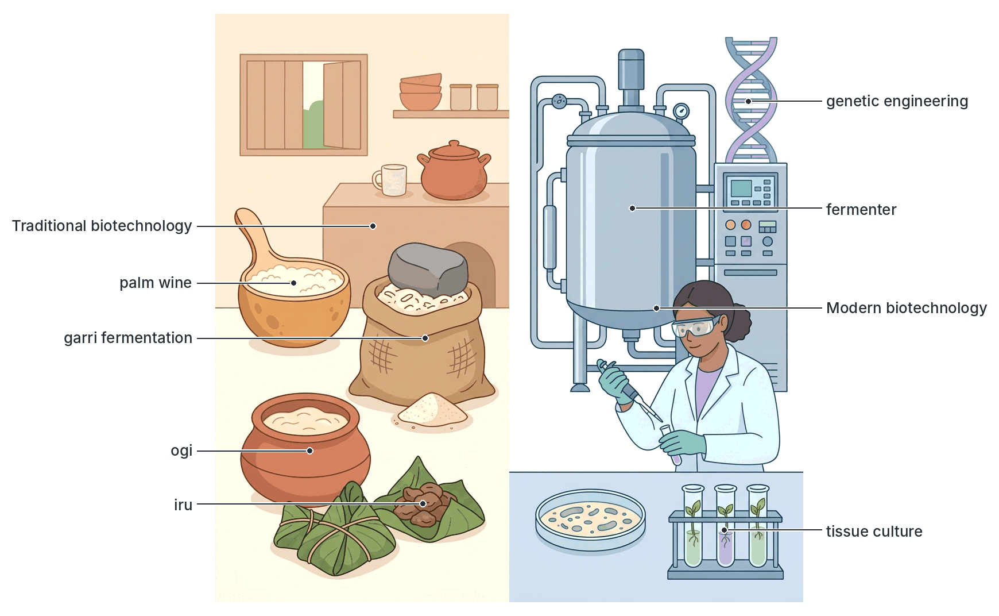
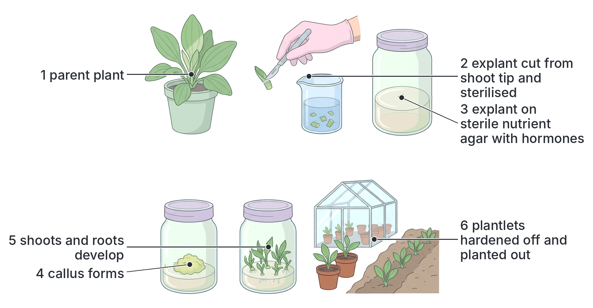
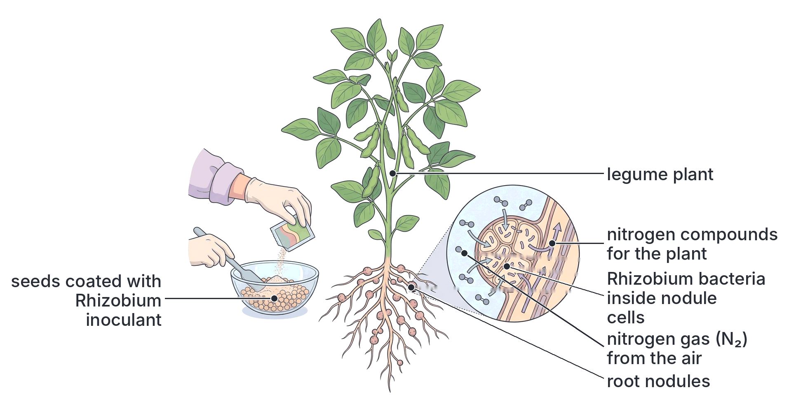
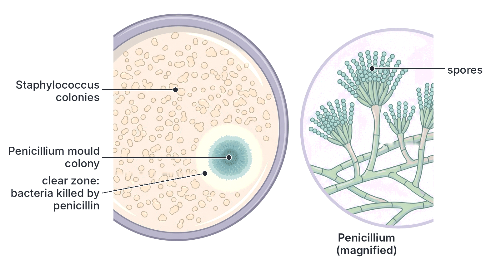
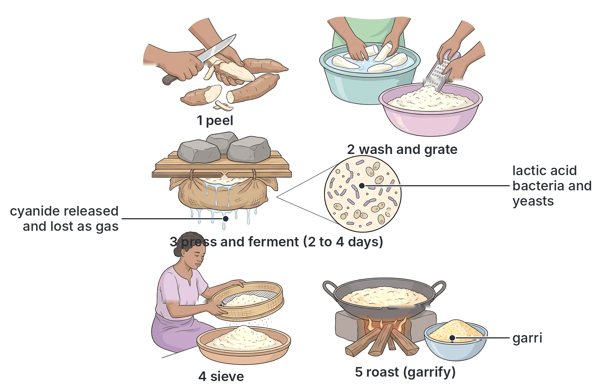
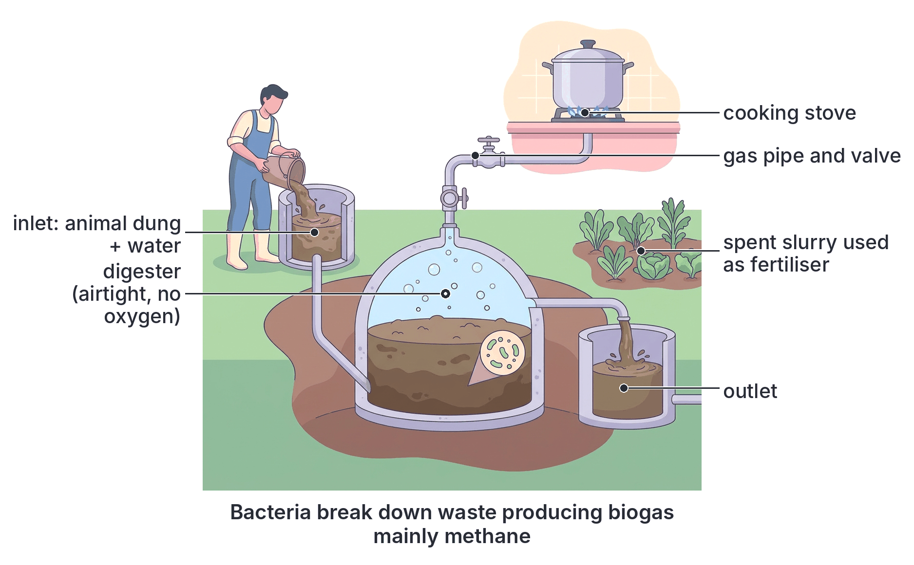

# JAMB Biology Notes: Biotechnology

## What JAMB expects

This topic is Section D, Topic 3 of the JAMB Biology syllabus: Heredity and Variations – Biotechnology. It has one content item:

- **a. Application of biotechnology in:**
  - (i) agriculture;
  - (ii) medicine;
  - (iii) pharmaceuticals; and
  - (iv) the food industry.

By the end of these notes, you should be able to:

1. Define biotechnology.
2. List (and explain) some applications of biotechnology in agriculture, medicine, the pharmaceutical industry and the food industry.

**Note on the syllabus wording:** the syllabus only asks you to "list" applications, but JAMB questions often ask which organism or process is used for a product (for example, which organism makes bread rise), so each application is explained below. Genetic engineering, recombinant DNA, GMOs and gene therapy, which are also forms of biotechnology, are explained in detail in `D2b-applications-of-heredity.md`; this file gives the wider picture. Environmental uses (biogas and the clean-up of oil spills) are not named in the syllabus but are included because they are common examples in textbooks and exams.

## What is biotechnology?

**Objective i: define biotechnology.**

**Biotechnology** is the use of **living organisms** (especially **microorganisms** such as bacteria, yeasts and moulds), or **parts or products** of living organisms (such as cells and enzymes), to make useful **products** or to carry out useful **processes** for human benefit.

Key ideas in the definition:

- **Living organisms:** mostly microorganisms, but also plant and animal cells, and whole plants and animals.
- **Parts or products:** enzymes, cells, genes (DNA).
- **Useful products or processes:** food, drink, medicines, vaccines, fuel, fertilisers, cleaning up pollution, identifying people.

**Textbook variation:** definitions differ in wording. Some textbooks define biotechnology narrowly as "the industrial use of microorganisms", and others as "the application of genetic engineering". The broad definition above includes both and is the one most textbooks now use. The word "biotechnology" was first used by the Hungarian engineer Károly (Karl) Ereky in 1919.

### Why microorganisms are so useful in biotechnology

1. They **reproduce very fast** (some bacteria divide every 20 minutes or so in good conditions), so large amounts can be grown quickly.
2. They can be grown cheaply on **waste or simple materials** (e.g. molasses, starch, agricultural waste).
3. They carry out a huge variety of **chemical reactions** using their enzymes.
4. They can be grown in **any season**, in tanks (**fermenters**), independent of the weather.
5. They are easy to **genetically modify**, because they have simple DNA and plasmids.
6. There are **few ethical problems** in using them.

### Traditional and modern biotechnology

Biotechnology is not new. People have used microorganisms for thousands of years to make bread, alcoholic drinks, yoghurt, cheese and fermented foods, without knowing that microbes were involved. In the 1850s–1860s, **Louis Pasteur** showed that fermentation is caused by living microorganisms.

| Feature | Traditional (old) biotechnology | Modern biotechnology |
| --- | --- | --- |
| Age | Thousands of years old | Mainly since the 1970s (genetic engineering) |
| Basis | Experience and custom; natural fermentation by whatever microbes are present | Scientific knowledge of cells, enzymes and genes |
| Organisms | Naturally occurring microbes, unchanged | Selected, improved or **genetically modified** organisms; isolated cells and enzymes |
| Main processes | **Fermentation**, selective breeding, composting | **Genetic engineering** (recombinant DNA), tissue culture, cell fusion, large-scale fermentation in controlled fermenters, DNA analysis |
| Control | Little control; quality varies from batch to batch | Carefully controlled (temperature, pH, sterility); consistent products |
| Scale | Household or village | Often large industrial scale |
| Examples | Garri, ogi, iru, ugba, palm wine, burukutu, nono, bread, yoghurt, cheese, vinegar | Human insulin, interferon, hepatitis B vaccine, Bt crops, tissue-cultured plantlets, DNA fingerprinting, monoclonal antibodies |

### Fermentation: the key process

Many biotechnology processes depend on **fermentation**.

- In the strict sense, **fermentation** is the breakdown of sugars by microorganisms (or cells) **without oxygen** (anaerobic respiration), releasing energy and producing substances such as **alcohol (ethanol)**, **carbon (IV) oxide (CO₂)** or **lactic acid**.
- **Alcoholic fermentation (by yeast):** glucose → ethanol + CO₂ + energy.
- **Lactic acid fermentation (by lactic acid bacteria):** glucose → lactic acid + energy.
- In industry, "fermentation" is used more loosely for **any** large-scale growth of microorganisms to make a product, even with oxygen (e.g. penicillin production).

## Applications of biotechnology

**Objective ii: list some applications in agriculture, medicine, pharmaceutical and food industries.**

### Summary list

| Area | Applications |
| --- | --- |
| **Agriculture** | Tissue culture (micropropagation); biofertilisers (*Rhizobium*, blue-green bacteria, mycorrhiza); biopesticides (Bt, fungal biopesticides); biological control; GM crops; improved livestock breeding (artificial insemination, embryo transfer); animal vaccines; silage and compost; disease diagnosis in crops and animals |
| **Medicine** | Vaccines; diagnostic tests (malaria and HIV rapid tests, PCR); DNA fingerprinting; gene therapy; stem cell and tissue engineering; *in vitro* fertilisation |
| **Pharmaceuticals** | Antibiotics (e.g. penicillin, streptomycin); recombinant proteins (insulin, interferon, growth hormone, clotting factors); vaccines on a large scale; steroids, vitamins; monoclonal antibodies |
| **Food industry** | Fermented foods and drinks (garri, ogi, ugba, iru/dawadawa, palm wine, beer, yoghurt, cheese, bread, vinegar); industrial enzymes; single-cell protein; food additives (citric acid, flavour enhancers) |
| **Environment and energy** (extra) | Biogas; bioremediation of oil spills; sewage treatment; biofuels such as ethanol |

## Biotechnology in agriculture

**Content a(i): application of biotechnology in agriculture.**

### 1. Tissue culture (micropropagation)

**Tissue culture** is growing small pieces of plant tissue (**explants**) on a sterile **nutrient medium** in glass containers in a laboratory, to produce many new plants. Plant cells can do this because each cell keeps all the genes needed to grow into a whole plant (they are **totipotent**).

**Steps:**

1. Choose a **healthy, high-yielding parent plant**.
2. Cut a small piece (explant), usually from the growing tip (**meristem**), which is often free of viruses.
3. **Sterilise** the explant (e.g. with dilute bleach) to kill bacteria and fungi on its surface.
4. Place it on a sterile **jelly-like medium (agar)** containing sugar, mineral salts, vitamins and **plant hormones** (auxins and cytokinins), in a sterile container.
5. Keep it in a warm, lit growth room. The cells divide to form a mass of undifferentiated cells (a **callus**) or many small shoots.
6. Divide the callus or shoots and transfer them to fresh media; changing the hormone balance makes them form **shoots** and then **roots**.
7. Move the young **plantlets** to soil in a greenhouse to **harden off** (get used to normal conditions) before planting them in the field.

**Advantages:**

- **Thousands of identical plants** (clones) can be produced from one parent in a short time and small space.
- Plants are produced **all year round**.
- **Disease-free (clean) planting material** can be produced, especially free of viruses, using meristem tips.
- Good for crops that are propagated **vegetatively** or produce few seeds, such as **yam, cassava, banana, plantain, pineapple, sugarcane** and **oil palm**. IITA in Ibadan and Nigerian institutes use tissue culture to produce clean yam, cassava and plantain planting material.
- Useful for **conserving rare or endangered plants** (storing them in laboratories, in gene banks).

**Disadvantages:** expensive laboratory and skilled staff needed; all the clones are **genetically identical**, so one new disease could attack them all; contamination by microbes can destroy whole batches.

### 2. Biofertilisers

**Biofertilisers** are preparations of **living microorganisms** that increase the supply of nutrients (especially nitrogen and phosphorus) to crops. They are cheaper and less polluting than chemical fertilisers.

| Biofertiliser | How it helps | Crops |
| --- | --- | --- |
| ***Rhizobium*** (nitrogen-fixing bacteria) | Lives in **root nodules** of legumes and **fixes atmospheric nitrogen** into compounds the plant can use. Seeds are coated with a ***Rhizobium* inoculant** before planting, especially where that legume has not been grown before | Soybean, cowpea, groundnut, beans |
| ***Azotobacter*** | Free-living soil bacterium that fixes nitrogen | Many crops |
| **Blue-green bacteria (cyanobacteria)**, e.g. *Anabaena*, *Nostoc* | Fix nitrogen in water and wet soil; *Anabaena* lives inside the small water fern ***Azolla***, which can be grown in flooded rice fields as a green manure | Rice |
| **Mycorrhizal fungi** | Fungi that live in association with roots and help them absorb **phosphate** and water | Many crops and trees |

### 3. Biopesticides and biological control

**Biopesticides** are pesticides made from living organisms or their natural products. They usually affect only the target pests and break down quickly, so they are safer for people, livestock, bees and the environment.

- **Bt (*Bacillus thuringiensis*) sprays:** this soil bacterium makes crystal proteins that are toxic to the larvae (caterpillars) of certain insects. Sprays of Bt spores and crystals are used against caterpillar pests, and against mosquito larvae (a related strain) in water. The Bt gene has also been put into crops (Bt cotton, Bt cowpea; see `D2b-applications-of-heredity.md`).
- **Fungal biopesticides:** for example, spores of the fungus ***Metarhizium*** infect and kill locusts and grasshoppers. A product based on this fungus (sold as "Green Muscle") was developed in Africa in the 1990s, through an international research programme that included IITA, for controlling locusts and grasshoppers without chemical insecticides.
- **Neem** (*Azadirachta indica*) extracts, from a tree widely grown in northern Nigeria, are used as a natural insecticide. (This is a plant product rather than a microbial one, and some textbooks call it a botanical pesticide.)

**Biological control** is the use of a **natural enemy** (a predator, parasite or disease) to control a pest. A famous African example: in the 1970s–1980s, the **cassava mealybug** (accidentally introduced from South America) was destroying cassava across Africa, including Nigeria. Scientists working with **IITA** found a tiny parasitic wasp (*Anagyrus lopezi*, also called *Apoanagyrus lopezi*) in South America that attacks the mealybug, bred it and released it across Africa, bringing the pest under control. The scientist who led the programme, Hans Herren, received the World Food Prize in 1995.

### 4. Genetically modified crops

Genetic engineering is used to give crops new characters such as insect resistance (Bt cotton, Bt cowpea), herbicide tolerance, virus resistance and improved nutrition (Golden Rice). These are explained, with their benefits and the arguments against them, in `D2b-applications-of-heredity.md`.

### 5. Livestock improvement and animal health

- **Artificial insemination (AI):** semen from a superior bull, ram or boar is collected, can be frozen and stored, and is placed into many females, spreading good genes quickly.
- **Embryo transfer:** embryos from a high-quality cow are collected and placed in ordinary "surrogate" cows to grow.
- **Animal vaccines:** biotechnology produces vaccines against diseases such as Newcastle disease in poultry, and anthrax and contagious bovine pleuropneumonia in cattle. In Nigeria, the **National Veterinary Research Institute (NVRI), Vom**, in Plateau State, produces many livestock vaccines.
- **Diagnostic tests** for animal diseases, and **DNA tests** for choosing breeding animals.

### 6. Silage and compost

- **Silage** is green fodder (grass, maize plants) packed tightly in a pit or bag without air, where **lactic acid bacteria** ferment it. The acid preserves it as animal feed for the dry season.
- **Compost** is made when bacteria and fungi decompose plant and animal wastes into humus-rich organic manure.

## Biotechnology in medicine

**Content a(ii): application of biotechnology in medicine.**

### 1. Vaccines

A **vaccine** is a preparation that stimulates the body to make antibodies and memory cells against a disease, without causing the disease, so the person becomes **immune**. Vaccines are produced by growing microorganisms or their parts in large quantities.

| Type of vaccine | What it contains | Examples |
| --- | --- | --- |
| **Live attenuated** (weakened) | Living microbes weakened so they cannot cause disease | Oral polio vaccine, measles, yellow fever, BCG (tuberculosis) |
| **Killed (inactivated)** | Dead microbes | Injected polio vaccine, some cholera vaccines |
| **Toxoid** | Inactivated toxins | Tetanus and diphtheria vaccines |
| **Subunit or recombinant** | Only a part of the microbe (e.g. a surface protein), often made by genetically engineered yeast or bacteria | **Hepatitis B vaccine**, HPV vaccine |
| **mRNA vaccines** | A piece of genetic material that instructs body cells to make a harmless protein of the virus | Some COVID-19 vaccines |

Vaccines given through Nigeria's routine childhood immunisation programme protect against diseases such as tuberculosis, polio, measles, diphtheria, whooping cough, tetanus, hepatitis B and yellow fever. Nigeria was declared free of wild poliovirus in **2020**, largely because of vaccination campaigns.

### 2. Diagnosis of diseases

Biotechnology provides fast and accurate tests:

- **Rapid diagnostic tests (RDTs)** for **malaria** and **HIV**: a drop of blood is placed on a test strip containing **antibodies** that bind to a specific protein (antigen) of the parasite or virus (or, in many HIV tests, antigens that detect the person's antibodies). A coloured line shows a positive result within minutes. Malaria RDTs are widely used in Nigerian health centres.
- **Monoclonal antibodies:** pure antibodies that recognise one particular molecule; used in **pregnancy tests** (detecting a hormone in urine), RDTs and many laboratory tests.
- **PCR (polymerase chain reaction):** copies tiny amounts of DNA or RNA millions of times so that a microbe can be detected; used to diagnose infections such as tuberculosis, HIV (in babies) and COVID-19.
- **Genetic tests:** e.g. haemoglobin genotype (sickle-cell) testing, and prenatal tests for inherited diseases.

### 3. DNA fingerprinting (DNA profiling)

Using differences in people's DNA to identify individuals in **crime detection**, **paternity disputes** and **identification of disaster victims**. The method is explained in `D1-variation-in-population.md`.

### 4. Gene therapy

Replacing or correcting faulty genes in a patient's cells to treat inherited diseases such as sickle-cell disease (see `D2b-applications-of-heredity.md`).

### 5. Other medical applications

- **Stem cell therapy:** using stem cells (cells that can develop into many types of cell) to replace damaged cells, e.g. **bone marrow transplants** for leukaemia and sickle-cell disease.
- **Tissue engineering:** growing skin in the laboratory for burn patients.
- ***In vitro* fertilisation (IVF):** fertilising eggs with sperm outside the body and placing the embryo in the womb, to help infertile couples (covered in Section B, reproduction).
- **Artificial blood clot busters and hormones** made by genetic engineering (see pharmaceuticals).

## Biotechnology in the pharmaceutical industry

**Content a(iii): application of biotechnology in pharmaceuticals.**

The **pharmaceutical industry** makes medicines (drugs) on a large scale. Many of the most important medicines are made by microorganisms.

### 1. Antibiotics

An **antibiotic** is a substance produced by a microorganism (or made to copy one) that **kills or stops the growth of other microorganisms**, especially bacteria. Antibiotics do **not** work against viruses.

#### The discovery of penicillin

1. In **1928**, **Alexander Fleming**, a Scottish scientist in London, was growing the bacterium *Staphylococcus* on culture plates.
2. One plate became contaminated by a **mould**, ***Penicillium notatum***.
3. He noticed that **around the mould, the bacteria had been killed**, leaving a clear zone.
4. He concluded that the mould produced a substance that killed bacteria and named it **penicillin**.
5. Fleming could not purify it in large amounts. In the early **1940s**, **Howard Florey** and **Ernst Chain** at Oxford purified penicillin and showed that it cured infections. During the Second World War, mass production was developed, using a higher-yielding species, ***Penicillium chrysogenum***, grown in large fermenters.
6. Fleming, Florey and Chain shared the Nobel Prize in 1945.

#### How penicillin is produced industrially

1. A high-yielding strain of *Penicillium chrysogenum* is grown in a large, sterile **fermenter** containing a nutrient medium (e.g. sugars such as lactose, and corn steep liquor).
2. The fermenter is kept at about **25 °C** and the right **pH**, and is **stirred** and supplied with sterile **air** (the mould needs oxygen).
3. Penicillin is produced mainly after the mould has finished its rapid growth (it is a **secondary metabolite**).
4. After several days, the culture is **filtered** to remove the mould.
5. Penicillin is **extracted and purified** from the liquid, then made into tablets, capsules or injections.
6. Chemists often modify the natural penicillin to make **semi-synthetic penicillins** such as **ampicillin** and **amoxicillin** (very commonly used in Nigeria), which work against more bacteria.

[IMAGE: Labelled cross-section of an industrial fermenter: a tall stainless steel cylinder with a motor-driven stirrer shaft and paddles inside, a water jacket around the outside with cold water in at the bottom and warm water out at the top, a sterile air inlet with a sparger (bubble ring) at the bottom, a nutrient inlet at the top, an exhaust gas outlet at the top, temperature and pH probes on the side, and a harvest outlet tap at the bottom. Inside, a cloudy culture with tiny fungal threads. Labels to add later: "motor", "stirrer (paddles)", "nutrient inlet", "sterile air in", "air bubbles (sparger)", "exhaust gases out", "water jacket (cooling)", "cold water in", "warm water out", "temperature probe", "pH probe", "culture of Penicillium", "product removed here". Clean flat textbook style, white background.]

#### Other antibiotics from microorganisms

| Antibiotic | Produced by |
| --- | --- |
| Penicillin | The mould *Penicillium* |
| Streptomycin (used against tuberculosis) | The soil bacterium *Streptomyces griseus* (discovered by Selman Waksman's team in 1943) |
| Tetracycline, erythromycin, chloramphenicol | Other *Streptomyces* species |
| Cephalosporins | The fungus *Cephalosporium* (now *Acremonium*) |

**Antibiotic resistance:** misuse of antibiotics (buying them without prescription, not finishing the course, using them for viral infections such as colds) allows **resistant bacteria** to survive and spread. This is a growing problem in Nigeria and worldwide, and is an example of natural selection (see `E1-theories-of-evolution.md`).

### 2. Medicines made by genetically engineered organisms

Genetically engineered bacteria, yeasts and animal cells grown in fermenters produce **human insulin**, **interferon**, **human growth hormone**, **clotting factors** (for haemophilia), **erythropoietin**, **tissue plasminogen activator** (to dissolve blood clots) and **recombinant vaccines**. The steps and the importance of these products are explained in `D2b-applications-of-heredity.md`.

### 3. Other pharmaceutical products

- **Steroid hormones** (e.g. cortisone and some contraceptive hormones): some steps of their manufacture are carried out by fungi, which change the molecule more cheaply than chemical methods.
- **Vitamins:** for example, **vitamin B₁₂** is made commercially by bacteria; **riboflavin (vitamin B₂)** by microorganisms.
- **Monoclonal antibodies** used as medicines against some cancers and other diseases.
- **Mass production of vaccines** (see medicine).

## Biotechnology in the food industry

**Content a(iv): application of biotechnology in the food industry.**

### 1. Traditional Nigerian fermented foods and drinks

Fermentation improves food by giving it a pleasant **sour or strong flavour**, **preserving** it (acids and alcohol stop harmful microbes growing), **removing poisons**, and making it **more digestible** and sometimes **more nutritious** (e.g. more protein or vitamins).

#### Garri

Garri is made from cassava roots, which contain **cyanogenic glycosides** (mainly **linamarin**) that can release poisonous **hydrogen cyanide**.

1. Cassava roots are **peeled**, **washed** and **grated** into a pulp.
2. The pulp is packed into a sack (jute or polypropylene) and **pressed** with heavy stones or a press for about **two to four days**, which squeezes out water.
3. During this time, the pulp **ferments**. Microorganisms, mainly **lactic acid bacteria** (with yeasts and other microbes), produce **acids** that give garri its sour taste and lower the pH.
4. Fermentation and the cassava's own enzymes help **break down the cyanogenic glycosides**, and the hydrogen cyanide released escapes as gas. This makes the garri **safe to eat**.
5. The dewatered, fermented mash is **sieved** and then **roasted (fried)** in a wide pan, with or without palm oil (palm oil gives yellow garri), until dry and crisp. Heating drives off remaining cyanide and dries the garri so it can be stored.

#### Ogi (akamu, koko)

1. Grains of **maize**, **sorghum** (guinea corn) or **millet** are **soaked (steeped)** in water for one to three days, during which they begin to ferment.
2. The softened grains are **wet-milled** and **sieved** to remove the bran (husk).
3. The starchy slurry is left to settle and **sour** for one to three days. **Lactic acid bacteria** (especially *Lactobacillus* species) and yeasts ferment the sugars, producing lactic acid and the typical sour taste.
4. The sediment (ogi) is stored under water and later cooked into a porridge (pap), eaten with akara or moin-moin, or used as a weaning food. It is also the base for agidi (eko).

#### Ugba (ukpaka)

1. Seeds of the **African oil bean tree** (*Pentaclethra macrophylla*) are **boiled** for several hours, **dehulled** (seed coats removed) and **sliced** into thin strips.
2. The slices are **washed**, boiled again or soaked, then **wrapped in leaves** and left to ferment for about three days.
3. Bacteria, mainly ***Bacillus*** species, break down the proteins and fats, giving ugba its characteristic flavour and soft texture. The process is mainly an **alkaline** (protein-digesting) fermentation.
4. Ugba is a popular food and delicacy in south-eastern Nigeria (e.g. in African salad, abacha).

#### Iru (Yoruba) and dawadawa (Hausa)

1. Seeds of the **African locust bean tree** (*Parkia biglobosa*) are **boiled** until soft, **dehulled**, washed and boiled again.
2. They are spread in a container, covered (often with leaves or sacks) and kept warm to ferment for **two to four days**.
3. Bacteria, mainly ***Bacillus subtilis***, break down proteins into simpler, tasty substances (giving a strong smell and flavour) and make the medium **alkaline**.
4. The product is used as a **food seasoning (condiment)** in soups and stews. It is rich in protein. **Ogiri**, made similarly from fermented **melon (egusi)** seeds or castor oil seeds, is used in the south-east.

#### Palm wine

1. Sweet, sugary **sap** is tapped from the **oil palm** (*Elaeis guineensis*) or the **raffia palm**.
2. Microorganisms from the air, the palm and the tapping containers, especially the yeast ***Saccharomyces*** and bacteria such as *Zymomonas* and lactic acid bacteria, ferment the sugar almost immediately.
3. Alcoholic fermentation: sugar → **ethanol** + **CO₂** (the CO₂ makes the wine frothy and fizzy).
4. As fermentation continues, the wine becomes more alcoholic and sourer; after a few days, bacteria (e.g. *Acetobacter*) can turn the alcohol into **acetic acid**, making it taste like vinegar.
5. Palm wine can be **distilled** to make a strong local gin (**ogogoro** or kai-kai).

Other traditional fermented drinks and foods include **burukutu** and **pito** (sorghum beers), **kunu** (a millet drink), **nono** (fermented cow's milk, often eaten with **fura**), **fufu** and **akpu** (fermented cassava), and **wara** (a soft cheese made by Fulani women, who curdle milk using the juice of the leaves of the **Sodom apple**, *Calotropis procera*).

### 2. Bread

1. Flour, water, sugar, salt and **baker's yeast** (*Saccharomyces cerevisiae*) are mixed into a **dough** and kneaded.
2. The dough is left in a warm place (**proving**). Enzymes in the flour and yeast break starch down into sugars; the yeast **ferments** the sugars, producing **CO₂** and a little ethanol.
3. The **CO₂ bubbles** are trapped by the stretchy **gluten** protein in the dough, so the dough **rises** (becomes light and spongy).
4. During **baking**, the heat kills the yeast, the bubbles expand further, the ethanol **evaporates**, and the bread sets.

[IMAGE: Three-panel diagram of bread making with yeast. Panel 1: a bowl of freshly kneaded dough, small and dense, with an inset circle showing oval budding yeast cells among starch grains. Panel 2: the same dough in a warm place, risen to twice its size, with a cut-away showing many trapped gas bubbles and an inset showing yeast cells releasing tiny CO2 bubbles. Panel 3: a baked brown loaf sliced to show the spongy, airy crumb, with wavy lines rising from it. Labels to add later: "1 dough: flour, water, sugar and yeast (Saccharomyces)", "yeast cells", "2 proving: yeast ferments sugar", "carbon (IV) oxide bubbles trapped by gluten", "dough rises", "3 baking: yeast killed, alcohol evaporates", "spongy bread". Clean flat textbook style, white background.]

### 3. Yoghurt

1. Milk is **pasteurised** (heated to kill harmful microbes) and then **cooled** to about **40–45 °C**.
2. A **starter culture** of lactic acid bacteria, usually ***Lactobacillus bulgaricus*** (now named *Lactobacillus delbrueckii* subsp. *bulgaricus*) and ***Streptococcus thermophilus***, is added.
3. The milk is kept warm (**incubated**) for a few hours.
4. The bacteria ferment the milk sugar (**lactose**) into **lactic acid**. The acid lowers the pH, which makes the milk protein (**casein**) **coagulate (thicken)** and gives the sour taste. The acid also helps preserve the yoghurt.
5. The yoghurt is cooled to stop fermentation; flavours or fruit may be added.

### 4. Cheese

Milk is soured by lactic acid bacteria, and the enzyme **rennin (chymosin)** is added to coagulate it into solid **curds** and liquid **whey**. The curds are pressed and often **ripened** by bacteria or moulds (e.g. *Penicillium* in blue cheeses), which give each cheese its flavour. Chymosin used to come from calves' stomachs; today most is made by **genetically engineered microorganisms**.

### 5. Vinegar

Vinegar is made in two stages: **yeasts** ferment sugar (from fruit juice, palm wine or malt) to **ethanol**, and then **acetic acid bacteria** (*Acetobacter*) oxidise the ethanol to **acetic (ethanoic) acid**, with oxygen.

### 6. Industrial enzymes

Enzymes extracted from microorganisms (and some plants) are used in food processing:

| Enzyme | Source | Use in food industry |
| --- | --- | --- |
| **Amylase** | Fungi (*Aspergillus*), bacteria | Breaking starch into sugars for syrups, brewing and baking |
| **Pectinase** | Fungi | Clearing (clarifying) fruit juices and getting more juice from fruit |
| **Invertase** | Yeast | Making soft-centred sweets and invert sugar syrups |
| **Lactase** | Yeast, fungi | Making **lactose-free milk** for people who cannot digest lactose |
| **Proteases** | Bacteria, fungi, plants | Tenderising meat; making biscuits; also in **biological washing powders** |
| **Papain** | **Pawpaw** (*Carica papaya*) latex | **Tenderising meat**: in many Nigerian homes, tough meat is wrapped in pawpaw leaves or cooked with unripe pawpaw to soften it |
| **Chymosin (rennin)** | Calves' stomachs or GM microbes | Cheese-making |
| **Glucose isomerase** | Bacteria | Changing glucose into the sweeter fructose (high-fructose syrup) |

### 7. Single-cell protein (SCP)

**Single-cell protein** is protein-rich food or animal feed made from **microorganisms** (bacteria, yeasts, fungi or algae) grown in large quantities.

- **Examples:** **mycoprotein** (sold as "Quorn"), made from the fungus ***Fusarium venenatum*** grown in fermenters on glucose, and used as a meat substitute; **Spirulina**, a blue-green bacterium (cyanobacterium) dried and eaten as a protein supplement; **yeast** grown on waste products (e.g. molasses) and used in animal feed.
- **Advantages:** microorganisms grow very fast and have a **high protein content** (often 40–80% of their dry mass); they can be grown on cheap **waste materials**; production does not need much land and is independent of the weather and seasons; can help meet protein shortages.
- **Disadvantages:** high **nucleic acid** content (which must be reduced because it can cause gout), possible **contamination**, people may find it unattractive, and the technology is costly.

### 8. Food additives

Microorganisms produce **citric acid** (by the mould *Aspergillus niger*, used in soft drinks and sweets), **flavour enhancers** such as monosodium glutamate (by bacteria), some **vitamins** and **thickeners**.

## Biotechnology in the environment and energy

### 1. Biogas

**Biogas** is a mixture of gases, mainly **methane** (about 50–70%) and **CO₂**, produced when bacteria break down organic matter **without oxygen** (anaerobic digestion).

**How it is produced:**

1. Organic wastes such as **cow dung, poultry droppings, pig waste, crop residues, food waste and sewage** are mixed with water to form a **slurry**.
2. The slurry is fed into an **airtight tank (digester)**, often built underground to keep it warm.
3. Different groups of microorganisms work in sequence: some break down large molecules (carbohydrates, proteins, fats) into simpler ones; others convert these into acids; finally, **methane-producing microorganisms (methanogens)** convert them to **methane** and CO₂.
4. The gas collects at the top and is piped off for **cooking, lighting, heating** or running generators.
5. The remaining **slurry** is a good **organic fertiliser**.

**Advantages:** cheap fuel from waste; reduces the cutting of trees for firewood; disposes of animal and human waste hygienically; reduces bad smells and flies; gives fertiliser; reduces the release of methane (a greenhouse gas) from rotting waste. Biogas digesters are being used in some Nigerian farms, abattoirs and schools.

### 2. Bioremediation of oil spills

**Bioremediation** is the use of **microorganisms** (or plants) to break down or remove **pollutants** from the environment.

- In the **Niger Delta**, oil spills from pipelines, sabotage and oil theft have polluted land, creeks and mangroves, damaging farming and fishing. A major United Nations Environment Programme (UNEP) report in 2011 described severe, long-lasting oil pollution in **Ogoniland**, and a clean-up programme was later started.
- Some **bacteria** (e.g. species of ***Pseudomonas***) and fungi can use **hydrocarbons** (the compounds in crude oil) as food, breaking them down into harmless CO₂ and water.

**Methods:**

1. **Biostimulation:** adding **fertilisers** (nitrogen and phosphorus), water and air (by tilling the soil) to speed up the growth of the oil-eating microbes already present.
2. **Bioaugmentation:** adding cultures of extra oil-degrading microorganisms to the polluted site.
3. **Phytoremediation:** growing plants that take up or help break down pollutants.

**Advantages:** cheaper and more natural than many chemical or physical methods; breaks pollutants down completely instead of moving them elsewhere. **Disadvantages:** slow (months to years); works less well with very heavy pollution or in waterlogged, airless soil.

### 3. Sewage treatment and biofuels

- **Sewage treatment:** in treatment plants, microorganisms break down organic matter in sewage (e.g. in **activated sludge** tanks and **trickling filters**), making the water safe to release.
- **Bioethanol:** yeasts ferment sugars from sugarcane, maize or **cassava** to produce **ethanol**, which can be mixed with petrol as a fuel.

## Advantages and concerns of biotechnology

| Advantages | Concerns |
| --- | --- |
| More and better food; higher crop and livestock yields | Safety concerns about GMOs and possible effects on health and the environment |
| Cheaper, safer and purer medicines and vaccines | High cost of modern biotechnology; benefits may not reach the poor |
| Faster, more accurate diagnosis of diseases | Misuse of antibiotics leads to resistant bacteria |
| Use of wastes to make fuel, fertiliser and food | Contamination of fermentation products if hygiene is poor (e.g. traditional fermented foods made in dirty conditions can cause food poisoning) |
| Cleaning up pollution | Ethical questions (e.g. gene editing, patents on living organisms) |
| Creation of jobs and industries | Possible misuse (e.g. biological weapons), which is why **biosafety** rules are needed |

## Key terms

| Term | Meaning |
| --- | --- |
| Biotechnology | The use of living organisms, or their parts or products, to make useful products or carry out useful processes |
| Traditional biotechnology | Old methods such as fermentation of foods and drinks, using natural microbes |
| Modern biotechnology | Methods based on genetic engineering, tissue culture and controlled industrial fermentation |
| Fermentation | Breakdown of sugars by microorganisms without oxygen, producing alcohol, CO₂ or lactic acid; in industry, any large-scale culture of microbes |
| Fermenter | A large, controlled vessel for growing microorganisms to make a product |
| Tissue culture (micropropagation) | Growing many plants from small pieces of tissue on sterile nutrient media |
| Explant | The small piece of tissue used to start a tissue culture |
| Callus | A mass of undifferentiated plant cells formed in tissue culture |
| Biofertiliser | Living microorganisms used to supply nutrients to crops, e.g. *Rhizobium* |
| Biopesticide | A pesticide made from living organisms or their natural products, e.g. Bt |
| Biological control | Using a natural enemy to control a pest |
| Vaccine | A preparation that stimulates immunity without causing disease |
| Antibiotic | A substance made by a microorganism that kills or stops the growth of other microorganisms |
| Monoclonal antibodies | Identical antibodies that recognise one particular molecule |
| PCR | Polymerase chain reaction: a method that makes millions of copies of a piece of DNA |
| Single-cell protein | Protein-rich food or feed made from microorganisms |
| Biogas | A fuel gas, mainly methane, made by anaerobic breakdown of organic waste |
| Bioremediation | Using microorganisms or plants to remove pollutants |
| Lactic acid bacteria | Bacteria such as *Lactobacillus* that ferment sugars to lactic acid (ogi, garri, yoghurt) |

## Exam tips and common mistakes

- **Learn the definition:** biotechnology = using living organisms or their products to make useful products or processes.
- **Yeast in bread produces CO₂,** which makes the dough rise; the alcohol evaporates during baking.
- **Yoghurt and ogi are made by lactic acid bacteria** (*Lactobacillus*), not by yeast.
- **Garri fermentation removes cyanide** from cassava; iru, dawadawa and ugba are fermented mainly by *Bacillus* species.
- **Palm wine is fermented by yeast** (alcohol and CO₂); left too long, it turns sour (acetic acid).
- **Penicillin comes from the mould *Penicillium*** and was discovered by Alexander Fleming in 1928; streptomycin comes from the bacterium *Streptomyces*.
- **Antibiotics do not kill viruses.**
- **Biogas is mainly methane,** produced anaerobically by bacteria from organic waste.
- **Rhizobium is a nitrogen-fixing bacterium in legume root nodules** and is used as a biofertiliser.
- **Tissue culture produces clones:** many identical, disease-free plants from one parent.
- **Do not confuse traditional and modern biotechnology:** fermentation of food is traditional; insulin from GM bacteria is modern.

## Quick summary

1. Biotechnology is the use of living organisms (especially microorganisms) or their parts and products to make useful products or carry out useful processes.
2. Traditional biotechnology relies on natural fermentation (garri, ogi, ugba, iru/dawadawa, palm wine, bread, yoghurt); modern biotechnology uses genetic engineering, tissue culture and controlled fermenters.
3. In agriculture, biotechnology provides tissue-cultured disease-free plantlets, biofertilisers such as *Rhizobium*, biopesticides such as Bt and *Metarhizium*, biological control, GM crops and animal vaccines.
4. In medicine, it provides vaccines, rapid diagnostic tests, PCR, DNA fingerprinting, gene therapy and stem cell treatments.
5. In the pharmaceutical industry, microorganisms in fermenters produce antibiotics (penicillin from *Penicillium*, streptomycin from *Streptomyces*) and genetically engineered medicines such as insulin and interferon.
6. In the food industry, microbes produce fermented foods and drinks, industrial enzymes (amylase, pectinase, lactase, chymosin, papain), single-cell protein and food additives.
7. Biotechnology also produces biogas (methane) from wastes and cleans up oil pollution by bioremediation, as needed in the Niger Delta.

## Practice questions

**1. Biotechnology can best be defined as the**

- A. study of the structure of living cells
- B. use of living organisms or their products to make useful products or carry out useful processes
- C. classification of microorganisms
- D. study of the interaction of organisms with their environment

**Answer: B.** Biotechnology applies organisms (especially microbes), cells and enzymes to produce useful goods and services.

**2. The organism that makes bread dough rise is**

- A. *Lactobacillus*
- B. *Penicillium*
- C. *Saccharomyces*
- D. *Rhizobium*

**Answer: C.** Baker's yeast (*Saccharomyces cerevisiae*) ferments sugars in the dough, producing carbon (IV) oxide bubbles that make it rise.

**3. During the fermentation of grated cassava for garri, an important benefit is the**

- A. increase in the starch content
- B. removal of cyanide-producing compounds
- C. production of penicillin
- D. fixation of nitrogen

**Answer: B.** Fermentation helps break down the cyanogenic glycosides, and the hydrogen cyanide released escapes, making garri safe to eat.

**4. Yoghurt is produced by the action of**

- A. lactic acid bacteria on milk
- B. yeast on milk
- C. moulds on cheese
- D. nitrogen-fixing bacteria on milk

**Answer: A.** Bacteria such as *Lactobacillus bulgaricus* and *Streptococcus thermophilus* ferment lactose to lactic acid, which thickens and sours the milk.

**5. The antibiotic penicillin is obtained from a**

- A. bacterium
- B. virus
- C. alga
- D. fungus

**Answer: D.** Penicillin is produced by the mould *Penicillium*, a fungus. Fleming discovered it in 1928.

**6. The main gas in biogas is**

- A. methane
- B. carbon (II) oxide
- C. hydrogen sulphide
- D. oxygen

**Answer: A.** Biogas is mainly methane (about 50–70%), with carbon (IV) oxide, produced by anaerobic bacteria breaking down organic waste.

**7. Which of the following is used as a biofertiliser?**

- A. *Plasmodium*
- B. *Rhizobium*
- C. *Penicillium*
- D. *Saccharomyces*

**Answer: B.** *Rhizobium* fixes atmospheric nitrogen in legume root nodules, increasing nitrogen available to the crop.

**8. Tissue culture is used in agriculture mainly to**

- A. produce new varieties by sexual reproduction
- B. kill insect pests
- C. produce large numbers of identical, disease-free plants
- D. increase the variation among crops

**Answer: C.** Tissue culture produces many genetically identical clones from small explants, often free of viruses.

**9. The use of microorganisms to break down crude oil spilled in the Niger Delta is called**

- A. biological control
- B. fermentation
- C. pasteurisation
- D. bioremediation

**Answer: D.** Bioremediation uses microorganisms (or plants) to remove pollutants, here by digesting hydrocarbons.

**10. Iru (dawadawa), used as a seasoning in Nigerian soups, is produced by fermenting the seeds of the**

- A. African locust bean
- B. oil palm
- C. African oil bean
- D. melon

**Answer: A.** Iru (dawadawa) is fermented African locust bean (*Parkia biglobosa*) seeds, mainly by *Bacillus subtilis*. Ugba comes from the African oil bean, and ogiri from melon seeds.
