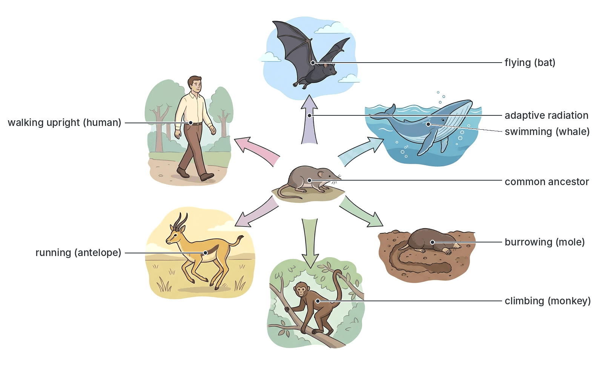
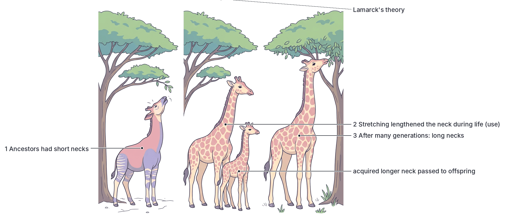
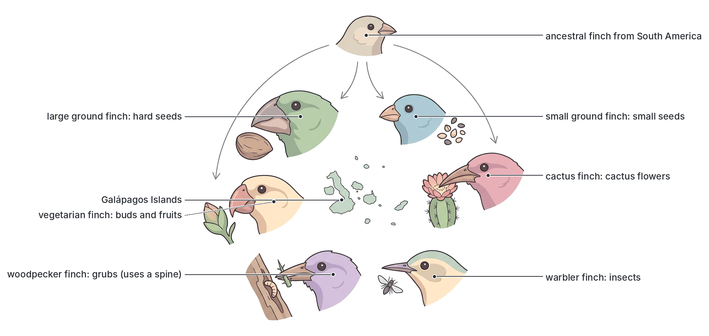
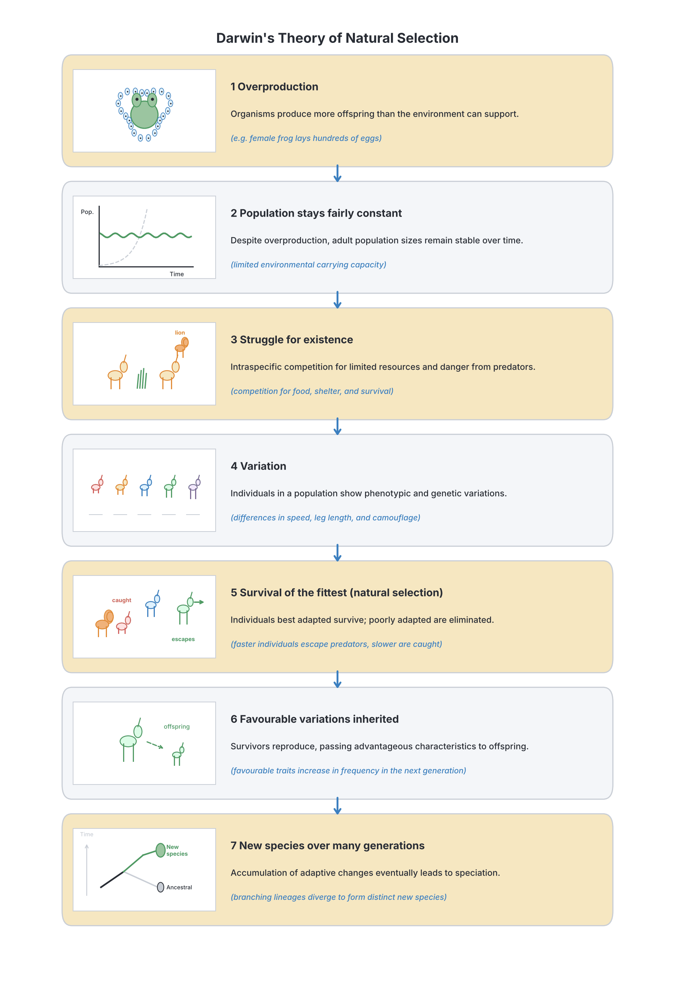
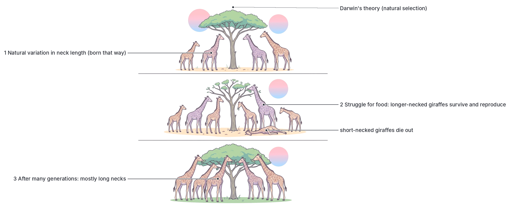
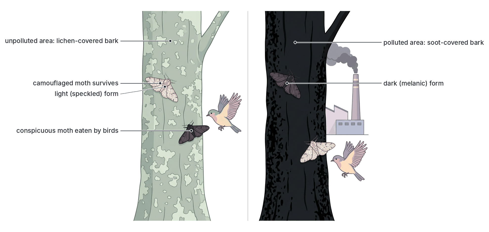
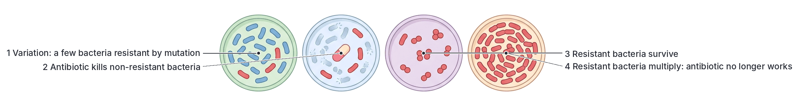
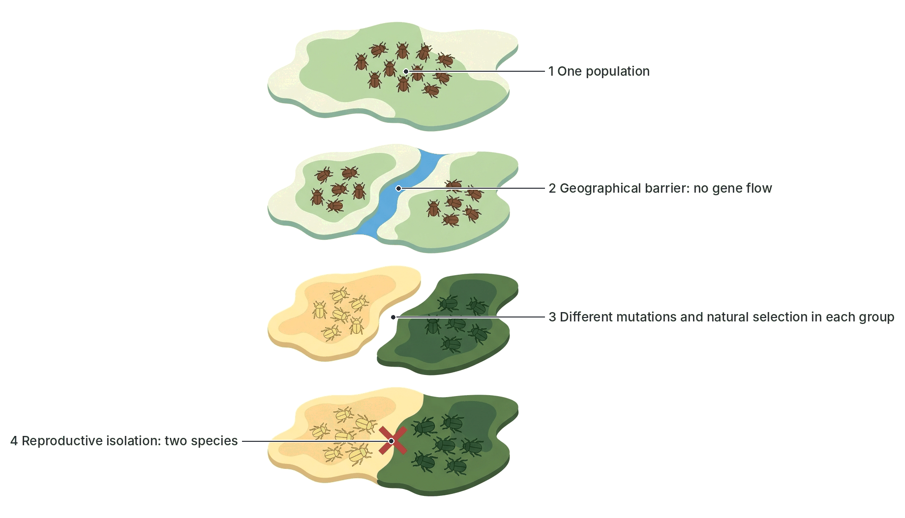

# JAMB Biology Notes: Theories of Evolution

## What JAMB expects

This topic is Section E, Topic 1 of the JAMB Biology syllabus: Evolution – Theories of evolution. It covers three content items:

- **a. Lamarck's theory.**
- **b. Darwin's theory.**
- **c. Organic theory** (the theory of organic evolution).

By the end of these notes, you should be able to:

1. Relate organic evolution as the sum total of all adaptive changes that have taken place over a long period of time, resulting in the diversity of forms, structures and functions among organisms.
2. Explain the contributions of Lamarck and Darwin to the theory of evolution.
3. State the evidences in support of organic evolution.

**Note on the syllabus wording:** content item c, "organic theory", is taken to mean the **theory of organic evolution**, including its modern form, the **modern synthesis** (neo-Darwinism), which combines Darwin's natural selection with genetics. This matches objective i (see the Transcription notes in the syllabus). The evidences for evolution are only **stated** in this file (objective iii); they are explained in full in the next topic, `E2-evidence-of-evolution.md`, whose objectives continue the numbering from this topic (iv to vi).

For context, this file also describes briefly two older ideas about the origin of living things, **special creation** and **spontaneous generation**, because textbooks and exam questions often compare them with evolution.

## What is evolution?

In everyday English, "evolution" means gradual change or development. In biology:

**Organic evolution** is the **gradual change** in the characteristics of populations of living organisms over **many generations**, over a **very long period of time**, by which **new species arise** from pre-existing (earlier) ones, and by which simple forms of life have given rise to more complex and more varied forms.

Important points in this definition:

- Evolution happens to **populations**, not to individuals. An individual does not evolve during its life; it is born with its genes. Over generations, the proportion of individuals with certain characteristics in the population changes.
- It is **gradual** and usually **very slow**, taking thousands to millions of years for large changes. (Small changes, such as resistance to antibiotics in bacteria, can be seen in a few years because bacteria reproduce so quickly.)
- It produces **new species** and the great **diversity** of living things.
- All living things are believed to share **common ancestors**: the more closely related two groups are, the more recent their common ancestor.

In genetic terms (see the modern synthesis below), evolution is a **change in the frequency of alleles** (forms of genes) in a population over generations.

**The time scale:** scientists estimate that the **Earth is about 4.6 billion years old**, and that the **earliest life** (simple, single-celled organisms like bacteria) appeared at least **3.5 billion years ago**. Multicellular animals appear in the fossil record only in roughly the last 600 million years, flowering plants in roughly the last 130–140 million years, and modern humans (*Homo sapiens*) in roughly the last 300,000 years. **Textbook variation:** these dates are estimates and are revised as new fossils and dating methods appear, so different books give slightly different figures.

## Organic evolution as the sum of adaptive changes

**Objective i: relate organic evolution as the sum total of all adaptive changes that have taken place over a long period of time resulting in the diversity of forms, structures and functions among organisms.**

### Adaptations and evolution

An **adaptation** is a feature that helps an organism survive and reproduce in its environment (see `A3-adaptations.md`), for example the hooked beak of an eagle, the spines of a cactus, the webbed feet of a duck, or the cocoon of the aestivating lungfish.

According to the theory of organic evolution:

1. In every population, individuals **vary** (see `D1-variation-in-population.md`).
2. Some variations happen to suit the environment better than others. Individuals with these **favourable (adaptive)** variations survive and reproduce more.
3. Because these variations are **inherited**, they become **more common** in the next generation.
4. Over many generations, **small adaptive changes add up (accumulate)**.
5. When a population lives in a particular environment for a long time, it becomes better and better **adapted** to that environment.
6. Different populations of one species living in **different environments** become adapted in **different ways**, and after a long time they may become so different that they are **separate species**.
7. Over hundreds of millions of years, the **sum total** of all these adaptive changes has produced the enormous **diversity** of life we see today: the different **forms** (shapes and sizes), **structures** (body parts) and **functions** (ways of working) among organisms.

So evolution is not a single event. It is the **total of countless small adaptive changes** that have happened over a vast period of time.

### Diversity of forms, structures and functions: examples

| Diversity in | Examples of evolved adaptations |
| --- | --- |
| **Form** (body shape and size) | Streamlined fish for swimming; long-legged herons for wading; tiny single-celled *Amoeba*; huge elephants and baobab trees |
| **Structure** (body parts) | The **pentadactyl limb** (five-fingered limb) has become a **wing** in bats and birds, a **flipper** in whales, a **hoof** in horses and a **hand** in humans (see `E2-evidence-of-evolution.md`); leaves have become **spines** in cacti and **tendrils** in peas |
| **Function** (ways of working) | Gills for breathing in water, lungs for breathing air; photosynthesis in plants, parasitism in tapeworms; warm-bloodedness in birds and mammals; kidneys that make very concentrated urine in desert animals |

### Adaptive radiation: one ancestor, many forms

When one ancestral group spreads into many different habitats and evolves into many different forms, each adapted to its own way of life, the process is called **adaptive radiation** (or **divergent evolution**). Examples:

- **Mammals:** from small, shrew-like ancestors, mammals have radiated into runners (antelopes), flyers (bats), swimmers (whales), burrowers (moles), climbers (monkeys) and many more.
- **Darwin's finches** on the Galápagos Islands: from one ancestral species of finch, many species evolved with different beaks for eating seeds, insects, cactus flowers and so on (see below).
- **Flowering plants:** they have radiated into trees, herbs, climbers, water plants, desert succulents and parasites.

### General trends produced by evolution

Over long periods of time, evolution has produced these broad trends (explained more fully in `E2-evidence-of-evolution.md`, objective v):

1. From **simple** to more **complex** organisms (though simple organisms such as bacteria are still very successful today).
2. From **unicellular** to **multicellular** organisms.
3. From life in **water** to life on **land**.
4. Increasing **specialisation** of cells, tissues and organs, and **division of labour**.
5. From **asexual** reproduction to more **sexual** reproduction, with more protection of the young.
6. Better **control and coordination** (nervous and hormonal systems).

## Older ideas about the origin of living things (for context)

Before the theory of evolution was accepted by scientists, people explained the variety of living things in other ways. Two are important in the history of biology.

### Special creation

**The idea:** each kind (species) of living thing was **created separately** by a supernatural Creator (God), in its present form, and species do **not change** into other species. This view is found in the creation accounts of several religions, including Christianity (the book of Genesis) and Islam (the Qur'an), and in the traditional beliefs of many peoples, including Nigerian peoples.

**Points to note:**

- Special creation is a matter of **religious faith**. It cannot be tested by scientific experiments, so it lies **outside the methods of science**.
- Scientific theories must be **testable** with evidence, which is why biology textbooks and examinations use the theory of evolution to explain the diversity of life.
- Many religious people and religious bodies accept that evolution is the way living things have changed over time and see no conflict with their faith; others do not. These are personal and religious questions. For the exam, you need to know what each idea says.

### Spontaneous generation

**The idea:** living things can arise **spontaneously** from **non-living** matter. For centuries, people believed, for example, that **maggots** arose from rotting meat, **mice** from stored grain and dirty rags, **frogs** from mud, and **microbes** from broth. This idea is also called **abiogenesis**.

The idea was disproved by a series of experiments.

#### Francesco Redi's experiment (1668)

**Aim:** to test whether maggots arise from rotting meat.

**Method:**

1. Redi, an Italian doctor, placed pieces of meat in several jars.
2. Some jars were left **open**; some were **sealed**; some were covered with fine **gauze** (which let in air but not flies).

**Observations:**

- **Open jars:** flies landed on the meat and **maggots appeared** on it.
- **Sealed jars:** **no maggots** appeared, although the meat rotted.
- **Gauze-covered jars:** **no maggots** on the meat, though flies laid eggs on the gauze, and maggots sometimes appeared on the gauze.

**Conclusion:** maggots come from **eggs laid by flies**, not from the meat itself. The gauze jar acted as a **control** to show that air was not the missing factor.

[IMAGE: Redi's experiment shown as three glass jars side by side, each containing a piece of red meat. Jar 1 is open, with flies landing on the meat and white maggots crawling on it. Jar 2 is sealed with a tight lid, the meat brownish but no maggots, flies outside. Jar 3 is covered with fine gauze, with flies sitting on the gauze, tiny eggs on top of the gauze and no maggots on the meat. Labels to add later: "open jar: maggots on meat", "sealed jar: no maggots", "gauze-covered jar: no maggots on meat", "flies", "eggs on gauze", "Redi (1668)". Clean flat textbook style, white background.]

#### Louis Pasteur's swan-neck flask experiment (around 1859–1862)

After microscopes revealed microorganisms, many people still believed that **microbes** arose spontaneously in broth. The French scientist **Louis Pasteur** settled the question.

**Method:**

1. Pasteur placed a nutrient **broth** in glass flasks.
2. He heated the necks of the flasks and bent them into a long **S-shape** (the "**swan neck**"), leaving the end **open** to the air.
3. He **boiled** the broth to kill any microbes already present, then let it cool.

**Observations:**

- Air could enter the flask freely, but **dust and microbes** from the air were **trapped** in the lowest bend of the neck.
- The broth stayed **clear (sterile)** for a long time, even months.
- When the neck was **broken off**, or the flask was tilted so that broth touched the dust trapped in the bend, the broth soon became **cloudy** with microbes.

**Conclusion:** microbes in the broth come from **microbes already present in the air** (on dust), not from the broth itself. Life comes only from pre-existing life (**biogenesis**). Pasteur's experiment also answered the old objection that boiling or sealing "damaged the air".

[IMAGE: Pasteur's swan-neck flask experiment in three panels. Panel 1: a round glass flask of yellowish broth with a long S-shaped (swan) neck open at the end, over a flame, steam rising (boiling). Panel 2: the same flask cooled, with dust specks and tiny microbes trapped in the lowest bend of the neck; the broth clear. Panel 3: the neck broken off short, dust falling straight in, and the broth cloudy with microbes. Labels to add later: "broth boiled to kill microbes", "swan neck open to air", "dust and microbes trapped in bend", "broth stays clear", "neck broken off", "broth becomes cloudy", "Pasteur (about 1860)". Clean flat textbook style, white background.]

**Note: spontaneous generation and the origin of life.** Disproving spontaneous generation shows that living things today arise only from other living things. Scientists still ask how the **very first** life arose on the early Earth, billions of years ago, under conditions very different from today. One scientific idea is that simple chemicals slowly formed more complex molecules and, eventually, the first simple cells (**chemical evolution**). In **1953**, Stanley Miller and Harold Urey passed electric sparks through a mixture of gases thought (at the time) to resemble the early atmosphere and obtained **amino acids**, the building blocks of proteins. The origin of the first life is still being researched and is not yet fully understood.

## Theories of evolution

**Objective ii: explain the contributions of Lamarck and Darwin to the theory of evolution.**

In the 18th and 19th centuries, scientists studying fossils, rocks and the variety of living things began to suggest that species are not fixed but **change over time**. The two most famous early theories of **how** evolution happens were put forward by Lamarck and by Darwin (with Wallace).

## Lamarck's theory

**Content a: Lamarck's theory.**

### Who was Lamarck?

**Jean-Baptiste de Lamarck** (1744–1829) was a French naturalist who worked at the natural history museum in Paris. He studied invertebrate animals and was one of the first scientists to state clearly that **species change over time** and that simple organisms gave rise to more complex ones. He published his theory in **1809** in a book called *Philosophie Zoologique* ("Zoological Philosophy").

### The main ideas of Lamarck's theory

Lamarck's theory is summarised in two "laws":

**1. The law of use and disuse.**

- When an animal's environment changes, its **needs** change, and it uses some organs **more** and others **less**.
- Organs that are **used a lot** become **larger and stronger** (more developed).
- Organs that are **not used** become **smaller and weaker** (they degenerate) and may eventually disappear.

**2. The law of inheritance of acquired characters.**

- The changes (characters) **acquired** by an organism during its lifetime, through use and disuse, are **passed on to its offspring**.
- Over many generations, these small changes add up, producing new forms of organisms.

Lamarck also believed that living things have an **inner tendency** to become more complex and perfect.

### Lamarck's examples

#### The neck of the giraffe (the classic example)

1. The ancestors of the giraffe had **short necks** and fed on grass and low leaves.
2. When food at ground level became scarce (e.g. in a drought), they **stretched** their necks to reach leaves higher up the trees.
3. Constant stretching made each giraffe's neck (and front legs) **slightly longer** during its life (**use**).
4. These slightly longer necks (an **acquired character**) were **passed on** to their young.
5. Each generation stretched a bit more and passed on a slightly longer neck.
6. After many generations, giraffes had the very **long necks** they have today.

#### Other examples used by Lamarck or his followers

| Example | Lamarck's explanation |
| --- | --- |
| **Webbed feet of water birds** (e.g. ducks) | Ancestors spread out their toes when swimming to push against the water; the skin between the toes stretched, and the stretched skin was inherited, giving webbed feet |
| **Loss of legs in snakes** | Ancestors crawled through narrow spaces and long grass, so they did not use their legs; the legs became smaller over generations and disappeared (**disuse**) |
| **Blind animals living in caves** | Eyes were not used in the dark, so they degenerated |
| **Long hind legs of the kangaroo** | Constant hopping made the hind legs stronger and longer |
| **Strong arms of a blacksmith** | Lamarckism would predict that a blacksmith's children would inherit his strong arms, which does not happen |

### Why Lamarck's theory was rejected

1. **Acquired characters are not inherited.** Characters acquired during life change only the body (somatic) cells; they do not change the genes in the **gametes** (sex cells). Since only the genes in gametes pass to the offspring, acquired characters cannot be inherited (see `D2a-heredity-principles.md`).

2. **Weismann's experiment.** The German biologist **August Weismann** (1834–1914) **cut off the tails of mice** and bred them together, then cut the tails off their offspring, and repeated this for many generations (about 20 generations, in the usual accounts). **Every** new generation of mice was born with **normal-length tails**. The acquired character (no tail) was **never inherited**. **Textbook variation:** textbooks give the number of generations as 19, 20, 21 or 22, and the number of mice as several hundred to about 1,500.

3. **Weismann's germ plasm theory (1892).** Weismann proposed that the **germ plasm** (the hereditary material in the reproductive cells) is **separate** from the **somatoplasm** (body cells) and is passed on unchanged by what happens to the body. Changes to the body cannot reach the germ plasm. Today we would say that information flows from **genes to the body**, not from the body back to the genes.

4. **Everyday evidence from human customs.** For many generations, people in some communities have had **tribal (facial) marks** cut, **ears pierced** or been **circumcised**, yet babies are never born with these features. Children of athletes and bodybuilders are not born with large muscles.

5. **Use and disuse cannot explain many features.** For example, the colour patterns of animals (camouflage, warning colours) or the hard shell of a tortoise are not produced by "using" them. Also, Lamarck did not explain how "need" could produce a new structure.

**A note on modern research (textbook variation):** some recent research (in a field called **epigenetics**) has found that certain environmental effects can change how genes are switched on or off, and that a few such changes can sometimes be passed on for one or a few generations. These findings are interesting, but they do not show that organs enlarged by use are inherited, and they do not replace natural selection as the main explanation of evolution. For the exam, Lamarck's theory is **rejected** because acquired characters are not inherited.

### Lamarck's contributions (why he still matters)

Even though his explanation of **how** evolution works was wrong, Lamarck made important contributions:

1. He was one of the first scientists to put forward a **full theory of evolution**, stating that **species are not fixed** but change over time.
2. He recognised that organisms are **adapted** to their environments and that changes in the environment are linked to changes in organisms.
3. He suggested that complex organisms evolved from **simpler** ones over **long periods of time**.
4. He did important work in classifying **invertebrates** (he introduced the distinction between vertebrates and invertebrates).
5. He was among the scientists who popularised the word **"biology"** for the study of living things (around 1802).
6. His ideas stimulated debate and further research, and helped prepare the way for Darwin.

## Darwin's theory

**Content b: Darwin's theory.**

### Who was Darwin?

**Charles Robert Darwin** (1809–1882) was an English naturalist.

- From **1831 to 1836**, he travelled around the world as the naturalist on a British naval survey ship, **HMS *Beagle***. He visited South America, the **Galápagos Islands** (in the Pacific Ocean, off Ecuador), Australia and other places, collecting animals, plants, rocks and fossils.
- He noticed that fossils of extinct animals in South America resembled living animals there, and that species on the Galápagos Islands resembled those on the nearby mainland but **differed from island to island**.
- After returning, he spent over **20 years** gathering evidence, including from **artificial selection** by breeders of pigeons, dogs and farm animals.
- He was influenced by:
  - **Charles Lyell's** *Principles of Geology*, which argued that the Earth is very old and has been shaped by slow, gradual processes;
  - **Thomas Malthus's** *Essay on the Principle of Population* (1798), which argued that human populations grow faster than the food supply, so there must be a struggle for survival.
- In **1858**, Darwin received an essay from **Alfred Russel Wallace**, a British naturalist working in the Malay Archipelago (in South-East Asia), who had arrived at the **same idea** of natural selection independently. Their ideas were presented together at a meeting of the **Linnean Society** in London in **1858**.
- In **1859**, Darwin published his famous book, ***On the Origin of Species by Means of Natural Selection***.

### Darwin's finches

On the Galápagos Islands, Darwin collected small birds that were later recognised as a group of **closely related finch species**, each with a **different beak** suited to a different food:

| Type of finch | Beak | Food |
| --- | --- | --- |
| Large ground finch | Large, deep and powerful | Cracking large, hard seeds |
| Small ground finch | Small and short | Small seeds |
| Cactus finch | Long and pointed | Cactus flowers and nectar |
| Warbler finch | Thin and pointed | Small insects |
| Woodpecker finch | Straight and strong | Insects from under bark; it uses a cactus spine as a tool |
| Vegetarian (tree) finch | Short, thick and curved, like a parrot's | Buds and fruits |

Darwin concluded that these finches had probably **descended from one ancestral species** that reached the islands from the South American mainland. On the different islands and in different habitats, populations became **adapted** to different foods, and eventually became **separate species**. This is a classic example of **adaptive radiation**. **Textbook variation:** the number of Darwin's finch species is given as 13, 14 or about 15, depending on the classification used.

### Darwin's theory of natural selection: step by step

Darwin's theory is based on a series of **observations** and **deductions** (conclusions):

1. **Overproduction (high reproductive potential).** All organisms produce **far more offspring** than can survive. A female toad lays thousands of eggs; a mango tree produces hundreds of fruits each year; a single fish may lay millions of eggs. If all survived and reproduced, the population would grow enormously.

2. **Populations remain fairly constant.** In fact, the numbers of most species stay roughly the same from year to year.

3. **Struggle for existence (competition).** From 1 and 2, Darwin deduced that there must be a **struggle for existence**: individuals **compete** for limited food, water, space, light, mates and shelter, and face predators, diseases and harsh weather. Most offspring die before they can reproduce.

4. **Variation.** Individuals of the same species are **not identical**; they **vary** in many characteristics (size, speed, colour, resistance to disease, and so on). Many of these variations are **inherited**.

5. **Survival of the fittest (natural selection).** Individuals whose variations make them **better adapted** to their environment (the "fittest") are more likely to **survive** the struggle and **reproduce**. Those with less favourable variations are more likely to die young or produce fewer offspring. Nature "selects" the best-adapted individuals, just as a breeder selects the best animals: Darwin called this **natural selection**.

6. **Inheritance of favourable variations.** The survivors **pass on** their favourable variations to their offspring, so these variations become **more common** in the next generation.

7. **Origin of new species.** Over **many generations**, favourable variations **accumulate**. Populations living in different environments become adapted in different ways, and eventually become so different that they can no longer interbreed: they become **new species**.

**Note:** the phrase "**survival of the fittest**" was first used by the British philosopher **Herbert Spencer** in 1864; Darwin adopted it in later editions of his book. "Fittest" means **best adapted to reproduce successfully in a particular environment**, not necessarily strongest or healthiest.

### Darwin's explanation of the giraffe's neck

Compare this with Lamarck's explanation:

1. Among the ancestors of the giraffe, there was **natural variation** in neck length: some were born with **slightly longer necks** than others.
2. During droughts, when low leaves and grass were scarce, there was a **struggle for food**.
3. Giraffes **born with longer necks** could reach more leaves high in the trees; they were better fed, more likely to **survive**, and had more young.
4. They **passed on** the genes for longer necks to their offspring.
5. Short-necked giraffes were more likely to die before breeding.
6. Over many generations, the average neck length of the population increased, giving the long-necked giraffes of today.

**The key difference:** Lamarck said the neck got longer **during each giraffe's life** by stretching, and this was inherited. Darwin said some giraffes were **born** with longer necks (inherited variation), and these were **selected** by nature.

### Artificial selection: Darwin's model

Darwin noted that farmers and breeders had produced very different **breeds** from one ancestral species by **choosing which individuals to breed** (artificial selection):

- All breeds of **dogs**, from tiny lap dogs to large guard dogs, are descended from wolves.
- Many breeds of **chickens** (broilers, layers, local breeds) and **cattle** came from wild ancestors.
- Cabbage, cauliflower, broccoli and kale were all bred from one wild cabbage plant.

If humans could produce such large changes in a few hundred or thousand years, Darwin argued, **nature** could produce even greater changes over millions of years. In artificial selection, **humans** choose; in natural selection, the **environment** "chooses".

### Examples of natural selection that can be observed

#### 1. The peppered moth (industrial melanism)

The **peppered moth** (*Biston betularia*) lives in Britain. It rests by day on tree trunks and branches, where birds hunt it. It has two main forms:

- a **light (pale, speckled)** form; and
- a **dark (melanic)** form, caused by a single dominant allele.

**What happened:**

1. **Before the Industrial Revolution** (before about 1800), tree trunks were covered with pale **lichens**. The light moths were **camouflaged**; the rare dark moths were easily seen and eaten by birds. Almost all moths were light.
2. **During the Industrial Revolution**, coal smoke from factories killed the lichens and covered trees with **black soot**, especially around industrial cities such as Manchester. Now the **dark** moths were camouflaged and the light moths were conspicuous.
3. Birds ate more light moths, so dark moths survived and reproduced more. The dark form was first recorded near Manchester in **1848**; by the end of the 19th century, the great majority of peppered moths around Manchester were dark.
4. In the **1950s**, the British biologist **Bernard Kettlewell** released marked light and dark moths in polluted and unpolluted woods and recaptured them. In polluted woods, more dark moths survived; in clean woods, more light moths survived.
5. After **clean air laws** reduced smoke pollution in Britain (from the 1950s), lichens returned, trunks became paler, and the **light** form became common again.

This change in the proportions of moth forms, caused by **bird predation** in a changed environment, is a clear example of **natural selection** in action. **Textbook variation:** some critics have questioned details of Kettlewell's experiments (for example, whether moths really rest on tree trunks). Later, larger studies (completed in the 2000s) confirmed that bird predation of the more visible form is the main cause of the changes.

#### 2. Antibiotic resistance in bacteria

1. A population of bacteria (e.g. those causing an infection) contains **variation**. By chance **mutation**, a few bacteria carry a gene that makes them **resistant** to an antibiotic.
2. When the antibiotic is used, it kills the **non-resistant** bacteria.
3. The **resistant** bacteria **survive** and multiply rapidly (bacteria can divide every 20 minutes or so), passing on the resistance gene (bacteria can also pass resistance genes to each other on plasmids).
4. Soon, most of the population is **resistant**, and the antibiotic no longer works.
5. **Misuse** of antibiotics, such as buying them without a prescription, taking them for viral infections like colds, stopping the course too early, or using them routinely in animal feed, speeds up this process. Resistant bacteria such as **MRSA** (methicillin-resistant *Staphylococcus aureus*) are a serious problem in hospitals worldwide.

#### 3. Resistance in malaria parasites and mosquitoes

- **Drug resistance in malaria parasites:** *Plasmodium falciparum* became widely **resistant to chloroquine**, which used to be the main malaria drug. Because of this, Nigeria, like many African countries, changed its recommended first-line treatment to **artemisinin-based combination therapies (ACTs)** in the mid-2000s. Using two drugs together makes it much harder for resistance to evolve.
- **Insecticide resistance in mosquitoes:** *Anopheles* mosquitoes in many parts of Nigeria and Africa have evolved **resistance to pyrethroid insecticides** (used on treated bed nets and in sprays). When insecticides are used heavily, the few resistant mosquitoes survive and breed. This is why new types of treated nets and insecticides are being developed and used.

#### 4. Other examples

- **Sickle-cell allele and malaria:** carriers (HbAS) survive malaria better, so the allele remains common in malarial areas such as Nigeria (see `D2b-applications-of-heredity.md` and `E2-evidence-of-evolution.md`).
- **Rats and the poison warfarin:** rats resistant to warfarin spread where the poison was heavily used.
- **Weeds resistant to herbicides** and **crop pests resistant to pesticides**.

### Strengths and weaknesses of Darwin's theory

**Strengths:**

1. It explained **how** evolution happens (natural selection), with a mechanism that could be **observed** and **tested**.
2. It was supported by a huge amount of **evidence** from fossils, anatomy, geographical distribution and breeding.
3. It explained **adaptation**: organisms fit their environments because the best-fitted survive.
4. It explained the **diversity** of life by descent from **common ancestors**.

**Weaknesses (in Darwin's time):**

1. Darwin did **not know how variations arise** or how they are inherited. Genes, chromosomes and mutations were unknown to him. (Mendel's work, published in 1866, was not widely known until 1900.)
2. Like most scientists of his day, he thought inheritance involved **blending** of the parents' characters; but blending would dilute a new favourable variation and make it disappear, which was a serious problem for his theory.
3. In later editions of his book, he also accepted some role for the inheritance of acquired characters.
4. The fossil record of his time had many **gaps**.

These weaknesses were later resolved by the science of genetics, leading to the modern synthesis.

### Darwin's contributions

1. He provided a convincing **mechanism** for evolution: **natural selection**.
2. He gathered a **vast body of evidence** (from his voyage, fossils, anatomy, embryology, geographical distribution and breeding) showing that evolution has occurred.
3. He explained **adaptation** and **diversity** through **descent with modification** from common ancestors.
4. He introduced the idea of the "**tree of life**", in which all organisms are related.
5. His book changed biology and made evolution the **central unifying idea** of the subject.
6. **Wallace's contribution:** Alfred Russel Wallace independently proposed natural selection, and also made major contributions to the study of the **geographical distribution** of animals (e.g. the **Wallace Line**, which separates the very different animals of Asia and Australia).

## Lamarck and Darwin compared

| Feature | Lamarck's theory | Darwin's theory |
| --- | --- | --- |
| Date | 1809 (*Philosophie Zoologique*) | 1858–1859 (*On the Origin of Species*), with Wallace |
| Main idea | **Use and disuse** and **inheritance of acquired characters** | **Natural selection** (survival of the fittest) |
| Source of variation | Variations are **acquired during life** in response to need and use | Variations are **already present** (inborn), arising by chance; they are not caused by need |
| Role of environment | The environment creates **needs**, which cause the organism to change its body | The environment **selects** among existing variations |
| What is inherited | Characters **acquired** during life | **Inborn (genetic)** variations |
| Who changes | **Each individual** changes during its life | The **population** changes over generations, as the proportion of favourable variations increases |
| Struggle for existence and competition | Not part of the theory | Central to the theory |
| Giraffe's neck | Lengthened by **stretching**, and the longer neck passed on | Giraffes **born** with longer necks survived and reproduced more |
| Evidence | Little; acquired characters are not inherited (Weismann's mice) | Much evidence: fossils, anatomy, distribution, artificial selection, observed examples (peppered moth, antibiotic resistance) |
| Status today | **Rejected** as the main mechanism | **Accepted**, with additions from genetics (the modern synthesis) |

**Similarities:** both agreed that species are **not fixed**, that they **change gradually** over **long periods of time**, that organisms become **adapted** to their environment, and that complex organisms evolved from **simpler** ones.

## The theory of organic evolution today: the modern synthesis

**Content c: organic theory (the theory of organic evolution).**

### What is the modern synthesis?

In the **1930s and 1940s**, scientists combined Darwin's idea of **natural selection** with **Mendelian genetics** and the study of genes in whole populations (**population genetics**). This combined theory is called the **modern synthesis** (or **neo-Darwinism**, or the **synthetic theory of evolution**). Scientists who contributed include **Ronald Fisher**, **J.B.S. Haldane** and **Sewall Wright** (population genetics), **Theodosius Dobzhansky**, **Ernst Mayr** and **Julian Huxley**, whose book *Evolution: The Modern Synthesis* (1942) gave the theory its name.

**Textbook variation:** strictly, "neo-Darwinism" was first used in the late 1800s for Darwin's theory without any inheritance of acquired characters (after Weismann's work). Today many textbooks use "neo-Darwinism" and "modern synthesis" to mean the same thing.

### The main ideas of the modern synthesis

1. **Evolution is a change in allele frequencies** in a population over generations. The population, not the individual, is the unit of evolution.
2. **The sources of variation are genetic:**
   - **Mutation** produces **new alleles** (and changes in chromosomes). It is the **original source** of all genetic variation.
   - **Sexual reproduction** reshuffles alleles into new combinations: **crossing over** and **independent assortment** in meiosis, and **random fertilisation** (see `D2a-heredity-principles.md`).
3. **Inheritance is particulate,** not blending: genes are passed on as separate units, so a favourable allele is not diluted; it can spread through a population. This solved Darwin's problem.
4. **Natural selection** acts on the phenotypes produced by these genetic variations, increasing the frequency of favourable alleles and decreasing unfavourable ones.
5. **Other processes** also change allele frequencies:
   - **Genetic drift:** random changes in allele frequencies, important in **small** populations (e.g. a few individuals reaching an island).
   - **Gene flow (migration):** movement of alleles between populations when individuals move and interbreed.
6. **Isolation and speciation:** new species form when populations become **isolated** and stop interbreeding (see below).
7. **Small changes add up:** over long periods, the same processes that produce small changes within species (**microevolution**) produce new species and larger groups (**macroevolution**).

### How new species arise (speciation)

A **species** is a group of organisms that can **interbreed** in nature to produce **fertile offspring**. (A horse and a donkey can mate, but their offspring, the mule, is usually sterile, so horses and donkeys are separate species.)

**Speciation (formation of a new species), step by step:**

1. A population of one species is divided into two (or more) groups by a **barrier**, such as a sea, a mountain range, a large river or a desert (**geographical isolation**). For example, a few finches are blown to a different island.
2. The separated groups can **no longer interbreed**, so there is **no gene flow** between them.
3. Each group lives in a **different environment** and experiences different **mutations**, **natural selection** and **genetic drift**.
4. Over many generations, the groups become **genetically different**, with different adaptations.
5. Eventually, they become so different that, even if they meet again, they **cannot interbreed** to produce fertile offspring (**reproductive isolation**). They are now **separate species**.

### Modern evidence for the theory

The modern synthesis is supported by evidence from **genetics, molecular biology (DNA and proteins), fossils, anatomy and embryology**. For example, the closer the relationship between species, the more similar their **DNA** and **proteins**; and all living things use the **same genetic code**. This is explained in `E2-evidence-of-evolution.md` (objective vi).

### Summary of the three theories in the syllabus

| Theory | Key person(s) | Key mechanism | Status |
| --- | --- | --- | --- |
| **Lamarck's theory** | Jean-Baptiste de Lamarck | Use and disuse; inheritance of acquired characters | Rejected |
| **Darwin's theory** | Charles Darwin and Alfred Russel Wallace | Natural selection of inherited variations | Accepted as the basis of modern theory |
| **Theory of organic evolution (modern synthesis)** | Fisher, Haldane, Wright, Dobzhansky, Mayr, Huxley and others | Mutation and recombination produce variation; natural selection, genetic drift, gene flow and isolation change allele frequencies and produce new species | The theory accepted by biologists today |

## Evidences in support of organic evolution

**Objective iii: state the evidences in support of organic evolution.**

The main lines of evidence that evolution has taken place are listed below. Each is explained in detail, with examples and tables, in `E2-evidence-of-evolution.md`.

1. **Fossil records (palaeontology):** fossils show that living things in the past were different from those of today; older rocks contain simpler organisms and younger rocks more complex ones; some fossils show intermediate forms (e.g. *Archaeopteryx*, between reptiles and birds) and gradual changes (e.g. the evolution of the horse).
2. **Comparative anatomy:** different organisms share a similar basic structure, showing common ancestry: **homologous structures** such as the **pentadactyl limb** of vertebrates; **vestigial organs** such as the human appendix and coccyx.
3. **Comparative physiology and biochemistry:** related organisms have similar body chemistry: similar blood proteins, haemoglobin, enzymes, hormones and **DNA**; all organisms use the same genetic code.
4. **Comparative embryology:** the early embryos of vertebrates (fish, amphibians, reptiles, birds and mammals) look very similar, with gill slits (pharyngeal pouches) and tails.
5. **Geographical distribution:** the distribution of organisms on different continents and islands (e.g. the marsupials of Australia, Darwin's finches on the Galápagos Islands) is best explained by evolution from common ancestors after separation.
6. **Classification (taxonomy):** organisms can be grouped into a branching hierarchy (species, genus, family, order and so on), as expected if they have descended from common ancestors.
7. **Genetic studies and mutation:** the discovery of genes and mutations explains how variation arises and is inherited; observed changes such as antibiotic resistance and the peppered moth show evolution in action.
8. **Artificial selection (domestication):** breeders have produced very different breeds from one ancestral species in a short time.

## Key terms

| Term | Meaning |
| --- | --- |
| Organic evolution | Gradual change in the characteristics of populations over many generations, by which new species arise from earlier ones |
| Adaptation | A feature that helps an organism survive and reproduce in its environment |
| Adaptive radiation | Evolution of many different forms from one ancestor, each adapted to a different way of life |
| Special creation | The belief that each species was created separately by a Creator and does not change |
| Spontaneous generation (abiogenesis) | The old idea that living things arise from non-living matter |
| Biogenesis | The principle that living things come only from other living things |
| Use and disuse | Lamarck's idea that organs used a lot grow larger and unused organs degenerate |
| Inheritance of acquired characters | Lamarck's idea that characters gained during life are passed on to offspring |
| Germ plasm theory | Weismann's idea that hereditary material in the gametes is separate from, and unaffected by, the body cells |
| Natural selection | The process by which individuals with favourable inherited variations survive and reproduce more |
| Struggle for existence | Competition among individuals for limited resources and survival |
| Survival of the fittest | The survival and reproduction of the best-adapted individuals |
| Artificial selection | Selection of parents by humans to produce desired breeds |
| Industrial melanism | The increase of dark forms of a species (e.g. the peppered moth) in polluted industrial areas |
| Modern synthesis (neo-Darwinism) | The theory of evolution combining natural selection with genetics |
| Allele frequency | How common an allele is in a population |
| Mutation | A sudden, heritable change in a gene or chromosome |
| Genetic drift | Random change in allele frequencies, especially in small populations |
| Gene flow | Movement of alleles between populations |
| Species | A group of organisms that can interbreed in nature to produce fertile offspring |
| Speciation | The formation of a new species |
| Reproductive isolation | The state in which two populations can no longer interbreed |

## Exam tips and common mistakes

- **Lamarck = use and disuse + inheritance of acquired characters; Darwin = natural selection.** If a question mentions "stretching", "need" or "acquired characters", it refers to Lamarck.
- **Weismann's tail-cutting experiment disproved the inheritance of acquired characters,** not natural selection.
- **Darwin and Wallace proposed natural selection independently;** Darwin published *On the Origin of Species* in 1859.
- **"Fittest" means best adapted to survive and reproduce,** not necessarily the strongest.
- **Individuals do not evolve; populations do.** Natural selection acts on existing inherited variation; it does not create variation on demand.
- **The original source of new variation is mutation;** sexual reproduction reshuffles it.
- **The peppered moth and antibiotic resistance are examples of natural selection in action.**
- **Redi disproved spontaneous generation of maggots; Pasteur disproved spontaneous generation of microbes** with swan-neck flasks.
- **Do not confuse objective iii with E2:** in E1 you only need to state the evidences; E2 explains them.
- **Know the order of Darwin's steps:** overproduction → struggle for existence → variation → survival of the fittest → inheritance → new species.

## Quick summary

1. Organic evolution is the gradual change in populations over many generations, the sum of countless small adaptive changes over a very long time, which has produced the diversity of forms, structures and functions among organisms.
2. Special creation (a religious belief) and spontaneous generation (disproved by Redi and Pasteur) were older explanations of living things; science uses the testable theory of evolution.
3. Lamarck (1809) proposed use and disuse and the inheritance of acquired characters (e.g. the giraffe stretching its neck); his theory was rejected because acquired characters are not inherited, as shown by Weismann's tail-cutting experiments on mice.
4. Darwin and Wallace (1858–1859) proposed natural selection: overproduction, struggle for existence, variation, survival of the fittest and inheritance of favourable variations lead, over many generations, to new species.
5. Natural selection can be seen in the peppered moth, antibiotic-resistant bacteria, chloroquine-resistant malaria parasites and insecticide-resistant mosquitoes.
6. The modern synthesis (neo-Darwinism) combines natural selection with genetics: mutation and recombination produce variation, and natural selection, genetic drift, gene flow and isolation change allele frequencies and form new species.
7. Evidences for evolution include fossils, comparative anatomy, comparative physiology and biochemistry, comparative embryology, geographical distribution, classification, genetics and artificial selection.

## Practice questions

**1. Organic evolution can best be described as**

- A. the changes that take place in an individual during its lifetime
- B. the sum of adaptive changes in populations over a long period of time, resulting in new species and diversity
- C. the sudden creation of new species
- D. the growth of an organism from a zygote to an adult

**Answer: B.** Evolution is gradual change in populations over many generations; the changes in an individual's life are growth and development, not evolution.

**2. Which of the following ideas is associated with Lamarck?**

- A. Natural selection
- B. Survival of the fittest
- C. Struggle for existence
- D. Inheritance of acquired characters

**Answer: D.** Lamarck proposed use and disuse and the inheritance of acquired characters. The other three are parts of Darwin's theory.

**3. Weismann cut off the tails of mice for many generations and found that the offspring were always born with tails. This experiment disproved the idea of**

- A. inheritance of acquired characters
- B. natural selection
- C. mutation
- D. spontaneous generation

**Answer: A.** Losing a tail during life is an acquired character, and it was never inherited, so Lamarck's idea was not supported.

**4. According to Darwin, the giraffe has a long neck because**

- A. giraffes stretched their necks to reach high leaves and passed the longer necks on
- B. giraffes were created with long necks
- C. giraffes born with longer necks were more likely to survive and reproduce
- D. the neck grew longer each time a giraffe ate

**Answer: C.** Darwin explained it by natural selection of inherited variation; option A is Lamarck's explanation.

**5. Who independently arrived at the theory of natural selection at the same time as Darwin?**

- A. Lamarck
- B. Weismann
- C. Mendel
- D. Wallace

**Answer: D.** Alfred Russel Wallace sent Darwin an essay with the same idea in 1858, and their work was presented together that year.

**6. In Darwin's theory, the competition among organisms for limited resources is called**

- A. struggle for existence
- B. use and disuse
- C. overproduction
- D. adaptive radiation

**Answer: A.** Because more offspring are produced than can survive, individuals compete for food, space and mates: the struggle for existence.

**7. The increase in the proportion of dark peppered moths in industrial areas of Britain is an example of**

- A. use and disuse
- B. natural selection
- C. spontaneous generation
- D. inheritance of acquired characters

**Answer: B.** Birds ate more of the conspicuous light moths on sooty trees, so the camouflaged dark moths survived and reproduced more.

**8. Pasteur's swan-neck flask experiment showed that**

- A. maggots come from flies' eggs
- B. microorganisms in broth come from microorganisms already present in the air
- C. boiling destroys the air needed for life
- D. life arises from non-living broth

**Answer: B.** The broth stayed clear while dust and microbes were trapped in the bend of the neck, and became cloudy only when microbes could reach it.

**9. According to the modern synthesis, the original source of new genetic variation in a population is**

- A. natural selection
- B. use and disuse
- C. mutation
- D. struggle for existence

**Answer: C.** Mutation creates new alleles; natural selection only acts on variation that already exists.

**10. Which of the following is an evidence of organic evolution?**

- A. Fossil records
- B. Spontaneous generation
- C. Inheritance of acquired characters
- D. Special creation

**Answer: A.** Fossils show organisms changing over time and include intermediate forms. Spontaneous generation and inheritance of acquired characters have been disproved, and special creation is a religious belief, not scientific evidence.
