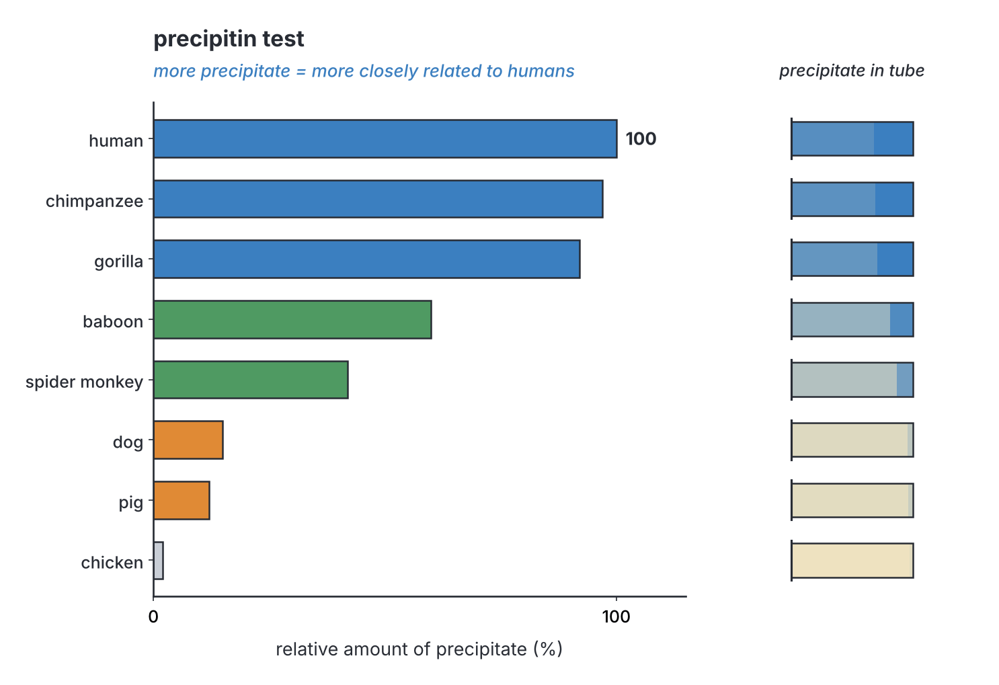
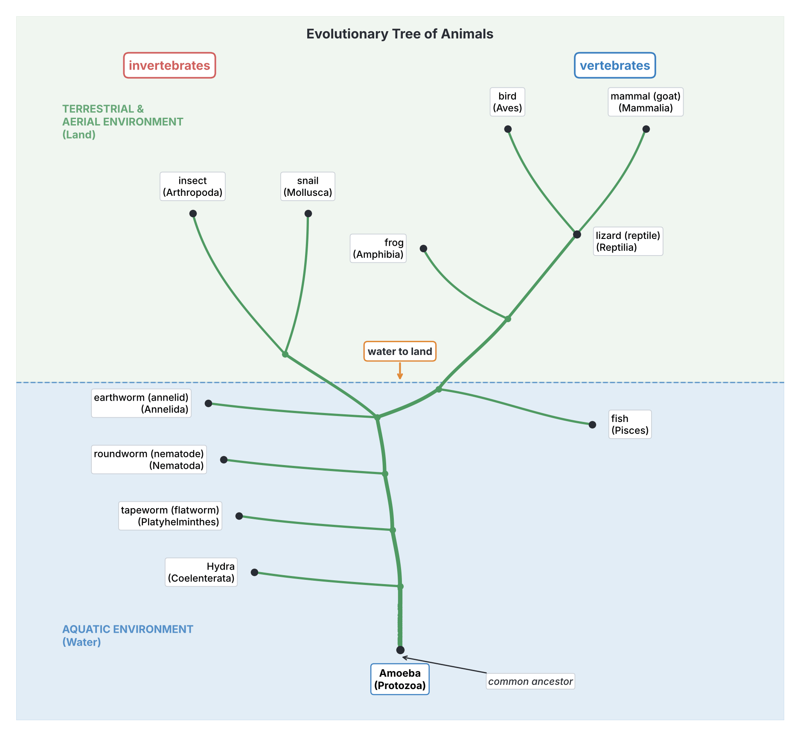
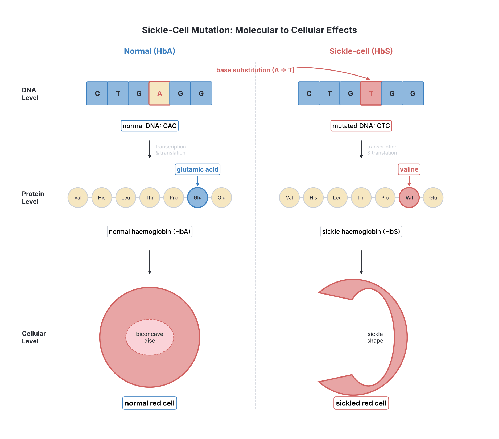

# JAMB Biology Notes: Evidence of Evolution

## What JAMB expects

This topic is Section E, Topic 2 of the JAMB Biology syllabus: Evolution – Evidence of evolution. It follows on from `E1-theories-of-evolution.md`, which explains what evolution is and the theories of Lamarck, Darwin and the modern synthesis, and which **states** the evidences briefly. This file explains the evidences in full.

The syllabus gives no separate content items for this topic, only objectives. By the end of these notes, you should be able to:

4. Mention the evidences for evolution, such as fossil records, comparative anatomy, physiology and embryology.
5. Trace evolutionary trends in plants and animals.
6. State the evidence of modern evolutionary theories, such as genetic studies and the role of mutation.

**Note on the syllabus wording:** this topic has no "Candidates should be able to:" line of its own, and its objectives continue the numbering from Topic E1, so they are numbered **iv, v and vi** (see the Transcription notes in the syllabus). The detailed features and life histories of the plant and animal groups are covered in Section A: `A2b-evolution-plants.md` (plants) and `A2c-evolution-animals.md` (animals). Mutation and heredity are also covered in `D1-variation-in-population.md` and `D2a-heredity-principles.md`.

## How do we know evolution has happened?

Evolution of large groups takes millions of years, so nobody can watch it happen from start to finish. Instead, scientists gather **evidence** from many different sources. Each line of evidence on its own is strong, but what makes the theory so convincing is that **all the different lines of evidence agree**: fossils, anatomy, embryos, body chemistry, DNA and the distribution of organisms all point to the same pattern of relationships.

| Line of evidence | What it studies | What it shows |
| --- | --- | --- |
| **Fossil records** (palaeontology) | Remains and traces of ancient organisms in rocks | Organisms have changed over time; intermediate forms; order of appearance of groups |
| **Comparative anatomy** | Structure of different organisms | Homologous structures and vestigial organs show common ancestry |
| **Comparative physiology and biochemistry** | Body chemistry and functions | Related organisms have similar proteins, hormones, enzymes and DNA |
| **Comparative embryology** | Development of embryos | Embryos of related animals are very similar in early stages |
| **Geographical distribution** | Where organisms live | Distribution is explained by evolution after separation of land masses and islands |
| **Genetics and mutation** (modern evidence) | Genes, DNA, mutation | Explains how variation arises; DNA similarities match relationships |

## Evidences for evolution

**Objective iv: mention the evidences for evolution such as fossil records, comparative anatomy, physiology and embryology.**

## 1. Evidence from fossil records

### What is a fossil?

A **fossil** is the **remains, impression or trace** of an organism that lived long ago, preserved in rocks (or sometimes in amber, ice or tar). The study of fossils is called **palaeontology** (also spelled paleontology), and scientists who study fossils are **palaeontologists**.

### Types of fossils

| Type | How it forms | Examples |
| --- | --- | --- |
| **Petrified (mineralised) fossils** | Minerals from water slowly replace the hard parts (bones, shells, wood), turning them to stone | Dinosaur bones, petrified wood, fossil shells |
| **Moulds and casts** | An organism buried in sediment dissolves away, leaving a hollow (**mould**); if the mould fills with minerals, a **cast** forms | Shells, ammonites |
| **Impressions (imprints) and carbon films** | Thin parts such as leaves or feathers leave a print or a thin carbon film in fine sediment | Fossil leaves and ferns, feather impressions |
| **Trace fossils** | Signs of activity rather than the body | Footprints, burrows, droppings (coprolites) |
| **Preserved whole organisms** | The whole body is preserved in a material that stops decay | Insects trapped in **amber** (fossilised tree resin); woolly mammoths frozen in **ice** in Siberia; animals in **tar** pits |

### How a fossil forms (step by step)

1. An organism dies and its body falls into **water** or onto soft ground, such as a lake bed, river delta, sea floor or swamp.
2. It is quickly **buried** by mud, sand or silt (sediment), which protects it from scavengers and slows decay.
3. The **soft parts decay**; the **hard parts** (bones, teeth, shells, wood) remain.
4. More layers of sediment build up on top over thousands of years. The weight presses the lower layers into **sedimentary rock**.
5. Water seeping through the rock carries **minerals** that slowly fill or replace the hard parts, turning them to stone (**petrification**).
6. Millions of years later, movements of the Earth's crust lift the rocks, and **erosion** by wind and water exposes the fossil, or people find it by digging or quarrying.

[IMAGE: Five-stage diagram of fossil formation in a row of vertical cross-sections through ground and water. Stage 1: a fish dies and sinks to the bottom of a lake. Stage 2: the body is covered by a layer of mud and sand; soft parts decaying. Stage 3: only the skeleton remains, under more layers of sediment. Stage 4: many layers of rock above the skeleton, which is now grey stone (mineralised). Stage 5: the land surface has been lifted and eroded, and a palaeontologist with a brush uncovers the fossil skeleton on a hillside. Labels to add later: "1 organism dies and sinks", "2 buried quickly by sediment", "3 soft parts decay, hard parts remain", "4 layers become rock; minerals replace bone", "5 uplift and erosion expose fossil", "sedimentary rock layers". Clean flat textbook style, white background.]

### Dating fossils

- **Relative dating (by rock layers):** sedimentary rocks are laid down in layers (**strata**), with the **oldest at the bottom** and the youngest at the top, unless the rocks have been disturbed. So fossils in **lower** layers are generally **older** than those in higher layers (the **law of superposition**).
- **Absolute (radiometric) dating:** some elements in rocks and fossils are **radioactive** and **decay** at a steady, known rate. By measuring how much has decayed, scientists can calculate the age.
  - **Carbon-14 dating** is used for remains of once-living things up to about **50,000 years** old (the half-life of carbon-14 is about **5,730 years**).
  - **Potassium–argon** and **uranium–lead** dating are used for rocks **millions or billions** of years old.

### What fossils tell us about evolution

1. **Life has changed over time.** Most fossils are of organisms that are **extinct** (no longer living), such as dinosaurs, ammonites and trilobites. Many living organisms have no fossils in old rocks. So the living world has not always been the same.
2. **The order of appearance matches evolution.** The **oldest rocks** contain only fossils of **simple** organisms (bacteria-like cells); **younger** rocks contain more complex organisms. Among vertebrates, fossils appear in the order **fish → amphibians → reptiles → mammals and birds**. Among plants, **algae** and simple land plants appear before **ferns**, then **gymnosperms**, and **flowering plants** last.
3. **Intermediate forms (transitional fossils, "missing links")** have been found that have features of two different groups, showing how one group arose from another.
4. **Gradual change within a line of descent** can be traced, for example in the horse.

[IMAGE: A vertical cliff cross-section showing six stacked sedimentary rock layers in different soft earth colours, with fossils drawn in each: bottom layer with simple worm-like and jellyfish-like imprints and trilobites; next layer with fish fossils; next with an amphibian; next with reptile and dinosaur bones and fern leaves; next with an early mammal and a bird skeleton; top layer with modern mammal bones and flowering plant leaves. A vertical arrow on the left side pointing up. Labels to add later: "oldest layers (bottom)", "youngest layers (top)", "simple invertebrates", "fish", "amphibians", "reptiles", "mammals and birds", "flowering plants", "time". Clean flat textbook style, white background.]

### Transitional fossils

#### *Archaeopteryx*: between reptiles and birds

*Archaeopteryx* ("ancient wing") is a fossil animal found in limestone in **Germany**, first described in **1861**, two years after Darwin's book was published. It lived about **150 million years ago** (in the Jurassic period).

| Reptile-like features | Bird-like features |
| --- | --- |
| **Teeth** in the jaws | **Feathers** (clearly preserved) |
| A long, **bony tail** with many vertebrae | **Wings** |
| **Claws** on the fingers of the wings (three free fingers) | A **wishbone** (fused collarbones, the furcula) |
| Solid (not fully hollow) bones in some parts; no keeled breastbone | Bird-like feet and legs |

*Archaeopteryx* shows that **birds evolved from reptiles** (today, scientists believe they evolved from small, feathered dinosaurs). Many other feathered dinosaur fossils have been found since the 1990s, especially in China.

[IMAGE: Reconstruction drawing of the fossil animal Archaeopteryx, shown both as a slab of pale limestone with the fossil skeleton and feather impressions, and beside it as a living-animal reconstruction in soft colours: a crow-sized creature with feathered wings, three clawed fingers on each wing, small teeth in its jaws and a long bony tail with feathers along both sides. Labels to add later: "feathers", "wing", "claws on wing fingers", "teeth in jaws", "long bony tail", "Archaeopteryx (about 150 million years ago)", "reptile features", "bird features". Clean flat textbook style, white background.]

#### *Tiktaalik*: between fish and amphibians

*Tiktaalik* is a fossil found in 2004 in the Canadian Arctic, about **375 million years** old. It had **gills and scales** like a fish, but also a **flat head**, a **neck**, and strong **fins with wrist-like bones** that could prop it up in shallow water, like an early four-legged animal. It shows how vertebrates moved from **water to land**.

**Other transitional fossils:** fossils of early whales with small hind legs, which show that whales evolved from land mammals; and mammal-like reptiles, which show the change from reptiles to mammals.

### The evolution of the horse

The horse has one of the most complete fossil records of any animal, mainly from North America. Over about **55 million years**:

| Ancestor (approximate time) | Size | Toes | Teeth and food |
| --- | --- | --- | --- |
| ***Hyracotherium*** (also called ***Eohippus***, "dawn horse"), about 55 million years ago | About the size of a fox or small dog (about 20–40 cm at the shoulder) | **Four toes** on the front feet, **three** on the hind feet | Low-crowned teeth for browsing on soft leaves in forests |
| ***Mesohippus***, about 35 million years ago | Larger, about the size of a sheep or goat | **Three toes** on each foot, the middle one larger | Browsing |
| ***Merychippus***, about 15 million years ago | Pony-sized | Three toes, but the **middle toe** carried most of the weight; side toes small | **High-crowned grinding teeth** for grazing tough grass on open plains |
| ***Pliohippus***, about 5–10 million years ago | Larger | **One toe** (the side toes reduced to splints) | Grazing |
| ***Equus*** (modern horse), from about 4 million years ago | Large (about 1.5 m at the shoulder) | **One toe** (hoof); the side toes are tiny **splint bones** | Long, high-crowned grinding teeth for grazing |

**Trends:** increase in **body size**; **lengthening of the legs**; **reduction in the number of toes** to a single hoof (better for running fast on hard, open grassland); and **teeth** becoming larger, high-crowned and ridged for **grinding grass**. These changes match a change in environment from **forests** to **open grasslands**.

**Textbook variation:** older textbooks show horse evolution as a straight line. Palaeontologists now know that it was a **branching bush**, with many side branches that died out, and the dates and sizes are approximate.

[IMAGE: Evolution of the horse in five steps from bottom-left to top-right, each showing a side view of the whole animal at relative size and, beneath it, a simplified front-foot skeleton. 1: small fox-sized Hyracotherium (Eohippus) in a forest, foot with four toes. 2: Mesohippus, goat-sized, three toes. 3: Merychippus, pony-sized, three toes with a large middle toe. 4: Pliohippus, one main toe with side splints. 5: modern Equus, large, single hoofed toe with tiny splint bones, on open grassland. Labels to add later: "Hyracotherium (Eohippus), about 55 million years ago", "Mesohippus", "Merychippus", "Pliohippus", "Equus (modern horse)", "4 toes", "3 toes", "1 toe (hoof)", "splint bones", "increase in size", "forest to grassland". Clean flat textbook style, white background.]

### Human fossils and Africa

Many important fossils of human ancestors (**hominins**) have been found in **Africa**, especially in East and South Africa, for example the partial skeleton nicknamed "**Lucy**" (*Australopithecus afarensis*), found in Ethiopia in 1974 and about 3.2 million years old. The oldest known fossils of modern humans (*Homo sapiens*), about 300,000 years old, were found in Morocco. This and genetic evidence support the view that modern humans **originated in Africa**. In Nigeria, a human skull dated to about 13,000 years ago was excavated at **Iwo Eleru**, a rock shelter in Ondo State, in 1965.

### Living fossils

Some living organisms are very similar to fossils of their ancestors from hundreds of millions of years ago, showing that they have changed very little. They are called **living fossils**:

- The **coelacanth** (*Latimeria*), a lobe-finned fish known only from fossils and thought to have died out about 66 million years ago, until a living one was caught off South Africa in **1938**.
- ***Ginkgo*** (maidenhair tree) and **cycads**, ancient gymnosperms.
- The **lungfish** (*Protopterus*, found in Nigeria; see `A3-adaptations.md`), related to the fish from which land vertebrates evolved.

### Limitations of the fossil record

1. **Fossils form only under special conditions** (quick burial in sediment), so most organisms never become fossils.
2. **Soft-bodied organisms** (worms, jellyfish) rarely fossilise; hard parts are preserved much more often.
3. Many fossils are **destroyed** by heat, pressure, erosion and movements of the Earth.
4. Many fossils have **not yet been found**, being buried deep or in unexplored places.

So there are **gaps** in the fossil record. However, new fossils keep filling them, and every fossil found so far fits the evolutionary order (for example, no mammal fossils have been found in rocks older than the first fish).

## 2. Evidence from comparative anatomy

**Comparative anatomy** is the comparison of the body structures of different organisms. Similarities in structure suggest a **common ancestor**.

### Homologous structures and the pentadactyl limb

**Homologous structures** are organs that have the **same basic structure** and the **same origin** (they develop from the same part of the embryo and came from the same structure in a common ancestor), but may **look different** and have **different functions**, because they have become adapted to different ways of life. This process, in which related organisms become different, is called **divergent evolution**.

**The best example is the pentadactyl limb** ("five-fingered limb") of land vertebrates (amphibians, reptiles, birds and mammals). Every forelimb has the same basic plan of bones:

1. **One upper-arm bone:** the **humerus**.
2. **Two forearm bones:** the **radius** and the **ulna**.
3. **A group of wrist bones:** the **carpals**.
4. **Palm (hand) bones:** the **metacarpals**.
5. **Finger bones:** the **phalanges**, arranged in up to **five digits**.

| Animal | Forelimb | Function | How the basic plan is modified |
| --- | --- | --- | --- |
| **Human** | Arm and hand | Grasping, holding, manipulating tools | Five free digits; an opposable thumb |
| **Bat** | Wing | **Flying** | Very long metacarpals and phalanges (digits 2 to 5) support a thin skin membrane; the thumb is short and clawed |
| **Bird** | Wing | **Flying** | Digits reduced to three and partly fused; the carpals and metacarpals are fused; feathers form the flight surface |
| **Whale (and dolphin)** | Flipper | **Swimming** (steering and balance) | Short, flat humerus, radius and ulna; many extra phalanges; all enclosed in a paddle-shaped flipper |
| **Horse** | Front leg | **Running** | Long limb bones; only **one digit** (the third) with a hoof; side digits reduced to splints |
| **Frog** | Front leg | Landing, supporting the body | Radius and ulna fused; four digits |
| **Mole** | Front leg | **Digging** | Short, very broad, strong bones with large claws |
| **Lizard** | Front leg | Walking, climbing | Five clawed digits; limbs held out to the side |

**Why this is evidence for evolution:** if each animal had been designed separately for its job, there would be no reason for a bat's wing, a whale's flipper and a human arm to have the **same bones in the same order**. The best explanation is that they all **inherited** this pattern from a **common ancestor** with a pentadactyl limb, and natural selection then adapted it for different uses.

[IMAGE: Comparison of pentadactyl forelimbs side by side: human arm, bat wing, bird wing, whale flipper, horse front leg and frog front leg. In every limb, colour-code the matching bones consistently: humerus in yellow, radius and ulna in orange, carpals in green, metacarpals in blue, phalanges in purple. Show outlines of the skin or wing around each skeleton faintly. Labels to add later: "human (grasping)", "bat (flying)", "bird (flying)", "whale (swimming)", "horse (running)", "frog (landing)", "humerus", "radius", "ulna", "carpals", "metacarpals", "phalanges". Clean flat textbook style, white background.]

**Other homologous structures:**

- **In animals:** the **mouthparts** of insects (biting in the cockroach, piercing and sucking in the mosquito, siphoning in the butterfly) are all modified from the same set of parts (see `A3-adaptations.md`); the **ear bones** of mammals are homologous with jaw bones in reptiles.
- **In plants:** the following are all modified **leaves**: the **spines** of a cactus, the **tendrils** of a pea, the fleshy **scale leaves** of an onion bulb, the trapping leaves of insect-eating plants (e.g. the pitcher of a pitcher plant), and the brightly coloured **bracts** of *Bougainvillea*.

### Analogous structures

**Analogous structures** are organs that have the **same function** and may **look similar**, but have a **different basic structure** and a **different origin**. They do **not** show close relationship. They arise because unrelated organisms living in similar ways face similar problems, and natural selection produces similar solutions. This is called **convergent evolution**.

**Examples:**

| Analogous structures | Same function | Different structure and origin |
| --- | --- | --- |
| **Wing of an insect** and **wing of a bird** | Flying | Insect wing: a thin outgrowth of the body wall (cuticle) with veins, no bones. Bird wing: a modified forelimb with bones, muscles and feathers |
| **Eye of an octopus** and **eye of a human** | Seeing (camera-type eyes with lens and retina) | Develop differently; in the octopus the nerve fibres lie behind the retina (no blind spot), in humans in front of it (blind spot) |
| **Fins of a fish** and **flippers of a whale** | Swimming | Fish fins: supported by fin rays. Whale flippers: modified pentadactyl limb |
| **Streamlined shape of a shark** (fish), **dolphin** (mammal) and **penguin** (bird) | Fast swimming | Unrelated groups |
| **Spines of a cactus** and **thorns of *Bougainvillea*** | Protection | Cactus spines are modified **leaves**; *Bougainvillea* thorns are modified **stems** (branches) |
| **Potato tuber** and **sweet potato** (and **cassava**) | Food storage underground | Potato tuber is a swollen **stem** (it has buds, the "eyes"); sweet potato and cassava are swollen **roots** |

**Note:** bird wings and bat wings are **homologous as forelimbs** (both are pentadactyl limbs) but **analogous as wings**, because the wings evolved separately in the two groups.

### Homologous and analogous structures compared

| Feature | Homologous structures | Analogous structures |
| --- | --- | --- |
| Basic structure | **Same** basic structure (same bones or parts) | **Different** basic structure |
| Origin (embryonic and evolutionary) | **Same** origin; from a common ancestor | **Different** origin |
| Function | Often **different** | **Same** (similar) |
| Appearance | May look different | Often look similar |
| What they show | **Common ancestry** (close relationship) | **Similar way of life**, not close relationship |
| Type of evolution | **Divergent** evolution | **Convergent** evolution |
| Examples | Human arm, bat wing, whale flipper, horse leg; cactus spine and pea tendril (both leaves) | Insect wing and bird wing; octopus and human eye; potato tuber and sweet potato |

[IMAGE: Analogous wings compared: on the left, a butterfly or dragonfly wing drawn as a thin transparent membrane with branching veins and no bones; on the right, a bird wing shown with feathers and a semi-transparent overlay revealing the arm bones (humerus, radius, ulna, fused hand bones). Between them, an "equals" sign over the word function and a "not equals" sign over the word structure. Labels to add later: "insect wing: membrane with veins, no bones", "bird wing: modified forelimb with bones and feathers", "same function (flight)", "different structure and origin", "analogous structures (convergent evolution)". Clean flat textbook style, white background.]

### Vestigial organs

**Vestigial organs** are organs that are **reduced in size** and have **little or no function** in an organism, but are **well developed and functional** in related organisms (or were functional in its ancestors). They are best explained as **"leftovers"** from ancestors in which they were useful.

**Vestigial structures in humans:**

| Vestigial structure | Where it is | Functional in other animals |
| --- | --- | --- |
| **Vermiform appendix** | A small, finger-like tube attached to the caecum (start of the large intestine) | In herbivores such as rabbits, horses and many rodents, the caecum (and appendix region) is large and contains bacteria that digest cellulose |
| **Coccyx** (tail bone) | Four or so small fused vertebrae at the end of the spine | The **tail** of other mammals, such as monkeys, dogs and goats |
| **Ear muscles** (extrinsic ear muscles) | Around the ear; most people cannot move their ears, or can only wiggle them slightly | Dogs, cats, horses and goats turn their ears towards sounds |
| **Plica semilunaris** | A small fold of pink tissue in the inner corner of the eye | The **nictitating membrane** (third eyelid) of birds, reptiles, frogs and some mammals, which sweeps across the eye to clean and protect it |
| **Wisdom teeth** (third molars) | At the back of the jaw; often too little space for them, so they grow sideways or not at all | Our ancestors had larger jaws and chewed tougher, raw food |
| **Body hair and goose bumps** | Fine hair over the body; tiny erector muscles raise them in cold or fear | Thick fur in other mammals, which insulates and can be raised to look bigger |

**Vestigial structures in other animals:**

- **Pythons and boas** have tiny remains of a **pelvic girdle** and **hind-limb bones**, which end in small claw-like **spurs** on either side of the vent. Their ancestors had legs.
- **Whales** have small **pelvic bones** (and sometimes thigh bones) buried in their body wall, though they have no hind legs. Their ancestors were four-legged land mammals.
- **Flightless birds** such as the **kiwi** have tiny, useless **wings**. (The **ostrich** cannot fly, but it uses its wings for balance when running, for display and to shade its young, so its wings are reduced rather than useless.)
- **Cave fish** have reduced, non-functional **eyes**, sometimes covered by skin.

**Textbook variation:** the human **appendix** is the most famous example of a vestigial organ in textbooks. Modern research shows that it is not completely useless: it contains **lymphoid (immune) tissue** and may act as a "safe store" of helpful gut bacteria. Many scientists still call it vestigial because it is much reduced and no longer has its ancestral digestive function, and people live normally without it. "Vestigial" means reduced and without its **original** function, not necessarily completely useless.

[IMAGE: An outline of a human body (front view, neutral, gender-neutral figure in soft beige) with small highlighted circles and leader lines to five vestigial structures: the ear muscles around the ear, the plica semilunaris in the inner corner of the eye (with a small enlarged eye inset), wisdom teeth at the back of the jaw (small skull inset), the appendix at the lower right of the abdomen (small inset of caecum and appendix), and the coccyx at the base of the spine (small inset of the lower spine). Labels to add later: "ear muscles", "plica semilunaris (remnant of third eyelid)", "wisdom teeth", "vermiform appendix", "coccyx (tail bone)", "vestigial structures in humans". Clean flat textbook style, white background.]

## 3. Evidence from comparative physiology and biochemistry

**Comparative physiology** compares how the bodies of different organisms work; **comparative biochemistry** compares the chemicals in their bodies. Closely related organisms have very **similar body chemistry**.

### Similarities shared by all (or most) living things

1. All living things are made of **cells** with the same basic structure (see `A1-living-organisms.md`).
2. All living things use **DNA** (some viruses use RNA) as their genetic material, made of the same **four bases** (A, T, G, C).
3. Almost all organisms use the **same genetic code**: the same three-base codes (codons) stand for the same amino acids in bacteria, plants, fungi and animals. This is why a bacterium can make human insulin from a human gene (see `D2b-applications-of-heredity.md`).
4. All organisms build proteins from the **same 20 amino acids**.
5. All organisms use **ATP** as the energy carrier, and similar enzymes for basic processes such as the first stage of respiration (glycolysis).

If living things had arisen separately, there is no reason why they should all share the same code and the same chemistry. These shared features are best explained by **descent from a single common ancestor**.

### Similar hormones and enzymes

- **Insulin** from **pigs and cattle** works in humans, and was used for decades to treat human diabetes (before human insulin was made by genetic engineering). Pig insulin differs from human insulin by just **one amino acid**.
- **Thyroxine** from mammals affects the metamorphosis of frog tadpoles.
- Digestive enzymes such as amylase and trypsin are similar in many vertebrates.

### Blood proteins: the precipitin test

In the early 1900s, the British scientist **George Nuttall** compared the **blood serum proteins** of different animals using the **precipitin test** (serological test).

**How the test works:**

1. **Human serum** (the liquid part of blood, containing proteins) is injected into a **rabbit**.
2. The rabbit's immune system recognises the human proteins as foreign and makes **antibodies** against them.
3. **Serum** containing these **anti-human antibodies** is collected from the rabbit.
4. This rabbit serum is mixed with the serum of **human beings** and of **other animals**.
5. Where the antibodies recognise proteins, a cloudy **precipitate** forms. The **more similar** the proteins of an animal are to human proteins, the **more precipitate** forms.

**Results (relative amount of precipitate, taking the reaction with human serum as 100%):** the reaction is strongest with **chimpanzee and gorilla** serum, weaker with **Old World monkeys** (e.g. baboons), weaker still with **New World monkeys**, very weak with other mammals such as dogs and pigs, and none at all with birds or reptiles.

**Conclusion:** humans are **most closely related to the great apes** (chimpanzees and gorillas), then to monkeys, and more distantly to other mammals. This matches the relationships worked out from anatomy and fossils.

**Textbook variation:** textbooks reproduce Nuttall's results with slightly different percentages, and some show only the pattern. Learn the **pattern** (apes > Old World monkeys > New World monkeys > other mammals > birds), not exact numbers.

### Haemoglobin and other proteins

- The amino acid sequence of **haemoglobin** (the oxygen-carrying protein in red blood cells) has been compared in many animals. The **beta chain** of human haemoglobin (146 amino acids) is **identical** to that of the chimpanzee, differs by **only one** amino acid from that of the gorilla, and differs by more amino acids from monkeys, other mammals, birds and fish, in that order.
- **Cytochrome c**, a protein used in respiration by almost all organisms (from yeast to humans), has been sequenced in many species. Human and chimpanzee cytochrome c are **identical**. The number of differences increases as we compare humans with more distantly related organisms (monkeys, then other mammals, birds, fish, insects, plants and yeast). A "family tree" drawn from these differences matches the tree drawn from fossils and anatomy.

### DNA comparisons

- Today, the **DNA sequences** (genomes) of many organisms have been read. The DNA of closely related species is **more similar** than that of distantly related species.
- For example, the DNA of **humans and chimpanzees** is about **98–99% identical** in the sequences that can be directly compared. **Textbook variation:** the exact percentage depends on how the comparison is made (e.g. whether insertions and deletions are counted), so figures from about 95% to 99% are quoted.
- Because mutations build up in DNA at a roughly steady rate over long periods, the number of differences can be used as a **molecular clock** to estimate when two groups shared a common ancestor.

### Blood groups

The **ABO blood group antigens** are found not only in humans but also in some apes, such as chimpanzees and gorillas, which supports their close relationship.

## 4. Evidence from comparative embryology

**Embryology** is the study of the development of embryos. **Comparative embryology** compares the embryos of different organisms.

### Similarities of vertebrate embryos

At **early stages** of development, the embryos of **fish, amphibians, reptiles, birds and mammals** (including humans) look **remarkably similar**. They all have:

1. **Pharyngeal pouches (gill pouches or gill slits) and pharyngeal arches** in the neck region. In **fish**, these develop into **gills**. In land vertebrates, they develop into other structures, such as parts of the **ear, throat, jaws** and **glands** (e.g. the thymus); they never become functional gills.
2. A **tail** extending beyond the anus. In humans, the tail is present in the embryo for a few weeks, then shrinks to form the **coccyx**.
3. A **notochord**, a flexible rod along the back, which in most vertebrates is later replaced by the backbone.
4. A **simple heart** in the early embryo, at first with few chambers, like a fish heart, before developing its adult form.
5. **Somites** (blocks of tissue along the back) that develop into muscles and vertebrae.

As development continues, the embryos become more and more different, and the special features of each class appear. Generally, the more closely related two animals are, the **longer** their embryos stay similar.

**Why this is evidence for evolution:** the similarities are best explained if all vertebrates **share a common ancestor** whose development they have inherited, with later stages modified in each group. The gill pouches of a human embryo, which never become gills, are inherited from fish-like aquatic ancestors.

[IMAGE: A grid of vertebrate embryos at three stages of development, in five columns: fish, salamander (amphibian), turtle (reptile), chicken (bird) and human (mammal). Top row (earliest stage): all five embryos look very similar, curled, with a large head, visible pharyngeal pouches (gill pouches) in the neck region and a tail. Middle row: differences beginning to appear (fins, limb buds, beak, etc.). Bottom row: recognisable young of each animal. Draw in soft pinks and beiges, simple and accurate, not exaggerated. Labels to add later: "fish", "amphibian", "reptile", "bird", "mammal (human)", "early stage: very similar", "pharyngeal (gill) pouches", "tail", "later stages: differences appear". Clean flat textbook style, white background.]

### Life histories as evidence

- The **frog** begins life as an aquatic **tadpole** that breathes with **gills**, has a **tail** and a **two-chambered heart** and a **lateral line**, very like a fish. It then changes into a land-living, air-breathing adult. This suggests that amphibians evolved from fish-like ancestors (see `A2c-evolution-animals.md`).
- Some marine animals that look very different as adults (e.g. barnacles and crabs) have very similar **larvae**, revealing their relationship (both are crustaceans).

**Textbook variation and caution:** in the 19th century, the German biologist **Ernst Haeckel** proposed that "**ontogeny recapitulates phylogeny**" (an embryo passes through the adult stages of its ancestors, for example that a human embryo passes through a "fish stage"). This idea is now known to be **wrong** as stated: embryos resemble the **embryos** of their relatives, not the **adults** of their ancestors. Haeckel's famous drawings were also **exaggerated** to make embryos look more alike than they are. However, the real similarities between vertebrate embryos, seen in photographs and modern studies, remain good evidence for common ancestry.

## 5. Evidence from geographical distribution (biogeography)

The way organisms are distributed around the world is best explained by evolution.

1. **Similar environments, different organisms:** places with similar climates in different parts of the world often have **different** species. For example, the tropical rainforests of Africa, South America and Asia have different monkeys, birds and plants. If each species had been created for its environment, we would expect the same species in similar environments.
2. **Australia's marsupials:** Australia has many **pouched mammals** (marsupials), such as kangaroos and koalas, but originally had very few placental mammals. Australia separated from other continents a long time ago, before placental mammals spread there, so marsupials evolved in isolation to fill many different ways of life.
3. **Island species:** islands far from the mainland (e.g. the **Galápagos Islands**, Hawaii, Madagascar) have many species found **nowhere else** (**endemic** species), but these species **resemble** species on the nearest mainland. Darwin's finches resemble South American finches; the lemurs of Madagascar are found only there. This suggests that a few ancestors reached the islands and then evolved in isolation (see `E1-theories-of-evolution.md`).
4. **Continental drift:** the continents were once joined in a single supercontinent (**Pangaea**) which broke up over the last 200 million years or so. Related groups are found on continents that were once joined: for example, **lungfish** live in **Africa** (including Nigeria), **South America** and **Australia**, all parts of the old southern supercontinent **Gondwana**; and fossils of the same ancient reptiles and plants are found in Africa and South America.

[IMAGE: World map in soft flat colours with simple animal icons: lungfish icons in tropical Africa (including Nigeria), South America and Australia, connected by faint dashed lines; kangaroo and koala icons in Australia; finch icons on the Galápagos Islands with an arrow from South America; a lemur icon on Madagascar. An inset in a corner shows the outline of the supercontinent Gondwana with Africa, South America, Australia, Antarctica and India joined together. Labels to add later: "lungfish (Africa, South America, Australia)", "marsupials (Australia)", "Darwin's finches (Galápagos)", "lemurs (Madagascar)", "Gondwana (joined continents)". Clean flat textbook style, white background.]

## 6. Other evidence

- **Classification (taxonomy):** organisms can be arranged in a branching hierarchy of groups within groups (species within genera, genera within families, and so on), like the branches of a family tree. This is exactly what we would expect if they descended from common ancestors (see Section A).
- **Artificial selection (domestication):** breeders have produced very different breeds of dogs, cattle, chickens and crops from single wild species in a few thousand years (see `E1-theories-of-evolution.md`).
- **Observed evolution today:** antibiotic resistance in bacteria, insecticide resistance in mosquitoes, drug resistance in malaria parasites and industrial melanism in the peppered moth (see `E1-theories-of-evolution.md`).

### Summary of the evidences

| Evidence | Key examples | What it shows |
| --- | --- | --- |
| Fossil records | *Archaeopteryx*, *Tiktaalik*, horse series, order of fossils in rock layers | Life has changed over time; groups arose from earlier groups |
| Comparative anatomy | Pentadactyl limb (homologous); vestigial appendix, coccyx, python's pelvis | Common ancestry; divergent evolution |
| Analogous structures | Insect and bird wings; potato and sweet potato | Convergent evolution in similar environments |
| Comparative physiology and biochemistry | Same genetic code; pig insulin works in humans; precipitin test; haemoglobin and cytochrome c sequences; DNA similarity | Degree of chemical similarity matches degree of relationship |
| Comparative embryology | Gill pouches and tails in all vertebrate embryos; tadpole | Common ancestry of vertebrates |
| Geographical distribution | Australian marsupials; Galápagos finches; lungfish on southern continents | Evolution in isolation after separation |

## Evolutionary trends in plants and animals

**Objective v: trace evolutionary trends in plants and animals.**

An **evolutionary trend** is a general direction of change seen over long periods of time in a group of organisms. By comparing the living groups and their fossils, we can trace how plants and animals have become more complex and better adapted to life on land.

**Important note:** evolution is a **branching tree**, not a ladder. When we say "algae → mosses → ferns" or "fish → amphibians", we mean that the **ancestors** of the later groups were organisms **like** the earlier groups. Today's mosses did not turn into today's ferns; they share common ancestors and have each continued to evolve. Similarly, birds and mammals evolved **separately** from **different groups of reptiles**.

### Evolutionary trends in plants

The plant groups are described in detail in `A2b-evolution-plants.md`. In order of increasing complexity:

**Thallophyta (algae) → Bryophyta (mosses and liverworts) → Pteridophyta (ferns) → Spermatophyta: gymnosperms (conifers, cycads) → angiosperms (flowering plants)**

| Feature | Algae (e.g. *Spirogyra*) | Bryophytes (moss, *Marchantia*) | Pteridophytes (fern, *Dryopteris*) | Gymnosperms (e.g. pine, cycads) | Angiosperms (flowering plants) |
| --- | --- | --- | --- | --- | --- |
| Habitat | Water | Damp, shady places on land | Moist, shady places on land | Land, including dry and cold places | All habitats |
| Body | **Thallus** (no true roots, stems or leaves); many are unicellular or filamentous | Simple stem and leaf-like structures (moss) or thallus (liverwort); **rhizoids**, no true roots | True **roots, stems** (rhizome) **and leaves** (fronds) | True roots, stems and leaves | True roots, stems and leaves, highly varied |
| Vascular (conducting) tissue | Absent | **Absent** | **Present** (xylem and phloem) | Present | Present, more efficient (xylem vessels in most) |
| Dominant generation | Gametophyte (haploid) | **Gametophyte** dominant; sporophyte depends on it | **Sporophyte** dominant; gametophyte (prothallus) small and independent | Sporophyte; gametophyte tiny and inside the sporophyte | Sporophyte; gametophyte very reduced (pollen grain and embryo sac) |
| Water needed for fertilisation? | Yes | **Yes** (sperm swim) | **Yes** (sperm swim) | **No**: **pollen** carries the male gamete; pollen tube | **No**: pollen and pollen tube |
| Seeds | None | None (spores) | None (spores) | **Naked seeds** (on cone scales) | Seeds **enclosed in an ovary** (inside fruits) |
| Flowers and fruits | None | None | None | None (cones) | **Flowers** and **fruits** |
| Size | Mostly small | Small (a few cm) | Small to medium (tree ferns larger) | Often large trees | From tiny herbs to huge trees |

**Main evolutionary trends in plants:**

1. From **simple** (unicellular and filamentous algae) to **complex**, multicellular plants with specialised tissues and organs.
2. From life in **water** to life on **land**.
3. Development of **true roots, stems and leaves**.
4. Development of **vascular tissue** (xylem and phloem) for transport and support, allowing plants to grow **tall**.
5. Development of a waxy **cuticle** and **stomata** to reduce water loss and allow gas exchange.
6. Change from a dominant **gametophyte** (in bryophytes) to a dominant **sporophyte** (in ferns and seed plants), with the gametophyte becoming smaller and more protected.
7. **Freedom from water for fertilisation:** swimming sperm in bryophytes and ferns are replaced by **pollen grains** and **pollen tubes** in seed plants.
8. **Seeds** (protecting and feeding the embryo and allowing dormancy) replace spores as the main means of spreading; seeds become **enclosed in ovaries** and **fruits** in angiosperms.
9. Development of **flowers**, often with insects, birds or animals for **pollination** and fruits for **seed dispersal**.

**The fossil record of plants matches these trends:** algae are found in very old rocks; the first simple land plants appear roughly **470 million years ago**; vascular plants and ferns follow; seed plants appear roughly **360 million years ago**; and flowering plants appear only roughly **130–140 million years ago**, becoming dominant later. (These dates are approximate and vary between sources.)

[IMAGE: Plant evolution diagram shown as a branching tree rising from water at the bottom to dry land at the top. At the base, in water, a green filamentous alga (Spirogyra). Branching upward onto damp ground: a moss and a liverwort (Marchantia). Next branch: a fern with fronds and a rhizome. Next: a gymnosperm (pine tree with cones). Topmost branch: a flowering plant (a hibiscus shrub with a flower and fruits). Along the side, an arrow labelled with trends. Labels to add later: "algae (Thallophyta)", "mosses and liverworts (Bryophyta)", "ferns (Pteridophyta)", "gymnosperms", "angiosperms (flowering plants)", "water to land", "no vascular tissue", "vascular tissue appears", "seeds appear", "flowers and fruits appear", "increasing complexity". Clean flat textbook style, white background.]

### Evolutionary trends in animals

The animal groups are described in detail in `A2c-evolution-animals.md`. In order of increasing complexity:

**Invertebrates:** Protozoa (single-celled, e.g. *Amoeba*, *Paramecium*) → Coelenterata (*Hydra*) → Platyhelminthes (flatworms, e.g. *Taenia*) → Nematoda (roundworms) → Annelida (earthworm) → Arthropoda (insects, etc.) and Mollusca (snails)

**Vertebrates (Chordata):** Pisces (fish) → Amphibia (frogs, toads) → Reptilia (lizards, snakes, turtles) → Aves (birds) and Mammalia (mammals), which evolved separately from reptile ancestors

**Note on the protozoa:** in modern classification, protozoa are placed in the kingdom **Protista**, not Animalia (see `A2a-evolution-monera-protista-fungi.md`). They are included here because animals are thought to have evolved from single-celled, protozoan-like ancestors.

#### Trends in invertebrates

| Feature | Protozoa | Coelenterata | Platyhelminthes | Nematoda | Annelida | Arthropoda |
| --- | --- | --- | --- | --- | --- | --- |
| Level of organisation | One cell | Tissue level | Organ level | Organ-system level | Organ-system level | Organ-system level |
| Germ layers | — | **Two** (diploblastic) | **Three** (triploblastic) | Three | Three | Three |
| Symmetry | Varied or none | **Radial** | **Bilateral** | Bilateral | Bilateral | Bilateral |
| Body cavity | — | Enteron only | **None** (acoelomate) | **Pseudocoelom** | **True coelom** | Coelom reduced; blood-filled haemocoel |
| Gut | Food vacuoles | **One opening** (mouth only) | One opening (or none in tapeworms) | **Two openings** (mouth and anus) | Two openings, with regions | Two openings, specialised regions |
| Segmentation | — | — | — (tapeworm proglottids are not true segments) | — | **Segmented** | **Segmented**, with segments grouped (head, thorax, abdomen) |
| Nervous system | None | Nerve net | Simple brain and nerve cords | Nerve ring and cords | Brain and ventral nerve cord | Brain, ventral nerve cord, well-developed sense organs |
| Circulation | Diffusion | Diffusion | Diffusion | Diffusion in body fluid | **Closed** blood system with "hearts" | Open blood system with heart |
| Support and movement | Pseudopodia, cilia | Hydrostatic | Muscles | Hydrostatic | Hydrostatic skeleton, chaetae | **Exoskeleton** and **jointed limbs**; many with wings |

#### Trends in vertebrates

| Feature | Fish | Amphibians | Reptiles | Birds | Mammals |
| --- | --- | --- | --- | --- | --- |
| Habitat | Water | Water and land | Mainly land | Land and air | Mainly land (some in water and air) |
| Breathing | **Gills** | Gills (tadpole), **lungs** and **moist skin** (adult) | **Lungs** | Lungs with **air sacs** | Lungs with a **diaphragm** |
| Heart | **Two chambers** (one atrium, one ventricle); single circulation | **Three chambers** (two atria, one ventricle); double circulation | **Three chambers**, ventricle partly divided (four in crocodiles) | **Four chambers** | **Four chambers** |
| Body temperature | Poikilothermic (cold-blooded) | Poikilothermic | Poikilothermic | **Homoiothermic** (warm-blooded) | **Homoiothermic** |
| Skin covering | Scales, mucus | Moist, glandular skin | Dry, horny **scales** | **Feathers** | **Hair** |
| Fertilisation | Mostly **external** (in water) | Mostly **external** (in water) | **Internal** | **Internal** | **Internal** |
| Eggs | Many small eggs laid in water | Jelly-coated eggs in water | **Shelled (amniotic) eggs** on land | Hard-shelled eggs, incubated | Most give birth to live young (**viviparous**), fed with **milk**; a few (e.g. the duck-billed platypus) lay eggs |
| Parental care | Little (some exceptions) | Little | Little (some exceptions) | Much: incubation, feeding | **Most**: pregnancy, suckling, long care |
| Brain | Small | Small | Larger | Large (especially the parts controlling flight) | **Largest** relative to body size, with a large cerebrum |

**Main evolutionary trends in animals:**

1. From **unicellular** to **multicellular** organisation, and from the cell level to the tissue, organ and system levels.
2. From **two** germ layers (diploblastic) to **three** (triploblastic).
3. From **radial** to **bilateral** symmetry, with a front end (head) that meets the environment first: **cephalisation** (concentration of the brain and sense organs in the head).
4. From **no body cavity** to a **true coelom**, giving space for organs.
5. From a gut with **one opening** to a gut with **two openings** (mouth and anus) and specialised regions.
6. **Segmentation** (in annelids and arthropods, and in the muscles and vertebrae of vertebrates).
7. Development of **skeletons**: hydrostatic → **exoskeleton** (arthropods) → **endoskeleton** of cartilage and bone (vertebrates).
8. More efficient **transport**: diffusion → open circulation → closed circulation; heart chambers increasing from **two** (fish) to **three** (amphibians, most reptiles) to **four** (birds and mammals), separating oxygenated and deoxygenated blood.
9. More efficient **gas exchange**: body surface → gills → lungs, with greater surface area.
10. From **cold-blooded** (poikilothermic) to **warm-blooded** (homoiothermic) animals (birds and mammals).
11. From life in **water** to life on **land**: waterproof skin, lungs, limbs for walking, internal fertilisation, and the shelled **amniotic egg** (reptiles and birds) or development inside the mother (mammals).
12. From **external** to **internal fertilisation**, from **many eggs with little care** to **few young with much parental care**.
13. Increasing **size and complexity of the nervous system and brain**, giving more complex behaviour and learning.

**The fossil record of vertebrates matches these trends:** fish fossils appear first (roughly 500 million years ago), then amphibians (roughly 370 million years ago), then reptiles (roughly 320 million years ago), then mammals (roughly 200 million years ago) and birds (roughly 150 million years ago, e.g. *Archaeopteryx*). (Approximate dates; sources differ.)

### General evolutionary trends in plants and animals together

| Trend | In plants | In animals |
| --- | --- | --- |
| Unicellular to multicellular | *Chlamydomonas* → *Spirogyra* → land plants | Protozoa → *Hydra* → higher animals |
| Simple to complex | Thallus → roots, stems, leaves | Tissue level → organ systems |
| Aquatic to terrestrial | Algae → mosses → ferns → seed plants | Fish → amphibians → reptiles, birds and mammals |
| Independence from water for reproduction | Swimming sperm → pollen tubes; spores → seeds | External fertilisation in water → internal fertilisation; shelled eggs; viviparity |
| Specialisation and division of labour | Specialised tissues (xylem, phloem, cuticle) | Specialised organs and systems |
| Better protection of the young | Seeds inside fruits | Eggs with shells; pregnancy; parental care |

## Modern evidence: genetic studies and the role of mutation

**Objective vi: state the evidence of modern evolutionary theories such as genetic studies and the role of mutation.**

Darwin did not know how variations arise or are inherited. Since 1900, **genetics** has supplied this missing knowledge and has become one of the strongest supports of evolution.

### Evidence from genetic studies

1. **Mendel's laws and particulate inheritance:** genes are passed on as **separate units** that are not blended or diluted (see `D2a-heredity-principles.md`). So a new favourable allele can be preserved and spread through a population by natural selection, solving a major problem of Darwin's theory.
2. **The chromosome theory of inheritance:** genes are carried on chromosomes, which segregate at meiosis and recombine at fertilisation, producing new **combinations** of alleles in every generation (**genetic recombination**).
3. **Population genetics:** studies of allele frequencies in populations show how natural selection, mutation, genetic drift and gene flow **change** populations over time, which is how the modern synthesis defines evolution.
4. **DNA as the universal genetic material** with an almost **universal genetic code**, pointing to a single common origin of life.
5. **DNA sequencing:** the genomes (complete DNA) of humans, chimpanzees, mice, fruit flies, yeast, rice, maize and many other organisms have been read. The pattern of similarities and differences in DNA matches the relationships worked out from fossils and anatomy, and allows scientists to draw detailed evolutionary trees.
6. **Shared genes for body plans:** very similar genes (for example, the so-called **Hox genes**) control the arrangement of body parts from head to tail in animals as different as fruit flies, mice and humans, showing deep common ancestry.
7. **Observed genetic change:** we can measure changes in allele frequencies in real populations, such as the peppered moth (the dark allele), bacteria becoming resistant to antibiotics, and mosquitoes becoming resistant to insecticides.

### Mutation

**A mutation** is a **sudden, permanent change** in the **genetic material** (DNA) of a cell: either in the **structure of a gene** or in the **structure or number of chromosomes**. An organism showing a new character due to mutation is called a **mutant**.

**Mutation is the only original source of new alleles**, and so of new inherited variation. Meiosis and fertilisation only reshuffle alleles that already exist; without mutation, there would eventually be no new variation for natural selection to act on.

### Types of mutation

#### 1. Gene (point) mutations

A **gene mutation** is a change in the sequence of **bases** in the DNA of a single gene. It is too small to be seen under a microscope.

| Type | What happens | Example (original sequence: **CAT CAT CAT**) |
| --- | --- | --- |
| **Substitution** | One base is **replaced** by another | CAT C**G**T CAT: only one codon is changed, so at most one amino acid changes |
| **Deletion** | A base is **lost** | CAT C_T CAT → read in threes: CAT CTC AT…: all the codons after the change are altered (a **frameshift**) |
| **Insertion (addition)** | An extra base is **added** | CAT C**G**A TCA T…: all the codons after it are altered (frameshift) |
| **Inversion** (of a few bases) | A short piece of the sequence is **reversed** | CAT **TAC** CAT |

Deletions and insertions often have **large effects** because they shift the "reading frame" of the code, changing many amino acids.

**Example: sickle-cell anaemia.** It is caused by a **substitution** of a single base in the gene for the **beta chain of haemoglobin** on chromosome 11. In the DNA, the codon for the sixth amino acid is changed from **GAG** to **GTG** (A replaced by T). As a result, the amino acid **glutamic acid** is replaced by **valine** at that position in the protein. This single change makes the haemoglobin molecules stick together at low oxygen levels, so the red cells become sickle-shaped (see `D2b-applications-of-heredity.md`).

Other examples of gene mutations: **albinism** (a gene for making melanin no longer works), **haemophilia**, **colour blindness**, the **dark form** of the peppered moth, and **antibiotic resistance** in bacteria.

#### 2. Chromosome mutations (changes in chromosome structure)

These are large changes affecting part of a chromosome, often big enough to be seen under a microscope:

| Type | What happens |
| --- | --- |
| **Deletion** | A piece of a chromosome is **lost** |
| **Duplication** | A piece of a chromosome is **repeated** (copied twice) |
| **Inversion** | A piece breaks off, turns round and rejoins **the wrong way round** |
| **Translocation** | A piece of one chromosome breaks off and joins a **different (non-homologous) chromosome** |

**Duplications** are important in evolution: the extra copy of a gene can mutate and take on a **new function**, while the original copy keeps doing the old job.

[IMAGE: Four small diagrams of chromosome structure mutations, each showing a normal chromosome (a vertical bar divided into coloured bands labelled A B C D E F with a centromere between B and C) and the mutated chromosome beside it. Deletion: A B C E F (band D missing). Duplication: A B C D D E F (band D repeated). Inversion: A B C E D F (D and E reversed). Translocation: A B C D plus bands G H from a second, differently coloured chromosome attached at the end, with the second chromosome shown shortened. Labels to add later: "normal chromosome", "deletion", "duplication", "inversion", "translocation", "centromere". Clean flat textbook style, white background.]

#### 3. Changes in chromosome number

| Type | What happens | Examples |
| --- | --- | --- |
| **Aneuploidy** | One extra or one missing chromosome, usually because a pair of chromosomes fails to separate at meiosis (**non-disjunction**) | **Down syndrome**: three copies of chromosome 21 (47 chromosomes); **Turner syndrome**: a female with only one X (45, XO); **Klinefelter syndrome**: a male with an extra X (47, XXY) |
| **Polyploidy** | **Whole extra sets** of chromosomes (3n, 4n, 6n, etc.) | Common in **plants**: **bread wheat** is hexaploid (6n); **cultivated bananas and plantains** are mostly **triploid** (3n), which is why they are seedless; potatoes are tetraploid (4n). Polyploidy can be induced with the chemical **colchicine** |

**Polyploidy and new species:** a polyploid plant usually **cannot breed with its parent species** (their offspring are sterile), so polyploidy can produce a **new species in a single step**. Many crop plants and wild flowering plants arose this way.

### Causes of mutation

- **Spontaneous mutations** happen naturally at a low rate, for example through rare **mistakes in copying DNA** during replication.
- **Mutagens** are agents that increase the rate of mutation:
  - **Radiation:** **X-rays**, **gamma rays** and radiation from radioactive materials (e.g. after nuclear accidents); **ultraviolet (UV) light** from the sun, which can cause skin cancer, a particular danger for people with albinism.
  - **Chemicals:** many chemicals, including some in **tobacco smoke**, mustard gas, some pesticides and industrial chemicals.
  - **Some viruses.**

### Effects of mutations

1. **Harmful mutations:** most mutations that have any effect are harmful (e.g. those causing genetic diseases or cancer). Natural selection tends to remove them.
2. **Neutral mutations:** many mutations have no noticeable effect (e.g. they change a base but not the amino acid, or occur in DNA that does not code for proteins).
3. **Beneficial mutations:** a few mutations are **useful** in a particular environment (e.g. antibiotic resistance for bacteria exposed to antibiotics; the dark moth form in sooty woods; the sickle-cell allele in carriers in malarial areas). Natural selection increases their frequency.

**Whether a mutation is beneficial depends on the environment.** The dark peppered moth was at a disadvantage in clean woods but at an advantage in sooty ones. The sickle-cell allele is harmful in two copies (SS), but in one copy (AS) it protects against severe malaria, so in malarial regions such as Nigeria it is kept at a high frequency (**heterozygote advantage**, or **balanced polymorphism**). In areas without malaria, it gives no advantage.

**Which mutations are inherited?** Only mutations in cells that produce **gametes** (**germ-line mutations**) can be passed to offspring and affect evolution. Mutations in ordinary body cells (**somatic mutations**), such as those that cause most skin cancers, are not inherited.

### The role of mutation in evolution (summary)

1. Mutation creates **new alleles** and new chromosome arrangements: the **raw material** of evolution.
2. **Sexual reproduction** (crossing over, independent assortment, random fertilisation) combines these alleles in new ways, increasing variation.
3. **Natural selection** keeps favourable mutations and removes harmful ones, so populations become adapted.
4. Over long periods, the accumulation of many mutations, together with selection and isolation, leads to **new species**.
5. **Polyploidy** can produce new plant species in a single step.
6. Counting the **differences in DNA** caused by mutations over time allows scientists to estimate how closely related species are and when they separated (**molecular clock**).

## Key terms

| Term | Meaning |
| --- | --- |
| Fossil | The remains, impression or trace of an ancient organism preserved in rock, amber, ice or tar |
| Palaeontology | The study of fossils |
| Law of superposition | In undisturbed rock layers, lower layers are older than upper layers |
| Radiometric dating | Finding the age of rocks or fossils from the decay of radioactive elements |
| Transitional fossil | A fossil with features of two different groups, e.g. *Archaeopteryx* |
| Living fossil | A living organism very similar to its ancient fossil relatives, e.g. the coelacanth |
| Homologous structures | Organs with the same basic structure and origin but often different functions |
| Analogous structures | Organs with the same function but different structure and origin |
| Pentadactyl limb | The five-digit limb plan of land vertebrates: humerus, radius and ulna, carpals, metacarpals, phalanges |
| Divergent evolution | Evolution of related organisms into different forms (shown by homologous structures) |
| Convergent evolution | Evolution of similar features in unrelated organisms with similar ways of life |
| Vestigial organ | A reduced organ with little or no function, functional in related organisms or ancestors |
| Precipitin test | A test comparing blood proteins of animals using antibodies; more precipitate means closer relationship |
| Comparative embryology | The comparison of embryos of different organisms |
| Pharyngeal (gill) pouches | Pouches in the neck region of all vertebrate embryos, which become gills only in fish |
| Biogeography | The study of the geographical distribution of organisms |
| Endemic species | A species found naturally in only one place |
| Evolutionary trend | A general direction of change in a group over long periods |
| Cephalisation | Concentration of the brain and sense organs at the head end |
| Mutation | A sudden, permanent change in the DNA of a gene or in chromosome structure or number |
| Mutagen | An agent that increases the rate of mutation, e.g. X-rays, UV light, some chemicals |
| Gene (point) mutation | A change in the base sequence of a single gene (substitution, deletion, insertion) |
| Frameshift | A change in the reading frame of the genetic code caused by deletion or insertion of bases |
| Aneuploidy | One chromosome more or fewer than normal, e.g. Down syndrome |
| Polyploidy | Having extra whole sets of chromosomes |
| Molecular clock | Using the number of DNA or protein differences to estimate when species diverged |

## Exam tips and common mistakes

- **Homologous = same structure, different function** (pentadactyl limb; human arm and whale flipper). **Analogous = same function, different structure** (insect wing and bird wing).
- **Homologous structures show divergent evolution; analogous structures show convergent evolution.**
- **The pentadactyl limb bones in order:** humerus → radius and ulna → carpals → metacarpals → phalanges.
- **Vestigial organs in humans:** appendix, coccyx, ear muscles, plica semilunaris, wisdom teeth. In pythons: the pelvic girdle and spurs.
- ***Archaeopteryx* links reptiles and birds:** teeth, claws and a bony tail (reptile) plus feathers and wings (bird).
- **Horse evolution:** increase in size, reduction in toes (four → one), grinding teeth for grazing.
- **In rock layers, lower fossils are older.** Simpler organisms appear in older rocks.
- **Precipitin test:** the more precipitate with anti-human serum, the more closely related the animal is to humans (apes > monkeys > other mammals).
- **Vertebrate embryos have gill pouches and tails;** in humans these never become gills, and the tail becomes the coccyx.
- **Heart chambers:** fish 2, amphibians 3, reptiles 3 (crocodiles 4), birds and mammals 4.
- **Mutation is the original source of new alleles;** sickle-cell anaemia is caused by a single base substitution (glutamic acid replaced by valine).
- **Down syndrome is trisomy 21** (47 chromosomes); polyploidy (whole extra sets) is common in plants and can form new species.
- **Evolution is a branching tree, not a ladder:** today's fish did not turn into today's frogs.

## Quick summary

1. Evidence for evolution comes from fossils, comparative anatomy, comparative physiology and biochemistry, comparative embryology, geographical distribution and genetics, and all the lines of evidence agree.
2. Fossils show that life has changed over time, that simpler organisms appear in older rocks, and that intermediate forms existed (e.g. *Archaeopteryx*, *Tiktaalik*, the horse series).
3. Homologous structures such as the pentadactyl limb show common ancestry and divergent evolution; analogous structures show convergent evolution; vestigial organs such as the appendix and coccyx are leftovers from ancestors.
4. Related organisms share similar body chemistry: the same genetic code, similar hormones (pig insulin works in humans), blood proteins (precipitin test), haemoglobin, cytochrome c and DNA; and vertebrate embryos all show gill pouches and tails.
5. Plants show trends from aquatic algae to bryophytes, pteridophytes, gymnosperms and angiosperms: vascular tissue, dominant sporophyte, seeds, flowers and freedom from water for fertilisation.
6. Animals show trends from protozoa through invertebrates to fish, amphibians, reptiles, birds and mammals: more germ layers, bilateral symmetry, a coelom, complete gut, more heart chambers, lungs, warm-bloodedness, internal fertilisation and parental care.
7. Genetic studies explain how variation is inherited and confirm relationships through DNA comparisons; mutations (gene, chromosome structure and number changes) are the original source of new alleles on which natural selection acts, as seen in sickle-cell anaemia and antibiotic resistance.

## Practice questions

**1. The forelimb of a bat, the flipper of a whale and the arm of a human are examples of**

- A. analogous structures
- B. vestigial organs
- C. homologous structures
- D. convergent evolution

**Answer: C.** They have the same basic pentadactyl bone structure and the same origin, but are adapted for different functions (divergent evolution).

**2. The wing of an insect and the wing of a bird are**

- A. homologous structures
- B. analogous structures
- C. vestigial structures
- D. pentadactyl limbs

**Answer: B.** Both are used for flying but have completely different structures and origins; the insect wing has no bones.

**3. Which of the following is a vestigial organ in humans?**

- A. Appendix
- B. Kidney
- C. Heart
- D. Liver

**Answer: A.** The vermiform appendix is greatly reduced and no longer has the cellulose-digesting role of the large caecum in herbivores.

**4. *Archaeopteryx* is regarded as evidence that**

- A. mammals evolved from birds
- B. fish evolved from amphibians
- C. birds evolved from reptiles
- D. insects evolved from birds

**Answer: C.** It had reptile features (teeth, clawed fingers, a long bony tail) together with bird features (feathers and wings).

**5. In undisturbed sedimentary rock, fossils of the simplest organisms are usually found in the**

- A. lowest (oldest) layers
- B. top (youngest) layers
- C. middle layers only
- D. layers of volcanic rock

**Answer: A.** Lower layers were laid down first, so they are older, and they contain simpler forms of life.

**6. The presence of pharyngeal (gill) pouches in the early embryos of fish, birds and humans is evidence from**

- A. comparative anatomy of adults
- B. geographical distribution
- C. fossil records
- D. comparative embryology

**Answer: D.** Similarities between the embryos of different vertebrates are evidence from comparative embryology, suggesting a common ancestor.

**7. In the precipitin test, rabbit serum containing anti-human antibodies gives the greatest precipitate with the serum of the**

- A. dog
- B. chimpanzee
- C. chicken
- D. pig

**Answer: B.** The chimpanzee's blood proteins are the most similar to human proteins, showing it is the closest relative of humans among these animals.

**8. Which of the following shows the correct evolutionary sequence of plant groups?**

- A. Algae → bryophytes → pteridophytes → gymnosperms → angiosperms
- B. Bryophytes → algae → angiosperms → pteridophytes → gymnosperms
- C. Pteridophytes → bryophytes → algae → gymnosperms → angiosperms
- D. Angiosperms → gymnosperms → pteridophytes → bryophytes → algae

**Answer: A.** Plants show a trend from simple aquatic algae through bryophytes and ferns to seed plants, with flowering plants appearing last.

**9. Sickle-cell anaemia results from a**

- A. loss of a whole chromosome
- B. gain of a whole set of chromosomes
- C. translocation between chromosomes
- D. substitution of a single base in a gene

**Answer: D.** One base in the beta-globin gene is substituted (GAG becomes GTG), so glutamic acid is replaced by valine in haemoglobin.

**10. The role of mutation in evolution is that it**

- A. removes unfavourable characters from a population
- B. is the original source of new alleles on which natural selection acts
- C. always produces better-adapted organisms
- D. causes acquired characters to be inherited

**Answer: B.** Mutation creates new genetic variation; natural selection then keeps favourable mutations and removes harmful ones. Most mutations are harmful or neutral, not beneficial.
