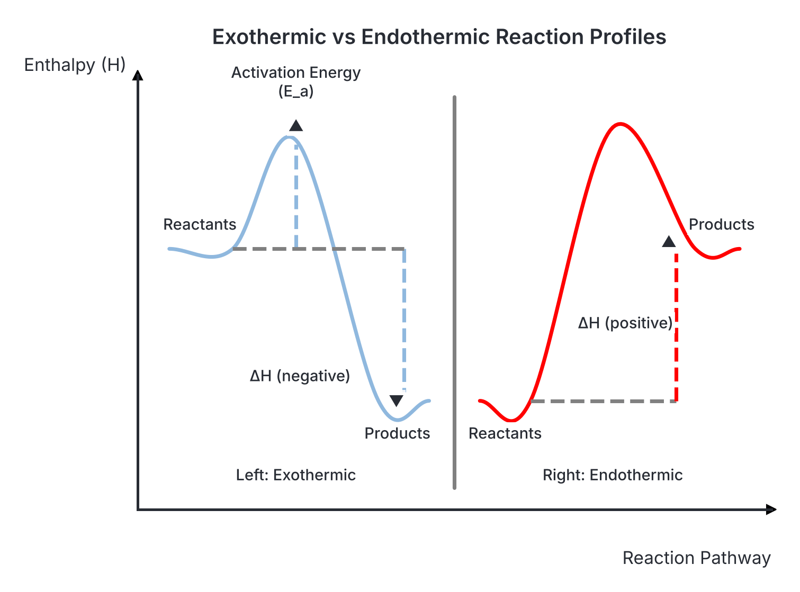
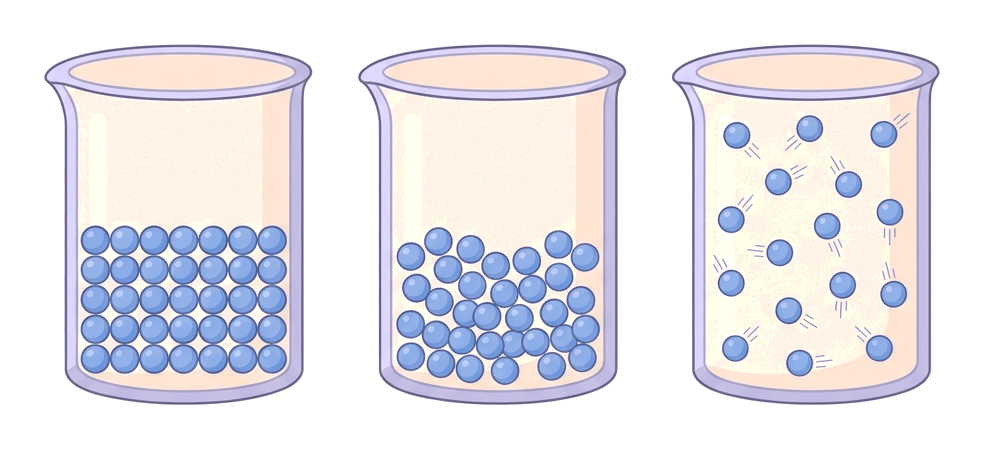

# JAMB Chemistry Notes: Energy Changes

## What JAMB expects

This topic is Section A, Topic 11 of the JAMB Chemistry syllabus: Energy Changes. It covers the following content items:
- **a.** Energy changes ($\Delta \text{H}$) accompanying physical and chemical changes: Dissolution of substances in/or reaction with water e.g. $\text{Na}$, $\text{NaOH}$, $\text{K}$, $\text{NH}_4\text{Cl}$. Endothermic ($+\Delta \text{H}$) and exothermic ($-\Delta \text{H}$) reactions
- **b.** Entropy as an order-disorder phenomenon: simple illustrations like mixing of gases and dissolution of salts
- **c.** Spontaneity of reactions: $\Delta \text{G}^0= 0$ as a criterion for equilibrium, $\Delta \text{G}$ greater or less than zero as a criterion for non-spontaneity or spontaneity respectively

By the end of these notes, you should be able to:
1. Determine the types of heat changes ($\Delta \text{H}$) in physical and chemical processes.
2. Interpret graphical representations of heat changes.
3. Relate the physical state of a substance to the degree of orderliness.
4. Determine the conditions for spontaneity of a reaction.
5. Relate $\Delta \text{H}^0$, $\Delta \text{S}^0$ and $\Delta \text{G}^0$ as the driving forces for chemical reactions.
6. Solve simple problems based on the relationships $\Delta \text{G}^0= \Delta \text{H}^0 - \text{T}\Delta \text{S}^0$.

## Energy changes accompanying physical and chemical changes

Almost every physical process (like melting or dissolving) and chemical process (like burning or rusting) is accompanied by a change in energy. In chemistry, the heat energy stored in a substance at constant pressure is called its **enthalpy**, represented by the symbol **$\text{H}$**. 

Because we cannot easily measure the total absolute enthalpy stored within a substance, we instead measure the **change in enthalpy ($\Delta \text{H}$)** when a reaction occurs. This is the difference in heat content between the final products and the initial reactants:
$$\Delta \text{H} = \text{H}_{\text{products}} - \text{H}_{\text{reactants}}$$

### Exothermic and endothermic reactions

Based on the flow of heat, chemical and physical processes are broadly classified into two categories:

- **Exothermic reactions:** These are reactions that **release heat** to the surroundings. As a result, the surroundings (such as the reaction beaker, the water, or the air) get hotter. Because the chemical system loses heat energy, the products end up with less energy than the reactants ($\text{H}_{\text{products}} < \text{H}_{\text{reactants}}$). This makes **$\Delta \text{H}$ mathematically negative ($-\Delta \text{H}$)**. Everyday Nigerian examples include the burning of kerosene in a stove or the combustion of petrol in a car engine; they both give off a massive amount of heat.
- **Endothermic reactions:** These are reactions that **absorb heat** from the surroundings. The surroundings get colder because their heat is being pulled into the reaction. Because the chemical system gains heat, the products have more energy than the reactants ($\text{H}_{\text{products}} > \text{H}_{\text{reactants}}$). This makes **$\Delta \text{H}$ mathematically positive ($+\Delta \text{H}$)**. A classic biological example is photosynthesis, where cassava or maize plants absorb solar energy to build food molecules.

### Examples of dissolution and reactions with water

JAMB frequently tests your knowledge of specific everyday laboratory examples involving dissolution and reactions with water.

**1. Reaction of Alkali Metals with Water (Exothermic)**
When Group 1 metals like **sodium ($\text{Na}$)** and **potassium ($\text{K}$)** are dropped into a bowl of water, they react violently, darting around the surface and hissing. This chemical reaction produces an alkaline metal hydroxide solution and hydrogen gas.
$$2\text{Na(s)} + 2\text{H}_2\text{O(l)} \rightarrow 2\text{NaOH(aq)} + \text{H}_2\text{(g)}$$
$$2\text{K(s)} + 2\text{H}_2\text{O(l)} \rightarrow 2\text{KOH(aq)} + \text{H}_2\text{(g)}$$
This process is highly **exothermic** ($-\Delta \text{H}$). The heat released is often intense enough to spontaneously ignite the hydrogen gas produced, especially with potassium, which burns with a lilac flame.

**2. Dissolution of Sodium Hydroxide (Exothermic)**
In many Nigerian homes and small industries, sodium hydroxide ($\text{NaOH}$, caustic soda) is dissolved in water to make liquid soap. When solid sodium hydroxide pellets are dissolved in water, the container quickly becomes very hot to the touch. The physical process of breaking the ionic bonds in the solid crystal requires energy, but a much larger amount of energy is released when new bonds form between the free $\text{Na}^+$ and $\text{OH}^-$ ions and the surrounding water molecules (hydration). Because the net effect is a release of heat, the dissolution of $\text{NaOH}$ is **exothermic** ($-\Delta \text{H}$).

**3. Dissolution of Ammonium Chloride (Endothermic)**
Conversely, if you dissolve ammonium chloride ($\text{NH}_4\text{Cl}$) in water, the beaker will feel noticeably cold. In this case, the process requires more energy to break the $\text{NH}_4^+$ and $\text{Cl}^-$ ions apart from their crystal lattice than is released when the ions are hydrated by water. Because the system must pull the extra heat it needs from the surroundings (the water and your hand), the dissolution of $\text{NH}_4\text{Cl}$ is **endothermic** ($+\Delta \text{H}$). 

### Types of heat changes in physical and chemical processes

To standardise how we report energy changes, chemists define specific types of heat changes (also called enthalpies of reaction) depending on the exact process taking place. These are usually measured under standard conditions: $298 \text{ K}$ ($25\ ^\circ\text{C}$), $1 \text{ atm}$ pressure, and $1 \text{ mol dm}^{-3}$ concentration. The standard state is denoted by the zero superscript ($\Delta \text{H}^0$).

1. **Heat of solution (Enthalpy of solution, $\Delta \text{H}_{\text{sol}}$):** The heat change when one mole of a substance dissolves completely in an excess of solvent (usually water) so that further dilution causes no further heat change. As seen above, it can be exothermic (e.g., dissolving $\text{NaOH}$) or endothermic (e.g., dissolving $\text{NH}_4\text{Cl}$).
2. **Heat of combustion ($\Delta \text{H}_{\text{c}}$):** The heat released when one mole of a substance is completely burned in an excess of oxygen. Because burning always releases heat, the heat of combustion is **always exothermic** (always a negative value).
3. **Heat of neutralisation ($\Delta \text{H}_{\text{neut}}$):** The heat change when an acid and a base react to form one mole of water. This is **always exothermic**. For strong acids reacting with strong bases (e.g., $\text{HCl}$ and $\text{NaOH}$), the value is approximately constant at $-57.3 \text{ kJ mol}^{-1}$ because it is simply the reaction between $\text{H}^+$ and $\text{OH}^-$ ions.
4. **Heat of formation ($\Delta \text{H}_{\text{f}}$):** The heat change when one mole of a compound is formed directly from its constituent elements in their standard, stable states.

## Graphical representations of heat changes

Energy changes during a chemical reaction can be shown visually using an **energy profile diagram** (or enthalpy level diagram). This graph plots the Enthalpy ($\text{H}$) on the vertical y-axis against the Progress of Reaction (or reaction pathway) on the horizontal x-axis.

Important features to look out for on these graphs:
- **Reactants and Products levels:** The horizontal lines showing the initial starting energy and the final energy.
- **Activation Energy ($\text{E}_\text{a}$):** This is the minimum extra energy that reactant particles must absorb when they collide in order to break their initial bonds and start the reaction. It appears as an energy "hill" or "barrier" that the reactants must climb over.
- **Enthalpy Change ($\Delta \text{H}$):** This is the vertical gap between the energy level of the reactants and the energy level of the products.

**Interpreting Exothermic Diagrams:**
In an exothermic reaction, the chemical system loses heat. Therefore, the products are drawn at a **lower energy level** than the reactants. The arrow for $\Delta \text{H}$ points downwards from the reactants line to the products line, visually representing a negative mathematical value.

**Interpreting Endothermic Diagrams:**
In an endothermic reaction, the chemical system absorbs heat. Therefore, the products are drawn at a **higher energy level** than the reactants. The arrow for $\Delta \text{H}$ points upwards from the reactants line to the products line, representing a positive mathematical value.

## Entropy as an order-disorder phenomenon

While enthalpy tells us about the heat energy in a system, another crucial thermodynamic concept is **entropy**. 

**Entropy** (symbolised as **$\text{S}$**) is a measure of the degree of **disorder, randomness, or chaos** in a system. The more scattered, messy, or random the particles in a system are, the higher the system's entropy. 

Just like enthalpy, we usually measure the **change in entropy ($\Delta \text{S}$)** during a process:
- A **positive $\Delta \text{S}$** ($+\Delta \text{S}$) means the system has become **more disordered** (entropy increased).
- A **negative $\Delta \text{S}$** ($-\Delta \text{S}$) means the system has become **more ordered** (entropy decreased).

Nature naturally tends toward disorder. If you leave a neatly arranged bedroom (low entropy, highly ordered) alone, over time it tends to become messy and scattered (high entropy, highly disordered) unless you put continuous energy into cleaning it.

### Simple illustrations of entropy

**1. Mixing of gases**
Imagine a classroom where someone opens a bottle of strong perfume in one corner. The gas molecules of the perfume, initially trapped closely together in the bottle (ordered), will quickly escape, spread out, and mix with the air throughout the whole room (disordered). The mixed state is far more random than the separate state. Therefore, the mixing of non-reacting gases always involves a large **increase in entropy** ($+\Delta \text{S}$).

**2. Dissolution of salts**
A solid salt crystal, like table salt ($\text{NaCl}$), consists of ions locked tightly in a neat, highly ordered, rigid lattice. When this salt is dropped into water and dissolves, the lattice breaks apart and the individual $\text{Na}^+$ and $\text{Cl}^-$ ions move freely around in the liquid. Moving freely means more chaos and randomness. Therefore, the dissolution of a solid salt in water generally involves an **increase in entropy** ($+\Delta \text{S}$).

### Relating physical states to the degree of orderliness

The physical state of a substance—solid, liquid, or gas—determines the freedom of movement of its particles, and therefore determines its degree of orderliness and its entropy.

| Physical State | Particle Arrangement | Degree of Orderliness | Entropy Level |
| --- | --- | --- | --- |
| **Solid** | Particles are tightly packed in fixed positions, only vibrating slightly. | **Highest orderliness** (least random). | **Lowest entropy** |
| **Liquid** | Particles are close together but have enough energy to slide past one another. | **Moderate orderliness** (moderately random). | **Higher entropy** than solids |
| **Gas** | Particles are far apart, moving rapidly and freely in all directions. | **Lowest orderliness** (most random). | **Highest entropy** |

**Phase Changes and Entropy:**
- Processes that increase randomness result in a **positive entropy change** ($+\Delta \text{S}$). Examples include **melting** (solid $\rightarrow$ liquid), **boiling/evaporation** (liquid $\rightarrow$ gas), and **sublimation** (solid directly to gas).
- Processes that increase orderliness result in a **negative entropy change** ($-\Delta \text{S}$). Examples include **freezing** (liquid $\rightarrow$ solid) and **condensation** (gas $\rightarrow$ liquid).

## Spontaneity of reactions and criteria for equilibrium

A **spontaneous process** is one that occurs naturally on its own, under a given set of conditions, without requiring any continuous input of external energy to keep it going. For example, water flowing downhill is a spontaneous physical process. Iron rusting in damp air is a spontaneous chemical reaction. 

**Note:** Just because a reaction is spontaneous does not mean it is fast. The rusting of a car body takes a long time, but it still happens naturally. Speed is a matter of *kinetics*, while spontaneity is a matter of *thermodynamics*.

To mathematically determine if a chemical reaction will be spontaneous, chemists use a comprehensive concept called **Gibbs free energy**, denoted by **$\text{G}$**. The change in free energy is **$\Delta \text{G}$**. It tells us the amount of "free" energy available in a system to do useful work.

The ultimate criterion for determining spontaneity relies entirely on the mathematical sign of $\Delta \text{G}$:

1. **$\Delta \text{G}$ is negative ($\Delta \text{G} < 0$):** The reaction is **spontaneous** in the forward direction. It will occur naturally.
2. **$\Delta \text{G}$ is positive ($\Delta \text{G} > 0$):** The reaction is **non-spontaneous** in the forward direction. (However, the *reverse* reaction will be spontaneous).
3. **$\Delta \text{G}$ is zero ($\Delta \text{G} = 0$):** The reaction is exactly at **equilibrium**. There is no net change occurring in the concentrations of reactants and products, and the system can do no useful work. 

### Enthalpy, entropy and Gibbs free energy as driving forces

Why do chemical reactions happen at all? There are two main **driving forces** in nature:
1. **The drive toward minimum energy:** Systems naturally want to lose heat and become more stable. This is favoured by an **exothermic** process (a negative $\Delta \text{H}$).
2. **The drive toward maximum disorder:** Systems naturally want to become as random and chaotic as possible. This is favoured by an **increase in entropy** (a positive $\Delta \text{S}$).

Sometimes these two forces work together to push a reaction forward, and sometimes they pull in opposite directions. **Gibbs free energy ($\Delta \text{G}$)** combines these two driving forces, along with the absolute temperature ($\text{T}$), into one master equation:

$$ \Delta \text{G}^0 = \Delta \text{H}^0 - \text{T}\Delta \text{S}^0 $$

- $\Delta \text{G}^0$ = Standard change in Gibbs free energy
- $\Delta \text{H}^0$ = Standard change in enthalpy
- $\text{T}$ = Absolute temperature (must be measured in **Kelvin, K**)
- $\Delta \text{S}^0$ = Standard change in entropy

### Conditions for spontaneity of a reaction

Because $\Delta \text{G}$ depends on $\Delta \text{H}$, $\Delta \text{S}$, and Temperature, we can predict whether a reaction will be spontaneous by looking at the signs of the enthalpy and entropy changes. 

| Sign of Enthalpy ($\Delta \text{H}$) | Sign of Entropy ($\Delta \text{S}$) | Analysis of $\Delta \text{G} = \Delta \text{H} - \text{T}\Delta \text{S}$ | Spontaneity Condition |
| --- | --- | --- | --- |
| Negative ($-$) | Positive ($+$) | Both driving forces favour the reaction. A negative minus a positive is always negative. $\Delta \text{G}$ is always negative. | **Spontaneous at all temperatures.** |
| Positive ($+$) | Negative ($-$) | Both driving forces oppose the reaction. A positive minus a negative is always positive. $\Delta \text{G}$ is always positive. | **Non-spontaneous at all temperatures.** |
| Negative ($-$) | Negative ($-$) | Enthalpy favours the reaction, but entropy opposes it. The reaction relies on the negative $\Delta \text{H}$ being larger than the $-\text{T}\Delta \text{S}$ term. | **Spontaneous only at LOW temperatures.** |
| Positive ($+$) | Positive ($+$) | Enthalpy opposes it, but entropy favours it. The reaction relies on the $-\text{T}\Delta \text{S}$ term being large enough to overcome the positive $\Delta \text{H}$. | **Spontaneous only at HIGH temperatures.** |

## Solving problems using the Gibbs free energy equation

JAMB expects you to calculate $\Delta \text{G}^0$, find the threshold temperature for spontaneity, and interpret the results. 

**Crucial rules for these calculations:**
- **Temperature must always be in Kelvin.** If given in Celsius ($^\circ\text{C}$), you must convert it by adding 273 ($\text{K} = ^\circ\text{C} + 273$).
- **Watch the units!** Enthalpy ($\Delta \text{H}$) is almost always given in kilojoules per mole ($\text{kJ mol}^{-1}$), while entropy ($\Delta \text{S}$) is given in Joules per Kelvin per mole ($\text{J K}^{-1} \text{mol}^{-1}$). You **must divide the entropy value by 1000** to convert it to kilojoules before you put it into the formula. If you mix kilojoules and Joules, your answer will be massively wrong.

Here are three worked examples going from simple to advanced.

**Worked Example 1: Direct calculation of $\Delta \text{G}^0$**
Calculate $\Delta \text{G}^0$ for a reaction at $25\ ^\circ\text{C}$ if its $\Delta \text{H}^0 = -50 \text{ kJ mol}^{-1}$ and $\Delta \text{S}^0 = -100 \text{ J K}^{-1} \text{mol}^{-1}$. State whether the reaction is spontaneous.
1. Identify the given values with units: $\Delta \text{H}^0 = -50 \text{ kJ mol}^{-1}$, $\Delta \text{S}^0 = -100 \text{ J K}^{-1} \text{mol}^{-1}$, Temperature = $25\ ^\circ\text{C}$.
2. Convert the temperature to Kelvin: $\text{T} = 25 + 273 = 298 \text{ K}$.
3. Convert the entropy to kilojoules by dividing by 1000: $\Delta \text{S}^0 = -100 \div 1000 = -0.100 \text{ kJ K}^{-1} \text{mol}^{-1}$.
4. State the Gibbs equation: $\Delta \text{G}^0 = \Delta \text{H}^0 - \text{T}\Delta \text{S}^0$.
5. Substitute the values and calculate the entropy term ($\text{T}\Delta \text{S}^0$): $298 \text{ K} \times (-0.100 \text{ kJ K}^{-1} \text{mol}^{-1}) = -29.8 \text{ kJ mol}^{-1}$.
6. Calculate final $\Delta \text{G}^0$ by subtracting the entropy term from the enthalpy: $\Delta \text{G}^0 = -50 \text{ kJ mol}^{-1} - (-29.8 \text{ kJ mol}^{-1}) = -50 + 29.8 = -20.2 \text{ kJ mol}^{-1}$.
7. State the conclusion: Since $\Delta \text{G}^0$ is negative ($-20.2 \text{ kJ mol}^{-1}$), the reaction is **spontaneous**.

**Worked Example 2: Finding the threshold temperature for spontaneity**
For a certain endothermic reaction, $\Delta \text{H}^0 = +40 \text{ kJ mol}^{-1}$ and $\Delta \text{S}^0 = +125 \text{ J K}^{-1} \text{mol}^{-1}$. Calculate the temperature at which the reaction is exactly at equilibrium, and deduce the condition for it to be spontaneous.
1. Identify the given values: $\Delta \text{H}^0 = +40 \text{ kJ mol}^{-1}$, $\Delta \text{S}^0 = +125 \text{ J K}^{-1} \text{mol}^{-1}$.
2. Convert the entropy to kilojoules: $\Delta \text{S}^0 = +125 \div 1000 = +0.125 \text{ kJ K}^{-1} \text{mol}^{-1}$.
3. Set the equilibrium condition: At equilibrium, $\Delta \text{G}^0 = 0$.
4. Rearrange the Gibbs formula to solve for temperature ($\text{T}$): Since $\Delta \text{H}^0 - \text{T}\Delta \text{S}^0 = 0$, this means $\Delta \text{H}^0 = \text{T}\Delta \text{S}^0$. Therefore, $\text{T} = \frac{\Delta \text{H}^0}{\Delta \text{S}^0}$.
5. Calculate the equilibrium temperature: $\text{T} = \frac{40 \text{ kJ mol}^{-1}}{0.125 \text{ kJ K}^{-1} \text{mol}^{-1}} = 320 \text{ K}$.
6. Determine the spontaneity condition: Because both enthalpy and entropy are positive, the reaction relies on high temperatures to be spontaneous (refer to the condition table). Therefore, it becomes spontaneous at any temperature **above** $320 \text{ K}$ (i.e., $\text{T} > 320 \text{ K}$).

**Worked Example 3: Why does an endothermic solid dissolve?**
The dissolution of ammonium chloride ($\text{NH}_4\text{Cl}$) in water is an endothermic process. If $\Delta \text{H}^0 = +14.8 \text{ kJ mol}^{-1}$ and $\Delta \text{S}^0 = +110 \text{ J K}^{-1} \text{mol}^{-1}$, calculate $\Delta \text{G}^0$ at $25\ ^\circ\text{C}$ ($298 \text{ K}$) and explain thermodynamically why it dissolves naturally despite absorbing heat.
1. Identify the given values: $\Delta \text{H}^0 = +14.8 \text{ kJ mol}^{-1}$, $\Delta \text{S}^0 = +110 \text{ J K}^{-1} \text{mol}^{-1}$, $\text{T} = 298 \text{ K}$.
2. Convert the entropy to kilojoules: $\Delta \text{S}^0 = +110 \div 1000 = +0.110 \text{ kJ K}^{-1} \text{mol}^{-1}$.
3. State the equation: $\Delta \text{G}^0 = \Delta \text{H}^0 - \text{T}\Delta \text{S}^0$.
4. Calculate the entropy term: $298 \text{ K} \times (+0.110 \text{ kJ K}^{-1} \text{mol}^{-1}) = +32.78 \text{ kJ mol}^{-1}$.
5. Calculate final $\Delta \text{G}^0$: $\Delta \text{G}^0 = 14.8 \text{ kJ mol}^{-1} - 32.78 \text{ kJ mol}^{-1} = -17.98 \text{ kJ mol}^{-1}$.
6. Provide the explanation: Even though the process absorbs heat (which opposes spontaneity, $+\Delta \text{H}$), it dissolves spontaneously because breaking the rigid crystal into free floating ions creates a massive increase in entropy. At room temperature, this entropy driving force outweighs the enthalpy handicap, making the final $\Delta \text{G}^0$ negative.

## Key terms

| Term | Meaning |
| --- | --- |
| **Enthalpy ($\text{H}$)** | The measure of heat content or heat energy of a system at constant pressure. |
| **Exothermic reaction** | A reaction that releases heat to its surroundings, resulting in a negative $\Delta \text{H}$. |
| **Endothermic reaction** | A reaction that absorbs heat from its surroundings, resulting in a positive $\Delta \text{H}$. |
| **Entropy ($\text{S}$)** | A thermodynamic measure of the degree of disorder, randomness, or chaos in a system. |
| **Spontaneous process** | A process that occurs naturally on its own under given conditions without continuous external energy input. |
| **Gibbs free energy ($\text{G}$)** | The energy available in a system to do useful work; the ultimate criterion for spontaneity. |
| **Activation energy ($\text{E}_\text{a}$)** | The minimum energy that colliding reactant particles must possess to start a chemical reaction. |
| **Equilibrium** | A thermodynamic state where $\Delta \text{G} = 0$, meaning no net forward or reverse reaction is occurring. |

## Exam tips and common mistakes

- **Unit slips are the #1 mistake:** In calculations, $\Delta \text{H}$ is almost always in $\text{kJ}$ and $\Delta \text{S}$ is in $\text{J}$. You **must** divide the $\Delta \text{S}$ value by 1000 to convert it to $\text{kJ}$ before subtracting it. 
- **Wrong temperature scale:** Always use Kelvin ($\text{K}$) for temperature in the formula $\Delta \text{G} = \Delta \text{H} - \text{T}\Delta \text{S}$. Add 273 to Celsius values.
- **Confusing $\Delta \text{H}$ and $\Delta \text{G}$ for spontaneity:** Students often think an exothermic reaction ($-\Delta \text{H}$) is *always* spontaneous. While it usually is, $\Delta \text{G} < 0$ is the *only absolute mathematical guarantee* of spontaneity. If entropy decreases significantly, an exothermic reaction might become non-spontaneous at high temperatures.
- **Signs matter deeply:** Ensure you understand what the signs mean. Negative $\Delta \text{H}$ = heat lost (exothermic). Positive $\Delta \text{H}$ = heat gained (endothermic). Positive $\Delta \text{S}$ = more disorder. Negative $\Delta \text{S}$ = more order.
- **Equilibrium condition shortcut:** Whenever an exam question mentions a reaction being "at equilibrium", instantly write down $\Delta \text{G} = 0$. This lets you use the handy shortcut $\text{T} = \frac{\Delta \text{H}}{\Delta \text{S}}$.
- **Beaker feel:** If a question says a reaction beaker feels cold to the touch, the reaction is endothermic. If it feels hot, the reaction is exothermic.

## Quick summary

1. Enthalpy change ($\Delta \text{H}$) describes the heat absorbed or released in a chemical or physical process. Exothermic reactions release heat ($- \Delta \text{H}$) and endothermic reactions absorb heat ($+ \Delta \text{H}$).
2. Energy profile diagrams show reactants at a higher energy than products for exothermic reactions, and lower than products for endothermic reactions.
3. Entropy ($\Delta \text{S}$) measures the disorder of a system. Solids are the most ordered (lowest entropy), while gases are the most disordered (highest entropy). Processes like mixing gases or dissolving salts increase entropy ($+ \Delta \text{S}$).
4. The two natural driving forces of chemical reactions are the tendency toward minimum enthalpy ($- \Delta \text{H}$) and maximum entropy ($+ \Delta \text{S}$).
5. Gibbs free energy ($\Delta \text{G}$) determines reaction spontaneity. If $\Delta \text{G} < 0$, a process is spontaneous; if $\Delta \text{G} > 0$, it is non-spontaneous; if $\Delta \text{G} = 0$, it is at equilibrium.
6. The fundamental equation $\Delta \text{G}^0 = \Delta \text{H}^0 - \text{T}\Delta \text{S}^0$ links these quantities and allows us to predict spontaneity mathematically, provided the temperature is converted to Kelvin and entropy to kilojoules.

## Practice questions

**1. In an endothermic reaction, the enthalpy change ($\Delta \text{H}$) is**
- A. zero
- B. negative
- C. positive
- D. unpredictable

**Answer: C.**
1. Endothermic reactions absorb heat energy from the surroundings.
2. This absorption of energy increases the heat content of the products relative to the reactants ($\text{H}_{\text{products}} > \text{H}_{\text{reactants}}$).
3. Because $\Delta \text{H} = \text{H}_{\text{products}} - \text{H}_{\text{reactants}}$, a larger product enthalpy results in a positive mathematical value ($+\Delta \text{H}$).
The mistake behind the most tempting wrong option (B) is confusing endothermic reactions with exothermic reactions, as exothermic reactions release heat and have a negative $\Delta \text{H}$.

**2. Which of the following physical changes is accompanied by a decrease in entropy?**
- A. Melting of ice
- B. Boiling of water
- C. Sublimation of iodine
- D. Condensation of steam

**Answer: D.**
1. Entropy measures the degree of disorder or randomness in a system.
2. Gases (like steam) are highly disordered and have high entropy, while liquids (like water) are more ordered and have lower entropy.
3. Condensation turns a gas into a liquid, which forces the particles closer together and reduces their randomness.
4. Therefore, condensation results in a decrease in entropy ($-\Delta \text{S}$).
The mistake behind the most tempting wrong option (A) is assuming that melting (which requires heat, thus endothermic) decreases entropy; however, turning a highly ordered solid into a liquid increases disorder and thus increases entropy.

**3. When a student dissolves sodium hydroxide pellets in water in a beaker, the beaker feels very hot. Which of the following statements is true about this process?**
- A. It is endothermic with a negative $\Delta \text{H}$
- B. It is exothermic with a negative $\Delta \text{H}$
- C. It is endothermic with a positive $\Delta \text{H}$
- D. It is exothermic with a positive $\Delta \text{H}$

**Answer: B.**
1. The beaker feels hot because the reaction releases heat from the chemical system into the surroundings (the water and your hand).
2. Any process that releases heat is defined thermodynamically as exothermic.
3. In an exothermic process, the system loses enthalpy, meaning the final products have less energy than the initial reactants.
4. This results in a negative enthalpy change ($-\Delta \text{H}$).
The mistake behind the most tempting wrong option (D) is knowing the reaction is exothermic but incorrectly thinking that exothermic reactions have a positive $\Delta \text{H}$ because the surroundings gained heat (forgetting that $\Delta \text{H}$ measures the *system*, which lost heat).

**4. In an energy profile diagram, the enthalpy of the reactants is $50 \text{ kJ mol}^{-1}$ and the enthalpy of the products is $20 \text{ kJ mol}^{-1}$. What is the enthalpy of reaction ($\Delta \text{H}$)?**
- A. $+30 \text{ kJ mol}^{-1}$
- B. $-30 \text{ kJ mol}^{-1}$
- C. $+70 \text{ kJ mol}^{-1}$
- D. $-70 \text{ kJ mol}^{-1}$

**Answer: B.**
1. Identify the enthalpy of the reactants: $\text{H}_{\text{reactants}} = 50 \text{ kJ mol}^{-1}$.
2. Identify the enthalpy of the products: $\text{H}_{\text{products}} = 20 \text{ kJ mol}^{-1}$.
3. State the formula for enthalpy change: $\Delta \text{H} = \text{H}_{\text{products}} - \text{H}_{\text{reactants}}$.
4. Substitute the values into the formula: $\Delta \text{H} = 20 \text{ kJ mol}^{-1} - 50 \text{ kJ mol}^{-1}$.
5. Calculate the final answer: $\Delta \text{H} = -30 \text{ kJ mol}^{-1}$.
The mistake behind the most tempting wrong option (A) is subtracting the product enthalpy from the reactant enthalpy ($50 - 20 = +30 \text{ kJ mol}^{-1}$), instead of strictly following the "final minus initial" rule.

**5. A chemical reaction will definitely be spontaneous at all temperatures if**
- A. $\Delta \text{H}$ is positive and $\Delta \text{S}$ is positive
- B. $\Delta \text{H}$ is negative and $\Delta \text{S}$ is negative
- C. $\Delta \text{H}$ is positive and $\Delta \text{S}$ is negative
- D. $\Delta \text{H}$ is negative and $\Delta \text{S}$ is positive

**Answer: D.**
1. Spontaneity is guaranteed mathematically when the Gibbs free energy change ($\Delta \text{G}$) is negative.
2. The formula linking these properties is $\Delta \text{G} = \Delta \text{H} - \text{T}\Delta \text{S}$.
3. A negative $\Delta \text{H}$ (exothermic, heat lost) favours spontaneity by pulling $\Delta \text{G}$ downwards.
4. A positive $\Delta \text{S}$ (increase in disorder) makes the $-\text{T}\Delta \text{S}$ term negative (since absolute temperature $\text{T}$ in Kelvin is always positive).
5. A negative number minus a positive number is always negative, so $\Delta \text{G}$ is negative regardless of how high or low the temperature is.
The mistake behind the most tempting wrong option (B) is thinking that two negative signs (for enthalpy and entropy) mean the reaction is always spontaneous, but a negative $\Delta \text{S}$ actually opposes spontaneity at high temperatures.

**6. The mixing of two non-reacting gases in a closed container is a spontaneous process primarily because**
- A. the process is highly exothermic
- B. there is a decrease in free energy due to an increase in entropy
- C. the enthalpy of the system increases drastically
- D. the gases form strong bonds with each other

**Answer: B.**
1. Mixing ideal non-reacting gases involves almost zero heat change ($\Delta \text{H} \approx 0 \text{ kJ mol}^{-1}$).
2. However, allowing the initially separate gases to mix vastly increases the randomness and disorder of their particles.
3. This creates a large, positive entropy change ($+\Delta \text{S}$).
4. Using the formula $\Delta \text{G} = \Delta \text{H} - \text{T}\Delta \text{S}$, the positive $\Delta \text{S}$ makes the $-\text{T}\Delta \text{S}$ term negative, leading to a negative $\Delta \text{G}$ (decrease in free energy).
The mistake behind the most tempting wrong option (A) is assuming that all spontaneous processes must release heat (be exothermic), completely ignoring the equally important driving force of entropy.

**7. Calculate the standard Gibbs free energy change ($\Delta \text{G}^0$) for a reaction at $300 \text{ K}$ where $\Delta \text{H}^0 = -90 \text{ kJ mol}^{-1}$ and $\Delta \text{S}^0 = -200 \text{ J K}^{-1} \text{mol}^{-1}$.**
- A. $-150 \text{ kJ mol}^{-1}$
- B. $-30 \text{ kJ mol}^{-1}$
- C. $+30 \text{ kJ mol}^{-1}$
- D. $-90 \text{ kJ mol}^{-1}$

**Answer: B.**
1. Identify the given values with units: $\text{T} = 300 \text{ K}$, $\Delta \text{H}^0 = -90 \text{ kJ mol}^{-1}$, $\Delta \text{S}^0 = -200 \text{ J K}^{-1} \text{mol}^{-1}$.
2. Convert $\Delta \text{S}^0$ from Joules to kilojoules by dividing by $1000$: $-200 \div 1000 = -0.2 \text{ kJ K}^{-1} \text{mol}^{-1}$.
3. State the Gibbs free energy formula: $\Delta \text{G}^0 = \Delta \text{H}^0 - \text{T}\Delta \text{S}^0$.
4. Calculate the $-\text{T}\Delta \text{S}^0$ term: $- [300 \text{ K} \times (-0.2 \text{ kJ K}^{-1} \text{mol}^{-1})] = - (-60 \text{ kJ mol}^{-1}) = +60 \text{ kJ mol}^{-1}$.
5. Add this to $\Delta \text{H}^0$: $\Delta \text{G}^0 = -90 \text{ kJ mol}^{-1} + 60 \text{ kJ mol}^{-1} = -30 \text{ kJ mol}^{-1}$.
The mistake behind the most tempting wrong option (A) is erroneously subtracting the $60$ (doing $-90 - 60 = -150 \text{ kJ mol}^{-1}$) instead of recognising that subtracting a negative number is equivalent to addition.

**8. The ultimate thermodynamic criterion for the spontaneity of a chemical reaction is that the**
- A. change in enthalpy must be negative
- B. change in entropy must be positive
- C. change in Gibbs free energy must be negative
- D. change in Gibbs free energy must be zero

**Answer: C.**
1. The change in enthalpy ($\Delta \text{H}$) and the change in entropy ($\Delta \text{S}$) are both individual driving forces for a reaction.
2. However, neither alone can guarantee spontaneity because they can oppose each other (e.g., an endothermic reaction can still be spontaneous).
3. The Gibbs free energy ($\Delta \text{G}$) combines both forces and temperature into one conclusive equation.
4. A reaction is only mathematically guaranteed to be spontaneous (able to occur without external energy) if the total Gibbs free energy change ($\Delta \text{G}$) is less than zero (negative).
The mistake behind the most tempting wrong option (A) is the common misconception that exothermic reactions (negative enthalpy change) are always spontaneous, which is false if the entropy decreases significantly at a high temperature.

**9. At what temperature does a chemical reaction with $\Delta \text{H}^0 = +30 \text{ kJ mol}^{-1}$ and $\Delta \text{S}^0 = +100 \text{ J K}^{-1} \text{mol}^{-1}$ reach equilibrium?**
- A. $0.3 \text{ K}$
- B. $30 \text{ K}$
- C. $300 \text{ K}$
- D. $333 \text{ K}$

**Answer: C.**
1. Recognise that at equilibrium, the change in Gibbs free energy is exactly zero ($\Delta \text{G}^0 = 0$).
2. Substitute zero into the Gibbs equation: $0 = \Delta \text{H}^0 - \text{T}\Delta \text{S}^0$, which rearranges to the shortcut formula $\text{T} = \frac{\Delta \text{H}^0}{\Delta \text{S}^0}$.
3. Convert $\Delta \text{S}^0$ to kilojoules to match the enthalpy units: $+100 \text{ J K}^{-1} \text{mol}^{-1} \div 1000 = +0.1 \text{ kJ K}^{-1} \text{mol}^{-1}$.
4. Substitute the values into the rearranged formula: $\text{T} = \frac{30 \text{ kJ mol}^{-1}}{0.1 \text{ kJ K}^{-1} \text{mol}^{-1}}$.
5. Calculate the temperature: $\text{T} = 300 \text{ K}$.
The mistake behind the most tempting wrong option (A) occurs if a student forgets to convert the entropy value from Joules to kilojoules, wrongly dividing $30$ by $100$ to get $0.3 \text{ K}$.

**10. Which of the following thermodynamic observations indicates that a chemical system is exactly at equilibrium?**
- A. The products are formed very rapidly
- B. The value of $\Delta \text{G}^0$ is zero
- C. The reaction is highly exothermic
- D. The value of $\Delta \text{S}^0$ is zero

**Answer: B.**
1. Chemical equilibrium is the dynamic state where the forward and reverse reactions proceed at the exact same rate.
2. In this state, there is no net change in the concentrations of the reactants and products over time.
3. Because there is no net driving force for the reaction to proceed in either direction to do useful work, the available "free" energy change is zero.
4. This thermodynamic state is defined mathematically as a Gibbs free energy change ($\Delta \text{G}^0$) of exactly zero.
The mistake behind the most tempting wrong option (D) is confusing zero free energy with zero entropy change; at equilibrium, total entropy is maximised for the system and surroundings, but $\Delta \text{S}^0$ of the system itself is not zero.
