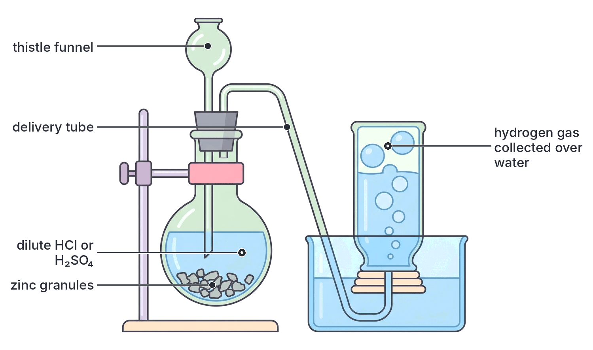
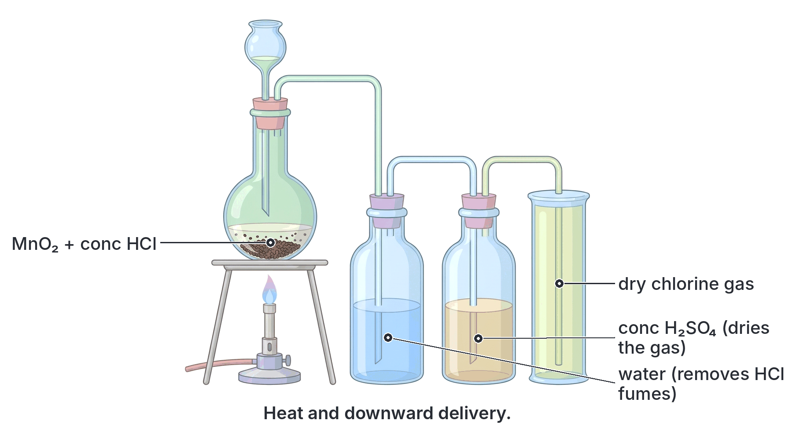
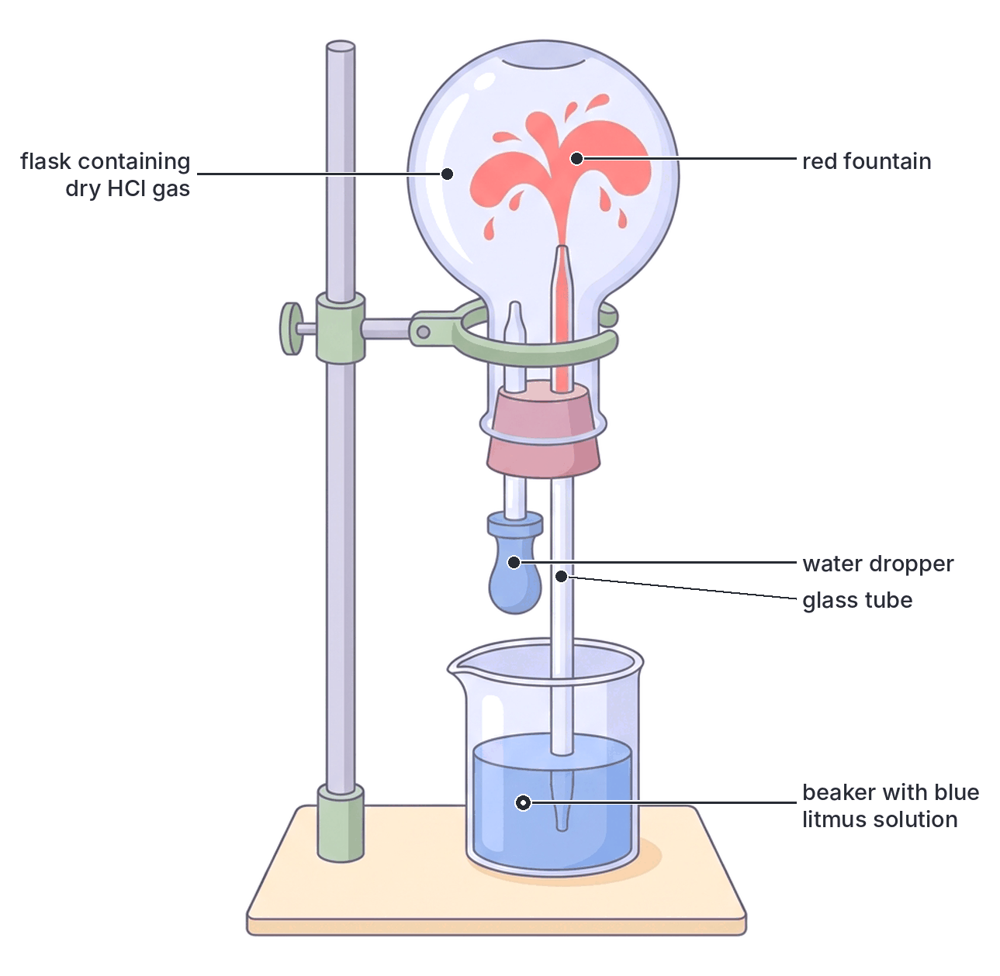

# JAMB Chemistry Notes: Hydrogen and Halogens

## What JAMB expects

This topic is Part A of Section 14 (Non-metals and their Compounds) of the JAMB Chemistry syllabus. Topic 14 is extremely large, covering several non-metals, so it is split into three parts. This file covers hydrogen, halogens (specifically chlorine), and their compounds. Oxygen, sulphur, nitrogen, and carbon are covered in `A14b-oxygen-and-sulphur.md` and `A14c-nitrogen-and-carbon.md`.

This file covers the following content items from the syllabus:
- **a.** Hydrogen: commercial production from water gas and cracking of petroleum fractions, laboratory preparation, properties, uses and test for hydrogen.
- **b.** Halogens: Chlorine as a representative element of the halogens. Laboratory preparation, industrial preparation by electrolysis, properties and uses, e.g. water sterilization, bleaching, manufacture of $\text{HCl}$, plastics and insecticides. Hydrogen chloride and Hydrochloric acid: Preparation and properties. Chlorides and test for chlorides.

By the end of these notes, you should be able to:
1. predict reagents for the laboratory and industrial preparation of these gases and their compounds;
2. identify the properties of the gases and their compounds;
3. compare the properties of these gases and their compounds;
4. specify the uses of each gas and its compounds;
5. determine the specific test for each gas and its compounds;
6. determine specific tests for $\text{Cl}^-$;
7. predict the reagents for preparation, properties and uses of $\text{HCl(g)}$ and $\text{HCl(aq)}$.

## Commercial Sources of Hydrogen

Hydrogen ($\text{H}_2$) is the lightest element and the most abundant element in the universe. While it is rare as a free gas in the Earth's atmosphere, it is found abundantly in compounds such as water ($\text{H}_2\text{O}$) and hydrocarbons (in crude oil and natural gas). 

Because of its massive industrial importance (especially in making ammonia for fertilisers), it is produced on a very large scale. One major commercial source is the **cracking of petroleum fractions**. In Nigerian oil refineries (like those in Port Harcourt and Kaduna), long-chain hydrocarbon molecules (alkanes) from crude oil are heated under pressure with a catalyst. They break down (crack) into smaller, more useful molecules (like alkenes and shorter alkanes) and release hydrogen gas as a by-product. 
For example:
$$\text{C}_2\text{H}_6\text{(g)} \rightarrow \text{C}_2\text{H}_4\text{(g)} + \text{H}_2\text{(g)}$$
*(Ethane cracks into ethene and hydrogen)*

Another commercial source is from **water gas**, which is detailed under industrial preparation below.

## Halogens as a Chemical Group

The **halogens** are the elements in Group 17 (formerly Group VII) of the Periodic Table. They include fluorine ($\text{F}$), chlorine ($\text{Cl}$), bromine ($\text{Br}$), iodine ($\text{I}$), and astatine ($\text{At}$). The word "halogen" means "salt-maker" because they react with metals to form salts, such as sodium chloride ($\text{NaCl}$) from the sea.

All halogens:
- Have seven valence electrons and need one more to achieve a stable octet, making them very reactive non-metals.
- Exist as diatomic molecules ($\text{F}_2, \text{Cl}_2, \text{Br}_2, \text{I}_2$).
- Form negatively charged ions called **halide ions** (e.g., chloride, $\text{Cl}^-$) with an oxidation state of $-1$.

**Chlorine** ($\text{Cl}_2$) is the most commonly tested halogen in JAMB and serves as the representative element for this group. It is a highly reactive, toxic gas that is never found free in nature.

## Predicting Reagents for Laboratory and Industrial Preparation

### 1. Preparation of Hydrogen

**Laboratory Preparation:**
Hydrogen is prepared in the lab by the action of dilute acids on active metals. 
- **Reagents:** Zinc granules ($\text{Zn}$) and dilute hydrochloric acid ($\text{HCl}$) or dilute tetraoxosulphate(VI) acid ($\text{H}_2\text{SO}_4$). (Zinc is used because it provides a steady, moderate reaction, unlike sodium which is dangerously explosive, or iron which requires heating).
- **Equation:** $\text{Zn(s)} + 2\text{HCl(aq)} \rightarrow \text{ZnCl}_2\text{(aq)} + \text{H}_2\text{(g)}$
- **Method:** The gas is collected **over water** because it is practically insoluble in water. Alternatively, it can be collected by **upward delivery** (downward displacement of air) because it is much lighter (less dense) than air.

**Industrial Preparation (From Water Gas - Bosch Process):**
- **Reagents:** Coke (carbon) and steam ($\text{H}_2\text{O}$).
- **Step 1:** Steam is passed over white-hot coke at about $1000^\circ\text{C}$ to produce **water gas** (a mixture of carbon(II) oxide and hydrogen).
  $$\text{C(s)} + \text{H}_2\text{O(g)} \rightarrow \text{CO(g)} + \text{H}_2\text{(g)}$$
- **Step 2 (Bosch Process):** The water gas is mixed with more steam and passed over a catalyst (iron(III) oxide with a chromium(III) oxide promoter) at $450^\circ\text{C}$. This converts the dangerous $\text{CO}$ into $\text{CO}_2$ and produces more hydrogen.
  $$\text{CO(g)} + \text{H}_2\text{O(g)} \rightleftharpoons \text{CO}_2\text{(g)} + \text{H}_2\text{(g)}$$
- **Purification:** The $\text{CO}_2$ is removed by dissolving it in water under high pressure or passing it through sodium hydroxide. Any remaining trace of $\text{CO}$ is absorbed by ammoniacal copper(I) chloride solution.

**Worked Example 1: Volume of hydrogen from zinc**
Calculate the volume of hydrogen gas produced at s.t.p. when 6.5 g of zinc reacts completely with excess dilute hydrochloric acid. *(Zn = 65, Molar volume at s.t.p. = 22.4 dm$^3$ mol$^{-1}$)*

1. **Write the balanced equation:** $\text{Zn(s)} + 2\text{HCl(aq)} \rightarrow \text{ZnCl}_2\text{(aq)} + \text{H}_2\text{(g)}$
2. **Find the moles of reacting zinc:**
   Moles of $\text{Zn} = \frac{6.5 \text{ g}}{65 \text{ g mol}^{-1}} = 0.1 \text{ mol}$
3. **Use the mole ratio:** The equation shows that 1 mole of $\text{Zn}$ produces 1 mole of $\text{H}_2$. Therefore, moles of $\text{H}_2 = 0.1 \text{ mol}$.
4. **Convert to volume:**
   Volume = $0.1 \text{ mol} \times 22.4 \text{ dm}^3 \text{ mol}^{-1} = 2.24 \text{ dm}^3$

### 2. Preparation of Chlorine

**Laboratory Preparation:**
Chlorine is prepared by the **oxidation of concentrated hydrochloric acid**. Since $\text{HCl}$ is a stable compound, a strong oxidizing agent is required to remove the hydrogen.
- **Reagents (Method 1 - Standard):** Manganese(IV) oxide ($\text{MnO}_2$) and concentrated $\text{HCl}$. The mixture must be **heated**.
  $$\text{MnO}_2\text{(s)} + 4\text{HCl(aq, conc.)} \rightarrow \text{MnCl}_2\text{(aq)} + 2\text{H}_2\text{O(l)} + \text{Cl}_2\text{(g)}$$
- **Reagents (Method 2 - No heat):** Potassium tetraoxomanganate(VII) ($\text{KMnO}_4$) and concentrated $\text{HCl}$. This reacts at room temperature.
  $$2\text{KMnO}_4\text{(s)} + 16\text{HCl(aq, conc.)} \rightarrow 2\text{KCl(aq)} + 2\text{MnCl}_2\text{(aq)} + 8\text{H}_2\text{O(l)} + 5\text{Cl}_2\text{(g)}$$
- **Purification and Collection:** The chlorine gas produced contains water vapour and $\text{HCl}$ fumes. It is passed through a wash bottle containing water (to dissolve the very soluble $\text{HCl}$ fumes) and then through a wash bottle containing concentrated $\text{H}_2\text{SO}_4$ (to dry the gas). The dry gas is denser than air, so it is collected by **downward delivery** (upward displacement of air).

**Industrial Preparation (Electrolysis):**
- **Reagent:** Concentrated sodium chloride solution (**brine**).
- **Process:** Brine is electrolysed in specially designed cells (like the Nelson diaphragm cell or the membrane cell). 
- At the **anode** (positive electrode), chloride ions lose electrons (oxidation) to form chlorine gas:
  $$2\text{Cl}^-\text{(aq)} \rightarrow \text{Cl}_2\text{(g)} + 2\text{e}^-$$
- The other products are hydrogen gas (at the cathode) and sodium hydroxide solution (left in the cell).

**Worked Example 2: Mass of manganese(IV) oxide required**
Calculate the mass of manganese(IV) oxide needed to produce 5.6 dm$^3$ of chlorine gas at s.t.p. when reacted with excess concentrated hydrochloric acid. *(Mn = 55, O = 16, Molar volume at s.t.p. = 22.4 dm$^3$ mol$^{-1}$)*

1. **Write the balanced equation:** $\text{MnO}_2\text{(s)} + 4\text{HCl(aq)} \rightarrow \text{MnCl}_2\text{(aq)} + 2\text{H}_2\text{O(l)} + \text{Cl}_2\text{(g)}$
2. **Find the moles of chlorine gas produced:**
   Moles of $\text{Cl}_2 = \frac{5.6 \text{ dm}^3}{22.4 \text{ dm}^3 \text{ mol}^{-1}} = 0.25 \text{ mol}$
3. **Use the mole ratio:** The equation shows 1 mole of $\text{MnO}_2$ produces 1 mole of $\text{Cl}_2$. Therefore, moles of $\text{MnO}_2 = 0.25 \text{ mol}$.
4. **Find the molar mass of $\text{MnO}_2$:** $55 + (2 \times 16) = 55 + 32 = 87 \text{ g mol}^{-1}$.
5. **Calculate the mass:**
   Mass = $0.25 \text{ mol} \times 87 \text{ g mol}^{-1} = 21.75 \text{ g}$

## Identifying Properties of Hydrogen and Chlorine

### Properties of Hydrogen
- **Physical:** It is a colourless, odourless, tasteless gas. It is the lightest known substance (density much lower than air). It is practically insoluble in water and is neutral to litmus.
- **Chemical:**
  - **Combustion:** Hydrogen does not support combustion, but it burns in air with a pale blue flame to form water. 
    $$2\text{H}_2\text{(g)} + \text{O}_2\text{(g)} \rightarrow 2\text{H}_2\text{O(l)}$$
  - **Reducing agent:** It removes oxygen from the heated oxides of metals lower than zinc in the reactivity series (e.g., copper, lead).
    $$\text{CuO(s)} + \text{H}_2\text{(g)} \rightarrow \text{Cu(s)} + \text{H}_2\text{O(l)}$$
  - **Reaction with halogens:** Hydrogen reacts directly with halogens. With chlorine, it reacts explosively in sunlight to form hydrogen chloride.
    $$\text{H}_2\text{(g)} + \text{Cl}_2\text{(g)} \rightarrow 2\text{HCl(g)}$$

### Properties of Chlorine
- **Physical:** It is a greenish-yellow gas with a choking, suffocating smell. It is highly toxic (used as a chemical weapon in World War I). It is about 2.5 times denser than air and is moderately soluble in water (forming "chlorine water").
- **Chemical:**
  - **Reaction with metals:** It is a very strong oxidizing agent. It reacts with most metals to form chlorides. Note that it oxidizes iron all the way to iron(III) chloride, not iron(II).
    $$2\text{Fe(s)} + 3\text{Cl}_2\text{(g)} \rightarrow 2\text{FeCl}_3\text{(s)}$$
  - **Reaction with water (Bleaching Action):** Chlorine dissolves in water to form a mixture of hydrochloric acid and oxochlorate(I) acid (hypochlorous acid).
    $$\text{Cl}_2\text{(g)} + \text{H}_2\text{O(l)} \rightleftharpoons \text{HCl(aq)} + \text{HClO(aq)}$$
    The oxochlorate(I) acid is unstable and decomposes to release **nascent oxygen** (atomic oxygen, $\text{[O]}$):
    $$\text{HClO(aq)} \rightarrow \text{HCl(aq)} + \text{[O]}$$
    This nascent oxygen attacks dyes and stains, oxidizing them into colourless compounds. Therefore, chlorine bleaches by **oxidation**. (Note: Chlorine requires water to bleach; dry chlorine cannot bleach).
  - **Reaction with Alkalis:**
    With **cold, dilute** sodium hydroxide:
    $$\text{Cl}_2\text{(g)} + 2\text{NaOH(aq)} \rightarrow \text{NaCl(aq)} + \text{NaClO(aq)} + \text{H}_2\text{O(l)}$$
    With **hot, concentrated** sodium hydroxide:
    $$3\text{Cl}_2\text{(g)} + 6\text{NaOH(aq)} \rightarrow 5\text{NaCl(aq)} + \text{NaClO}_3\text{(aq)} + 3\text{H}_2\text{O(l)}$$
  - **Displacement reaction:** Chlorine displaces less reactive halogens (bromine and iodine) from their salts.
    $$\text{Cl}_2\text{(g)} + 2\text{KI(aq)} \rightarrow 2\text{KCl(aq)} + \text{I}_2\text{(s)}$$

## Comparing the Properties of Hydrogen and Chlorine

| Property | Hydrogen ($\text{H}_2$) | Chlorine ($\text{Cl}_2$) |
| :--- | :--- | :--- |
| **Colour** | Colourless | Greenish-yellow |
| **Odour** | Odourless | Choking and suffocating |
| **Density compared to air** | Much less dense (lighter) | About 2.5 times denser (heavier) |
| **Bonding** | Non-polar covalent single bond | Non-polar covalent single bond |
| **Solubility in water** | Practically insoluble | Moderately soluble (reacts to form acids) |
| **Effect on damp litmus** | Neutral (no effect) | Turns blue litmus red, then bleaches it white |
| **Redox behaviour** | Strong reducing agent | Powerful oxidizing agent |
| **Toxicity** | Non-poisonous | Highly toxic |

## Specifying Uses of Hydrogen and Chlorine

**Uses of Hydrogen:**
1. **Manufacture of Ammonia:** The largest use of hydrogen is in the Haber process to make ammonia ($\text{NH}_3$), which is used to make fertilisers.
2. **Hydrogenation of Oils:** Hydrogen is bubbled through liquid vegetable oils (like palm oil or groundnut oil) with a nickel catalyst to harden them into solid margarine.
3. **Welding:** Oxy-hydrogen flames produce extremely high temperatures for cutting and welding metals.
4. **Rocket Fuel:** Liquid hydrogen is used in rockets because it provides a massive amount of energy per unit mass.
5. **Manufacture of Chemicals:** Used to make hydrogen chloride, methanol, and plastics.

**Uses of Chlorine:**
1. **Water Sterilization:** Chlorine is added to municipal water supplies (water works) and swimming pools to kill pathogenic bacteria and microorganisms.
2. **Manufacture of Plastics:** Used extensively to make **polyvinyl chloride (PVC)**, a plastic used for pipes, electrical insulation, and raincoats in Nigeria.
3. **Manufacture of Insecticides:** Used to manufacture agricultural chemicals like Gammexane (BHC) and formerly DDT.
4. **Bleaching Agent:** Used industrially to bleach wood pulp for paper production and cotton for textiles.
5. **Manufacture of Solvents and Acids:** Used to produce dry-cleaning solvents (like trichloroethene) and to manufacture hydrochloric acid.

## Determining Specific Tests for Hydrogen and Chlorine

**Test for Hydrogen:**
Insert a **lighted splint** (a burning wooden stick) into a test tube of the suspected gas.
- **Observation:** The gas burns with a characteristic **'pop' sound** (a small explosion as it reacts with oxygen). 
- *Mistake warning:* Do not confuse this with the test for oxygen, which uses a *glowing* splint that relights. Hydrogen requires a *lighted* splint.

**Test for Chlorine:**
Hold a piece of **damp blue litmus paper** in the suspected gas.
- **Observation:** The blue litmus paper turns **red** (showing it is acidic) and is then quickly **bleached white** (showing its oxidising bleaching action).
- *Alternative test:* Damp starch-iodide paper turns blue-black in the presence of chlorine, because chlorine displaces iodine, which then reacts with the starch.

## Specific Test for Chloride Ions

If you suspect a solid or solution contains chloride ions (like $\text{NaCl}$ or $\text{CaCl}_2$), you perform the silver trioxonitrate(V) test.

- **Reagents:** Dilute trioxonitrate(V) acid ($\text{HNO}_3$) followed by aqueous silver trioxonitrate(V) ($\text{AgNO}_3$).
- **Observation:** A heavy **white precipitate** of silver chloride ($\text{AgCl}$) forms immediately.
  $$\text{Ag}^+\text{(aq)} + \text{Cl}^-\text{(aq)} \rightarrow \text{AgCl(s)}$$
- **Confirmatory step:** When excess aqueous ammonia ($\text{NH}_3$) is added to the test tube, the white precipitate **dissolves** to form a colourless, complex solution.
  $$\text{AgCl(s)} + 2\text{NH}_3\text{(aq)} \rightarrow [\text{Ag(NH}_3\text{)}_2]^+\text{(aq)} + \text{Cl}^-\text{(aq)}$$

*Note on the reagents:* The dilute $\text{HNO}_3$ is added first to destroy any carbonate ($\text{CO}_3^{2-}$) or sulphite ($\text{SO}_3^{2-}$) ions that might be present. If they are not removed, they will also form white precipitates with silver ions, leading to a false positive.

## Hydrogen Chloride and Hydrochloric Acid

Hydrogen chloride ($\text{HCl}$) is a gas at room temperature. When dissolved in water, it forms hydrochloric acid ($\text{HCl(aq)}$).

### Preparation of Hydrogen Chloride Gas ($\text{HCl(g)}$)
- **Reagents:** Solid sodium chloride ($\text{NaCl}$) and **concentrated tetraoxosulphate(VI) acid** ($\text{H}_2\text{SO}_4$).
- **Equation:** $\text{NaCl(s)} + \text{H}_2\text{SO}_4\text{(aq, conc.)} \rightarrow \text{NaHSO}_4\text{(s)} + \text{HCl(g)}$
- **Method:** The acid is added to the salt in a flask. The reaction occurs even in the cold, but gentle heating speeds it up. The gas is dried by passing it through a wash bottle of concentrated $\text{H}_2\text{SO}_4$ and is collected by **downward delivery** (it is denser than air).
- *Reagent warning:* You cannot use concentrated trioxonitrate(V) acid ($\text{HNO}_3$) to prepare $\text{HCl}$ because $\text{HNO}_3$ is volatile and its vapours will mix with the $\text{HCl(g)}$. Also, you **cannot** dry $\text{HCl}$ with quicklime ($\text{CaO}$) or ammonia, as it will react with them.

**Worked Example 3: Volume of hydrogen chloride from salt**
Calculate the volume of hydrogen chloride gas produced at s.t.p. when 11.7 g of sodium chloride reacts completely with excess concentrated tetraoxosulphate(VI) acid. *(Na = 23, Cl = 35.5, Molar volume at s.t.p. = 22.4 dm$^3$ mol$^{-1}$)*

1. **Write the balanced equation:** $\text{NaCl(s)} + \text{H}_2\text{SO}_4\text{(aq)} \rightarrow \text{NaHSO}_4\text{(s)} + \text{HCl(g)}$
2. **Find the molar mass of $\text{NaCl}$:** $23 + 35.5 = 58.5 \text{ g mol}^{-1}$.
3. **Find the moles of $\text{NaCl}$:** $\frac{11.7 \text{ g}}{58.5 \text{ g mol}^{-1}} = 0.2 \text{ mol}$.
4. **Use the mole ratio:** 1 mole $\text{NaCl}$ yields 1 mole $\text{HCl}$. So, moles of $\text{HCl} = 0.2 \text{ mol}$.
5. **Convert to volume:** $0.2 \text{ mol} \times 22.4 \text{ dm}^3 \text{ mol}^{-1} = 4.48 \text{ dm}^3$.

### Properties of Hydrogen Chloride Gas
- It is a colourless, pungent-smelling gas that fumes strongly in moist air (forming tiny droplets of hydrochloric acid).
- It is **extremely soluble in water**. This is demonstrated by the **fountain experiment**.

### Properties of Hydrochloric Acid ($\text{HCl(aq)}$)
When $\text{HCl(g)}$ dissolves in water, it dissociates completely into $\text{H}^+$ and $\text{Cl}^-$ ions, making it a **strong acid**.
- It reacts with metals (above hydrogen in the reactivity series) to give hydrogen gas.
- It reacts with bases and alkalis to form chloride salts and water (neutralization).
- It reacts with trioxocarbonate(IV) salts ($\text{CO}_3^{2-}$) to release carbon(IV) oxide ($\text{CO}_2$).

### Uses of Hydrochloric Acid
- **Descaling:** Used to remove rust (iron oxides) and scale from metals before they are galvanized or painted.
- **Laboratory reagent:** It is one of the most common standard acids used in titrations and analysis.
- **Industrial chemistry:** Used in the manufacture of dyes, drugs, and photographic materials.

## Key terms

| Term | Meaning |
| --- | --- |
| **Halogen** | A Group 17 element (e.g., chlorine); meaning "salt-maker". |
| **Water gas** | A mixture of carbon(II) oxide ($\text{CO}$) and hydrogen ($\text{H}_2$), produced by passing steam over hot coke. |
| **Bosch process** | The industrial process of obtaining hydrogen from water gas by reacting it with more steam. |
| **Cracking** | The breaking down of large hydrocarbon molecules into smaller ones, producing hydrogen as a by-product. |
| **Brine** | Concentrated sodium chloride ($\text{NaCl}$) solution in water. |
| **Nascent oxygen** | Highly reactive atomic oxygen ($\text{[O]}$) responsible for the bleaching action of chlorine. |
| **Fountain experiment** | A laboratory demonstration showing the extreme solubility of a gas (like $\text{HCl}$ or $\text{NH}_3$) in water. |

## Exam tips and common mistakes

- **Mistaking the gas tests:** A *lighted* splint gives a pop with hydrogen. A *glowing* splint relights with oxygen. Do not mix these up.
- **Bleaching action error:** Chlorine bleaches by **oxidation** (using oxygen from water). Sulphur(IV) oxide ($\text{SO}_2$) bleaches by reduction.
- **Iron and Chlorine:** When iron reacts with chlorine, it forms **iron(III) chloride ($\text{FeCl}_3$)**, not iron(II) chloride, because chlorine is a strong oxidizing agent. When iron reacts with dilute $\text{HCl}$, it forms iron(II) chloride and hydrogen gas.
- **Drying gases:** You cannot dry $\text{HCl(g)}$ with ammonia or alkaline driers like quicklime, as they will react. You must use concentrated $\text{H}_2\text{SO}_4$.
- **Water requirement for bleaching:** Dry chlorine gas does not bleach. It must be damp (mixed with water) to form the unstable oxochlorate(I) acid that releases nascent oxygen.

## Quick summary

1. Hydrogen is prepared in the lab using zinc and dilute acid, and industrially by the Bosch process (from water gas) or petroleum cracking.
2. Hydrogen is the lightest gas, burns with a blue flame, is a strong reducing agent, and produces a 'pop' sound with a lighted splint.
3. Chlorine is a toxic, greenish-yellow Group 17 gas prepared industrially by the electrolysis of brine and in the lab by heating $\text{MnO}_2$ with concentrated $\text{HCl}$.
4. Chlorine is a strong oxidizing agent, displaces heavier halogens, and bleaches damp dyes by oxidation via the formation of oxochlorate(I) acid.
5. Hydrogen is used for making ammonia (Haber process), hardening oils (margarine), and as rocket fuel. Chlorine is used for water sterilization, making PVC plastics, and bleaching.
6. Hydrogen chloride ($\text{HCl}$) gas is prepared from $\text{NaCl}$ and concentrated $\text{H}_2\text{SO}_4$. It is extremely soluble in water, as shown by the fountain experiment, forming hydrochloric acid.
7. Chloride ions ($\text{Cl}^-$) are tested by adding dilute $\text{HNO}_3$ and $\text{AgNO}_3$, which produces a white precipitate of $\text{AgCl}$ that dissolves in excess aqueous ammonia.

## Practice questions

**1. The gas commonly produced by the action of dilute acids on zinc granules is:**
- A. oxygen
- B. chlorine
- C. hydrogen
- D. nitrogen

**Answer: C.** Zinc ($\text{Zn}$) reacts with dilute acids such as hydrochloric acid ($\text{HCl}$) to produce hydrogen gas ($\text{H}_2$) and zinc chloride ($\text{ZnCl}_2$). The mistake behind option A is assuming acids release oxygen gas, but active metals liberate hydrogen from acids.

**2. Which of the following describes the bleaching action of chlorine?**
- A. It bleaches by reduction in the presence of water
- B. It bleaches by oxidation in the presence of water
- C. It bleaches by dehydration
- D. It bleaches dry fabrics by replacing hydrogen

**Answer: B.** Chlorine ($\text{Cl}_2$) reacts with water to form oxochlorate(I) acid ($\text{HClO}$), which decomposes to release nascent atomic oxygen ($\text{[O]}$). This oxygen oxidizes the dye to a colourless substance. The mistake behind option A is confusing chlorine with sulphur(IV) oxide ($\text{SO}_2$), which bleaches by reduction rather than oxidation.

**3. In the industrial preparation of chlorine, the standard method used is the:**
- A. oxidation of hydrochloric acid by manganese(IV) oxide
- B. Bosch process
- C. electrolysis of brine
- D. thermal decomposition of sodium chloride

**Answer: C.** Industrially, chlorine ($\text{Cl}_2$) is manufactured by the electrolysis of concentrated sodium chloride solution ($\text{NaCl(aq)}$), known as brine. The mistake behind option A is that using manganese(IV) oxide ($\text{MnO}_2$) is the laboratory method, not the large-scale industrial method.

**4. When chlorine gas is passed over heated iron filings, the main product is:**
- A. iron(II) chloride
- B. iron(III) chloride
- C. a mixture of iron(II) and iron(III) chlorides
- D. iron(III) chlorate

**Answer: B.** Chlorine ($\text{Cl}_2$) is a very strong oxidizing agent, so it oxidizes the iron ($\text{Fe}$) entirely to the $+3$ oxidation state, yielding iron(III) chloride ($\text{FeCl}_3$). The mistake behind option A is assuming it forms iron(II) chloride ($\text{FeCl}_2$), which would only happen if iron reacted with dilute hydrochloric acid ($\text{HCl}$), not chlorine gas.

**5. What is the function of dilute trioxonitrate(V) acid in the laboratory test for chloride ions?**
- A. To act as a catalyst for the precipitation of silver chloride
- B. To prevent the precipitation of carbonates and sulphites
- C. To dissolve the silver chloride precipitate
- D. To oxidize the chloride ions to chlorine gas

**Answer: B.** Adding dilute trioxonitrate(V) acid ($\text{HNO}_3$) before the silver trioxonitrate(V) ($\text{AgNO}_3$) ensures that any interfering trioxocarbonate(IV) ($\text{CO}_3^{2-}$) or trioxosulphate(IV) ($\text{SO}_3^{2-}$) ions are decomposed, preventing a false positive white precipitate. The mistake behind option C is confusing the acid with aqueous ammonia ($\text{NH}_3$), which is the reagent used afterward to dissolve the silver chloride precipitate.

**6. Which of the following is NOT a commercial use of hydrogen?**
- A. Hardening of vegetable oils
- B. Sterilization of public water supplies
- C. Manufacture of ammonia
- D. Fuel for rockets

**Answer: B.** Water sterilization is a primary commercial use of chlorine ($\text{Cl}_2$), not hydrogen ($\text{H}_2$). Hydrogen is heavily used to manufacture ammonia ($\text{NH}_3$) in the Haber process, to harden vegetable oils into margarine by hydrogenation, and as rocket fuel. The mistake behind option A is thinking hydrogenation uses a different gas, but it relies directly on hydrogen.

**7. A colourless, pungent gas fumes in moist air and dissolves rapidly in water to form an acidic solution. This gas is:**
- A. chlorine
- B. hydrogen
- C. hydrogen chloride
- D. carbon(IV) oxide

**Answer: C.** Hydrogen chloride ($\text{HCl}$) is a colourless, pungent gas that is extremely soluble in water (as demonstrated in the fountain experiment) and fumes in moist air to form tiny droplets of hydrochloric acid. The mistake behind option A is that chlorine ($\text{Cl}_2$) is a greenish-yellow gas, not colourless.

**8. Which of the following chemicals cannot be used to dry hydrogen chloride gas?**
- A. Concentrated tetraoxosulphate(VI) acid
- B. Calcium chloride
- C. Phosphorus(V) oxide
- D. Ammonia

**Answer: D.** Ammonia ($\text{NH}_3$) is an alkaline gas and will immediately react with the acidic hydrogen chloride ($\text{HCl}$) gas to form dense white solid fumes of ammonium chloride ($\text{NH}_4\text{Cl}$). The mistake behind option A is thinking that concentrated tetraoxosulphate(VI) acid ($\text{H}_2\text{SO}_4$) reacts with it, but it is actually the standard, safe drying agent for this gas.

**9. Calculate the mass of zinc required to produce 1.12 dm$^3$ of hydrogen gas at s.t.p. by reacting with excess dilute hydrochloric acid. (Zn = 65, Molar volume at s.t.p. = 22.4 dm$^3$ mol$^{-1}$)**
- A. 1.625 g
- B. 3.25 g
- C. 6.50 g
- D. 13.0 g

**Answer: B.** 
1. Write the balanced equation: $\text{Zn(s)} + 2\text{HCl(aq)} \rightarrow \text{ZnCl}_2\text{(aq)} + \text{H}_2\text{(g)}$
2. Find the moles of $\text{H}_2$ produced: $\frac{1.12 \text{ dm}^3}{22.4 \text{ dm}^3 \text{ mol}^{-1}} = 0.05 \text{ mol}$
3. Use the mole ratio: 1 mole of $\text{Zn}$ produces 1 mole of $\text{H}_2$. So, moles of $\text{Zn} = 0.05 \text{ mol}$.
4. Calculate the mass of $\text{Zn}$: $0.05 \text{ mol} \times 65 \text{ g mol}^{-1} = 3.25 \text{ g}$.

The mistake behind option C is using $0.1 \text{ moles}$ instead of $0.05 \text{ moles}$, which would only be correct if the volume of gas was $2.24 \text{ dm}^3$.

**10. What volume of chlorine gas at s.t.p. is produced when 8.7 g of manganese(IV) oxide completely reacts with excess concentrated hydrochloric acid? (Mn = 55, O = 16, Molar volume at s.t.p. = 22.4 dm$^3$ mol$^{-1}$)**
- A. 1.12 dm$^3$
- B. 2.24 dm$^3$
- C. 3.54 dm$^3$
- D. 4.48 dm$^3$

**Answer: B.** 
1. Write the balanced equation: $\text{MnO}_2\text{(s)} + 4\text{HCl(aq)} \rightarrow \text{MnCl}_2\text{(aq)} + 2\text{H}_2\text{O(l)} + \text{Cl}_2\text{(g)}$
2. Find the molar mass of $\text{MnO}_2$: $55 + (2 \times 16) = 87 \text{ g mol}^{-1}$.
3. Find the moles of $\text{MnO}_2$: $\frac{8.7 \text{ g}}{87 \text{ g mol}^{-1}} = 0.1 \text{ mol}$.
4. Use the mole ratio: 1 mole of $\text{MnO}_2$ yields 1 mole of $\text{Cl}_2$. So, moles of $\text{Cl}_2 = 0.1 \text{ mol}$.
5. Calculate the volume of $\text{Cl}_2$: $0.1 \text{ mol} \times 22.4 \text{ dm}^3 \text{ mol}^{-1} = 2.24 \text{ dm}^3$. 

The mistake behind option D is multiplying the volume by $2$ (incorrectly assuming a $1:2$ mole ratio between the reactant and product), which gives $4.48 \text{ dm}^3$.
