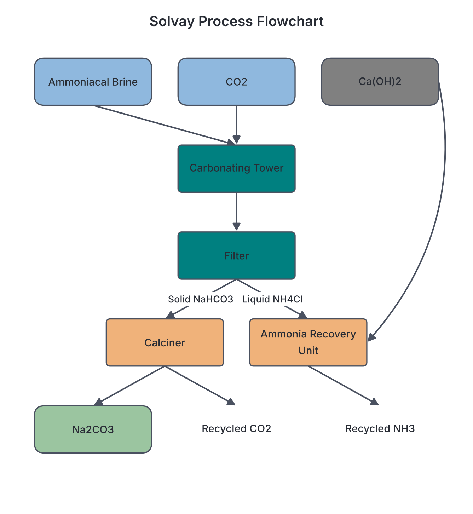

# JAMB Chemistry Notes: General Properties, Alkali, Alkaline-Earth Metals, Aluminium, and Tin

## What JAMB expects

This topic is Part A of Section A, Topic 15 of the JAMB Chemistry syllabus: Metals and their Compounds. It covers the general properties of metals and the detailed chemistry of representative metals from Groups 1, 2, 13, and 14.

This file covers the following content items:
- **(a) General properties of metals**
- **(b) Alkali metals e.g. sodium:** Sodium hydroxide; Sodium trioxocarbonate (IV) and sodium hydrogen trioxocarbonate (IV); Sodium chloride.
- **(c) Alkaline-earth metals, e.g. calcium:** Calcium oxide, calcium hydroxide, and calcium trioxocarbonate (IV); preparation of calcium oxide from sea shells; chemical composition of cement and setting of mortar; test for $\text{Ca}^{2+}$.
- **(d) Aluminium:** Purification of bauxite, electrolytic extraction, properties and uses; test for $\text{A1}^{3+}$.
- **(e) Tin:** Extraction from its ores, properties, and uses.

By the end of these notes, you should be able to:
1. Specify the general properties of metals.
2. Determine the method of extraction suitable for each metal.
3. Relate the methods of extraction to the properties for the metals.
4. Compare the chemical reactivities of the metals.
5. Specify the uses of the metals.
6. Determine specific test for metallic ions.
7. Determine the process for the production of the compounds of these metals.
8. Compare the chemical reactivities of the compounds.
9. Specify the uses of these compounds.
10. Specify the chemical composition of cement.
11. Describe the method of purification of bauxite.
12. Specify the ores of tin.
13. Relate the method of extraction to its properties.
14. Specify the uses of tin.

**Note on the syllabus wording:** In the JAMB syllabus, the ion symbol for aluminium is accidentally printed with the digit "1" as "$\text{A1}^{3+}$" instead of "$\text{Al}^{3+}$". These notes use the correct symbol ($\text{Al}^{3+}$) throughout. Also, Topic 15 is large, so it is split into two parts. The transition elements (iron, copper, alloys) are covered in `A15b-transition-metals-and-alloys.md`.

---

## General Properties of Metals

### Content a: General properties of metals
Metals make up the vast majority of the elements in the periodic table. They are found on the left and center of the periodic table and are bonded by a unique "sea" of mobile, delocalised electrons (metallic bonding). 

### Objective i: specify the general properties of metals
Metals share several characteristic physical and chemical properties.

**Physical properties:**
1. **State and appearance:** All metals are solid at room temperature except mercury (which is a liquid). Freshly cut metals are shiny, a property known as **metallic lustre**.
2. **Conductivity:** They are excellent conductors of **heat** and **electricity** because their delocalised electrons can move freely.
3. **Malleability and ductility:** Metals are **malleable** (they can be hammered or rolled into thin sheets like aluminium foil) and **ductile** (they can be drawn into wires).
4. **Melting and boiling points:** Most metals have high melting and boiling points due to strong metallic bonds, though Group 1 metals are an exception.
5. **Density:** Most metals are dense and heavy, though Group 1 metals like sodium are light enough to float on water.
6. **Sonorousness:** Metals produce a ringing sound when struck.

**Chemical properties:**
1. **Electropositivity:** Metals react by losing their valence electrons to form positive ions (cations).
   $$\text{M} \rightarrow \text{M}^{n+} + n\text{e}^-$$
2. **Formation of basic oxides:** Metals react with oxygen to form oxides that are usually basic. Some metal oxides (like those of aluminium, zinc, and lead) are **amphoteric** (they behave as both acids and bases).
3. **Displacement of hydrogen:** Metals positioned above hydrogen in the electrochemical series displace hydrogen gas from dilute acids.
4. **Reducing agents:** Because they readily give away electrons, metals act as strong reducing agents.

---

## Introduction to the Metals of Study

### Content b: Alkali metals e.g. sodium
Sodium ($\text{Na}$) is a highly reactive Group 1 metal. It is so soft that it can be cut with a knife. Because it reacts vigorously with moisture and oxygen in the air, it is always **stored under paraffin oil** or naphtha.

### Content c: Alkaline-earth metals, e.g. calcium
Calcium ($\text{Ca}$) is a reactive Group 2 metal. It is harder and denser than sodium but still reacts steadily with water and air, forming compounds widely found in the Earth's crust.

### Content d: Aluminium
Aluminium ($\text{Al}$) is a Group 13 metal and the most abundant metal in the Earth's crust. Despite being highly reactive, it resists corrosion because it immediately forms a tough, thin, transparent layer of aluminium oxide ($\text{Al}_2\text{O}_3$) when exposed to air. This self-protection is called **passivity**.

### Content e: Tin
Tin ($\text{Sn}$) is a moderately reactive Group 14 metal. It exhibits a unique physical property called allotropy: the normal shiny **white tin** slowly crumbles into a powdery, non-metallic **grey tin** at very cold temperatures (below 13.2 °C), a phenomenon historically called **tin pest** or tin disease.

---

## Extraction of Metals

### Objective ii: determine the method of extraction suitable for each metal
The method used to extract a metal depends entirely on its position in the reactivity (electrochemical) series. 
- **Electrolysis:** Highly reactive metals like Sodium ($\text{Na}$), Calcium ($\text{Ca}$), and Aluminium ($\text{Al}$) must be extracted by the electrolysis of their molten compounds.
- **Carbon reduction (Smelting):** Moderately reactive metals like Tin ($\text{Sn}$), Zinc ($\text{Zn}$), and Iron ($\text{Fe}$) are extracted by reducing their oxide ores with carbon (coke) or carbon (II) oxide.
- **Roasting/Native:** Low-reactivity metals like Copper ($\text{Cu}$) are extracted by roasting, and unreactive metals like Gold ($\text{Au}$) are found native (uncombined) in the ground.

### Objective iii: relate the methods of extraction to the properties for the metals
The choice of extraction method relates directly to the metal's electropositivity. 
Highly reactive metals (like sodium and aluminium) form incredibly stable compounds with very strong bonds. Chemical reducing agents like carbon are not powerful enough to break these bonds, so the immense energy of **electricity** (electrolysis) is required. Conversely, moderately reactive metals (like tin) form less stable oxides; the bonds can be broken cheaply using carbon in a furnace.

### Objective xii: specify the ores of tin
The principal ore of tin is **cassiterite**, also known as tinstone. Chemically, it is tin(IV) oxide ($\text{SnO}_2$). Historically, cassiterite was heavily mined on the Jos Plateau in Nigeria.

### Objective xiii: relate the method of extraction to its properties
Because tin sits in the middle of the reactivity series, it is moderately reactive. Therefore, its oxide ($\text{SnO}_2$) is not too stable to resist chemical reduction. It is extracted simply by mixing the concentrated cassiterite ore with coal (carbon) and limestone, and heating it strongly in a **reverberatory furnace**. The carbon reduces the oxide to molten tin metal.
$$\text{SnO}_{2\text{(s)}} + 2\text{C}_{\text{(s)}} \rightarrow \text{Sn}_{\text{(l)}} + 2\text{CO}_{\text{(g)}}$$
The limestone acts as a flux, combining with sandy impurities to form a liquid slag that floats on top of the molten tin.

---

## Reactivity and Uses of the Metals

### Objective iv: compare the chemical reactivities of the metals
We can observe the differing reactivities of these metals through their reactions with common substances:

| Metal | Reaction with Air (Oxygen) | Reaction with Cold Water | Reaction with Dilute Acids |
| :--- | :--- | :--- | :--- |
| **Sodium** | Very vigorous; burns to form a mixture of oxides/peroxides. | Explosive; darts around the surface forming $\text{NaOH}$ and $\text{H}_2$ gas. | Explosive (too dangerous to attempt). |
| **Calcium** | Burns with a brick-red flame to form white $\text{CaO}$. | Steady reaction; forms cloudy $\text{Ca(OH)}_2$ suspension and $\text{H}_2$ gas. | Vigorously forms the calcium salt and $\text{H}_2$ gas. |
| **Aluminium**| Slow at first (due to passivity); powdered aluminium burns brightly. | No reaction with cold water due to the protective oxide layer. | Reacts slowly at first, then vigorously with hot acid. Also reacts with strong alkalis (amphoteric). |
| **Tin** | Only reacts when heated strongly to form $\text{SnO}_2$. | No reaction. | Reacts very slowly with warm dilute acids. |

### Objective v: specify the uses of the metals
- **Sodium:** Used in sodium vapour lamps (street lights) emitting a yellow glow; liquid sodium is used as a coolant in nuclear reactors; it is also used to manufacture sodium peroxide.
- **Calcium:** Used to remove oxygen and sulfur in steelmaking; used in the extraction of other metals like uranium.
- **Aluminium:** Its low density and high strength when alloyed make it essential for aircraft bodies, car engines, and roofing sheets. It is also an excellent conductor, used for **overhead high-tension electrical cables**. In Nigeria, pots and pans are frequently cast from aluminium.

### Objective xiv: specify the uses of tin
Tin is non-toxic and highly resistant to corrosion. Its major use is in **tin-plating**—coating cheaper steel cans to prevent rust and protect preserved food. Tin is also a critical component in alloys such as **bronze** (copper and tin) and **soft solder** (tin and lead).

---

## Specific Tests for Metallic Ions

### Objective vi: determine specific test for metallic ions

**1. Flame Tests:**
When a volatile salt is heated in a non-luminous Bunsen burner flame, specific metal ions emit characteristic colours:
- **Sodium ($\text{Na}^+$):** Imparts a bright **golden-yellow** colour to the flame.
- **Calcium ($\text{Ca}^{2+}$):** Imparts a distinct **brick-red** colour.

**2. Precipitation Tests using aqueous Sodium Hydroxide ($\text{NaOH}$) and Ammonia ($\text{NH}_3$):**
- **Calcium ($\text{Ca}^{2+}$):** Adding a few drops of $\text{NaOH}$ yields a white precipitate of $\text{Ca(OH)}_2$. This precipitate is **insoluble** in excess $\text{NaOH}$. (Aqueous ammonia does not yield a precipitate with calcium ions).
- **Aluminium ($\text{Al}^{3+}$):** Adding a few drops of $\text{NaOH}$ yields a **white gelatinous precipitate** of $\text{Al(OH)}_3$. When **excess $\text{NaOH}$** is added, this precipitate **dissolves** to form a colourless solution of tetrahydroxoaluminate(III) ions, $\text{[Al(OH)}_4\text{]}^-$, because it is amphoteric. If aqueous ammonia is used instead, the white gelatinous precipitate forms but is **insoluble** in excess ammonia.

---

## Production of Compounds of these Metals

### Objective vii: determine the process for the production of the compounds of these metals

**1. Sodium hydroxide ($\text{NaOH}$)**
$\text{NaOH}$ (caustic soda) is produced industrially by the **electrolysis of brine** (concentrated sodium chloride solution) using a diaphragm cell or a flowing mercury cathode cell. 
- The brine contains $\text{Na}^+$, $\text{Cl}^-$, $\text{H}^+$, and $\text{OH}^-$.
- **At the anode:** Chloride ions are discharged as chlorine gas.
  $$2\text{Cl}^-_{\text{(aq)}} \rightarrow \text{Cl}_{2\text{(g)}} + 2\text{e}^-$$
- **At the cathode:** Hydrogen ions are discharged as hydrogen gas.
  $$2\text{H}^+_{\text{(aq)}} + 2\text{e}^- \rightarrow \text{H}_{2\text{(g)}}$$
- The remaining $\text{Na}^+$ and $\text{OH}^-$ ions form the sodium hydroxide solution.

**Worked Example 1: Faraday calculation for Brine Electrolysis**
**Question:** Calculate the mass of sodium hydroxide produced when $19,300 \text{ C}$ of electricity is passed through concentrated brine. ($\text{Na} = 23, \text{O} = 16, \text{H} = 1$; $1\text{F} = 96,500 \text{ C mol}^{-1}$)
1. Write the cathode half-equation: $2\text{H}_2\text{O(l)} + 2\text{e}^- \rightarrow \text{H}_{2\text{(g)}} + 2\text{OH}^-_{\text{(aq)}}$.
2. Deduce the mole ratio: $2 \text{ moles}$ of electrons ($2\text{F}$) produce $2 \text{ moles}$ of $\text{OH}^-$, meaning $1 \text{ mole}$ of electrons yields $1 \text{ mole}$ of $\text{OH}^-$. This pairs with $\text{Na}^+$ to yield $1 \text{ mole}$ of $\text{NaOH}$.
3. Calculate Faradays of charge passed: $Q / F = 19,300 \text{ C} / 96,500 \text{ C mol}^{-1} = 0.20 \text{ mol}$ of electrons.
4. Moles of $\text{NaOH}$ produced = $0.20 \text{ mol}$.
5. Calculate the molar mass of $\text{NaOH}$: $23 + 16 + 1 = 40 \text{ g mol}^{-1}$.
6. Convert moles to mass: $0.20 \text{ mol} \times 40 \text{ g mol}^{-1} = 8.0 \text{ g}$.
**Answer:** $8.0 \text{ g}$ of $\text{NaOH}$.

**2. Sodium trioxocarbonate(IV) ($\text{Na}_2\text{CO}_3$)**
It is produced industrially by the **Solvay Process**. The raw materials are brine ($\text{NaCl}$), limestone ($\text{CaCO}_3$), and ammonia ($\text{NH}_3$).
- Brine is saturated with ammonia to form ammoniacal brine.
- Carbon (IV) oxide (from heating limestone) is bubbled through it, precipitating slightly soluble **sodium hydrogen trioxocarbonate(IV)** ($\text{NaHCO}_3$).
  $$\text{NaCl}_{\text{(aq)}} + \text{NH}_3\text{(aq)} + \text{H}_2\text{O}_{\text{(l)}} + \text{CO}_{2\text{(g)}} \rightarrow \text{NaHCO}_{3\text{(s)}} + \text{NH}_4\text{Cl}_{\text{(aq)}}$$
- The $\text{NaHCO}_3$ is filtered and heated strongly to produce the final product, $\text{Na}_2\text{CO}_3$.
  $$2\text{NaHCO}_{3\text{(s)}} \rightarrow \text{Na}_2\text{CO}_{3\text{(s)}} + \text{H}_2\text{O}_{\text{(g)}} + \text{CO}_{2\text{(g)}}$$
*(Note: Potassium trioxocarbonate(IV) cannot be made this way because $\text{KHCO}_3$ is too soluble to precipitate out).*

**Worked Example 2: Solvay process stoichiometry**
**Question:** If $16.8 \text{ g}$ of sodium hydrogen trioxocarbonate(IV) is heated in the Solvay process, what mass of sodium trioxocarbonate(IV) is produced? ($\text{Na} = 23, \text{H} = 1, \text{C} = 12, \text{O} = 16$).
1. State the balanced equation: $2\text{NaHCO}_3 \rightarrow \text{Na}_2\text{CO}_3 + \text{H}_2\text{O} + \text{CO}_2$.
2. Calculate molar masses: $\text{NaHCO}_3 = 23+1+12+(3 \times 16) = 84 \text{ g mol}^{-1}$. $\text{Na}_2\text{CO}_3 = (2 \times 23)+12+(3 \times 16) = 106 \text{ g mol}^{-1}$.
3. Find moles of reactant heated: Moles = $16.8 \text{ g} / 84 \text{ g mol}^{-1} = 0.20 \text{ mol}$.
4. Use the mole ratio (2:1): Moles of $\text{Na}_2\text{CO}_3 = 0.20 \text{ mol} / 2 = 0.10 \text{ mol}$.
5. Convert moles to mass: Mass = $0.10 \text{ mol} \times 106 \text{ g mol}^{-1} = 10.6 \text{ g}$.
**Answer:** $10.6 \text{ g}$ of $\text{Na}_2\text{CO}_3$.

**3. Calcium oxide ($\text{CaO}$) and Calcium hydroxide ($\text{Ca(OH)}_2$)**
- **Calcium oxide (Quicklime):** Prepared by roasting limestone ($\text{CaCO}_3$). In Nigeria, **sea shells** (which are mostly $\text{CaCO}_3$) found along the coast are frequently collected, crushed, and heated to produce quicklime.
  $$\text{CaCO}_{3\text{(s)}} \rightarrow \text{CaO}_{\text{(s)}} + \text{CO}_{2\text{(g)}}$$
- **Calcium hydroxide (Slaked lime):** Prepared by adding a controlled amount of water to quicklime, a highly exothermic process called slaking.

**4. Sodium chloride ($\text{NaCl}$)**
Occurs abundantly dissolved in sea water. It is recovered by channeling sea water into shallow coastal pans where the sun's heat evaporates the water (**solar evaporation**), leaving behind solid salt crystals. In Nigeria, traditional salt recovery also occurs at inland salt lakes, such as the Uburu salt lakes in Ebonyi State.

**5. Aluminium Electrolytic Extraction (Hall-Héroult Process)**
Once purified, alumina ($\text{Al}_2\text{O}_3$) is dissolved in molten **cryolite** ($\text{Na}_3\text{AlF}_6$) to lower its melting point from over 2000 °C to about 900 °C. The mixture is electrolysed using graphite anodes and a graphite-lined steel tank as the cathode.
- **Cathode:** $\text{Al}^{3+}_{\text{(l)}} + 3\text{e}^- \rightarrow \text{Al}_{\text{(l)}}$. (Molten aluminium collects at the bottom).
- **Anode:** $2\text{O}^{2-}_{\text{(l)}} \rightarrow \text{O}_{2\text{(g)}} + 4\text{e}^-$. (The oxygen gas burns away the carbon anodes, so they must be replaced regularly). In Nigeria, the ALSCON plant in Ikot Abasi was established to perform this smelting.

**Worked Example 3: Faraday calculation for Aluminium extraction**
**Question:** What mass of aluminium is deposited when a current of $10.0 \text{ A}$ is passed through molten alumina for $16 \text{ minutes}$ and $5 \text{ seconds}$? ($\text{Al} = 27$, $1\text{F} = 96,500 \text{ C mol}^{-1}$)
1. Convert time to seconds: $t = (16 \times 60) \text{ s} + 5 \text{ s} = 965 \text{ s}$.
2. Calculate total charge: $Q = I \times t = 10.0 \text{ A} \times 965 \text{ s} = 9,650 \text{ C}$.
3. Write the cathode reduction equation: $\text{Al}^{3+} + 3\text{e}^- \rightarrow \text{Al}$.
4. Calculate Faradays passed: $9,650 \text{ C} / 96,500 \text{ C mol}^{-1} = 0.10 \text{ mol}$ of electrons.
5. Use the mole ratio: $3 \text{ moles}$ of electrons ($3\text{F}$) deposit $1 \text{ mole}$ of $\text{Al}$. Therefore, moles of $\text{Al} = 0.10 \text{ mol} / 3 = 0.0333 \text{ mol}$.
6. Convert moles to mass: $0.0333 \text{ mol} \times 27 \text{ g mol}^{-1} = 0.90 \text{ g}$.
**Answer:** $0.90 \text{ g}$ of aluminium.

### Objective xi: describe the method of purification of bauxite
Before extracting aluminium, its ore, **bauxite** ($\text{Al}_2\text{O}_3 \cdot 2\text{H}_2\text{O}$), must be purified by the **Bayer Process** to remove iron(III) oxide and silica impurities.
1. **Digestion:** Crushed bauxite is heated under pressure with concentrated **sodium hydroxide solution**. The amphoteric aluminium oxide dissolves to form sodium tetrahydroxoaluminate(III), while basic iron(III) oxide impurities do not dissolve and are filtered off as "red mud".
   $$\text{Al}_2\text{O}_3 \cdot 2\text{H}_2\text{O}_{\text{(s)}} + 2\text{NaOH}_{\text{(aq)}} + \text{H}_2\text{O}_{\text{(l)}} \rightarrow 2\text{NaAl(OH)}_{4\text{(aq)}}$$
2. **Precipitation:** The clear filtrate is cooled and "seeded" with pure aluminium hydroxide crystals, causing pure $\text{Al(OH)}_3$ to precipitate out.
3. **Calcination:** The precipitate is heated strongly to leave pure anhydrous alumina ($\text{Al}_2\text{O}_3$), ready for electrolysis.

---

## Reactivities and Uses of the Compounds

### Objective viii: compare the chemical reactivities of the compounds
**1. Action of Sodium Hydroxide on Metal Ions:**
$\text{NaOH}$ reacts with metal ions to precipitate insoluble metallic hydroxides. 
- Most are strongly basic (e.g., $\text{Ca(OH)}_2$) and will not dissolve in excess $\text{NaOH}$. 
- However, hydroxides of **Aluminium ($\text{Al}^{3+}$), Zinc ($\text{Zn}^{2+}$), and Lead ($\text{Pb}^{2+}$)** are **amphoteric**. They dissolve in excess $\text{NaOH}$ to form complex ions.
  $$\text{Al(OH)}_{3\text{(s)}} + \text{OH}^-_{\text{(aq)}} \rightarrow \text{[Al(OH)}_4\text{]}^-_{\text{(aq)}}$$

**2. Thermal Stability of Carbonates:**
- **Sodium trioxocarbonate(IV) ($\text{Na}_2\text{CO}_3$):** Highly stable to heat. It melts but does **not** decompose when heated.
- **Calcium trioxocarbonate(IV) ($\text{CaCO}_3$):** Less stable. It decomposes upon strong heating to yield calcium oxide and carbon (IV) oxide.
- **Aluminium carbonate:** Extremely unstable; it hydrolyses immediately in water and does not exist as a stable solid compound.

### Objective ix: specify the uses of these compounds
- **$\text{NaOH}$:** Used in the manufacture of soap (saponification), paper, rayon, and to precipitate metallic hydroxides in qualitative analysis.
- **$\text{Na}_2\text{CO}_3$:** Essential in the **manufacture of glass**, softening hard water, and the paper industry.
- **$\text{NaCl}$:** Economically vital as table salt for human diet, a food preservative, and the starting raw material for manufacturing chlorine, $\text{NaOH}$, and $\text{Na}_2\text{CO}_3$.
- **$\text{CaO}$:** Used in agriculture to neutralise acidic soil and as a drying agent for gases (like ammonia).
- **$\text{Ca(OH)}_2$:** Its aqueous solution (limewater) is used in the lab to test for $\text{CO}_2$.
- **$\text{CaCO}_3$:** Used extensively in the manufacture of cement, and historically extracted from limestone belts in Ewekoro, Nkalagu, and Obajana in Nigeria.

---

## Chemistry of Cement

### Objective x: specify the chemical composition of cement
**Portland cement** is manufactured by heavily roasting a finely ground mixture of limestone ($\text{CaCO}_3$) and clay (containing silica, alumina, and iron oxides) in a rotary kiln. 

**Chemical composition:**
The intense heat fuses the materials into lumps called clinker, which is then ground to a fine powder. The main chemical constituents of the cement powder are:
1. **Tricalcium silicate** ($3\text{CaO}\cdot\text{SiO}_2$)
2. **Dicalcium silicate** ($2\text{CaO}\cdot\text{SiO}_2$)
3. **Tricalcium aluminate** ($3\text{CaO}\cdot\text{Al}_2\text{O}_3$)

**Setting of mortar:**
Mortar is a paste made by mixing cement, sand, and water. When water is added, the complex silicates and aluminates undergo a series of **hydration reactions**. Instead of just "drying out", they form rigid, interlocking gel crystals that firmly bind the sand particles together. This chemical hardening process is what causes the mortar to set strongly over several days.

---

## Key terms

| Term | Meaning |
| :--- | :--- |
| **Passivity** | The unreactivity of a metal (like aluminium) due to the formation of a tough, thin, protective oxide layer on its surface. |
| **Amphoteric** | A substance (such as $\text{Al}_2\text{O}_3$ or $\text{Al(OH)}_3$) that can behave as both an acid and a base. |
| **Solvay process** | The industrial method for producing sodium trioxocarbonate(IV) using brine, ammonia, and limestone. |
| **Bayer process** | The industrial process used to purify bauxite into pure alumina by dissolving it in hot sodium hydroxide. |
| **Hall-Héroult process**| The electrolytic extraction of aluminium from alumina dissolved in molten cryolite. |
| **Cryolite** | A mineral ($\text{Na}_3\text{AlF}_6$) added to alumina to lower its melting point and improve electrical conductivity during electrolysis. |
| **Cassiterite** | The chief ore of tin, chemically tin(IV) oxide ($\text{SnO}_2$). |
| **Tin pest** | The phenomenon where metallic white tin turns into a powdery grey allotrope at cold temperatures. |
| **Portland cement** | A widely used building material chemically composed of calcium silicates and calcium aluminates. |

## Exam tips and common mistakes

- **Flame colours:** Do not mix up the flame tests. Sodium ($\text{Na}^+$) is **golden-yellow**, while calcium ($\text{Ca}^{2+}$) is **brick-red**.
- **Solvay process trap:** Questions often ask why potassium trioxocarbonate(IV) cannot be prepared by the Solvay process. The answer is that the intermediate compound, potassium hydrogen trioxocarbonate(IV) ($\text{KHCO}_3$), is **too soluble in water** and will not precipitate out.
- **Thermal stability of carbonates:** A very common mistake is believing that heating washing soda ($\text{Na}_2\text{CO}_3$) produces $\text{CO}_2$. It does **not**. Group 1 carbonates (except lithium) are thermally stable. Only carbonates of Group 2 (like $\text{CaCO}_3$) and lower metals decompose on heating.
- **Amphoteric hydroxides in qualitative analysis:** Memorise that $\text{Al}^{3+}$, $\text{Zn}^{2+}$, and $\text{Pb}^{2+}$ are the ions that dissolve in **excess sodium hydroxide**. If a white precipitate does not dissolve in excess $\text{NaOH}$, it is likely $\text{Ca}^{2+}$ or $\text{Mg}^{2+}$.
- **Aluminium reactivity:** Aluminium is high in the reactivity series, but its **oxide layer** protects it (passivity), making it falsely appear unreactive.

## Quick summary

1. Metals are generally electropositive, lustrous, malleable, and good conductors. Extraction depends on reactivity: high reactivity (Na, Ca, Al) requires electrolysis; medium reactivity (Sn, Zn, Fe) requires carbon reduction.
2. Sodium is highly reactive, stored under oil, and manufactured by electrolysing fused NaCl. Its compound $\text{NaOH}$ dissolves amphoteric hydroxides (Al, Zn, Pb).
3. The Solvay process manufactures $\text{Na}_2\text{CO}_3$ from brine, ammonia, and limestone. $\text{Na}_2\text{CO}_3$ is thermally stable and widely used in glass manufacturing.
4. Calcium compounds include quicklime ($\text{CaO}$), slaked lime ($\text{Ca(OH)}_2$), and limestone ($\text{CaCO}_3$). Portland cement is primarily composed of tricalcium silicate, dicalcium silicate, and tricalcium aluminate, which harden by hydration.
5. Aluminium is extracted from bauxite. Bauxite is purified using $\text{NaOH}$ (Bayer process), and the pure alumina is electrolysed in molten cryolite (Hall-Héroult process).
6. Cassiterite ($\text{SnO}_2$) is the main ore of tin. Tin is extracted by carbon reduction and used heavily in tin-plating and alloys.

## Practice questions

**1. Which of the following metals is extracted commercially by the electrolysis of its fused chloride?**
- A. Sodium
- B. Aluminium
- C. Tin
- D. Iron

**Answer: A.**
1. Sodium is highly reactive and is extracted by the electrolysis of its fused chloride ($\text{NaCl}$) in a Downs cell.
2. Aluminium is extracted from its fused oxide ($\text{Al}_2\text{O}_3$), not its chloride.
3. Tin and iron are moderately reactive and are extracted by reducing their oxides with carbon.
The mistake behind option B is confusing the extraction of aluminium (which uses an oxide) with sodium (which uses a chloride). Both use electrolysis, but the compounds differ.

**2. Potassium trioxocarbonate(IV) cannot be prepared by the Solvay process because**
- A. potassium chloride is insoluble in water.
- B. potassium hydrogen trioxocarbonate(IV) is soluble in water.
- C. potassium is more reactive than sodium.
- D. potassium trioxocarbonate(IV) decomposes on heating.

**Answer: B.**
1. The Solvay process relies on the intermediate compound precipitating out of solution.
2. For sodium, the intermediate sodium hydrogen trioxocarbonate(IV) ($\text{NaHCO}_3$) is only slightly soluble and precipitates.
3. For potassium, potassium hydrogen trioxocarbonate(IV) ($\text{KHCO}_3$) is highly soluble in water and does not precipitate.
The mistake behind option D is confusing the thermal stability of Group 1 carbonates; neither $\text{Na}_2\text{CO}_3$ nor $\text{K}_2\text{CO}_3$ decomposes on normal heating.

**3. In the Solvay process, heating $16.8 \text{ g}$ of sodium hydrogen trioxocarbonate(IV) produces sodium trioxocarbonate(IV). Calculate the mass of the sodium trioxocarbonate(IV) produced. ($\text{Na} = 23, \text{H} = 1, \text{C} = 12, \text{O} = 16$)**
- A. $5.3 \text{ g}$
- B. $10.6 \text{ g}$
- C. $21.2 \text{ g}$
- D. $42.4 \text{ g}$

**Answer: B.**
1. Write the balanced equation: $2\text{NaHCO}_3 \rightarrow \text{Na}_2\text{CO}_3 + \text{H}_2\text{O} + \text{CO}_2$.
2. Calculate molar masses: $\text{NaHCO}_3 = 23 + 1 + 12 + 48 = 84 \text{ g mol}^{-1}$. $\text{Na}_2\text{CO}_3 = 46 + 12 + 48 = 106 \text{ g mol}^{-1}$.
3. Find moles of reactant heated: Moles = $16.8 \text{ g} / 84 \text{ g mol}^{-1} = 0.20 \text{ mol}$.
4. Use the mole ratio: $2 \text{ moles}$ of $\text{NaHCO}_3$ yield $1 \text{ mole}$ of $\text{Na}_2\text{CO}_3$. Moles of $\text{Na}_2\text{CO}_3 = 0.20 \text{ mol} / 2 = 0.10 \text{ mol}$.
5. Convert to mass: Mass = $0.10 \text{ mol} \times 106 \text{ g mol}^{-1} = 10.6 \text{ g}$.
The mistake behind option C is ignoring the 2:1 mole ratio in the balanced chemical equation, falsely calculating $0.20 \text{ mol} \times 106 \text{ g mol}^{-1} = 21.2 \text{ g}$.

**4. When a few drops of aqueous sodium hydroxide are added to an unknown solution, a white gelatinous precipitate forms. When excess sodium hydroxide is added, the precipitate dissolves. The metallic ion present could be**
- A. $\text{Ca}^{2+}$
- B. $\text{Mg}^{2+}$
- C. $\text{Al}^{3+}$
- D. $\text{Fe}^{2+}$

**Answer: C.**
1. Aqueous sodium hydroxide ($\text{NaOH}$) precipitates metallic hydroxides.
2. $\text{Ca}^{2+}$ and $\text{Mg}^{2+}$ form white basic hydroxides that do not dissolve in excess alkali.
3. $\text{Al}^{3+}$ (along with $\text{Zn}^{2+}$ and $\text{Pb}^{2+}$) forms an amphoteric hydroxide ($\text{Al(OH)}_3$).
4. This amphoteric hydroxide reacts with excess $\text{NaOH}$ to form a soluble complex ion, $\text{[Al(OH)}_4\text{]}^-$, making the precipitate dissolve.
The mistake behind option A is assuming that all white precipitates dissolve in excess $\text{NaOH}$; however, calcium hydroxide is strictly basic and insoluble in excess $\text{NaOH}$.

**5. What mass of aluminium is deposited when $9,650 \text{ C}$ of electricity is passed through molten aluminium oxide? ($\text{Al} = 27$, $1\text{F} = 96,500 \text{ C mol}^{-1}$)**
- A. $0.3 \text{ g}$
- B. $0.9 \text{ g}$
- C. $2.7 \text{ g}$
- D. $8.1 \text{ g}$

**Answer: B.**
1. Write the cathode half-equation: $\text{Al}^{3+} + 3\text{e}^- \rightarrow \text{Al}$.
2. Calculate Faradays passed: $Q / F = 9,650 \text{ C} / 96,500 \text{ C mol}^{-1} = 0.10 \text{ F}$ (or $0.10 \text{ mol}$ of electrons).
3. Relate charge to moles of metal: $3 \text{ moles}$ of electrons ($3\text{F}$) are required to deposit $1 \text{ mole}$ ($27 \text{ g}$) of aluminium.
4. Calculate moles of aluminium: Moles = $0.10 \text{ mol} / 3 = 0.0333 \text{ mol}$.
5. Convert to mass: Mass = $0.0333 \text{ mol} \times 27 \text{ g mol}^{-1} = 0.90 \text{ g}$.
The mistake behind option C is forgetting the $+3$ charge on the aluminium ion and falsely assuming $1 \text{ mole}$ of electrons deposits $1 \text{ mole}$ of aluminium ($0.10 \text{ mol} \times 27 \text{ g mol}^{-1} = 2.7 \text{ g}$).

**6. Cassiterite is the principal ore of**
- A. aluminium
- B. copper
- C. iron
- D. tin

**Answer: D.**
1. Aluminium's primary ore is bauxite ($\text{Al}_2\text{O}_3 \cdot 2\text{H}_2\text{O}$).
2. Iron's primary ores are hematite and magnetite.
3. Copper's primary ore is copper pyrites.
4. Tin's primary ore is cassiterite, which is chemically tin(IV) oxide ($\text{SnO}_2$).
The mistake behind option A is confusing the major ores of reactive metals; bauxite is for aluminium, while cassiterite is specifically for tin.

**7. Electrolysis of concentrated brine produces sodium hydroxide. If $19,300 \text{ C}$ of electricity is passed through the brine, what mass of sodium hydroxide is produced? ($\text{Na} = 23, \text{O} = 16, \text{H} = 1$, $1\text{F} = 96,500 \text{ C mol}^{-1}$)**
- A. $4.0 \text{ g}$
- B. $8.0 \text{ g}$
- C. $16.0 \text{ g}$
- D. $40.0 \text{ g}$

**Answer: B.**
1. Write the cathode half-equation for brine: $2\text{H}_2\text{O(l)} + 2\text{e}^- \rightarrow \text{H}_{2\text{(g)}} + 2\text{OH}^-_{\text{(aq)}}$.
2. Note the mole ratio: $2 \text{ moles}$ of electrons ($2\text{F}$) produce $2 \text{ moles}$ of $\text{OH}^-$. Thus, $1 \text{ mole}$ of electrons produces $1 \text{ mole}$ of $\text{OH}^-$ (which forms $1 \text{ mole}$ of $\text{NaOH}$).
3. Calculate Faradays passed: $19,300 \text{ C} / 96,500 \text{ C mol}^{-1} = 0.20 \text{ mol}$ of electrons.
4. Moles of $\text{NaOH}$ produced: $0.20 \text{ mol}$.
5. Calculate molar mass of $\text{NaOH}$: $23 + 16 + 1 = 40 \text{ g mol}^{-1}$.
6. Convert to mass: $0.20 \text{ mol} \times 40 \text{ g mol}^{-1} = 8.0 \text{ g}$.
The mistake behind option A is incorrectly assuming that $2 \text{ moles}$ of electrons are required to produce just $1 \text{ mole}$ of $\text{NaOH}$, halving the correct amount ($0.10 \text{ mol} \times 40 \text{ g mol}^{-1} = 4.0 \text{ g}$).

**8. The chemical composition of Portland cement primarily includes**
- A. silicates and aluminates of calcium
- B. sodium trioxocarbonate(IV) and silica
- C. calcium sulphate and tin oxides
- D. aluminium oxide and cryolite

**Answer: A.**
1. Portland cement is manufactured by heating a mixture of limestone ($\text{CaCO}_3$) and clay.
2. The complex reactions in the kiln produce clinker.
3. The clinker primarily consists of tricalcium silicate ($3\text{CaO}\cdot\text{SiO}_2$), dicalcium silicate, and tricalcium aluminate ($3\text{CaO}\cdot\text{Al}_2\text{O}_3$).
The mistake behind option B is confusing the ingredients of glass making (which uses sodium carbonate and silica) with those of cement.

**9. Which of the following tests is used to confirm the presence of calcium ions in a salt?**
- A. Golden-yellow colour in a non-luminous flame
- B. Brick-red colour in a non-luminous flame
- C. Formation of a dark brown ring with iron(II) sulphate
- D. Formation of a white precipitate that dissolves in excess aqueous ammonia

**Answer: B.**
1. Flame tests are diagnostic for s-block metal ions.
2. Sodium ions ($\text{Na}^+$) impart a golden-yellow colour to a non-luminous flame.
3. Calcium ions ($\text{Ca}^{2+}$) impart a distinctive brick-red colour to the flame.
The mistake behind option A is attributing the flame colour of sodium (golden-yellow) to calcium.

**10. What happens when solid sodium trioxocarbonate(IV) is heated strongly?**
- A. It decomposes to give sodium oxide and carbon (IV) oxide.
- B. It decomposes to give sodium metal and oxygen gas.
- C. It melts but does not decompose.
- D. It sublimes directly into a gas.

**Answer: C.**
1. The thermal stability of metal carbonates increases with the reactivity of the metal.
2. Sodium is a highly reactive Group 1 alkali metal.
3. Its carbonate, sodium trioxocarbonate(IV) ($\text{Na}_2\text{CO}_3$), is highly stable to heat.
4. When heated strongly, it merely melts but does not undergo chemical decomposition.
The mistake behind option A is assuming that all carbonates decompose like calcium carbonate ($\text{CaCO}_3 \rightarrow \text{CaO} + \text{CO}_2$); however, Group 1 carbonates (except lithium) do not decompose on heating.
