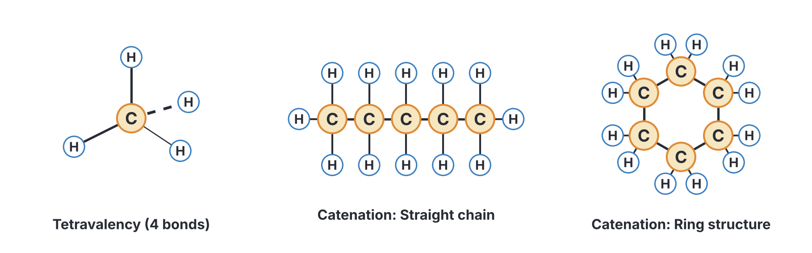
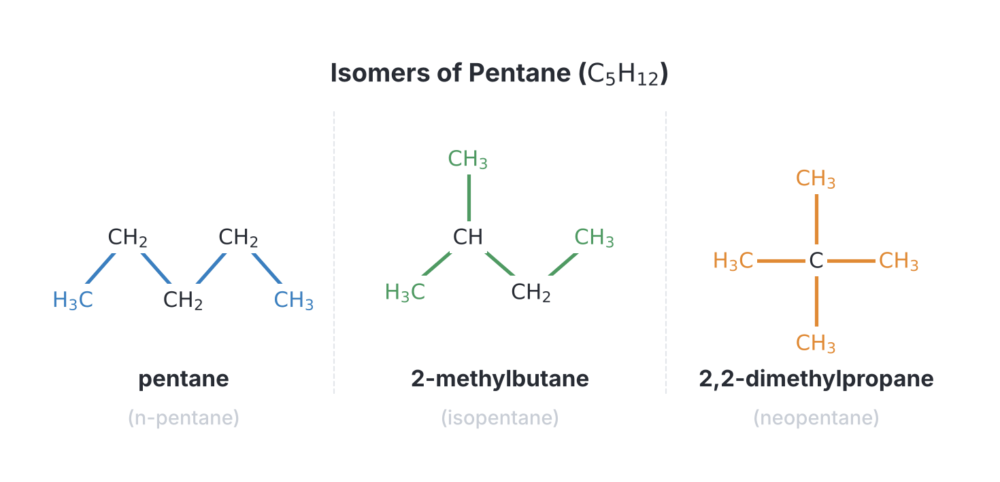
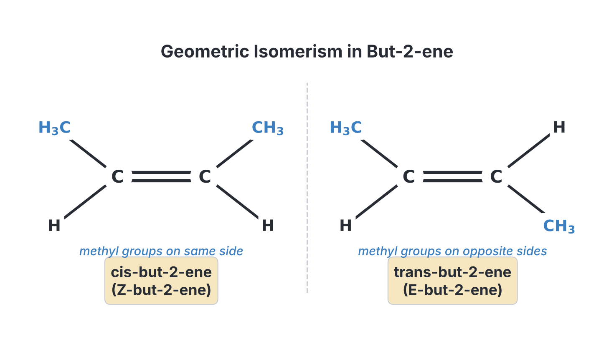
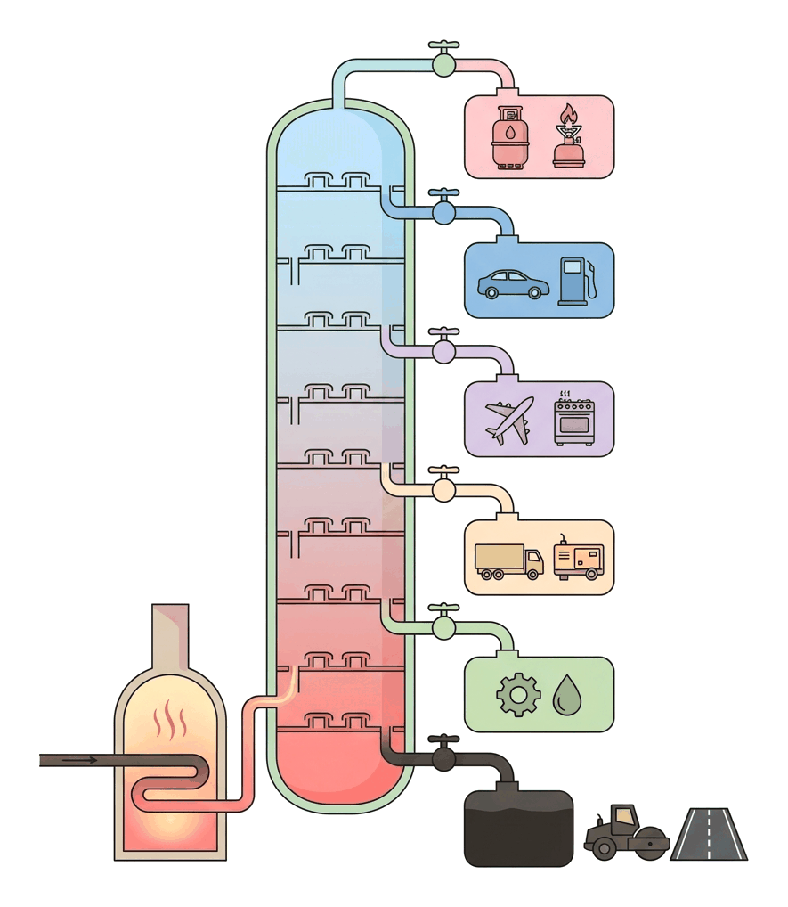
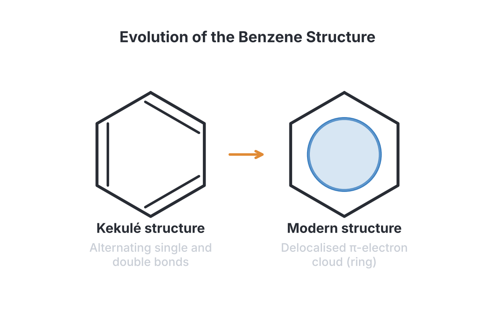

# JAMB Chemistry Notes: Introduction to Organic Chemistry and Hydrocarbons

## What JAMB expects

This topic is part of Section A, Topic 16 of the JAMB Chemistry syllabus: Organic Compounds. This file is Part 1 of the organic chemistry notes and covers the introduction to organic chemistry and the chemistry of hydrocarbons. 

It covers the following content items:
- **An introduction** to the tetravalency of carbon, the general formula, IUPAC nomenclature and the determination of empirical formula.
- **(a) Aliphatic hydrocarbons**: Alkanes (homologous series, isomerism, petroleum, cracking, reforming), Alkenes (isomerism, addition, polymerization, vulcanization), and Alkynes (ethyne production and properties).
- **(b) Aromatic hydrocarbons**: e.g., benzene - structure, properties and uses.

By the end of these notes, you should be able to:
1. derive the name of organic compounds from their general formulae;
2. relate the name of a compound to its structure;
3. relate the tetravalency of carbon to its ability to form chains of compound (catenation);
4. classify compounds according to their functional groups;
5. derive empirical formula and molecular formula from given data;
6. relate structure/functional groups to specific properties;
7. derive various isomeric forms from a given formula;
8. distinguish between the different types of isomerism;
9. classify the various types of hydrocarbons;
10. distinguish each class of hydrocarbons by their properties;
11. specify the uses of various hydrocarbons;
12. identify crude oil as a complex mixture of hydrocarbons;
13. relate the fractions of hydrocarbons to their properties and uses;
14. relate transformation processes to quality improvement of the fractions;
15. distinguish between various polymerization processes;
16. specify the process involved in vulcanization;
17. specify chemical test for alkenes;
18. specify chemical test for terminal alkynes;
19. distinguish between aliphatic and aromatic hydrocarbons;
20. relate the properties of benzene to its structure.

**Note on the syllabus wording:** The syllabus asks you to distinguish between "addition and condensation polymerization" in objective (xv), but condensation polymerization is fully covered under Macromolecules in a later file. Here, we focus on addition polymerization of alkenes as requested by content item (a)(ii).

**Split topic:** Topic 16 is vast. This file (Part 1) covers Introduction and Hydrocarbons. Functional groups like alkanols, alkanals, and alkanoic acids are covered in `A16b-alkanols-alkanals-and-acids.md`, and macromolecules like carbohydrates, proteins, and condensation polymers are in `A16c-carbohydrates-proteins-polymers.md`.

## Introduction to Organic Chemistry

**Organic chemistry** is the branch of chemistry that studies carbon compounds, with the exception of simple inorganic carbon compounds like carbon(IV) oxide ($\text{CO}_2$), carbonates, and carbides.

### The tetravalency of carbon and catenation

**Objective iii: relate the tetravalency of carbon to its ability to form chains of compound (catenation).**

Carbon is unique among elements because it can form millions of different compounds. This ability is due to two main properties:

1. **Tetravalency:** Carbon belongs to Group 14 (Group IV) of the periodic table and has four valence electrons. It needs four more electrons to achieve a stable octet. Thus, it forms exactly **four covalent bonds** (tetra = four, valency = combining power) with other atoms like hydrogen, oxygen, nitrogen, or halogens.
2. **Catenation:** This is the unique ability of carbon atoms to bond **directly to one another** to form long, stable straight chains, branched chains, or rings. Because the carbon-carbon ($\text{C-C}$) bond is very strong, these chains can be endlessly varied without breaking apart. 

### Functional groups and homologous series

**Objective iv: classify compounds according to their functional groups.**

A **functional group** is an atom, a group of atoms, or a specific bond inside an organic molecule that determines its chemical properties. Molecules with the same functional group undergo similar chemical reactions.

A **homologous series** is a family of organic compounds that follow a regular structural pattern. Each series:
- Has the same general formula.
- Features the same functional group.
- Differs from the next consecutive member by a $-\text{CH}_2-$ group (a mass of $14\text{ g mol}^{-1}$).
- Shows similar chemical properties.
- Shows a gradual change in physical properties (e.g., boiling point increases as the carbon chain gets longer).

Common functional groups include:
- **Alkenes:** Double bond ($\text{C=C}$)
- **Alkynes:** Triple bond ($\text{C}\equiv\text{C}$)
- **Alkanols (Alcohols):** Hydroxyl group ($-\text{OH}$)
- **Alkanoic acids (Carboxylic acids):** Carboxyl group ($-\text{COOH}$)

### Deriving names from general formulae

**Objective i: derive the name of organic compounds from their general formulae.**

Every homologous series has a mathematical formula that applies to all its members. By knowing the number of carbon atoms ($n$), you can find the molecular formula and derive the name.

The IUPAC name of an unbranched organic compound has two parts:
1. **Root word (Prefix):** Tells you the number of carbon atoms (1 = meth, 2 = eth, 3 = prop, 4 = but, 5 = pent, 6 = hex, 7 = hept, 8 = oct).
2. **Suffix:** Tells you the homologous series (e.g., -ane for alkanes, -ene for alkenes, -yne for alkynes).

**Steps to derive a name:**
1. Identify the formula and determine $n$ (the number of carbon atoms).
2. Use the general formula to identify the homologous series.
3. Combine the root word for $n$ with the suffix for the series.

**Example:** A compound has the formula $\text{C}_3\text{H}_4$. Derive its name.
- It fits the general formula $\text{C}_n\text{H}_{2n-2}$ where $n = 3$.
- The prefix for 3 carbons is **prop-**.
- The formula $\text{C}_n\text{H}_{2n-2}$ belongs to the alkynes, so the suffix is **-yne**.
- The name is **propyne**.

### Relating compound names to their structures

**Objective ii: relate the name of a compound to its structure.**

The International Union of Pure and Applied Chemistry (IUPAC) provides rules to name any structure systematically. 

**Steps for IUPAC Nomenclature:**
1. **Find the longest continuous carbon chain** that contains the functional group (if any). This gives the parent root name (e.g., 4 carbons = butane).
2. **Number the chain** starting from the end closest to the functional group or branching substituent so that they get the lowest possible number.
3. **Identify the substituents** (e.g., $-\text{CH}_3$ is methyl, $-\text{Cl}$ is chloro, $-\text{Br}$ is bromo).
4. **Combine the parts** into a single name: put the substituent positions and names first, followed by the parent name. If there are multiple identical substituents, use prefixes like di-, tri-, or tetra-.

**Example:** What is the structure of **2-methylbutane**?
- "Butane" means the main chain has 4 carbon atoms with all single bonds: $\text{C-C-C-C}$.
- "2-methyl" means there is a $-\text{CH}_3$ group on the second carbon atom.
- Add hydrogen atoms to ensure every carbon has exactly 4 bonds.
- Structure: $\text{CH}_3\text{-CH(CH}_3\text{)-CH}_2\text{-CH}_3$.

**Textbook variation:** Older textbooks might write "2-butene" while modern IUPAC rules prefer "but-2-ene". JAMB accepts both, but expects you to recognise that the number indicates the position of the double bond.

### Determining empirical and molecular formulae

**Objective v: derive empirical formula and molecular formula from given data.**

The **empirical formula** is the simplest whole-number ratio of atoms in a molecule. 
The **molecular formula** gives the actual number of atoms of each element in the molecule. It is a multiple of the empirical formula: $\text{Molecular Formula} = (\text{Empirical Formula})_n$.

**Worked Example 1: Finding an empirical and molecular formula**
A hydrocarbon contains $85.7\%$ carbon and $14.3\%$ hydrogen by mass. Its molar mass is $42\text{ g mol}^{-1}$. Determine its empirical and molecular formulae. ($\text{C}=12$, $\text{H}=1$)
1. **Assume a $100\text{ g}$ sample** so the percentages become masses: carbon is $85.7\text{ g}$, hydrogen is $14.3\text{ g}$.
2. **Find the number of moles of each element** by dividing the mass by the relative atomic mass:
   Moles of C = $85.7\text{ g} / 12\text{ g mol}^{-1} = 7.14\text{ mol}$
   Moles of H = $14.3\text{ g} / 1\text{ g mol}^{-1} = 14.3\text{ mol}$
3. **Find the simplest molar ratio** by dividing both mole values by the smallest one ($7.14\text{ mol}$):
   Ratio of C = $7.14\text{ mol} / 7.14\text{ mol} = 1$
   Ratio of H = $14.3\text{ mol} / 7.14\text{ mol} = 2$
4. **Write the empirical formula** using the whole number ratio: $\text{CH}_2$.
5. **Calculate the mass of the empirical unit**:
   Mass of $\text{CH}_2 = 12 + (2 \times 1) = 14\text{ g mol}^{-1}$.
6. **Find the molecular formula** by dividing the molar mass by the empirical unit mass:
   $n = 42\text{ g mol}^{-1} / 14\text{ g mol}^{-1} = 3$.
   Multiply the empirical formula by $3$: The molecular formula is $\text{C}_3\text{H}_6$.

**Worked Example 2: Handling decimal ratios (The 0.5 trap)**
A gaseous hydrocarbon has a vapour density of $29$. It contains $82.76\%$ carbon and $17.24\%$ hydrogen by mass. Find its molecular formula.
1. **Find the number of moles:**
   Moles of C = $82.76\text{ g} / 12\text{ g mol}^{-1} = 6.90\text{ mol}$
   Moles of H = $17.24\text{ g} / 1\text{ g mol}^{-1} = 17.24\text{ mol}$
2. **Divide by the smallest mole value:**
   Ratio of C = $6.90\text{ mol} / 6.90\text{ mol} = 1$
   Ratio of H = $17.24\text{ mol} / 6.90\text{ mol} = 2.5$
3. **Clear the decimal (Never round 2.5 to 3):** Multiply the entire ratio by $2$ to get whole numbers.
   C = $1 \times 2 = 2$
   H = $2.5 \times 2 = 5$
   The empirical formula is $\text{C}_2\text{H}_5$.
4. **Find the molecular formula:**
   Molar mass = $2 \times \text{Vapour Density} = 2 \times 29 = 58\text{ g mol}^{-1}$.
   Mass of $\text{C}_2\text{H}_5 = (2 \times 12) + (5 \times 1) = 29\text{ g mol}^{-1}$.
   $n = 58\text{ g mol}^{-1} / 29\text{ g mol}^{-1} = 2$.
   Multiply the empirical formula by $2$: $\text{C}_4\text{H}_{10}$ (butane).

**Worked Example 3: Finding empirical formula with three elements**
Find the empirical formula of an organic compound containing $40.0\%$ carbon, $6.7\%$ hydrogen, and $53.3\%$ oxygen by mass. ($\text{C}=12$, $\text{H}=1$, $\text{O}=16$).
1. **Find the number of moles:**
   Moles of C = $40.0\text{ g} / 12\text{ g mol}^{-1} = 3.33\text{ mol}$
   Moles of H = $6.7\text{ g} / 1\text{ g mol}^{-1} = 6.7\text{ mol}$
   Moles of O = $53.3\text{ g} / 16\text{ g mol}^{-1} = 3.33\text{ mol}$
2. **Divide by the smallest mole value ($3.33\text{ mol}$):**
   Ratio of C = $3.33\text{ mol} / 3.33\text{ mol} = 1$
   Ratio of H = $6.7\text{ mol} / 3.33\text{ mol} = 2$
   Ratio of O = $3.33\text{ mol} / 3.33\text{ mol} = 1$
3. **Write the empirical formula:**
   The ratio is $1:2:1$, so the empirical formula is $\text{CH}_2\text{O}$.

### Relating structure and functional groups to properties

**Objective vi: relate structure/functional groups to specific properties.**

The type of bonding (structure) and the functional group dictate how a compound behaves physically and chemically.
- Compounds with **only single bonds** (alkanes) are generally unreactive and undergo substitution slowly.
- Compounds with **double or triple bonds** (alkenes, alkynes) are "unsaturated" and highly reactive; they readily undergo addition reactions to "open up" the extra bonds.
- The length of the carbon chain affects physical properties: as the chain gets longer, the molecule gets heavier, so boiling points increase and the state changes from gas (e.g., methane) to liquid (e.g., octane) to solid (e.g., paraffin wax).

## Isomerism

### Deriving isomeric forms

**Objective vii: derive various isomeric forms from a given formula.**

**Isomerism** is the occurrence of two or more organic compounds with the same molecular formula but different chemical structures. The compounds are called **isomers**. Because they are arranged differently, they often have different physical properties (like boiling points) and slightly different chemical properties.

**Isomers of Alkanes (up to 6 carbon atoms):**
- **Methane ($\text{CH}_4$), Ethane ($\text{C}_2\text{H}_6$), Propane ($\text{C}_3\text{H}_8$):** These have only one possible arrangement. They have NO isomers.
- **Butane ($\text{C}_4\text{H}_{10}$):** Has **2** isomers.
  1. butane (straight chain)
  2. 2-methylpropane (branched chain)
- **Pentane ($\text{C}_5\text{H}_{12}$):** Has **3** isomers.
  1. pentane (straight chain)
  2. 2-methylbutane (one branch)
  3. 2,2-dimethylpropane (two branches)
- **Hexane ($\text{C}_6\text{H}_{14}$):** Has **5** isomers.
  1. hexane
  2. 2-methylpentane
  3. 3-methylpentane
  4. 2,2-dimethylbutane
  5. 2,3-dimethylbutane

### Distinguishing types of isomerism

**Objective viii: distinguish between the different types of isomerism.**

1. **Structural Isomerism:** The atoms are connected in completely different orders. 
   - *Chain isomerism:* The carbon skeleton varies (e.g., straight chain vs branched chain, like butane and 2-methylpropane).
   - *Position isomerism:* The functional group is in a different position (e.g., but-1-ene vs but-2-ene).
   - *Functional group isomerism:* Compounds with the same formula belong to entirely different homologous series (e.g., ethanol, an alcohol, and methoxymethane, an ether, both share $\text{C}_2\text{H}_6\text{O}$).

2. **Geometric (cis-trans) Isomerism:** This occurs in **alkenes**. Because the carbon-carbon double bond ($\text{C=C}$) is rigid, the groups attached to it cannot freely rotate. If the two carbon atoms of the double bond each carry two different groups, geometric isomers exist.
   - **Cis-isomer:** The identical heavy groups are on the **same side** of the double bond.
   - **Trans-isomer:** The identical heavy groups are on **opposite sides** (diagonally across) the double bond.
   - Example: cis-but-2-ene and trans-but-2-ene.

## Hydrocarbons

### Classifying various types of hydrocarbons

**Objective ix: classify the various types of hydrocarbons.**

Hydrocarbons are compounds containing **only** carbon and hydrogen. They are broadly classified into:
1. **Aliphatic Hydrocarbons:** The carbon atoms are joined in straight or branched chains, or non-aromatic rings. They include:
   - Alkanes (single bonds)
   - Alkenes (double bonds)
   - Alkynes (triple bonds)
2. **Aromatic Hydrocarbons:** They contain a highly stable, flat ring of carbon atoms with delocalised electrons (e.g., benzene ring).

### Distinguishing aliphatic and aromatic hydrocarbons

**Objective xix: distinguish between aliphatic and aromatic hydrocarbons.**

| Feature | Aliphatic Hydrocarbons | Aromatic Hydrocarbons (e.g., Benzene) |
| --- | --- | --- |
| **Structure** | Open chains or simple cyclic rings | Contain a stable benzene ring |
| **Carbon-to-Hydrogen ratio** | Usually high proportion of hydrogen (e.g., $\text{C}_6\text{H}_{14}$) | High proportion of carbon (low hydrogen, e.g., $\text{C}_6\text{H}_6$) |
| **Combustion** | Burn with a relatively clean, non-sooty flame (unless heavily branched or long chain) | Burn with a very smoky, **sooty luminous flame** due to high carbon content |
| **Reaction type** | Alkenes undergo **addition** readily | Resist addition; undergo **substitution** reactions to preserve ring stability |

## Aliphatic hydrocarbons

### Properties of the classes of hydrocarbons

**Objective x: distinguish each class of hydrocarbons by their properties.**

| Property | Alkanes | Alkenes | Alkynes |
| --- | --- | --- | --- |
| **General Formula** | $\text{C}_n\text{H}_{2n+2}$ | $\text{C}_n\text{H}_{2n}$ | $\text{C}_n\text{H}_{2n-2}$ |
| **Bonding** | Saturated (only $\text{C-C}$ single bonds) | Unsaturated (one $\text{C=C}$ double bond) | Highly unsaturated (one $\text{C}\equiv\text{C}$ triple bond) |
| **Reactivity** | Unreactive under normal conditions | Highly reactive | Very highly reactive |
| **Main Reaction Type** | **Substitution** (needs UV light) | **Addition** | **Addition** |
| **Flame on burning** | Clean, blue flame (low carbon) | Luminous, slightly smoky flame | Very smoky, luminous flame |

#### Alkanes and their substitution reactions
Alkanes are chemically stable. Their most characteristic reaction is **substitution**, where a halogen replaces hydrogen atoms one by one, triggered by ultraviolet (UV) light.
For methane and chlorine:
1. $\text{CH}_4\text{(g)} + \text{Cl}_2\text{(g)} \xrightarrow{\text{uv light}} \text{CH}_3\text{Cl(g)} + \text{HCl(g)}$ (chloromethane)
2. $\text{CH}_3\text{Cl(g)} + \text{Cl}_2\text{(g)} \xrightarrow{\text{uv light}} \text{CH}_2\text{Cl}_2\text{(l)} + \text{HCl(g)}$ (dichloromethane)
3. $\text{CH}_2\text{Cl}_2\text{(l)} + \text{Cl}_2\text{(g)} \xrightarrow{\text{uv light}} \text{CHCl}_3\text{(l)} + \text{HCl(g)}$ (trichloromethane or chloroform)
4. $\text{CHCl}_3\text{(l)} + \text{Cl}_2\text{(g)} \xrightarrow{\text{uv light}} \text{CCl}_4\text{(l)} + \text{HCl(g)}$ (tetrachloromethane)

#### Alkenes and addition reactions
Because alkenes have a double bond, one part of the bond easily breaks, allowing two new atoms to attach.
Example: Adding bromine to ethene:
$\text{C}_2\text{H}_4\text{(g)} + \text{Br}_2\text{(l)} \rightarrow \text{C}_2\text{H}_4\text{Br}_2\text{(l)}$ (1,2-dibromoethane)
This happens instantly in the dark, changing the reddish-brown bromine to a colourless liquid.

#### Alkynes: Production and properties
**Ethyne (acetylene)** is the simplest alkyne ($\text{C}_2\text{H}_2$). In Nigeria, panel beaters and welders generate it locally by dripping water onto solid calcium carbide.
**Equation:** $\text{CaC}_2\text{(s)} + 2\text{H}_2\text{O(l)} \rightarrow \text{Ca(OH)}_2\text{(aq)} + \text{C}_2\text{H}_2\text{(g)}$
Ethyne undergoes addition reactions (like alkenes, but requires two molecules of the reactant to fully saturate it).

### Uses of various hydrocarbons

**Objective xi: specify the uses of various hydrocarbons.**

- **Alkanes:** 
  - Methane is the main component of natural gas, used for domestic cooking and power generation.
  - Butane is used in camping gas and cigarette lighters.
  - Halogenated alkanes have specific uses: **trichloromethane (chloroform)** was used as an anaesthetic and is a solvent; **tetrachloromethane** is a powerful solvent for dry cleaning; **chlorofluorocarbons (CFCs)** were used as refrigerants and aerosol propellants but are phased out due to ozone layer destruction.
- **Alkenes:** 
  - Ethene is used to artificially ripen fruits.
  - Large quantities of ethene and propene are used to manufacture plastics (polythene, polypropene).
- **Alkynes:** 
  - Ethyne is mixed with oxygen in the **oxy-ethyne (oxy-acetylene) flame**, which burns extremely hot (up to $3000\text{ }^\circ\text{C}$) and is used for cutting and welding metals.

### Polymerization processes

**Objective xv: distinguish between various polymerization processes.**

**Polymerization** is the process where thousands of small molecules (**monomers**) join together to form a very large, giant molecule (**polymer**).

**Addition Polymerization:**
This occurs when unsaturated monomers (alkenes) join together by opening their double bonds without losing any atoms. 
- **Polythene (Polyethylene):** Formed when thousands of ethene ($\text{C}_2\text{H}_4$) molecules link up. Used for plastic bags and buckets.
- **Synthetic rubber:** Formed by the addition polymerization of dienes (molecules with two double bonds). For example, 2-chlorobut-1,3-diene (chloroprene) polymerizes to form Neoprene, a synthetic rubber resistant to oil and heat.

*(Note: Condensation polymerization, where a small molecule like water is eliminated during the joining process, is covered in the macromolecules topic).*

### The vulcanization of rubber

**Objective xvi: specify the process involved in vulcanization.**

Natural rubber (from rubber trees) is soft, sticky when hot, and brittle when cold. To make it useful for car tyres and shoe soles, it must be toughened.
**Vulcanization** is the process of heating natural rubber with **sulphur**. 
- The sulphur atoms form chemical "cross-links" between the long rubber polymer chains.
- This prevents the chains from slipping past each other.
- Vulcanized rubber is harder, stronger, more durable, and retains its elasticity over a wide temperature range. In Nigeria, local tyre repairers (vulcanizers) use heat and rubber patches to fix punctures based on this principle.

### Chemical tests for alkenes

**Objective xvii: specify chemical test for alkenes.**

Alkenes are unsaturated and readily undergo addition. Two common tests can distinguish an alkene from an alkane:
1. **Bromine Water Test:** When reddish-brown bromine water is shaken with an alkene, it turns **colourless** immediately. (An alkane produces no change in the dark).
2. **Baeyer's Reagent Test:** When an alkene is bubbled through potassium tetraoxomanganate(VII) ($\text{KMnO}_4$) solution, the **purple colour turns colourless** if the solution is acidified. (Textbooks differ on the name: strictly, *Baeyer's reagent* is cold, dilute, **alkaline** $\text{KMnO}_4$, in which the purple turns green and then forms a brown precipitate of $\text{MnO}_2$. Many Nigerian textbooks use the acidified form, so know both results.)

### Chemical tests for terminal alkynes

**Objective xviii: specify chemical test for terminal alkynes.**

A **terminal alkyne** has the triple bond at the very end of the carbon chain (e.g., propyne, $\text{CH}_3\text{-C}\equiv\text{CH}$). The hydrogen atom attached directly to the triple-bonded carbon is slightly acidic. Because of this, terminal alkynes react with heavy metal salts, which alkenes and internal alkynes (like but-2-yne) cannot do.

1. **Ammoniacal Copper(I) chloride ($\text{Cu}_2\text{Cl}_2$):** Bubbling a terminal alkyne through this solution produces a **reddish-brown precipitate** of copper(I) acetylide.
2. **Ammoniacal Silver nitrate ($\text{AgNO}_3$):** Bubbling a terminal alkyne through this produces a **whitish-yellow precipitate** (or white precipitate) of silver acetylide.

## Petroleum (Crude oil)

### Petroleum as a complex mixture

**Objective xii: identify crude oil as a complex mixture of hydrocarbons.**

Petroleum (crude oil) is a dark, sticky liquid found deep underground, famously abundant in Nigeria's Niger Delta. It is a **complex mixture of hundreds of different hydrocarbons**, mostly alkanes. Because it is a mixture, crude oil does not have a specific chemical formula or a single boiling point. To be useful, it must be separated.

### Fractional distillation of petroleum

**Objective xiii: relate the fractions of hydrocarbons to their properties and uses.**

Crude oil is separated into simpler mixtures called **fractions** by **fractional distillation**. This process works because different hydrocarbons have different boiling points depending on the length of their carbon chains. 

**Step-by-step process:**
1. Crude oil is heated in a furnace to about $400\text{ }^\circ\text{C}$ until most of it turns into vapour.
2. The vapour enters the bottom of a tall **fractionating column**.
3. The column is very hot at the bottom and gradually cooler at the top.
4. As the vapours rise, they cool down. When a hydrocarbon reaches a height where the temperature is equal to its boiling point, it condenses back into a liquid.
5. Heavier fractions (long chains, high boiling points) condense at the hot bottom. Lighter fractions (short chains, low boiling points) travel to the cooler top before condensing.

| Fraction | Carbon atoms | Boiling point | Common Uses |
| --- | --- | --- | --- |
| **Petroleum gases** | $\text{C}_1 - \text{C}_4$ | Below $20\text{ }^\circ\text{C}$ | Bottled gas for cooking (LPG), petrochemicals |
| **Petrol (Gasoline)** | $\text{C}_5 - \text{C}_{10}$ | $40 - 200\text{ }^\circ\text{C}$ | Fuel for cars and light vehicles |
| **Kerosene (Paraffin)** | $\text{C}_{11} - \text{C}_{15}$ | $200 - 250\text{ }^\circ\text{C}$ | Fuel for jet aircraft (aviation fuel), local kerosene stoves and lanterns |
| **Diesel oil (Gas oil)** | $\text{C}_{16} - \text{C}_{20}$ | $250 - 350\text{ }^\circ\text{C}$ | Fuel for lorries, trains, and generators |
| **Lubricating oil** | $\text{C}_{20} - \text{C}_{30}$ | $350 - 500\text{ }^\circ\text{C}$ | Engine oil, grease, lubricants to reduce friction |
| **Bitumen (Asphalt)** | Above $\text{C}_{30}$ | Above $500\text{ }^\circ\text{C}$ (Residue) | Paving roads, waterproofing roofs |

### Quality improvement of petrol fractions

**Objective xiv: relate transformation processes to quality improvement of the fractions.**

The demand for petrol is far higher than the amount produced directly from fractional distillation. Refineries use transformation processes to make more petrol and to improve its quality.

1. **Cracking:** The process of breaking down large, heavy, less useful hydrocarbons (like diesel or lubricating oil) into smaller, more valuable molecules (like petrol and ethene) using high heat (**thermal cracking**) or a catalyst (**catalytic cracking**).
   - Example: $\text{C}_{16}\text{H}_{34} \rightarrow \text{C}_8\text{H}_{18} \text{ (octane, petrol)} + \text{C}_8\text{H}_{16} \text{ (octene)}$
   - **Petrochemicals:** Cracking produces alkenes like ethene, which are starting materials (petrochemicals) for synthesizing plastics, detergents, and drugs.
2. **Reforming:** Rearranging the structure of straight-chain alkanes into branched-chain, cyclic, or aromatic hydrocarbons using heat and a platinum catalyst, **without changing the number of carbon atoms**. Branched alkanes burn much more smoothly in engines.
3. **Octane Number:** A measure of the quality of petrol and its ability to resist "knocking" (explosive, irregular burning in the engine). 
   - **0:** Assigned to heptane (a straight chain, causes terrible knocking).
   - **100:** Assigned to 2,2,4-trimethylpentane (iso-octane) (highly branched, burns very smoothly).
   - A high octane number means the fuel is of very high quality.

## Aromatic hydrocarbons

### Relating the properties of benzene to its structure

**Objective xx: relate the properties of benzene to its structure.**

**Benzene** ($\text{C}_6\text{H}_6$) is the simplest aromatic hydrocarbon.
- **Structure:** It is a flat (planar), six-membered ring of carbon atoms. Originally, it was drawn as alternating single and double bonds (the Kekulé structure). However, the true structure is a **resonance hybrid**. The electrons from the expected double bonds are **delocalised**, meaning they form a continuous electron cloud moving freely above and below the entire ring.
- **Properties:** Because of the delocalised electron cloud, the benzene ring is exceptionally stable (resonance stability). Even though it appears highly unsaturated, **it does not readily undergo addition reactions** like alkenes (it does not decolourise bromine water on its own). Instead, it typically undergoes **electrophilic substitution reactions**, where a hydrogen atom is replaced without breaking the stable ring.
  - Example: It reacts with chlorine to form chlorobenzene, but only if a catalyst like iron(III) chloride ($\text{FeCl}_3$) is present.
- **Uses:** Benzene is a valuable solvent and a vital starting material (feedstock) for making dyes, explosives (like TNT), plastics, and pharmaceuticals.

## Key terms

| Term | Meaning |
| --- | --- |
| Catenation | The ability of carbon atoms to covalently bond to one another to form long chains or rings. |
| Homologous series | A family of organic compounds with the same general formula, similar chemical properties, and successive members differing by $-\text{CH}_2-$. |
| Isomerism | The existence of two or more compounds with the same molecular formula but different structural arrangements. |
| Empirical formula | The simplest whole-number ratio of atoms of elements in a compound. |
| Cracking | Breaking down long-chain hydrocarbons into smaller, more valuable molecules using heat or catalysts. |
| Reforming | Rearranging the carbon skeleton of straight-chain alkanes to branched or cyclic structures to improve petrol quality. |
| Octane number | A scale indicating the anti-knock quality of petrol; higher numbers mean smoother burning. |
| Vulcanization | Heating natural rubber with sulphur to form cross-links, making it harder and more elastic. |
| Aromatic hydrocarbon | A stable, ring-shaped hydrocarbon with delocalised electrons, such as benzene. |

## Exam tips and common mistakes

- **The 0.5 trap in empirical formulas:** If your mole ratio ends in $0.5$ (like $1 : 2.5$), **never round it to 3**. Always multiply the entire ratio by $2$ to get whole numbers ($2 : 5$).
- **Bromine water vs Ammoniacal $\text{AgNO}_3$:** Bromine water tests for **unsaturation** (both alkenes and alkynes will decolourise it). Ammoniacal silver nitrate or copper(I) chloride specifically tests for **terminal alkynes** only. Benzene does not react with either under normal conditions.
- **Cracking vs Fractional Distillation:** Do not confuse them. Fractional distillation is a physical separation based on boiling points. Cracking is a chemical reaction that breaks molecules apart.
- **Addition vs Substitution:** Alkenes and alkynes undergo addition reactions because they have space to "open" their double/triple bonds. Alkanes and benzene undergo substitution because their bonds are already full or highly stabilised.
- **Isomer limits:** Remember the number of isomers for the alkanes: Butane has 2, Pentane has 3, Hexane has 5. This is a common quick-recall JAMB question.

## Quick summary

1. Carbon is unique due to its tetravalency (forming 4 covalent bonds) and catenation (forming long chains).
2. Organic compounds are grouped into homologous series sharing a general formula and functional group.
3. The empirical formula is the simplest ratio of atoms, while the molecular formula shows the true number. 
4. Isomerism occurs when compounds share the same formula but have different structures. Structural isomerism involves different atom connectivity; geometric (cis-trans) isomerism occurs in alkenes due to the rigid double bond.
5. Alkanes ($\text{C}_n\text{H}_{2n+2}$) are saturated and undergo substitution. Alkenes ($\text{C}_n\text{H}_{2n}$) and alkynes ($\text{C}_n\text{H}_{2n-2}$) are unsaturated and undergo addition reactions.
6. Petroleum is a mixture of hydrocarbons separated by fractional distillation; its heavy fractions are "cracked" into petrol, and "reformed" to increase the octane number.
7. Addition polymerization links unsaturated monomers like ethene into polymers like polythene. Rubber is strengthened by vulcanization (adding sulphur).
8. Benzene ($\text{C}_6\text{H}_6$) is an aromatic hydrocarbon that prefers substitution over addition due to the stability of its delocalised electron ring.

## Practice questions

**1. What is the empirical formula mass of a hydrocarbon containing 92.3% carbon and 7.7% hydrogen by mass? (C = 12, H = 1)**

- A. $13\text{ g mol}^{-1}$
- B. $26\text{ g mol}^{-1}$
- C. $39\text{ g mol}^{-1}$
- D. $78\text{ g mol}^{-1}$

**Answer: A.** 
1. Moles of C = $92.3\text{ g} / 12\text{ g mol}^{-1} = 7.69\text{ mol}$.
2. Moles of H = $7.7\text{ g} / 1\text{ g mol}^{-1} = 7.70\text{ mol}$.
3. Divide by the smallest value ($7.69\text{ mol}$): Ratio of C = $1$, Ratio of H $\approx 1$.
4. The empirical formula is $\text{CH}$.
5. The empirical formula mass = $12\text{ g mol}^{-1} + 1\text{ g mol}^{-1} = 13\text{ g mol}^{-1}$.
Mistake B occurs if you assume the molecular mass of ethyne ($\text{C}_2\text{H}_2$) instead of calculating the simplest empirical formula mass.

**2. A gaseous hydrocarbon has a vapour density of 29. It contains 82.76% carbon and 17.24% hydrogen by mass. What is its molecular formula? (C = 12, H = 1)**

- A. $\text{C}_2\text{H}_5$
- B. $\text{C}_4\text{H}_{10}$
- C. $\text{C}_3\text{H}_8$
- D. $\text{C}_5\text{H}_{12}$

**Answer: B.** 
1. Moles C = $82.76 / 12 = 6.90\text{ mol}$.
2. Moles H = $17.24 / 1 = 17.24\text{ mol}$.
3. Ratio: C = $6.90 / 6.90 = 1$, H = $17.24 / 6.90 = 2.5$.
4. Multiply by 2: Empirical formula = $\text{C}_2\text{H}_5$ (mass = $29\text{ g mol}^{-1}$).
5. Molar mass = $2 \times \text{vapour density} = 2 \times 29 = 58\text{ g mol}^{-1}$.
6. $(\text{C}_2\text{H}_5)_n = 58 \Rightarrow 29n = 58 \Rightarrow n = 2$.
7. Molecular formula = $\text{C}_4\text{H}_{10}$. 
Mistake A occurs if you stop at the empirical formula ($\text{C}_2\text{H}_5$) without using the vapour density to find the actual molecular formula.

**3. What is the molar mass of the alkane that, when 0.20 mol is combusted completely, produces 17.6 g of carbon(IV) oxide? (C = 12, O = 16, H = 1)**

- A. $16\text{ g mol}^{-1}$
- B. $30\text{ g mol}^{-1}$
- C. $44\text{ g mol}^{-1}$
- D. $58\text{ g mol}^{-1}$

**Answer: B.**
1. Find moles of $\text{CO}_2$: Molar mass of $\text{CO}_2 = 12 + (2 \times 16) = 44\text{ g mol}^{-1}$.
2. Moles of $\text{CO}_2 = 17.6\text{ g} / 44\text{ g mol}^{-1} = 0.40\text{ mol}$.
3. Determine moles of $\text{CO}_2$ per mole of alkane: $0.40\text{ mol} / 0.20\text{ mol} = 2$.
4. Since $1\text{ mol}$ of alkane produces $2\text{ mol}$ of $\text{CO}_2$, the alkane has 2 carbon atoms ($n = 2$).
5. The alkane is ethane ($\text{C}_2\text{H}_6$).
6. Calculate its molar mass: $(2 \times 12) + (6 \times 1) = 30\text{ g mol}^{-1}$.
Mistake C is the molar mass of carbon(IV) oxide, not the alkane.

**4. How many structural isomers does pentane ($\text{C}_5\text{H}_{12}$) have?**

- A. 2
- B. 3
- C. 4
- D. 5

**Answer: B.**
1. The formula $\text{C}_5\text{H}_{12}$ is an alkane.
2. Isomer 1 is the straight chain: pentane.
3. Isomer 2 has a 4-carbon chain with a methyl branch: 2-methylbutane.
4. Isomer 3 has a 3-carbon chain with two methyl branches: 2,2-dimethylpropane.
5. Total number of isomers = 3.
Mistake D is a common error because students confuse pentane ($\text{C}_5\text{H}_{12}$) with hexane ($\text{C}_6\text{H}_{14}$), which has exactly 5 isomers.

**5. Which of the following reagents is used to distinguish a terminal alkyne like propyne from an alkene?**

- A. Acidified potassium tetraoxomanganate(VII)
- B. Bromine water
- C. Ammoniacal copper(I) chloride
- D. Sodium hydroxide

**Answer: C.**
1. Propyne ($\text{C}_3\text{H}_4$) is a terminal alkyne and has a slightly acidic hydrogen atom.
2. It reacts with ammoniacal copper(I) chloride to form a reddish-brown precipitate of copper(I) acetylide.
3. Alkenes like propene ($\text{C}_3\text{H}_6$) do not have acidic hydrogens and will not react.
Mistake B is the most tempting wrong option because bromine water tests for unsaturation, but both alkenes and alkynes will decolourise it, so it cannot distinguish between them.

**6. The process of converting straight-chain alkanes into branched-chain alkanes to improve the anti-knock quality of petrol without changing the number of carbon atoms is known as:**

- A. cracking
- B. reforming
- C. fractional distillation
- D. vulcanization

**Answer: B.**
1. Reforming uses heat and a catalyst to rearrange a straight-chain molecule into a branched or cyclic structure.
2. The total number of carbon atoms remains unchanged.
3. This structural change greatly improves the octane number of the fuel.
Mistake A is tempting, but cracking involves breaking large molecules into smaller molecules, rather than just reshaping them while keeping the carbon count the same.

**7. Benzene ($\text{C}_6\text{H}_6$) differs from aliphatic alkenes because it:**

- A. has no double bonds at all in its history
- B. readily undergoes addition reactions
- C. prefers substitution reactions due to a stable ring of delocalised electrons
- D. does not contain carbon-hydrogen bonds

**Answer: C.**
1. Benzene has the formula $\text{C}_6\text{H}_6$, indicating a high degree of unsaturation.
2. However, the electrons are completely delocalised around the planar ring, creating a resonance hybrid.
3. This delocalisation provides extraordinary stability (resonance energy).
4. To maintain this stable ring, benzene undergoes substitution (replacing an $\text{H}$ atom) rather than addition.
Mistake B is the exact opposite of the truth; a student might choose it by assuming that because benzene is highly unsaturated, it must easily undergo addition just like an aliphatic alkene.

**8. Which of the following fractions of petroleum is primarily used as fuel for jet engines?**

- A. Petrol (Gasoline)
- B. Kerosene (Paraffin)
- C. Diesel oil
- D. Bitumen

**Answer: B.**
1. Crude oil is separated by fractional distillation based on boiling points.
2. The kerosene fraction boils between $200 - 250\text{ }^\circ\text{C}$.
3. It is highly refined to produce aviation fuel (Jet A-1) for jet aircraft.
Mistake A is a common error where students assume that jet engines use petrol; however, petrol is too volatile and is used instead for light vehicles and cars.

**9. A hydrocarbon follows the general formula $\text{C}_n\text{H}_{2n}$. If it contains 4 carbon atoms, it belongs to the homologous series of:**

- A. alkanes
- B. alkenes
- C. alkynes
- D. alkanols

**Answer: B.**
1. The formula $\text{C}_n\text{H}_{2n}$ indicates a molecule with twice as many hydrogen atoms as carbon atoms.
2. For $n = 4$, the formula is $\text{C}_4\text{H}_8$.
3. This is the general formula for the homologous series of alkenes.
4. Alkanes follow $\text{C}_n\text{H}_{2n+2}$ and alkynes follow $\text{C}_n\text{H}_{2n-2}$.
Mistake A occurs if a student confuses the general formulas and thinks $\text{C}_n\text{H}_{2n}$ is for alkanes, which would instead require the formula $\text{C}_4\text{H}_{10}$.

**10. The characteristic reaction of alkanes with halogens in the presence of ultraviolet light is:**

- A. addition
- B. substitution
- C. polymerization
- D. neutralization

**Answer: B.**
1. Alkanes (e.g., $\text{CH}_4$) are fully saturated with single covalent bonds.
2. They do not have "extra" bonds to open up, so they cannot undergo addition.
3. In the presence of ultraviolet (UV) light, a halogen atom (like $\text{Cl}$) can replace a hydrogen atom.
4. This reaction is called substitution, e.g., $\text{CH}_4 + \text{Cl}_2 \rightarrow \text{CH}_3\text{Cl} + \text{HCl}$.
Mistake A is typical for students who confuse alkanes with alkenes; alkenes are unsaturated and readily undergo addition reactions, while alkanes undergo substitution.
