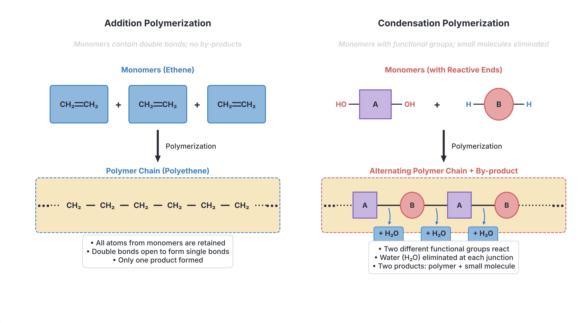

# JAMB Chemistry Notes: Carbohydrates, Proteins, and Polymers

## What JAMB expects

This topic is Part 3 of Section A, Topic 16 of the JAMB Chemistry syllabus: Organic Compounds. It covers natural macromolecules (carbohydrates and proteins) and polymers (plastics and rubbers). For the notes on hydrocarbons and other functional groups, see `A16a-hydrocarbons.md` and `A16b-alkanols-alkanals-and-acids.md`.

It covers the following content items:
- **h. Carbohydrates:** Classification, composition, tests, hydrolysis, and uses.
- **i. Proteins:** Primary structures, hydrolysis, tests, and enzymes.
- **j. Polymers:** Natural and synthetic rubber, addition and condensation polymerization, and plastics.

By the end of these notes, you should be able to:
1. (xxxii) identify the natural sources of carbohydrates;
2. (xxxiii) compare the various classes of carbohydrates;
3. (xxxiv) infer the products of hydrolysis and dehydration of carbohydrates;
4. (xxxv) determine the uses of carbohydrates;
5. (xxxvi) specify the tests for simple sugars;
6. (xxxvii) identify the basic structure of proteins;
7. (xxxviii) specify the methods and products of hydrolysis (of proteins);
8. (xxxix) specify the various tests for proteins;
9. (xl) distinguish between natural and synthetic polymers;
10. (xli) differentiate between addition and condensation polymerization processes;
11. (xlii) classify natural and commercial polymers and their uses;
12. (xliii) distinguish between thermoplastics and thermosetting plastics.

## Carbohydrates

### Carbohydrate Characteristics
**Content h: Carbohydrates (Composition and classification)**

Carbohydrates are a major class of naturally occurring organic compounds. Their composition is strictly limited to three elements: **carbon ($\text{C}$), hydrogen ($\text{H}$), and oxygen ($\text{O}$)**. 
In most carbohydrates, the ratio of hydrogen atoms to oxygen atoms is $2:1$, which is the exact same ratio found in water ($\text{H}_2\text{O}$). Because of this, early chemists thought of them as "hydrates of carbon", giving them the general empirical formula $\text{C}_x(\text{H}_2\text{O})_y$.

### Natural Sources of Carbohydrates
**Objective xxxii: identify the natural sources of carbohydrates**

Carbohydrates are widely distributed in nature. They are primarily synthesized by green plants during the process of **photosynthesis**, where carbon(IV) oxide and water are converted into glucose and then stored as more complex sugars.
- **Starch:** Found abundantly in staple Nigerian crops such as cassava, yam, maize, guinea corn, rice, and plantain.
- **Cellulose:** The main structural material of plant cell walls. Cotton is almost pure cellulose; wood is another major source.
- **Sucrose (Cane sugar):** Extracted heavily from sugarcane and sugar beet.
- **Glucose and Fructose:** Naturally present in sweet, ripe fruits, freshly tapped palm wine, and honey.

### Comparing the Classes of Carbohydrates
**Objective xxxiii: compare the various classes of carbohydrates**

Carbohydrates are classified into three main groups based on their molecular size and their ability to be broken down by hydrolysis.

| Feature | Monosaccharides (Simple sugars) | Disaccharides (Complex sugars) | Polysaccharides (Giant molecules) |
| --- | --- | --- | --- |
| **Meaning** | Single sugar units; they cannot be hydrolyzed into simpler carbohydrates | Formed by the condensation of two monosaccharide units | Formed by joining hundreds or thousands of monosaccharide units |
| **General Formula** | $\text{C}_6\text{H}_{12}\text{O}_6$ | $\text{C}_{12}\text{H}_{22}\text{O}_{11}$ | $(\text{C}_6\text{H}_{10}\text{O}_5)_n$ (where $n$ is very large) |
| **Physical Properties** | Very sweet, crystalline solids, highly soluble in water | Sweet, crystalline solids, soluble in water | Tasteless, non-crystalline (amorphous) solids, insoluble in water |
| **Reducing Ability** | All are strong reducing agents | Some are reducing (maltose, lactose); some are non-reducing (sucrose) | Non-reducing agents |
| **Examples** | Glucose (grape sugar), Fructose (fruit sugar), Galactose | Sucrose (cane sugar), Maltose (malt sugar), Lactose (milk sugar) | Starch, Cellulose, Glycogen (animal starch) |

### Tests for Simple Sugars
**Objective xxxvi: specify the tests for simple sugars**

Simple sugars like glucose and fructose are **reducing sugars**. They contain free aldehyde or ketone functional groups that can reduce copper(II) ions ($\text{Cu}^{2+}$) to copper(I) oxide ($\text{Cu}_2\text{O}$) in an alkaline medium. Note that **sucrose is a non-reducing sugar** and will fail these tests unless it is first hydrolyzed into simple sugars by heating with an acid.

1. **Fehling's Test:**
   - **Procedure:** A few drops of Fehling's solution (a deep blue alkaline solution containing $\text{Cu}^{2+}$ complex ions) are added to a solution of the sugar and heated in a boiling water bath.
   - **Observation:** The blue solution changes to green, then yellow, and finally yields a **brick-red precipitate** of copper(I) oxide ($\text{Cu}_2\text{O}$).
2. **Benedict's Test:**
   - **Procedure:** Benedict's reagent is added to the sugar solution and heated. It works on the exact same chemical principle as Fehling's but uses a more stable citrate complex.
   - **Observation:** A **brick-red precipitate** confirms the presence of a reducing sugar.

### Products of Hydrolysis and Dehydration of Carbohydrates
**Objective xxxiv: infer the products of hydrolysis and dehydration of carbohydrates**

**1. Dehydration (Action of concentrated $\text{H}_2\text{SO}_4$)**
Concentrated tetraoxosulphate(VI) acid ($\text{H}_2\text{SO}_4$) is a powerful dehydrating agent. When it reacts with a carbohydrate, it completely removes the elements of water (hydrogen and oxygen in a $2:1$ ratio), leaving behind a black, spongy mass of elemental carbon known as **sugar charcoal**.
$$\text{C}_{12}\text{H}_{22}\text{O}_{11(s)} \xrightarrow{\text{conc. H}_2\text{SO}_4} 12\text{C}_{(s)} + 11\text{H}_2\text{O}_{(g)}$$
This is a violent, highly exothermic reaction. The steam produced makes the black carbon mass expand rapidly.

**Worked Example 1: Calculating the mass of sugar charcoal produced from sucrose**
A student treats $34.2 \text{ g}$ of sucrose with concentrated tetraoxosulphate(VI) acid. Calculate the mass of carbon formed. (C = 12, H = 1, O = 16).

1. **Write the balanced equation:** $\text{C}_{12}\text{H}_{22}\text{O}_{11} \rightarrow 12\text{C} + 11\text{H}_2\text{O}$
2. **Calculate the molar mass of sucrose:** $(12 \times 12) + (22 \times 1) + (11 \times 16) = 144 + 22 + 176 = 342 \text{ g mol}^{-1}$.
3. **Find the moles of sucrose:** $\text{Moles} = \frac{\text{Mass}}{\text{Molar Mass}} = \frac{34.2 \text{ g}}{342 \text{ g mol}^{-1}} = 0.1 \text{ mol}$.
4. **Use the mole ratio:** The equation shows $1 \text{ mol}$ of sucrose yields $12 \text{ mol}$ of carbon. Therefore, $0.1 \text{ mol}$ of sucrose yields $0.1 \times 12 = 1.2 \text{ mol}$ of carbon.
5. **Calculate the mass of carbon:** $\text{Mass} = \text{Moles} \times \text{Molar Mass} = 1.2 \text{ mol} \times 12 \text{ g mol}^{-1} = 14.4 \text{ g}$.

**2. Hydrolysis of complex sugars**
Hydrolysis is the breakdown of large molecules by reaction with water. For carbohydrates, this is achieved by boiling with **dilute mineral acids** (like dilute $\text{HCl}$) or using biological catalysts (**enzymes**).
- **Sucrose:** Hydrolyzes into one molecule of glucose and one molecule of fructose.
  $$\text{C}_{12}\text{H}_{22}\text{O}_{11(aq)} + \text{H}_2\text{O}_{(l)} \xrightarrow{\text{dil. acid or invertase}} \text{C}_6\text{H}_{12}\text{O}_{6(aq)} \text{ (glucose)} + \text{C}_6\text{H}_{12}\text{O}_{6(aq)} \text{ (fructose)}$$
- **Maltose:** Hydrolyzes into two molecules of glucose.
- **Starch (from cassava or grains):** When treated with dilute acids or amylase, the giant starch chain breaks down. Partial hydrolysis yields maltose; complete hydrolysis yields **glucose**.
- **Cellulose (from cotton):** Though chemically resistant, prolonged boiling with concentrated acids eventually hydrolyzes it completely into **glucose**.

**Worked Example 2: Calculating the mass of glucose from maltose hydrolysis**
What mass of glucose is produced by the complete hydrolysis of $17.1 \text{ g}$ of maltose? (C = 12, H = 1, O = 16).

1. **Write the balanced equation:** $\text{C}_{12}\text{H}_{22}\text{O}_{11} + \text{H}_2\text{O} \rightarrow 2\text{C}_6\text{H}_{12}\text{O}_6$
2. **Calculate the molar mass of maltose:** $(12 \times 12) + (22 \times 1) + (11 \times 16) = 342 \text{ g mol}^{-1}$.
3. **Find the moles of maltose:** $\text{Moles} = \frac{17.1 \text{ g}}{342 \text{ g mol}^{-1}} = 0.05 \text{ mol}$.
4. **Use the mole ratio:** The equation shows $1 \text{ mol}$ of maltose yields $2 \text{ mol}$ of glucose. Therefore, $0.05 \text{ mol}$ maltose yields $0.05 \times 2 = 0.1 \text{ mol}$ of glucose.
5. **Calculate the mass of glucose:** The molar mass of glucose ($\text{C}_6\text{H}_{12}\text{O}_6$) is $(6 \times 12) + (12 \times 1) + (6 \times 16) = 180 \text{ g mol}^{-1}$. Mass of glucose = $0.1 \text{ mol} \times 180 \text{ g mol}^{-1} = 18.0 \text{ g}$.

### Uses of Carbohydrates
**Objective xxxv: determine the uses of carbohydrates**

- **Food and Energy:** They are the primary and most immediate source of energy for the human body, supplying fuel for respiration.
- **Alcoholic Beverages:** Starch from grains or cassava is hydrolyzed into glucose, which is then fermented by yeast into **ethanol** ($\text{C}_2\text{H}_5\text{OH}$) and carbon(IV) oxide ($\text{CO}_2$). This is the basis of brewing beer, tapping palm wine, and distilling local gin (ogogoro).
- **Pharmaceuticals:** Sucrose is used as a sweetening agent in medicinal syrups to mask bitter active ingredients. Starch is widely used as a binder and filler (excipient) in the pressing of pharmaceutical tablets.
- **Textiles and Paper:** Cellulose from cotton is the major raw material for making cotton clothing and synthetic silk (rayon). Cellulose extracted from wood pulp is the raw material for paper manufacturing.

## Proteins

### Protein Properties and Enzymes
**Content i: Enzymes and their functions**

**Enzymes** are organic catalysts produced by living cells, and they are almost entirely made of **proteins**. They speed up specific biochemical reactions without being consumed.
- **Key properties:** They are highly specific (a "lock and key" mechanism), easily denatured (destroyed) by high heat (usually above $40~^\circ\text{C}$), and highly sensitive to changes in pH.
- **Functions in digestion:** Amylase breaks down starch; proteases (like pepsin) break down proteins; lipases break down fats.
- **Functions in industry:** The enzyme **zymase** (found in yeast) catalyzes the breakdown of glucose into ethanol and $\text{CO}_2$ during fermentation. **Invertase** converts sucrose into glucose and fructose.

### Basic Structure of Proteins
**Objective xxxvii: identify the basic structure of proteins**

Proteins are large natural macromolecules (polymers) made up of smaller repeating units called **amino acids** (the monomers). 
An amino acid is a molecule containing two functional groups:
- An **amino group** ($-\text{NH}_2$), which is basic.
- A **carboxyl group** ($-\text{COOH}$), which is acidic.

**Primary Structure:**
Amino acids link together through **condensation polymerization**. The carboxyl group of one amino acid reacts with the amino group of another, eliminating a small molecule of water ($\text{H}_2\text{O}$). The resulting chemical link is an **amide linkage** ($-\text{CO}-\text{NH}-$), known in biology and biochemistry as a **peptide bond**. The primary structure of a protein is simply the specific linear sequence of amino acids connected by these peptide bonds.

[IMAGE: Chemical diagram showing the formation of a dipeptide. On the left, two simple amino acids are drawn side-by-side. A dashed box encloses the OH group from the -COOH of the first amino acid and one H atom from the -NH2 group of the second amino acid, representing water removal. An arrow points to the right, showing the two molecules joined by a new -CO-NH- bond, labelled "Peptide bond (amide linkage)", with a "+ H2O" byproduct. Clean flat textbook illustration, white background.]

### Methods and Products of Protein Hydrolysis
**Objective xxxviii: specify the methods and products of hydrolysis**

The peptide bonds holding a protein together can be broken by adding water across them (hydrolysis), reversing the condensation process.
- **Methods of hydrolysis:** Proteins can be hydrolyzed chemically by boiling them for several hours with **dilute mineral acids** (e.g., dilute $\text{HCl}$), by boiling with **alkalis**, or biologically using **proteolytic enzymes** (proteases, such as pepsin or trypsin operating at body temperature).
- **Products:** The complete hydrolysis of any protein yields a complex mixture of its component **amino acids**.

### Chemical Tests for Proteins
**Objective xxxix: specify the various tests for proteins**

To detect the presence of proteins in a food sample or solution, the following standard chemical tests are specified by JAMB:

1. **Biuret Test (for peptide bonds):**
   - **Method:** Add dilute sodium hydroxide ($\text{NaOH}$) solution to the sample, then add a few drops of 1% copper(II) tetraoxosulphate(VI) ($\text{CuSO}_4$) solution.
   - **Observation:** A **violet or purple** colour develops, confirming the presence of $-\text{CO}-\text{NH}-$ linkages.
2. **Millon’s Test (for tyrosine/phenolic groups):**
   - **Method:** Add a few drops of Millon's reagent (a solution of mercury compounds in nitric acid) to the sample and heat gently.
   - **Observation:** A **white precipitate** forms, which turns **brick-red** on heating.
3. **Xanthoproteic Test (for aromatic amino acids):**
   - **Method:** Add concentrated trioxonitrate(V) acid ($\text{HNO}_3$) to the sample and warm carefully.
   - **Observation:** A **yellow precipitate or colour** appears, which turns intensely **orange** when cooled and treated with an alkali (like ammonia solution).
4. **Ninhydrin Test (general test for free amino acids):**
   - **Method:** Boil the sample with a few drops of ninhydrin solution.
   - **Observation:** A **purple or deep blue** colour appears.

## Polymers

### Polymer Types and Rubbers
**Content j: Natural and synthetic rubber, Methods of preparation, examples**

- **Natural Rubber:** Extracted as a milky white liquid (latex) from the bark of the rubber tree (*Hevea brasiliensis*), commonly cultivated in Edo and Delta states in Nigeria. It is a natural addition polymer. Its repeating monomer is **isoprene**, systematically named **2-methyl-1,3-butadiene** ($\text{C}_5\text{H}_8$).
- **Synthetic Rubber:** Prepared in chemical plants by the addition polymerization of petroleum-derived monomers. Examples include **neoprene** (made from chloroprene) and **SBR** (Styrene-Butadiene Rubber). Synthetic rubbers are generally more resistant to heat, oil, and harsh chemicals than natural rubber.
- **Vulcanization:** Pure natural rubber is too soft and sticky when hot, and brittle when cold, making it useless for tyres. To fix this, it undergoes **vulcanization**, a process where it is heated with **sulphur** ($\text{S}_8$). The sulphur atoms form strong covalent cross-links between the long polyisoprene chains. This stops the chains from sliding past each other, making the vulcanized rubber significantly harder, stronger, more durable, and highly elastic.

### Natural vs Synthetic Polymers
**Objective xl: distinguish between natural and synthetic polymers**

**Polymerization** is the chemical process where thousands of small molecules called **monomers** join together covalently to form a giant macromolecule called a **polymer**.
- **Natural polymers:** These occur naturally in plants and animals. Examples include starch, cellulose, natural rubber, proteins, silk, and wool.
- **Synthetic polymers:** These are entirely man-made in factories, usually derived from petroleum by-products (petrochemicals). Examples include plastics (polyethene, PVC, polystyrene), synthetic fibres (nylon, Terylene), and synthetic rubbers (neoprene).

### Addition vs Condensation Polymerization
**Objective xli: differentiate between addition and condensation polymerization processes**

| Feature | Addition Polymerization | Condensation Polymerization |
| --- | --- | --- |
| **Monomer requirement** | Monomers must contain a **carbon-carbon double bond** (unsaturated, e.g., alkenes) | Monomers must have **at least two reactive functional groups** (e.g., $-\text{OH}, -\text{COOH}, -\text{NH}_2$) |
| **By-products** | None. Monomers simply add end-to-end | **Loss of small molecules** (e.g., water or hydrogen chloride) |
| **Polymer empirical formula** | Exactly the same as the monomer | Different from the monomers (due to the eliminated small molecules) |
| **Examples** | Polyethene, Polyvinyl chloride (PVC), Polystyrene, Natural rubber, Teflon | Nylon (a polyamide), Terylene (a polyester), Proteins, Starch, Cellulose |

**Worked Example 3: Calculating the molar mass of an addition polymer**
Calculate the molar mass of a polyethene molecule formed by the addition polymerization of 1000 ethene monomers. (C = 12, H = 1).

1. **Identify the monomer formula:** Ethene is $\text{C}_2\text{H}_4$.
2. **Calculate the molar mass of the monomer:** $(2 \times 12) + (4 \times 1) = 24 + 4 = 28 \text{ g mol}^{-1}$.
3. **Use the principle of addition polymerization:** No atoms are lost during the reaction, so the mass of the polymer is simply the mass of the monomer multiplied by the number of monomers.
4. **Calculate total molar mass:** $\text{Mass} = 1000 \times 28 \text{ g mol}^{-1} = 28,000 \text{ g mol}^{-1}$.

### Classes and Uses of Natural and Commercial Polymers
**Objective xlii: classify natural and commercial polymers and their uses**

Commercial polymers are generally grouped into three main classes based on their physical properties:
1. **Plastics:** Materials that can be moulded into various permanent shapes under heat and pressure (e.g., polyethene for shopping bags and buckets; PVC for plumbing pipes).
2. **Fibres:** Materials that can be drawn into long, thin threads for making clothes, ropes, and textiles (e.g., natural cotton and silk; synthetic nylon and polyester).
3. **Elastomers (Rubbers):** Materials that can be stretched to many times their resting length and return rapidly to their original shape (e.g., natural rubber for vehicle tyres; synthetic neoprene for chemical hoses).

### Thermoplastic vs Thermosetting Plastics
**Objective xliii: distinguish between thermoplastics and thermosetting plastics**

Synthetic plastics are grouped into two categories based strictly on how their physical structure responds to heat:

| Property | Thermoplastics (Thermosoftening plastics) | Thermosetting plastics (Thermosets) |
| --- | --- | --- |
| **Action of heat** | Soften and melt when heated. They can be remoulded and recycled repeatedly | Do not soften when heated. Once moulded and set, they cannot be melted again; they will char (burn) if strongly heated |
| **Internal Structure** | Composed of long individual polymer chains held together by **weak intermolecular forces** (van der Waals forces) | Chains are heavily **cross-linked by strong covalent bonds**, creating a highly rigid 3D framework |
| **Physical properties** | Generally softer, highly flexible, and less brittle | Extremely hard, highly rigid, and brittle |
| **Examples** | Polyethene, PVC, Polystyrene, Nylon | Bakelite, Urea-formaldehyde resin |
| **Uses** | Plastic buckets, water sachets, pipes, packaging | Pot handles, electrical plug sockets, switches (due to their immense heat and electrical resistance) |

## Key terms

| Term | Meaning |
| --- | --- |
| **Monosaccharide** | A simple sugar (e.g., glucose, fructose) that cannot be hydrolyzed into smaller carbohydrates. |
| **Polysaccharide** | A complex carbohydrate (e.g., starch, cellulose) composed of many simple sugar units. |
| **Reducing sugar** | A sugar that contains a free carbonyl group and can reduce $\text{Cu}^{2+}$ to $\text{Cu}^+$ in Fehling's or Benedict's test. |
| **Hydrolysis** | A chemical reaction where water is used to break down a large molecule into smaller constituent molecules. |
| **Amino acid** | The fundamental building block (monomer) of proteins, containing both basic $-\text{NH}_2$ and acidic $-\text{COOH}$ groups. |
| **Peptide bond** | The specific amide linkage ($-\text{CO}-\text{NH}-$) that joins amino acids together in proteins. |
| **Polymerization** | The chemical process of joining thousands of small molecules (monomers) to form a giant molecule (polymer). |
| **Addition polymer** | A polymer formed when unsaturated monomers join end-to-end without the loss of any small molecules. |
| **Condensation polymer** | A polymer formed by the linking of monomers accompanied by the elimination of a small molecule like water. |
| **Vulcanization** | The industrial process of heating natural rubber with sulphur to form covalent cross-links, drastically increasing its strength and elasticity. |
| **Thermoplastic** | A plastic whose polymer chains are held by weak forces, allowing it to soften on heating and be repeatedly reshaped. |
| **Thermosetting plastic** | A plastic heavily cross-linked with strong bonds that remains permanently hard once set and chars rather than melts when heated. |

## Exam tips and common mistakes

- **Sucrose is a non-reducing sugar:** It will fail Fehling's and Benedict's tests. Do not confuse it with glucose, fructose, and maltose, which are all reducing sugars.
- **Dehydration vs Hydrolysis:** Remember that concentrated $\text{H}_2\text{SO}_4$ *dehydrates* carbohydrates (removes water to leave elemental carbon), while dilute acids *hydrolyze* them (adds water to break them into simple sugars).
- **Monomer of natural rubber:** JAMB frequently tests this explicitly. It is **isoprene** (systematically named 2-methyl-1,3-butadiene).
- **Nylon is a polyamide; Terylene is a polyester.** Both are synthetic condensation polymers. Nylon features the exact same linkage (amide) as natural proteins.
- **Thermoplastics vs Thermosets:** Thermoplastics (like polyethene, PVC) melt because of weak forces between chains. Thermosets (like Bakelite) do not melt because they possess strong covalent cross-links.
- **Sulphur in vulcanization:** Always remember that sulphur is the element added during the vulcanization of rubber to create the strengthening cross-links.

## Quick summary

1. Carbohydrates are classified into simple sugars (monosaccharides), complex sugars (disaccharides), and giant molecules (polysaccharides like starch and cellulose). They are vital for energy, textiles, and fermentation into ethanol.
2. Concentrated $\text{H}_2\text{SO}_4$ intensely dehydrates carbohydrates into black carbon (sugar charcoal), while dilute acids or biological enzymes hydrolyze complex carbohydrates into simple sugars.
3. Reducing sugars give a characteristic brick-red precipitate with Fehling's or Benedict's solution, whereas sucrose is non-reducing.
4. Proteins are natural condensation polymers formed from amino acid monomers joined by peptide bonds (amide linkages). Complete hydrolysis of proteins yields amino acids.
5. Standard analytical tests for proteins include the Biuret (violet), Millon's (brick-red), Xanthoproteic (yellow/orange), and Ninhydrin (purple) tests.
6. Polymers are built from monomers. Addition polymerization (e.g., PVC, polyethene) involves unsaturated monomers and loses no atoms; condensation polymerization (e.g., nylon, proteins) eliminates small molecules like water.
7. Natural rubber is an addition polymer of isoprene; it is vulcanized with sulphur to make it stronger, harder, and highly elastic.
8. Thermoplastics can be melted and endlessly remoulded due to weak intermolecular forces; thermosetting plastics cannot be melted once set due to heavy covalent cross-linking.

## Practice questions

**1. A student dehydrates 34.2 g of sucrose using concentrated tetraoxosulphate(VI) acid. What mass of sugar charcoal (carbon) is produced? (C = 12, H = 1, O = 16)**
- A. $1.2 \text{ g}$
- B. $7.2 \text{ g}$
- C. $14.4 \text{ g}$
- D. $34.2 \text{ g}$

**Answer: C.**
1. Write the balanced equation: $\text{C}_{12}\text{H}_{22}\text{O}_{11(s)} \xrightarrow{\text{conc. H}_2\text{SO}_4} 12\text{C}_{(s)} + 11\text{H}_2\text{O}_{(g)}$.
2. Calculate the molar mass of sucrose ($\text{C}_{12}\text{H}_{22}\text{O}_{11}$): $(12 \times 12) + (22 \times 1) + (11 \times 16) = 144 + 22 + 176 = 342 \text{ g mol}^{-1}$.
3. Calculate the moles of sucrose: $34.2 \text{ g} \div 342 \text{ g mol}^{-1} = 0.1 \text{ mol}$.
4. Use the mole ratio from the equation (1 mol sucrose produces 12 mol carbon) to find moles of carbon: $0.1 \text{ mol} \times 12 = 1.2 \text{ mol}$.
5. Calculate the mass of carbon: $1.2 \text{ mol} \times 12 \text{ g mol}^{-1} = 14.4 \text{ g}$.
The most tempting wrong option is A, which comes from the mistake of forgetting to multiply by the mole ratio of 12, simply taking $0.1 \text{ mol} \times 12 \text{ g mol}^{-1} = 1.2 \text{ g}$.

**2. Which of the following carbohydrates is a non-reducing sugar that will NOT yield a brick-red precipitate when boiled with Fehling's solution?**
- A. Glucose
- B. Fructose
- C. Sucrose
- D. Maltose

**Answer: C.** Sucrose ($\text{C}_{12}\text{H}_{22}\text{O}_{11}$) is a non-reducing sugar because it lacks a free reactive carbonyl group, so it cannot reduce $\text{Cu}^{2+}$ in Fehling's solution. The most tempting wrong option is D (maltose), which is a disaccharide like sucrose, but the mistake is forgetting that maltose retains a reducing aldehyde group.

**3. The complete hydrolysis of 17.1 g of maltose by boiling with dilute hydrochloric acid yields what mass of glucose? (C = 12, H = 1, O = 16)**
- A. $9.0 \text{ g}$
- B. $17.1 \text{ g}$
- C. $18.0 \text{ g}$
- D. $36.0 \text{ g}$

**Answer: C.**
1. Write the balanced equation: $\text{C}_{12}\text{H}_{22}\text{O}_{11(aq)} + \text{H}_2\text{O}_{(l)} \rightarrow 2\text{C}_6\text{H}_{12}\text{O}_{6(aq)}$.
2. Calculate the molar mass of maltose: $(12 \times 12) + (22 \times 1) + (11 \times 16) = 342 \text{ g mol}^{-1}$.
3. Calculate the moles of maltose: $17.1 \text{ g} \div 342 \text{ g mol}^{-1} = 0.05 \text{ mol}$.
4. Use the mole ratio (1 mol maltose yields 2 mol glucose): $0.05 \text{ mol} \times 2 = 0.1 \text{ mol}$ of glucose.
5. Calculate the molar mass of glucose ($\text{C}_6\text{H}_{12}\text{O}_6$): $(6 \times 12) + (12 \times 1) + (6 \times 16) = 180 \text{ g mol}^{-1}$.
6. Calculate the mass of glucose: $0.1 \text{ mol} \times 180 \text{ g mol}^{-1} = 18.0 \text{ g}$.
The most tempting wrong option is A, which comes from the mistake of forgetting the mole ratio of 2 and calculating the mass for only $0.05 \text{ mol}$ of glucose ($0.05 \text{ mol} \times 180 \text{ g mol}^{-1} = 9.0 \text{ g}$).

**4. Which chemical test gives a violet or purple colour to confirm the presence of peptide bonds in a protein sample?**
- A. Biuret test
- B. Millon's test
- C. Xanthoproteic test
- D. Fehling's test

**Answer: A.** The Biuret test uses dilute $\text{NaOH}$ and 1% $\text{CuSO}_4$ to detect the $-\text{CO}-\text{NH}-$ peptide bond in proteins, yielding a violet complex. The most tempting wrong option is B (Millon's test), which is the mistake of selecting another valid protein test that gives a brick-red precipitate for tyrosine residues, not a violet colour for peptide bonds.

**5. Calculate the molar mass of a polyethene macromolecule that is formed by the addition polymerization of 500 ethene monomers. (C = 12, H = 1)**
- A. $7,000 \text{ g mol}^{-1}$
- B. $14,000 \text{ g mol}^{-1}$
- C. $28,000 \text{ g mol}^{-1}$
- D. $50,000 \text{ g mol}^{-1}$

**Answer: B.**
1. Write the formula of the ethene monomer: $\text{C}_2\text{H}_4$.
2. Calculate the molar mass of one ethene monomer: $(2 \times 12) + (4 \times 1) = 24 + 4 = 28 \text{ g mol}^{-1}$.
3. In addition polymerization, no atoms are lost, so the polymer mass is exactly the monomer mass multiplied by the number of monomers.
4. Calculate the total molar mass: $500 \times 28 \text{ g mol}^{-1} = 14,000 \text{ g mol}^{-1}$.
The most tempting wrong option is A, which comes from the mistake of using the empirical formula $\text{CH}_2$ ($14 \text{ g mol}^{-1}$) instead of the actual monomer $\text{C}_2\text{H}_4$ ($28 \text{ g mol}^{-1}$), yielding $500 \times 14 \text{ g mol}^{-1} = 7,000 \text{ g mol}^{-1}$.

**6. Which of the following pairs correctly represents a natural polymer and its repeating monomer?**
- A. Starch and sucrose
- B. Natural rubber and isoprene
- C. Nylon and amino acids
- D. Cellulose and maltose

**Answer: B.** Natural rubber is a natural addition polymer built entirely from the monomer isoprene ($\text{C}_5\text{H}_8$, or 2-methyl-1,3-butadiene). The most tempting wrong option is A, which is a mistake because the monomer of starch is the monosaccharide glucose, while sucrose is a disaccharide, not a monomer.

**7. What mass of glucose is produced when 34.2 g of sucrose is completely hydrolyzed by warming with dilute hydrochloric acid? (C = 12, H = 1, O = 16)**
- A. $18.0 \text{ g}$
- B. $36.0 \text{ g}$
- C. $180 \text{ g}$
- D. $342 \text{ g}$

**Answer: A.**
1. Write the balanced equation: $\text{C}_{12}\text{H}_{22}\text{O}_{11(aq)} + \text{H}_2\text{O}_{(l)} \rightarrow \text{C}_6\text{H}_{12}\text{O}_{6(aq)} \text{ (glucose)} + \text{C}_6\text{H}_{12}\text{O}_{6(aq)} \text{ (fructose)}$.
2. Calculate the molar mass of sucrose: $(12 \times 12) + (22 \times 1) + (11 \times 16) = 144 + 22 + 176 = 342 \text{ g mol}^{-1}$.
3. Calculate the moles of sucrose: $34.2 \text{ g} \div 342 \text{ g mol}^{-1} = 0.1 \text{ mol}$.
4. Use the mole ratio (1 mol sucrose yields 1 mol glucose): $0.1 \text{ mol}$ of sucrose yields $0.1 \text{ mol}$ of glucose.
5. Calculate the molar mass of glucose: $(6 \times 12) + (12 \times 1) + (6 \times 16) = 180 \text{ g mol}^{-1}$.
6. Calculate the mass of glucose: $0.1 \text{ mol} \times 180 \text{ g mol}^{-1} = 18.0 \text{ g}$.
The most tempting wrong option is B ($36.0 \text{ g}$), which comes from the mistake of assuming sucrose yields two moles of glucose like maltose does, leading to $0.2 \text{ mol} \times 180 \text{ g mol}^{-1} = 36.0 \text{ g}$.

**8. Nylon and proteins are structurally similar because their polymer chains are both held together by which type of linkage?**
- A. Ester linkage
- B. Amide linkage
- C. Glycosidic linkage
- D. Carbon-carbon double bond

**Answer: B.** Both nylon (a synthetic polyamide) and natural proteins are formed by condensation polymerization and contain the amide linkage ($-\text{CO}-\text{NH}-$), structurally known as a peptide bond in biology. The most tempting wrong option is A (ester linkage), which is a mistake because ester linkages ($-\text{COO}-$) are found in fats and Terylene, not nylon or proteins.

**9. During the vulcanization of natural rubber, which element is added and heated with the rubber to form cross-links that massively improve its strength and elasticity?**
- A. Carbon
- B. Oxygen
- C. Sulphur
- D. Chlorine

**Answer: C.** Sulphur ($\text{S}_8$) is added during vulcanization to form strong disulfide covalent bonds between the polyisoprene chains, preventing them from slipping. The most tempting wrong option is A (carbon), which is a mistake because while carbon black is often added to tyres as a filler for durability, it is the sulphur that chemically cross-links the rubber.

**10. When an unknown food sample is boiled with dilute hydrochloric acid, neutralized, and then tested with Benedict's solution, a brick-red precipitate forms. However, before boiling with acid, the sample gave a negative Benedict's test and a blue-black colour with iodine. The sample is most likely:**
- A. Glucose
- B. Fructose
- C. Starch
- D. Sucrose

**Answer: C.** The sample gives a blue-black colour with iodine, which definitively confirms it is starch ($(\text{C}_6\text{H}_{10}\text{O}_5)_n$). Starch is non-reducing (negative Benedict's initially), but acid hydrolysis breaks it down into glucose monomers, which then give a positive Benedict's test. The most tempting wrong option is D (sucrose), which is also a non-reducing sugar that hydrolyzes to reducing sugars, but the mistake is forgetting that sucrose does not react to give a blue-black colour with iodine.
