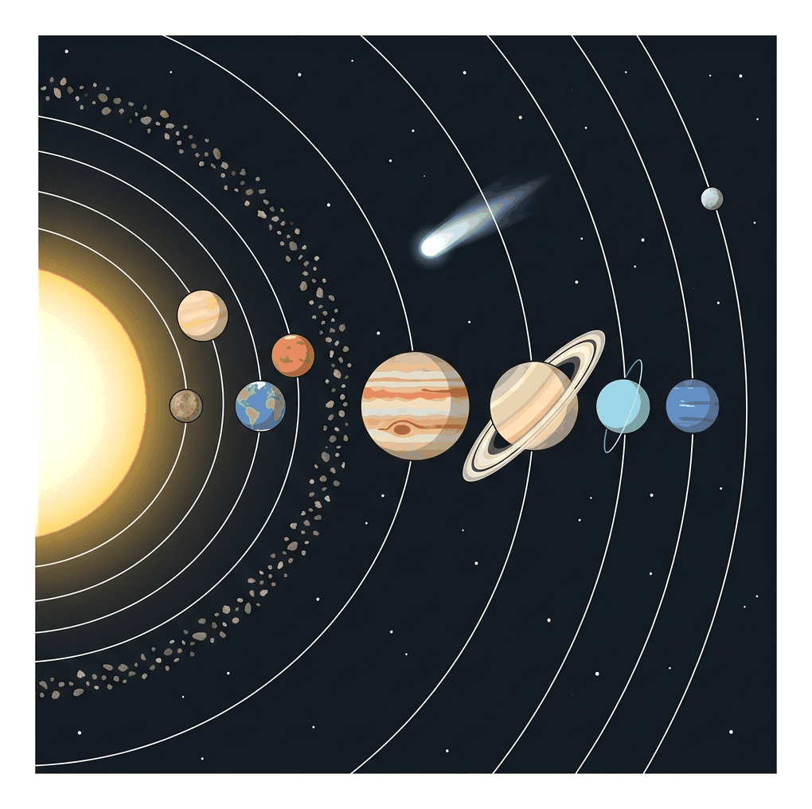
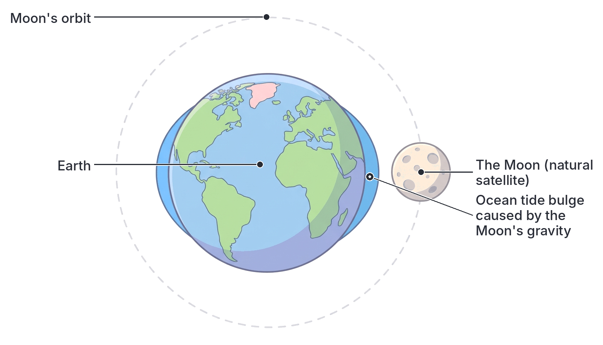
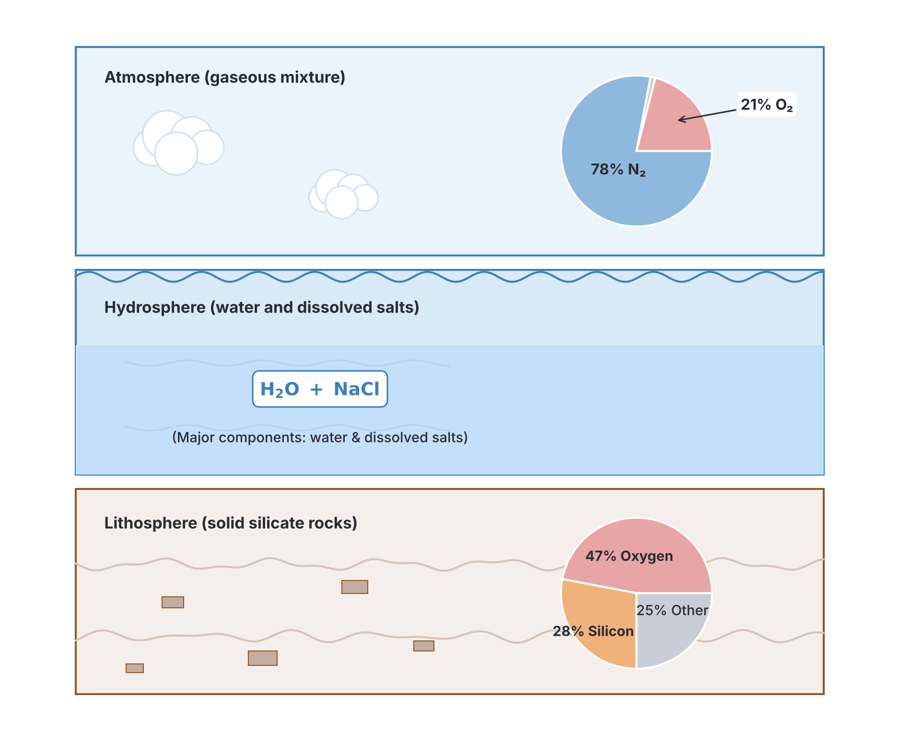

# JAMB Chemistry Notes: Astronomical Chemistry

## What JAMB expects

This topic is Topic 18 of the JAMB Chemistry syllabus: Astronomical Chemistry. It focuses on the fundamental composition of our space neighbourhood and the chemical structure of our own planet. It covers one main content item:

- **Solar system, planets, satellite and the composition of the earth - atmosphere, lithosphere and hydrosphere**

By the end of these notes, you should be able to:

1. state the composition of the solar system;
2. list the planets;
3. identify the segments of the earth;
4. name the natural satellite on the earth; and
5. identify the smallest planet that is also the farthest from the sun.

**Note on the syllabus wording:** Objective (v) asks you to identify the smallest planet that is also the farthest from the Sun. The expected answer for JAMB is **Pluto**. In 2006, the International Astronomical Union (IAU) reclassified Pluto as a "dwarf planet," meaning scientifically there are now only eight major planets. However, the JAMB syllabus and older recommended textbooks (from 1999 to 2012) still treat Pluto as the ninth planet. For the purpose of the UTME, always treat Pluto as the answer to this specific objective.

## Solar system

The universe is unimaginably large, containing billions of galaxies. Our galaxy is called the Milky Way, and situated within one of its spiral arms is our local planetary neighbourhood, known as the **solar system**. The solar system was formed about $4.6$ billion years ago from the gravitational collapse of a giant interstellar cloud of gas and dust (the solar nebula). It is a highly structured system held together by the immense gravitational pull of a central star. 

### State the composition of the solar system

The solar system is composed of several distinct types of celestial bodies. By mass, over $99.8\%$ of the entire solar system is concentrated in the Sun alone. The remaining mass is distributed among the planets and other smaller bodies. 

The composition of the solar system includes:
1. **The Sun:** The central star. It is a massive sphere of glowing, electrically charged gas (plasma), primarily composed of **hydrogen** ($\sim 73\%$) and **helium** ($\sim 25\%$). It generates enormous amounts of energy through **nuclear fusion** (joining four hydrogen-1 nuclei, $^1_1\text{H}$, to form one helium-4 nucleus, $^4_2\text{He}$), providing heat and light to the system.
2. **The Planets:** Large spherical bodies that orbit the Sun in elliptical (oval-shaped) paths and do not produce their own light.
3. **Natural Satellites (Moons):** Smaller solid bodies that orbit the planets rather than orbiting the Sun directly.
4. **Asteroids:** Rocky, airless remnants left over from the early formation of the solar system. Most are found in the **Asteroid Belt**, a ring situated between the orbits of Mars and Jupiter.
5. **Comets:** Often described as "dirty snowballs," comets are cosmic bodies composed of frozen gases (water, ammonia, methane) mixed with rock and dust. As a comet approaches the Sun, the ice sublimates, forming a bright glowing coma (head) and a long tail that always points away from the Sun due to the solar wind.
6. **Meteoroids:** Small fragments of rock or metal travelling through space. When they enter Earth's atmosphere and burn up due to friction, they produce streaks of light called **meteors** (shooting stars). If a fragment survives the fall and strikes the ground, it is called a **meteorite**.
7. **Interplanetary Dust and Gas:** Extremely thin clouds of microscopic dust particles and ionised gases filling the vast empty spaces between the planets.

### List the planets

A planet is a large heavenly body that revolves around the Sun and shines only by reflecting the Sun's light. Traditionally, and according to the JAMB syllabus, there are **nine planets** in the solar system. 

In order of their increasing distance from the Sun, they are:
1. **Mercury**
2. **Venus**
3. **Earth**
4. **Mars**
5. **Jupiter**
6. **Saturn**
7. **Uranus**
8. **Neptune**
9. **Pluto**

**Mnemonic to remember the order:** **M**y **V**ery **E**ducated **M**other **J**ust **S**erved **U**s **N**ine **P**izzas.

The planets are divided into two main categories based on their physical and chemical characteristics:

| Feature | Inner Planets (Terrestrial) | Outer Planets (Gas Giants / Jovian) |
| --- | --- | --- |
| **Planets Included** | Mercury, Venus, Earth, Mars | Jupiter, Saturn, Uranus, Neptune |
| **Chemical Composition** | Solid, dense, and rocky. Made mostly of silicate rocks and heavy metals (iron, nickel core). | Made mostly of gases (Hydrogen, $\text{H}_2$; Helium, $\text{He}$) and ices (Water, $\text{H}_2\text{O}$; Ammonia, $\text{NH}_3$; Methane, $\text{CH}_4$). They lack solid surfaces. |
| **Physical Size** | Relatively small. | Extremely large (Jupiter is the largest planet in the solar system). |
| **Moons and Rings** | Few or no moons (Earth has one, Mars has two). No ring systems. | Many moons. All have ring systems (Saturn's rings of ice and rock are the most prominent). |

*(Note: Pluto does not fit into either category. It is tiny, rocky, and icy, and actually belongs to a region of icy debris known as the Kuiper Belt).*

**A closer look at the planets:**
- **Mercury:** The closest planet to the Sun. It is heavily cratered and has no atmosphere to trap heat, resulting in extreme temperature swings between day and night.
- **Venus:** The hottest planet in the solar system. It has a thick, toxic atmosphere primarily composed of carbon (IV) oxide ($\text{CO}_2$), which creates a runaway greenhouse effect.
- **Earth:** The only planet known to support life, characterised by abundant liquid water and an oxygen-rich atmosphere.
- **Mars:** Known as the "Red Planet" because its surface is covered in iron (III) oxide ($\text{Fe}_2\text{O}_3$, rust).
- **Jupiter:** The largest planet, famous for its Great Red Spot (a giant storm) and numerous moons.
- **Saturn:** The second-largest planet, easily recognised by its spectacular ring system.
- **Uranus:** An ice giant that rotates on its side, making its axis of rotation almost parallel to its orbital plane.
- **Neptune:** A cold, blue, windy planet. Its blue colour comes from traces of methane gas in its upper atmosphere.

### Identify the smallest and farthest planet

According to the JAMB syllabus, **Pluto** is identified as the smallest planet and the farthest from the Sun. 

- **Size:** Pluto is incredibly small. With a diameter of about $2,370 \text{ km}$, it is even smaller than Earth's Moon.
- **Distance:** It orbits at the very edge of the traditional planetary system. Its orbit is highly elliptical (oval) and tilted. It takes about $248$ Earth years for Pluto to complete just one orbit around the Sun.
- **Environment:** Because it is extremely far from the Sun's heat, Pluto is a frozen world. Its surface is composed mostly of nitrogen ice, with traces of frozen methane and carbon (II) oxide.
- **JAMB Context:** As noted earlier, modern science classifies Pluto as a dwarf planet. However, if a UTME question asks for the smallest planet that is also the farthest from the Sun, the expected answer is undoubtedly **Pluto**.

### Name the natural satellite on the earth

A **satellite** is any object that orbits a larger central body (usually a planet). 
- **Artificial satellites** are machines built by humans and launched into space for communication, weather tracking, and navigation (for example, Nigeria's NigComSat-1R satellite).
- **Natural satellites** are naturally occurring celestial bodies orbiting planets. In everyday language, we call them moons.

The natural satellite of the Earth is **the Moon**.

**Chemical and Physical Characteristics of the Moon:**
- **Size and Structure:** The Moon is about one-quarter the size of the Earth. It is a dry, rocky, airless body. Its surface is heavily scarred with craters formed by asteroid impacts over billions of years.
- **Light:** The Moon does not produce its own light; it shines entirely by reflecting sunlight. The varying angles of this reflected light as it orbits the Earth cause the phases of the Moon (e.g., full moon, crescent).
- **Gravity:** The Moon's gravitational pull is about one-sixth ($1/6$) of the Earth's. However, this pull is strong enough to exert a force on Earth's oceans, causing the regular rise and fall of sea levels known as **ocean tides**.
- **Orbit:** The Moon takes roughly $27.3$ days to complete one orbit around the Earth.

### Identify the segments of the earth

Chemically and structurally, the Earth is not a uniform solid ball. It is divided into three main non-living segments or "spheres" that continuously interact with one another to sustain the biosphere (the zone of life). These three segments are the **Atmosphere** (air), the **Hydrosphere** (water), and the **Lithosphere** (rock/land). 

#### 1. The Atmosphere

The atmosphere is the invisible, gaseous envelope surrounding the Earth, held in place by the planet's gravity. It provides the gases necessary for life, protects the surface from harmful ultraviolet (UV) solar radiation (via the ozone layer), and regulates the planet's temperature (the greenhouse effect).

**Chemical Composition of Dry Air:**
The atmosphere is a mechanical mixture of gases, not a compound. By volume, it contains:
- **Nitrogen ($\text{N}_2$):** $\sim 78\%$ (Acts as a diluent to control burning and is converted by nitrogen-fixing bacteria into nitrates for soil fertility).
- **Oxygen ($\text{O}_2$):** $\sim 21\%$ (Essential for respiration in living things and the active supporter of combustion/burning).
- **Argon ($\text{Ar}$):** $\sim 0.9\%$ (An unreactive, inert noble gas).
- **Carbon (IV) oxide ($\text{CO}_2$):** $\sim 0.03\% - 0.04\%$ (Used by plants for photosynthesis; a major greenhouse gas).
- **Traces of other gases:** Small amounts of neon, helium, and krypton. The atmosphere also contains highly variable amounts of **water vapour ($\text{H}_2\text{O}$)**, ranging from $0\%$ to $4\%$, depending on the climate and weather.

#### 2. The Hydrosphere

The hydrosphere encompasses all the water found on, under, and above the surface of the Earth. It covers approximately $71\%$ of the Earth's surface. 

- **Components:** It includes the oceans, seas, rivers (such as the River Niger and River Benue), lakes (such as Lake Chad), underground water (aquifers), and solid ice (glaciers and polar ice caps).
- **Chemical Composition:** The fundamental chemical compound of the hydrosphere is **water ($\text{H}_2\text{O}$)**. 
- **Salinity and Dissolved Substances:** Ocean water is a complex solution containing dissolved gases (like $\text{O}_2$ for aquatic life and $\text{CO}_2$) and a large amount of dissolved mineral salts. The two most abundant dissolved salts in seawater are **sodium chloride ($\text{NaCl}$)** and **magnesium chloride ($\text{MgCl}_2$)**. Sodium chloride is the primary compound responsible for the salty taste of the oceans.

#### 3. The Lithosphere

The lithosphere is the rigid, solid, rocky outer layer of the Earth. It consists of the entire crust (both the continental landmasses and the ocean floors) and the uppermost, solid portion of the mantle. This is the segment upon which humans live, practice agriculture, mine mineral ores, and drill for fossil fuels (such as crude oil in the Niger Delta).

**Chemical Composition of the Lithosphere:**
The lithosphere is composed predominantly of silicate minerals and rocks. The crust is often divided into *Sial* (rocks rich in Silicon and Aluminium) and *Sima* (rocks rich in Silicon and Magnesium). 

By mass, the most abundant elements in the Earth's crust are:
- **Oxygen ($\text{O}$):** $\sim 47\%$ (Note: This oxygen is not a free gas; it is chemically combined with other elements to form solid mineral oxides and silicates).
- **Silicon ($\text{Si}$):** $\sim 28\%$ (Combines with oxygen to form silica, $\text{SiO}_2$, which is common sand, and various complex silicates).
- **Aluminium ($\text{Al}$):** $\sim 8\%$ (Found in clays and ores like bauxite).
- **Iron ($\text{Fe}$):** $\sim 5\%$ (Found in ores like haematite and magnetite).
- Other significant elements include calcium ($\text{Ca}$), sodium ($\text{Na}$), potassium ($\text{K}$), and magnesium ($\text{Mg}$).

*(Important Distinction: Nitrogen is the most abundant element in the atmosphere, but Oxygen is the most abundant element in the solid lithosphere).*

## Key terms

| Term | Meaning |
| --- | --- |
| Solar system | The Sun and all the celestial bodies (planets, moons, asteroids, comets) that revolve around it due to its gravitational pull. |
| Planet | A large spherical body that orbits a star (like the Sun) and reflects the star's light. |
| Natural satellite | A naturally occurring solid body that orbits a planet; commonly called a moon. |
| Asteroid | A small rocky body orbiting the Sun, mostly found in a belt between Mars and Jupiter. |
| Comet | An icy, dusty celestial body that develops a glowing tail of gas when it approaches the Sun. |
| Atmosphere | The gaseous envelope surrounding the Earth, primarily composed of nitrogen and oxygen. |
| Hydrosphere | All the water present on Earth, including oceans, lakes, rivers, and ice caps. |
| Lithosphere | The solid, rocky outer layer of the Earth, encompassing the crust and the upper mantle. |
| Nuclear fusion | The nuclear reaction inside the Sun where lighter nuclei (hydrogen) combine to form a heavier nucleus (helium), releasing massive amounts of energy. |

## Exam tips and common mistakes

- **Pluto is the smallest and farthest planet.** Even if you know it is currently classified as a dwarf planet by astronomers, JAMB chemistry historically tests it as the 9th planet. Pick Pluto for this objective.
- **Do not confuse the most abundant elements.** Nitrogen is the most abundant element in the *atmosphere* ($78\%$), but Oxygen is the most abundant element in the *lithosphere* ($\sim 47\%$). Oxygen is locked up in rocks, not floating as gas in the ground.
- **Distinguish between satellites.** The Moon is a *natural* satellite. Satellites launched by humans for television broadcasts or weather tracking are *artificial* satellites. They are not natural components of the solar system.
- **Know the planetary order perfectly.** Use the mnemonic "My Very Educated Mother Just Served Us Nine Pizzas" to remember Mercury, Venus, Earth, Mars, Jupiter, Saturn, Uranus, Neptune, Pluto.
- **The hydrosphere is not pure water.** Remember that ocean water includes dissolved salts. The most abundant is sodium chloride ($\text{NaCl}$), followed by magnesium chloride ($\text{MgCl}_2$).

## Quick summary

1. The solar system consists of the central Sun, nine planets, moons, asteroids, comets, meteoroids, and interplanetary dust. The Sun contains over $99.8\%$ of the system's mass.
2. There are traditionally nine planets: Mercury, Venus, Earth, Mars (inner terrestrial), Jupiter, Saturn, Uranus, Neptune (outer gas giants), and Pluto.
3. According to the JAMB syllabus, Pluto is recognized as the smallest planet and the farthest from the Sun.
4. The Earth has only one natural satellite, the Moon, which shines by reflecting sunlight and its gravity causes ocean tides.
5. The Earth is chemically and structurally divided into three segments: the Atmosphere (gaseous mixture, mainly nitrogen and oxygen), the Hydrosphere (all water bodies, containing dissolved salts like NaCl), and the Lithosphere (solid rocky crust and upper mantle, rich in oxygen and silicon).

## Practice questions

**1. The solar system is composed of the Sun, planets, their moons, and other bodies such as**

- A. artificial satellites, galaxies, and black holes
- B. asteroids, comets, and meteoroids
- C. galaxies, comets, and constellations
- D. meteoroids, artificial satellites, and pulsars

**Answer: B.** 1. Recall that the solar system consists of the Sun, planets, natural satellites (moons), asteroids, comets, and meteoroids. 2. Galaxies and black holes are far outside our solar system, meaning they do not belong to it. 3. Artificial satellites are man-made and not natural components of the solar system. The most tempting mistake is option D, which assumes artificial satellites (like those in Earth orbit) are considered natural astronomical components of the solar system, but they are human-made.

**2. Which of the following shows the correct order of the first four planets from the Sun?**

- A. Venus, Mercury, Mars, Earth
- B. Earth, Mars, Mercury, Venus
- C. Mercury, Venus, Earth, Mars
- D. Mercury, Mars, Venus, Earth

**Answer: C.** 1. Use the mnemonic "My Very Educated Mother" to remember the order of the inner planets. 2. "My" = Mercury, "Very" = Venus, "Educated" = Earth, "Mother" = Mars. 3. Therefore, the sequence is Mercury, Venus, Earth, Mars. The mistake in option D comes from swapping Venus and Mars, perhaps confusing their relative sizes or temperatures instead of their orbital distance from the Sun.

**3. Based on the UTME syllabus, the smallest planet which is also the farthest from the Sun is**

- A. Mercury
- B. Neptune
- C. Uranus
- D. Pluto

**Answer: D.** 1. Identify the planets in the JAMB syllabus, which includes Pluto as the ninth planet. 2. Compare their distances from the Sun (Pluto is the farthest). 3. Compare their sizes (Pluto has a diameter of about $2370 \text{ km}$, making it the smallest). The most tempting mistake is option B (Neptune), which is the farthest major planet according to modern definitions, but JAMB specifically requires Pluto as the answer for the smallest and farthest.

**4. The natural satellite of the Earth is called the**

- A. Sun
- B. Meteor
- C. Moon
- D. Asteroid

**Answer: C.** 1. Define a natural satellite as a naturally occurring celestial body orbiting a planet. 2. Identify the Earth's orbit. 3. The Moon orbits the Earth at a distance of about $3.84 \times 10^5 \text{ km}$, making it Earth's natural satellite. The mistake in option B assumes meteors orbit the Earth, but meteors are space debris burning up in the atmosphere, not stable orbiting satellites.

**5. If a student traps $100 \text{ cm}^3$ of dry air, what volume of nitrogen gas ($\text{N}_2$) is expected in the sample, given standard atmospheric composition?**

- A. $21 \text{ cm}^3$
- B. $78 \text{ cm}^3$
- C. $0.04 \text{ cm}^3$
- D. $99 \text{ cm}^3$

**Answer: B.** 1. Recall the percentage of nitrogen in dry air by volume is $78\%$. 2. Set up the calculation: Volume of $\text{N}_2$ = $78\%$ of $100 \text{ cm}^3$. 3. Calculate: $\frac{78}{100} \times 100 \text{ cm}^3 = 78 \text{ cm}^3$. The mistake in option A is using $21\%$, which is the percentage for oxygen ($\text{O}_2$), not nitrogen.

**6. Which of the following segments of the Earth represents the solid, rocky outer layer?**

- A. Hydrosphere
- B. Atmosphere
- C. Biosphere
- D. Lithosphere

**Answer: D.** 1. Define the segments of the Earth. 2. The hydrosphere is water, the atmosphere is gas, and the lithosphere is the solid outer crust and upper mantle. 3. Therefore, the solid rocky layer (composed mostly of silicates like $\text{SiO}_2$) is the lithosphere. The mistake in option A comes from confusing "hydro" (water) with solid ground.

**7. A geologist analyzes a $200 \text{ g}$ sample of typical Earth's crust (lithosphere). Given that oxygen makes up approximately $47\%$ of the lithosphere by mass, what is the expected mass of oxygen in the sample?**

- A. $47 \text{ g}$
- B. $56 \text{ g}$
- C. $94 \text{ g}$
- D. $156 \text{ g}$

**Answer: C.** 1. State the mass percentage of oxygen in the lithosphere: $47\%$. 2. Multiply this percentage by the total mass of the sample. 3. Calculation: $\frac{47}{100} \times 200 \text{ g} = 94 \text{ g}$. The mistake in option A is taking the percentage ($47$) directly as the mass in grams without multiplying by the $200 \text{ g}$ sample size.

**8. Which of the following planets is classified as a gas giant?**

- A. Mars
- B. Jupiter
- C. Venus
- D. Mercury

**Answer: B.** 1. Divide the planets into inner (terrestrial) and outer (Jovian) groups. 2. Mars, Venus, and Mercury are inner, rocky planets. 3. Jupiter is an outer planet composed mainly of hydrogen ($\text{H}_2$) and helium ($\text{He}$), making it a gas giant. The mistake in option A (Mars) is confusing its position as the last inner planet with the first outer planet.

**9. A sample of seawater from the hydrosphere is evaporated. The most abundant dissolved salt left behind is**

- A. $\text{CaCO}_3$
- B. $\text{MgCl}_2$
- C. $\text{NaCl}$
- D. $\text{KNO}_3$

**Answer: C.** 1. Identify the hydrosphere as Earth's water bodies, including oceans. 2. Recall that seawater contains dissolved mineral salts. 3. The most abundant dissolved salt in seawater is sodium chloride ($\text{NaCl}$), which gives the ocean its salty taste. The mistake in option B is choosing magnesium chloride ($\text{MgCl}_2$), which is the second most abundant salt, not the first.

**10. The Sun generates its immense energy by fusing hydrogen nuclei to form helium. How many hydrogen-1 nuclei ($^1_1\text{H}$) are minimally required to fuse and form one helium-4 nucleus ($^4_2\text{He}$) in the overall net reaction?**

- A. $1$
- B. $2$
- C. $4$
- D. $8$

**Answer: C.** 1. Write the net nuclear equation for hydrogen fusion in the Sun: $4 ^1_1\text{H} \rightarrow ^4_2\text{He} + 2 ^0_{+1}\text{e} + \text{energy}$. 2. Balance the mass numbers on both sides: $4 \times 1 = 4$. 3. Balance the atomic numbers on both sides: $4 \times 1 = 2 + 2 \times 1$. 4. Conclude that exactly $4$ hydrogen nuclei are needed. The mistake in option B is assuming only $2$ protons are needed because the atomic number of Helium is $2$, forgetting that the mass number of $4$ requires $4$ nucleons in total.
