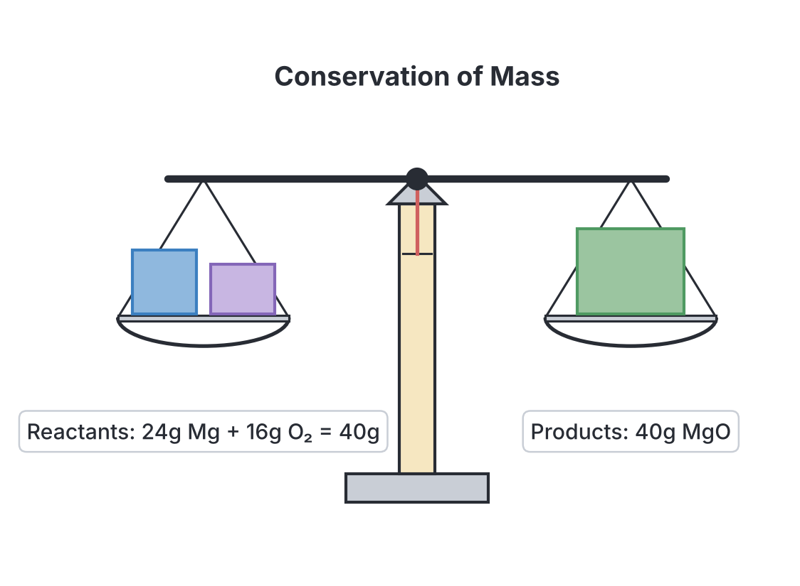
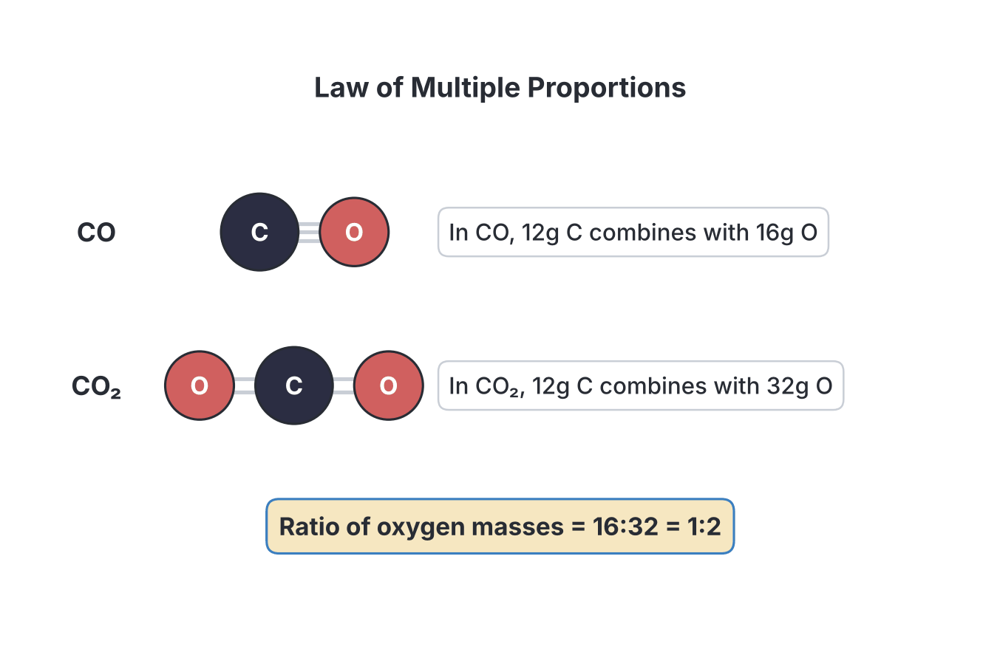
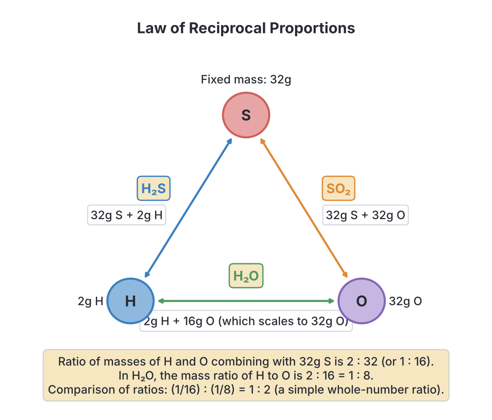
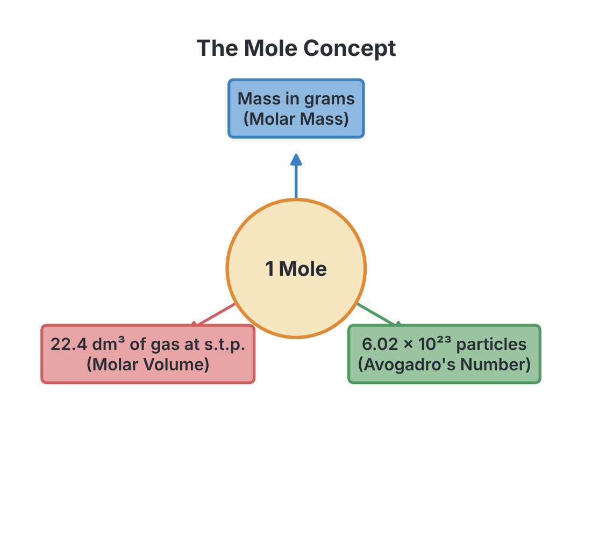

# JAMB Chemistry Notes: Chemical Combination

## What JAMB expects

This topic is Topic 2 of the JAMB Chemistry syllabus: Chemical Combination. It covers the fundamental rules of how elements combine to form compounds, how we represent these changes with symbols, and how we measure and calculate reacting quantities using the mole concept.

The syllabus scope includes:
- Laws of definite, multiple and reciprocal proportions, and the law of conservation of matter.
- Chemical symbols, formulae, equations and their uses.
- Relative atomic mass based on $^{12}\text{C}=12$.
- The mole concept and the stoichiometry of reactions.

By the end of these notes, you should be able to:
1. Deduce the chemical laws from given expressions, statements or data.
2. Perform simple calculations involving formulae, equations, chemical composition and the mole concept.
3. Deduce the stoichiometry of chemical reactions.

## Chemical symbols, formulae, and equations

Chemists use a universal shorthand to represent elements, compounds, and the reactions between them. Understanding this language is the first step in chemical calculations.

### Chemical symbols

A chemical symbol is a one- or two-letter abbreviation for an element. The modern system was proposed by Jöns Jacob Berzelius in 1814. 
- The first letter is always a **capital** letter. If there is a second letter, it is always a **small** (lowercase) letter. 
- **Examples from English names:** Carbon is $\text{C}$, Calcium is $\text{Ca}$, Chlorine is $\text{Cl}$, Magnesium is $\text{Mg}$.
- **Examples from Latin names:** Sodium (Natrium) is $\text{Na}$, Potassium (Kalium) is $\text{K}$, Iron (Ferrum) is $\text{Fe}$, Copper (Cuprum) is $\text{Cu}$, Silver (Argentum) is $\text{Ag}$, Gold (Aurum) is $\text{Au}$, and Lead (Plumbum) is $\text{Pb}$.

### Valency and chemical formulae

A chemical formula shows the types and numbers of atoms present in a single molecule or unit of a compound. It is written using the chemical symbols of the elements and small subscript numbers.
- $\text{H}_2\text{O}$ means one molecule of water contains 2 atoms of hydrogen and 1 atom of oxygen.

To write the formula of a compound, you must know the **valency** (combining power or charge) of its atoms or radicals (groups of atoms acting as a single unit).

**Common valencies to memorize for JAMB:**
- **Valency 1:** $\text{Na}^+$, $\text{K}^+$, $\text{Ag}^+$, $\text{H}^+$, $\text{NH}_4^+$ (ammonium) / $\text{Cl}^-$, $\text{OH}^-$ (hydroxide), $\text{NO}_3^-$ (trioxonitrate(V)), $\text{HCO}_3^-$ (hydrogen trioxocarbonate(IV))
- **Valency 2:** $\text{Mg}^{2+}$, $\text{Ca}^{2+}$, $\text{Zn}^{2+}$, $\text{Cu}^{2+}$ / $\text{O}^{2-}$, $\text{S}^{2-}$, $\text{SO}_4^{2-}$ (tetraoxosulphate(VI)), $\text{CO}_3^{2-}$ (trioxocarbonate(IV))
- **Valency 3:** $\text{Al}^{3+}$, $\text{Fe}^{3+}$ / $\text{PO}_4^{3-}$ (tetraoxophosphate(V)), $\text{N}^{3-}$

**Steps to write a formula:**
1. Write the symbols of the ions (positive first, negative second).
2. Write their valencies underneath.
3. Swap the valencies (criss-cross) to become subscripts.
4. Simplify the ratio if possible. If a radical needs a subscript greater than 1, put it in brackets.

**Example:** Aluminium tetraoxosulphate(VI)
1. Symbols: $\text{Al}$ and $\text{SO}_4$
2. Valencies: $\text{Al}$ is 3, $\text{SO}_4$ is 2
3. Swap: $\text{Al}$ gets 2, $\text{SO}_4$ gets 3.
4. Formula: $\text{Al}_2(\text{SO}_4)_3$.

### Chemical equations and balancing

A chemical equation represents a chemical reaction. It shows the **reactants** (starting substances) on the left side and the **products** (new substances formed) on the right side, separated by an arrow ($\rightarrow$).

Equations must include **state symbols** to show the physical state of each substance at the reaction temperature:
- **(s)** for solid
- **(l)** for liquid (used mainly for pure liquids like water or molten substances)
- **(g)** for gas
- **(aq)** for aqueous (dissolved in water)

**Balancing equations:**
Because of the law of conservation of matter, atoms cannot be created or destroyed. The number of atoms of each element must be exactly the same on both sides of the equation. You balance an equation by placing whole numbers (**coefficients**) in front of the formulae. 

**Common mistake:** Never change the small subscript numbers inside a correct formula to balance an equation; this changes the identity of the substance! For example, changing $\text{H}_2\text{O}$ to $\text{H}_2\text{O}_2$ changes water into hydrogen peroxide.

**Step-by-step example:** Balance the combustion of propane (the main gas in some cooking gas cylinders).
1. Write the unbalanced equation: $\text{C}_3\text{H}_8\text{(g)} + \text{O}_2\text{(g)} \rightarrow \text{CO}_2\text{(g)} + \text{H}_2\text{O(g)}$
2. Count atoms: Reactants have 3 $\text{C}$, 8 $\text{H}$, 2 $\text{O}$. Products have 1 $\text{C}$, 2 $\text{H}$, 3 $\text{O}$.
3. Balance carbon by multiplying $\text{CO}_2$ by 3: $\text{C}_3\text{H}_8 + \text{O}_2 \rightarrow 3\text{CO}_2 + \text{H}_2\text{O}$
4. Balance hydrogen by multiplying $\text{H}_2\text{O}$ by 4: $\text{C}_3\text{H}_8 + \text{O}_2 \rightarrow 3\text{CO}_2 + 4\text{H}_2\text{O}$
5. Count oxygen on the right: $(3 \times 2) + (4 \times 1) = 6 + 4 = 10$ oxygen atoms.
6. Balance oxygen on the left by multiplying $\text{O}_2$ by 5: $\text{C}_3\text{H}_8 + 5\text{O}_2 \rightarrow 3\text{CO}_2 + 4\text{H}_2\text{O}$.
7. Final check: 3 $\text{C}$, 8 $\text{H}$, and 10 $\text{O}$ on both sides. It is perfectly balanced.

## Laws of chemical combination

**Objective i: deduce the chemical laws from given expressions/statements/data.**

Whenever chemical reactions occur, they obey four fundamental laws of chemical combination.

### Law of conservation of matter (mass)
Formulated by Antoine Lavoisier in 1789, this law states that **in any chemical reaction, matter is neither created nor destroyed, but only changes from one form to another**.
- **Meaning:** The total mass of the reactants equals the total mass of the products. 
- **Example:** If $24.0 \text{ g}$ of magnesium wire is burned completely inside a sealed flask containing oxygen to produce exactly $40.0 \text{ g}$ of magnesium oxide, the mass of oxygen used up from the air inside the flask must be $40.0 \text{ g} - 24.0 \text{ g} = 16.0 \text{ g}$.
- **Experimental proof:** Hans Landolt proved this by placing two solutions (e.g., silver trioxonitrate(V) and sodium chloride) in an H-shaped tube. He weighed it, tilted it to mix the solutions to form a white precipitate of silver chloride, and weighed it again. The mass remained identical.

### Laws of definite, multiple and reciprocal proportions

**1. Law of definite proportions**
Formulated by Joseph Proust in 1799, this law is also called the Law of Constant Composition. It states that **all pure samples of a particular chemical compound contain the same elements combined in the same proportion by mass**.
- **Meaning:** It does not matter how a compound is made or where it is found; its formula and percentage composition by mass never change. 
- **Example:** Pure water ($\text{H}_2\text{O}$), whether obtained from rain in Lagos, a river in Kano, or made chemically in a lab, will always contain exactly $2.0 \text{ g}$ of hydrogen for every $16.0 \text{ g}$ of oxygen (a 1:8 ratio by mass).

**2. Law of multiple proportions**
Proposed by John Dalton in 1804 to support his atomic theory, this law states that **if two elements combine to form more than one compound, the masses of one element that combine with a fixed mass of the other element are in the ratio of small whole numbers**.
- **Meaning:** Elements combine in discrete "chunks" (atoms), not fractions. When they form multiple compounds, the differences are whole atoms.
- **Example:** Nitrogen and oxygen form several oxides. Let us fix the mass of nitrogen at $14.0 \text{ g}$:
  - In dinitrogen(I) oxide ($\text{N}_2\text{O}$), $14.0 \text{ g}$ of N combines with $8.0 \text{ g}$ of O.
  - In nitrogen(II) oxide ($\text{NO}$), $14.0 \text{ g}$ of N combines with $16.0 \text{ g}$ of O.
  - In nitrogen(IV) oxide ($\text{NO}_2$), $14.0 \text{ g}$ of N combines with $32.0 \text{ g}$ of O.
  - The ratio of the masses of oxygen combining with the fixed $14.0 \text{ g}$ of nitrogen is $8.0 : 16.0 : 32.0$, which simplifies perfectly to the simple whole numbers **1:2:4**.

**3. Law of reciprocal proportions**
Formulated by Jeremias Richter in 1792, this law states that **the masses of two elements A and B that combine separately with a fixed mass of a third element C, are in the same ratio (or a simple multiple of the ratio) in which they combine with each other**.
- **Meaning:** This law applies when you have **three** elements that can form binary compounds with each other.
- **Example:** Consider Carbon (C), Hydrogen (H), and Oxygen (O). 
  1. C and H form methane ($\text{CH}_4$). $12.0 \text{ g}$ of C combines with $4.0 \text{ g}$ of H.
  2. C and O form carbon(IV) oxide ($\text{CO}_2$). $12.0 \text{ g}$ of C combines with $32.0 \text{ g}$ of O.
  3. The ratio of H to O combining with a fixed mass ($12.0 \text{ g}$) of C is $4.0 \text{ g} : 32.0 \text{ g}$, which simplifies to **1:8**.
  4. Now look at how H and O combine with each other to form water ($\text{H}_2\text{O}$). $2.0 \text{ g}$ of H combines with $16.0 \text{ g}$ of O. The ratio here is $2.0 \text{ g} : 16.0 \text{ g}$, which also simplifies to **1:8**. 
  5. The ratios are identical, confirming the law.

**Common mistake in JAMB:** Confusing the Law of Multiple Proportions with Reciprocal Proportions. 
- **Multiple Proportions:** Involves **two** elements forming **two or more** compounds (e.g., $\text{SO}_2$ and $\text{SO}_3$).
- **Reciprocal Proportions:** Involves **three** elements forming **three** compounds (e.g., $\text{H}_2\text{S}$, $\text{H}_2\text{O}$, $\text{SO}_2$).

## Relative atomic mass based on $^{12}\text{C}=12$

Atoms are too small to weigh on standard scales, so chemists use a relative scale to compare their masses. The standard chosen by the international scientific community is the **carbon-12 isotope ($^{12}\text{C}$)**. A single atom of carbon-12 is assigned a mass of exactly $12$ atomic mass units (amu). 

The **Relative Atomic Mass (Ar)** of an element is the average mass of one atom of the element compared to one-twelfth ($1/12$) of the mass of an atom of carbon-12. 
*(Textbook variation: Before 1961, oxygen-16 was used as the standard. Modern chemistry exclusively uses carbon-12, because carbon is a solid, easy to handle, and forms many compounds).*

Because elements exist in nature as mixtures of isotopes (atoms of the same element with different masses), the relative atomic mass is a weighted average that depends on the percentage abundance of each isotope. Isotopic abundance is determined using an instrument called a **mass spectrometer**.

**Worked Example 1: Isotopic Abundance Calculation** 
Natural chlorine consists of $75\%$ of $^{35}\text{Cl}$ and $25\%$ of $^{37}\text{Cl}$. Calculate its relative atomic mass.
1. Multiply the mass of each isotope by its percentage abundance: 
   - $(75 \times 35) = 2625$
   - $(25 \times 37) = 925$
2. Add them together and divide by 100 to find the average: 
   - $(2625 + 925) / 100 = 3550 / 100 = 35.5$.
3. The Ar of chlorine is $35.5$. *(Note: Relative atomic masses have no units, but they are used in grams per mole when dealing with molar masses).*

## The mole concept and chemical calculations

**Objective ii: perform simple calculations involving formulae, equations/chemical composition and the mole concept.**

### The mole and Avogadro's constant
In everyday life, a "dozen" means 12 items. In chemistry, a **mole (mol)** is a specific number of particles used to count atoms, molecules, or ions. 
One mole of any substance contains exactly **$6.02 \times 10^{23}$** particles. This enormous number is called **Avogadro's constant ($N_A$)**.
- 1 mole of carbon atoms = $6.02 \times 10^{23}$ carbon atoms.
- 1 mole of water molecules = $6.02 \times 10^{23}$ water molecules.
- 1 mole of electrons = $6.02 \times 10^{23}$ electrons.

### Molar mass
The **molar mass (M)** is the mass of one mole of a substance, expressed in **$\text{g mol}^{-1}$**. It is calculated by adding the relative atomic masses of all the atoms in the chemical formula.

**Worked Example 2: Molar mass**
Calculate the molar mass of sodium trioxocarbonate(IV), $\text{Na}_2\text{CO}_3$.
*(Given: Na = 23, C = 12, O = 16)*
1. Write down the number of each atom in the formula: 2 Na, 1 C, 3 O.
2. Multiply by their relative atomic masses:
   - Na: $2 \times 23 = 46$
   - C: $1 \times 12 = 12$
   - O: $3 \times 16 = 48$
3. Sum the totals: $46 + 12 + 48 = 106 \text{ g mol}^{-1}$.

### Molar volume of gases
Avogadro's Law states that equal volumes of all gases at the same temperature and pressure contain the same number of molecules. 
At **standard temperature and pressure (s.t.p.)**—which means a temperature of $273 \text{ K}$ ($0 \text{ }^\circ\text{C}$) and a pressure of $1 \text{ atm}$ ($760 \text{ mmHg}$)—one mole of *any* ideal gas occupies a volume of **$22.4 \text{ dm}^3$** (or $22,400 \text{ cm}^3$). 
*(Textbook variation: The modern IUPAC value for molar volume is $22.7 \text{ dm}^3 \text{ mol}^{-1}$ because standard pressure was slightly redefined, but JAMB expects you to use $22.4 \text{ dm}^3 \text{ mol}^{-1}$. Always check the given constants in the exam).*

### Master Mole Formulas
You can easily convert between mass, moles, volume, and particles using these core relationships:
1. **Moles ($n$)** = $\frac{\text{Mass } (m)}{\text{Molar mass } (M)}$
2. **Moles ($n$)** = $\frac{\text{Volume of gas at s.t.p. } (V)}{22.4 \text{ dm}^3 \text{ mol}^{-1}}$
3. **Moles ($n$)** = $\frac{\text{Number of particles}}{6.02 \times 10^{23}}$

### Percentage composition
The percentage composition by mass calculates how much of a compound's total mass comes from a specific element.

**Worked Example 3: Percentage Composition**
Find the percentage by mass of nitrogen in ammonium trioxonitrate(V), $\text{NH}_4\text{NO}_3$, a common fertiliser component.
*(Given: N = 14, H = 1, O = 16)*
1. Calculate the molar mass of $\text{NH}_4\text{NO}_3$: 
   - There are 2 nitrogen atoms: $2 \times 14 = 28$
   - 4 hydrogen atoms: $4 \times 1 = 4$
   - 3 oxygen atoms: $3 \times 16 = 48$
   - Total molar mass = $28 + 4 + 48 = 80 \text{ g mol}^{-1}$.
2. State the total mass of nitrogen in the formula: $28 \text{ g}$.
3. Calculate the percentage: 
   $\text{\% N} = \frac{28 \text{ g}}{80 \text{ g}} \times 100\% = 35.0\%$.

**Common mistake:** Forgetting to count *all* the atoms of the target element. In $\text{NH}_4\text{NO}_3$, many students only see the first 'N' and use $14 \text{ g}$ instead of $28 \text{ g}$.

### Water of crystallization (Hydration)
Many salts crystallize from water with specific amounts of water molecules trapped in their structure. This is called water of crystallization (e.g., blue copper(II) tetraoxosulphate(VI) is $\text{CuSO}_4 \cdot 5\text{H}_2\text{O}$). We can find the number of water molecules by heating the salt to drive off the water and comparing the masses.

**Worked Example 4: Hydration**
A sample of hydrated magnesium tetraoxosulphate(VI) ($\text{MgSO}_4\cdot x\text{H}_2\text{O}$) has a mass of $24.6 \text{ g}$. When heated strongly to a constant mass, the anhydrous (dry) salt remaining weighs $12.0 \text{ g}$. Find the value of $x$.
*(Given: Mg = 24, S = 32, O = 16, H = 1)*
1. Calculate the mass of water driven off: $24.6 \text{ g} - 12.0 \text{ g} = 12.6 \text{ g}$.
2. Calculate molar masses:
   - $\text{MgSO}_4 = 24 + 32 + (4 \times 16) = 120 \text{ g mol}^{-1}$.
   - $\text{H}_2\text{O} = (2 \times 1) + 16 = 18 \text{ g mol}^{-1}$.
3. Convert both masses to moles:
   - Moles of $\text{MgSO}_4 = 12.0 \text{ g} / 120 \text{ g mol}^{-1} = 0.10 \text{ mol}$.
   - Moles of $\text{H}_2\text{O} = 12.6 \text{ g} / 18 \text{ g mol}^{-1} = 0.70 \text{ mol}$.
4. Find the simplest whole-number ratio by dividing by the smaller number ($0.10$):
   - $\text{MgSO}_4 = 0.10 / 0.10 = 1$
   - $\text{H}_2\text{O} = 0.70 / 0.10 = 7$
5. The formula is $\text{MgSO}_4\cdot 7\text{H}_2\text{O}$ (Epsom salt), so $x = 7$.

### Empirical and molecular formulae
- **Empirical formula:** The simplest whole-number ratio of atoms of each element in a compound.
- **Molecular formula:** The actual number of atoms of each element in a single molecule. It is always a whole-number multiple of the empirical formula: $(\text{Empirical Formula})_n = \text{Molar Mass}$.

Chemists often find empirical formulae using **combustion analysis**, where an organic compound is burned in oxygen, and the masses of the $\text{CO}_2$ and $\text{H}_2\text{O}$ produced are collected and weighed.

**Worked Example 5: Combustion Analysis**
An organic compound burns completely in oxygen to produce $8.8 \text{ g}$ of carbon(IV) oxide and $5.4 \text{ g}$ of water. If the original mass of the compound was $4.6 \text{ g}$, find its empirical formula.
*(Given: C = 12, H = 1, O = 16)*
1. Find the mass of carbon inside the $\text{CO}_2$:
   - Molar mass of $\text{CO}_2 = 12 + (2 \times 16) = 44 \text{ g mol}^{-1}$.
   - Carbon is $12 \text{ g}$ out of every $44 \text{ g}$ of $\text{CO}_2$.
   - Mass of C = $\frac{12}{44} \times 8.8 \text{ g} = 2.4 \text{ g}$.
2. Find the mass of hydrogen inside the $\text{H}_2\text{O}$:
   - Molar mass of $\text{H}_2\text{O} = (2 \times 1) + 16 = 18 \text{ g mol}^{-1}$.
   - Hydrogen is $2 \text{ g}$ out of every $18 \text{ g}$ of $\text{H}_2\text{O}$.
   - Mass of H = $\frac{2}{18} \times 5.4 \text{ g} = 0.6 \text{ g}$.
3. Check if there is oxygen in the original compound:
   - Total mass of C and H = $2.4 \text{ g} + 0.6 \text{ g} = 3.0 \text{ g}$.
   - The compound weighed $4.6 \text{ g}$, which is more than $3.0 \text{ g}$. The missing mass must be oxygen.
   - Mass of O = $4.6 \text{ g} - 3.0 \text{ g} = 1.6 \text{ g}$.
4. Convert masses to moles to find the mole ratio:
   - Moles of C = $2.4 \text{ g} / 12 \text{ g mol}^{-1} = 0.20 \text{ mol}$.
   - Moles of H = $0.6 \text{ g} / 1 \text{ g mol}^{-1} = 0.60 \text{ mol}$.
   - Moles of O = $1.6 \text{ g} / 16 \text{ g mol}^{-1} = 0.10 \text{ mol}$.
5. Divide all by the smallest mole value ($0.10$) to get the simplest integer ratio:
   - C = $0.20 / 0.10 = 2$
   - H = $0.60 / 0.10 = 6$
   - O = $0.10 / 0.10 = 1$
6. The **empirical formula** is $\text{C}_2\text{H}_6\text{O}$ (which could be ethanol, common alcohol).

## Stoichiometry of chemical reactions

**Objective iii: deduce the stoichiometry of chemical reactions.**

Stoichiometry refers to calculating the relative quantities of reactants and products in chemical reactions based on balanced equations. The coefficients in a balanced equation provide the exact **mole ratio** in which substances react and form. 

### Steps for solving stoichiometry problems
1. **Write the balanced chemical equation.** (If the equation is unbalanced, all calculations will be wrong).
2. **Determine the mole ratio** between the known substance (the one with data given) and the unknown substance.
3. **Convert the given quantity** of the known substance to moles.
4. **Use the mole ratio** to find the moles of the unknown substance.
5. **Convert the moles** of the unknown substance into the required unit (mass, volume, or particles).

**Worked Example 6: Mass-Mass Calculation**
What mass of water is produced when $4.0 \text{ g}$ of hydrogen gas reacts completely with excess oxygen?
*(Given: H = 1, O = 16)*
1. Write the balanced equation:
   $2\text{H}_2\text{(g)} + \text{O}_2\text{(g)} \rightarrow 2\text{H}_2\text{O(g)}$
2. Convert the given mass of $\text{H}_2$ to moles:
   - Molar mass of $\text{H}_2 = 2 \times 1 = 2 \text{ g mol}^{-1}$.
   - Moles of $\text{H}_2 = 4.0 \text{ g} / 2 \text{ g mol}^{-1} = 2.0 \text{ mol}$.
3. Find the mole ratio of $\text{H}_2$ to $\text{H}_2\text{O}$:
   - From the equation, $2 \text{ moles}$ of $\text{H}_2$ produce $2 \text{ moles}$ of $\text{H}_2\text{O}$ (a 1:1 ratio).
   - Therefore, $2.0 \text{ mol}$ of $\text{H}_2$ will produce $2.0 \text{ mol}$ of $\text{H}_2\text{O}$.
4. Convert moles of unknown ($\text{H}_2\text{O}$) to mass:
   - Molar mass of $\text{H}_2\text{O} = (2 \times 1) + 16 = 18 \text{ g mol}^{-1}$.
   - Mass of $\text{H}_2\text{O} = 2.0 \text{ mol} \times 18 \text{ g mol}^{-1} = 36.0 \text{ g}$.

**Worked Example 7: Mass-Volume Calculation**
Limestone ($\text{CaCO}_3$), quarried in places like Obajana and Ewekoro for cement making, reacts with acids to give carbon(IV) oxide. What volume of carbon(IV) oxide is produced at s.t.p. when $10.0 \text{ g}$ of calcium trioxocarbonate(IV) reacts completely with dilute hydrochloric acid?
*(Given: Ca = 40, C = 12, O = 16, Molar volume at s.t.p. = $22.4 \text{ dm}^3 \text{ mol}^{-1}$)*
1. Write the balanced equation:
   $\text{CaCO}_3\text{(s)} + 2\text{HCl(aq)} \rightarrow \text{CaCl}_2\text{(aq)} + \text{H}_2\text{O(l)} + \text{CO}_2\text{(g)}$
2. Convert the mass of $\text{CaCO}_3$ to moles:
   - Molar mass of $\text{CaCO}_3 = 40 + 12 + (16 \times 3) = 100 \text{ g mol}^{-1}$.
   - Moles of $\text{CaCO}_3 = 10.0 \text{ g} / 100 \text{ g mol}^{-1} = 0.10 \text{ mol}$.
3. Find the mole ratio of $\text{CaCO}_3$ to $\text{CO}_2$:
   - From the equation, $1 \text{ mole}$ of $\text{CaCO}_3$ produces $1 \text{ mole}$ of $\text{CO}_2$ (a 1:1 ratio).
   - Therefore, $0.10 \text{ mol}$ of $\text{CaCO}_3$ produces $0.10 \text{ mol}$ of $\text{CO}_2$.
4. Convert moles of $\text{CO}_2$ to volume at s.t.p.:
   - Volume of $\text{CO}_2 = 0.10 \text{ mol} \times 22.4 \text{ dm}^3 \text{ mol}^{-1} = 2.24 \text{ dm}^3$.

### Limiting reactants
In many experiments, reactants are not mixed in the exact ratio of the equation. One reactant will run out first. This is the **limiting reactant**, and it dictates exactly how much product can be formed. The other reactants are said to be **in excess**.

To find the limiting reactant: Calculate the moles of all reactants. Divide each by their coefficient in the balanced equation. The smallest resulting number indicates the limiting reactant. Always base your product calculation purely on the limiting reactant.

### Percentage yield
In real life, chemical reactions never produce 100% of the calculated product due to side reactions, impurities, or losses during transfer. The theoretical yield is what you calculate on paper; the actual yield is what you physically weigh in the lab.

$$ \text{Percentage Yield} = \frac{\text{Actual Yield}}{\text{Theoretical Yield}} \times 100\% $$

## Key terms

| Term | Meaning |
| --- | --- |
| Mole | The amount of a substance that contains $6.02 \times 10^{23}$ particles. |
| Avogadro's constant | The number of particles in one mole of a substance ($6.02 \times 10^{23} \text{ mol}^{-1}$). |
| Molar mass | The mass of one mole of a given substance, expressed in $\text{g mol}^{-1}$. |
| Standard Temperature and Pressure (s.t.p.) | A temperature of $273 \text{ K}$ ($0 \text{ }^\circ\text{C}$) and pressure of $1 \text{ atm}$ ($760 \text{ mmHg}$). |
| Molar volume | The volume occupied by one mole of a gas at s.t.p., usually taken as $22.4 \text{ dm}^3$. |
| Relative atomic mass (Ar) | The average mass of an atom of an element compared to $1/12$ of the mass of a carbon-12 atom. |
| Empirical formula | The simplest whole-number integer ratio of the different atoms in a compound. |
| Molecular formula | The actual number of each type of atom present in one molecule of a compound. |
| Stoichiometry | The relationship between the amounts of reactants and products in a chemical reaction. |
| Limiting reactant | The reactant that is completely used up first, limiting the amount of product formed. |

## Exam tips and common mistakes

- **Unbalanced equations:** The most common mistake in stoichiometry is skipping the balancing step. If your equation is wrong, the mole ratio is wrong, and the entire calculation fails.
- **Wrong diatomic formulas:** Remember that elemental gases like hydrogen, oxygen, nitrogen, and all halogens exist as diatomic molecules ($\text{H}_2, \text{O}_2, \text{N}_2, \text{Cl}_2$). The molar mass of hydrogen gas ($\text{H}_2$) is $2.0 \text{ g mol}^{-1}$, not $1.0 \text{ g mol}^{-1}$.
- **Unit slips with volume:** The molar volume at s.t.p. is $22.4 \text{ dm}^3$. If a question gives or asks for volume in $\text{cm}^3$, remember to convert: $1 \text{ dm}^3 = 1000 \text{ cm}^3$. Therefore, molar volume is also $22,400 \text{ cm}^3 \text{ mol}^{-1}$.
- **Mixing up the laws:** The Law of *Multiple* Proportions deals with two elements forming multiple compounds (e.g., $\text{CO}$ and $\text{CO}_2$). The Law of *Reciprocal* Proportions involves three elements (e.g., C, H, O).
- **Calculating percentage composition:** Do not forget to multiply the atomic mass by the subscript number in the formula. For example, finding the total mass of nitrogen in $\text{NH}_4\text{NO}_3$ requires adding the masses of *both* nitrogen atoms together ($28 \text{ g}$) before dividing by the molar mass.

## Quick summary

1. A balanced chemical equation obeys the Law of Conservation of Matter by showing the exact same number of atoms for each element on both sides of the arrow.
2. The Law of Definite Proportions (Constant Composition) states that a pure chemical compound always contains the same elements in a fixed ratio by mass, regardless of its source.
3. Relative atomic mass is the weighted average mass of an element's isotopes compared to $1/12$ of a carbon-12 atom.
4. One mole of any substance contains Avogadro's number ($6.02 \times 10^{23}$) of particles and has a mass in grams exactly equal to its formula mass.
5. One mole of any gas at standard temperature and pressure (s.t.p.) occupies a constant volume of $22.4 \text{ dm}^3$.
6. The empirical formula gives the simplest ratio of atoms, while the molecular formula gives the exact actual number of atoms in a molecule.
7. To solve stoichiometry problems reliably: Write the balanced equation $\rightarrow$ Find the mole ratio $\rightarrow$ Convert known data to moles $\rightarrow$ Use the ratio to find unknown moles $\rightarrow$ Convert back to the desired final unit.

## Practice questions

**1. Which pair of compounds is commonly used to illustrate the law of multiple proportions?**
- A. $\text{H}_2\text{O}$ and $\text{H}_2\text{O}_2$
- B. $\text{NaCl}$ and $\text{KCl}$
- C. $\text{CO}_2$ and $\text{SiO}_2$
- D. $\text{Na}_2\text{CO}_3$ and $\text{NaHCO}_3$

**Answer: A.** The Law of Multiple Proportions applies when the same two elements (here, hydrogen and oxygen) form more than one different compound. They combine to form water ($\text{H}_2\text{O}$) and hydrogen peroxide ($\text{H}_2\text{O}_2$). 

**2. A $24.0 \text{ g}$ sample of magnesium wire burns completely in oxygen to yield $40.0 \text{ g}$ of magnesium oxide. What mass of oxygen was consumed, and which law does this illustrate?**
- A. $16.0 \text{ g}$, Law of Multiple Proportions
- B. $16.0 \text{ g}$, Law of Conservation of Matter
- C. $64.0 \text{ g}$, Law of Definite Proportions
- D. $32.0 \text{ g}$, Law of Conservation of Matter

**Answer: B.** By the Law of Conservation of Matter, the total mass of reactants equals the total mass of products. Mass of oxygen = $40.0 \text{ g} - 24.0 \text{ g} = 16.0 \text{ g}$.

**3. How many atoms are present in $0.50 \text{ mol}$ of oxygen gas ($\text{O}_2$)? (Avogadro's constant = $6.02 \times 10^{23} \text{ mol}^{-1}$)**
- A. $3.01 \times 10^{23}$ atoms
- B. $6.02 \times 10^{23}$ atoms
- C. $1.20 \times 10^{24}$ atoms
- D. $1.50 \times 10^{23}$ atoms

**Answer: B.** 
1. Calculate the number of molecules: $0.50 \text{ mol} \times 6.02 \times 10^{23} \text{ mol}^{-1} = 3.01 \times 10^{23}$ molecules. 
2. Since oxygen gas is diatomic ($\text{O}_2$), each molecule has 2 atoms. 
3. Total atoms = $3.01 \times 10^{23} \times 2 = 6.02 \times 10^{23}$ atoms. 
Mistake A occurs if you count molecules instead of individual atoms.

**4. A hydrocarbon contains $80.0\%$ carbon and $20.0\%$ hydrogen by mass. What is its empirical formula? (C = 12, H = 1)**
- A. $\text{CH}$
- B. $\text{CH}_2$
- C. $\text{CH}_3$
- D. $\text{C}_2\text{H}_5$

**Answer: C.** 
1. Moles of C = $80.0 \text{ g} / 12 \text{ g mol}^{-1} = 6.67 \text{ mol}$.
2. Moles of H = $20.0 \text{ g} / 1 \text{ g mol}^{-1} = 20.0 \text{ mol}$.
3. Divide both by the smallest ($6.67$): C = $6.67 / 6.67 = 1$. H = $20.0 / 6.67 = 3$. 
The ratio is 1:3, giving the empirical formula $\text{CH}_3$.

**5. What is the percentage by mass of nitrogen in ammonium trioxonitrate(V), $\text{NH}_4\text{NO}_3$? (N = 14, H = 1, O = 16)**
- A. $17.5\%$
- B. $28.0\%$
- C. $35.0\%$
- D. $40.0\%$

**Answer: C.** 
1. The molar mass of $\text{NH}_4\text{NO}_3$ is $(2 \times 14) + (4 \times 1) + (3 \times 16) = 28 + 4 + 48 = 80 \text{ g mol}^{-1}$. 
2. There are two nitrogen atoms in the formula, so their total combined mass is $28 \text{ g}$. 
3. Percentage of N = $(28 \text{ g} / 80 \text{ g}) \times 100\% = 35.0\%$. 
Mistake A comes from only counting one nitrogen atom ($(14 \text{ g} / 80 \text{ g}) \times 100\% = 17.5\%$).

**6. Natural chlorine consists of $75\%$ $^{35}\text{Cl}$ and $25\%$ $^{37}\text{Cl}$. What is the relative atomic mass of chlorine?**
- A. $35.0$
- B. $35.5$
- C. $36.0$
- D. $37.0$

**Answer: B.** The relative atomic mass is the weighted average: 
Ar = $[(75 \times 35) + (25 \times 37)] / 100 = (2625 + 925) / 100 = 3550 / 100 = 35.5$.

**7. In the reaction $a\text{Al} + b\text{H}_2\text{SO}_4 \rightarrow c\text{Al}_2(\text{SO}_4)_3 + d\text{H}_2$, what are the values of $a$, $b$, $c$ and $d$ respectively that correctly balance the equation?**
- A. 1, 2, 1, 2
- B. 2, 3, 1, 3
- C. 2, 3, 2, 3
- D. 3, 2, 1, 3

**Answer: B.** 
1. To balance Al, there are 2 Al atoms on the right, so $a = 2$. 
2. To balance sulphate ($\text{SO}_4$), there are 3 groups on the right, so $b = 3$. 
3. This creates 6 H atoms on the left ($3 \times 2$), so $d$ must be $3$ to give 6 H atoms on the right. 
The balanced coefficients are 2, 3, 1, 3.

**8. A student reacts $4.0 \text{ g}$ of hydrogen gas with excess oxygen and collects $27.0 \text{ g}$ of water. What is the percentage yield? (H = 1, O = 16)**
- A. $37.5\%$
- B. $50.0\%$
- C. $75.0\%$
- D. $133.3\%$

**Answer: C.** 
1. Equation: $2\text{H}_2\text{(g)} + \text{O}_2\text{(g)} \rightarrow 2\text{H}_2\text{O(l)}$.
2. Moles of $\text{H}_2$ used = $4.0 \text{ g} / 2.0 \text{ g mol}^{-1} = 2.0 \text{ mol}$.
3. Mole ratio of $\text{H}_2$ to $\text{H}_2\text{O}$ is 2:2 (1:1 ratio). So, $2.0 \text{ mol}$ of $\text{H}_2$ yields $2.0 \text{ mol}$ of $\text{H}_2\text{O}$.
4. Theoretical mass of $\text{H}_2\text{O} = 2.0 \text{ mol} \times 18.0 \text{ g mol}^{-1} = 36.0 \text{ g}$.
5. Percentage yield = (Actual / Theoretical) $\times 100\% = (27.0 \text{ g} / 36.0 \text{ g}) \times 100\% = 75.0\%$.
Mistake A occurs if you forget that $\text{H}_2$ gas is diatomic, wrongly computing $4.0 \text{ g} / 1.0 \text{ g mol}^{-1} = 4.0 \text{ mol}$, which would give a theoretical mass of $72.0 \text{ g}$ and a $37.5\%$ yield.

**9. What volume of carbon(IV) oxide is produced at s.t.p. when $5.3 \text{ g}$ of sodium trioxocarbonate(IV) reacts completely with dilute hydrochloric acid? (Na = 23, C = 12, O = 16, Molar volume at s.t.p. = $22.4 \text{ dm}^3 \text{ mol}^{-1}$)**
- A. $1.12 \text{ dm}^3$
- B. $1.43 \text{ dm}^3$
- C. $2.24 \text{ dm}^3$
- D. $1120 \text{ dm}^3$

**Answer: A.** 
1. Equation: $\text{Na}_2\text{CO}_3 + 2\text{HCl} \rightarrow 2\text{NaCl} + \text{H}_2\text{O} + \text{CO}_2$.
2. Molar mass of $\text{Na}_2\text{CO}_3 = (2 \times 23) + 12 + (3 \times 16) = 106 \text{ g mol}^{-1}$.
3. Moles of $\text{Na}_2\text{CO}_3 = 5.3 \text{ g} / 106 \text{ g mol}^{-1} = 0.05 \text{ mol}$.
4. Mole ratio $\text{Na}_2\text{CO}_3$ : $\text{CO}_2$ is 1:1. Moles of $\text{CO}_2 = 0.05 \text{ mol}$.
5. Volume of $\text{CO}_2 = 0.05 \text{ mol} \times 22.4 \text{ dm}^3 \text{ mol}^{-1} = 1.12 \text{ dm}^3$.
Mistake C occurs if you use the wrong mole ratio (1:2) or miscalculate the moles of salt as $0.10 \text{ mol}$. 

**10. The law of reciprocal proportions is best demonstrated by the properties and combinations of which set of elements?**
- A. Carbon, hydrogen and oxygen
- B. Sodium, potassium and chlorine
- C. Iron, oxygen and sulphur
- D. Carbon, silicon and oxygen

**Answer: A.** The Law of Reciprocal Proportions requires exactly three elements that can combine with one another to form three different binary compounds. Carbon, hydrogen, and oxygen successfully form methane ($\text{CH}_4$), carbon(IV) oxide ($\text{CO}_2$), and water ($\text{H}_2\text{O}$).
