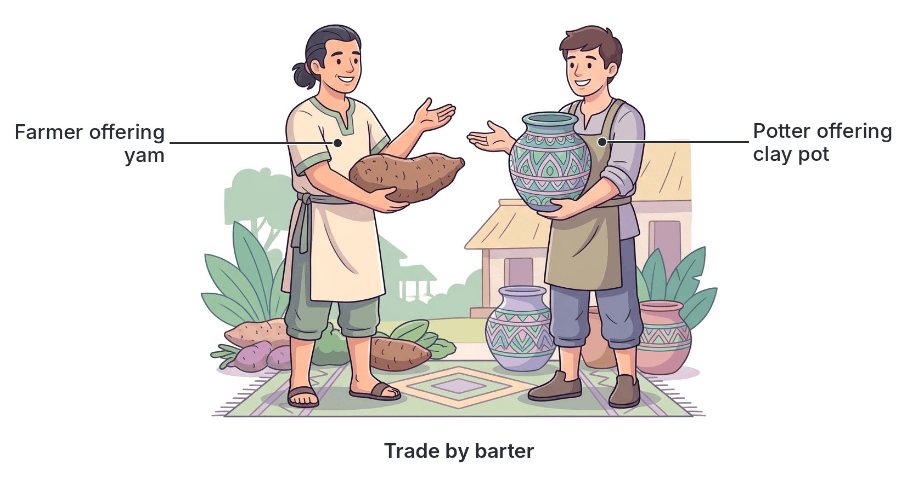
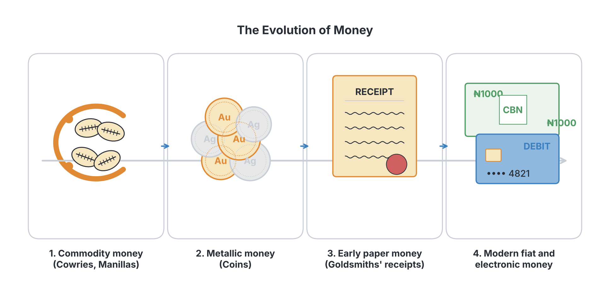

# JAMB Commerce Notes: Money

## What JAMB expects

This topic is Section A, Topic 10 of the JAMB Commerce syllabus: Money. It covers the following content items:
* (i) Evolution
* (ii) Forms and qualities
* (iii) Functions

By the end of these notes, you should be able to:
1. discuss the origin of money;
2. analyse the forms and qualities of money;
3. appraise the functions of money.

## The evolution and origin of money

**Objective i: discuss the origin of money.**

To understand what money is and why we use it, we have to look back at how people exchanged goods before money existed.

### Trade by barter

Before the invention of money, people exchanged goods they had for the goods they needed. This direct exchange of goods for other goods (or services) is called **trade by barter**.

For example, a farmer in Benue State who had harvested plenty of yams but needed a clay pot for cooking would have to find a potter who had a pot and wanted yams. They would then agree on how many yams equalled one pot and make the exchange.

### Problems of trade by barter

While barter worked in small, simple communities, it became very difficult as societies grew and people started producing a wider variety of goods. Barter had several major problems, which eventually forced humans to invent money.

1. **Lack of double coincidence of wants:** This was the biggest problem. For barter to happen, you must find someone who *has* what you want AND *wants* what you have. If the farmer wants a pot, but the potter wants fish (not yams), no trade can happen. The farmer would have to find a fisherman who wants yams, trade yams for fish, and then take the fish to the potter. 
2. **No common measure of value:** In a barter system, there is no single way to price things. You have to figure out how many yams equal a pot, how many pots equal a goat, and how many yams equal a goat. It is confusing and causes endless arguing over exchange rates.
3. **Indivisibility of some goods:** Some goods cannot be divided without losing their value. If a goat is worth twenty yams, but the goat owner only wants five yams, he cannot cut off a quarter of the live goat to trade.
4. **Difficulty in storing wealth:** If a farmer produces a large harvest of tomatoes, they cannot save their wealth for the future because the tomatoes will rot. Wealth had to be stored in physical goods, which could die, spoil, or take up too much space.
5. **Difficulty in making deferred payments:** It is hard to borrow or buy on credit under barter. If you borrow a young, thin cow today and agree to return a cow in three years, do you return a young thin cow, or a fully grown fat cow? Value changes over time.

### The history of money

To solve the problems of barter, people began to agree on a single, generally accepted item to act as a go-between for all trades. This was the origin of money.

1. **Commodity money:** Early societies used useful or valuable items as money. In Nigeria and other parts of West Africa, items like **cowrie shells**, **manillas** (bronze or copper rings), iron, salt, and beads were used. A person could sell their yams for cowries, and later use the cowries to buy a pot.
2. **Metallic money:** As trade expanded, metals like gold, silver, and copper became popular because they were durable and their value was recognized everywhere. At first, pieces of metal were weighed for every transaction. Later, rulers and governments started stamping the metal into **coins** of fixed weight and value.
3. **Paper money:** Carrying heavy bags of gold coins was risky and tiring. People began keeping their gold with trusted goldsmiths for safety. The goldsmiths issued **paper receipts** for the gold. Soon, people realized it was easier to simply hand over the paper receipt to pay for things, rather than going to fetch the gold. These receipts became the first paper money.
4. **Modern fiat money:** Today, the paper money and coins we use (like the Naira notes issued by the Central Bank of Nigeria) are not backed by physical gold. They have value purely because the government says they are legal tender and because everyone accepts them. This is called **fiat money**.

## Forms and qualities of money

**Objective ii: analyse the forms and qualities of money.**

### Qualities of good money

For any object to serve effectively as money, it must possess certain characteristics. If it lacks these, the monetary system will fail.

1. **General acceptability:** This is the most important quality. Everyone in the society must be willing to accept it as payment for goods and services. If people refuse to accept it, it ceases to be money.
2. **Portability:** Money must be easy to carry around. A bag of cement has value, but it is too heavy to be carried to the market to buy groceries. Paper notes and coins are light and easy to transport.
3. **Durability:** Money must not easily tear, rust, spoil, or wear out quickly. It has to survive being passed from hand to hand. This is why Nigerian Naira notes are made from special, tough paper or polymer (plastic).
4. **Homogeneity (Uniformity):** Every unit of money of the same value must look exactly the same. Every genuine ₦500 note must be identical in size, colour, and design to every other ₦500 note. If they look different, people will argue over which one is real.
5. **Divisibility:** Money must be easily broken down into smaller denominations to allow people to buy low-priced items or give exact change. The Naira is divisible into smaller notes (₦1000, ₦500, ₦200, ₦100, ₦50) and coins (kobo).
6. **Relative scarcity:** Money must be somewhat rare to maintain its value. If money was as common as the sand on the ground, everyone would have it, and it would lose its value (prices would skyrocket). The Central Bank controls the supply to keep it relatively scarce.
7. **Recognisability:** It must be easily identified and hard to counterfeit (forge). Good money has security features (like watermarks and security threads in Naira notes) so that even uneducated people can tell it is genuine.
8. **Stability of value:** The value of money should not go up and down wildly overnight. If it loses value too fast (hyperinflation), people will lose trust in it and return to barter or foreign currencies.

### Forms of money

Money exists in several different forms today. 

1. **Coins:** These are pieces of metal stamped by the government with a specific value. They are mainly used for small transactions.
2. **Banknotes (Paper money):** These are slips of special paper or polymer issued by the central bank (e.g., the Central Bank of Nigeria). Together, coins and banknotes are called **currency**.
3. **Bank deposits (Bank money):** This is money kept in bank accounts, specifically **demand deposits** (current accounts). If you have money in a current account, you can write a cheque or use a debit card to pay for things directly. *Note: A cheque itself is not money; it is a written order to the bank to transfer the money. The actual money is the deposit in the bank.*
4. **Commodity money:** As discussed earlier, these are items that have value in themselves as well as being used as money (e.g., cattle, gold, silver).
5. **Fiat money:** This is money that has no intrinsic value (a piece of paper is essentially worthless) but is made money by government decree. The government declares it **legal tender**, meaning you cannot legally refuse it as payment for a debt. All modern paper money is fiat money.
6. **Near money:** These are financial assets that are not cash, but can easily and quickly be converted into cash. Examples include Treasury bills, fixed deposits, shares, and bonds. You cannot buy a loaf of bread directly with a Treasury bill, but you can quickly sell it for cash to buy the bread.
7. **E-money (Electronic money):** In modern commerce, value is often transferred digitally through mobile banking apps, USSD codes, POS terminals, and digital currencies (like Nigeria's eNaira).

| Form of Money | What it is | Example |
| :--- | :--- | :--- |
| **Legal Tender** | Money backed by law that a creditor must accept | Naira notes and coins |
| **Fiat Money** | Money by government order, with no value as a physical object | Paper money (Banknotes) |
| **Commodity Money** | Items used as money that are also useful objects | Cowries, salt, gold |
| **Bank Money** | Balances in a bank account that can be used for payments | Current account deposits |
| **Near Money** | Assets that are highly liquid but not actual cash | Treasury bills, fixed deposits |

## Functions of money

**Objective iii: appraise the functions of money.**

Money is defined not by what it *is* made of, but by what it *does*. An old saying goes: *"Money is a matter of functions four: a medium, a measure, a standard, a store."* 

Money performs four main functions in an economy. Each function directly solves one of the problems of trade by barter.

### 1. Medium of exchange
Money is generally accepted as payment for goods and services. You do not need to find someone who has what you want and wants what you have. You simply sell your goods for money, and then use that money to buy whatever you want from anybody. 
* **Which barter problem does this solve?** It solves the lack of double coincidence of wants.

### 2. Unit of account (Measure of value)
Money acts as a common measuring stick for the value of everything. Just as we measure weight in kilograms and distance in metres, we measure value in Naira and Kobo. Because of money, a trader can put a price tag on a bag of rice (e.g., ₦45,000) and a bottle of groundnut oil (e.g., ₦5,000), making it easy to compare their values and calculate profits.
* **Which barter problem does this solve?** It solves the lack of a common measure of value and the indivisibility of goods.

### 3. Store of value
Money allows people to save their wealth for the future. If a tomato farmer sells their harvest for cash, they can put the cash in a bank and use it five years later to build a house. The money will not rot or die like tomatoes or livestock would. (However, severe inflation can reduce the *purchasing power* of this stored value).
* **Which barter problem does this solve?** It solves the difficulty of storing wealth.

### 4. Standard of deferred payment
Money makes credit transactions (borrowing and lending) possible. If a business needs a loan to buy equipment today, the bank will lend them a specific amount of money (e.g., ₦5 million), and the business agrees to pay back exactly that amount of money plus interest later. Both parties know exactly what is owed. 
* **Which barter problem does this solve?** It solves the difficulty of deferred payments.

## Key terms

| Term | Meaning |
| :--- | :--- |
| **Barter** | The direct exchange of goods and services for other goods and services without the use of money. |
| **Double coincidence of wants** | A situation in barter where two people each have a good the other person wants. |
| **Commodity money** | Money that takes the form of a commodity with intrinsic value (e.g., gold, cowries). |
| **Fiat money** | Money that has value because the government has ordered that it is an acceptable means to pay debts. |
| **Legal tender** | Coins or banknotes that must be accepted if offered in payment of a debt. |
| **Near money** | Highly liquid assets that can easily be converted into cash (e.g., Treasury bills, bonds). |
| **Portability** | The quality of money being light and easy to carry around. |
| **Homogeneity** | The quality of money where identical denominations look exactly the same. |
| **Medium of exchange** | The function of money that allows it to be widely accepted in trade for goods and services. |
| **Deferred payment** | A payment made at a later date (buying on credit or borrowing). |

## Exam tips and common mistakes

* **Confusing the functions with the qualities:** JAMB frequently tests this. Remember: functions are what money *does* (medium, measure, store, standard). Qualities are the *characteristics* money must have to work well (portable, durable, acceptable, divisible). 
* **Cheques are NOT money:** A cheque is merely a written order to a bank. The real money is the bank deposit itself. If an option asks for an example of money, look for "bank deposits" or "currency", not "cheques".
* **Misunderstanding Near Money:** Near money is not cash. It is an asset that can easily become cash. Never pick "Naira notes" as an example of near money; Naira is actual money. Treasury bills and fixed deposits are near money.
* **Memorising the phrase:** *"Money is what money does"* is a functional definition of money, famously linked to the economist F.A. Walker. JAMB sometimes asks for the definition of money based on this concept.
* **Fiat money vs Legal tender:** All legal tender in Nigeria today is fiat money (paper notes backed by law), but commodity money (like gold) used to be legal tender in the past. If JAMB asks what makes our modern notes money, the answer points to government decree/law (Fiat/Legal tender).

## Quick summary

1. Before money, people used trade by barter (exchanging goods directly for goods).
2. Barter had major problems, the most serious being the lack of double coincidence of wants.
3. Money evolved from commodity money (cowries, manillas, gold) to metallic coins, then paper receipts (goldsmiths), and finally modern fiat money.
4. For anything to serve as money, it must be generally acceptable, portable, durable, homogeneous, divisible, relatively scarce, and recognisable.
5. Acceptability is the single most important characteristic of money.
6. The major forms of money today include coins, banknotes, bank deposits, and electronic money. Near money includes easy-to-convert assets like Treasury bills.
7. Money has four main functions: it acts as a medium of exchange, a unit of account (measure of value), a store of value, and a standard of deferred payment.
8. Each function of money directly solves one of the old problems of the barter system.

## Practice questions

**1. The primary problem of trade by barter that led to the invention of money was the**
- A. lack of storage space
- B. inability to divide human labour
- C. absence of double coincidence of wants
- D. difficulty of producing agricultural goods

**Answer: C.** The absence of double coincidence of wants. In a barter system, you must find someone who has exactly what you want and wants exactly what you have. This difficulty made trading so frustrating that society had to invent a common medium of exchange (money).

**2. Which of the following is NOT a function of money?**
- A. Medium of exchange
- B. Store of value
- C. Standard of deferred payment
- D. Divisibility

**Answer: D.** Divisibility is a *characteristic* (or quality) of money, not a function. The functions are what money *does* (medium of exchange, store of value, unit of account, standard of deferred payment). 

**3. Money that has no intrinsic value but acts as money by government decree is known as**
- A. commodity money
- B. near money
- C. fiat money
- D. metallic money

**Answer: C.** Fiat money is money that has value purely because a government has declared it to be legal tender. A piece of paper used for a ₦1,000 note has almost no value as just paper. Option A refers to items that have value in themselves, like gold.

**4. A trader labels a bag of rice as ₦45,000. Which function of money is being demonstrated here?**
- A. Medium of exchange
- B. Unit of account
- C. Standard of deferred payment
- D. Store of value

**Answer: B.** Unit of account (or measure of value). By putting a price on the bag of rice, money is being used as a yardstick to measure and state the value of the good, so buyers can compare it with the prices of other goods.

**5. Which of the following best describes "near money"?**
- A. Worn-out currency notes that the bank will soon replace
- B. Foreign currency kept in a local bank account
- C. Assets that can easily and quickly be converted into cash
- D. Coins used for very small purchases

**Answer: C.** Near money refers to highly liquid financial assets, such as Treasury bills, bonds, or fixed deposits, which are not cash but can be turned into cash very quickly. 

**6. If a piece of currency is easily identified and hard to counterfeit, it possesses the quality of**
- A. portability
- B. recognisability
- C. general acceptability
- D. homogeneity

**Answer: B.** Recognisability. Good money must be easy to recognise and verify so people can trust it and spot fake (counterfeit) notes easily.

**7. Which of the following objects served as commodity money in pre-colonial Nigeria?**
- A. Treasury bills
- B. Cheques
- C. Goldsmiths' receipts
- D. Cowrie shells

**Answer: D.** Cowrie shells were widely used across West Africa as a generally accepted medium of exchange. They had value as decorative items (commodity money). 

**8. The quality of money that ensures all genuine ₦500 notes look completely identical is called**
- A. divisibility
- B. durability
- C. homogeneity
- D. relative scarcity

**Answer: C.** Homogeneity (uniformity). This ensures that every unit of a specific denomination is identical in size, colour, and design, preventing arguments over which notes are real.

**9. Why is a cheque not legally considered money?**
- A. It is made of paper, which tears easily.
- B. It is merely an order to a bank to transfer bank deposits.
- C. It takes too long to write out properly.
- D. It is a form of commodity money.

**Answer: B.** A cheque itself is not money; it is a document giving an instruction. The actual money is the deposit held in the bank account (bank money or demand deposits). 

**10. By enabling a consumer to buy a refrigerator today and pay for it over the next twelve months, money is performing the function of a**
- A. medium of exchange
- B. store of value
- C. standard of deferred payment
- D. unit of account

**Answer: C.** Standard of deferred payment. Money makes credit and borrowing possible because debts can be expressed in a specific amount of money to be paid at a future date.

<!-- COVERAGE
obj i | The evolution and origin of money
obj ii | Forms and qualities of money
obj iii | Functions of money
item i | The evolution and origin of money
item ii | Forms and qualities of money
item iii | Functions of money
-->
