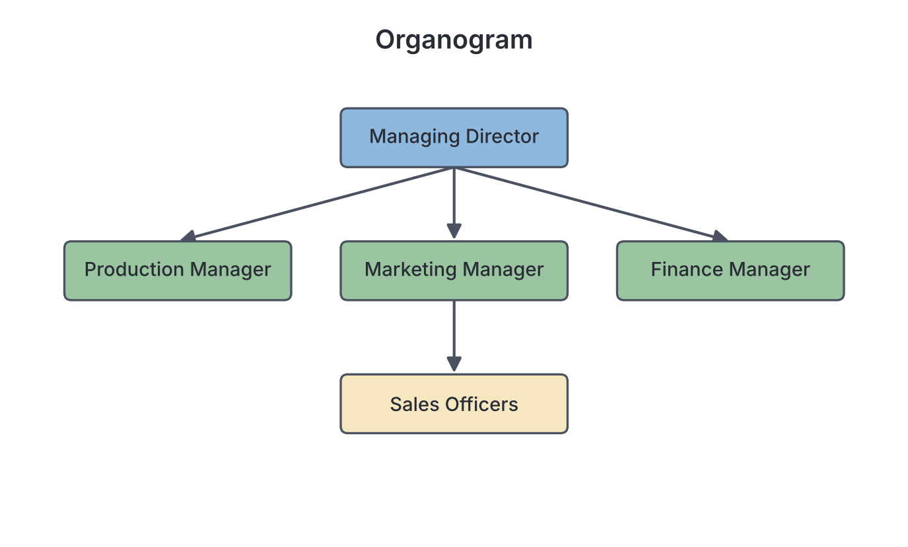
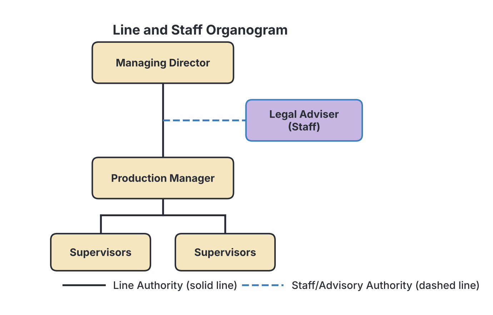
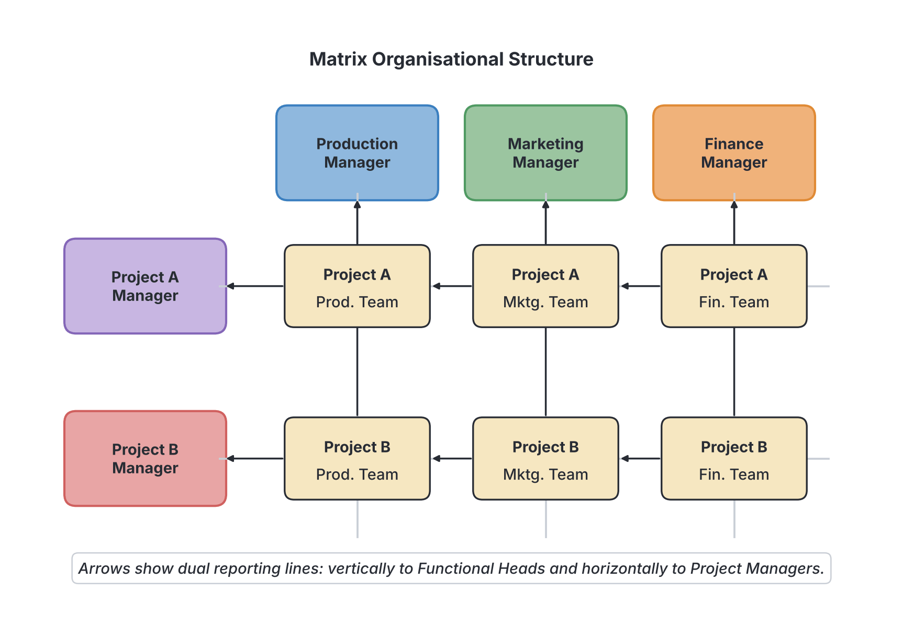

# JAMB Commerce Notes: Elements of Business Management

## What JAMB expects

This topic is Section A, Topic 12 of the JAMB Commerce syllabus: Elements of Business Management. It has five content items:

* (i) Functions (planning, organizing, staffing, coordinating, motivating, communicating, controlling etc.)
* (ii) Principles (span of control, unity of command, delegation of authority, etc.)
* (iii) Organizational structure (line, line and staff, functional, matrix and committee)
* (iv) Functional areas of business (production, marketing, finance and personnel)
* (v) Business resources (man, money, materials, machines and opportunities/goodwill)

By the end of these notes, you should be able to:

1. appraise the functions of management;
2. analyse the principles of management;
3. identify organizational structures;
4. assess the functional areas of business;
5. examine the business resources.

## Functions of management

**Objective i: appraise the functions of management.**
**Content (i): Functions (planning, organizing, staffing, coordinating, motivating, communicating, controlling etc.)**

**Management** is the process of getting things done effectively and efficiently through and with other people to achieve organizational goals. To do this, managers perform several continuous activities known as the **functions of management**.

### 1. Planning
Planning is the first and most important function of management. It involves looking ahead, setting business goals, and deciding in advance the best way to achieve them. It answers the questions: *What* is to be done? *How* is it to be done? *When* is it to be done? and *Who* is to do it?
* **Example:** A Nigerian bakery planning to expand its operations from Lagos to Abuja must decide how much money it needs, where to locate the new factory, and what new equipment to buy.

### 2. Organizing
Once a plan is made, organizing is the process of arranging resources (people, materials, and machines) to carry out the plan. It involves breaking down the total work into smaller tasks, grouping these tasks into departments, and assigning them to specific workers. Organizing creates the structure of the business.

### 3. Staffing
Staffing is the function of filling and keeping filled the positions in the organizational structure. It involves finding the right people for the right jobs. 
* **Processes involved:** Recruitment (attracting candidates), selection (interviewing and hiring), training, and development of workers.

### 4. Coordinating
Coordinating is the process of harmonizing and linking the activities of different departments and individuals so they work together smoothly toward the organization's goals. 
* **Example:** The manager must ensure the production department produces enough goods to meet the sales targets set by the marketing department. Without coordination, departments might work against each other.

### 5. Motivating
Motivating means inspiring and encouraging employees to put in their best effort. A manager must understand what drives their workers. 
* **Methods of motivation:** Financial rewards (salaries, bonuses, allowances) and non-financial rewards (praise, promotion, good working conditions, recognizing a worker as "Employee of the Month").

### 6. Communicating
Communicating is the transfer of information, ideas, and instructions from one person or department to another. Good communication ensures that everyone understands the company's goals and their specific duties. It must be a two-way process: managers give instructions downwards, and workers give feedback or report grievances upwards.

### 7. Controlling
Controlling is the process of monitoring actual performance and comparing it with the planned objectives. If there is a difference (a deviation) between what was planned and what is actually happening, the manager must take corrective action.
* **Steps in controlling:** 
  1. Set a standard (e.g., produce 500 bags of cement a day).
  2. Measure actual performance (e.g., only 400 bags were produced).
  3. Compare performance to the standard (a shortage of 100 bags).
  4. Take corrective action (e.g., repair a broken machine causing the delay).

### 8. Directing (Leading)
Often grouped with motivating and communicating, directing involves giving instructions, guiding, and overseeing subordinates to ensure they do their work properly. 

## Principles of management

**Objective ii: analyse the principles of management.**
**Content (ii): Principles (span of control, unity of command, delegation of authority, etc.)**

The principles of management are fundamental guidelines for decision-making and managerial actions. Many of these originated from Henri Fayol, a French engineer who proposed 14 principles of management. JAMB specifically tests your understanding of the following key concepts:

### 1. Span of control
**Span of control** (or span of management) refers to the number of subordinates that a manager can effectively and efficiently supervise directly. 
* **Narrow span of control:** A manager supervises only a few workers (e.g., 2 to 5). This allows for very close supervision but creates a "tall" organization with many levels of management.
* **Wide span of control:** A manager supervises a large number of workers (e.g., 10 to 20). This is suitable for routine, repetitive work where workers are highly trained, resulting in a "flat" organization.

### 2. Unity of command
**Unity of command** states that an employee should receive orders from, and report to, **only one superior (boss)**. 
* **Why it matters:** If a worker receives conflicting instructions from two different managers at the same time, it causes confusion, a clash of authority, and indiscipline. 

### 3. Delegation of authority
**Delegation** is the transfer of authority and decision-making power from a superior to a subordinate to carry out specific duties. Because a manager cannot do all the work alone, they must pass some tasks down.
* **The Golden Rule of Delegation:** A manager can delegate **authority** (the power to do the work) but can never delegate **ultimate responsibility** (accountability). If a manager delegates a task to a junior staff member and the staff member makes a mistake, the manager is still ultimately answerable to the company directors.

### 4. Other key principles (The "etc." in the syllabus)
* **Division of labour (Specialization):** Work should be divided into small, specialized tasks assigned to individuals based on their skills. This increases speed, efficiency, and output.
* **Authority and Responsibility:** Authority is the right to give orders, while responsibility is the obligation to do the work. The two must go together; you cannot give someone responsibility without the authority needed to carry it out.
* **Unity of direction:** All activities that have the same objective should be directed by one manager using one plan. (Note: *Unity of command* is about people receiving orders from one boss; *Unity of direction* is about departments following one plan).
* **Centralization and Decentralization:** Centralization means decision-making power is kept at the top level of management. Decentralization means power is spread down to lower levels.
* **Esprit de corps:** This is a French phrase meaning "team spirit." Management must promote harmony, unity, and teamwork among employees.

## Organizational structure

**Objective iii: identify organizational structures.**
**Content (iii): Organizational structure (line, line and staff, functional, matrix and committee)**

An **organizational structure** is the framework that shows how authority, responsibility, and tasks are divided, coordinated, and controlled within a business. It is usually drawn as a diagram called an **organogram** (organization chart). 

### 1. Line structure
Also known as scalar or military structure, this is the simplest and oldest form of organizational structure. Authority flows in a direct, straight vertical line from the top management down to the lowest worker.
* **Features:** Everyone knows exactly who their boss is. There are no advisory specialists.
* **Advantages:** Decisions are made quickly; discipline is easy to maintain; clear unity of command.
* **Disadvantages:** Managers can become overloaded with work because they have no experts to advise them. It is only suitable for small businesses.

### 2. Line and staff structure
This structure combines the direct flow of authority (line managers) with the presence of experts or specialists (staff) who provide advice and support.
* **Features:** Line managers (e.g., Production Manager) have the authority to give orders. Staff personnel (e.g., Legal Adviser, Human Resource Expert, Public Relations Officer) only give advice to the line managers; they cannot give orders outside their own department.
* **Advantages:** Line managers get expert advice; relieves line managers of specialized tasks.
* **Disadvantages:** Can cause conflict if line managers ignore the advice of staff experts, or if staff experts try to give orders. It is more expensive to maintain.

### 3. Functional structure
In a functional structure, the organization is divided into departments based on specialized functions or skills (e.g., Production, Marketing, Finance). This is the most common structure for medium and large businesses.
* **Features:** Each department is headed by an expert in that specific field. 
* **Advantages:** High degree of specialization; efficient use of expert skills.
* **Disadvantages:** Departments might become selfish ("silo mentality") and ignore the overall company goals; coordinating between departments can be difficult.

### 4. Matrix structure
A matrix structure (or project structure) combines functional grouping with project-based grouping. Employees have two bosses: they report to their usual functional manager and also to a project manager.
* **Features:** It creates a dual-command situation. It is commonly used in construction (like Julius Berger), engineering, and advertising agencies where experts from different departments are brought together to complete a specific project.
* **Advantages:** Very flexible; excellent for complex, temporary projects; allows pooling of expert knowledge.
* **Disadvantages:** It breaks the principle of "unity of command" (workers have two bosses), which can lead to confusion and power struggles between project managers and functional managers.

### 5. Committee structure
A committee is a group of people formally appointed to consider, investigate, or decide on a specific matter. It can be temporary (ad-hoc) or permanent (standing).
* **Features:** Decision-making authority is given to a group rather than an individual. Examples include a disciplinary committee, a budget committee, or a board of directors.
* **Advantages:** Allows for the pooling of different ideas and experiences ("two heads are better than one"); promotes democratic decision-making.
* **Disadvantages:** Slow decision-making process; compromises may lead to weak decisions; no single person can be held fully responsible if things go wrong.

### Comparison of major organizational structures

| Feature | Line Structure | Line and Staff Structure | Functional Structure | Matrix Structure |
| :--- | :--- | :--- | :--- | :--- |
| **Authority flow** | Direct vertical line | Vertical line + horizontal advice | By specialized department | Dual command (vertical & horizontal) |
| **Specialists** | None | Yes, as advisors | Yes, as department heads | Yes, grouped by project |
| **Best for** | Small businesses | Medium to large businesses | Medium to large businesses | Project-based companies (e.g., construction) |
| **Unity of command** | Strictly maintained | Maintained for line workers | Maintained within functions | Broken (employees have two bosses) |

## Functional areas of business

**Objective iv: assess the functional areas of business.**
**Content (iv): Functional areas of business (production, marketing, finance and personnel)**

Most modern businesses organize their activities into distinct functional departments. Each department is responsible for a specific aspect of the business, but they must all work together (be coordinated) to achieve the organization’s overall goals. 

### 1. Production department
This department is responsible for turning raw materials into finished goods or services.
* **Key functions:**
  * **Manufacturing:** Actually making the product (e.g., a Nigerian textile mill turning cotton into fabric).
  * **Production planning and control:** Deciding what will be produced, when, and how.
  * **Quality control:** Ensuring the finished goods meet the required standards and have no defects.
  * **Maintenance:** Keeping factory machinery and equipment in good working order.
  * **Purchasing (sometimes separate):** Buying the raw materials needed for production.

### 2. Marketing department
Marketing is responsible for identifying what consumers want and ensuring the company provides it profitably. It connects the business with the outside world.
* **Key functions:**
  * **Market research:** Gathering information about consumer needs, preferences, and competitors in the market.
  * **Product development:** Working with the production team to design goods that customers actually want to buy.
  * **Pricing:** Setting the right price that is attractive to buyers but profitable for the company.
  * **Promotion (Advertising):** Creating awareness and persuading people to buy the product through TV, radio, billboards, or social media.
  * **Sales and Distribution:** Ensuring the goods reach the consumers efficiently, sometimes using wholesalers and retailers.

### 3. Finance department
The finance department manages the company’s money. It ensures the business has enough funds to operate and keeps track of how money is spent.
* **Key functions:**
  * **Accounting and Record keeping:** Recording all financial transactions, preparing balance sheets, and calculating profit or loss.
  * **Budgeting:** Planning future financial needs and deciding how money will be allocated to different departments.
  * **Sourcing funds:** Finding the cheapest and best ways to raise capital (e.g., getting bank loans or issuing shares on the Nigerian Exchange).
  * **Payment (Payroll):** Paying workers' wages and salaries, as well as paying suppliers and taxes to the government.

### 4. Personnel (Human Resources) department
Also known as Human Resources (HR), the personnel department is responsible for managing the most important asset of the business: its workers.
* **Key functions:**
  * **Recruitment and Selection:** Advertising job vacancies, conducting interviews, and hiring the best candidates.
  * **Training and Development:** Organizing workshops and courses to improve workers' skills.
  * **Welfare:** Managing employee benefits, health, safety, and working conditions.
  * **Discipline and Dismissal:** Handling employee grievances, disciplining workers who break rules, and firing poor-performing staff.
  * **Performance appraisal:** Evaluating how well employees are doing their jobs, which helps in deciding promotions or salary increases.

## Business resources

**Objective v: examine the business resources.**
**Content (v): Business resources (man, money, materials, machines and opportunities/goodwill)**

For a business to operate, produce goods, and make a profit, it needs resources. These are the inputs required for production. They are commonly known as the "Ms of Management" along with intangible assets.

### 1. Man (Human Resources)
"Man" refers to the human effort, both mental and physical, used in the business. This includes top management, supervisors, and unskilled labourers. 
* **Importance:** Human resources are the **most active and most important** of all business resources. Why? Because money, materials, and machines cannot do anything on their own. It takes human beings to plan, organize, operate machines, and put the other resources to use.

### 2. Money (Financial Resources)
Money refers to the financial capital needed to start and run the business.
* **Importance:** It is the purchasing power of the business. Without money, a business cannot buy raw materials, pay its workers' salaries, buy machinery, or rent a factory. Money provides the foundation for acquiring all other physical resources.

### 3. Materials (Physical Resources)
Materials refer to the raw materials, semi-finished goods, components, and supplies that the business uses to produce its final product.
* **Example:** For a furniture maker in Benin City, materials include timber, nails, glue, and polish. For a pure water company, materials include untreated water and plastic sachets. Without materials, the production department has nothing to work on.

### 4. Machines (Technological Resources)
Machines include all tools, equipment, vehicles, computers, and factory plants used in the business.
* **Importance:** Machines make production faster, easier, and standard. They replace heavy human labor and increase the quantity of goods a business can produce.

### 5. Opportunities / Goodwill (Intangible Resources)
Unlike the four physical "Ms", opportunities and goodwill are invisible (intangible) but extremely valuable resources.
* **Opportunities:** Favourable external conditions that a business can exploit to make a profit. For example, a new government policy banning imported rice creates a huge business *opportunity* for local Nigerian rice farmers to sell more.
* **Goodwill:** This is the good reputation, brand loyalty, and public image a business has built up over time. 
  * **Why goodwill is a resource:** Because of goodwill, customers will choose to buy from a trusted company (like Dangote Cement or GTBank) even if a new, unknown competitor offers a slightly cheaper product. Goodwill allows a business to retain customers and make consistent profits, and it holds a measurable monetary value if the business is ever sold.

## Key terms

| Term | Meaning |
| :--- | :--- |
| **Management** | The process of getting things done through others to achieve organizational goals. |
| **Planning** | The management function of setting future objectives and deciding how to achieve them. |
| **Span of control** | The number of subordinates a manager can effectively and efficiently supervise directly. |
| **Unity of command** | The management principle stating an employee should receive orders from only one boss. |
| **Delegation** | Transferring authority to a subordinate to perform a task, while retaining ultimate responsibility. |
| **Organogram** | A chart showing the internal structure, hierarchy, and lines of authority in an organization. |
| **Line structure** | A simple organizational structure where authority flows directly vertically from top to bottom. |
| **Matrix structure** | A structure combining functional and project setups, where an employee reports to two managers. |
| **Human resources (Man)** | The workforce of a business; the most vital resource as it controls all other resources. |
| **Goodwill** | The intangible asset representing a company's good reputation, brand loyalty, and customer trust. |

## Exam tips and common mistakes

* **Authority vs. Responsibility in Delegation:** A very common JAMB question asks what cannot be delegated. Remember: you can delegate **authority** (power), but you **cannot delegate ultimate responsibility** (accountability).
* **Span of Control vs. Unity of Command:** Do not confuse these two! *Span of control* is about *how many* workers one boss supervises. *Unity of command* is about one worker having *only one* boss.
* **Line vs. Line and Staff:** If a question mentions "advisory experts" or "specialists without command power," the answer is **Line and staff structure**. If it says "direct flow of authority only," it is **Line structure**.
* **Matrix Structure:** JAMB often uses keywords like "dual command," "two bosses," or "project-based" to test the Matrix structure. It is the only structure that intentionally breaks the principle of unity of command.
* **Most important resource:** If asked which business resource is the most important or most active, the answer is always **Man (Human resources)** because it organizes and utilizes all the others.

## Quick summary

1. Management involves key functions: planning (setting goals), organizing (arranging resources), staffing (hiring), coordinating (harmonizing), motivating, communicating, and controlling (checking progress).
2. Henri Fayol's principles of management include span of control, unity of command, and delegation of authority.
3. A manager can delegate authority to a subordinate to do a job, but ultimate responsibility remains with the manager.
4. Organizational structures (shown on an organogram) include line (direct authority), line and staff (with advisors), functional (by specialization), matrix (dual project command), and committee.
5. The main functional areas of a business are Production (manufacturing), Marketing (selling and research), Finance (money management), and Personnel/HR (managing staff).
6. Business resources (the inputs for production) consist of the 4 Ms (Man, Money, Materials, Machines) and intangible resources (Opportunities and Goodwill). 
7. Human resources (Man) is the most critical resource because it controls all other resources.

## Practice questions

**1. The management function which involves comparing actual performance with planned objectives to ensure goals are met is called**
- A. planning
- B. controlling
- C. coordinating
- D. directing

**Answer: B.** Controlling is the process of monitoring actual performance and taking corrective action if it falls short of the plan. A common mistake is choosing coordinating, but coordinating means harmonizing departments, not checking performance against standards.

**2. Which management principle states that a subordinate should receive instructions from only one superior?**
- A. Span of control
- B. Unity of direction
- C. Unity of command
- D. Esprit de corps

**Answer: C.** Unity of command ensures an employee has only one boss, preventing conflicting orders. Unity of direction (Option B) means one plan for a group of activities, which students often confuse with unity of command.

**3. In the process of delegation, a manager can transfer**
- A. authority but not ultimate responsibility
- B. responsibility but not authority
- C. both authority and ultimate responsibility
- D. neither authority nor responsibility

**Answer: A.** A manager gives the subordinate the authority (power) to do the work but remains ultimately responsible to top management for the final outcome. 

**4. The organizational structure where a worker has to report to both a functional manager and a project manager is the**
- A. functional structure
- B. line and staff structure
- C. matrix structure
- D. line structure

**Answer: C.** The matrix structure assigns workers to specific projects while keeping them in their functional departments, creating a dual-reporting system. 

**5. Which of the following departments is primarily responsible for market research, pricing, and advertising?**
- A. Production department
- B. Personnel department
- C. Finance department
- D. Marketing department

**Answer: D.** The marketing department connects the business with consumers by researching their needs, setting prices, and promoting products. 

**6. The number of subordinates a manager can effectively supervise is referred to as**
- A. chain of command
- B. organizational chart
- C. span of control
- D. delegation of authority

**Answer: C.** Span of control dictates how wide or narrow a manager's supervisory reach is. Chain of command (Option A) refers to the line of authority from top to bottom, not the number of subordinates.

**7. In an organization, the legal adviser and public relations officer who provide specialized advice without direct command over operations are part of a**
- A. line structure
- B. line and staff structure
- C. committee structure
- D. functional structure

**Answer: B.** In a line and staff structure, experts (staff) provide advice to the operational managers (line) but do not have authority outside their own departments.

**8. Which of the following business resources is regarded as the most active and important?**
- A. Money
- B. Machines
- C. Materials
- D. Man

**Answer: D.** Man (human resources) is the most important resource because human intelligence and effort are required to mobilize, operate, and manage money, machines, and materials.

**9. The intangible business resource that refers to the good reputation and brand loyalty a company enjoys is known as**
- A. opportunities
- B. goodwill
- C. motivation
- D. staff welfare

**Answer: B.** Goodwill is the established reputation of a business regarded as a quantifiable asset, distinct from physical resources.

**10. A baker buys flour, sugar, and yeast to bake bread. These items fall under which category of business resources?**
- A. Machines
- B. Capital
- C. Materials
- D. Opportunities

**Answer: C.** Materials refer to the raw materials and components used in the production process. A common slip is confusing this with capital, but in management resource grouping (the 4 Ms), physical production inputs are specifically 'Materials'.

<!-- COVERAGE
obj i | ## Functions of management
obj ii | ## Principles of management
obj iii | ## Organizational structure
obj iv | ## Functional areas of business
obj v | ## Business resources
item i | ## Functions of management
item ii | ## Principles of management
item iii | ## Organizational structure
item iv | ## Functional areas of business
item v | ## Business resources
-->
