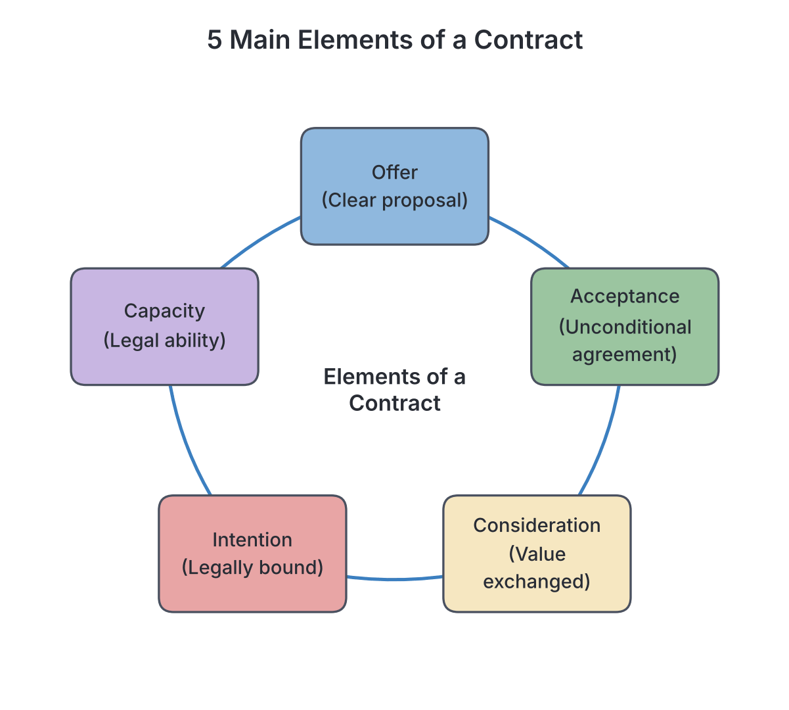
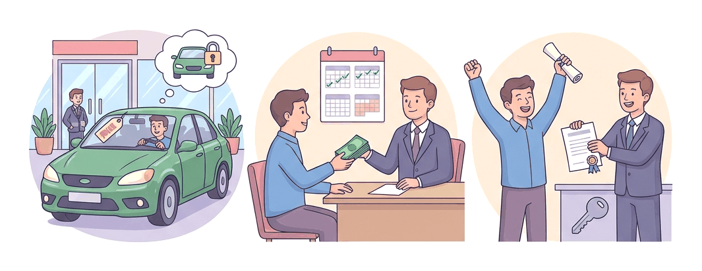

# JAMB Commerce Notes: Legal Aspects of Business

## What JAMB expects

This topic covers Section A, Topic 14 of the JAMB Commerce syllabus: Legal Aspects of Business. It deals with the laws that guide how business is done in Nigeria, protecting buyers, sellers, employers, and employees.

It covers the following content items:
* (i) Meaning and validity of a simple contract
* (ii) Agency, Sale of Goods Act and Hire Purchase Act
* (iii) Contract of employment
* (iv) Government regulations of business (registration of business, patents, trademarks, copyrights, etc)
* (v) Consumer protection (Government legislation, Standards Organization Trade Descriptions Act, Consumer Protection Council, NAFDAC, NDLEA, Customs and Excise, etc.)
* (vi) Regulatory agencies.

By the end of these notes, you should be able to:
1. analyse the elements and validity of a simple contract;
2. examine Agency, Sale of Goods Act and Hire Purchase Act;
3. assess the rights and obligations of employers and employees;
4. distinguish between patents, trademarks and copyrights;
5. identify the functions of consumerism;
6. assess the relevance of regulatory agencies and acts in the provision of safe goods and drugs.

> **Note on the syllabus wording:** The syllabus mentions the "Consumer Protection Council (CPC)". At the time of writing, this body has been replaced by the **Federal Competition and Consumer Protection Commission (FCCPC)** under a 2018 law. Also, the syllabus lists "Standards Organization Trade Descriptions Act" which is missing a comma; these are two separate entities/laws (the Standards Organisation of Nigeria, and the Trade Descriptions Act). We will cover them exactly as JAMB tests them while explaining the correct current positions.

---

## Meaning and validity of a simple contract

A **contract** is a legally binding agreement between two or more parties. If one party breaks the agreement, the other party can take them to a court of law to seek a remedy. 

Not all agreements are contracts. If you agree to meet your friend for lunch at a fast-food restaurant and you fail to show up, your friend cannot sue you because it was merely a social agreement. However, if you agree to buy a plot of land from an agent and you pay the money, but the agent refuses to give you the documents, you can sue, because that is a legal contract.

Contracts are generally divided into two:
1. **Specialty Contracts (Contracts under seal):** These are formal contracts that must be in writing, signed, sealed, and delivered. Examples include the sale of land or property.
2. **Simple Contracts:** These are contracts that are not under seal. They can be made orally (by word of mouth), in writing, or implied by conduct (e.g., buying a bottle of water from a shop). 

### Analyse the elements and validity of a simple contract

For a simple contract to be valid and enforceable in a court of law, certain essential elements must be present. If any of these are missing, the contract may be invalid.

#### 1. Elements of a Valid Contract

1. **Offer:** An offer is a clear proposal or promise made by one party (the **offeror**) to another (the **offeree**), with the intention that it will become a binding contract if accepted. 
   * *Note:* An offer is different from an **"Invitation to Treat"**. An invitation to treat is merely an invitation for others to make an offer. Examples of invitations to treat include displaying goods with price tags in a supermarket, advertising goods in a newspaper, or an auctioneer asking for bids. When you take a basket to the supermarket counter, *you* are making the offer, and the cashier *accepts* it when they take your money.
2. **Acceptance:** This is the unconditional agreement to all the terms of the offer by the offeree. It must be communicated to the offeror. If the offeree changes the terms (e.g., "I will buy the phone for ₦40,000 instead of ₦50,000"), it is no longer an acceptance but a **counter-offer**, which cancels the original offer.
3. **Consideration:** This is the "price" paid for the promise. It is what each party brings to the table. In a contract to buy a laptop, your consideration is the money (e.g., ₦150,000), and the seller's consideration is the laptop. Consideration must have some value, but it does not have to be adequate (e.g., you can legally sell your car for ₦100 if you choose to, provided there was no force or fraud).
4. **Intention to create legal relations:** Both parties must intend for the agreement to be legally binding. Business and commercial agreements automatically have this intention. Social and domestic agreements (like a father promising his son a bicycle for passing an exam) usually lack this intention and are not legally binding.
5. **Capacity to contract:** The parties must be legally capable of entering into a contract. Minors (persons under 18), people of unsound mind, and intoxicated persons generally lack the capacity to make binding contracts (except for "necessaries" like basic food and clothing).
6. **Legality of object:** The purpose of the contract must be legal. A contract to smuggle contraband goods or commit a crime is illegal and void.
7. **Consent:** The agreement must be made freely. It must not be obtained through force, threats, or fraud.

#### 2. Validity of a Contract

A contract's legal status can fall into one of four categories based on its validity:

* **Valid Contract:** All essential elements are present. It is fully enforceable by law.
* **Void Contract:** This is a contract that has no legal effect whatsoever from the very beginning. It is as if it never existed. Examples include contracts for illegal acts or contracts lacking consideration.
* **Voidable Contract:** This is a contract that is valid and binding, but one party has the right to cancel (avoid) it because there was a flaw when it was made. For example, if Amina is forced (under duress) or tricked (by misrepresentation) into signing a contract, she can choose to either continue with it or have it cancelled.
* **Unenforceable Contract:** This is a valid contract that the courts will not enforce because of a technical defect, such as failing to put it in writing when the law requires it (e.g., sale of land), or because the time limit to sue has expired (statute of limitations).

#### 3. Discharge of a Contract

Discharge of a contract means the contract has come to an end, and the parties are free from their obligations. A contract can be discharged by:
1. **Performance:** Both parties have successfully done what they promised to do. (The most common way).
2. **Agreement:** Both parties mutually agree to cancel the contract before it is completed.
3. **Frustration:** Something completely unexpected happens, making it impossible to complete the contract (e.g., a hall rented for a wedding burns down a day before the event).
4. **Breach:** One party fails or refuses to do what they promised. The other party is discharged from their duties and can sue for **damages** (financial compensation).

---

## Agency, Sale of Goods Act and Hire Purchase Act

These are three specific types of commercial contracts that govern how goods are sold and how businesses are represented in Nigeria.

### Examine Agency, Sale of Goods Act and Hire Purchase Act

#### 1. Agency

**Agency** is a legal relationship where one person, called the **Agent**, is given the authority to act on behalf of another person, called the **Principal**, to form a contract with a **Third Party**. 
For example, if you (the Principal) hire an estate agent (the Agent) to sell your house to a buyer (the Third Party), the contract of sale is between you and the buyer, not the agent.

**How Agency is Created:**
* **Express Agency:** The principal clearly appoints the agent, either in writing or orally.
* **Implied Agency:** Created by the conduct or relationship of the parties (e.g., a wife buying household food on credit on behalf of her husband).
* **Agency by Estoppel:** If a principal allows a third party to believe that someone is their agent, the principal is "estopped" (prevented) from later denying it.
* **Agency by Ratification:** Someone acts as an agent without authority, but the principal later approves and accepts (ratifies) the action.
* **Agency by Necessity:** Created in an emergency to protect the property of the principal (e.g., a driver of a broken-down truck selling perishable tomatoes before they rot, even without reaching the owner).

**Types of Agents:**
* **Factor:** An agent who is given possession of goods and can sell them in their own name. They can pledge the goods for a loan.
* **Broker:** An agent who negotiates contracts between buyers and sellers but does *not* have possession of the goods and cannot sell in their own name (e.g., a stockbroker).
* **Del Credere Agent:** An agent who guarantees that the third party will pay for the goods sold. If the buyer defaults, the del credere agent pays the principal. In return, they receive a higher commission (del credere commission).
* **Auctioneer:** An agent licensed to sell goods to the highest bidder in a public auction.

**Duties of an Agent:** To obey lawful instructions, to exercise skill and care, to avoid conflicts of interest, not to make secret profits, and not to delegate their duties (*delegatus non potest delegare*).

#### 2. The Sale of Goods Act (1893)

The Sale of Goods Act is a law that governs contracts where a seller transfers or agrees to transfer the ownership (property) of goods to a buyer for a money consideration called the price. 

**Conditions and Warranties:**
Terms in a contract of sale are divided into conditions and warranties.
| Feature | Condition | Warranty |
| :--- | :--- | :--- |
| **Meaning** | A vital, major term that goes to the root of the contract. | A minor term that is secondary to the main purpose of the contract. |
| **Breach effect** | If broken, the injured party can reject the goods and cancel the contract. | If broken, the injured party can only sue for damages (money), but cannot reject the goods. |
| **Example** | Ordering a blue car and receiving a red one. | Ordering a car with a free spare tyre, but the spare tyre is missing. |

**Caveat Emptor:** 
This is a Latin phrase meaning **"Let the buyer beware."** Traditionally, the law says it is the buyer's duty to check the goods before buying them. If you buy a faulty shoe without inspecting it, the seller is not liable. 
However, the Sale of Goods Act protects the buyer by creating **implied conditions** (rules that apply even if not written down), such as:
1. The seller actually has the right to sell the goods.
2. The goods must match their description (if you order "pure honey", it must not be sugar syrup).
3. The goods must be of merchantable quality (fit for their normal purpose).

**Transfer of Ownership (Property) and *Nemo dat quod non habet*:**
The general rule is *Nemo dat quod non habet*, meaning **"You cannot give what you do not have."** If a thief steals a television and sells it to you, you do not become the legal owner, even if you paid for it innocently. 
**Exceptions to Nemo dat:**
* **Market Overt:** If goods are bought openly in a recognized public market during normal business hours in good faith.
* **Sale by an authorized Agent:** A factor selling goods binds the principal.
* **Estoppel:** When the true owner's conduct makes it look like the seller has the right to sell.

**Rights of an Unpaid Seller:**
If a seller has not been fully paid, they have special rights under the Act:
1. **Lien:** The right to hold onto the goods until payment is made (if they haven't been delivered yet).
2. **Stoppage in transit:** The right to stop the goods while they are on their way to the buyer if the buyer becomes bankrupt.
3. **Right of resale:** The right to resell the perishable goods or if the buyer takes too long to pay.

#### 3. Hire Purchase Act

**Hire Purchase** is a contract where the owner of goods lets them out on hire to a hirer, with an agreement that the hirer will pay in instalments, and the ownership (property) will transfer to the hirer *only when the final instalment is paid*. Until that final payment, the hirer is just renting the goods. If they fail to pay, the owner can repossess (take back) the goods.

**Hire Purchase vs. Credit Sale vs. Deferred Payment:**
It is very important not to confuse these terms.
| Feature | Hire Purchase | Credit Sale | Deferred Payment (Installment Sale) |
| :--- | :--- | :--- | :--- |
| **Transfer of Ownership** | Passes only after the **last** instalment is paid. | Passes to the buyer **immediately** at the time of contract. | Passes to the buyer **immediately**. |
| **Right of Repossession** | The owner can repossess the goods if the hirer defaults on payments. | The seller cannot repossess the goods; they can only sue for the money owed. | The seller cannot repossess; they must sue for the debt. |
| **Right to Sell** | The hirer cannot sell the goods to a third party (since they don't own them yet). | The buyer can sell the goods at any time because they are the legal owner. | The buyer can sell the goods at any time. |

**Obligations under Hire Purchase:**
* **Owner:** Must ensure the goods are of merchantable quality, must deliver the goods, and must respect the hirer's quiet possession.
* **Hirer:** Must pay the instalments as agreed, must take reasonable care of the goods, and must not sell or pledge the goods.

---

## Contract of employment

A **Contract of Employment** is a legally binding agreement between an employer and an employee, where the employee agrees to work for the employer in exchange for a wage or salary. 

### Assess the rights and obligations of employers and employees

Both parties have rights and duties implied by law, even if they are not written down in the employment letter.

#### Rights and Duties of the Employer
* **Rights of the employer:**
  * To expect the employee to render the agreed services faithfully.
  * To give lawful and reasonable orders which the employee must obey.
  * To dismiss an employee for gross misconduct (e.g., theft, fighting, disclosing company secrets).
  * To expect the employee to be punctual and dedicated.
* **Duties (Obligations) of the employer:**
  * To pay the agreed wages/salary promptly.
  * To provide a safe and healthy working environment (e.g., providing safety boots for factory workers).
  * To provide work for the employee (especially if the employee is paid by the piece or commission).
  * To reimburse the employee for reasonable expenses incurred while doing the job.

#### Rights and Duties of the Employee
* **Rights of the employee:**
  * The right to receive regular payment (wages/salary).
  * The right to paid annual leave and sick leave.
  * The right to join a trade union.
  * The right to a safe working environment.
* **Duties (Obligations) of the employee:**
  * To obey all lawful and reasonable instructions from the employer.
  * To exercise reasonable skill and care in carrying out their duties.
  * To act in good faith and loyalty (not working for a competitor in secret).
  * Not to disclose confidential information or trade secrets of the business.

---

## Government regulations of business (registration of business, patents, trademarks, copyrights, etc)

To ensure order, protect innovators, and track economic activities, the government regulates businesses through various registrations and intellectual property laws.

### Distinguish between patents, trademarks and copyrights

Before distinguishing these intellectual property rights, we must mention **Business Registration**. In Nigeria, businesses must be registered with the **Corporate Affairs Commission (CAC)** under the Companies and Allied Matters Act (CAMA) 2020. This formalises the business, giving it legal recognition.

**Intellectual Property** refers to creations of the mind. The government protects these through Patents, Trademarks, and Copyrights, ensuring that creators profit from their work and preventing others from stealing it.

| Feature | Patent | Trademark | Copyright |
| :--- | :--- | :--- | :--- |
| **What it protects** | **Inventions**, new machines, processes, or scientific discoveries. | **Brand identity**: logos, names, symbols, slogans, or designs used in trade. | **Creative works**: books, music, art, films, software, and broadcasts. |
| **Example** | A newly invented machine for peeling cassava; a new pharmaceutical drug formula. | The MTN yellow logo; the Coca-Cola name; the Nike "swoosh" tick. | A JAMB Commerce textbook; a song by a Nigerian artist; a Nollywood movie. |
| **Purpose** | Prevents others from making, using, or selling the invention without permission. | Helps consumers distinguish one company’s goods/services from another's. Prevents brand copying. | Prevents unauthorized copying, publishing, or performing of the creative work. |
| **Duration (General)** | Usually lasts for 20 years from the date of filing. | Lasts indefinitely, as long as it is renewed (usually every 10 years) and used. | Lasts for the life of the author plus 70 years after their death (in Nigeria). |
| **Symbol** | Usually labeled "Patented". | ™ (unregistered) or ® (registered). | © |

---

## Consumer protection

**Consumer protection** refers to the laws, organizations, and actions designed to protect the rights of consumers from unfair, deceptive, or dangerous practices by businesses. 
**Consumerism** is the organized movement of citizens and government agencies to improve the rights and power of buyers in relation to sellers.

### Identify the functions of consumerism

The main functions of consumerism (reasons for consumer protection) include:
1. **Protection against harmful goods:** Ensuring foods and drugs are not expired, toxic, or hazardous to health.
2. **Prevention of deceptive advertising:** Stopping businesses from making false claims about what their product can do.
3. **Ensuring fair pricing and quality:** Protecting consumers from being overcharged, especially by monopolies, and ensuring goods are of merchantable quality.
4. **Enforcing standard weights and measures:** Ensuring a "1kg" bag of rice actually weighs 1kg, and a "litre" of fuel at the filling station is truly a litre.
5. **Educating consumers:** Making buyers aware of their rights so they are not easily cheated.

**Government Legislation for Consumer Protection:**
The government passes laws to enforce these protections, such as:
* **The Sale of Goods Act:** Ensures goods match their description and are fit for purpose.
* **Weights and Measures Act:** Makes it a criminal offence to use false scales or measuring equipment.
* **Food and Drugs Act:** Regulates the manufacture, sale, and advertisement of food, drugs, and cosmetics to ensure they are safe.
* **Trade Descriptions Act:** Makes it illegal for businesses to give false or misleading information about their products (e.g., claiming a leather shoe is pure leather when it is synthetic). 

---

## Regulatory agencies

To enforce the laws mentioned above, the government creates special bodies known as regulatory agencies.

### Assess the relevance of regulatory agencies and acts in the provision of safe goods and drugs

Several key agencies operate in Nigeria. Understanding their specific roles is crucial, as students frequently mix them up.

#### 1. Standards Organisation of Nigeria (SON)
SON is responsible for ensuring that **manufactured products, industrial goods, and materials** meet established quality standards. 
* **Relevance:** It prevents the circulation of substandard products like fake building materials (which cause building collapses), faulty electrical wires (which cause fires), and poor-quality vehicle tyres. Products that pass their tests are given the **NIS (Nigerian Industrial Standard)** mark of quality.

#### 2. Consumer Protection Council (CPC) / FCCPC
The CPC was established to attend to general consumer complaints, seek redress, and eliminate hazardous products from the market. 
* *Note:* As mentioned, the CPC was replaced by the **Federal Competition and Consumer Protection Commission (FCCPC)**. 
* **Relevance:** It serves as a general watchdog. If a consumer buys a faulty refrigerator and the company refuses to honor the warranty, the consumer can report to the FCCPC to force the company to replace it or refund the money.

#### 3. National Agency for Food and Drug Administration and Control (NAFDAC)
NAFDAC is specifically tasked with regulating and controlling the manufacture, importation, exportation, distribution, advertisement, sale, and use of **Food, Drugs, Cosmetics, Medical Devices, Packaged Water, and Chemicals**.
* **Relevance:** NAFDAC is highly relevant in fighting the menace of fake and expired drugs in Nigeria (a fight famously led by the late Prof. Dora Akunyili). Every approved food and drug product in Nigeria must carry a **NAFDAC Registration Number**. 

#### 4. National Drug Law Enforcement Agency (NDLEA)
Unlike NAFDAC (which regulates medical drugs), the NDLEA is responsible for eliminating the growing, processing, manufacturing, selling, exporting, and trafficking of **hard, illicit, and narcotic drugs** (such as cocaine, heroin, and cannabis/marijuana).
* **Relevance:** It protects society from the harmful effects of drug abuse and international drug trafficking, securing Nigeria's borders and airports against drug cartels.

#### 5. Nigerian Customs Service (Customs and Excise)
Customs officers are stationed at seaports, airports, and land borders. Their main duty is to collect tariffs (import duties) on behalf of the government, but they play a massive role in consumer protection.
* **Relevance:** They are the first line of defense in intercepting **contraband (banned) goods** from entering the country. For example, Customs officers regularly seize smuggled frozen poultry, expired foreign rice, and illegal weapons, ensuring these dangerous items never reach Nigerian markets.

---

## Key terms

| Term | Meaning |
| :--- | :--- |
| **Contract** | A legally binding agreement between two or more parties. |
| **Offer** | A clear proposal made with the intention of being bound if accepted. |
| **Consideration** | The price, value, or promise exchanged between parties in a contract. |
| **Void Contract** | A contract that has no legal effect from the beginning. |
| **Agency** | A relationship where an agent acts on behalf of a principal to contract with a third party. |
| **Del Credere Agent** | An agent who guarantees that a buyer will pay, receiving an extra commission. |
| **Caveat Emptor** | "Let the buyer beware." The principle that the buyer is responsible for checking goods before purchase. |
| **Nemo dat quod non habet** | "You cannot give what you do not have." A seller cannot pass a better title (ownership) than they possess. |
| **Hire Purchase** | A system of buying goods where payment is made in instalments, and ownership passes *only* on the final payment. |
| **Patent** | An exclusive legal right granted for an invention. |
| **Trademark** | A recognized sign, design, or expression identifying products or services of a particular brand. |
| **Copyright** | An exclusive legal right over a creative, literary, or artistic work. |

---

## Exam tips and common mistakes

* **Offer vs. Invitation to Treat:** Remember that displaying goods with a price tag in a shop is NOT an offer, it is an invitation to treat. Taking the goods to the cashier is the offer.
* **Hire Purchase vs. Credit Sale:** In Hire Purchase, ownership passes at the *last* instalment. In Credit Sale, ownership passes *immediately*. This is one of the most frequently tested distinctions in JAMB.
* **SON vs. NAFDAC:** SON regulates manufactured/industrial goods (electronics, cement, steel). NAFDAC regulates consumables (food, drugs, pure water, cosmetics). Do not mix them up!
* **NDLEA vs. NAFDAC:** NAFDAC handles legitimate drugs (like paracetamol) to ensure they are safe. NDLEA handles illegal hard drugs (like cocaine) to arrest traffickers.
* **Void vs. Voidable:** "Void" means it was never a contract (e.g., illegal). "Voidable" means it is a valid contract, but one party has the right to cancel it (e.g., due to fraud).

---

## Quick summary

1. A valid simple contract requires an offer, acceptance, consideration, intention to create legal relations, capacity, legality, and free consent.
2. In an agency relationship, an agent makes contracts for a principal with third parties. A del credere agent guarantees payment for an extra commission.
3. The Sale of Goods Act protects buyers through implied conditions (like merchantable quality) and limits the *Caveat Emptor* rule.
4. Hire purchase allows a hirer to pay in instalments, but the ownership of the goods remains with the seller until the final instalment is paid. 
5. Intellectual property is protected by Patents (for inventions), Trademarks (for brand logos/names), and Copyrights (for artistic/literary works).
6. Consumerism protects buyers from unfair business practices, unsafe products, and false advertising. 
7. Regulatory agencies enforce standards: NAFDAC for food and drugs, SON for manufactured goods, NDLEA for illicit drugs, and Customs for border control of imports/exports.

---

## Practice questions

**1. A display of goods with price tags in a supermarket is legally known as:**
- A. an offer
- B. an acceptance
- C. a consideration
- D. an invitation to treat

**Answer: D.** An invitation to treat is merely an invitation to the public to make an offer. The customer makes the offer by taking the goods to the counter to pay.

**2. In which of the following transactions does ownership of goods pass to the buyer immediately the contract is signed?**
- A. Hire purchase
- B. Equipment leasing
- C. Credit sale
- D. Simple renting

**Answer: C.** In a credit sale, ownership of the property passes to the buyer immediately, even though the payment will be made at a later date. In hire purchase, it passes only after the final instalment.

**3. The legal maxim *Caveat Emptor* means:**
- A. let the seller beware
- B. let the buyer beware
- C. you cannot give what you do not have
- D. goods must match their description

**Answer: B.** *Caveat Emptor* means "let the buyer beware", placing the responsibility on the buyer to inspect goods before purchasing. "You cannot give what you do not have" is *Nemo dat quod non habet*.

**4. Which of the following intellectual property rights is used to protect an inventor’s new machine from being copied by others?**
- A. Copyright
- B. Trademark
- C. Patent
- D. Business registration

**Answer: C.** A patent protects inventions and discoveries. Copyright protects artistic/literary works, and trademarks protect brand identities like logos.

**5. An agent who promises to make good any loss suffered by the principal if a buyer fails to pay for goods is called a:**
- A. general agent
- B. broker
- C. factor
- D. del credere agent

**Answer: D.** A del credere agent guarantees the payment of goods sold to a third party and in return receives a higher commission.

**6. Which of the following agencies in Nigeria is responsible for ensuring the quality of manufactured industrial goods like building materials?**
- A. NAFDAC
- B. SON
- C. NDLEA
- D. Customs and Excise

**Answer: B.** The Standards Organisation of Nigeria (SON) regulates manufactured and industrial goods. NAFDAC focuses on food, drugs, and cosmetics.

**7. A contract in which one of the parties has the right to either cancel it or continue with it because of a flaw like misrepresentation is termed:**
- A. void
- B. voidable
- C. valid
- D. unenforceable

**Answer: B.** A voidable contract is one that is valid but can be cancelled by the aggrieved party. A void contract, on the other hand, has no legal standing from the start.

**8. Which of the following is a primary duty of an employee to an employer?**
- A. To provide a safe working environment
- B. To pay wages promptly
- C. To obey lawful and reasonable instructions
- D. To grant annual leave

**Answer: C.** Obeying lawful and reasonable instructions is the duty of the employee. Providing a safe environment, paying wages, and granting leave are obligations of the employer.

**9. The government agency charged with the responsibility of intercepting smuggled and contraband goods at the country's borders is the:**
- A. Consumer Protection Council
- B. Nigerian Police Force
- C. Nigerian Customs Service
- D. National Drug Law Enforcement Agency

**Answer: C.** The Nigerian Customs Service operates at borders and ports to collect tariffs and stop contraband (banned/smuggled) goods from entering the country.

**10. When an unauthorized person acts on behalf of a principal, but the principal later accepts and approves the transaction, agency is created by:**
- A. necessity
- B. estoppel
- C. express agreement
- D. ratification

**Answer: D.** Agency by ratification occurs when the principal approves an act that was done on their behalf without their prior authority.

<!-- COVERAGE
obj i | Analyse the elements and validity of a simple contract
obj ii | Examine Agency, Sale of Goods Act and Hire Purchase Act
obj iii | Assess the rights and obligations of employers and employees
obj iv | Distinguish between patents, trademarks and copyrights
obj v | Identify the functions of consumerism
obj vi | Assess the relevance of regulatory agencies and acts in the provision of safe goods and drugs
item i | Meaning and validity of a simple contract
item ii | Agency, Sale of Goods Act and Hire Purchase Act
item iii | Contract of employment
item iv | Government regulations of business (registration of business, patents, trademarks, copyrights, etc)
item v | Consumer protection
item vi | Regulatory agencies
-->
