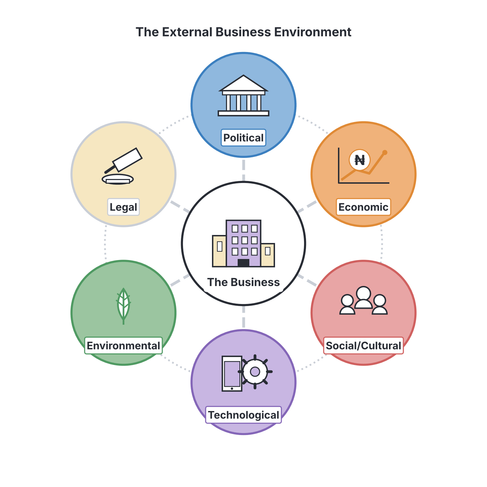
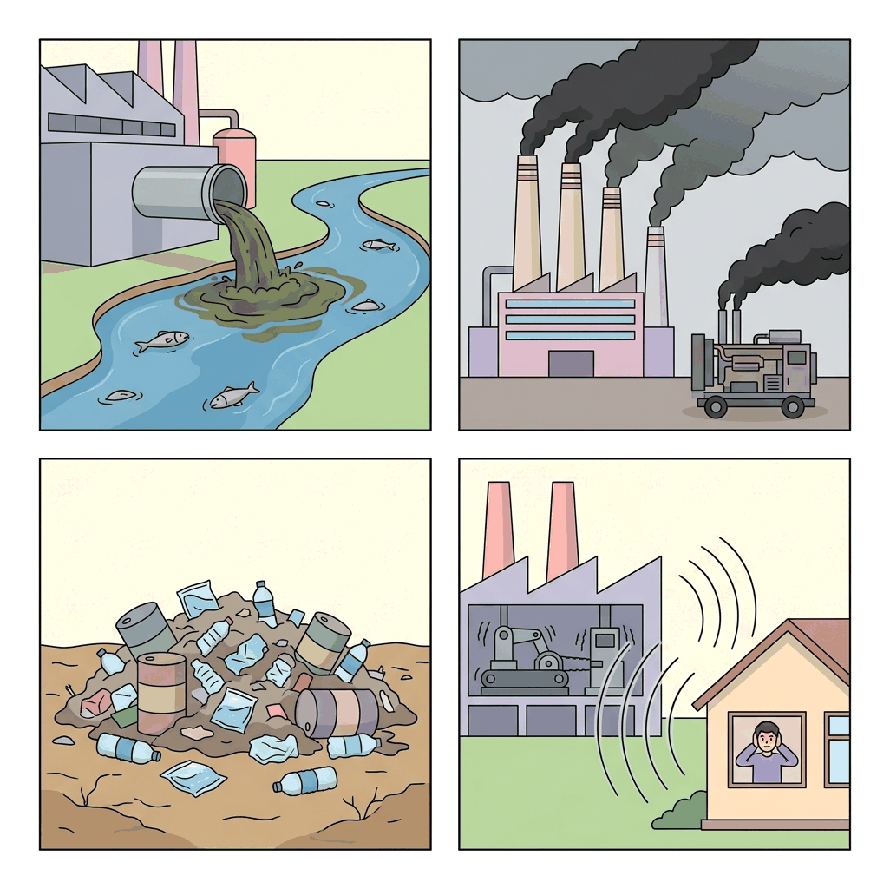

# JAMB Commerce Notes: Business Environment and Social Responsibility

## What JAMB expects

This topic is Section A, Topic 16 of the JAMB Commerce syllabus: Business Environment and Social Responsibility. It covers the external factors that affect businesses and the duties businesses owe to society.

This file covers the following content items:
- (i) Legal, political, economic, social, cultural, technological environments, etc.
- (ii) Safe products, philanthropic and societal consideration.
- (iii) Types and implication of pollution (water, air, land, etc.).

By the end of these notes, you should be able to:
1. discuss the types of business environment;
2. assess the role of social environment in the provision of safe products;
3. identify the different types of pollution and their implications on businesses.

**Note on the syllabus wording:** Objective (ii) asks you to assess the "role of social environment in the provision of safe products". However, Content (ii) also requires knowledge of "philanthropic and societal consideration". These notes cover both the provision of safe products and the broader philanthropic responsibilities of a business to ensure you are fully prepared.

## Types of Business Environment

**Objective i: discuss the types of business environment.**
**Content i: Legal, political, economic, social, cultural, technological environments, etc.**

A **business environment** refers to all the internal and external factors, forces, and conditions that affect how a business operates, grows, and survives. While internal factors (like employees, company policies, and management style) are under the control of the business, **external factors** are beyond the control of the business but have a massive impact on its success or failure. 

The external environment is often remembered using the acronym **PESTLE** (Political, Economic, Social/Cultural, Technological, Legal, and Environmental). Businesses must continuously monitor these environments to adapt and survive.

### 1. The Legal Environment
This consists of all the laws, regulations, and judicial decisions that dictate how businesses must operate within a country. Businesses must obey the law or face fines, lawsuits, and closure.
*   **Company laws:** In Nigeria, businesses must register with the Corporate Affairs Commission (CAC) and operate according to the rules set out in the Companies and Allied Matters Act (CAMA).
*   **Labor and employment laws:** Rules regarding the minimum wage, working hours, pension contributions, and worker safety ensure businesses do not exploit employees.
*   **Regulatory bodies:** Agencies like the National Agency for Food and Drug Administration and Control (NAFDAC) and the Standards Organisation of Nigeria (SON) enforce strict rules for product quality and safety.
*   **Consumer protection laws:** Laws prevent businesses from making false claims in advertisements (e.g., the Trade Descriptions Act) and protect the rights of buyers.

### 2. The Political Environment
This refers to the actions of the government and the overall political stability of the country where the business operates.
*   **Government policies:** A government might decide to ban the importation of foreign rice to boost local farming. This political decision destroys the business of a rice importer but helps the local farmer.
*   **Political stability:** Frequent changes in government, riots, insurgencies, or unrest create an unpredictable environment. This discourages both foreign investors and local entrepreneurs from expanding their businesses.
*   **Taxation and subsidies:** Changes in Value Added Tax (VAT), company tax rates, or the removal of fuel subsidies directly affect a business's operational costs and profit margins.

### 3. The Economic Environment
This includes all the macroeconomic factors that affect consumer purchasing power and the cost of doing business. It determines how much money flows through the economy.
*   **Inflation:** When the general price of goods rises continuously, raw materials become more expensive. Consumers also buy less because their money loses value (reduced purchasing power).
*   **Exchange rates:** If the Naira (₦) falls in value against the US Dollar (USD), a business that imports raw materials will have to spend more Naira to obtain the same amount of materials, driving up production costs.
*   **Interest rates:** If the Central Bank of Nigeria (CBN) raises interest rates, commercial banks will charge higher interest on loans. This makes it difficult and expensive for businesses to borrow money for expansion.
*   **Economic cycles:** During an economic boom, unemployment is low, people have more disposable income, and businesses thrive. During a recession, people lose jobs, spending drops, and businesses struggle to make sales.

### 4. The Social and Cultural Environment
This is made up of the beliefs, values, customs, demographics, religions, and lifestyles of the people in the society where the business operates. Businesses must tailor their products to fit the society.
*   **Cultural and religious beliefs:** A business must respect local cultures. For example, a fast-food restaurant in northern Nigeria must ensure its meat is *halal* and would not succeed if it sold pork, due to the dominant religious beliefs of the consumer base.
*   **Demographics:** This refers to the structure of the population (age, gender, income distribution). Nigeria has a very large, growing youth population. Businesses that sell trendy clothing, mobile data, streaming services, and tech gadgets thrive because their products match the lifestyle of this young demographic.
*   **Social trends and lifestyle changes:** A growing trend of health consciousness means people are demanding less sugar in their diets. This forces beverage companies to innovate and produce "zero sugar" or diet options to retain customers.

### 5. The Technological Environment
This includes the tools, machinery, digital innovations, and scientific advancements that change how goods are produced, distributed, and marketed.
*   **E-commerce and Mobile Money:** The rise of Point of Sale (POS) operators, mobile banking apps, and online shopping platforms (like Jumia and Konga) has completely transformed how businesses receive payment and reach customers across the country.
*   **Automation and Artificial Intelligence:** Factories using modern robotic machines can produce goods faster, with fewer errors, and cheaper than those relying strictly on manual labor. 
*   **Communication:** Social media (X, Instagram, TikTok) allows businesses to advertise to millions of people cheaply, changing the face of marketing. Businesses that fail to adapt to new technology quickly become obsolete.

## Safe Products, Philanthropic and Societal Consideration

**Objective ii: assess the role of social environment in the provision of safe products.**
**Content ii: Safe products, philanthropic and societal consideration.**

A business does not exist in a vacuum; it extracts resources from society, sells to society, and uses the infrastructure provided by society. Therefore, it has a **Corporate Social Responsibility (CSR)**. CSR is the idea that businesses should balance profit-making activities with ethical activities that protect and benefit society.

### The Role of the Social Environment in the Provision of Safe Products
Businesses are fundamentally driven by profit. Without external pressure, some might cut corners, use cheap and harmful ingredients, or sell substandard goods to maximize their gains. The social environment plays a massive role in forcing businesses to provide safe products through the following mechanisms:

1.  **Consumer Awareness and Education:** Today’s consumers are highly educated about health, hygiene, and product safety. If a company produces skin cream containing harmful bleaching chemicals, the social environment (public opinion) will quickly turn against it, leading to a massive drop in sales.
2.  **Pressure Groups and Activism:** Non-governmental organizations (NGOs) and consumer rights groups actively campaign against unsafe products. They investigate, expose, and organize boycotts against companies that put public health at risk.
3.  **The Power of Social Media:** In Nigeria, consumers use platforms to publicly call out companies that sell expired, damaged, or fake products. A viral post about a contaminated batch of bottled water or a foreign object found in a snack can ruin a company's reputation and financial standing overnight.
4.  **Demand for Government Regulation:** It is the society's collective demand for safety that led to the creation and empowerment of government agencies like NAFDAC, SON, and the Federal Competition and Consumer Protection Commission (FCCPC). (Note: Older textbooks and past questions may refer to the FCCPC by its former name, the Consumer Protection Council, CPC).

Because of these powerful social pressures, businesses are forced to invest heavily in quality control laboratories, proper hygienic packaging, clear expiration dates, and accurate ingredient labeling to ensure they do not harm their customers.

### Philanthropic Considerations
**Philanthropy** means donating money, time, or resources to charitable causes without expecting a direct financial return. Businesses engage in philanthropy to show they care about their host communities, build a positive brand image, and give back to the society that supports their growth. 
*   **Examples in Nigeria:** 
    *   Telecommunication companies giving out university scholarships to bright, underprivileged students.
    *   Banks donating medical equipment to government hospitals, renovating schools, or sponsoring national sports tournaments.
    *   Oil companies in the Niger Delta building roads, providing boreholes for clean water, and equipping healthcare centers in their host communities to maintain peace, goodwill, and a social "license to operate."

### Societal Considerations
Beyond just giving money to charity, societal consideration means doing business in a fundamentally ethical way that does not exploit people, the environment, or the community. It involves how the business makes its money in the first place. This includes:
*   Paying workers a fair, living wage and providing health insurance.
*   Strictly refusing to use child labor or forced labor in the supply chain.
*   Ensuring the workplace is safe, well-ventilated, and free from hazards for employees.
*   Being honest in advertising and not misleading the vulnerable public (like children or the elderly).
*   Sourcing raw materials locally to empower local farmers and suppliers.

## Types and Implications of Pollution

**Objective iii: identify the different types of pollution and their implications on businesses.**
**Content iii: Types and implication of pollution (water, air, land, etc.).**

**Pollution** is the introduction of harmful substances (pollutants) into the natural environment, causing adverse changes. Businesses, especially those in the manufacturing, mining, and oil sectors, are often the major culprits of environmental pollution. However, pollution also has serious legal, financial, and operational implications for the businesses themselves.

### Types of Pollution

| Type of Pollution | Causes by Businesses | Examples in Nigeria |
| :--- | :--- | :--- |
| **Water Pollution** | Dumping untreated toxic chemicals, industrial waste, hot water, or crude oil into rivers, streams, and oceans. | **Oil spills** in the Niger Delta contaminating drinking water and destroying fishing ecosystems. Textile factories discharging coloured, toxic chemical waste directly into local drainage systems. |
| **Air Pollution** | Releasing harmful gases (like carbon (IV) oxide and sulphur (IV) oxide), smoke, and chemical fumes into the atmosphere from factory chimneys, vehicles, and generators. | Heavy exhaust from large diesel generators used by businesses to cope with power outages; thick smoke and dust from cement manufacturing plants or illegal crude oil refineries. |
| **Land (Soil) Pollution** | Dumping solid waste, plastics, and non-biodegradable materials on land; spilling hazardous chemicals that ruin soil fertility and kill crops. | Indiscriminate dumping of pure water sachets and polythene bags by traders; mining companies leaving large, toxic open pits without restoring the land. |
| **Noise Pollution** | Generating excessive, loud, and disturbing noise that disrupts the peace, hearing, and mental health of the surrounding community. | Heavy vibrating machinery in factories; extremely loud music from record stores or promotional vans; constant roaring of heavy-duty generators in residential business areas. |

### Implications of Pollution on Businesses

Pollution is not just an environmental disaster; it has direct and often severe consequences for the businesses responsible for it:

1.  **Legal Fines and Penalties:** Government environmental agencies like the National Environmental Standards and Regulations Enforcement Agency (NESREA) can impose heavy fines on polluting businesses. For instance, a multinational oil company might be fined billions of Naira for a severe oil spill.
2.  **Closure of Business Operations:** If a business continuously violates environmental laws and endangers public health, the government has the authority to seal off its premises and force it to shut down temporarily or permanently.
3.  **Compensation and Expensive Lawsuits:** Communities affected by pollution often sue the companies responsible. A community whose drinking water is poisoned or whose farmlands are destroyed by a factory can demand massive financial compensation in court, draining the company's funds.
4.  **Loss of Reputation (Bad Image):** Modern consumers are increasingly environmentally conscious. A company known for destroying the environment will face public hatred, organized boycotts, and a sharp drop in sales. Investors may also withdraw their funding.
5.  **Hostility from Host Communities:** In extreme cases, youths in polluted host communities may protest, barricade company gates, or vandalize company property, disrupting business operations completely.
6.  **Creation of New Business Opportunities (Positive Implication):** While pollution hurts the polluters and the environment, it paradoxically creates lucrative business opportunities for others. It creates a market for waste management companies, recycling businesses, environmental consultants, and companies that manufacture anti-pollution equipment (like water filters, catalytic converters, and eco-friendly packaging).

## Key terms

| Term | Meaning |
| :--- | :--- |
| **Business Environment** | The combination of internal and external factors that influence a business's operations, survival, and growth. |
| **PESTLE** | An acronym for the external environment factors: Political, Economic, Social, Technological, Legal, and Environmental. |
| **Corporate Social Responsibility (CSR)** | The obligation of a business to act in ethical ways that protect and improve the welfare of society alongside making a profit. |
| **Philanthropy** | The act of a business voluntarily giving back to society through charitable donations, scholarships, or community development projects. |
| **Pollution** | The introduction of harmful, toxic materials (pollutants) into the natural environment. |
| **NESREA** | National Environmental Standards and Regulations Enforcement Agency, a body responsible for protecting the environment in Nigeria. |
| **FCCPC** | Federal Competition and Consumer Protection Commission (formerly CPC), the agency that ensures safe products, fair market competition, and protects consumer rights. |

## Exam tips and common mistakes

*   **Political vs. Legal:** Students often confuse these two environments. **Political** relates to government stability, tax policies, trade bans, and leadership changes. **Legal** relates specifically to passed laws (like CAMA) and regulatory bodies (like NAFDAC or SON) that enforce those laws.
*   **Social vs. Economic:** If a question mentions "consumer income," "inflation," or "exchange rates," it is the **Economic** environment. If it mentions "fashion trends," "population age," or "religious beliefs," it is the **Social/Cultural** environment.
*   **CPC is now FCCPC:** If a JAMB question asks for the body that protects consumers from unsafe products and FCCPC is not an option, look for CPC (Consumer Protection Council), as older past questions still use the former name.
*   **Implications of pollution:** Remember that pollution implications aren't always negative for *every* single business. It creates profits for recycling and waste management businesses. Read the wording of the question carefully to see if it asks for a positive or negative implication.

## Quick summary

1. The business environment consists of the legal, political, economic, social/cultural, and technological factors that affect how a business operates.
2. The legal environment involves laws and regulatory agencies (NAFDAC, SON); the economic environment involves inflation, exchange rates, interest rates, and purchasing power.
3. The social environment involves the culture, religion, and lifestyle of the people, while the technological environment involves digital tools, automation, and e-commerce.
4. Businesses are forced to provide safe products primarily because of social pressures, including consumer awareness, social media call-outs, and pressure group activism.
5. Corporate Social Responsibility (CSR) includes philanthropy (e.g., giving scholarships, building boreholes) and acting ethically in society (e.g., fair wages, honest advertising).
6. Major types of pollution caused by businesses include water (oil spills), air (generator smoke), land (plastic waste and chemical dumping), and noise pollution.
7. Pollution can lead to severe implications for businesses, such as legal fines, closure, expensive lawsuits, bad public image, and protests from host communities.

## Practice questions

**1. A business environment can best be described as:**
- A. the physical building and offices where a company is located
- B. the internal and external forces that affect the operations of a business
- C. the government agencies that collect taxes from a business
- D. the social relationship between the manager and the employees

**Answer: B.** The business environment encompasses all internal and external factors, forces, and conditions that influence a business's operations and survival. Option A is a common mistake where students confuse the physical premises with the business environment as a theoretical concept. Option C and D represent just small fractions of the environment.

**2. A sudden increase in the exchange rate of the Naira to the US Dollar, making imported raw materials highly expensive, is a change in the:**
- A. political environment
- B. social environment
- C. technological environment
- D. economic environment

**Answer: D.** Exchange rates, inflation, interest rates, and consumer income are all factors of the economic environment affecting purchasing power and costs. A common mistake is choosing Option A (political environment) because people often blame the government for exchange rate policies, but the exchange rate itself is an economic indicator.

**3. Which of the following is a philanthropic activity by a business?**
- A. Paying workers their agreed monthly salaries on time
- B. Registering the business with the Corporate Affairs Commission
- C. Building a free healthcare clinic for the host community
- D. Increasing the price of goods to maximize profit

**Answer: C.** Philanthropy involves voluntarily giving back to society without expecting a direct financial return, such as building a clinic or providing scholarships. Option A is the most tempting wrong option because treating workers well is a societal consideration, but it is an ethical/legal obligation (paying agreed wages), not a philanthropic charitable donation.

**4. A multinational oil company was forced to pay a fine of ₦200,000,000 because its pipeline leaked and destroyed local fishing waters. This is a negative implication of:**
- A. air pollution
- B. water pollution
- C. noise pollution
- D. cultural pollution

**Answer: B.** A leaking oil pipeline that destroys fishing waters is a clear example of water pollution. The fine is the negative legal implication for the business. Option C (noise pollution) might be mistakenly chosen if one thinks of the industrial machinery, but the destruction of fishing waters explicitly points to water pollution.

**5. The role of the social environment in ensuring that businesses produce safe products includes all the following EXCEPT:**
- A. consumer boycotts of harmful products
- B. granting tax holidays to companies
- C. calling out companies on social media
- D. activism by consumer rights groups

**Answer: B.** Granting tax holidays is a function of the political and economic environment, executed by the government to encourage investment. The social environment ensures safety through awareness, boycotts, social media, and activism. Students might choose Option D if they confuse consumer activism with government regulation, but activism from groups is a social force.

**6. If a fast-food company opens a branch in a predominantly Muslim state in northern Nigeria, it must ensure its meat is *halal*. This adaptation is in response to the:**
- A. socio-cultural environment
- B. legal environment
- C. economic environment
- D. technological environment

**Answer: A.** Religion, beliefs, customs, and lifestyles make up the socio-cultural environment. Option B is a tempting mistake because people assume religious rules might be formal state laws, but dietary laws like *halal* are primarily driven by the socio-cultural and religious beliefs of the consumer base.

**7. Which of the following government agencies is primarily responsible for ensuring that foods and drugs manufactured by businesses in Nigeria are safe for consumption?**
- A. Corporate Affairs Commission (CAC)
- B. National Agency for Food and Drug Administration and Control (NAFDAC)
- C. Central Bank of Nigeria (CBN)
- D. National Drug Law Enforcement Agency (NDLEA)

**Answer: B.** NAFDAC is the agency responsible for regulating and ensuring the safety of foods, drugs, cosmetics, and packaged water in Nigeria. The most tempting wrong option is Option D (NDLEA), but NDLEA is strictly responsible for fighting illicit and hard drugs, not regulating the safety of commercial food and medical drugs.

**8. The introduction of POS terminals and mobile banking applications which reduced the use of physical cash in business transactions is an element of the:**
- A. legal environment
- B. technological environment
- C. political environment
- D. social environment

**Answer: B.** New tools, machines, and digital innovations like POS and mobile banking fall under the technological environment. A common mistake is choosing Option D (social environment) because the use of POS has become a widespread social habit, but the tools and networks themselves are technological advancements.

**9. When a factory continuously dumps non-biodegradable plastics and toxic chemical drums onto a nearby empty plot of earth, it is causing:**
- A. air pollution
- B. water pollution
- C. land pollution
- D. noise pollution

**Answer: C.** Dumping solid waste, plastics, and chemicals onto the soil is land (or soil) pollution. Students might mistakenly choose Option B (water pollution) if they assume rain will eventually wash the chemicals into the groundwater, but the direct act described is land pollution.

**10. Which of the following represents a positive implication of environmental pollution for businesses?**
- A. Host communities protesting against the company
- B. Government sealing off the business premises
- C. Paying heavy financial compensation to victims
- D. Creation of market opportunities for recycling and waste management firms

**Answer: D.** While pollution is terrible for society and the environment, it creates a lucrative business opportunity for companies that specialize in waste management, recycling, and manufacturing pollution-control equipment. Option C is a common mistake for students who think paying compensation redistributes wealth positively to victims, but for the polluting business itself, it is a negative financial loss.

<!-- COVERAGE
obj i | Types of Business Environment
obj ii | Safe Products, Philanthropic and Societal Consideration
obj iii | Types and Implications of Pollution
item i | Types of Business Environment
item ii | Safe Products, Philanthropic and Societal Consideration
item iii | Types and Implications of Pollution
-->
