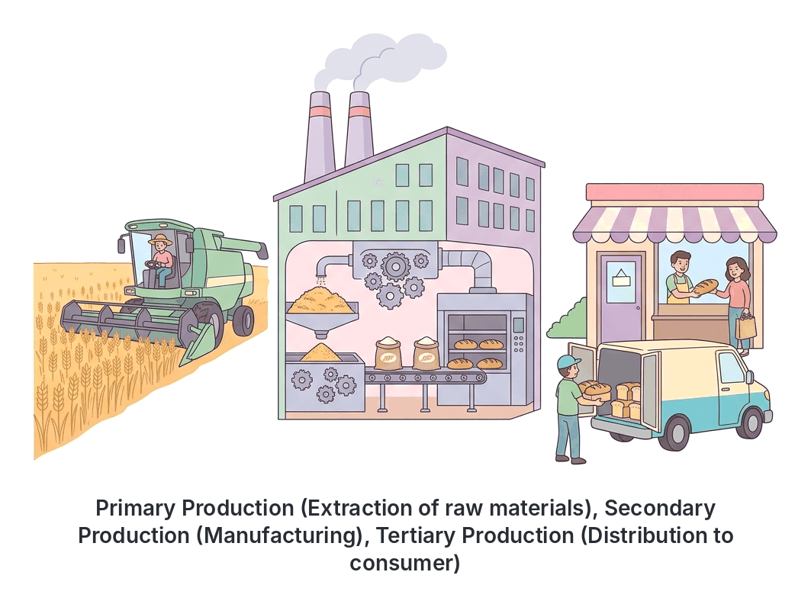

# JAMB Commerce Notes: Production

## What JAMB expects

This topic is Topic 3 of the JAMB Commerce syllabus: Production. It covers the following content items:

* (i) Factors, characteristics and rewards (land, labour, capital and entrepreneur)
* (ii) Division of Labour and specialization
* (iii) Types (primary, secondary and tertiary)
* (iv) Relationship between production, specialization and exchange.

By the end of these notes, you should be able to:

1. identify the Factors of Production and their rewards;
2. distinguish between Division of Labour and Specialization;
3. classify the types of production;
4. State the relationship between production, specialization and exchange.

## What is Production?

In commerce and economics, **production** is the creation of wealth or goods, and the provision of services to satisfy human wants. It is the process of transforming raw materials into finished products and distributing them to the people who need them. 

A very important rule in Commerce is that **production is not complete until the goods reach the final consumer**. For example, a bag of rice produced in a farm in Abakaliki is not fully "produced" in the commercial sense until it is in the hands of the person in Lagos who will cook and eat it. 

## Factors of Production and their Rewards

**Objective i: identify the Factors of Production and their rewards.**
**Content i: Factors, characteristics and rewards (land, labour, capital and entrepreneur)**

To produce any good or service, certain resources must be combined. These resources are called the **factors of production**. There are four main factors: Land, Labour, Capital, and the Entrepreneur.

### 1. Land

In commerce, "land" does not just mean the ground we build houses on. It refers to all the **free gifts of nature** used in production. This includes agricultural soil, forests, rivers, oceans, the atmosphere, and mineral resources (like crude oil in the Niger Delta, tin in Jos, and coal in Enugu).

**Characteristics of Land:**
* **Fixed in supply:** The total land mass and natural resources on earth cannot be increased by human effort.
* **Geographically immobile:** You cannot move a piece of land or a river from one place to another (e.g., you cannot move the River Niger to Kano).
* **It is a free gift of nature:** It was not created by human effort.
* **Subject to the law of diminishing returns:** As you keep adding more labour and capital to a fixed piece of land, the extra output will eventually start to drop.
* **Varies in quality:** Some land is very fertile for farming cocoa (like in Ondo State), while others are dry and sandy.

**Reward:** The reward for using land is **Rent**.

### 2. Labour

Labour is the **human effort** (both physical and mental) directed towards the production of goods and services. It includes the physical strength of a bricklayer and the mental effort of an accountant.

Labour is usually grouped into three categories:
* **Skilled labour:** Highly educated and specially trained workers (e.g., doctors, engineers, bank managers).
* **Semi-skilled labour:** Workers with basic training or experience (e.g., drivers, tailors, typists).
* **Unskilled labour:** Workers with little or no formal education or special training (e.g., cleaners, labourers carrying blocks on a building site).

**Characteristics of Labour:**
* **Mobile:** Labour can move from one place to another (geographical mobility) or from one job to another (occupational mobility).
* **Human feelings:** Unlike machines, labour has emotions, can get tired, requires motivation, and can go on strike.
* **Cannot be separated from the labourer:** A worker must be present to offer their labour.
* **Perishable:** Time lost cannot be regained. If a worker is sick for a day, the labour for that day is lost forever.
* **Variable in quality:** No two workers are exactly the same in efficiency and skill.

**Reward:** The reward for labour is **Wages** (usually paid daily or weekly) or **Salaries** (paid monthly).

### 3. Capital

Capital refers to **man-made wealth used to produce more wealth**. It is not just money; it includes all the physical assets and equipment used in the production process, such as machinery, factory buildings, delivery vans, tools, and raw materials.

Types of Capital:
* **Fixed Capital:** Assets used for a long time in production that do not change their form (e.g., tractors, buildings, heavy machinery).
* **Working (or Circulating) Capital:** Items used up in the day-to-day running of the business (e.g., cash in hand, raw materials like flour for a baker, fuel).

**Characteristics of Capital:**
* **Man-made:** It is created by human beings, unlike land.
* **Mobile:** Most capital goods (like cash, tools, and vehicles) can easily be moved from one place to another.
* **Subject to depreciation:** Machines and vehicles wear out over time and lose their value.
* **Requires savings:** Capital is accumulated by saving and postponing current consumption.

**Reward:** The reward for providing capital is **Interest**.

### 4. Entrepreneur

The entrepreneur is the person or group of people who **coordinates, organizes, and controls** the other three factors of production (land, labour, and capital). They are the risk-takers and the decision-makers in the business. Examples include business owners like Aliko Dangote or a local woman running a large provisions store in Balogun market.

**Characteristics of the Entrepreneur:**
* **Risk-bearer:** They bear the financial risks of the business. If the business fails, they lose their investment.
* **Decision-maker:** They decide what to produce, how to produce it, and where to sell it.
* **Innovator:** They introduce new ideas, new products, and better ways of doing things.
* **Organizer:** They bring land, labour, and capital together in the right proportions.

**Reward:** The reward for the entrepreneur's risk and effort is **Profit** (and if the business does badly, the "reward" is a Loss).

### Summary Table of the Factors of Production

| Factor of Production | Meaning | Main Characteristic | Reward |
| --- | --- | --- | --- |
| **Land** | Free gifts of nature | Fixed in supply; immobile | **Rent** |
| **Labour** | Human effort (mental or physical) | Has feelings; mobile | **Wages / Salaries** |
| **Capital** | Man-made assets used to make more wealth | Depreciates; man-made | **Interest** |
| **Entrepreneur** | The organizer and risk-taker | Bears risk; coordinates | **Profit** |

## Division of Labour and Specialization

**Objective ii: distinguish between Division of Labour and Specialization.**
**Content ii: Division of Labour and specialization**

These two concepts are closely related but have distinct meanings in commerce.

### Specialization

**Specialization** is the concentration of productive efforts on a particular, narrow range of tasks, products, or industries. Instead of trying to produce everything they need, individuals, firms, regions, or countries focus on what they can do best. 
* **Individual specialization:** A person decides to become only a dentist, rather than trying to be a dentist, a mechanic, and a farmer at the same time.
* **Regional specialization:** The Northern part of Nigeria specializes in producing cattle and tomatoes (due to favorable climate), while the South specializes in root crops like yam and cassava.
* **International specialization:** Nigeria specializes in exporting crude oil, while Japan specializes in producing electronics and vehicles.

### Division of Labour

**Division of Labour** is a form of specialization. It is the breaking down of a single production process into smaller, separate tasks, with each task performed by a different worker. 
* **Example:** In a local shoe factory in Aba, instead of one person cutting the leather, sewing it, gluing the sole, and polishing the finished shoe, the process is divided. Worker A only cuts leather. Worker B only sews. Worker C only glues the soles. Worker D only polishes and packages.

### Distinguishing between the two

| Feature | Specialization | Division of Labour |
| --- | --- | --- |
| **Scope** | Broader concept. Can apply to individuals, towns, regions, or whole countries. | Narrower concept. Applies specifically to the breakdown of tasks *within* a workplace or production process. |
| **Focus** | Concentrating on a particular line of business, profession, or product. | Dividing a single job into different stages done by different people. |
| **Example** | A lawyer focusing only on corporate law; Nigeria producing oil. | A bakery where one person mixes dough, another operates the oven, and a third packages the bread. |

### Advantages of Division of Labour and Specialization
1. **Increase in output (Greater productivity):** Because workers focus on small tasks, the total volume of goods produced is much higher.
2. **Time-saving:** Workers do not waste time moving from one task or tool to another.
3. **Development of skills (Dexterity):** Doing the same task repeatedly makes a worker extremely fast and highly skilled at that specific task.
4. **Use of machinery:** Breaking tasks into simple, repetitive steps makes it easy to design machines to do the work, leading to automation.
5. **Less fatigue:** The physical strain is often reduced because the worker is only performing a limited set of movements.

### Disadvantages of Division of Labour and Specialization
1. **Monotony and boredom:** Doing the exact same small task (like tightening one specific bolt) every day becomes boring and can lead to a loss of interest.
2. **Decline in craftsmanship:** The worker no longer feels the pride of making a complete product from start to finish.
3. **Interdependence (The chain reaction):** The whole factory relies on every worker. If the person cutting the leather is absent or goes on strike, the people sewing and gluing cannot work because they have no materials.
4. **Occupational immobility:** A worker who spends 10 years only gluing shoe soles may find it very hard to get a job in another industry if the shoe factory closes down, because they lack broad skills.

## Types of Production

**Objective iii: classify the types of production.**
**Content iii: Types (primary, secondary and tertiary)**

Production is classified into three main stages or types. For a product to reach the final consumer, it often passes through all three stages.

### 1. Primary Production (Extractive)

This is the first stage of production. It involves the **extraction (bringing out) of raw materials directly from nature** (land or sea). It is often called extractive production.
* **Examples in Nigeria:** 
  * Agriculture (farming cassava, cocoa, maize)
  * Mining (drilling crude oil, mining coal or gold)
  * Fishing (catching fish in rivers or oceans)
  * Forestry and lumbering (cutting down trees for timber)
  * Quarrying (extracting stones and gravel)
* **Output:** The products of primary production are mostly raw materials that need further processing, though some (like fresh fruits) can be consumed directly.

### 2. Secondary Production (Manufacturing and Construction)

This stage involves processing and transforming the raw materials extracted in the primary stage into finished or semi-finished goods. It adds value to the raw materials.
* **Manufacturing:** Changing raw materials into new products. Examples include turning cocoa beans into chocolate, turning cotton into textiles in Kano, or processing crude oil into petrol at a refinery.
* **Construction:** Using manufactured materials to build infrastructure. Examples include building roads, bridges, houses, and factories (e.g., Julius Berger constructing a bridge).

### 3. Tertiary Production (Commercial and Direct Services)

As stated earlier, production is not complete until the goods reach the final consumer. Tertiary production covers the distribution of goods and the provision of services. It is divided into two areas:
* **Commercial Services (Commerce):** This involves Trade (buying and selling) and Aids to Trade (transportation, banking, insurance, advertising, warehousing, communication). It ensures that the goods manufactured in the secondary stage are distributed to consumers. For example, a truck driver moving cement from the Dangote factory to a building materials market in Alaba.
* **Direct / Professional Services:** These are services rendered directly to consumers to satisfy their non-material wants. It includes the work of teachers teaching students, doctors treating patients, police officers maintaining security, lawyers, barbers, and entertainers like musicians and actors.

**Note on Textbook Variations:** 
Some older textbooks classify production into two main categories: *Industry* (Extractive, Manufacturing, Construction) and *Commerce* (Trade, Aids to Trade, Direct Services). The JAMB syllabus specifically groups the classification as Primary, Secondary, and Tertiary, which is the modern standard. Always use the Primary/Secondary/Tertiary classification for JAMB questions.

## Relationship between Production, Specialization and Exchange

**Objective iv: State the relationship between production, specialization and exchange.**
**Content iv: Relationship between production, specialization and exchange.**

There is a very close and logical relationship between production, specialization, and exchange. They are a continuous chain that makes modern economies work.

Here is how they connect:

**Step 1: Production is the foundation.**
People produce goods to satisfy human wants. In a basic, primitive society (subsistence living), a family might try to farm their own food, build their own house, and sew their own clothes. Because they do everything themselves, they are inefficient and produce very little. There is no specialization and no exchange.

**Step 2: Specialization increases output and creates a surplus.**
People soon realize that they are more efficient if they focus on doing just one thing well. The farmer only farms; the tailor only sews. This **specialization** (and division of labour) drastically increases the speed and volume of production. As a result, the farmer produces far more food than their family can eat. This excess is called a **surplus**.

**Step 3: Specialization creates the need for Exchange.**
While specialization creates a surplus of one item, it creates a shortage of others. The farmer has plenty of food but no clothes. The tailor has plenty of clothes but no food. Because they have specialized, they can no longer survive on their own. They are now interdependent. 

**Step 4: Exchange completes the cycle.**
To survive and satisfy all their different wants, the farmer and the tailor must trade their surpluses with each other. This trading of goods and services is called **exchange**. Money is introduced to make this exchange easy.

**Summary of the Relationship:**
1. **Production** aims to satisfy wants.
2. **Specialization** makes production highly efficient, leading to a massive **surplus** of specific goods.
3. This surplus, combined with the fact that specialized workers lack other necessary goods, necessitates **exchange** (trade).
4. Therefore, **specialization makes exchange necessary**, and exchange makes specialization possible (because no one would specialize if they couldn't trade their surplus for other things they need).

## Key terms

| Term | Meaning |
| --- | --- |
| **Production** | The creation of goods and services to satisfy human wants, ending when goods reach the final consumer. |
| **Land** | All free gifts of nature (minerals, water, forests) used in production. Its reward is rent. |
| **Labour** | Human physical or mental effort applied in production. Its reward is wages/salaries. |
| **Capital** | Man-made resources (machinery, tools, money) used to produce further wealth. Its reward is interest. |
| **Entrepreneur** | The person who coordinates other factors, bears risks, and takes decisions. Their reward is profit. |
| **Specialization** | Concentrating effort on a particular line of production or task. |
| **Division of Labour** | Breaking a production process down into smaller, separate tasks, each done by a different person. |
| **Primary production** | Extraction of raw materials directly from nature (e.g., farming, mining). |
| **Secondary production** | Processing raw materials into finished or semi-finished goods (e.g., manufacturing, construction). |
| **Tertiary production** | The distribution of goods and the provision of commercial and direct services (e.g., trade, teaching, banking). |
| **Exchange** | The act of trading surplus goods and services, made necessary by specialization. |

## Exam tips and common mistakes

* **Common mistake:** Thinking that "Land" only means the soil. Remember that for JAMB, land includes rivers, forests, crude oil, and the atmosphere (all free gifts of nature).
* **Common mistake:** Confusing the reward for Capital with the reward for the Entrepreneur. Capital earns **Interest**. The Entrepreneur earns **Profit**.
* **JAMB trick:** Questions often ask when production is considered complete. The answer is always: **when it reaches the final consumer**. Goods sitting in a factory warehouse are not yet fully "produced" in the economic sense.
* **Distinguishing Division of Labour and Specialization:** If the question mentions breaking down one specific job (like making a pin or a shoe) into steps, it's Division of Labour. If it talks about regions, countries, or people focusing on a whole profession, it is Specialization. 
* **Relationship chain:** Memorize the flow: Production $\rightarrow$ Specialization $\rightarrow$ Surplus $\rightarrow$ Exchange. Specialization always *causes* the need for exchange.
* **Tertiary production trap:** Some students forget that direct services (like the police, doctors, and musicians) fall under tertiary production alongside commercial services (like transport and banking). 

## Quick summary

1. Production is the creation of utility (goods and services) to satisfy human wants, and it is only complete when the product reaches the final consumer.
2. The four factors of production are Land (rewarded by rent), Labour (wages/salaries), Capital (interest), and Entrepreneur (profit).
3. Land is a fixed, immobile free gift of nature. Capital is a man-made, mobile resource that depreciates.
4. The entrepreneur is the most critical factor because they organize the other factors, make decisions, and bear all business risks.
5. Specialization is focusing on a specific line of production, while Division of Labour is breaking a single job into smaller tasks done by different workers.
6. Division of labour saves time and increases output and skill, but it can cause boredom and makes workers too dependent on each other.
7. Production is classified into Primary (extractive, like farming and mining), Secondary (manufacturing and construction), and Tertiary (commercial and direct services).
8. Specialization leads to increased production and creates a surplus, which directly causes the need for exchange (trade) among people.

## Practice questions

**1. Production in commerce is said to be complete only when**
- A. raw materials have been fully turned into finished goods.
- B. the goods are stored safely in a warehouse.
- C. the goods get to the final consumer.
- D. a profit has been made by the entrepreneur.

**Answer: C.** In commerce, the production process is not complete until the goods reach the final consumer who will use them to satisfy a want.

**2. Which of the following is a characteristic of land as a factor of production?**
- A. It is highly mobile.
- B. It depreciates with time.
- C. It is a free gift of nature.
- D. Its reward is interest.

**Answer: C.** Land is a free gift of nature, its supply is fixed, it is geographically immobile, and its reward is rent. Option D is the reward for capital, and Options A and B apply better to capital or labour.

**3. The reward for capital as a factor of production is**
- A. profit.
- B. interest.
- C. rent.
- D. wages.

**Answer: B.** Capital earns interest. Profit is the reward for the entrepreneur, rent is for land, and wages are for labour.

**4. The breaking down of a production process into smaller, separate tasks performed by different individuals is called**
- A. integration.
- B. specialization.
- C. division of labour.
- D. automation.

**Answer: C.** Division of labour specifically refers to dividing a single production process into distinct tasks. Specialization is the broader concept of focusing on one line of production.

**5. A major disadvantage of division of labour is that it**
- A. reduces the time taken to produce goods.
- B. increases the cost of production.
- C. leads to monotony and boredom.
- D. encourages the use of machinery.

**Answer: C.** Because a worker performs the same tiny task repeatedly every day, the work becomes highly monotonous and boring. Options A and D are advantages.

**6. The extraction of crude oil in the Niger Delta is an example of**
- A. secondary production.
- B. primary production.
- C. tertiary production.
- D. construction industry.

**Answer: B.** Primary (extractive) production involves getting raw materials directly from nature, such as farming, mining, fishing, and drilling for oil.

**7. Which of the following workers belongs to the tertiary sector of production?**
- A. A farmer harvesting yams in Benue.
- B. A bricklayer building a house.
- C. A machine operator in a textile mill.
- D. A police officer directing traffic.

**Answer: D.** Tertiary production includes both commercial services and direct/professional services. A police officer provides a direct service. Option A is primary; Options B and C are secondary.

**8. What is the main role of the entrepreneur in production?**
- A. Providing the physical strength needed in the factory.
- B. Supplying the land for the business.
- C. Coordinating other factors of production and bearing risk.
- D. Transporting finished goods to the consumers.

**Answer: C.** The entrepreneur's primary roles are to organize/coordinate land, labour, and capital, make business decisions, and bear the financial risks.

**9. How does specialization necessitate exchange?**
- A. By creating a surplus of one product and a lack of others, forcing people to trade.
- B. By ensuring everyone produces exactly what they need to survive.
- C. By reducing the overall output of goods in a country.
- D. By eliminating the need for money in the economy.

**Answer: A.** Specialization means individuals focus on producing one thing, leading to a massive surplus of that item but a shortage of everything else they need, which makes trading (exchange) absolutely necessary for survival.

**10. A carpenter specializing in making only school desks instead of building full houses, repairing roofs, and making beds is an example of**
- A. occupational immobility.
- B. specialization.
- C. primary production.
- D. commercial exchange.

**Answer: B.** The carpenter is concentrating his productive efforts on one narrow line of production (school desks), which is the definition of specialization. 

<!-- COVERAGE
obj i | Factors of Production and their Rewards
obj ii | Division of Labour and Specialization
obj iii | Types of Production
obj iv | Relationship between Production, Specialization and Exchange
item i | Factors of Production and their Rewards
item ii | Division of Labour and Specialization
item iii | Types of Production
item iv | Relationship between Production, Specialization and Exchange
-->
