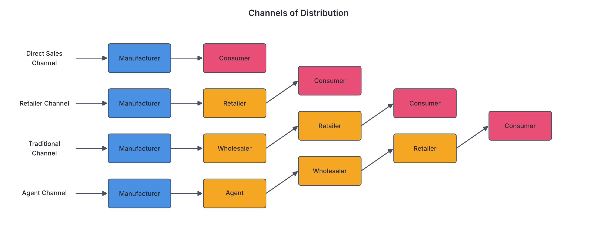

# JAMB Commerce Notes: Trade: Home Trade

## What JAMB expects

This topic is Section 4, Part (a) of the JAMB Commerce syllabus: Trade (Home Trade). It covers the nature of domestic trade, focusing on the retail and wholesale trade sectors, the channels of distribution, and the role of middlemen.

By the end of these notes, you should be able to:
1. compare the various types of retail trade
2. identify the functions of retailers;
3. highlight the factors in setting up retail trade;
4. classify modern retailing practices;
5. identify the advantages and disadvantages of retail business;
6. explain the success/failure of retail trade
7. classify the types of wholesalers;
8. identify the channels of distribution
9. discuss the functions of wholesalers;
10. outline the merits and demerits of the middleman;

**Note on the syllabus wording:** In the syllabus section for modern trends, you will see "the use of luncheon, fuel vouchers, etc". This is a typographical omission in the official syllabus; it refers to the use of "luncheon vouchers and fuel vouchers" as modern sales promotion methods in retail. Also, objective (x) asks for the merits and demerits of the "middleman," which is a broad term encompassing both wholesalers and retailers; this is treated as a separate, comprehensive topic. Foreign trade (Section 4b) is covered in `A4b-trade-foreign-trade.md`.

## Home Trade

Trade is the buying and selling of goods and services with the aim of making a profit. It is a major branch of commerce. Trade is divided into two main categories:
1. **Home Trade (Domestic/Internal Trade):** The buying and selling of goods and services within the geographical boundaries of a single country (e.g., trading between Kano and Lagos).
2. **Foreign Trade (International/External Trade):** The buying and selling of goods and services across national borders (e.g., Nigeria trading with China). 

Home trade uses a single currency (the Naira, ₦) and is governed by the same national laws. It is further divided into **Retail Trade** and **Wholesale Trade**.

## Types of retail trade

**Objective i: compare the various types of retail trade**
**Content: Types of retail trade**

A **retailer** is a trader who buys goods in small quantities from the wholesaler or directly from the manufacturer and sells them in smaller units (bulk-breaking) to the final consumer. Retail trade is broadly divided into two groups: **small-scale retail trade** and **large-scale retail trade**.

### 1. Small-Scale Retail Trade
Small-scale retailing requires little capital, is easy to set up, and is the most common form of retail trade in Nigeria.
*   **Itinerant Traders (Hawkers and Peddlers):** These are mobile traders who move from place to place seeking customers. **Hawkers** carry goods on their heads, in wheelbarrows, or on carts (e.g., people selling gala and bottled water in Lagos traffic). **Peddlers** typically use vehicles to move goods.
*   **Roadside Traders:** They display their wares on tables or mats beside busy roads but do not have permanent structures. 
*   **Market Stall Holders:** They rent spaces or stalls in designated markets (e.g., Balogun Market in Lagos, Onitsha Main Market, or Ariaria International Market in Aba). 
*   **Kiosks:** Small wooden or metal structures placed in neighbourhoods selling provisions and daily necessities.
*   **Unit Shops (Tied Shops):** Shops that sell goods of only one manufacturer or a single line of products (e.g., a shop selling only Bata shoes or a specific bakery's bread).

### 2. Large-Scale Retail Trade
Large-scale retailing requires huge capital, a large floor space, and often operates with complex management structures.
*   **Department Stores:** A large retail building divided into separate departments, each selling a different line of goods, but all under a single central management and roof. For example, one department sells clothes, another sells electronics, and another groceries (e.g., Kingsway Stores or UTC in the past).
*   **Multiple Shops (Chain Stores):** A group of similar shops owned by a single company, spread across different locations or cities. They have identical shop layouts, sell the same type of goods, and are centrally managed (e.g., FoodCo branches or various branches of a popular pharmacy chain like Medplus).
*   **Supermarkets:** Large, self-service retail shops that sell mainly groceries, household items, and provisions. Customers pick items from shelves and pay at a central cashier desk.
*   **Hypermarkets:** Extremely large retail facilities that combine a supermarket and a department store (sometimes called "superstores"). They are usually located on the outskirts of towns where land is cheaper, providing massive parking spaces.
*   **Mail Order Business:** Retailing done through the post or delivery services. The seller advertises via catalogues or online, the buyer orders, and goods are dispatched without the buyer and seller ever meeting face-to-face.

### Comparing Small-Scale and Large-Scale Retail Trade

| Feature | Small-Scale Retail Trade | Large-Scale Retail Trade |
| :--- | :--- | :--- |
| **Capital Requirement** | Very low capital needed to start. | Huge capital is required. |
| **Management** | Managed by the owner (sole proprietor). | Managed by employed professionals and a board of directors. |
| **Personal Contact** | High personal contact with final consumers. | Impersonal relationship with consumers. |
| **Operating Overhead** | Low overhead cost (little to no rent or electricity bills). | High overhead cost (air conditioning, heavy staffing, large rent). |
| **Credit Facility** | Frequently grants credit to trusted, loyal customers. | Sells strictly on a cash-and-carry basis. |
| **Variety of Goods** | Limited variety of goods due to space and capital limits. | Wide variety of goods under one roof. |
| **Pricing** | Prices can be haggled/bargained. | Fixed prices indicated by price tags or barcodes. |

## Functions of retailers

**Objective ii: identify the functions of retailers**
**Content: Functions of retailers**

The retailer acts as the final link in the channel of distribution. Their functions are divided into services rendered to the consumer and services rendered to the wholesaler/manufacturer.

### Functions to the Consumer
1.  **Bulk-breaking:** Retailers buy in dozens or cartons and break them into single, usable units for the consumer (e.g., selling one tin of milk from a carton).
2.  **Proximity (Bringing goods closer):** They locate their shops in residential neighbourhoods, saving consumers the cost and time of traveling to factories or large wholesale markets.
3.  **Provision of Credit:** Small-scale retailers often allow trusted neighbours to buy goods on credit and pay at the end of the month.
4.  **Variety of Goods:** A retailer stocks goods from different manufacturers, giving the consumer a wide range of choices.
5.  **Expert Advice:** They advise consumers on the use of technical products or recommend new products.
6.  **After-sales Service:** For certain goods like electronics, retailers may offer installation or minor repair services.

### Functions to the Wholesaler and Manufacturer
1.  **Feedback and Market Information:** Since retailers interact directly with consumers, they pass consumer complaints, preferences, and trends back to the wholesalers and manufacturers.
2.  **Clearing of Goods:** They help manufacturers clear their production lines by buying goods regularly.
3.  **Financing:** By paying cash for goods, retailers provide essential working capital back into the distribution chain.
4.  **Sales Promotion/Advertising:** Retailers help to display goods attractively on their shelves, which aids in advertising the manufacturer's products.

## Factors to be considered in setting up retail trade

**Objective iii: highlight the factors in setting up retail trade**
**Content: Factors to be considered in setting up retail trade**

Before opening a retail business, an entrepreneur must carefully evaluate several factors to avoid early business failure:

1.  **Capital:** The amount of money available dictates the scale of the business, the type of goods to stock, and the size of the shop.
2.  **Location:** The business must be sited where there is high human traffic or accessibility for the target market. A shop selling textbooks is best located near a school or university.
3.  **Type of Goods:** The retailer must decide whether to sell perishable goods, consumer durables, or fast-moving consumer goods (FMCG), as this affects storage and shop design.
4.  **Target Market (Demand):** The retailer must ensure there is sufficient demand for the products in that area. Selling luxury cars in a low-income neighbourhood will likely fail.
5.  **Source of Supply:** The retailer needs reliable wholesalers or manufacturers to ensure they never run out of stock.
6.  **Experience and Skill:** Knowledge of the product lines, basic bookkeeping, and customer relations are necessary for the day-to-day running of the business.
7.  **Terms of Trade:** The retailer must consider whether suppliers will offer trade discounts or credit facilities.

## Modern retailing practices and trends

**Objective iv: classify modern retailing practices**
**Content: Trends in retailing (branding, self-service, vending machines, the use of luncheon, fuel vouchers, etc)**

Retailing has evolved over time due to technology and changing consumer behaviour. Modern practices can be classified into **Technological Trends**, **Promotional/Marketing Trends**, and **Operational Trends**.

### 1. Promotional and Marketing Trends
*   **Branding:** Retailers (especially large ones like Shoprite or SPAR) now create their own "house brands" or "store brands" (e.g., selling a loaf of bread branded with the supermarket's name). It builds customer loyalty.
*   **Use of Luncheon Vouchers and Fuel Vouchers:** Instead of cash gifts, companies give their employees luncheon (meal) vouchers or fuel vouchers, which are accepted by participating modern retailers (restaurants, supermarkets, and petrol stations) as a form of payment. This drives guaranteed traffic to these retailers.
*   **Loyalty Cards and Reward Points:** Customers are issued cards that accumulate points every time they shop, which can be redeemed for discounts later.

### 2. Operational Trends
*   **Self-Service:** Instead of asking a shopkeeper to fetch items, customers walk through aisles with shopping carts, pick what they want, and pay at a checkout counter. This reduces the number of sales assistants needed and encourages impulse buying.
*   **Pre-packaging:** Goods are now pre-weighed, measured, and sealed in attractive wrappers with price and weight printed on them, removing the need to weigh items like sugar or garri in front of the customer.

### 3. Technological Trends
*   **Vending Machines:** Coin-operated or card-operated machines that dispense small items like drinks, snacks, or coffee automatically without a human attendant. They operate 24 hours a day.
*   **E-commerce and Online Retailing:** Retailing via the internet. Consumers browse catalogs on websites or apps (like Jumia or Konga in Nigeria), pay electronically, and have the goods delivered to their doorsteps.
*   **Point of Sale (POS) Systems:** The use of electronic terminals and barcode scanners to calculate bills rapidly, manage inventory automatically, and accept ATM card payments.

## Advantages and disadvantages of retail business

**Objective v: identify the advantages and disadvantages of retail business**
**Content: Advantages and disadvantages of retailers**

### Advantages of Retail Business
1.  **Ease of Setup:** Small-scale retailing requires very little capital and can be started by anyone with little to no legal formalities.
2.  **Independence:** The retailer is often their own boss and enjoys the flexibility of making quick decisions.
3.  **Personal Contact:** Retailers build strong personal relationships with customers, creating loyalty.
4.  **Convenience:** The business can often be attached to the retailer's home (e.g., a kiosk in front of a house).
5.  **Low Operating Costs:** Many small-scale retailers avoid paying huge rents, taxes, or staff salaries.

### Disadvantages of Retail Business
1.  **High Risk of Failure:** Because of intense competition and lack of experience, many retail shops fold up within their first few years.
2.  **Bad Debts:** Retailers who offer credit to local customers often suffer from late payments or total default (bad debts), which cripples their working capital.
3.  **Limited Capital for Expansion:** Sole-proprietor retailers find it very hard to secure bank loans to expand their business.
4.  **Long Working Hours:** Retailers often open very early and close very late, missing out on holidays or weekends.
5.  **No Economies of Scale:** Because they buy in small quantities, they cannot negotiate large discounts, keeping their cost price relatively high compared to large-scale retailers.

## Reasons for success and failure of retail trade

**Objective vi: explain the success/failure of retail trade**
**Content: Reasons for success/failure of retail trade**

A retail business may thrive or collapse based on several managerial and environmental factors.

### Reasons for Success
1.  **Excellent Location:** Siting the shop in an area with high foot traffic and low competition.
2.  **Good Customer Relations:** Being polite, honest, and helpful ensures customers return and recommend the shop to others.
3.  **Proper Record Keeping:** Keeping accurate accounts of purchases, sales, and expenses prevents the retailer from eating into their core capital.
4.  **Adequate Stocking:** Keeping the right amount of popular items ensures customers always find what they need.
5.  **Appropriate Pricing:** Setting prices that cover costs but remain competitive compared to nearby shops.

### Reasons for Failure
1.  **Poor Management and Inexperience:** Lack of business skills can lead to fatal decision-making.
2.  **Too Much Credit:** Giving out excessive goods on credit causes cash flow problems and eventual collapse if customers default.
3.  **Poor Location:** Setting up in a hidden area or an area where the residents do not need the product.
4.  **Misappropriation of Funds:** Using the shop's capital and revenue for personal, family, or social expenses (like naming ceremonies or buying personal clothes) instead of restocking.
5.  **Overstocking/Understocking:** Buying too much of a slow-moving item ties up capital (and invites spoilage for perishables), while understocking drives customers to competitors.
6.  **Pilferage (Theft):** Stealing by shop attendants or shoplifting by customers can quickly erode profits.

## Types of wholesalers

**Objective vii: classify the types of wholesalers**
**Content: Types of wholesalers (merchant, agent, general, etc)**

A **wholesaler** is a trader who buys goods in large quantities from the manufacturer and sells in smaller quantities to the retailer. Wholesalers are classified based on the scope of their operations and the nature of the goods they handle.

| Class / Type | Explanation |
| :--- | :--- |
| **Merchant Wholesalers** | These are traditional wholesalers who take legal title (ownership) of the goods they buy from manufacturers. They bear the risk of storing the goods until they are sold to retailers. |
| **Agent Wholesalers (Brokers/Commission Agents)** | Unlike merchant wholesalers, agents do *not* take ownership of the goods. They merely negotiate and facilitate the buying and selling process between the manufacturer and the retailer for a commission (e.g., produce brokers). |
| **General Wholesalers** | They stock and sell a wide variety of unrelated goods. A retailer can buy milk, soap, pens, and batteries all from one general wholesaler. |
| **Specialized Wholesalers** | They restrict their trade to a particular line of goods. For instance, a wholesaler who deals strictly in building materials or strictly in pharmaceuticals. |
| **Cash-and-Carry Wholesalers** | They sell strictly on a cash basis and do not offer delivery services. Retailers bring their own transport and pay cash immediately. |
| **Regional/National Wholesalers** | Classified by area of operation. A regional wholesaler supplies goods to retailers in a specific region (e.g., South-West Nigeria), while a national wholesaler distributes across the entire country. |

## Channels of distribution

**Objective viii: identify the channels of distribution**
**Content: Channels of distribution**

The **channel of distribution** is the path or route through which goods pass from the producer (manufacturer) to the final consumer. Choosing the right channel depends on the nature of the product, the size of the market, and the cost.

### Common Channels

1.  **Channel 1 (Zero-level / Direct Sales):** 
    **Manufacturer $\rightarrow$ Consumer**
    *   Used for highly perishable goods (fresh bread, farm produce), fragile goods, or custom-made technical products. The manufacturer sells directly to the buyer without any middlemen.
2.  **Channel 2 (One-level):**
    **Manufacturer $\rightarrow$ Retailer $\rightarrow$ Consumer**
    *   Common when the retailer is a large-scale business (like a supermarket or department store) that can buy in bulk directly from the factory, bypassing the wholesaler.
3.  **Channel 3 (Two-level / Traditional Route):**
    **Manufacturer $\rightarrow$ Wholesaler $\rightarrow$ Retailer $\rightarrow$ Consumer**
    *   This is the most common channel for fast-moving consumer goods (FMCG) like soap, matches, and canned foods in Nigeria. 
4.  **Channel 4 (Three-level):**
    **Manufacturer $\rightarrow$ Agent $\rightarrow$ Wholesaler $\rightarrow$ Retailer $\rightarrow$ Consumer**
    *   Often used in foreign trade (imports) or agriculture, where agents or brokers are needed to assemble goods or handle complex negotiations before wholesalers take over.

## Functions of wholesalers

**Objective ix: discuss the functions of wholesalers**
**Content: Functions of wholesalers**

The wholesaler provides immense value to both the manufacturer and the retailer.

### Functions to the Manufacturer
1.  **Bulk Buying:** The wholesaler buys in massive quantities, which clears the factory floor and allows the manufacturer to continue producing without worrying about storage space.
2.  **Financing:** Wholesalers often pay for goods in advance or pay promptly, providing the manufacturer with continuous working capital.
3.  **Risk Bearing:** Once the wholesaler takes ownership of the goods, they bear the risks of price changes, spoilage, theft, or fire during storage.
4.  **Warehousing:** The wholesaler provides large storage facilities, saving the manufacturer the cost of building huge warehouses.
5.  **Market Research:** Wholesalers gather information from numerous retailers across the country and advise the manufacturer on changes in consumer tastes and product performance.

### Functions to the Retailer
1.  **Bulk Breaking:** They buy in large crates or tonnes and sell in smaller quantities (dozens or half-dozens) that the retailer can afford.
2.  **Provision of Credit:** Wholesalers often allow loyal retailers to collect goods on credit, sell them, and bring the money back.
3.  **Variety of Goods:** They assemble goods from various manufacturers, allowing the retailer to source all their different stock from one place.
4.  **Transportation:** Many wholesalers provide delivery vans to transport goods to the retailers' shops.
5.  **Price Stability:** By storing goods during times of plenty and releasing them during scarcity, wholesalers help keep prices relatively stable for retailers.

## Advantages and disadvantages of wholesalers

**Content: Advantages and disadvantages of wholesalers**

### Advantages
1.  They encourage **economies of scale** in production by taking bulk orders.
2.  They bridge the geographical gap between centralized producers and scattered consumers.
3.  They stabilize market prices through effective warehousing (preventing massive price drops during harvest and price hikes during off-seasons).

### Disadvantages
1.  **Increased Price:** The wholesaler adds their own profit margin, which ultimately increases the final price the consumer pays.
2.  **Hoarding (Artificial Scarcity):** Unscrupulous wholesalers may hide essential goods in their warehouses to create artificial scarcity, forcing prices to rise illegally.
3.  **Delay in Distribution:** Adding a wholesaler to the chain can slow down the arrival of goods, making this route unsuitable for highly perishable items.

## Merits and demerits of the middleman

**Objective x: outline the merits and demerits of the middleman**

A **middleman** is any intermediary connecting the producer and the consumer. The primary middlemen in home trade are **wholesalers** and **retailers** (along with brokers and agents). 

There is a long-standing economic debate on whether middlemen should be eliminated to reduce prices.

### Merits of the Middleman (Why they are necessary)
1.  **Bulk Breaking:** Consumers cannot buy goods in factory-size cartons. Middlemen break bulk to usable quantities.
2.  **Financing the Chain:** Middlemen provide prompt payment to producers and grant credit to consumers, keeping trade flowing.
3.  **Risk Management:** Producers do not want to carry the risks of theft, obsolescence, or spoilage while searching for individual buyers; middlemen absorb this risk.
4.  **Convenience and Location:** Without retailers (middlemen), consumers would have to travel hundreds of kilometres to factories just to buy a bar of soap.
5.  **Assortment/Variety:** Middlemen collect items from different producers, making it possible for a consumer to buy bread, milk, and tea in one shop.

### Demerits of the Middleman (Arguments for elimination)
1.  **Higher Prices:** Every middleman adds a mark-up (profit margin). The longer the chain, the more expensive the final good.
2.  **Exploitation:** Middlemen can exploit consumers through hoarding and price inflation during crises.
3.  **Misrepresentation:** Some middlemen may re-package expired goods, adulterate products, or give false information to push sales.
4.  **Spoilage of Perishables:** Multiple handling by several middlemen can cause physical damage or decay to fragile/perishable agricultural produce before it reaches the consumer.

**Conclusion:** While some middlemen can be eliminated (e.g., a manufacturer opening their own retail outlet), the *functions* they perform cannot be eliminated. Someone still has to transport, store, and finance the goods.

## Key terms

| Term | Meaning |
| :--- | :--- |
| **Home Trade** | Buying and selling of goods within the boundaries of one country. |
| **Retailer** | A trader who buys in small quantities from wholesalers and sells in smaller units to final consumers. |
| **Wholesaler** | A trader who buys in bulk from producers and sells in smaller quantities to retailers. |
| **Bulk Breaking** | The process of dividing large quantities of goods into smaller, manageable units. |
| **Itinerant Trader** | A mobile retailer (hawker or peddler) who moves from place to place to sell goods. |
| **Department Store** | A large retail shop divided into various sections, each selling different lines of goods under one roof. |
| **Chain Store (Multiple Shop)** | A group of identically designed retail shops owned by one company, located in different areas. |
| **Vending Machine** | A coin or card-operated machine that automatically dispenses items like snacks or drinks. |
| **Channel of Distribution** | The path goods take from the manufacturer to the final consumer. |
| **Middleman** | Intermediaries (wholesalers, retailers, agents) who bridge the gap between producer and consumer. |

## Exam tips and common mistakes

*   **Mistaking Chain stores for Department stores:** Remember, a department store is *one building* with many sections (like a giant house with many rooms). Chain stores are *many separate shops* in different cities, all looking exactly the same and owned by one company.
*   **Functions to Manufacturer vs Consumer:** JAMB often asks, "Which of the following is a function of the retailer to the manufacturer?" Do not pick "bulk breaking" or "granting credit" (those are for the consumer/retailer). Pick "clearing goods" or "providing market feedback".
*   **Hoarding:** Often tested as the biggest disadvantage of wholesalers. It creates artificial scarcity and drives up prices.
*   **Zero-level Channel:** Know that highly perishable goods and expensive custom goods usually use the direct channel (Manufacturer $\rightarrow$ Consumer).
*   **Luncheon vouchers:** Understand that these are part of modern retail trends to drive specific sales without using raw cash.

## Quick summary

1. Home trade involves buying and selling within a country and is split into wholesale and retail trade.
2. Retail trade involves breaking bulk and selling directly to final consumers. It ranges from small-scale hawkers to large-scale supermarkets and department stores.
3. Retailers provide convenience, variety, and credit to consumers while giving feedback and clearing goods for manufacturers.
4. Modern retailing relies heavily on self-service, branding, vending machines, and e-commerce.
5. While small retail shops are easy to start and offer personal contact, they suffer from limited capital and bad debts, leading to high failure rates.
6. Wholesalers buy in massive bulk, bear risks, warehouse goods, and finance the production chain.
7. Channels of distribution dictate how goods move from producer to consumer. The traditional route is Manufacturer $\rightarrow$ Wholesaler $\rightarrow$ Retailer $\rightarrow$ Consumer.
8. While middlemen increase the final price and may sometimes hoard goods, their functions of bulk-breaking, bearing risk, and providing variety make them generally indispensable to trade.

## Practice questions

**1. The primary function of a retailer is to**
- A. manufacture goods for the local market
- B. sell goods in bulk to other traders
- C. break bulk and sell in small units to final consumers
- D. warehouse goods for the manufacturer

**Answer: C.** The retailer is the last link in the distribution chain, buying in small quantities to sell in even smaller (broken down) units to the final consumer.

**2. Which of the following is an example of large-scale retail trade?**
- A. A kiosk
- B. A roadside trader
- C. A mobile peddler
- D. A department store

**Answer: D.** A department store requires huge capital, massive floor space, and professional management, making it a large-scale retail business.

**3. Which of the following channels of distribution is most suitable for highly perishable agricultural produce?**
- A. Manufacturer $\rightarrow$ Wholesaler $\rightarrow$ Retailer $\rightarrow$ Consumer
- B. Producer $\rightarrow$ Consumer
- C. Manufacturer $\rightarrow$ Agent $\rightarrow$ Wholesaler $\rightarrow$ Retailer $\rightarrow$ Consumer
- D. Manufacturer $\rightarrow$ Retailer $\rightarrow$ Consumer

**Answer: B.** Highly perishable goods must reach the consumer as quickly as possible to avoid spoilage, making the direct channel (Producer to Consumer) the most suitable.

**4. A major reason why small-scale retail businesses fail easily is**
- A. selling goods at fixed prices
- B. poor record keeping and excessive credit given to customers
- C. taking instructions from a board of directors
- D. buying directly from the manufacturer

**Answer: B.** Poor management skills, failing to keep proper financial records, and granting too much credit that turns into bad debt are the leading causes of small retail failure.

**5. Which of the following retailers operates strictly through the postal system or delivery services without a physical showroom for buyers?**
- A. Mail order business
- B. Supermarket
- C. Chain store
- D. Hypermarket

**Answer: A.** Mail order businesses rely on catalogues, the internet, and postal/delivery services to reach buyers; face-to-face contact is not required.

**6. A wholesaler performs the function of financing the manufacturer by**
- A. granting credit to the final consumers
- B. providing delivery vans to the retailers
- C. paying promptly or in advance for bulk goods
- D. giving expert advice on product usage

**Answer: C.** By buying in bulk and paying cash (often in advance), the wholesaler provides the manufacturer with the working capital needed to continue production. 

**7. Artificial scarcity is a negative market situation usually created by**
- A. consumer boycotts
- B. government taxation
- C. retailers offering discounts
- D. wholesalers hoarding goods

**Answer: D.** Unscrupulous wholesalers may hide (hoard) essential goods in their large warehouses to create a false shortage, allowing them to illegally increase prices.

**8. The use of electronic barcode scanners and automated checkout tills is a modern retailing practice associated with**
- A. itinerant hawking
- B. point of sale (POS) systems
- C. vending machines
- D. luncheon vouchers

**Answer: B.** Point of sale (POS) systems use scanners and computerised tills to automatically calculate bills and update inventory. (A vending machine dispenses without an attendant, but the scanner/till describes the POS).

**9. One major argument for the elimination of middlemen is that they**
- A. provide a variety of goods
- B. increase the final price of goods
- C. grant credit to customers
- D. buy goods in large quantities

**Answer: B.** Because each middleman adds a profit margin (mark-up), the final price paid by the consumer is higher than if they bought directly from the producer.

**10. A chain store (multiple shop) can be distinguished from a department store because a chain store**
- A. sells goods under one central roof
- B. operates many identical branches across different locations
- C. requires very little capital to set up
- D. does not employ professional managers

**Answer: B.** Chain stores are multiple similar shops spread across different locations (like branches of a pharmacy), whereas a department store is a single massive building with different sections.

<!-- COVERAGE
obj i | Types of retail trade
obj ii | Functions of retailers
obj iii | Factors to be considered in setting up retail trade
obj iv | Modern retailing practices and trends
obj v | Advantages and disadvantages of retail business
obj vi | Reasons for success and failure of retail trade
obj vii | Types of wholesalers
obj viii | Channels of distribution
obj ix | Functions of wholesalers
obj x | Merits and demerits of the middleman
item a | Home Trade
-->
