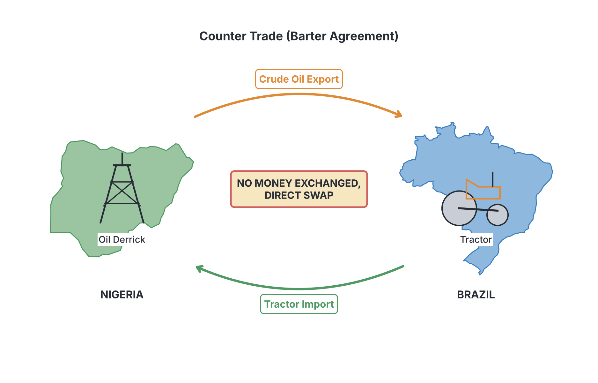

# JAMB Commerce Notes: Trade – Foreign Trade

## What JAMB expects

This topic is Section A, Topic 4(b) of the JAMB Commerce syllabus: Trade – Foreign Trade. It covers international trading practices, issues, and regulations. 

**THIS FILE COVERS:**
*   **b(i)** Types of foreign trade
*   **b(ii)** Basic issues in foreign trade (balance of trade, balance of payments and counter trade)
*   **b(iii)** Procedures and documents used in export, import and entrepôt trade
*   **b(iv)** Barriers to international trade
*   **b(v)** Tariffs and reasons for the imposition
*   **b(vi)** Tools for trade restriction and export promotion
*   **b(vii)** Role of Customs and Excise Authority, Ports Authority, etc. in foreign trade

**By the end of these notes, you should be able to:**
1.  Compare the various types of foreign trade (Objective xi).
2.  Analyse the basic issues in foreign trade (Objective xii).
3.  Explain the procedures and documents used in foreign trade (Objective xiii).
4.  Identify the barriers to international trade (Objective xiv).
5.  State the various tariffs and reasons for their imposition (Objective xv).
6.  Identify the tools for trade restriction and export promotion (Objective xvi).
7.  Appraise the role of government agencies in foreign trade (Objective xvii).

*Note: This is Part 2 of the "Trade" topic. Home Trade (which covers retailers, wholesalers, and the middleman) is covered in `A4a-trade-home-trade.md`.*

---

## Types of Foreign Trade

**Objective xi: compare the various types of foreign trade**
**Content b(i): Types of foreign trade**

**Foreign trade** (also called international trade) is the buying and selling of goods and services across the national boundaries of different countries (e.g., between Nigeria and China).

There are three main types of foreign trade:

1.  **Import Trade:** This is the buying of goods and services from other countries into one's own country. For example, a Nigerian trader buying electronics from Japan and bringing them to Lagos.
2.  **Export Trade:** This is the selling of goods and services produced in one's own country to other countries. For example, Nigeria selling crude oil or cocoa to the United Kingdom.
3.  **Entrepôt Trade:** This occurs when goods are imported from one country into a second country, not to be used there, but to be re-exported to a third country. For instance, goods may be imported from the USA to Benin Republic, and then re-exported to landlocked countries like Niger or Chad.

### Comparing the Types of Foreign Trade

| Feature | Import Trade | Export Trade | Entrepôt Trade |
| :--- | :--- | :--- | :--- |
| **Direction of goods** | Entering the home country | Leaving the home country | Entering and then leaving |
| **Flow of money** | Money flows out of the country | Money flows into the country | Money flows both ways |
| **Purpose** | To satisfy domestic demand | To earn foreign exchange | To serve as a middleman or distribution hub |
| **Nigerian Example** | Buying Toyota cars from Japan | Selling sesame seeds to China | Importing textiles from India to Lagos, then re-exporting them to Niger Republic |

---

## Basic Issues in Foreign Trade

**Objective xii: analyse the basic issues in foreign trade**
**Content b(ii): Basic issues in foreign trade (balance of trade, balance of payments and counter trade)**

When countries trade with each other, they need to keep a record of the value of goods and services going in and out. This leads to three fundamental issues:

### 1. Balance of Trade (BOT)

The **Balance of Trade** is the difference in value between a country's **visible exports** and **visible imports** over a given period (usually a year). 
*   **Visible goods** are physical items you can touch and see (e.g., petroleum, cars, rice, machinery).
*   **Favourable BOT:** When the value of visible exports is greater than visible imports.
*   **Unfavourable (Deficit) BOT:** When the value of visible imports is greater than visible exports.

**Formula:** 
$\text{Balance of Trade} = \text{Total Value of Visible Exports} - \text{Total Value of Visible Imports}$

**Worked Example:**
In 2023, imagine Nigeria exported physical goods (mostly crude oil and cocoa) worth ₦500,000, and imported physical goods (machinery and vehicles) worth ₦350,000. Calculate the Balance of Trade.
*   **Step 1:** Identify visible exports = ₦500,000.
*   **Step 2:** Identify visible imports = ₦350,000.
*   **Step 3:** Subtract imports from exports (₦500,000 - ₦350,000).
*   **Answer:** The Balance of Trade is a favourable surplus of ₦150,000.

### 2. Balance of Payments (BOP)

The **Balance of Payments** is a broader record. It is the difference between a country's total receipts (income) from all other countries and its total payments to all other countries over a given period. It includes both **visible goods**, **invisible services**, and **capital transfers**.
*   **Invisible items** are services you cannot touch (e.g., tourism, banking, shipping, insurance, education). 
*   A favourable BOP means the country is earning more from the rest of the world than it is spending.

**Worked Example:**
Using the trade figures above, suppose Nigeria also earned ₦150,000 from invisible exports (foreigners flying on Air Peace) and spent ₦200,000 on invisible imports (Nigerians paying for schooling abroad). Calculate the current account Balance of Payments.
*   **Step 1:** Calculate total exports (visible + invisible) = ₦500,000 + ₦150,000 = ₦650,000.
*   **Step 2:** Calculate total imports (visible + invisible) = ₦350,000 + ₦200,000 = ₦550,000.
*   **Step 3:** Subtract total imports from total exports (₦650,000 - ₦550,000).
*   **Answer:** The Balance of Payments shows a surplus of ₦100,000.

### 3. Counter Trade

**Counter trade** is a system of international trade where goods are exchanged for other goods instead of hard currency (like US dollars). It is essentially international barter. 
*   **Example:** If Nigeria does not have enough US dollars to buy tractors from Brazil, Nigeria might agree to send $50 million worth of crude oil to Brazil in direct exchange for $50 million worth of Brazilian tractors.

---

## Procedures and Documents Used in Foreign Trade

**Objective xiii: explain the procedures and documents used in foreign trade**
**Content b(iii): Procedures and documents used in export, import and entrepôt trade**

International trade requires many strict legal and financial steps because the buyer and seller are in different countries, operate under different laws, and do not know each other.

### Import and Export Procedures

**Step-by-step process of importing goods:**
1.  **Enquiry:** The importer sends an enquiry to the foreign exporter asking for a catalogue and price list.
2.  **Quotation:** The exporter replies with a quotation, stating the prices, terms of payment, and delivery options (e.g., F.O.B or C.I.F).
3.  **Order (Indent):** If satisfied, the importer places an order, known in foreign trade as an **Indent**.
4.  **Letter of Credit:** Because the exporter does not trust the importer to pay, the importer’s bank issues a **Letter of Credit** guaranteeing payment once the goods are shipped.
5.  **Dispatch and Shipping:** The exporter packs the goods, clears them with their local customs, and hands them to a shipping company. The shipping company issues a **Bill of Lading**.
6.  **Sending Documents:** The exporter sends the shipping documents (Invoice, Bill of Lading, Certificate of Origin) to the importer through their bank.
7.  **Customs Clearance and Delivery:** The goods arrive at the destination port (e.g., Tin Can Island, Lagos). The importer uses the documents to clear the goods through Customs, pays any required import duties, and takes delivery.

### Key Documents in Foreign Trade

Foreign trade relies on specific documents to transfer ownership, guarantee payment, and satisfy customs.

1.  **Indent:** This is an order to buy goods from abroad. 
    *   *Open Indent:* The importer does not specify the exact manufacturer; the agent can buy from anyone.
    *   *Closed Indent:* The importer specifies the exact manufacturer and brand to buy.
2.  **Bill of Lading:** This is a crucial document in shipping. It serves three purposes: it is a receipt for goods loaded on the ship, a contract of carriage between the exporter and the shipping company, and a **document of title** (whoever holds it owns the goods).
3.  **Airway Bill:** The equivalent of a Bill of Lading, but used when goods are transported by air. It is a receipt, but *not* a document of title.
4.  **Consular Invoice:** An invoice signed by the consul (embassy official) of the importer’s country located in the exporter’s country. It proves the prices charged are fair and prevents the exporter from cheating on customs duties (preventing under-invoicing).
5.  **Certificate of Origin:** A document certifying the specific country where the goods were produced. This is used by Customs to determine if the goods qualify for preferential tariff rates (cheaper duties) or if they come from a banned country.
6.  **Letter of Credit (L/C):** A financial document issued by the importer's bank to the exporter. It guarantees that the exporter will be paid a specified amount once they provide documents proving the goods have been shipped.
7.  **Bill of Exchange:** A written order requiring the importer to pay a specified sum of money at a given future date. 

#### Sample Document: Bill of Lading (Simplified)
| OCEANIC SHIPPING LINES LTD - BILL OF LADING | Document No: BL-40592 |
| :--- | :--- |
| **Shipper (Exporter):** Chika Cocoa Exports, Lagos, Nigeria | **Vessel Name:** MV Sea Hawk |
| **Consignee (Importer):** London Chocolate Co., UK | **Port of Loading:** Apapa, Lagos |
| **Description of Goods:** 500 Bags of Raw Cocoa Beans | **Port of Discharge:** Southampton, UK |
| **Gross Weight:** 25,000 kg | **Freight:** Prepaid |
| *Received the above goods in apparent good order and condition.* | **Date:** 12th May 2024 |

---

## Barriers to International Trade

**Objective xiv: identify the barriers to international trade**
**Content b(iv): Barriers to international trade**

Trading with someone in a different country is harder than trading in your local market. The main barriers include:

1.  **Language and Communication:** Differences in language can lead to misunderstandings in contracts and specifications. A Nigerian trader might struggle to negotiate with a Chinese factory owner if neither speaks a common language well.
2.  **Differences in Currency:** Every country uses its own money. Exchange rates constantly fluctuate (e.g., the Naira to US Dollar rate), which can suddenly make goods too expensive and complicate planning.
3.  **Distance and Transport Costs:** Goods must travel thousands of miles by sea or air, which takes a long time, adds heavy freight costs, and increases the risk of damage or piracy.
4.  **Differences in Weights and Measures:** Some countries use the metric system (kilograms, metres) while others use the imperial system (pounds, feet).
5.  **Legal and Political Differences:** Countries have different commercial laws. Also, political instability or wars can instantly halt trade between nations.
6.  **Artificial Barriers (Tariffs and Quotas):** Governments deliberately put taxes or limits on imported goods to protect their local industries, making trade difficult.

---

## Tariffs and Reasons for Imposition

**Objective xv: state the various tariffs and reasons for their imposition**
**Content b(v): Tariffs and reasons for the imposition**

A **tariff** (or customs duty) is a tax placed by the government on imported or exported goods. The primary focus is usually on imports. 

### Types of Tariffs

1.  **Specific Tariff (Specific Duty):** This is a tax based on the physical quantity (weight, volume, or number) of the goods, regardless of their price.
    *   **Calculation:** If the specific duty on imported rice is ₦150 per bag, and an importer brings in 500 bags.
    *   **Step 1:** Formula: Quantity $\times$ Rate per unit.
    *   **Step 2:** $500 \text{ bags} \times ₦150$.
    *   **Answer:** The specific duty is ₦75,000.
2.  **Ad Valorem Tariff:** This is a tax based on a percentage of the total value of the goods. "Ad valorem" is Latin for "according to value".
    *   **Calculation:** If a car is valued at ₦250,000 and the ad valorem duty is 20%.
    *   **Step 1:** Formula: Value of goods $\times$ Percentage rate.
    *   **Step 2:** $₦250,000 \times \frac{20}{100}$.
    *   **Answer:** The ad valorem duty is ₦50,000.

### Reasons for Imposing Tariffs

Governments do not just tax imports to punish traders; they have specific economic reasons:
1.  **To Protect Infant Industries:** Newly established local industries cannot compete with older, cheaper foreign companies. Tariffs make foreign goods expensive, encouraging citizens to buy locally made goods.
2.  **To Generate Government Revenue:** Customs duties are a major source of income for the government.
3.  **To Prevent Dumping:** Dumping occurs when a foreign country sells goods in your country below the cost of production to destroy local competitors. Tariffs block this.
4.  **To Correct a Balance of Payments Deficit:** By taxing imports, the government discourages citizens from buying foreign goods, which stops money from flowing out of the country, improving the BOP.
5.  **To Create/Protect Employment:** When citizens buy locally produced goods, local factories stay open and hire more workers.
6.  **Political Reasons:** Tariffs can be used to retaliate against unfriendly nations.

---

## Tools for Trade Restriction and Export Promotion

**Objective xvi: identify the tools for trade restriction and export promotion**
**Content b(vi): Tools for trade restriction and export promotion**

Governments intervene in foreign trade to protect the national economy. They use tools to restrict imports (bringing less in) and tools to promote exports (sending more out).

### 1. Tools for Trade Restriction

These are methods used to reduce the volume of goods imported into a country.

| Tool | Meaning | How it restricts trade |
| :--- | :--- | :--- |
| **Tariffs** | Taxes on imports. | Makes foreign goods more expensive, reducing demand. |
| **Quotas** | A physical limit on the quantity of a specific good that can be imported in a year. | Even if the goods are cheap, once the limit (e.g., 10,000 cars) is reached, no more can enter. |
| **Embargoes** | A total legal ban on the importation of a particular product or trading with a specific country. | Completely stops the entry of the good (e.g., banning imported poultry to protect local farmers). |
| **Import Licensing** | The requirement that importers must obtain a government permit before bringing in goods. | The government can simply refuse to issue licenses, stopping trade. |
| **Foreign Exchange Control** | The Central Bank restricts the amount of foreign currency (dollars) importers can buy. | If importers cannot get dollars, they cannot pay foreign suppliers, so they cannot import. |

### 2. Tools for Export Promotion

Export promotion involves government strategies to encourage domestic companies to sell their goods abroad to earn foreign exchange.

1.  **Export Subsidies:** The government gives financial assistance or grants to local producers, lowering their costs so they can sell at cheaper, more competitive prices abroad.
2.  **Tax Holidays:** The government exempts export-focused businesses from paying taxes for a certain number of years.
3.  **Export Processing Zones (EPZs):** Special areas (like the Calabar Free Trade Zone) where businesses that produce for export are given free land, uninterrupted power, and zero taxes.
4.  **Export Credit Guarantee:** The government provides insurance that protects exporters against the risk of foreign buyers failing to pay.
5.  **Establishment of Agencies:** Creating bodies like the **Nigerian Export Promotion Council (NEPC)**, which helps local businesses find foreign buyers, train on export standards, and participate in international trade fairs.

---

## Role of Government Agencies in Foreign Trade

**Objective xvii: appraise the role of government agencies in foreign trade**
**Content b(vii): Role of Customs and Excise Authority, Ports Authority, etc. in foreign trade**

Several government agencies regulate and facilitate the movement of goods at the borders and seaports.

### 1. Nigerian Customs Service (NCS)
The Customs and Excise Authority is the primary body controlling the flow of goods into and out of the country.
*   **Collection of Revenue:** They calculate and collect all tariffs, import duties, and export duties on behalf of the federal government.
*   **Prevention of Smuggling:** They patrol borders and inspect cargo to stop illegal goods (or undeclared goods) from entering the country.
*   **Enforcement of Restrictions:** They ensure that quotas, embargoes, and import bans are strictly followed.
*   **Supervision of Bonded Warehouses:** They guard warehouses where dutiable goods are kept until the importer pays the tax.

### 2. Nigerian Ports Authority (NPA)
The NPA manages all the seaports in Nigeria (such as Apapa, Tin Can Island, and Onne Port).
*   **Provision of Port Facilities:** They build and maintain docks, wharves, and cargo-handling equipment (cranes, forklifts) for loading and unloading ships.
*   **Berthing of Ships:** They allocate parking spaces (berths) for ships when they arrive.
*   **Pilotage and Towage:** They provide expert local pilots and tugboats to safely guide massive foreign ships through Nigerian waters into the port.
*   **Security:** They protect the goods while they are waiting in the port to be cleared.

### 3. Other Agencies
*   **NAFDAC** (National Agency for Food and Drug Administration and Control) operates at ports to inspect imported food, drugs, and cosmetics to ensure they are safe and not expired.
*   **NDLEA** (National Drug Law Enforcement Agency) checks cargo to prevent the smuggling of hard drugs (narcotics).

---

## Key terms

| Term | Meaning |
| :--- | :--- |
| **Balance of Trade (BOT)** | The difference in value between a country's visible exports and visible imports. |
| **Balance of Payments (BOP)** | The difference between a country's total financial receipts from and payments to other countries (visible + invisible + capital). |
| **Counter Trade** | Exchanging goods for goods in international trade without using currency. |
| **Bill of Lading** | A document that acts as a receipt for cargo, a contract of carriage, and a document of title. |
| **Consular Invoice** | An invoice signed by an embassy official of the importing country to verify prices. |
| **Indent** | An order placed by an importer to buy goods from abroad. |
| **Tariff** | A tax imposed by the government on imported goods. |
| **Ad valorem Duty** | A customs duty calculated as a percentage of the value of the goods. |
| **Quota** | A physical limit placed on the quantity of goods that can be imported. |
| **Embargo** | A total ban on the importation of a specific product or trade with a country. |

---

## Exam tips and common mistakes

*   **BOT vs BOP:** A very common mistake! Remember: Balance of *Trade* only deals with *visible* (physical) goods. Balance of *Payments* includes *everything* (visible goods, invisible services, capital).
*   **Ad valorem vs Specific:** "Ad valorem" means percentage of the price (value). "Specific" means a fixed amount per physical unit (kg, bag, litre).
*   **Quota vs Tariff:** A tariff is a *tax* (makes it expensive but you can still import). A quota is a *physical limit* (once the limit is reached, you cannot import more, no matter how much money you have).
*   **Bill of Lading is a Document of Title:** This is highly tested. It means whoever holds the actual paper legally owns the goods while they are on the ocean. An Airway Bill does *not* have this power.
*   **Consular Invoice purpose:** It prevents under-invoicing. Importers sometimes lie about the price to pay less tax; the Consular Invoice confirms the real price.

---

## Quick summary

1.  Foreign trade includes import (bringing goods in), export (sending goods out), and entrepôt (importing to re-export).
2.  Balance of Trade (BOT) measures only physical goods, while Balance of Payments (BOP) measures all financial inflows and outflows, including services (invisibles).
3.  Important documents in foreign trade include the Bill of Lading (a document of title), Consular Invoice (to prevent duty evasion), Certificate of Origin, and Letter of Credit (to guarantee payment).
4.  Trade is hampered by barriers like language differences, distance, currency exchange rates, and protective tariffs.
5.  Governments charge tariffs (Specific or Ad valorem) to raise revenue, protect infant industries, prevent dumping, and correct BOP deficits.
6.  Tools to restrict trade include quotas, embargoes, and foreign exchange controls. Export promotion tools include subsidies, tax holidays, and Export Processing Zones.
7.  The Nigerian Customs Service collects duties and stops smuggling, while the Nigerian Ports Authority provides facilities for ships to dock and unload goods safely.

---

## Practice questions

**1. Entrepôt trade is best described as**
- A. buying goods from foreign countries for domestic use
- B. exchanging goods directly for other goods without money
- C. importing goods from one country with the intention of re-exporting them to another
- D. exporting goods that were manufactured locally

**Answer: C.** Entrepôt trade occurs when a country imports goods not for its own consumption, but to serve as a middleman and re-export them to a third country.

**2. A country exports visible goods worth ₦800,000 and imports visible goods worth ₦950,000. What is the Balance of Trade?**
- A. ₦1,750,000 favourable
- B. ₦150,000 deficit (unfavourable)
- C. ₦150,000 favourable
- D. ₦1,750,000 deficit (unfavourable)

**Answer: B.** Step 1: Use the formula: Visible Exports - Visible Imports. Step 2: ₦800,000 - ₦950,000 = -₦150,000. Because imports are higher than exports, it is an unfavourable deficit of ₦150,000. Mistaking exports for imports would wrongly lead to option C.

**3. Which of the following documents is recognized as a document of title to goods being transported by sea?**
- A. Consular Invoice
- B. Airway Bill
- C. Letter of Credit
- D. Bill of Lading

**Answer: D.** The Bill of Lading gives the holder legal ownership of the goods. A common mistake is thinking the Airway Bill does this; the Airway Bill is just a receipt, not a document of title.

**4. To ensure that an importer does not under-invoice goods to evade customs duties, the exporter is required to obtain a**
- A. Certificate of Origin
- B. Consular Invoice
- C. Bill of Exchange
- D. Closed Indent

**Answer: B.** A Consular Invoice is signed by an embassy official in the exporter's country to certify the true value of the goods. Option A is a distractor used to verify where the goods were made, not their price.

**5. One of the natural barriers to international trade is**
- A. imposition of tariffs
- B. import licensing
- C. differences in language and currency
- D. export subsidies

**Answer: C.** Language and currency differences are natural barriers that naturally complicate trade. Options A and B are artificial barriers deliberately created by governments.

**6. If a government places a 15% customs duty on imported machinery valued at ₦2,000,000, how much is the tariff, and what type is it?**
- A. ₦300,000 ad valorem duty
- B. ₦150,000 specific duty
- C. ₦30,000 ad valorem duty
- D. ₦300,000 specific duty

**Answer: A.** Step 1: Recognize that a percentage-based tax is an "ad valorem" duty. Step 2: Calculate 15% of ₦2,000,000. (15/100) × 2,000,000 = ₦300,000. A common mistake is classifying a percentage tax as a specific duty (Option D).

**7. A government will impose a tariff in order to**
- A. encourage citizens to travel abroad
- B. protect newly established local industries from foreign competition
- C. increase the volume of imported luxury goods
- D. reduce government revenue

**Answer: B.** Tariffs make imported goods more expensive, which protects "infant" (newly established) local industries because consumers will buy the cheaper local goods instead. 

**8. An absolute prohibition placed by a government on the importation of a particular commodity is called**
- A. a quota
- B. an embargo
- C. an import license
- D. a specific tariff

**Answer: B.** An embargo is a total legal ban on importing a good. A common mistake is choosing quota (Option A), but a quota merely limits the quantity; it does not absolutely prohibit the goods.

**9. Which of the following is a tool used by governments for export promotion?**
- A. Foreign exchange control
- B. Export subsidies
- C. Imposing export duties
- D. Setting import quotas

**Answer: B.** Export subsidies provide financial help to local producers so they can produce cheaply and sell their goods abroad. Options A and D restrict trade, while C discourages exports.

**10. The primary role of the Nigerian Customs Service in foreign trade is to**
- A. provide pilotage and towage for ships
- B. allocate berthing spaces at the port
- C. collect import duties and prevent smuggling
- D. find foreign buyers for local exporters

**Answer: C.** The Customs Service collects revenue (tariffs) and inspects borders to stop smuggling. Options A and B describe the role of the Nigerian Ports Authority (NPA). Option D is the role of the Nigerian Export Promotion Council (NEPC).
