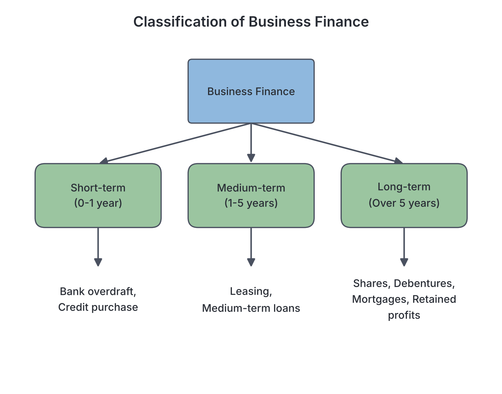
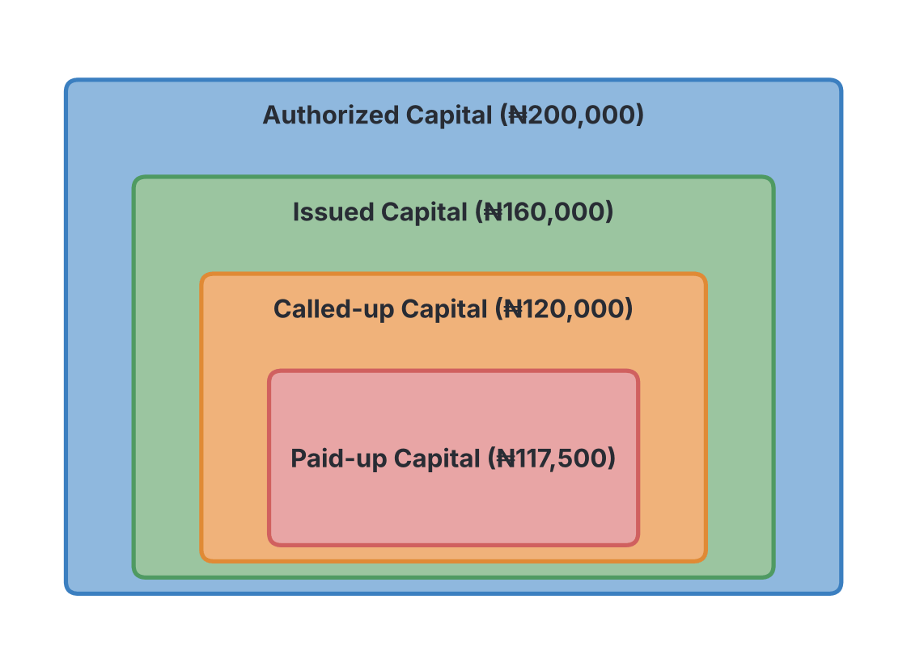

# JAMB Commerce Notes: Financing Business

## What JAMB expects

This topic is Section A, Topic 8 of the JAMB Commerce syllabus: Financing Business. 

It covers the following content items:
*   (i) Sources of finance (personal savings, sale of shares and bonds, loans, debentures, mortgage, bank overdraft, ploughing back of profit, credit purchase, leasing, etc.)
*   (ii) Types of capital (share capital, capital owned, authorized capital, issued capital, called-up capital, paid-up capital, liquid capital, working capital and owners’ equity)
*   (iii) Calculation of forms of capital, profits (gross and net) and turnover
*   (iv) Problems of sourcing finance
*   (v) The role of Bureau de change in an economy

By the end of these notes, you should be able to:
1. Identify the various ways of financing a business;
2. Discuss the different types of capital;
3. Compute the different forms of capital, profits and turnover;
4. Appraise the problems associated with sourcing finances for business;
5. Assess the role of Bureau de change in an economy.

## Ways of financing a business

**Objective i: identify the various ways of financing a business.**

Every business needs money to start, run its daily operations, and expand. This money is called **finance** or **capital**. Depending on how soon the money must be paid back, business finance is divided into three categories:

1. **Short-term finance:** Money needed for daily operations (working capital), usually repaid within one year.
2. **Medium-term finance:** Money needed for a few years (usually 1 to 5 years) to buy vehicles or machinery.
3. **Long-term finance:** Money needed for a long period (over 5 years) or permanently, used to buy fixed assets like land, buildings, or heavy equipment.

Below are the various ways a business can raise finance:

### 1. Personal savings
This is the most common source of finance for sole proprietors and partners. The business owner uses their own money, saved over time, to start or expand the business. It is a long-term source of finance because the owner does not have to pay themselves back within a strict timeframe, and it does not attract interest.

### 2. Sale of shares and bonds
- **Shares:** A company (especially a Public Limited Liability Company) can raise long-term capital by selling shares to the public. People who buy these shares become part-owners (shareholders) and receive a portion of the profits as **dividends**.
- **Bonds:** These are official documents issued by a government or a large company promising to repay borrowed money with a fixed rate of interest after a specified number of years. It is a long-term loan to the issuer.

### 3. Loans
A business can borrow a specific amount of money from a commercial bank (like First Bank or Zenith Bank) or other financial institutions. 
- The bank charges **interest** on the entire amount borrowed.
- The business must usually provide **collateral** (security), such as the title deeds to a house or land.
- Loans can be medium-term or long-term.

### 4. Debentures
A debenture is a document issued by a company to acknowledge that it has borrowed money from the general public. It is a long-term source of finance. People who buy debentures are **creditors** to the company (not owners) and receive a fixed rate of interest every year, whether the company makes a profit or a loss.

### 5. Mortgage
A mortgage is a long-term loan specifically used to buy property or land, where the property itself serves as the collateral. If the business fails to repay the loan, the lender (usually a mortgage bank or commercial bank) has the legal right to seize and sell the property to recover their money.

### 6. Bank overdraft
An overdraft is a short-term source of finance given by a bank to a customer who has a **current account**. It allows the business to withdraw more money than it actually has in its account, up to an agreed limit. 
- Interest is charged **only on the amount overdrawn** on a daily basis.
- It is highly flexible and used to solve sudden cash shortages.

### 7. Ploughing back of profit (Retained earnings)
Instead of sharing all the net profit among owners or shareholders, a successful business will keep a portion of it to reinvest in the business. This is called "ploughing back" profits or retained earnings. It is an excellent internal source of long-term finance because there is no interest to pay.

### 8. Credit purchase (Trade credit)
This is a short-term source of finance where a business buys raw materials or goods from a supplier and agrees to pay for them at a later date (e.g., in 30 or 60 days). It allows the business to sell the goods and make money before actually paying the supplier. 

### 9. Leasing and Hire Purchase
- **Leasing:** The business rents an asset (like a tractor or factory equipment) for a specified period and pays a regular lease fee. The business uses the equipment without needing the huge capital to buy it outright.
- **Hire Purchase:** The business takes an asset and pays for it in instalments. The business gets to use the asset immediately but only becomes the legal owner after the final instalment is paid. 

## Types of capital

**Objective ii: discuss the different types of capital.**

In Commerce and Accounting, the word "capital" has several specific meanings depending on the context. Below are the classifications of capital you must know:

### 1. Authorized, Issued, Called-up, and Paid-up Capital
These terms relate specifically to the **share capital** of a limited liability company.

| Type of Capital | Meaning |
| --- | --- |
| **Authorized Capital (Nominal or Registered Capital)** | The maximum amount of share capital a company is legally permitted to issue, as stated in its Memorandum of Association. |
| **Issued Capital** | The portion of the authorized capital that the company has actually offered to the public for sale. (A company usually does not issue all its authorized capital at once). |
| **Called-up Capital** | The portion of the issued capital that the company has requested the shareholders to pay for so far. (Companies sometimes ask for payment in instalments). |
| **Paid-up Capital** | The actual amount of money the shareholders have paid to the company out of the called-up capital. If some shareholders fail to pay, the unpaid amount is called **calls in arrears**. |

### 2. Share Capital
Share capital is the total amount of money raised by a company through the issue of shares. It is divided into two main types:
*   **Preference Shares:** These shareholders have a fixed rate of dividend and are paid first before ordinary shareholders. If the company closes down, they get their capital back first.
*   **Ordinary Shares (Equity Shares):** These shareholders are the real risk-bearers. Their dividend is not fixed; they get whatever is left after preference shareholders are paid. They also have voting rights to elect the Board of Directors.

### 3. Capital Owned (Owners’ Equity / Net Worth)
This is the actual wealth of the owner in the business. It is the amount left if the business sells all its assets and pays off all its external debts (liabilities). 
*   **Formula:** `Capital Owned = Total Assets - Total Liabilities`

### 4. Working Capital (Circulating Capital)
This is the money available to run the day-to-day operations of the business, such as paying salaries, buying stock, and paying electricity bills. It is the difference between current assets and current liabilities.
*   **Formula:** `Working Capital = Current Assets - Current Liabilities`
*   If working capital is negative, the business cannot pay its immediate short-term debts and may face closure.

### 5. Liquid Capital (Quick Capital)
This measures a business's ability to pay its immediate debts without having to sell its inventory (stock), because stock might take a long time to sell. 
*   **Formula:** `Liquid Capital = Current Assets - Closing Stock`

## Calculation of forms of capital, profits and turnover

**Objective iii: compute the different forms of capital, profits and turnover.**

To calculate these figures accurately, we extract numbers from a business's Trading, Profit and Loss Account and its Balance Sheet. 

**Note on formulas:**
1.  $\text{Turnover (Net Sales)} = \text{Sales} - \text{Return Inwards}$
2.  $\text{Cost of Goods Sold (COGS)} = \text{Opening Stock} + \text{Net Purchases} - \text{Closing Stock}$
    *(Where Net Purchases = Purchases + Carriage Inwards - Return Outwards)*
3.  $\text{Gross Profit} = \text{Turnover} - \text{COGS}$
4.  $\text{Net Profit} = \text{Gross Profit} - \text{Total Expenses}$
5.  $\text{Working Capital} = \text{Current Assets} - \text{Current Liabilities}$
6.  $\text{Liquid Capital} = \text{Current Assets} - \text{Closing Stock}$
7.  $\text{Capital Owned} = \text{Total Assets} - \text{Total Liabilities}$

### Worked Example

Imagine a Nigerian trader, Chinedu, has the following balances at the end of the year:

*   **Sales:** ₦500,000
*   **Return Inwards (Sales Returns):** ₦20,000
*   **Opening Stock:** ₦50,000
*   **Purchases:** ₦300,000
*   **Carriage Inwards:** ₦10,000
*   **Return Outwards (Purchases Returns):** ₦15,000
*   **Closing Stock:** ₦20,000
*   **Expenses (Rent, Salaries):** ₦60,000
*   **Current Assets:** Cash ₦30,000, Debtors ₦40,000, Closing Stock ₦20,000
*   **Current Liabilities:** Creditors ₦25,000, Bank Overdraft ₦15,000
*   **Fixed Assets (Premises, Motor Van):** ₦550,000
*   **Long-Term Liabilities (Bank Loan):** ₦100,000

Let us compute the required values step by step.

**Step 1: Calculate Turnover**
Turnover is the actual value of goods sold, minus any goods customers returned to the business.
*   $\text{Turnover} = \text{Sales} - \text{Return Inwards}$
*   $\text{Turnover} = ₦500,000 - ₦20,000 = ₦480,000$

**Step 2: Calculate Cost of Goods Sold (COGS)**
First, find Net Purchases:
*   $\text{Net Purchases} = \text{Purchases} + \text{Carriage Inwards} - \text{Return Outwards}$
*   $\text{Net Purchases} = ₦300,000 + ₦10,000 - ₦15,000 = ₦295,000$

Next, find Cost of Goods Available for Sale:
*   $\text{Cost of Goods Available} = \text{Opening Stock} + \text{Net Purchases}$
*   $\text{Cost of Goods Available} = ₦50,000 + ₦295,000 = ₦345,000$

Finally, calculate COGS:
*   $\text{COGS} = \text{Cost of Goods Available} - \text{Closing Stock}$
*   $\text{COGS} = ₦345,000 - ₦20,000 = ₦325,000$

**Step 3: Calculate Gross Profit**
Gross profit is the profit made simply from buying and selling goods, before removing business operating expenses.
*   $\text{Gross Profit} = \text{Turnover} - \text{COGS}$
*   $\text{Gross Profit} = ₦480,000 - ₦325,000 = ₦155,000$

**Step 4: Calculate Net Profit**
Net profit is the final profit after all running expenses (like rent and salaries) have been paid.
*   $\text{Net Profit} = \text{Gross Profit} - \text{Expenses}$
*   $\text{Net Profit} = ₦155,000 - ₦60,000 = ₦95,000$

**Step 5: Calculate Working Capital**
First, sum the Current Assets and Current Liabilities.
*   $\text{Total Current Assets} = \text{Cash} (₦30,000) + \text{Debtors} (₦40,000) + \text{Closing Stock} (₦20,000) = ₦90,000$
*   $\text{Total Current Liabilities} = \text{Creditors} (₦25,000) + \text{Bank Overdraft} (₦15,000) = ₦40,000$
*   $\text{Working Capital} = \text{Current Assets} - \text{Current Liabilities}$
*   $\text{Working Capital} = ₦90,000 - ₦40,000 = ₦50,000$

**Step 6: Calculate Liquid Capital**
Liquid capital removes stock because stock is not instantly converted to cash.
*   $\text{Liquid Capital} = \text{Total Current Assets} - \text{Closing Stock}$
*   $\text{Liquid Capital} = ₦90,000 - ₦20,000 = ₦70,000$

**Step 7: Calculate Capital Owned (Owners' Equity)**
First, find Total Assets and Total Liabilities.
*   $\text{Total Assets} = \text{Fixed Assets} (₦550,000) + \text{Current Assets} (₦90,000) = ₦640,000$
*   $\text{Total Liabilities} = \text{Long-Term Liabilities} (₦100,000) + \text{Current Liabilities} (₦40,000) = ₦140,000$
*   $\text{Capital Owned} = \text{Total Assets} - \text{Total Liabilities}$
*   $\text{Capital Owned} = ₦640,000 - ₦140,000 = ₦500,000$

## Problems of sourcing finance

**Objective iv: appraise the problems associated with sourcing finances for business.**

Even though there are many sources of finance, most businesses—especially Small and Medium Enterprises (SMEs) in Nigeria—find it very difficult to get the money they need. The major problems include:

1.  **Lack of adequate collateral security:** Most commercial banks demand tangible assets like houses or land as collateral before granting a loan. Many small business owners do not have these properties to pledge.
2.  **High interest rates:** The cost of borrowing money from banks in Nigeria is often very high. High interest rates eat heavily into the business’s profit, making loans unattractive or impossible to repay.
3.  **Stringent bank conditions:** Banks ask for detailed business plans, audited accounts for several years, and complex legal documents that small businesses usually cannot provide.
4.  **Poor record-keeping:** Many entrepreneurs fail to keep proper accounting records. Without accurate financial statements, investors and banks cannot trust the business with their money.
5.  **Ignorance and lack of information:** Many business owners are simply unaware of specialized funds created by the government or institutions (like the Bank of Industry or agricultural grants) that offer cheaper loans.
6.  **Economic instability and inflation:** In an unstable economy with high inflation, financial institutions are afraid to lend money long-term because the value of money drops rapidly, making the loan risky.
7.  **Public apathy towards shares:** For public companies trying to raise money through the Stock Exchange, general lack of public interest or fear of losing money can cause a share issue to fail.

## The role of Bureau de change in an economy

**Objective v: assess the role of Bureau de change in an economy.**

A **Bureau de Change (BDC)** is a retail financial institution licensed to buy and sell foreign currencies (foreign exchange). In Nigeria, BDCs operate to provide easy access to foreign exchange for individuals and small businesses. 

**Note on current regulations:** The Central Bank of Nigeria (CBN) heavily regulates BDCs, frequently changing their operating guidelines, licensing rules, and access to official foreign exchange to manage the value of the Naira. While these rules change fast, the fundamental roles of a BDC taught in your syllabus remain constant.

### Key roles of a Bureau de Change:

1.  **Buying and selling foreign exchange:** They convert local currency (Naira) into foreign currencies (like US Dollars, British Pounds, or Euros) and vice versa. 
2.  **Facilitating small-scale transactions:** Commercial banks often prioritize massive corporate forex requests. BDCs provide a fast avenue for individuals to get foreign currency for Personal Travel Allowance (PTA), Business Travel Allowance (BTA), school fees abroad, and medical bills.
3.  **Promoting tourism:** Foreign tourists arriving in Nigeria rely heavily on BDCs to exchange their home currency into Naira to spend during their visit.
4.  **Providing exchange rate information:** Because they display their buying and selling rates openly, BDCs provide real-time information on the current value of the Naira against other currencies.
5.  **Reducing informal (black) market activities:** By providing a regulated and licensed environment for currency exchange, BDCs help discourage illegal street hawking of foreign currency (the black market).

### Calculation Example for Bureau de Change
If a Nigerian student needs US$2,000 for their Personal Travel Allowance (PTA), and the BDC's selling rate is ₦1,200 per US$:
*   **Step 1:** Identify the rate and the target currency. The BDC is selling dollars at ₦1,200 each.
*   **Step 2:** Multiply the amount needed by the exchange rate. 
*   $\text{Total Naira needed} = 2,000 \times 1,200 = ₦2,400,000$

Conversely, if a tourist arrives from the UK with £500 and wants to sell it to the BDC at an exchange rate of ₦1,450 per £:
*   $\text{Total Naira received} = 500 \times 1,450 = ₦725,000$

## Key terms

| Term | Meaning |
| --- | --- |
| **Collateral** | A valuable asset pledged by a borrower as security for a loan. |
| **Dividend** | The portion of a company's profit distributed to its shareholders. |
| **Retained Earnings** | Profits kept in the business for expansion rather than distributed to owners. |
| **Overdraft** | A short-term loan allowing a current account holder to withdraw more than their balance. |
| **Debenture** | A certificate acknowledging a long-term loan to a company, bearing a fixed interest rate. |
| **Turnover** | The net sales of a business during a specific period (Sales minus Return Inwards). |
| **Working Capital** | The capital used for day-to-day operations (Current Assets minus Current Liabilities). |
| **Liquid Capital** | Current Assets excluding closing stock, showing immediate ability to pay debts. |
| **Bureau de Change** | A financial institution licensed to buy and sell foreign currencies to the public. |

## Exam tips and common mistakes

*   **Confusing Return Inwards and Outwards:** Remember that **Return Inwards** comes *into* the business (sales returned by customers) and is deducted from Sales. **Return Outwards** goes *out* of the business (purchases returned to suppliers) and is deducted from Purchases.
*   **Working Capital vs Liquid Capital:** Working capital includes all current assets. Liquid capital excludes closing stock because stock is not considered completely "liquid" (it hasn't been sold yet).
*   **Overdraft vs Loan:** An overdraft is strictly **short-term** and you only pay interest on the amount overdrawn. A loan is medium to long-term and you pay interest on the full amount borrowed.
*   **Issued vs Authorized Capital:** A company can never issue more capital than it is authorized to. Authorized is the maximum legal limit; Issued is what is actually pushed out to the public.
*   **Debenture holders vs Shareholders:** Debenture holders earn **interest** and are creditors. Shareholders earn **dividends** and are owners.

## Quick summary

1. Business finance is divided into short-term (e.g., overdraft, trade credit), medium-term (e.g., leasing), and long-term (e.g., shares, debentures, mortgages).
2. Authorized capital is the maximum share capital a company can legally raise, while Issued capital is the portion offered to the public.
3. Turnover is calculated by subtracting Return Inwards from Sales. 
4. Gross profit is Turnover minus Cost of Goods Sold. Net profit is Gross profit minus all operating expenses.
5. Working capital is the difference between current assets and current liabilities, showing a firm's short-term financial health.
6. The major problems of sourcing finance in Nigeria include lack of collateral security, high interest rates, and poor record-keeping by small businesses.
7. A Bureau de Change (BDC) facilitates the buying and selling of foreign exchange for small-scale transactions like travel allowances, helping to boost tourism and stabilize currency access.

## Practice questions

**1. A trader has Sales of ₦100,000, Return inwards of ₦5,000, Opening stock of ₦20,000, Purchases of ₦60,000, and Closing stock of ₦15,000. What is the Gross Profit?**
- A. ₦35,000
- B. ₦30,000
- C. ₦50,000
- D. ₦0

**Answer: B.** 
*Step 1:* Turnover = Sales - Return inwards = ₦100,000 - ₦5,000 = ₦95,000. 
*Step 2:* COGS = Opening stock + Purchases - Closing stock = ₦20,000 + ₦60,000 - ₦15,000 = ₦65,000.
*Step 3:* Gross Profit = Turnover - COGS = ₦95,000 - ₦65,000 = ₦30,000.
(Option A is a common mistake if you forget to deduct Return inwards from Sales).

**2. The difference between total current assets and total current liabilities is known as**
- A. Liquid capital
- B. Working capital
- C. Capital owned
- D. Fixed capital

**Answer: B.** Working capital is calculated as Current Assets minus Current Liabilities. It represents the funds available for day-to-day operations.

**3. Which of the following is a short-term source of business finance?**
- A. Mortgage
- B. Debenture
- C. Bank overdraft
- D. Ordinary shares

**Answer: C.** A bank overdraft is a short-term facility that allows a current account holder to withdraw more than their balance, usually repayable within a year. Mortgages, debentures, and shares are long-term sources.

**4. A company is authorized to issue 100,000 shares of ₦2 each. It issued 80,000 shares and called up ₦1.50 per share. If calls in arrears amount to ₦2,500, what is the paid-up capital?**
- A. ₦160,000
- B. ₦120,000
- C. ₦117,500
- D. ₦200,000

**Answer: C.**
*Step 1:* Calculate called-up capital: 80,000 shares × ₦1.50 = ₦120,000.
*Step 2:* Deduct calls in arrears: ₦120,000 - ₦2,500 = ₦117,500.
The paid-up capital is the amount actually received by the company.

**5. One of the major problems small businesses face when sourcing funds from commercial banks is**
- A. Excessive profits
- B. Lack of collateral security
- C. High number of shareholders
- D. Issuing too many debentures

**Answer: B.** Banks require collateral (like land or buildings) to secure loans. Most small business owners lack these assets, making it difficult for them to secure bank financing.

**6. If a business has Total Current Assets of ₦90,000 (including Closing Stock of ₦20,000) and Total Current Liabilities of ₦40,000, what is its Liquid Capital?**
- A. ₦50,000
- B. ₦70,000
- C. ₦30,000
- D. ₦110,000

**Answer: B.** 
*Step 1:* The formula for Liquid Capital is Current Assets - Closing Stock. 
*Step 2:* ₦90,000 - ₦20,000 = ₦70,000. 
(Option A is the Working Capital, which is ₦90,000 - ₦40,000).

**7. Retained earnings, or ploughing back of profit, is best described as**
- A. Borrowing money from the stock exchange
- B. Reinvesting a portion of net profit back into the business
- C. Distributing all profits as dividends to shareholders
- D. Selling fixed assets to raise working capital

**Answer: B.** Retained earnings mean keeping some of the company's net profits to expand the business rather than distributing it all to the owners.

**8. People who buy a company's debentures are referred to as its**
- A. Debtors
- B. Creditors
- C. Shareholders
- D. Directors

**Answer: B.** A debenture is a loan to the company. Therefore, debenture holders are creditors to the business and are entitled to a fixed rate of interest.

**9. What is the primary function of a Bureau de Change in an economy?**
- A. Issuing authorized share capital
- B. Providing long-term mortgage loans
- C. Buying and selling foreign exchange for small-scale transactions
- D. Accepting deposits to create bank overdrafts

**Answer: C.** A Bureau de Change is licensed specifically to buy and sell foreign currencies (like Dollars and Euros), helping individuals get foreign exchange for travel, medicals, and school fees.

**10. The formula `Total Assets - Total Liabilities` is used to determine**
- A. Gross Profit
- B. Net Profit
- C. Working Capital
- D. Capital Owned (Owners' equity)

**Answer: D.** Capital Owned (also known as net worth or owners' equity) represents the true wealth of the owner in the business, calculated by subtracting all external debts (liabilities) from everything the business owns (assets).

<!-- COVERAGE
obj i | Ways of financing a business
obj ii | Types of capital
obj iii | Calculation of forms of capital, profits and turnover
obj iv | Problems of sourcing finance
obj v | The role of Bureau de change in an economy
item i | Ways of financing a business
item ii | Types of capital
item iii | Calculation of forms of capital, profits and turnover
item iv | Problems of sourcing finance
item v | The role of Bureau de change in an economy
-->
