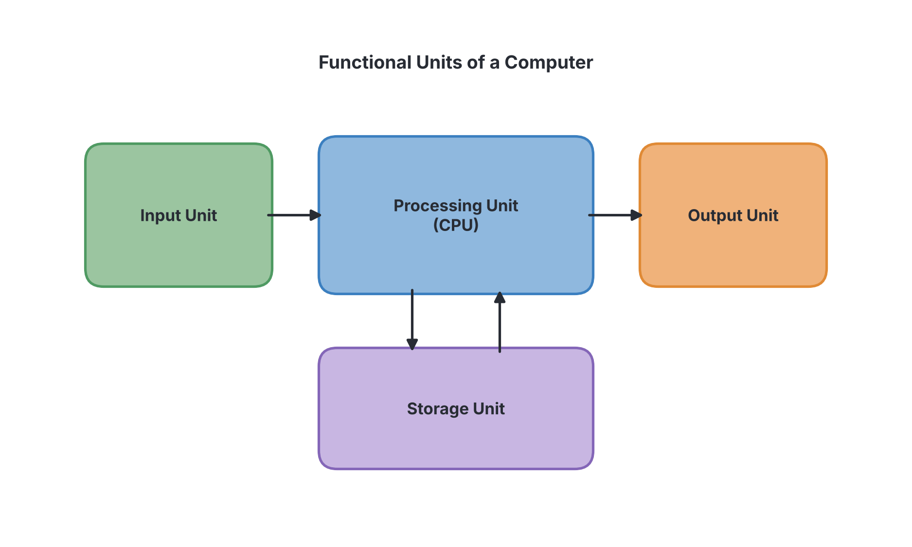

# JAMB Computer Studies Notes: Overview of Computer Systems

## What JAMB expects

This topic is Section B, Topic 1 of the JAMB Computer Studies syllabus: Overview of Computing Systems. It is a large topic, so we have split it into several files. This first file covers the fundamental concept of a computer system, its characteristics, its functional parts, and the difference between its two main constituents (hardware and software). 

It covers the following content items:
- **a. Two main constituents of a computer (hardware and software)**
- **b. Characteristics of computers**

By the end of these notes, you should be able to:
1. Define Computer system in relation to its nature and programmability.
2. List functional parts of computer systems.
3. Explain the characteristics of computers (Electronic, Accuracy, Speed, interactive, Reliability, Consistency, Large Storage etc.).
4. Identify the differences between hardware and software.

*Note on the syllabus wording:* The syllabus writes "interactive" with a lowercase letter in a list of capitalised words; we treat it as a standard characteristic here. Detailed notes on specific hardware components (CPU, input/output devices) are in `B1b-hardware.md`, and notes on specific software types are in `B1e-system-software.md` and `B1f-application-software.md`.

---

## Defining a Computer System

**Objective i: Define Computer system in relation to its nature and programmability.**

A **computer system** is an electronic device that can accept raw data (input), process that data according to specific instructions, and produce useful information (output) while storing the data and information for future use. 

To fully understand this definition, JAMB expects you to understand a computer based on two main ideas: its **nature** and its **programmability**.

### 1. The Nature of a Computer
By "nature", we mean what a computer fundamentally is. A computer is an **electronic** device. This means it is powered by electricity and uses electronic circuits (such as microchips, transistors, and wires) to function. Unlike older mechanical machines (like typewriters or mechanical adding machines that used moving gears and levers), a computer relies on the flow of electric current to represent and process data at the speed of light.

### 2. The Programmability of a Computer
Programmability is the core feature that makes a computer different from an ordinary electronic device like a television or a torchlight. 
- A computer cannot do anything on its own. It is basically a "dumb" machine until it is given a set of instructions.
- **Programmability** means a computer can be given a sequence of instructions (a **program**) that tells it exactly what to do step by step. 
- Because it is programmable, a single computer can be used for many different things: the same smartphone or laptop can be used to type a document, play a game, browse a Nigerian news website, or calculate mathematics, simply by running different programs.

---

## Functional Parts of a Computer System

**Objective ii: List functional parts of computer systems.**

Even though computers come in many shapes and sizes (from huge servers to small mobile phones), they all share the same basic structure. A computer is divided into four main **functional parts** that work together to perform tasks.

1. **Input Unit:**
   This part allows the user to feed raw data and instructions into the computer. It acts as the bridge between the outside world and the computer. 
   *Examples:* Keyboard, mouse, touch screen, scanner, microphone.
2. **Processing Unit (Central Processing Unit - CPU):**
   This is the "brain" of the computer. It receives the input data and processes it according to the software's instructions. It does all the calculating, comparing, and decision-making. 
   *Note:* The CPU itself has smaller functional parts, mainly the **Arithmetic and Logic Unit (ALU)** for calculations, and the **Control Unit (CU)** for directing operations.
3. **Output Unit:**
   This part takes the processed data (now called information) and presents it to the user in a form they can understand, such as text on a screen or a printed paper.
   *Examples:* Monitor (screen), printer, speakers.
4. **Storage Unit (Memory):**
   This part holds data, instructions, and information. 
   - **Primary Storage (Main Memory):** Holds data temporarily while the computer is actively working on it (e.g., RAM).
   - **Secondary Storage:** Holds data permanently for future use, even when the power is turned off (e.g., Hard disk, flash drive).

---

## Characteristics of Computers

**Objective iii: Explain the characteristics of computers (Electronic, Accuracy, Speed, interactive, Reliability, Consistency, Large Storage etc.).**

Computers have several distinct features that make them incredibly powerful and necessary in today's world. JAMB specifically lists the following characteristics:

### 1. Electronic
Computers are built using electronic components (semiconductors, integrated circuits) and run on electrical power. This is what allows them to process data incredibly fast, using electrical signals to represent binary data (0s and 1s).

### 2. Accuracy
Computers perform operations with a very high degree of accuracy. If a computer is given the correct instructions and the correct data, it will produce a 100% correct result, whether it is calculating the change for a ₦5,000 purchase or launching a satellite. 
* Errors usually only happen because of human mistakes—either the programmer wrote a bad instruction, or the user entered the wrong data. In computer science, this is known as **GIGO (Garbage In, Garbage Out)**.

### 3. Speed
Computers work at incredibly high speeds. They can process millions or even billions of instructions per second. Computer speed is often measured in units like Megahertz (MHz) or Gigahertz (GHz), and processing times are measured in milliseconds, microseconds, nanoseconds, or picoseconds. What would take a human months to calculate, a computer can do in a fraction of a second (e.g., verifying the BVN of millions of Nigerians instantly).

### 4. Interactive
Modern computers are highly interactive, meaning there is a two-way communication between the user and the system. The user inputs a command, and the computer responds instantly. For example, when you tap an icon on an ATM screen in Nigeria to withdraw money, the system asks you for your PIN, you reply by typing it, and the system processes your cash.

### 5. Reliability
Computers are very reliable and can perform tasks without failure for long periods, provided they are maintained properly and have a stable power supply (or a UPS). A computer will not "forget" instructions or randomly change its behavior unless there is a physical hardware failure or a software bug.

### 6. Consistency (Diligence)
Humans get tired, bored, and lose concentration when doing repetitive tasks, which leads to mistakes. A computer is highly diligent and consistent. It can perform the exact same task millions of times without suffering from tiredness, lack of concentration, or boredom, and the millionth result will be just as accurate as the first.

### 7. Large Storage
Computers can store massive amounts of data in very small physical spaces. A single flash drive or hard disk can hold thousands of textbooks, hundreds of movies, or the medical records of an entire hospital. This data can be retrieved almost instantly whenever it is needed.

---

## Two Main Constituents of a Computer

**Content a: Two main constituents of a computer (hardware and software).**
**Objective iv: Identify the differences between hardware and software.**

A computer system is made up of two major, distinct parts that depend on each other: **Hardware** and **Software**. Without hardware, software has nowhere to run. Without software, hardware is just useless plastic and metal.

### Hardware
**Computer hardware** refers to all the physical, tangible parts of the computer. Tangible means you can see, touch, and feel them. The hardware is responsible for the physical execution of tasks.
* **Examples:** The monitor, keyboard, mouse, system unit (casing), motherboard, hard drive, cables, and printer.

### Software
**Computer software** refers to the intangible set of instructions, programs, and data that tell the hardware exactly what to do and how to do it. You cannot physically touch software. It is stored electronically on the hardware.
* **Examples:** Operating systems (Windows, Android), application packages (Microsoft Word, WhatsApp, CorelDraw), and video games.

### Differences Between Hardware and Software

JAMB frequently tests your ability to distinguish between these two constituents.

| Feature | Hardware | Software |
| :--- | :--- | :--- |
| **Definition** | Physical components that make up the computer system. | A set of instructions or programs that tell the hardware what to do. |
| **Tangibility** | Tangible (can be seen and physically touched). | Intangible (can be seen on a screen, but cannot be physically touched). |
| **Creation** | Manufactured in factories using materials like plastic, silicon, and metal. | Developed and engineered by programmers using programming languages. |
| **Replacement** | If hardware is damaged, it must be physically repaired or replaced with a new part. | If software is damaged (corrupted), it can be fixed by reinstalling it or downloading an update using a backup copy. |
| **Wear and Tear** | Wears out over time due to age, heat, and physical use. | Does not wear out physically, though it may become outdated. |
| **Infection** | Cannot be infected by computer viruses (though hardware can be damaged by electrical spikes). | Can be infected, corrupted, or destroyed by computer viruses and malware. |

---

## Key terms

| Term | Meaning |
| :--- | :--- |
| **Computer system** | An electronic, programmable device that accepts data, processes it, stores it, and outputs information. |
| **Programmability** | The ability of a computer to follow a given sequence of instructions (programs) to perform different tasks. |
| **Hardware** | The physical, tangible parts of a computer system. |
| **Software** | The intangible set of instructions or programs that direct the hardware. |
| **Functional parts** | The main units of a computer (Input, Processing, Output, Storage). |
| **GIGO** | Garbage In, Garbage Out; a principle showing that a computer is highly accurate, so wrong output is the result of wrong input by the user. |
| **Consistency / Diligence** | The characteristic of a computer to perform repetitive tasks without getting tired or bored. |

---

## Exam tips and common mistakes

- **GIGO belongs to Accuracy:** If a question asks which characteristic explains why a computer gives wrong results when bad data is entered, the answer relates to **Accuracy**. The computer accurately processed the "garbage" it was given.
- **Consistency vs. Reliability:** Consistency (or diligence) is about not getting tired or bored while doing the *same* repetitive task. Reliability is about the computer functioning for a long time without failing.
- **Hardware vs. Software:** The most common JAMB trick is to mix up hardware and software characteristics. Remember: **Hardware = physical (manufactured, wears out, can't catch viruses)**. **Software = instructions (programmed, doesn't wear out, can catch viruses)**.
- **Brain of the computer:** The Central Processing Unit (CPU) is the main part of the Processing Unit. If asked which functional part does the actual thinking/calculating, it is the Processing Unit.

---

## Quick summary

1. A computer system is an electronic, programmable device designed to accept, process, store, and output data.
2. Programmability means a computer operates based on specific instructions given to it, allowing it to perform many different tasks.
3. The functional parts of a computer are the Input Unit, Processing Unit, Output Unit, and Storage Unit.
4. Computers are Electronic; they use electrical power and circuits.
5. Computers are incredibly fast, completely accurate (GIGO), interactive, reliable, and capable of storing massive amounts of data.
6. Consistency (or diligence) means a computer does not get tired or bored, no matter how many times it repeats a task.
7. Hardware is the physical, tangible part of the computer (e.g., monitor, keyboard).
8. Software is the intangible set of instructions that controls the hardware (e.g., Windows, MS Word).

---

## Practice questions

**1. A computer is considered a programmable machine because it:**
- A. operates using electrical power.
- B. follows a stored sequence of instructions to perform tasks.
- C. has a keyboard and a monitor for users.
- D. never makes a mistake during calculations.

**Answer: B.** Programmability is the ability to accept and follow a set of instructions (a program) to execute different tasks.

**2. Which of the following is NOT one of the major functional parts of a computer system?**
- A. Storage unit
- B. Processing unit
- C. Internet unit
- D. Output unit

**Answer: C.** The four main functional units are Input, Processing, Output, and Storage. The internet is a network, not a fundamental internal unit of a standalone computer.

**3. The principle of "Garbage In, Garbage Out" (GIGO) relates most closely to which characteristic of a computer?**
- A. Consistency
- B. Accuracy
- C. Large Storage
- D. Speed

**Answer: B.** GIGO demonstrates a computer's strict accuracy. It does exactly what it is told; if you put in accurate data, you get accurate results. If you put in bad data (garbage), it accurately processes that bad data to give bad results.

**4. A computer's ability to perform the exact same task millions of times without suffering from tiredness or boredom is known as:**
- A. Reliability
- B. Versatility
- C. Consistency
- D. Speed

**Answer: C.** Consistency (also known as diligence) means the computer does not suffer from human traits like fatigue, boredom, or loss of concentration.

**5. Which of the following statements correctly identifies a difference between hardware and software?**
- A. Hardware can be infected by computer viruses, while software cannot.
- B. Hardware consists of physical components, while software consists of intangible instructions.
- C. Hardware is programmed by software developers, while software is manufactured in factories.
- D. Hardware does not wear out over time, while software undergoes physical wear and tear.

**Answer: B.** Hardware is physical and tangible, whereas software is a set of intangible programs.

**6. Which functional part of the computer is often referred to as the "brain" because it interprets instructions and performs calculations?**
- A. Output Unit
- B. Storage Unit
- C. Input Unit
- D. Processing Unit (CPU)

**Answer: D.** The Central Processing Unit (CPU) handles all the processing, logic, and control, making it the "brain" of the computer.

**7. In a bank in Lagos, a computer system immediately prompts the teller if they enter an incomplete account number, and the teller corrects it immediately. This two-way communication illustrates which characteristic of computers?**
- A. Interactive
- B. Large Storage
- C. Electronic
- D. Reliability

**Answer: A.** The interactive nature of computers allows for instant two-way communication between the user and the machine.

**8. Which of the following is the best example of computer software?**
- A. The system unit casing
- B. A flash drive used to save documents
- C. The Microsoft Word program used to type a letter
- D. The screen that displays the typed letter

**Answer: C.** Microsoft Word is an application program (instructions) and is therefore software. The others are physical hardware objects.

**9. What happens to computer software when it gets corrupted or develops a major error?**
- A. It must be sent to a factory for welding and repair.
- B. It can be reinstalled, debugged, or updated.
- C. It causes the hardware to melt.
- D. It becomes physically tangible.

**Answer: B.** Because software is intangible data, errors (bugs) are fixed by updating the code, or the software can simply be reinstalled from a backup. It is not physically repaired.

**10. When describing the nature of a computer system, it is fundamentally referred to as an "electronic" device because:**
- A. it can store data on paper.
- B. it uses mechanical gears and levers to count.
- C. it is powered by electricity and uses semiconductor circuits.
- D. it requires human beings to operate it.

**Answer: C.** The nature of modern computers is electronic, meaning they rely on electrical current and electronic circuits (like microchips) to represent and process data, unlike older mechanical devices.

<!-- COVERAGE
obj i | Defining a Computer System
obj ii | Functional Parts of a Computer System
obj iii | Characteristics of Computers
obj iv | Two Main Constituents of a Computer
item a | Two Main Constituents of a Computer
item b | Characteristics of Computers
-->
