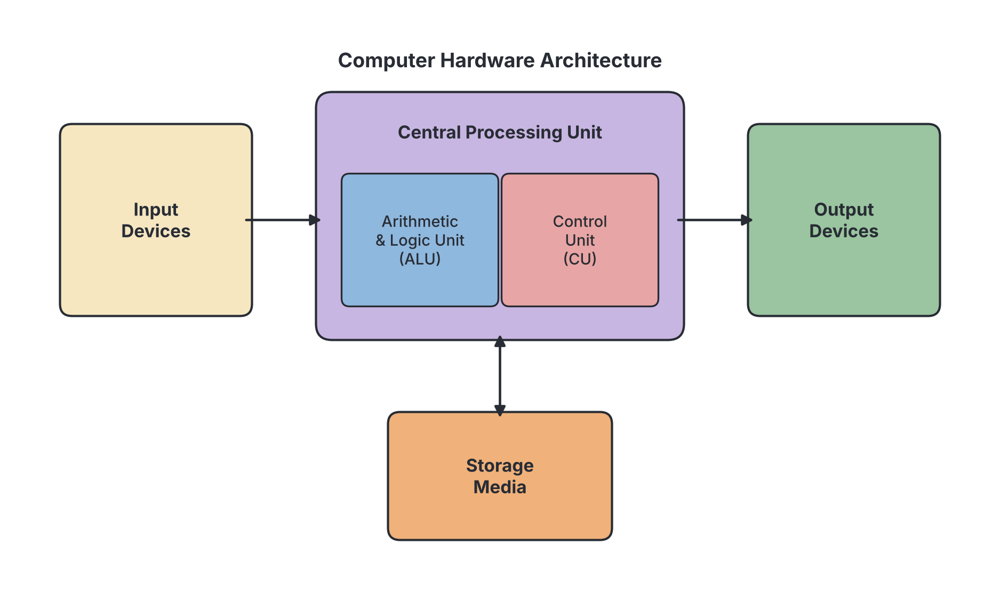
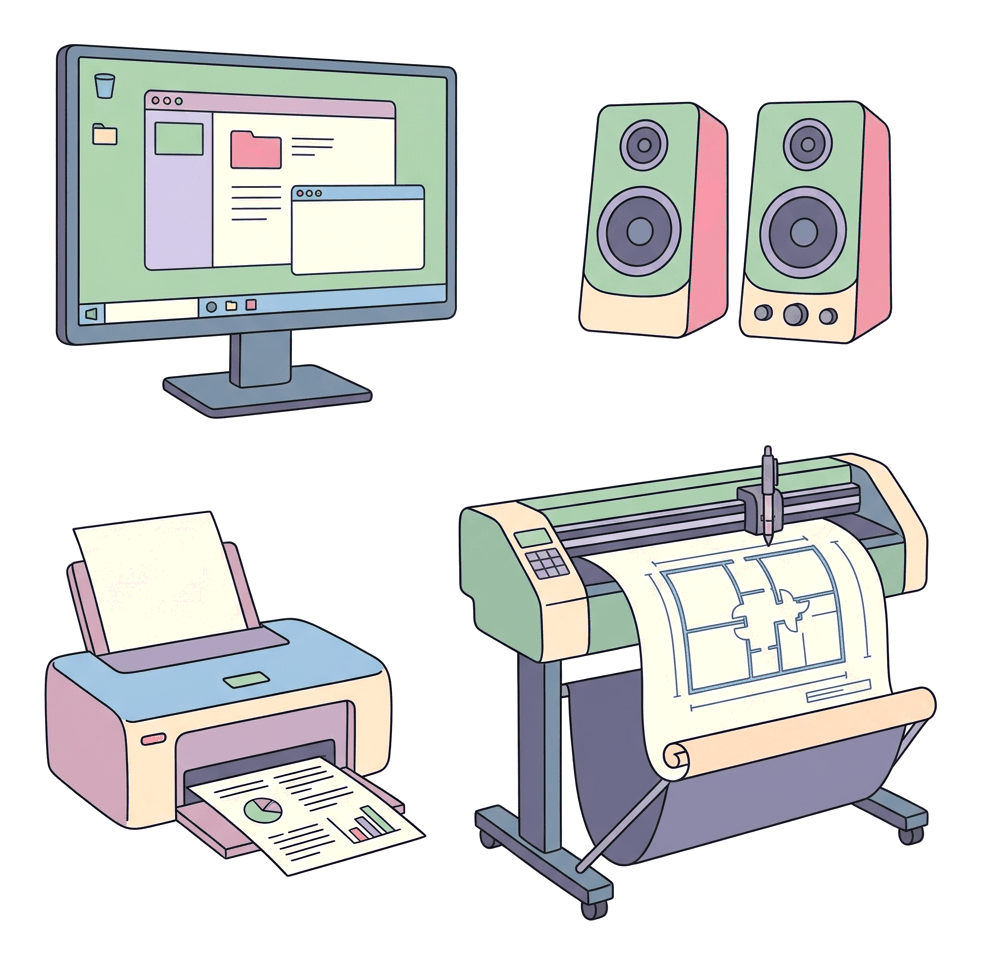
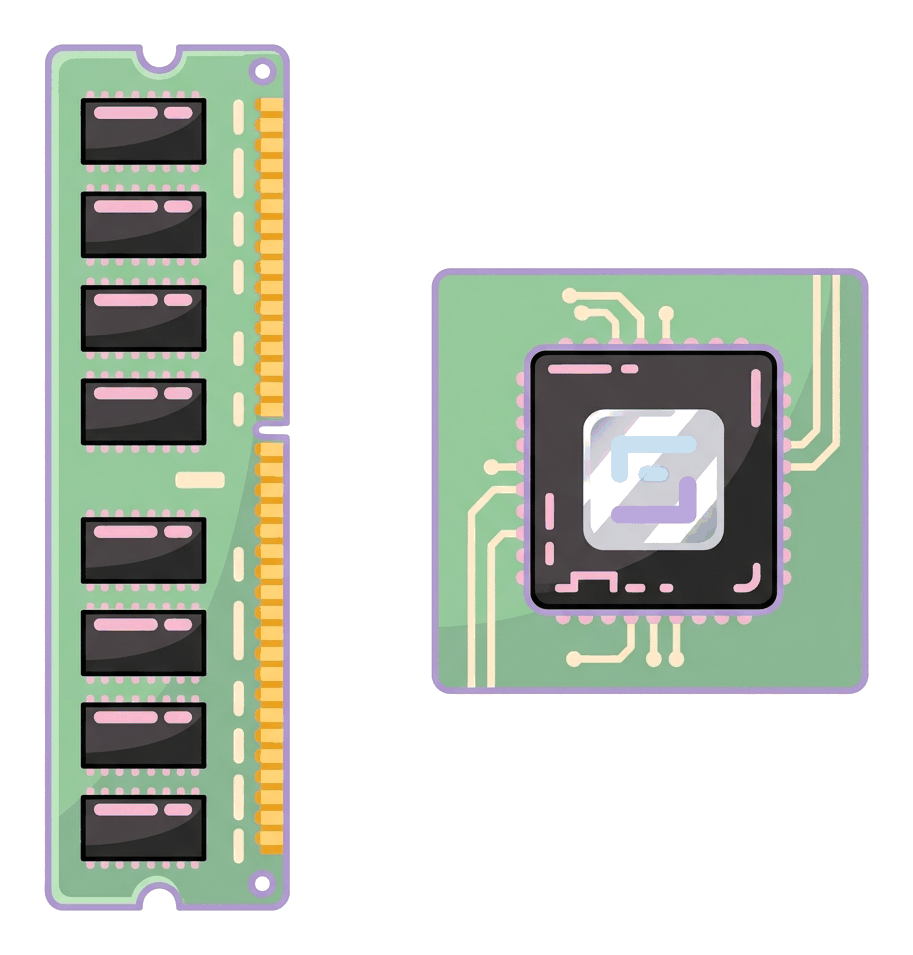

# JAMB Computer Studies Notes: Computer Hardware

## What JAMB expects

This file covers Section B, Topic 1 (Overview of Computing Systems), specifically the second block of objectives under "Candidates should be able to:". This is part of a split topic; the overview of computer systems, registers and the processing cycle, logic gates, and software are covered in separate files (`B1a-computer-systems.md`, `B1c-registers-bus-and-processing-cycle.md`, `B1d-logic-circuits.md`, `B1e-system-software.md`, `B1f-application-software.md`).

It covers content item **(c): Type, examples and uses of computer hardware**.

By the end of these notes, you should be able to:
1. Define and give examples of hardware devices
2. List components of computer hardware, their functions and different types -Central Processing Unit, Peripherals (Input and Output devices) and Storage media
3. Explain the differences between input and output devices
4. Explain the functions of major input devices and give examples of the major input devices (keyboards, mouse, scanner, joystick, light pen, voice, digital camera etc)
5. Explain the classification of keys on the keyboard (function, numeric, alphabetic, cursors.
6. Explain the features, functions and operations of the mouse
7. Explain the differences among keyboard, mouse, light pen and scanner, digital camera and output devices
8. Define and give examples of output devices (monitor, printer, speaker, plotters)
9. List the different types, features and uses of each output device above.
10. Explain the similarities and differences among inkjet, laser and line printers
11. List the components of CPU – Arithmetic and Logic Unit (ALU), Control Unit (CU) and Registers.
12. Explain the functions of ALU, CU and Registers.
13. Distinguish between Primary and Secondary Memory (Storage) units
14. List the components of Primary Memory Unit (Random Access Memory (RAM), Read Only Memory (ROM))
15. Explain the uses and differences between RAM and ROM
16. Explain the functions of secondary (auxiliary) storages
17. List different types of secondary storages
18. Give examples of secondary storages (Floppy disks, magnetic tape, hard disks, compact disk (CD), Digital Video Disk (DVD),USB, etc.)
19. Carry out comparative analysis of auxiliary storage devices in respect of size, speed, cost and technology (access mode, component etc).
20. List different units by which storage are measured and their relationships - bits, bytes, nibbles, words, kilobytes, megabytes, gigabytes, terabytes etc.
21. Relate the relationships between Micro, Mega, Giga, and Terra bytes.

**Note on the syllabus wording:**
- In objective (v), the syllabus writes "cursors." with no closing bracket. This refers to **cursor keys** (the arrow or navigation keys).
- In objective (xxi), the syllabus writes "Terra bytes"; the correct spelling is **Terabytes**. 
- Objective (xxi) also asks for the relationship involving "Micro". In standard scientific units, "micro" is a sub-multiple unit meaning one-millionth ($10^{-6}$), which is almost never applied to bytes. The syllabus likely intended **Kilo**, which is the standard step before Mega. These notes explain standard prefixes, including the difference between the 1,000-based (SI) and 1,024-based (binary) conventions commonly used in exams.
- The syllabus names "Floppy disks" as an example of secondary storage. Floppy disks are obsolete and no longer sold or used, but they are explained here because the syllabus names them and JAMB frequently sets questions on them.

## Overview of Computer Hardware

A computer system is divided into two main parts: software (the invisible instructions) and hardware. Hardware makes up the physical machinery of the computer. The types, examples, and uses of all hardware components are detailed in the sections below, taking you from input devices through processing and storage, to output devices.

## Definition and Examples of Hardware Devices

**Computer hardware** refers to all the physical, tangible, and visible components of a computer system. If you can touch it, see it, or pick it up, it is hardware. 

**Examples of hardware devices:**
- The system unit case
- The monitor (screen)
- The keyboard and mouse
- Printers and scanners
- Internal electronic parts like the motherboard, processor chips, and hard drive

## Components of Computer Hardware

Computer hardware is broadly grouped into three main functional components, following the Input-Process-Output (IPO) model. Their functions and types are:

1. **Central Processing Unit (CPU):** This is the brain of the computer. Its function is to process data, perform calculations, and control all other parts of the computer.
2. **Peripherals (Input and Output Devices):** 
   - **Input devices:** Devices used to send raw data and commands into the computer.
   - **Output devices:** Devices used to present the processed information out of the computer to the user.
3. **Storage Media:** Devices used to keep data, instructions, and information either temporarily while the computer is running (Primary Memory) or permanently for future use (Secondary Storage).

## Differences Between Input and Output Devices

Input and output devices are both peripherals, but they perform opposite roles in the flow of data.

| Feature | Input Devices | Output Devices |
| --- | --- | --- |
| **Primary Function** | Send data and instructions *into* the computer. | Send processed information *out* of the computer. |
| **Data Conversion** | Convert human-understandable data (text, voice, actions) into machine-readable digital signals (0s and 1s). | Convert machine-readable digital signals back into human-understandable forms (visual, audio, printed). |
| **Role in processing** | Start the processing cycle. | End the processing cycle. |
| **Examples** | Keyboard, mouse, microphone, scanner. | Monitor, printer, speaker. |

## Functions and Examples of Major Input Devices

Input devices allow users to communicate with the computer by providing data and control signals. The major examples include:

1. **Keyboard:** Used for typing text and entering alphanumeric commands by pressing discrete keys.
2. **Mouse:** A pointing device used to control the movement of a cursor on the screen and select items by clicking.
3. **Scanner:** Acts like a photocopier, but instead of printing on paper, it captures an image of a physical document or photo and converts it into a digital file inside the computer.
4. **Joystick:** A stick that pivots on a base and reports its angle or direction to the device it is controlling. Used mainly for playing video games and simulating flight controls.
5. **Light Pen:** A light-sensitive pointing tool shaped like a pen, used to draw directly on a CRT computer screen or select menu options. (At the time of writing, light pens are mostly obsolete, replaced by touchscreens and modern styluses).
6. **Voice (Microphone):** Captures sound or human speech and converts it into digital audio, used for recording sound or issuing voice commands.
7. **Digital Camera:** Captures photographs and video as digital files rather than on chemical film, allowing them to be instantly transferred to a computer.

## Classification of Keys on the Keyboard

A standard computer keyboard (like the commonly used QWERTY layout) is divided into distinct groups of keys based on their functions:

1. **Alphabetic (Alphanumeric) keys:** The largest section, containing the letters of the alphabet (A–Z), numbers (0–9), and punctuation marks (comma, full stop, spacebar). Used for typing normal text.
2. **Numeric keypad:** A separate block of numbers and basic math operators ($+$, $-$, $*$, $/$) on the right side of most desktop keyboards. It is laid out like a calculator for fast number entry. Market traders and bank tellers in Nigeria use this frequently when typing amounts.
3. **Function keys:** A row of keys at the top labeled **F1 to F12**. They are programmed to perform specific shortcut tasks depending on the software open. For example, F1 usually opens the Help menu in most Windows programs.
4. **Cursor (Navigation) keys:** Also called arrow keys. They move the blinking text cursor up, down, left, and right without deleting text. This group also includes keys like Home, End, Page Up, and Page Down.
5. **Special / Modifier keys:** Keys like Shift, Ctrl (Control), Alt, and Caps Lock. They do not print anything on their own but change the action of other keys when held down.

## Features, Functions, and Operations of the Mouse

The mouse is the most common Graphical User Interface (GUI) pointing device.

**Features:**
- **Buttons:** Most modern mice have a **Left button** (primary) and a **Right button** (secondary).
- **Scroll Wheel:** A small wheel between the left and right buttons used to scroll pages up and down.
- **Sensor:** The mechanism underneath that tracks movement. Older mice used a heavy rubber **tracking ball**, while modern ones use an **optical sensor** (a tiny light and camera) or a laser.

**Functions:**
It translates the motion of the user's hand into the movement of a pointer (cursor) on the screen, allowing the user to select text, open files, and draw shapes effortlessly.

**Operations of the mouse (How to use it):**
1. **Pointing:** Moving the mouse so the on-screen cursor hovers over an item.
2. **Clicking (Single click):** Pressing and quickly releasing the left button once. Used to select an item or place the text cursor.
3. **Double-clicking:** Pressing the left button twice very quickly. Used to open a file or launch a program.
4. **Right-clicking:** Pressing the right button once. This usually opens a special context menu showing options for the selected item.
5. **Drag-and-drop:** Clicking and holding down the left button on an item, moving the mouse to a new location, and then releasing the button to drop the item there.

## Differences Among Specific Input Devices and Output Devices

While output devices simply display or present the final result, different input devices capture different *types* of raw data. Here is how these specific input devices differ from each other, and how they contrast generally with output devices:

| Device | Category | Form of Data Handled | How it differs from Output Devices |
| --- | --- | --- | --- |
| **Keyboard** | Input | Alphanumeric (Text & Numbers) | Translates physical finger presses into digital text; an output device (like a monitor) only *displays* that text. |
| **Mouse** | Input | Spatial / Navigational | Captures 2D hand movement to steer a cursor; an output device shows the cursor moving. |
| **Light Pen** | Input | Drawing / Navigational | Uses a light sensor to "draw" input directly onto the screen. |
| **Scanner** | Input | Static Image | Digitises existing hard-copy paper into a digital file; a printer (output) does the exact reverse (digital to paper). |
| **Digital Camera** | Input | Dynamic/Static Image | Captures real-world light to create a new digital image; a monitor (output) displays the image. |

## Definition and Examples of Output Devices

**Output devices** are hardware components that receive processed data from the CPU and present it in a form that humans can understand (like text, images, or sound) or another machine can use.

**Examples of output devices:**
- Monitor (Visual Display Unit)
- Printer
- Speaker
- Plotter

## Types, Features, and Uses of Output Devices

Each major output device has distinct types, features, and uses:

### 1. Monitor (Visual Display Unit - VDU)
- **Types and Features:** Displays information visually on a screen. Older types were heavy glass **CRT (Cathode Ray Tube)** monitors. Modern types are thin **Flat Panels** using **LCD (Liquid Crystal Display)** or **LED** technology. The image is made of tiny dots of light called **pixels**. The clarity of the image is called its **resolution**.
- **Uses:** Used to view software interfaces, typed text, and videos. It produces **soft copy** (electronic, temporary output).

### 2. Printer
- **Types and Features:** Transfers text and images from the computer onto paper. They are grouped into **Impact printers** (which strike an ink ribbon against the paper mechanically) and **Non-impact printers** (which use spray ink or laser powder). 
- **Uses:** Used to produce a **hard copy** (permanent, physical output) of documents, such as printing a JAMB registration slip or a school assignment.

### 3. Speaker
- **Types and Features:** Contains an electromagnet and a cone that vibrates to produce sound waves. Can be built into the computer casing or connected externally.
- **Uses:** Used to output audio, such as system alert sounds, music, voice calls, or audio instructions in a CBT centre.

### 4. Plotter
- **Types and Features:** A specialised, large-format printing device. Traditional plotters use actual pens moving on mechanical arms to draw continuous lines. Modern plotters often use wide-format inkjet technology. 
- **Uses:** Used by architects, engineers, and mapmakers to produce very large, highly accurate line drawings, such as building blueprints and large advertising banners.

## Similarities and Differences Among Inkjet, Laser and Line Printers

Printers are broadly categorised by the technology they use.

**Similarities:**
- All three are output devices.
- All three produce a **hard copy** (physical print on paper).
- All three require a connection to a computer (or network) and driver software to function.

**Differences:**

| Feature | Inkjet Printer | Laser Printer | Line Printer |
| --- | --- | --- | --- |
| **Category** | Non-impact | Non-impact | Impact |
| **Technology / Component** | Sprays microscopic droplets of liquid **ink** through tiny nozzles onto the paper. | Uses a laser beam, static electricity, and dry powder called **toner** (like a photocopier). | Uses mechanical hammers to strike an **ink ribbon** against the paper. |
| **Speed** | Slow to medium (prints line by line or section by section). | Very fast (processes and prints an entire page at once). | Very fast for text (prints a whole line of text in one strike). |
| **Quality** | Excellent for colour photographs. | Excellent for crisp, sharp black text and high-volume graphics. | Low quality (dotty text, unsuitable for photographs). |
| **Cost** | Printer is cheap to buy, but ink cartridges are very expensive over time. | Printer is more expensive, but toner is cheaper per page for large volumes. | Expensive industrial machines, but very cheap to run. |
| **Noise** | Very quiet. | Quiet. | Extremely loud (sounds like rapid machine-gun fire). |
| **Typical Use** | Home use and printing coloured photos. | Offices, schools, and cybercafés for printing heavy volumes of text. | Factories and banks for printing massive continuous logs, receipts, or wage slips. |

## Components of the CPU

The **Central Processing Unit (CPU)** or microprocessor is the main chip inside the computer. It executes instructions. The CPU is made up of three main components:
1. Arithmetic and Logic Unit (ALU)
2. Control Unit (CU)
3. Registers

## Functions of ALU, CU and Registers

Each component of the CPU has a specific, critical function:

1. **Arithmetic and Logic Unit (ALU):** 
   - **Function:** This is where the actual computation happens. It performs all **arithmetic** calculations (addition, subtraction, multiplication, division) and all **logical** comparisons (checking if one number is greater than, less than, or equal to another, and handling logic operations like AND and OR).

2. **Control Unit (CU):**
   - **Function:** The CU acts like a traffic warden or supervisor. It does not process data itself. Instead, it **fetches** instructions from memory, **decodes** what they mean, and **directs** the ALU, memory, and output devices on how to execute them. It controls the timing and flow of data across the computer.

3. **Registers:**
   - **Function:** Registers are extremely fast, tiny, temporary storage areas located directly inside the CPU chip. They hold the data and instructions that the CPU is working on at that exact fraction of a second. (Note: Specific registers like the MAR and MDR are detailed in `B1c-registers-bus-and-processing-cycle.md`).

## Primary vs Secondary Memory (Storage) Units

Memory and storage refer to the devices that hold data. Because the CPU works incredibly fast but cannot store much data itself, computers use a two-tier storage system: Primary and Secondary.

| Feature | Primary Memory (Main Memory) | Secondary Memory (Auxiliary Storage) |
| --- | --- | --- |
| **Proximity to CPU** | Accessed directly by the CPU. | Cannot be accessed directly by the CPU; data must first be loaded into Primary Memory. |
| **Speed** | Extremely fast. | Much slower. |
| **Capacity** | Generally small capacity (e.g., 4 GB to 16 GB). | Massive capacity (e.g., 500 GB to several Terabytes). |
| **Volatility** | Mostly **volatile** (loses data when power goes off), except for ROM. | **Non-volatile** (keeps data permanently even when powered off). |
| **Cost** | Very expensive per gigabyte. | Much cheaper per gigabyte. |

## Components of the Primary Memory Unit

Primary memory consists of two main types of chips physically located on the motherboard:
1. **Random Access Memory (RAM)**
2. **Read-Only Memory (ROM)**

## Uses and Differences Between RAM and ROM

Both are primary memory, but they serve completely different purposes.

**Uses:**
- **Random Access Memory (RAM):** RAM is the computer's "working space" or short-term memory. When you open an application like Microsoft Word or play a game, the computer loads the program and your current unsaved work into RAM so the CPU can access it instantly. 
- **Read-Only Memory (ROM):** ROM contains essential, permanent system instructions placed there by the manufacturer. Its most important use is holding the firmware (like the BIOS) that tells the computer how to start up (boot) when you press the power button.

**Differences between RAM and ROM:**

| Feature | RAM (Random Access Memory) | ROM (Read-Only Memory) |
| --- | --- | --- |
| **Volatility** | **Volatile:** All data is wiped completely when power is turned off (e.g., during a NEPA/PHCN power cut). | **Non-volatile:** Data remains safe permanently even without power. |
| **Read/Write Ability** | Read and Write: The CPU can constantly read from it and write new data to it. | Read-Only: The CPU can only read from it; users cannot easily change or write new data to it. |
| **Function** | Holds current programs and data currently in use by the user. | Holds the startup instructions (bootstrap loader) needed to turn the computer on. |

## Functions of Secondary Storage

Secondary storage (also called auxiliary storage) is used for the **long-term, permanent storage** of data, files, software, and the operating system. Because it is non-volatile, your files are safely preserved here so they are still available the next time you turn the computer on. It acts as a vast warehouse compared to the small, fast workbench of primary memory.

## Types of Secondary Storages

Secondary storage devices are categorised by the **technology** they use to read and write data:
1. **Magnetic Storage:** Uses magnetised dots on a spinning metal disk, plastic disk, or tape to represent 0s and 1s.
2. **Optical Storage:** Uses a laser beam to read microscopic pits and bumps burned onto the shiny surface of a plastic disc.
3. **Solid-State / Flash Storage:** Has no moving mechanical parts. It uses electronic flash memory chips to store data, making it very fast and durable.

## Examples of Secondary Storages

Common examples of secondary storage devices include:

- **Hard Disk Drive (HDD):** The main magnetic storage inside most desktop computers. It contains spinning magnetic platters. It has a huge capacity and is relatively fast.
- **Floppy Disk:** A very old, small plastic disk coated in magnetic material inside a square plastic case. *Note: Floppy disks are completely obsolete today, holding only 1.44 MB of data, but they frequently appear in exams as an example of portable magnetic storage.*
- **Magnetic Tape:** Looks like an old cassette tape but holds massive amounts of data. It is very slow because to find a file at the end, you must wind past all the files at the beginning. Used mainly by large organisations for backing up data.
- **Compact Disk (CD):** An older optical disc holding about 700 MB of data (often used for music or old software).
- **Digital Video Disk (DVD):** Looks identical to a CD but uses a finer laser, allowing it to hold 4.7 GB of data or more (often used for movies).
- **USB Flash Drive:** A small, highly portable solid-state memory stick that plugs into a USB port.

## Comparative Analysis of Auxiliary Storage Devices

Storage devices differ greatly in size, speed, cost, and access mode.

**Access modes:**
- **Sequential access:** The drive must read through all preceding data to find a specific file (e.g., Magnetic Tape). This is very slow.
- **Direct (Random) access:** The drive can jump directly to the spot where the file is stored (e.g., Hard Disks, Flash Drives). This is very fast.

| Device | Technology | Access Mode | Speed | Capacity (Size) | Cost |
| --- | --- | --- | --- | --- | --- |
| **Hard Disk (HDD)** | Magnetic | Direct | Fast | Very Large (500 GB to several TB) | Moderate cost per GB |
| **USB Flash Drive** | Solid-State | Direct | Very Fast | Medium to Large (16 GB to 1 TB) | Low to moderate cost |
| **CD / DVD** | Optical (Laser) | Direct | Slow | Small to Medium (700 MB to 4.7 GB) | Very cheap per disc |
| **Magnetic Tape** | Magnetic | Sequential | Very Slow | Massive (Several TB) | Very cheap per GB (best for backups) |
| **Floppy Disk** | Magnetic | Direct | Extremely Slow| Extremely Small (1.44 MB) | Obsolete / Not applicable |

## Storage Measurement Units

Digital data is represented by states of electricity: ON or OFF, represented mathematically as 1 or 0. Data storage is measured using these fundamental units:

- **Bit (Binary Digit):** The smallest unit of data. It is a single 0 or 1.
- **Nibble:** A grouping of **4 bits**. (e.g., `1011`)
- **Byte:** A grouping of **8 bits**. One byte is enough space to store exactly one typed character, like the letter 'A'. (e.g., `01000001`)
- **Word:** The natural unit of data a specific CPU can process at one time. A word size varies depending on the computer—common sizes are **16 bits**, **32 bits**, or **64 bits** (which equals 2, 4, or 8 bytes).

## Relationships Between Micro, Mega, Giga, and Terabytes

Because modern files are large, we group bytes into larger units using prefixes. 
*Note: In science (SI units), "Kilo" means exactly 1,000. However, because computers operate in base-2 (binary), textbooks and JAMB exams usually use the binary convention where each step is a power of 2, specifically $2^{10}$ which equals **1,024**.* 

Always use the **1,024** progression in exams unless told otherwise.

| Unit | Abbreviation | Exact Relationship (Binary) | Mathematical Power |
| --- | --- | --- | --- |
| **Kilobyte** | KB | 1,024 bytes | $2^{10}$ bytes |
| **Megabyte** | MB | 1,024 KB (or $1,024 \times 1,024$ bytes) | $2^{20}$ bytes |
| **Gigabyte** | GB | 1,024 MB | $2^{30}$ bytes |
| **Terabyte** | TB | 1,024 GB | $2^{40}$ bytes |

**Note on Syllabus Wording:** As mentioned in the introduction, the syllabus asks for the relationship between "Micro, Mega, Giga, and Terra bytes". 
1. **Terra** is a typographical error for **Tera**.
2. **Micro** is a scientific prefix meaning one-millionth ($10^{-6}$), which is never used to measure byte capacity. The syllabus author almost certainly meant **Kilo**, which is the fundamental step leading up to Mega.

The correct progression of standard sizes is: **Byte $\rightarrow$ Kilobyte $\rightarrow$ Megabyte $\rightarrow$ Gigabyte $\rightarrow$ Terabyte**.

## Key terms

| Term | Meaning |
| --- | --- |
| **Hardware** | The physical, tangible components of a computer system. |
| **Peripheral** | Any external device connected to the system unit (includes input and output devices). |
| **Input Device** | A device used to send data and instructions into the computer. |
| **Output Device** | A device used to present processed data to the user. |
| **ALU** | Arithmetic and Logic Unit; the part of the CPU that does the math and logic. |
| **CU** | Control Unit; the part of the CPU that directs the operation of the system. |
| **Volatile** | Memory that loses its contents when power is turned off (e.g., RAM). |
| **Non-volatile** | Storage that retains its data even when power is off (e.g., ROM, Hard disk). |
| **Hard Copy** | Printed physical output on paper. |
| **Soft Copy** | Digital output displayed on a screen or played through speakers. |
| **Sequential Access** | Reading data in strict order from beginning to end (e.g., magnetic tape). |
| **Bit** | Binary digit (0 or 1), the smallest unit of digital data. |
| **Byte** | 8 bits; the basic unit of storage, representing one character. |

## Exam tips and common mistakes

- **RAM and ROM mix-ups:** A very common JAMB trap is swapping their traits. Remember: **RAM is volatile and temporary; ROM is non-volatile and permanent.**
- **Storage units math:** Know that 1 MB is $1,024 \times 1,024$ bytes, not just $1,000,000$ bytes. Also, remember that 1 byte = 8 bits, and 1 nibble = 4 bits.
- **Input vs Output:** Pay attention to devices that look like they output but are actually input, like a **digital camera** or a **scanner**. A scanner sends data *into* the PC; a printer sends data *out*.
- **Printer types:** If a question mentions "striking a ribbon", "loud noise", or "continuous stationery", it is referring to a **Line printer** or Dot-matrix (impact printer). If it mentions "toner", it is a **Laser printer**.
- **CPU components:** The ALU does the calculating, but the CU does the directing. The CU never computes data itself.
- **Tape access:** Magnetic tape is the only major storage device that uses **sequential access** (which is why it is so slow).

## Quick summary

1. A computer system consists of hardware (physical parts) and software (programs). Hardware is divided into the CPU, peripherals (input/output), and storage media.
2. Input devices (keyboard, mouse, scanner) send raw data into the system, while output devices (monitor, printer, speaker) present processed information to the user.
3. Keyboards have alphabetic, numeric, function (F1–F12), and cursor keys. Mice operate via pointing, clicking, double-clicking, and drag-and-drop.
4. Printers produce hard copies. Laser printers use toner and are fast; inkjet printers use liquid ink and are good for colour; line printers are impact printers used for bulk text.
5. The CPU consists of the Arithmetic and Logic Unit (for math), the Control Unit (for directing data flow), and Registers (for immediate, temporary storage).
6. Primary memory consists of RAM (volatile, working memory) and ROM (non-volatile, start-up instructions).
7. Secondary storage is non-volatile and long-term. Magnetic tapes use sequential access; hard disks, flash drives, and CDs use direct access.
8. Storage size is measured in bits. 4 bits = 1 nibble; 8 bits = 1 byte. Bytes group into Kilobytes, Megabytes, Gigabytes, and Terabytes, usually moving in multiples of 1,024 ($2^{10}$).

## Practice questions

**1. Which of the following best differentiates hardware from software?**
- A. Hardware processes data while software stores it
- B. Hardware consists of physical components, whereas software consists of instructions
- C. Hardware is volatile while software is non-volatile
- D. Hardware is used for input while software is used for output

**Answer: B.** Hardware refers to the physical, tangible parts of the computer, while software is the invisible set of instructions (programs) that tell the hardware what to do.

**2. Which part of the Central Processing Unit is responsible for directing the flow of instructions and data?**
- A. Control Unit
- B. Arithmetic and Logic Unit
- C. Registers
- D. Primary Memory

**Answer: A.** The Control Unit supervises and directs the operation of the CPU and the flow of data, acting like a traffic warden. The ALU does the actual calculating.

**3. In computer storage, a grouping of 4 bits is called a:**
- A. Byte
- B. Word
- C. Nibble
- D. Kilobyte

**Answer: C.** A nibble is 4 bits. A byte is 8 bits. A word usually consists of 16, 32, or 64 bits depending on the processor.

**4. A user holds down the left mouse button on a file, moves the mouse, and releases the button to place the file in a new folder. This operation is known as:**
- A. Pointing
- B. Double-clicking
- C. Right-clicking
- D. Drag-and-drop

**Answer: D.** Drag-and-drop is the operation of clicking and holding an item to move it across the screen before releasing it.

**5. Which of the following keys are classified as navigation or cursor keys?**
- A. A, B, C, D
- B. F1, F2, F3, F4
- C. Shift, Ctrl, Alt
- D. Up arrow, Down arrow, Home, End

**Answer: D.** Cursor keys (navigation keys) are used to move the text cursor around the screen. F1–F4 are function keys, and Shift/Ctrl are modifier keys.

**6. Which of the following statements correctly distinguishes RAM from ROM?**
- A. RAM is permanent, while ROM is temporary.
- B. RAM contains the boot instructions, while ROM holds user application data.
- C. RAM is volatile, while ROM is non-volatile.
- D. RAM is an output device, while ROM is an input device.

**Answer: C.** RAM is volatile (loses data when power goes out), while ROM is non-volatile (retains data permanently). Option A has this exactly backwards, which is a common mistake.

**7. A bank requires a printer to print massive continuous logs of transactions. Noise is not an issue, but low running cost is essential. The most appropriate printer is a:**
- A. Line printer
- B. Inkjet printer
- C. Laser printer
- D. Plotter

**Answer: A.** Line printers are impact printers that are extremely fast, cheap to run on continuous stationery, and very loud. They are ideal for bulk text logs where high print quality is not needed.

**8. Which of the following secondary storage devices relies on sequential access?**
- A. Hard disk drive
- B. Magnetic tape
- C. USB flash drive
- D. Digital Video Disk (DVD)

**Answer: B.** Magnetic tape uses sequential access, meaning it must be read from the beginning to find a file at the end. The others use direct (random) access.

**9. How many bytes are exactly contained in one Megabyte (MB) using standard computer memory measurements?**
- A. 1,000 bytes
- B. 1,024 bytes
- C. 1,000,000 bytes
- D. 1,048,576 bytes

**Answer: D.** 
1. In standard binary measurement, 1 KB is 1,024 bytes.
2. 1 MB is 1,024 KB.
3. Therefore, $1,024 \times 1,024 = 1,048,576$ bytes. 
Option B is a Kilobyte.

**10. Which of the following devices captures a hard-copy physical document and converts it into a digital format inside the computer?**
- A. Printer
- B. Plotter
- C. Scanner
- D. Monitor

**Answer: C.** A scanner is an input device that digitises physical paper documents. A printer does the exact opposite (digital to physical).

<!-- COVERAGE
obj i | ## Definition and Examples of Hardware Devices
obj ii | ## Components of Computer Hardware
obj iii | ## Differences Between Input and Output Devices
obj iv | ## Functions and Examples of Major Input Devices
obj v | ## Classification of Keys on the Keyboard
obj vi | ## Features, Functions, and Operations of the Mouse
obj vii | ## Differences Among Specific Input Devices and Output Devices
obj viii | ## Definition and Examples of Output Devices
obj ix | ## Types, Features, and Uses of Output Devices
obj x | ## Similarities and Differences Among Inkjet, Laser and Line Printers
obj xi | ## Components of the CPU
obj xii | ## Functions of ALU, CU and Registers
obj xiii | ## Primary vs Secondary Memory (Storage) Units
obj xiv | ## Components of the Primary Memory Unit
obj xv | ## Uses and Differences Between RAM and ROM
obj xvi | ## Functions of Secondary Storage
obj xvii | ## Types of Secondary Storages
obj xviii | ## Examples of Secondary Storages
obj xix | ## Comparative Analysis of Auxiliary Storage Devices
obj xx | ## Storage Measurement Units
obj xxi | ## Relationships Between Micro, Mega, Giga, and Terabytes
item c | ## Overview of Computer Hardware
-->
