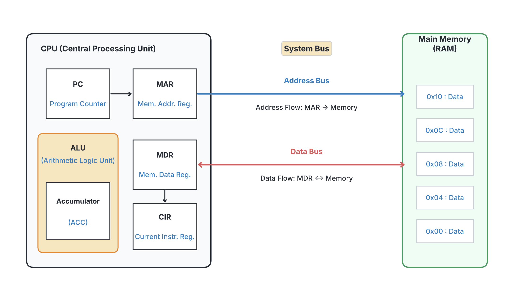
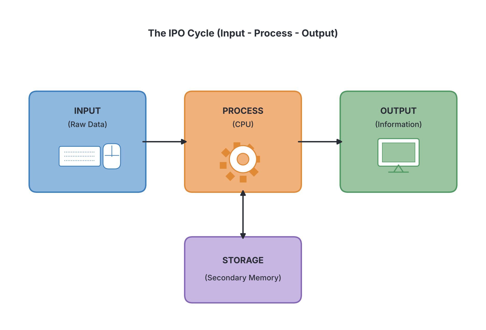

# JAMB Computer Studies Notes: Registers, Bus, and the Processing Cycle

## What JAMB expects

This topic is part of Section B: Fundamentals of Computing, Topic 1 (Overview of Computing Systems). This file covers the third block of objectives for this topic.

By the end of these notes, you should be able to:

1. Define Registers, Bus, and Address.
2. Explain the functions of the following Registers: MDR (Memory Data Register), MAR (Memory Address Register), MBR (Memory Base Register), AC (Accumulator), PC (Program Counter), and CIR (Current Instruction Register).
3. Explain the differences between register and main memory.
4. State the major steps involved in how a computer converts data to required information (Input – Process – Output).
5. Enumerate factors affecting speed of data transfer (bus speed and bus width).

**Note on the syllabus wording:** The syllabus names "MBR" as "Memory Base Register". In most computer science textbooks, MBR stands for "Memory Buffer Register", which does exactly the same job as the MDR (Memory Data Register). A "base register" is actually a different type of register used for memory addressing. Also, the CIR (Current Instruction Register) is often simply called the IR (Instruction Register) in many books. We will explain both meanings so you are fully prepared for the exam.

## 1. Definitions: Registers, Bus, and Address

**Objective i: Define Registers, Bus, Address**

To understand how the Central Processing Unit (CPU) works, you need to know about the tools and pathways it uses to handle data.

### Registers
A **Register** is a very small, ultra-fast temporary storage location built directly inside the CPU. Registers hold the data, instructions, or memory addresses that the CPU is working on *right at that exact moment*. Because they are inside the CPU, the processor can access them much faster than any other type of memory (like RAM or hard drives). 

### Bus
A **Bus** is an electronic communication pathway or set of wires that transfers data, signals, or memory addresses between different components inside the computer. Think of it as a highway connecting the CPU, memory, and input/output devices. 
The main system bus is divided into three parts:
*   **Data Bus:** Carries the actual data being processed.
*   **Address Bus:** Carries information about where the data should go or where it is coming from.
*   **Control Bus:** Carries command and control signals from the CPU to other parts of the computer.

### Address
An **Address** is a unique number that identifies a specific location in the computer's memory (RAM) where a piece of data or an instruction is stored. Just as every house on Awolowo Road has a unique house number so the postman can deliver a letter accurately, every byte in memory has a unique binary address so the CPU can find it.

## 2. CPU Registers and their Functions

**Objective ii: Explain the functions of the following Registers**

The CPU contains several special-purpose registers. Each one has a specific job during the process of fetching and executing instructions.

1.  **PC (Program Counter):** 
    The Program Counter holds the memory **address of the next instruction** that the CPU needs to fetch and execute. Once an instruction is fetched, the PC automatically updates (increments) to point to the next one in line. 
    *Everyday comparison:* Think of it as a bookmark in a recipe book, showing you which step to read next.

2.  **MAR (Memory Address Register):** 
    The MAR holds the **address of the current memory location** that the CPU wants to read from or write to. When the CPU needs data from RAM, it places the address of that data into the MAR so the memory unit knows where to look.

3.  **MDR (Memory Data Register):** 
    The MDR holds the **actual data or instruction** that has just been fetched from memory, or the data that is waiting to be written into memory. It acts as a two-way receiving and sending station for data.

4.  **MBR (Memory Base Register):**
    *   *Syllabus meaning (Memory Base Register):* A base register holds a starting (or "base") memory address. When a program runs, the CPU adds an "offset" value to this base address to find the exact location of data. This stops programs from accidentally interfering with each other's memory.
    *   *Standard textbook meaning (Memory Buffer Register):* In most older textbooks, MBR means Memory Buffer Register. This is just another name for the **MDR**. It "buffers" (temporarily holds) data traveling between the CPU and memory.

5.  **CIR (Current Instruction Register):** 
    The CIR holds the **current instruction** that the CPU has just fetched and is currently decoding and executing. (Many textbooks simply call this the IR, or Instruction Register).

6.  **AC (Accumulator):** 
    The Accumulator is the register inside the Arithmetic Logic Unit (ALU). It holds the **intermediate and final mathematical or logical results**. If the CPU adds two numbers, it will hold one number, add the second to it, and store the final answer in the Accumulator.

## 3. Differences Between Register and Main Memory

**Objective iii: Explain the differences between register and main memory**

Although both hold data, they are very different in how they are built and used. Main memory (Primary memory, usually RAM) holds all the programs and data currently being used by the user, while registers only hold the tiny pieces of data the CPU is calculating at that very split second.

| Feature | Register | Main Memory (RAM) |
| :--- | :--- | :--- |
| **Location** | Located **inside** the CPU chip. | Located **outside** the CPU, on the motherboard. |
| **Speed** | **Fastest** memory in the computer; operates at the speed of the processor. | **Slower** than registers (though still very fast compared to a hard drive). |
| **Capacity** | Very **small**. Holds only a few bytes (e.g., 32 bits or 64 bits) per register. | Very **large**. Typically holds gigabytes (GB) of data (e.g., 4GB, 8GB, 16GB). |
| **Function** | Holds only the current data, instructions, and addresses being processed at that exact moment. | Holds the operating system, running applications, and data currently in use by the system. |
| **Cost** | Extremely **high** cost per byte to manufacture. | Much **lower** cost per byte. |
| **Addressing** | Accessed directly by the CPU using specific register names (e.g., Accumulator, PC). | Accessed using memory addresses sent over the address bus. |

## 4. The Input-Process-Output Cycle

**Objective iv: State the major steps involved in how a computer converts data to required information (Input – Process – Output)**

Computers exist to solve problems. To do this, every computer system follows a sequence of events called the **Input-Process-Output (IPO) cycle**. This cycle describes how raw facts (data) are converted into meaningful results (information).

Here are the major steps step-by-step:

1.  **Input (Data Collection):**
    The computer receives raw data or instructions from the user or from an external environment. This data is entered using input devices like a keyboard, mouse, scanner, or microphone. 
    *Example:* A teacher types students' test scores (e.g., 45, 60, 75) into an Excel spreadsheet.

2.  **Process (Data Transformation):**
    The CPU takes the raw data and acts on it using the instructions given by a program. This involves performing calculations, sorting, comparing, or moving the data. The CPU uses its registers, ALU, and Control Unit during this phase.
    *Example:* The computer calculates the average (mean) of the three test scores.

3.  **Output (Information Generation):**
    The computer presents the processed data (now called information) in a format that the user can understand. This is done through output devices like monitors, printers, or speakers.
    *Example:* The screen displays the final average score of 60 to the teacher.

*Note on Storage:* Most modern textbooks call this the **IPOS cycle** (Input-Process-Output-Storage), because after processing, the information is usually saved to a hard drive or flash drive for future use. However, the core data conversion process relies on the first three steps.

## 5. Factors Affecting Speed of Data Transfer

**Objective v: Enumerate factors affecting speed of data transfer (bus speed and bus width)**

The CPU must constantly talk to the RAM and other components over the system bus. How fast this conversation happens directly affects how fast the computer performs. The speed of data transfer across a bus depends mainly on two factors:

### 1. Bus Width
**Bus width** is the number of parallel wires (or lines) that make up the data bus. Since each wire carries exactly 1 bit of data (a 0 or a 1) at a time, the bus width determines how many bits can be transferred simultaneously in one trip.
*   A **32-bit bus** can transfer 32 bits (4 bytes) of data at a time.
*   A **64-bit bus** can transfer 64 bits (8 bytes) of data at a time.

*Analogy:* Think of bus width as the number of lanes on a highway. A 4-lane road (narrow bus width) can only fit 4 cars side-by-side. If you widen the highway to 8 lanes (wider bus width), twice as many cars can travel at the exact same time, moving traffic much faster.

### 2. Bus Speed
**Bus speed** (or bus frequency) is how fast the bus can send these groups of bits. It is measured in Megahertz (MHz) or Gigahertz (GHz), meaning millions or billions of cycles per second.
*   Every time the computer's internal clock "ticks", the bus transfers one group of bits.
*   A bus with a speed of 400 MHz transfers data 400 million times every second.
*   A bus with a speed of 800 MHz transfers data 800 million times every second.

*Analogy:* If bus width is the number of lanes on a highway, bus speed is the speed limit of the cars. Even if you have an 8-lane highway, if the cars are only moving at 20 km/h (low bus speed), traffic will still be slow. For the best data transfer speed, a computer needs both a wide bus (many lanes) and a high bus speed (fast-moving cars).

## Key terms

| Term | Meaning |
| :--- | :--- |
| **Register** | A tiny, ultra-fast storage location built inside the CPU. |
| **Bus** | An electronic pathway that carries data, addresses, and control signals between computer components. |
| **Address** | A unique number identifying a specific location in memory where data is stored. |
| **Program Counter (PC)** | A register that holds the memory address of the next instruction to be fetched. |
| **Memory Address Register (MAR)** | A register that holds the address of the current memory location being accessed. |
| **Accumulator (AC)** | A register inside the ALU that holds intermediate and final calculation results. |
| **IPO Cycle** | The sequence of Input, Process, and Output that a computer uses to convert data into information. |
| **Bus Width** | The number of wires in a bus, determining how many bits can be sent at the same time. |
| **Bus Speed** | How many times per second the bus can transmit data, usually measured in MHz or GHz. |

## Exam tips and common mistakes

*   **Confusing PC and MAR:** Remember, the **P**rogram **C**ounter points to the *next* instruction. The **MAR** holds the address of the *current* data or instruction being accessed right now.
*   **Confusing MAR and MDR:** MAR holds the *address* (where it is). MDR holds the *data* (what it is). 
*   **Registers vs. Main Memory:** A common trick question asks where registers are located. They are **inside the CPU**, not on the motherboard or in the RAM chips.
*   **Understanding MBR:** If an exam question asks about the Memory Buffer Register, know that it does the same thing as the MDR (holds data). If it asks about a Memory Base Register, it relates to holding a starting memory address.
*   **Bus width analogy:** Widen the bus, and more data flows at once (like a wider pipe for water). Increase the bus speed, and the data flows faster (like increasing the water pressure). 

## Quick summary

1. A Register is the fastest type of temporary memory, located directly inside the CPU.
2. A Bus is a system of wires that transfers data, addresses, and control signals between computer parts.
3. An Address is a unique identifying number for a specific location in the computer's RAM.
4. The Program Counter (PC) holds the address of the next instruction, while the Current Instruction Register (CIR) holds the instruction currently being processed.
5. The MAR holds memory addresses, the MDR (or MBR) holds actual data being fetched or stored, and the Accumulator holds ALU calculation results.
6. Registers are much faster, smaller, and more expensive per byte than main memory, and they live inside the CPU.
7. The IPO cycle (Input-Process-Output) is the fundamental way a computer receives raw data, calculates or manipulates it, and presents useful information.
8. Data transfer speed is heavily influenced by bus width (how many bits travel at once) and bus speed (how frequently data is sent per second).

## Practice questions

**1. A very fast temporary storage location built directly inside the CPU is called a:**
- A. Bus
- B. RAM
- C. Register
- D. Cache

**Answer: C.** A register is a tiny, ultra-fast storage area located within the processor itself.

**2. Which register is responsible for holding the intermediate and final results of arithmetic operations?**
- A. Program Counter (PC)
- B. Accumulator (AC)
- C. Memory Address Register (MAR)
- D. Current Instruction Register (CIR)

**Answer: B.** The Accumulator holds the results of calculations performed by the Arithmetic Logic Unit (ALU).

**3. In a computer system, a "Bus" refers to:**
- A. A vehicle that transports physical hardware devices
- B. An electronic pathway that transfers data between components
- C. The casing that protects the motherboard
- D. The software that controls input devices

**Answer: B.** A bus is a set of wires or a communication pathway used to transmit data, addresses, or control signals.

**4. What is the function of the Program Counter (PC)?**
- A. It counts the total number of programs installed on the computer.
- B. It holds the current instruction being decoded.
- C. It holds the address of the next instruction to be fetched and executed.
- D. It stores the final results of a calculation.

**Answer: C.** The PC's main job is to keep track of the sequence of execution by holding the address of the next instruction. A common mistake is choosing B, but that is the job of the CIR.

**5. Which of the following statements correctly compares a register to main memory (RAM)?**
- A. A register has a larger storage capacity than main memory.
- B. Main memory is located inside the CPU, while registers are on the motherboard.
- C. A register operates much faster than main memory.
- D. Registers are cheaper to manufacture per byte than main memory.

**Answer: C.** Registers are the fastest type of memory because they are built directly inside the processor. They are much smaller and more expensive than RAM.

**6. The unique number used by the CPU to locate a specific piece of data in the computer's memory is called a(n):**
- A. Bus width
- B. Address
- C. Accumulator
- D. Data packet

**Answer: B.** Every byte in memory has a unique binary address, much like a house number on a street.

**7. Which register holds the actual data that has just been read from memory, or is about to be written to memory?**
- A. PC
- B. MAR
- C. MDR
- D. CIR

**Answer: C.** The Memory Data Register (MDR), also called the Memory Buffer Register in some texts, handles the actual data. The MAR handles only the address.

**8. Increasing the bus width of a computer system will:**
- A. Allow more bits to be transferred at the same time
- B. Increase the physical size of the monitor
- C. Decrease the amount of RAM available
- D. Slow down the data transfer rate

**Answer: A.** Bus width determines how many wires are available. A wider bus (e.g., going from 32-bit to 64-bit) allows more data to travel simultaneously.

**9. The basic sequence of operations that describes how a computer converts raw facts into meaningful information is the:**
- A. Fetch-Decode-Execute cycle
- B. Input-Process-Output cycle
- C. Booting process
- D. System Development Life Cycle

**Answer: B.** The IPO (Input-Process-Output) cycle specifically describes the conversion of raw data into required information.

**10. What does CIR stand for in the context of CPU registers?**
- A. Control Information Register
- B. Computer Input Reader
- C. Central Instruction Register
- D. Current Instruction Register

**Answer: D.** CIR stands for Current Instruction Register, which holds the instruction that is actively being decoded and executed by the CPU.

<!-- COVERAGE
obj i | 1. Definitions: Registers, Bus, and Address
obj ii | 2. CPU Registers and their Functions
obj iii | 3. Differences Between Register and Main Memory
obj iv | 4. The Input-Process-Output Cycle
obj v | 5. Factors Affecting Speed of Data Transfer
-->
