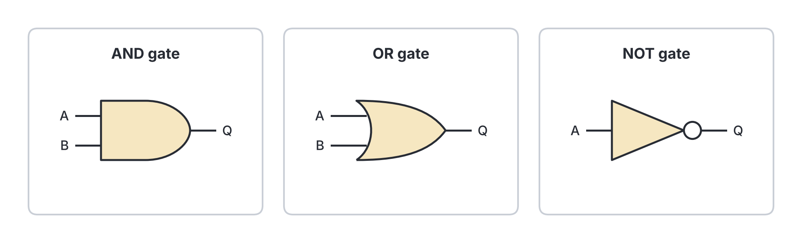
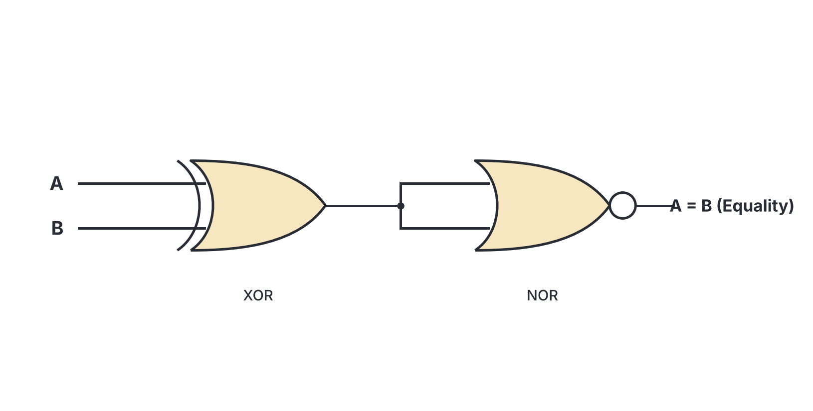

# JAMB Computer Studies Notes: Logic Circuits

## What JAMB expects

This topic is Section B, Topic 1 of the JAMB Computer Studies syllabus (fourth objective block). It covers the basic building blocks of a computer's processor: logic gates.

**THIS FILE COVERS:**
- **d. Logic Circuits**

By the end of these notes, you should be able to:
1. Define different types and uses of gates: AND, NOT, OR, NOR, NAND
2. Interpret Logic equations for AND, NOT and OR gates
3. List the symbols of AND, NOT and OR gates
4. Construct Truth Table for standard logic gates – AND, NOT, OR gates
5. Define comparator
6. Construct a simple comparator with XOR (Exclusive OR) and NOR gate

**Note on the syllabus wording:** The syllabus has a small typing error asking candidates to "Define different type types" of gates. We will simply define the different types of gates. Also, this file is one part of a split topic. Topic 1 (Overview of Computing Systems) is divided into several files to make the notes easy to digest. You will find the rest of Topic 1 in files like `B1b-hardware.md`, `B1c-registers-bus-and-processing-cycle.md`, and `B1e-system-software.md`.

## Introduction to Logic Circuits

Inside a computer's Central Processing Unit (CPU), all data and instructions are processed as tiny electronic pulses. The computer only understands two states:
* **High voltage** (represented by the binary digit **1**, meaning True or ON)
* **Low voltage** (represented by the binary digit **0**, meaning False or OFF)

A **logic circuit** is an electronic circuit that makes decisions based on these 0s and 1s. The basic building blocks of logic circuits are called **logic gates**. 

## Defining Types and Uses of Logic Gates

**Objective i: Define different types and uses of gates: AND, NOT, OR, NOR, NAND**

A **logic gate** is a microscopic electronic circuit that takes one or more binary inputs (0s and 1s) and produces a single binary output based on a specific logical rule. Millions of these gates are combined inside a microchip to perform complex calculations.

### 1. AND Gate
* **Definition:** A gate that outputs 1 (True) **only if ALL its inputs are 1**. If any input is 0, the output is 0.
* **Use/Analogy:** It acts like two switches in a series circuit. For example, to open a high-security bank vault in Nigeria, the manager AND the chief security officer must insert their keys at the same time. If only one person tries, the vault stays closed.

### 2. OR Gate
* **Definition:** A gate that outputs 1 (True) **if ANY of its inputs is 1**. It only outputs 0 if all inputs are 0.
* **Use/Analogy:** It acts like two switches in a parallel circuit. For example, a generator OR solar power can light up a house. As long as at least one source is on, the house has light.

### 3. NOT Gate (Inverter)
* **Definition:** A gate that has only **one input** and reverses it. If the input is 1, it outputs 0. If the input is 0, it outputs 1.
* **Use/Analogy:** It is used whenever a signal needs to be inverted. For example, a street light circuit that turns ON (1) when the sun is NOT shining (0).

### 4. NAND Gate (NOT-AND)
* **Definition:** A combination of an AND gate followed by a NOT gate. It outputs the exact opposite of an AND gate. It outputs 0 **only if all inputs are 1**.
* **Use:** NAND gates are called **Universal Gates** because you can build any other logic gate (like AND, OR, or NOT) using only combinations of NAND gates. This makes them very popular and cheap for manufacturing computer memory and processors.

### 5. NOR Gate (NOT-OR)
* **Definition:** A combination of an OR gate followed by a NOT gate. It outputs the exact opposite of an OR gate. It outputs 1 **only if all inputs are 0**.
* **Use:** Like NAND, the NOR gate is also a **Universal Gate** used heavily in digital electronics design to simplify circuits and reduce manufacturing costs.

## Interpreting Logic Equations

**Objective ii: Interpret Logic equations for AND, NOT and OR gates**

In computer science, we use a special kind of algebra called **Boolean algebra** (named after the mathematician George Boole) to write logic equations. We use letters like $A$ and $B$ for inputs, and $Q$ (or $Y$ or $Z$) for the final output.

### 1. AND Gate Equation
* **Logic Equation:** $Q = A \cdot B$ (read as "A AND B"). It is sometimes written simply as $Q = AB$. 
* The dot ($\cdot$) represents logical multiplication.

### 2. OR Gate Equation
* **Logic Equation:** $Q = A + B$ (read as "A OR B"). 
* The plus sign ($+$) represents logical addition (this is not standard mathematical addition; in Boolean logic, $1 + 1 = 1$).

### 3. NOT Gate Equation
* **Logic Equation:** $Q = \overline{A}$ (read as "NOT A"). 
* The overline means the signal is inverted. It is also sometimes written as $Q = A'$ or $Q = \neg A$.

## Symbols of Logic Gates

**Objective iii: List the symbols of AND, NOT and OR gates**

Each logic gate has a specific standard symbol used when engineers draw circuit diagrams.

* **AND Gate Symbol:** The AND gate symbol looks like a capital letter **D**. It has a flat, straight vertical line on the input side (left) and a curved semi-circle on the output side (right).
* **OR Gate Symbol:** The OR gate symbol looks like a curved shield or an arrowhead. It has a curved back line on the input side and comes to a point on the output side.
* **NOT Gate Symbol:** The NOT gate symbol is a triangle pointing to the right, with a small circle (called an inversion bubble) attached to the tip.

## Truth Tables

**Objective iv: Construct Truth Table for standard logic gates – AND, NOT, OR gates**

A **truth table** is a mathematical table that lists all possible combinations of inputs to a logic gate and shows the exact output for each combination. 

For a gate with two inputs ($A$ and $B$), there are four possible combinations: 00, 01, 10, and 11.

### NOT Truth Table (1 Input)
Because there is only one input, there are only two possibilities. It simply flips the bit.

| Input (A) | Output (Q = NOT A) |
| :---: | :---: |
| 0 | 1 |
| 1 | 0 |

### AND Truth Table (2 Inputs)
Output is 1 only when both A and B are 1.

| Input (A) | Input (B) | Output (Q = A AND B) |
| :---: | :---: | :---: |
| 0 | 0 | 0 |
| 0 | 1 | 0 |
| 1 | 0 | 0 |
| 1 | 1 | 1 |

### OR Truth Table (2 Inputs)
Output is 1 when at least one input is 1.

| Input (A) | Input (B) | Output (Q = A OR B) |
| :---: | :---: | :---: |
| 0 | 0 | 0 |
| 0 | 1 | 1 |
| 1 | 0 | 1 |
| 1 | 1 | 1 |

*(Context for exams: Though the syllabus explicitly demands truth tables for AND, NOT, and OR, it is good to remember that the NAND truth table reverses the AND output, and the NOR truth table reverses the OR output).*

## Defining a Comparator

**Objective v: Define comparator**

A **comparator** is a digital logic circuit that compares two binary numbers to determine their relationship. 

When a CPU needs to make a decision—for example, checking if a student's JAMB score ($A$) is greater than, less than, or equal to the required cut-off mark ($B$)—it uses a comparator circuit. 

A simple 1-bit magnitude comparator takes two single-bit inputs ($A$ and $B$) and can output whether:
* $A > B$ (A is greater than B)
* $A < B$ (A is less than B)
* $A = B$ (A is equal to B)

The most common and basic comparator checks strictly for **equality**. An equality comparator outputs 1 (True) only when both inputs are exactly the same (either both 0s or both 1s).

## Constructing a Simple Comparator with XOR and NOR

**Objective vi: Construct a simple comparator with XOR (Exclusive OR) and NOR gate**

The JAMB syllabus specifically requires you to know how to build a simple equality comparator using an **XOR (Exclusive OR) gate** combined with a **NOR gate**. 

To understand this, we must look at how these two gates behave:

1. **XOR Gate (Exclusive OR):** This gate outputs 1 *only when the inputs are different* (e.g., 0 and 1, or 1 and 0). If the inputs are the same (0 and 0, or 1 and 1), it outputs 0. It is practically a "difference" or "inequality" detector.
2. **NOR Gate (used as a NOT gate):** A NOR gate outputs 1 only when all its inputs are 0. If we tie the two inputs of a NOR gate together (so it only receives one signal that splits into both input pins), it behaves exactly like a **NOT gate**. (For example, if you feed a 0 into both pins, it outputs 1. If you feed a 1 into both pins, it outputs 0).

**Step-by-step construction:**
1. Connect the two binary signals you want to compare ($A$ and $B$) into the inputs of an **XOR gate**.
2. If $A$ and $B$ are identical (both 0 or both 1), the XOR gate will output **0**.
3. Take that output from the XOR gate and feed it into both inputs of a **NOR gate** (using it as an inverter).
4. The NOR gate receives (0, 0) and outputs **1** (meaning True, the original inputs $A$ and $B$ are equal!).
5. If $A$ and $B$ were different, the XOR would output 1. The NOR gate would receive (1, 1) and output **0** (meaning False, they are not equal).

This specific combination (an XOR followed by a NOT/NOR) creates what is officially known as an **XNOR (Exclusive NOR) gate**, which is the standard digital logic equality comparator. 

## Key terms

| Term | Meaning |
| --- | --- |
| **Logic Gate** | A basic electronic circuit that performs a logical operation on one or more binary inputs to produce a single output. |
| **AND Gate** | A gate that outputs 1 only if all its inputs are 1. |
| **OR Gate** | A gate that outputs 1 if at least one of its inputs is 1. |
| **NOT Gate** | A gate with one input that reverses the signal (0 becomes 1, 1 becomes 0). Also called an inverter. |
| **NAND / NOR** | Universal gates. NAND is NOT-AND; NOR is NOT-OR. They can be used to build any other logic gate. |
| **Boolean Algebra** | The branch of algebra used to represent logical operations mathematically. |
| **Truth Table** | A table showing all possible input combinations to a logic circuit and the resulting output. |
| **Comparator** | A digital circuit that compares two binary inputs and outputs whether they are equal, greater than, or less than each other. |
| **XOR Gate** | Exclusive OR gate. Outputs 1 only when inputs are different. |

## Exam tips and common mistakes

* **Mistaking the OR gate for the XOR gate:** An OR gate outputs 1 if *any or all* inputs are 1. An XOR (Exclusive OR) gate outputs 1 *only* if the inputs are different (it specifically outputs 0 if both are 1).
* **Confusing the symbols:** Remember that **AND** ends with a straight letter D, and its symbol looks exactly like a **D**. **OR** has a pointy, arrow-like shape.
* **Reading the equations:** $Q = A \cdot B$ is AND. Do not confuse the dot (multiplication) with OR. $Q = A + B$ is OR. The plus sign means logical addition.
* **Understanding universal gates:** Examiners often ask which gates can be used to build any other gate. The answer is **NAND** and **NOR**.
* **Comparator logic:** Remember that the syllabus specifically asks for a comparator built with an **XOR** and a **NOR** gate. The XOR detects if they are different, and the NOR (acting as an inverter) turns that result into an equality checker.

## Quick summary

1. A computer processes all data as binary 0s (Low/False) and 1s (High/True).
2. Logic circuits are built from tiny components called logic gates. 
3. The AND gate outputs 1 only when all inputs are 1. Its Boolean equation is $Q = A \cdot B$.
4. The OR gate outputs 1 when any input is 1. Its Boolean equation is $Q = A + B$.
5. The NOT gate (inverter) flips a 0 to 1 and a 1 to 0. Its Boolean equation is $Q = \overline{A}$.
6. Truth tables mathematically map out all possible input combinations and show their exact outputs.
7. A digital comparator is a circuit that compares two numbers to see if they are equal, greater, or lesser. 
8. A simple equality comparator can be built by feeding the output of an XOR gate (which detects difference) into a NOR gate (acting as a NOT gate to invert the result). 

## Practice questions

**1. A logic gate that produces a high output (1) only when all of its inputs are high (1) is called:**
- A. OR gate
- B. NOT gate
- C. AND gate
- D. NAND gate

**Answer: C.** An AND gate requires all inputs to be 1 to output 1. The mistake behind option A is thinking "any" instead of "all".

**2. Which of the following Boolean equations represents an OR gate?**
- A. $Q = A \cdot B$
- B. $Q = A + B$
- C. $Q = \overline{A \cdot B}$
- D. $Q = \overline{A + B}$

**Answer: B.** The plus sign ($+$) represents logical OR. Option A represents AND.

**3. In a logic circuit, what is the main function of a NOT gate?**
- A. To add two binary numbers together
- B. To invert the input signal
- C. To compare two binary inputs
- D. To block the flow of electricity

**Answer: B.** The NOT gate is an inverter; it changes a 1 to a 0, and a 0 to a 1. 

**4. A digital circuit that is used to check if two binary inputs are equal is called a:**
- A. Register
- B. Comparator
- C. Bus
- D. Decoder

**Answer: B.** A comparator compares two binary signals and determines if they are equal, greater than, or less than each other.

**5. What is the output of a NOT gate if the input is 1?**
- A. 0
- B. 1
- C. 2
- D. It depends on the second input

**Answer: A.** A NOT gate only has one input and it inverts it. A 1 becomes a 0.

**6. Which combination of gates is specified in the syllabus to construct a simple equality comparator?**
- A. AND and OR
- B. NAND and NOT
- C. XOR and NOR
- D. AND and NAND

**Answer: C.** An XOR gate checks if the inputs are different, and feeding its output into a NOR gate (acting as an inverter) turns it into an equality comparator (which is effectively an XNOR gate).

**7. Examine the truth table below:**
| Input A | Input B | Output Q |
| :---: | :---: | :---: |
| 0 | 0 | 0 |
| 0 | 1 | 1 |
| 1 | 0 | 1 |
| 1 | 1 | 1 |
**Which logic gate does this truth table describe?**
- A. AND gate
- B. OR gate
- C. NAND gate
- D. NOR gate

**Answer: B.** The output is 1 whenever at least one of the inputs (A or B) is 1, which is the exact behavior of an OR gate.

**8. Which logic gate is visually represented by a D-shaped symbol?**
- A. AND gate
- B. OR gate
- C. NOT gate
- D. XOR gate

**Answer: A.** The standard symbol for an AND gate is a straight back with a curved, semi-circular front, resembling the letter D. The mistake behind option B is confusing the D-shape with the arrowhead/shield shape of the OR gate.

**9. Why are NAND and NOR gates often referred to as "universal gates"?**
- A. Because they are the only gates used globally in all countries.
- B. Because they can be used to construct any other basic logic gate.
- C. Because they have universally accepted standard symbols.
- D. Because they can take an unlimited number of inputs.

**Answer: B.** Any digital circuit, including AND, OR, and NOT gates, can be built entirely using only combinations of NAND or NOR gates.

**10. If input A is 0 and input B is 1, what will be the output if they are passed through an AND gate?**
- A. 0
- B. 1
- C. -1
- D. 10

**Answer: A.** For an AND gate, the output is only 1 if both A and B are 1. Since A is 0, the output is 0. The mistake behind option B is applying OR logic instead of AND logic.

<!-- COVERAGE
obj i | Defining Types and Uses of Logic Gates
obj ii | Interpreting Logic Equations
obj iii | Symbols of Logic Gates
obj iv | Truth Tables
obj v | Defining a Comparator
obj vi | Constructing a Simple Comparator with XOR and NOR
item d | Introduction to Logic Circuits
-->
