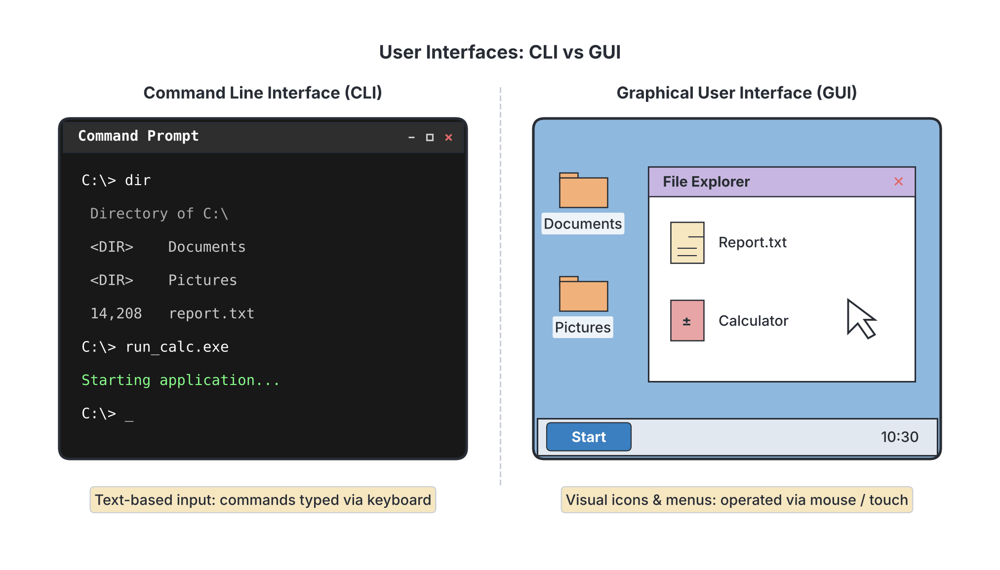

# JAMB Computer Studies Notes: System Software

## What JAMB expects

This topic covers the fifth block of objectives in Section B, Topic 1 of the JAMB Computer Studies syllabus: Overview of Computing Systems. It focuses on the software that runs the computer itself.

By the end of these notes, you should be able to:

1. Differentiate between system and application software.
2. List different types of System software (Operating Systems, Utility Software, Middleware, Device Drivers, Translators, etc.).
3. Define Operating System (OS).
4. List functions of OS.
5. List different types of OS User Interfaces (Text (Command Line and Menu) and Graphical User Interface (GUI)).
6. Give examples of Operating Systems (MS Windows, LINUX, UNIX, etc.).
7. Discuss different OS on phones, iPad (Android, Blackberry, iPhone, etc.).
8. Define Utility Software.
9. List functions of Utility Software.
10. List different types of Utility Software.
11. Give examples of Utility Software (Editors, Anti-Virus, etc.).
12. Define Translators.
13. Explain the functions of Translator Software.
14. List the different categories of translators (Interpreter, Assembler and Compiler).
15. Explain the differences among the categories of translators.

**Note on the syllabus wording:** The syllabus lists "Blackberry" as an example of a phone operating system. At the time of writing, Blackberry OS has been discontinued and is no longer used on new devices, but because it is explicitly named in the syllabus, you must know it as an example of a mobile operating system for your exam.

## Types, examples and uses of software

Software is the intangible set of instructions that tells the hardware what to do. Generally, software is divided into two main categories: System Software and Application Software. Examples include Windows (an operating system used to run a PC), MS Word (an application used for typing documents), and Anti-virus (a utility used to protect the system). 

## Differentiating between system and application software

**System Software** is designed to control, manage, and operate the computer hardware. It acts as a bridge between the computer hardware and the application software. Without system software, a computer cannot boot up or run other programs.

**Application Software**, on the other hand, is designed to help the user perform specific tasks. Examples include writing a letter in MS Word, browsing the internet, or playing a game. 

| Feature | System Software | Application Software |
| --- | --- | --- |
| **Purpose** | Manages and controls the computer hardware. | Performs specific tasks for the user. |
| **Dependency** | Can run independently. It must be installed first. | Cannot run without system software. |
| **Execution** | Runs in the background at all times while the computer is on. | Runs only when the user opens or requests it. |
| **Complexity** | Highly complex, written in low-level or specific high-level languages (like C/C++). | Simpler to use, written in various high-level languages (like Python, Java). |
| **Examples** | Microsoft Windows, Android, Antivirus, Device Drivers. | MS Word, CorelDraw, WhatsApp, Google Chrome. |

## Types of System software

System software is not just one program; it is a category made up of several types of programs that handle different background tasks. The main types include:

1. **Operating Systems (OS):** The master control program (e.g., Windows, Android).
2. **Utility Software:** Housekeeping tools that maintain and protect the system (e.g., Anti-virus).
3. **Device Drivers:** Small programs that teach the OS how to communicate with specific hardware devices (like a printer, scanner, or graphics card).
4. **Translators (Language Processors):** Programs that convert human-readable programming code into the binary machine code (0s and 1s) that the CPU understands.
5. **Middleware:** Software that acts as a hidden "bridge" or translator between different applications or systems, allowing them to communicate and share data.

## Definition of Operating System (OS)

An **Operating System (OS)** is the most important system software on a computer. It is a set of programs that manages the computer's hardware resources and provides common services for computer programs. It acts as the primary interface between the user, the application software, and the hardware. When you turn on a computer or a smartphone, the OS is the first program loaded into the memory (RAM) during a process called *booting*.

## Functions of an OS

An OS acts like the principal of a school, making sure all departments (hardware and software) work together smoothly. Its main functions include:

1. **Resource Management:** It manages all hardware resources, deciding which application gets to use the CPU, memory, or input/output devices at any given time.
2. **Memory Management:** It keeps track of primary memory (RAM). It allocates memory to programs when they open and frees it up when they close so the computer does not crash.
3. **Process Management:** It ensures that multiple processes (running programs) do not interfere with each other, scheduling CPU time for each process (multitasking).
4. **File Management:** It organizes how data is saved, retrieved, named, and protected on storage devices like hard drives or flash drives.
5. **Security and Access Control:** It protects the system from unauthorized access through passwords, user accounts, and built-in firewalls.
6. **Providing a User Interface:** It provides the screens, menus, or command prompts that allow human users to interact with the machine.

## Types of OS User Interfaces

The way a user communicates with the OS is called the **User Interface (UI)**. There are three main types you need to know:

1. **Text / Command Line Interface (CLI):** 
   In this interface, the user interacts with the computer entirely by typing text commands on a keyboard. There are no pictures or mouse pointers. It requires the user to memorize specific commands.
   *Example:* MS-DOS, Linux Terminal, Windows Command Prompt.
2. **Menu-driven Interface:**
   The user interacts by choosing options from a list (a menu). You do not need to memorize commands; you just use arrow keys or buttons to select an option.
   *Example:* Older mobile phones, traditional bank ATMs.
3. **Graphical User Interface (GUI):**
   This is the modern interface we use today. It uses pictures and graphics to represent programs and files. It is often described using the acronym **WIMP**, which stands for **W**indows, **I**cons, **M**enus, and **P**ointers. It is highly user-friendly because you simply use a mouse or touch screen to click on what you want.
   *Example:* Microsoft Windows, Android, macOS.

## Examples of Operating Systems

Operating systems are designed for different types of devices. Some common examples of OS used on desktop computers, laptops, and servers include:

*   **MS Windows:** Developed by Microsoft. It is the most widely used GUI operating system for personal computers worldwide (e.g., Windows 10, Windows 11).
*   **macOS:** Developed by Apple for their Mac computers.
*   **UNIX:** A powerful, highly secure, command-line-based operating system often used on large servers and mainframes.
*   **LINUX:** An open-source operating system similar to UNIX. Because it is free to use and modify, it is very popular among programmers and is used to run many internet servers. Examples of Linux versions include Ubuntu and Fedora.

## Different OS on phones and iPads

Mobile operating systems are specifically built for mobile devices like smartphones and tablets. Common examples include:

*   **Android:** Developed by Google. It is an open-source OS used by many manufacturers globally (like Samsung, Tecno, Infinix). It is the most popular mobile OS in Nigeria.
*   **iPhone OS (iOS):** Developed by Apple exclusively for their mobile devices (iPhones). It is known for its smooth performance and strong security. Note that Apple's iPads run a variation of this called **iPadOS**.
*   **Blackberry OS:** Developed by BlackBerry Limited. It was famous for its secure email messaging and physical keyboards. As mentioned, this OS is now discontinued, but JAMB often tests it as a classic example of a mobile OS.
*   **Windows Mobile / Windows Phone:** Microsoft's operating system for smartphones (also now largely discontinued).

## Definition of Utility Software

**Utility Software** (or utility programs) are specialized system software programs designed to help analyze, configure, optimize, or maintain a computer. While the OS runs the main functions of the computer, utility software performs the "housekeeping" tasks. 

## Functions of Utility Software

1. **System Protection:** Detecting and removing malicious software (viruses, malware) to keep the system safe.
2. **Data Backup and Recovery:** Making copies of important files in case the original data is lost or corrupted.
3. **Storage Optimization:** Reorganizing files on a hard drive (defragmentation) so the computer can read them faster, or compressing files to save space.
4. **Hardware Diagnostic:** Checking the hardware components (like memory or hard drives) for physical errors and reporting on system health.

## Types of Utility Software

There are several types of utility software based on the specific maintenance task they perform:
1. **Anti-Virus / Anti-Malware Utilities**
2. **Editors (Text Editors)**
3. **Disk Defragmenters**
4. **File Compression Utilities**
5. **Backup Utilities**

## Examples of Utility Software

Here are specific examples of the types of utility software mentioned above:

*   **Anti-Virus / Anti-Malware:** Windows Defender, Norton AntiVirus, Avast, McAfee.
*   **Editors:** These are simple programs used to create, read, or modify text files (often used for writing configuration files or programming code without formatting). The syllabus specifically lists Editors under utilities. Examples include Notepad (Windows) and Vim (Linux).
*   **Disk Defragmenters:** Over time, files on a hard drive get broken into pieces (fragmented) and scattered. A disk defragmenter reorganizes these pieces so the files are stored continuously, speeding up the computer. Example: Windows Disk Defragmenter.
*   **File Compression Utilities:** They reduce the size of files so they take up less storage space or can be sent more easily over the internet as attachments. Examples: WinZip, WinRAR, 7-Zip.
*   **Backup Utilities:** Programs that automate the process of copying data to a safe location (like an external drive or the cloud). Examples: Windows Backup and Restore, Apple Time Machine.

## Definition of Translators

Computers do not understand English. They only understand **machine code**, which is a low-level language made entirely of 1s and 0s (binary). However, programmers write software in **High-Level Languages** (like Python, Java, or BASIC) using English-like words, or in **Assembly Language** (which uses short codes called mnemonics).

A **Translator** is system software that converts a program written in a human-readable programming language (Source Code) into machine code (Object Code) so that the computer's CPU can execute it.

## Functions of Translator Software

1. **Translation:** Converts source code into machine-readable object code (binary).
2. **Error Detection:** Checks the programmer's code for syntax errors (grammar mistakes in the programming language, like a missing bracket) and alerts the programmer so they can fix it before the program runs.

## Categories of translators

There are three main categories of translators, based on the type of language they translate and how they do it:

1. **Assembler:** Translates Assembly Language.
2. **Compiler:** Translates High-Level Languages.
3. **Interpreter:** Translates High-Level Languages.

## Differences among the categories of translators

The three categories differ mainly in what they translate and how they execute the translation process.

**1. Assembler:**
An assembler translates **Assembly Language** (a low-level language) into machine code. Assembly language uses short memory aids called mnemonics (like `ADD`, `SUB`, `MOV`). Because Assembly is already very close to machine code, an assembler's job is relatively simple.

**2. Compiler:**
A compiler translates a **High-Level Language** (like C++, Pascal, or COBOL) into machine code. It takes the **entire program** and translates it all at once. 
*   If it finds errors, it lists all of them at the end and does not produce the executable file until all errors are fixed.
*   Once compiled, the resulting program runs very quickly because it is already in machine code.

**3. Interpreter:**
An interpreter also translates a **High-Level Language** (like Python or BASIC) into machine code, but it does so **line by line**. 
*   It reads the first line, translates it, and executes it immediately. Then it moves to the second line.
*   If it finds an error on line 5, it stops the program right there and waits for the programmer to fix it. 
*   Because it translates while the program is running, an interpreted program generally runs slower than a compiled program.

*(Note: Some languages, like Java, use a hybrid approach—they are compiled into an intermediate code called bytecode, which is then interpreted by a Virtual Machine. However, for JAMB classification, focus on the strict differences between Compilers and Interpreters).*

| Feature | Assembler | Compiler | Interpreter |
| --- | --- | --- | --- |
| **Input Language** | Assembly Language (Low-level). | High-Level Language. | High-Level Language. |
| **Method of Translation** | Translates mnemonics directly to machine code. | Translates the **entire program** at once. | Translates the program **line by line**. |
| **Execution Speed** | Very fast (produces a direct machine code file). | Fast (creates an executable `.exe` object file beforehand). | Slower (translates and executes at the same time). |
| **Error Handling** | Reports errors during assembly. | Lists all syntax errors after analyzing the whole code. | Stops executing at the very first error it encounters. |
| **Memory** | Uses very little memory. | Requires more memory because it links the whole program at once. | Uses less memory than a compiler during execution. |

## Key terms

| Term | Meaning |
| --- | --- |
| **System Software** | Software designed to control and manage computer hardware (e.g., OS, Utilities). |
| **Application Software** | Software designed to help users perform specific tasks (e.g., MS Word, games). |
| **Operating System (OS)** | The master system software that manages hardware and software resources (e.g., Windows). |
| **Utility Software** | Housekeeping system software used to maintain, configure, or protect the computer. |
| **Device Driver** | System software that helps the OS communicate with a specific piece of hardware. |
| **GUI** | Graphical User Interface; an interface using windows, icons, menus, and pointers (WIMP). |
| **CLI** | Command Line Interface; an interface where users type text commands. |
| **Translator** | System software that converts human-written code into machine code (binary). |
| **Assembler** | A translator that converts low-level Assembly Language into machine code. |
| **Compiler** | A translator that converts a high-level language into machine code all at once. |
| **Interpreter** | A translator that converts and executes a high-level language line by line. |
| **Source Code** | The human-readable code written by a programmer. |
| **Object Code** | The machine-readable binary code produced by a translator. |

## Exam tips and common mistakes

*   **Compiler vs. Interpreter:** This is one of the most frequently tested areas. Memorize the phrase: **Compiler = all at once**, **Interpreter = line by line**.
*   **System vs. Application:** If a program's main job is to help *you* (typing, drawing, calculating), it is Application software. If its main job is to help the *computer* (booting, saving, protecting), it is System software.
*   **Utility vs. OS:** Do not confuse them. Windows is an OS. Windows Defender (antivirus) and Disk Defragmenter are Utility software.
*   **Editors are Utilities:** Students often mistake text editors (like Notepad) for application software because they involve typing. While advanced word processors (MS Word) are applications, basic *Editors* are explicitly classed by the syllabus as Utility Software for editing system or code files.
*   **Blackberry is a Mobile OS:** Even though nobody buys Blackberry phones today, JAMB past questions often list Blackberry alongside Android and iOS. Recognize it as a mobile OS.
*   **Assembler does not translate High-Level Languages:** If a question asks what translates C++ or Python, do not pick Assembler. Assemblers *only* translate Assembly Language.

## Quick summary

1. Software is divided into System Software (manages hardware) and Application Software (performs user tasks).
2. Types of system software include Operating Systems, Utility Software, Middleware, Device Drivers, and Translators.
3. An Operating System (OS) is the master program that manages resources, memory, files, and provides a user interface.
4. User interfaces can be Text-based (CLI), Menu-driven, or Graphical (GUI/WIMP). Examples of OS include Windows, Linux (PC), and Android, iOS, Blackberry (Mobile).
5. Utility Software performs system maintenance and housekeeping (e.g., Anti-virus, disk defragmenters, file compression, backup tools, editors).
6. Translators convert human-written code into machine code so the computer can understand it.
7. An **Assembler** converts assembly language to machine code. A **Compiler** converts high-level language to machine code all at once. An **Interpreter** converts high-level language to machine code line by line.

## Practice questions

**1. Which of the following is the primary difference between system software and application software?**
- A. System software is used for typing documents, while application software protects the computer.
- B. System software manages hardware resources, while application software performs specific user tasks.
- C. System software is free, while application software must be purchased.
- D. System software runs only on mobile phones, while application software runs on desktop computers.

**Answer: B.** System software acts as an interface between hardware and the user to manage the computer's basic functions, while application software is built to help the user perform specific activities like typing or drawing. Option A incorrectly reverses their roles.

**2. All the following are examples of utility software EXCEPT:**
- A. Anti-virus
- B. Disk defragmenter
- C. Microsoft Windows
- D. File compression software

**Answer: C.** Microsoft Windows is an Operating System, which is the main system software, not a utility software. Utility software (like antivirus and defragmenters) performs specific housekeeping tasks within the OS.

**3. The type of user interface that requires a user to memorize and type specific text commands to operate the computer is called a:**
- A. Graphical User Interface (GUI)
- B. Menu-driven interface
- C. Command Line Interface (CLI)
- D. Point-and-click interface

**Answer: C.** A Command Line Interface (CLI) relies entirely on typing text commands (like MS-DOS). Option A (GUI) is the mistake students make if they confuse modern interfaces with older text interfaces; GUI uses icons and pointers.

**4. Which of the following best describes the function of an assembler?**
- A. It translates high-level language into machine code line by line.
- B. It translates high-level language into machine code all at once.
- C. It translates low-level assembly language into machine code.
- D. It detects viruses in a computer system.

**Answer: C.** An assembler's sole job is to translate Assembly Language (which uses mnemonics) into binary machine code. Option A describes an interpreter, and Option B describes a compiler.

**5. An operating system designed specifically for mobile devices (phones and tablets) is:**
- A. UNIX
- B. MS-DOS
- C. LINUX
- D. Android

**Answer: D.** Android is a mobile operating system developed by Google. UNIX, MS-DOS, and LINUX are traditionally operating systems used for desktop computers, mainframes, or servers.

**6. A translator that reads a high-level programming language and converts it to machine code line by line is a/an:**
- A. Compiler
- B. Interpreter
- C. Assembler
- D. Device Driver

**Answer: B.** An interpreter translates and executes code one line at a time. The mistake behind Option A is confusing the two high-level translators; a compiler translates the *entire program* all at once before execution.

**7. Which of the following is NOT a core function of an Operating System?**
- A. File management
- B. Resource management
- C. Surfing the World Wide Web
- D. Memory management

**Answer: C.** Surfing the web is a specific task performed by Application Software (a web browser like Chrome), not a core function of the OS itself. The OS manages files, memory, and hardware resources.

**8. The term "WIMP" (Windows, Icons, Menus, Pointers) is strongly associated with which type of OS interface?**
- A. Command Line Interface
- B. Graphical User Interface
- C. System Interface
- D. Text Interface

**Answer: B.** A Graphical User Interface (GUI) relies on Windows, Icons, Menus, and Pointers (WIMP) to allow users to interact with the computer using a mouse or touch, rather than typing commands.

**9. What happens if a compiler encounters syntax errors while translating a program?**
- A. It fixes the errors automatically and runs the program.
- B. It runs the program up to the line where the error occurred and then stops.
- C. It ignores the errors and generates the object code anyway.
- D. It generates a list of all errors at the end and fails to produce the object code.

**Answer: D.** A compiler scans the entire program. If it finds syntax errors, it stops the creation of the executable file and lists all errors for the programmer to fix. Option B describes the behaviour of an interpreter, not a compiler.

**10. According to the syllabus classification, a simple "Editor" (like Notepad) used for writing unformatted text or configuration files is primarily categorized as:**
- A. Middleware
- B. Utility Software
- C. Operating System
- D. Translator

**Answer: B.** The syllabus explicitly lists "Editors" alongside Anti-Virus as examples of Utility Software because they are basic system tools used to view or edit system files and code, unlike full application word processors.

<!-- COVERAGE
obj i | Differentiating between system and application software
obj ii | Types of System software
obj iii | Definition of Operating System (OS)
obj iv | Functions of an OS
obj v | Types of OS User Interfaces
obj vi | Examples of Operating Systems
obj vii | Different OS on phones and iPads
obj viii | Definition of Utility Software
obj ix | Functions of Utility Software
obj x | Types of Utility Software
obj xi | Examples of Utility Software
obj xii | Definition of Translators
obj xiii | Functions of Translator Software
obj xiv | Categories of translators
obj xv | Differences among the categories of translators
item e | Types, examples and uses of software
-->
