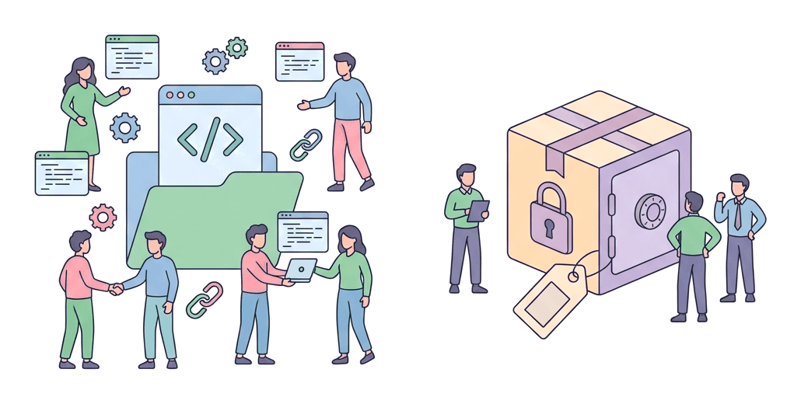
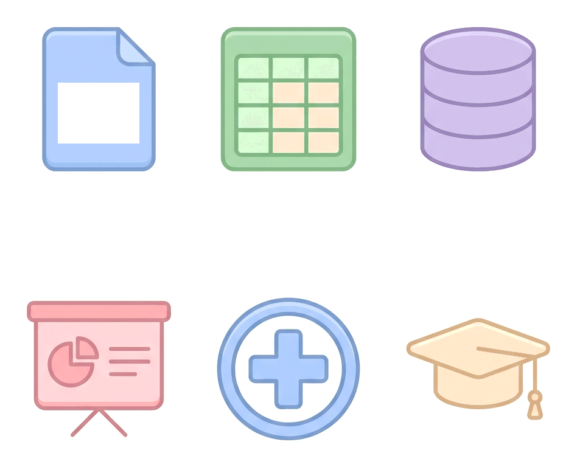

# JAMB Computer Studies Notes: Application Software

## What JAMB expects

This topic is the sixth and final part of Section B, Topic 1: Overview of Computing Systems. It covers the different types of application software that run on computer systems. System software (which runs the computer itself) is covered in `B1e-system-software.md`. 

By the end of these notes, you should be able to:

1. List examples of application software and their usage.
2. Differentiate between open source and proprietary software.
3. Explain different methods of acquiring Application software (Built in house and Off the Shelf).
4. Explain the differences between User Application program and general-purpose Application packages.
5. Give examples of common off the Shelf Application packages and their examples.

## Application software and their usage

**Objective i: List examples of application software and their usage**

While system software manages the hardware (like an engine running a car), **application software** is designed to help the user perform specific everyday tasks. Whenever you type a document, play a game, browse the internet, or calculate figures on a computer or smartphone, you are using application software. 

Application software cannot run on its own; it requires system software (an operating system like Windows or Android) to function. 

**Examples of application software and their uses:**

*   **Web browsers (e.g., Google Chrome, Mozilla Firefox):** Used to access, view, and navigate websites on the World Wide Web.
*   **Media players (e.g., VLC, Windows Media Player):** Used to play audio and video files.
*   **Computer games (e.g., FIFA, Candy Crush):** Used for entertainment and recreation.
*   **Word processors (e.g., Microsoft Word):** Used to type, format, edit, and print text documents like letters and reports.
*   **Messaging apps (e.g., WhatsApp, Telegram):** Used to send text messages, voice notes, and make calls over the internet.

## Open source versus proprietary software

**Objective ii: Differentiate between open source and proprietary software**

When software is created, the programmers write it in human-readable code (called **source code**), which is then translated into machine language for the computer to run. How this source code is shared determines whether the software is "open source" or "proprietary."

| Feature | Open Source Software (OSS) | Proprietary (Closed Source) Software |
| :--- | :--- | :--- |
| **Definition** | Software whose source code is freely available to the public to view, use, modify, and distribute. | Software owned by a company or individual; the source code is kept secret and restricted. |
| **Cost** | Usually free of charge. | Usually requires paying for a license or a subscription. |
| **Modification** | Anyone with programming skills can change the code to add features or fix bugs. | Only the original developers (the owners) can modify the code. |
| **Support** | Supported by a community of volunteers and developers worldwide. | Supported by the company that sells it; often includes official customer service. |
| **Security** | Security flaws are quickly found and fixed by the community, though anyone can see the code. | Security relies entirely on the vendor finding and fixing flaws. |
| **Examples** | Linux operating systems (e.g., Ubuntu), Mozilla Firefox browser, LibreOffice, Android. | Microsoft Office, Adobe Photoshop, Apple iOS, CorelDraw. |

## Methods of acquiring application software

**Objective iii: Different methods of acquiring Application software (Built in house and Off the Shelf)**

Organisations and individuals need software to solve problems. There are two main ways to get application software: buying it ready-made or having it custom-built.

### 1. Off-the-Shelf Software
**Off-the-shelf software** (also called packaged software) is pre-written, mass-produced software designed for the general public or a wide range of businesses. You buy it "off the shelf" (from a store or a website) and install it immediately. 

*   **Advantages:** It is cheaper because the development cost is shared among millions of buyers. It is ready to use immediately. It has been tested by many people, so it usually has fewer major bugs.
*   **Disadvantages:** It may include features you do not need, and it might lack a specific feature your particular business requires.
*   **Examples:** Microsoft Word, PC games, Adobe Reader.

### 2. Built In-House (Bespoke / Custom Software)
**Built in-house** or **bespoke software** is software specially designed and written for a single specific organisation to meet its unique needs. A company either uses its own programmers (in-house) or hires a software company to build it. 

*   **Advantages:** It perfectly fits the exact needs of the business. The company owns the software and has full control over it. It can give the company a competitive advantage.
*   **Disadvantages:** It is very expensive to develop. It takes a long time to build and test before it can be used. If the developers leave, it can be hard to maintain.
*   **Examples:** A custom results-processing portal built specifically for one Nigerian university, or the specific internal software used by a Nigerian bank to manage its daily transactions.

## User application programs versus general-purpose packages

**Objective iv: Explain the differences between User Application program and general-purpose Application packages**

Application software can be classified based on how broad or narrow its intended use is. 

| Feature | General-Purpose Application Packages | User Application Programs (Specific-Purpose) |
| :--- | :--- | :--- |
| **Definition** | Software designed to perform a broad variety of common tasks for a large number of different users. | Software designed to perform one specific, specialised task for a particular type of user or business. |
| **Versatility** | Highly versatile. A word processor can be used to write a poem, a CV, a novel, or a business letter. | Not versatile. A school payroll program can only calculate salaries; it cannot be used to edit photos. |
| **Target Audience** | The general public. Anyone with a computer might need them. | A specific niche, profession, or organisation. |
| **Source** | Always off-the-shelf. | Can be built in-house (bespoke) or bought off-the-shelf as specialised software. |
| **Examples** | Word processors (MS Word), Spreadsheets (Excel), Web browsers, Media players. | Airline reservation systems, JAMB CBT exam software, supermarket barcode checkout software, ATM software. |

**Note on the syllabus wording:** Textbooks often call "User Application programs" either *specific-purpose software* or *tailor-made software*. They are applications written strictly for a defined task, whereas general-purpose packages give the user tools to create many different things.

## Common off-the-shelf application packages

**Objective v: Give examples of common off the Shelf Application packages and their examples.**

The JAMB syllabus explicitly lists several categories of common off-the-shelf application packages and asks you to know specific examples for each. You must be able to match the software category to the given example.

1.  **Word Processing**
    *   **Use:** Creating, editing, formatting, storing, and printing text-based documents (letters, memos, reports).
    *   **Syllabus Example:** **MS Word** (Microsoft Word).
2.  **Spreadsheet**
    *   **Use:** Organising data in rows and columns, performing mathematical calculations, analysing numerical data, and creating charts. Market traders and accountants use them to track inventory and budgets.
    *   **Syllabus Example:** **Excel** (Microsoft Excel).
3.  **Database**
    *   **Use:** Storing, organising, retrieving, and managing large collections of structured data (like a school's student records or a hospital's patient list).
    *   **Syllabus Example:** **Access** (Microsoft Access).
4.  **Presentation**
    *   **Use:** Creating digital slides with text, images, animations, and sound to display information to an audience during a talk or lecture.
    *   **Syllabus Example:** **PowerPoint** (Microsoft PowerPoint).
5.  **Graphics**
    *   **Use:** Creating, editing, and manipulating digital images, photographs, and illustrations.
    *   **Syllabus Example:** **Adobe Photoshop**. (CorelDraw is also a very common graphics package in Nigeria).
6.  **Accounting**
    *   **Use:** Managing a company's financial accounts, tracking income and expenses, and generating financial reports.
    *   **Syllabus Example:** **Sage**. (Sage is a popular commercial accounting software suite used by many businesses).
7.  **Payroll**
    *   **Use:** Calculating employees' salaries, deducting taxes, and generating payslips.
    *   **Syllabus Example:** **Sage** (Sage also provides dedicated payroll modules).
8.  **Government**
    *   **Use:** Managing public sector payments, tax collections, and e-government services.
    *   **Syllabus Example:** **Remita**. (Remita is a major electronic payment platform used widely in Nigeria to process government revenues under the Treasury Single Account (TSA) system).
9.  **Banking**
    *   **Use:** Core banking operations, managing customer bank accounts, loans, and financial transactions.
    *   **Syllabus Example:** **Fusion Banking Essence**. (This is a well-known core banking software product developed by the financial technology company Finastra).
10. **Statistics**
    *   **Use:** Performing complex statistical data analysis, used heavily by university researchers and data scientists.
    *   **Syllabus Example:** **SPSS** (Statistical Package for the Social Sciences).
11. **Educational**
    *   **Use:** School management systems, managing student portals, exam results, and e-learning.
    *   **Syllabus Example:** **SchoolShell**. (SchoolShell is a Nigerian comprehensive school management software portal).
12. **Hospital**
    *   **Use:** Managing healthcare facilities, patient electronic medical records (EMR), doctor appointments, and medical billing.
    *   **Syllabus Example:** **eHospital**. (eHospital is a category of hospital management software packages).

## Key terms

| Term | Meaning |
| :--- | :--- |
| **Application software** | Programs that help a user perform specific tasks (e.g., typing, browsing, playing games). |
| **Proprietary software** | Closed-source software owned by a company, usually requiring a paid license to use. |
| **Open-source software** | Software whose source code is freely available to the public to view, modify, and share. |
| **Off-the-shelf software** | Mass-produced software ready to be purchased and used immediately by anyone. |
| **Built in-house / Bespoke** | Software custom-designed and created for one specific organisation's unique needs. |
| **General-purpose package** | Software designed to perform a wide variety of tasks for a large number of users (e.g., MS Word). |
| **User application program** | Software designed to solve one specific problem or perform one narrow task (e.g., ATM software). |
| **Source code** | The original human-readable instructions written by a programmer before being turned into a running program. |

## Exam tips and common mistakes

*   **Memorise the exact syllabus examples:** JAMB will ask you for the specific software type. Remember that **Remita** is for government/payments, **SPSS** is for statistics, **Sage** is for accounting/payroll, and **Fusion Banking Essence** is for banking.
*   **Do not confuse open source with free software:** While most open-source software is free, its defining feature is that the *source code* is openly available to modify. Freeware (like a free closed-source game) is free but not open source.
*   **System vs Application software:** If a program runs the computer hardware (like Windows, Linux, or a device driver), it is system software. If it does a task for the user (like Excel or WhatsApp), it is application software.
*   **General vs Specific:** MS Word is general-purpose because you can use it for many different things. A supermarket checkout program is specific-purpose (a user application program) because it only does one thing.

## Quick summary

1.  Application software consists of programs designed to perform specific tasks for the user, unlike system software which manages the computer hardware.
2.  Open-source software has publicly available source code that anyone can modify (e.g., Android, Linux), while proprietary software is closed and owned by a vendor (e.g., MS Office).
3.  Software can be acquired by buying it ready-made (off-the-shelf) or having it custom-written for a specific company (built in-house/bespoke).
4.  Off-the-shelf software is cheaper and instantly available, but bespoke software perfectly fits a company's exact needs.
5.  General-purpose packages (like spreadsheets and word processors) do many different tasks for many types of users.
6.  User application programs (specific-purpose software) are designed to perform only one specialised task (like an airline booking system).
7.  The syllabus identifies specific software packages for categories, such as MS Word (Word Processing), Excel (Spreadsheet), Access (Database), PowerPoint (Presentation), and Adobe Photoshop (Graphics).
8.  Other specific examples include Sage (Accounting/Payroll), Remita (Government payments), Fusion Banking Essence (Banking), SPSS (Statistics), SchoolShell (Educational), and eHospital (Hospital).

## Practice questions

**1. Which of the following is an example of a general-purpose application package?**
- A. A bank's ATM software
- B. Microsoft Word
- C. A hospital patient database system
- D. An airline flight reservation program

**Answer: B.** Microsoft Word is a general-purpose package because it can be used by anyone to perform a wide variety of text-related tasks. The other options are specific-purpose (user application) programs.

**2. Software whose source code is freely available for the public to view and modify is known as:**
- A. Proprietary software
- B. Utility software
- C. Open-source software
- D. Built in-house software

**Answer: C.** Open-source software allows anyone to see, change, and distribute the underlying source code. Proprietary software keeps the source code secret.

**3. Which of the following is a major advantage of built in-house (bespoke) software?**
- A. It is very cheap to develop.
- B. It perfectly fits the exact needs of the specific organisation.
- C. It can be bought and installed immediately from a shop.
- D. Its development cost is shared among millions of users.

**Answer: B.** Bespoke (in-house) software is custom-made for a specific business, so it perfectly meets their exact requirements. However, it is expensive and slow to develop, making options A, C, and D incorrect (those are advantages of off-the-shelf software).

**4. According to common application packages, "SPSS" is primarily used for:**
- A. Payroll processing
- B. Graphic design
- C. Statistical analysis
- D. Core banking operations

**Answer: C.** SPSS (Statistical Package for the Social Sciences) is a software package specifically designed for complex statistical data analysis. 

**5. An example of software used for government financial transactions and the Treasury Single Account (TSA) in Nigeria is:**
- A. Remita
- B. Sage
- C. eHospital
- D. Fusion Banking Essence

**Answer: A.** Remita is explicitly listed in the syllabus as an example of a Government application package used for payments. 

**6. Which of the following best differentiates proprietary software from open-source software?**
- A. Proprietary software is always downloaded from the internet, while open-source software is bought on CDs.
- B. Proprietary software cannot be modified by the user, while open-source software can.
- C. Proprietary software is for graphics, while open-source software is for word processing.
- D. Proprietary software is a system software, while open-source software is an application software.

**Answer: B.** The key difference is the availability of the source code. Proprietary software is closed-source, meaning the user cannot modify it, whereas open-source software allows community modification. 

**7. "Fusion Banking Essence" is an example of an application package used in which sector?**
- A. Education
- B. Hospitality
- C. Banking
- D. Government

**Answer: C.** Fusion Banking Essence is a core banking software application used by financial institutions to manage customer accounts and transactions.

**8. Which of the following is an off-the-shelf accounting and payroll application?**
- A. SchoolShell
- B. Adobe Photoshop
- C. Access
- D. Sage

**Answer: D.** Sage is widely known and listed in the syllabus as an off-the-shelf software package for Accounting and Payroll.

**9. What type of software is designed to solve a single, specific problem for a particular organisation?**
- A. A general-purpose package
- B. An operating system
- C. A user application program (specific-purpose software)
- D. A utility program

**Answer: C.** A user application program (or specific-purpose software) is tailored to solve one specific problem, unlike a general-purpose package which handles broad tasks.

**10. A school needs software to manage student results, attendance, and CBT exams. Which of the following off-the-shelf packages is specifically tailored for this educational purpose?**
- A. SchoolShell
- B. Remita
- C. SPSS
- D. Microsoft Access

**Answer: A.** SchoolShell is an educational software package designed for school management. While Access could be used to build a custom database, SchoolShell is already tailored specifically for educational purposes off-the-shelf.

<!-- COVERAGE
obj i | Application software and their usage
obj ii | Open source versus proprietary software
obj iii | Methods of acquiring application software
obj iv | User application programs versus general-purpose packages
obj v | Common off-the-shelf application packages
-->
