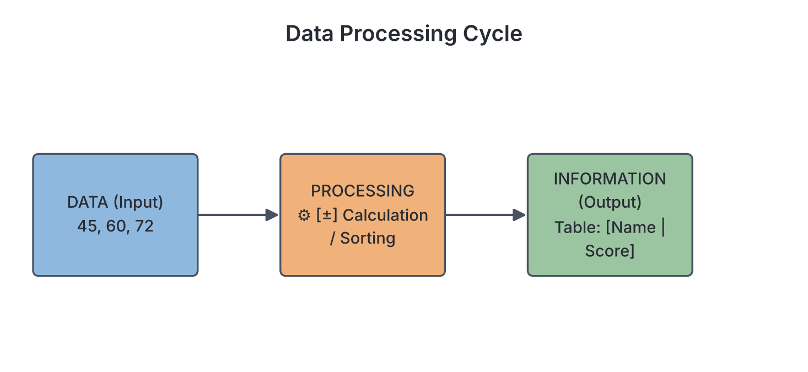

# JAMB Computer Studies Notes: Data and Information

## What JAMB expects

This topic is Section B, Topic 2 of the JAMB Computer Studies syllabus: Data and Information. Because this topic is broad, it has been split into three files. This file is the **first part**.

This file covers the following content item:
* a. Differences between Data and Information

By the end of these notes, you should be able to:
* i. Define data and information
* ii. List properties of information

**Note on the split topic:** Data types and number bases (binary, decimal, hexadecimal) are covered in `B2b-data-representation-and-number-bases.md`. Digitisation and its methods are covered in `B2c-digitisation.md`. 

## Objective i: Define data and information

To understand computers and how they work, you must first understand the two most basic concepts in computing: **data** and **information**. People often use these two words as if they mean the same thing, but in Computer Studies, they have very different and specific meanings.

### What is Data?

**Data** can be defined as raw, unprocessed facts, figures, letters, symbols, or observations that have no real meaning on their own. 

The word "data" is actually the plural of the Latin word *datum*, which means "something given". Data is a collection of independent and unorganized elements. Because it has not been organized or processed, it does not give you a complete picture or allow you to make a sensible decision. 

**Examples of data:**
*   A list of numbers: 45, 60, 72, 50. (We do not know what these numbers represent. Are they ages? Prices in naira? WAEC scores?)
*   A string of letters: "B, A, C, C, A, B".
*   An unorganized list of names: "Chinedu, Fatima, Ade, Efe".
*   A barcode scanned at a supermarket before the computer looks up the price.

Data is the **raw material** that a computer or a human being takes in to work on. 

### What is Information?

**Information** is data that has been processed, organized, structured, and presented in a meaningful context so that it is useful to the receiver. 

When data undergoes processing, it is transformed into information. Information tells a story, answers a question, or provides knowledge that can be used to make decisions.

**Examples of information:**
*   If we take the numbers 45, 60, 72, and 50, and state that they are the "Computer Studies test scores for four SS3 students out of 100", they suddenly make sense. We now know that 72 is a good score and 45 is a poor score. 
*   "Ade scored 72% in Mathematics" is information.
*   A printed JAMB UTME result slip showing a candidate's aggregate score of 285 is information.
*   Your monthly electricity bill from the distribution company (e.g., Ikeja Electric or AEDC) showing how much you owe is information (calculated from raw data like your daily meter readings and the tariff rate).

### The Data Processing Cycle

To turn data into information, it must go through a process. This happens in three main stages, known as the **Input-Process-Output (IPO)** cycle:

1.  **Input:** The raw data is collected and entered into the computer (e.g., typing student marks using a keyboard).
2.  **Process:** The computer performs operations on the data. This could involve calculating averages, sorting names into alphabetical order, comparing values, or formatting text.
3.  **Output:** The result of the processing is presented to the user in a meaningful way as information (e.g., a printed report card or a chart on a screen).

## Content a: Differences between Data and Information

It is important to be able to contrast data and information clearly, as examiners frequently test this. 

| Feature | Data | Information |
| :--- | :--- | :--- |
| **Meaning** | Raw, unorganized, and unprocessed facts or details. | Processed, organized, and structured facts. |
| **Meaningfulness** | Meaningless on its own; it lacks context. | Meaningful; it provides context and understanding. |
| **Computer stage** | It is the **Input** given to a computer. | It is the **Output** generated by a computer. |
| **Dependency** | Data is independent. It exists on its own. | Information depends entirely on data. You cannot have information without data. |
| **Decision Making** | Cannot be used directly to make decisions. | Used actively by humans to make informed decisions. |
| **Form** | Usually in the form of raw numbers, letters, symbols, or unedited recordings. | Usually in the form of reports, graphs, tables, or summarized statements. |
| **Everyday Analogy** | Like raw ingredients (flour, sugar, butter, eggs). | Like the finished product (a baked cake). |

## Objective ii: List properties of information

For information to be valuable and useful for decision-making, it must possess certain characteristics or qualities. If a manager, a student, or the government receives bad information, they will make bad decisions. Good information has the following key properties:

### 1. Accuracy
Information must be exact, correct, and free from errors. If the processing is wrong or the original data was wrong, the resulting information is inaccurate. 
*   *Example:* If a bank app shows your account balance as ₦50,000 when you actually have ₦500,000, that information is inaccurate and could cause you to panic or miss an important payment.

### 2. Timeliness (Currency)
Information is only useful if it is available when it is needed. It must be up-to-date and delivered in time to influence a decision. 
*   *Example:* A weather forecast warning about heavy rain in Lagos is very useful if broadcast in the morning before people leave for work. If the forecast is broadcast two days after the flood has happened, the information has lost its timeliness and is useless.

### 3. Completeness
Good information must contain all the necessary details required by the user. Nothing important should be left out.
*   *Example:* An invitation to a JAMB CBT exam that gives you the date and time, but fails to include the address of the exam centre, is incomplete information.

### 4. Relevance
Information must be related directly to the situation at hand or the needs of the person receiving it. Extra details that do not matter only cause confusion.
*   *Example:* If you ask for the price of a laptop in Computer Village, Ikeja, being told the history of the laptop's manufacturer is irrelevant. You only need the price, the specifications, and the warranty.

### 5. Reliability
Information must come from a trustworthy, dependable, and authoritative source. 
*   *Example:* JAMB exam dates announced directly on the official JAMB IBASS portal or a verified JAMB social media handle are reliable. A WhatsApp forward from an unknown person claiming the exam is cancelled is unreliable information.

### 6. Accessibility
Information should be easily obtainable by authorized people when they need it, in a format they can easily access.
*   *Example:* A school's termly results are accessible if parents can log into a portal from their phones to view them. If the results are locked in a safe and the principal has traveled with the only key, the information is inaccessible.

### 7. Clarity (Understandability)
Information must be presented clearly so that the intended user can easily understand it without confusion. It should avoid unnecessary technical jargon (complex terms) if the user is a layperson.
*   *Example:* A doctor explaining a diagnosis to a patient should say "You have high blood pressure," rather than using complex medical terminology that the patient cannot understand.

### 8. Conciseness
Information should be brief and straight to the point. It should contain only what is needed, without unnecessary padding or overly long explanations that bury the main point.

### 9. Verifiability
Information is verifiable if it can be checked against a standard or source to prove that it is true.
*   *Example:* If someone claims they graduated with a First Class degree, that information is verifiable because you can check their certificate or contact the university's registry.

### 10. Cost-effectiveness
The cost of gathering the data and processing it into information should not be greater than the value the information provides. If a small business spends ₦500,000 on software to calculate a tax saving of ₦10,000, the information produced is not cost-effective.

## Key terms

| Term | Meaning |
| :--- | :--- |
| **Data** | Raw, unorganized facts, figures, letters, or symbols that lack context and meaning. |
| **Information** | Processed, organized, and structured data that provides context and is useful for decision-making. |
| **Input** | The stage where raw data is entered into the computer system. |
| **Processing** | The operations a computer performs to convert raw data into meaningful information. |
| **Output** | The final result of processing; the stage where information is presented to the user. |
| **Accuracy** | A property of information indicating it is exact and free from errors. |
| **Timeliness** | A property of information indicating it is available right when it is needed. |
| **Relevance** | A property of information indicating it applies directly to the current need or problem. |
| **Completeness** | A property of information indicating it contains all necessary parts and details. |

## Exam tips and common mistakes

*   **Data = Raw Input; Information = Processed Output.** This is the most common and important distinction to memorize for the exam.
*   Examiners love to ask you to identify an example of data versus an example of information. Look for context. If the example is just numbers (e.g., "30, 40, 50"), it is data. If it has meaning (e.g., "The temperature is 30°C"), it is information.
*   Remember the properties of information. A common question gives a scenario (e.g., receiving an exam timetable after the exam has finished) and asks which property is missing (Answer: Timeliness).
*   Do not confuse **Reliability** (trustworthy source) with **Accuracy** (mathematically/factually correct). A generally reliable newspaper might occasionally print an inaccurate figure by mistake.
*   Do not confuse **Completeness** (having all the parts) with **Conciseness** (being short and to the point). In fact, good information balances these two: it includes everything necessary without adding useless padding.

## Quick summary

1.  **Data** consists of raw, unorganized facts, numbers, letters, or symbols that have no meaningful context on their own.
2.  **Information** is data that has been processed, organized, and given meaning so that it can be understood and used.
3.  The computer uses the **Input-Process-Output (IPO)** cycle to turn data (input) into information (output).
4.  Data is the raw material, independent, and not directly useful for decision-making, while information is the finished product, dependent on data, and essential for decisions.
5.  **Accuracy** means the information is correct and free of errors.
6.  **Timeliness** means the information is provided exactly when it is needed.
7.  **Completeness** means all the required details are included.
8.  **Relevance** means the information specifically addresses the issue at hand, without unrelated details.

## Practice questions

**1. Which of the following best defines data?**
- A. Processed facts that are useful for decision-making
- B. Raw, unorganized facts and figures that have no distinct meaning
- C. A set of instructions given to a computer
- D. The physical components of a computer system

**Answer: B.** Data is the raw, unorganized, and unprocessed facts, figures, and symbols that lack context until they are processed.

**2. The process of converting raw facts into a meaningful form is known as:**
- A. Data collection
- B. Information retrieval
- C. Data processing
- D. Data transmission

**Answer: C.** Data processing is the act of transforming raw input data into meaningful output information.

**3. Which of the following is a key difference between data and information?**
- A. Data is used for decision-making, while information is not
- B. Data is the output, while information is the input
- C. Data is dependent on information, while information is independent
- D. Data consists of raw facts, while information is processed and meaningful

**Answer: D.** Data is the raw input material lacking context, while information is the processed, meaningful output. 

**4. A student is given a textbook on French language to study for an upcoming Economics exam. Which property of good information does this textbook lack for the student?**
- A. Timeliness
- B. Accuracy
- C. Relevance
- D. Reliability

**Answer: C.** Relevance means the information must apply directly to the matter at hand. A French textbook is irrelevant to studying for an Economics exam.

**5. Which of the following is an example of data?**
- A. A student's printed end-of-term report card
- B. The string of characters "X7Y9Z"
- C. A graph showing the rainfall in Lagos over six months
- D. An alert stating "Your battery is at 15%"

**Answer: B.** The string of characters "X7Y9Z" lacks context and meaning. Options A, C, and D have been processed and formatted to convey a specific message, making them information.

**6. An announcement is made on Friday evening that a meeting originally scheduled for Friday morning has been cancelled. Which property of information does this announcement lack?**
- A. Conciseness
- B. Timeliness
- C. Verifiability
- D. Completeness

**Answer: B.** Timeliness (or currency) means the information must be available when it is needed to influence action. Telling people a meeting is cancelled after the time has already passed is not timely.

**7. In the Input-Process-Output (IPO) cycle, what does the output stage represent?**
- A. The raw data being typed in
- B. The computer saving the data to a hard drive
- C. The information presented to the user
- D. The CPU performing calculations on facts

**Answer: C.** In the IPO cycle, data is the input, calculations are the process, and the resulting meaningful information is the output presented to the user.

**8. If a bank manager receives a financial report that is missing the figures for the last three months of the year, the report lacks which property of information?**
- A. Completeness
- B. Reliability
- C. Clarity
- D. Accessibility

**Answer: A.** Completeness means containing all necessary details. Missing the last three months means the report does not have all the required parts.

**9. Why is information considered dependent?**
- A. It depends on electricity to exist
- B. It relies completely on the existence and processing of data
- C. It depends on internet access to be verified
- D. It relies on humans to generate it manually

**Answer: B.** Information is dependent because it is produced from data. Without raw data to process, you cannot generate information.

**10. A weather forecast website provides rainfall measurements in complex meteorological codes that the general public cannot read. Which property of good information is compromised?**
- A. Verifiability
- B. Accuracy
- C. Clarity (Understandability)
- D. Conciseness

**Answer: C.** Clarity means the information should be presented in a way that the intended user can easily understand. Complex, unexplained codes lack clarity for the general public.

<!-- COVERAGE
item a | Content a: Differences between Data and Information
obj i | Objective i: Define data and information
obj ii | Objective ii: List properties of information
-->
