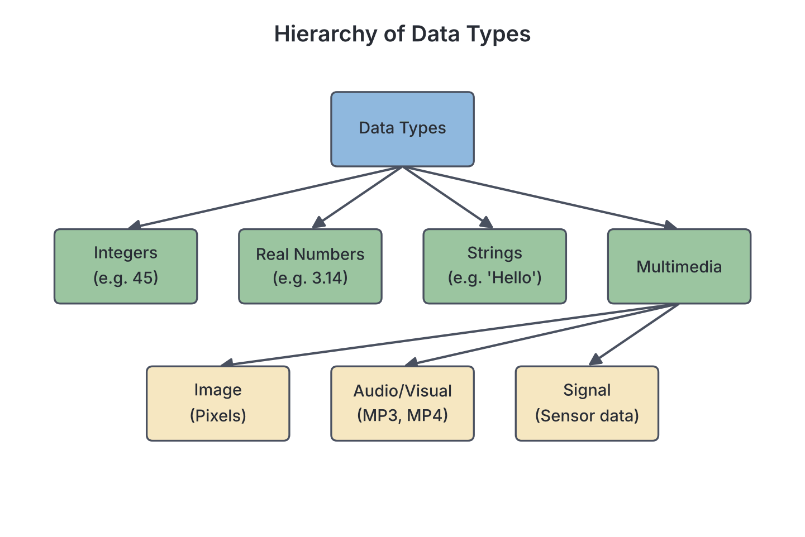
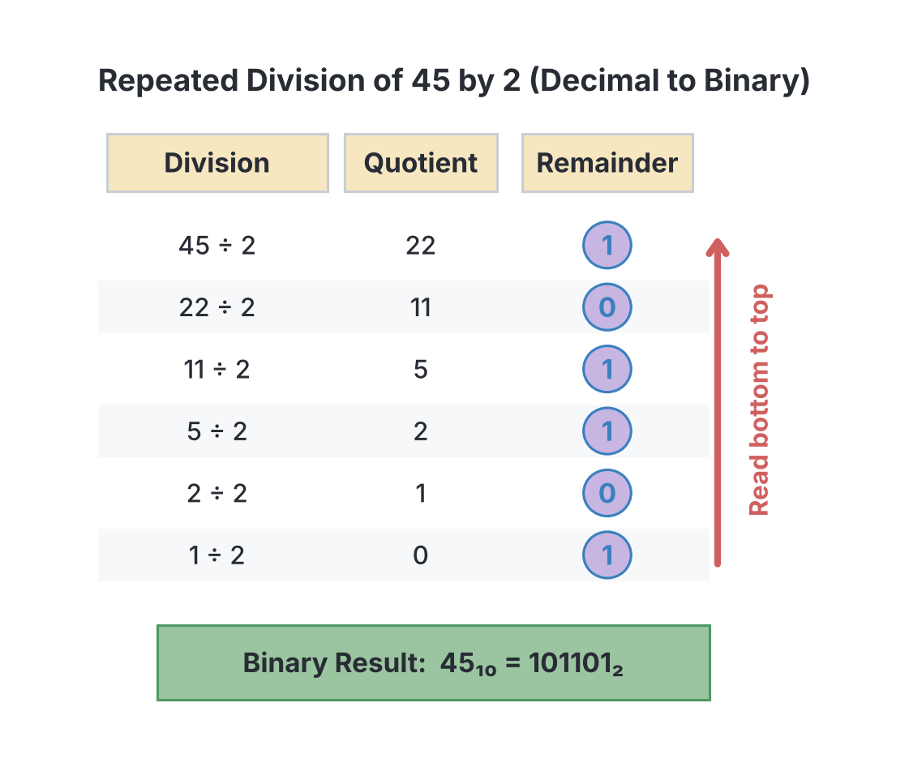

# JAMB Computer Studies Notes: Data Representation and Number Bases

## What JAMB expects

This topic is Section B, Topic 2 (Part 2) of the JAMB Computer Studies syllabus: Data and Information. It covers content item **b**. 

Because Topic 2 contains three separate sections, it is split across three files. This file focuses on data representation and number bases. The differences between Data and Information are covered in `B2a-data-and-information.md`, and digitisation is covered in `B2c-digitisation.md`.

**Content item covered:**
- **b. Data representation.**

By the end of these notes, you should be able to:
1. List different types of data types (integers, real numbers, strings, multimedia (image, audio/visual, signal etc.)).
2. Identify ways of representing and handling data that is number bases with special reference to binary, decimal, hexadecimal etc.

**Note on the syllabus wording:** The syllabus asks you to "List different types of data types"; this simply means listing the different data types. It also asks you to "Identify ways of representing and handling data that is number bases..." which has a slight grammatical error (it means *in* number bases). While the printed objectives do not explicitly list conversion methods or binary arithmetic, JAMB exam questions very frequently test converting between these bases and performing basic binary arithmetic. These worked mathematical skills are therefore fully covered step-by-step in these notes.

## Types of Data

**Objective i: List different types of data types (integers, real numbers, strings, multimedia (image, audio/visual, signal etc.)).**

When programmers write software or users enter data, the computer needs to know what *kind* of data it is receiving. This is called the **data type**. The data type tells the computer how much memory to allocate and what operations can be performed on the data (for example, you can add two integers, but you cannot multiply two names together).

The main data types include:

### 1. Integers
An integer is a whole number that does not have a decimal point or fractional part. Integers can be positive, negative, or zero.
- **Examples:** $45$, $-12$, $0$, $2025$.
- **Uses:** Counting items, calculating ages, tracking quantities in stock, or looping a computer process a specific number of times.

### 2. Real numbers
Real numbers are numbers that contain a decimal point or fractional part. In computing, they are usually referred to as **floating-point** numbers.
- **Examples:** $3.14$, $-0.005$, $1500.50$.
- **Uses:** Precise measurements, weight, temperature, and currency values (such as ₦5,200.75).

### 3. Strings
A string is a sequence of characters treated purely as text. The characters can be letters of the alphabet, numbers, spaces, or symbols. Programmers usually enclose strings in quotation marks so the computer knows they are not commands or numbers meant for calculation.
- **Examples:** `"Hello, JAMB!"`, `"No. 54 Broad Street"`, `"08012345678"`.
- **Uses:** Storing names, home addresses, passwords, and descriptive text. 
- *Note:* Even though a phone number or a bank account number contains digits, it is stored as a string. This is because we do not perform mathematics on a phone number, and storing it as an integer would strip away the important leading zero!

### 4. Multimedia
Multimedia refers to complex data that goes beyond simple text and numbers.
- **Image data:** Digital photographs, illustrations, and graphics. Computers represent images by dividing them into a grid of millions of tiny dots called **pixels** (picture elements). Each pixel's specific colour is stored as a binary number (often using hexadecimal colour codes).
- **Audio/visual data:** Sound (audio) and moving pictures (video). Sound waves are continuous (analog) by nature. To store them, the computer takes thousands of digital snapshots (samples) of the sound wave every second. Videos are stored as a rapid sequence of image frames combined with a synchronized audio track.
- **Signal data:** Continuous data collected from the physical world using sensors. Examples include temperature readings from a smart weather device on a farm, GPS location signals, or a patient's heartbeat on a hospital monitor. These physical signals are converted into numbers the computer can understand using an Analog-to-Digital Converter (ADC).



## Data Representation in Computers

**Content item b: Data representation.**

No matter what data type you are working with—whether it is a string of text, a real number, or a vibrant photograph—the computer's hardware cannot understand it in that form. A computer's processor and memory are made up of billions of microscopic electronic switches (transistors) that can only be in one of two states: **On** or **Off**. 

To process information, all data must eventually be converted into a code made entirely of these two states. We represent "On" as the number **$1$** and "Off" as the number **$0$**. 
- A single $0$ or $1$ is called a **bit** (short for **bi**nary digi**t**).
- A group of 4 bits is called a **nibble**.
- A group of 8 bits is called a **byte**. A single byte has enough combinations to represent one text character, such as the letter 'A'.
- A group of bits processed by the computer's CPU all at once is called a **word**. 
  - *Textbook variation:* The size of a "word" is not fixed; it depends on the design of the processor. Today, processors commonly use 32-bit words or 64-bit words.

## Number Bases

**Objective ii: Identify ways of representing and handling data that is number bases with special reference to binary, decimal, hexadecimal etc.**

Because humans and computers count differently, we use different number bases to represent data. A number base indicates how many digits are available in that counting system.

### Decimal (Base 10)
This is the standard number system used by humans in daily life. 
- **Digits used:** Ten digits ($0, 1, 2, 3, 4, 5, 6, 7, 8, 9$).
- Place values are based on powers of 10 (units, tens, hundreds, thousands).

### Binary (Base 2)
This is the fundamental language of the computer, reflecting the on/off states of its circuitry.
- **Digits used:** Two digits ($0$ and $1$).
- Place values are based on powers of 2 (ones, twos, fours, eights, sixteens, etc.). We often write binary numbers with a subscript 2, such as $1011_2$, to prevent confusing them with decimal numbers like one thousand and eleven.

### Hexadecimal (Base 16)
Binary numbers are very long and difficult for humans to read. Hexadecimal was adopted as a convenient shorthand for binary because one hexadecimal digit exactly matches a 4-bit binary nibble ($2^4 = 16$).
- **Digits used:** Sixteen digits. Since we only have symbols for 0 to 9, we use letters for the remaining values: $0, 1, 2, 3, 4, 5, 6, 7, 8, 9, A, B, C, D, E, F$.
  - $A = 10$, $B = 11$, $C = 12$, $D = 13$, $E = 14$, $F = 15$.
- Hexadecimal is heavily used in computing for memory addresses, MAC addresses on networks, and web colour codes (like `#FF0000` for pure red).

### Octal (Base 8)
While less common today, octal is another base sometimes mentioned in computing ("etc." in the syllabus). 
- **Digits used:** Eight digits ($0, 1, 2, 3, 4, 5, 6, 7$).
- One octal digit exactly matches a 3-bit binary group ($2^3 = 8$). It was heavily used in older, early-generation computers.

---

## Worked Skills: Number Base Conversions

JAMB frequently tests your ability to convert values between decimal, binary, and hexadecimal.

### 1. Converting Binary to Decimal
To convert a base 2 number to base 10, multiply each binary digit by its place value (a power of 2) and add the results together.

**Example: Convert $101101_2$ to decimal.**
1. Write down the binary digits and assign place values starting from the right ($2^0, 2^1, 2^2$, etc.).

| $2^5$ | $2^4$ | $2^3$ | $2^2$ | $2^1$ | $2^0$ |
|---|---|---|---|---|---|
| 32 | 16 | 8 | 4 | 2 | 1 |
| **1** | **0** | **1** | **1** | **0** | **1** |

2. Multiply the digit by the place value:
   - $1 \times 32 = 32$
   - $0 \times 16 = 0$
   - $1 \times 8 = 8$
   - $1 \times 4 = 4$
   - $0 \times 2 = 0$
   - $1 \times 1 = 1$
3. Add them up: $32 + 0 + 8 + 4 + 0 + 1 = 45$.
**Result:** $45_{10}$.

### 2. Converting Decimal to Binary
To convert a base 10 number to base 2, use the **repeated division by 2** method. Divide the number by 2, write down the remainder, and repeat with the quotient until the quotient reaches 0.

**Example: Convert $45_{10}$ to binary.**
1. $45 \div 2 = 22$, remainder **1**
2. $22 \div 2 = 11$, remainder **0**
3. $11 \div 2 = 5$, remainder **1**
4. $5 \div 2 = 2$, remainder **1**
5. $2 \div 2 = 1$, remainder **0**
6. $1 \div 2 = 0$, remainder **1**

**Crucial step:** Read the remainders from **bottom to top**. 
**Result:** $101101_2$.



### 3. Converting Decimal to Hexadecimal
This uses the same repeated division method, but you divide by 16.

**Example: Convert $254_{10}$ to hexadecimal.**
1. $254 \div 16 = 15$, remainder **14**.
2. $15 \div 16 = 0$, remainder **15**.
3. Convert the remainders to their hexadecimal letters: $14$ is **E**, and $15$ is **F**.
4. Read bottom to top.
**Result:** $FE_{16}$.

### 4. Converting Hexadecimal to Decimal
Use place values, which are powers of 16 ($16^0 = 1$, $16^1 = 16$, $16^2 = 256$).

**Example: Convert $3B_{16}$ to decimal.**

| $16^1$ | $16^0$ |
|---|---|
| 16 | 1 |
| **3** | **B** (11) |

1. Multiply the digit by the place value:
   - $3 \times 16 = 48$
   - $11 \times 1 = 11$
2. Add them up: $48 + 11 = 59$.
**Result:** $59_{10}$.

### 5. Converting between Binary and Hexadecimal
Because $16 = 2^4$, you can convert instantly without going through decimal. Just group the binary bits into fours (nibbles).

**Hexadecimal to Binary:** Expand each hex digit into a 4-bit binary group.
**Example:** Convert $B6_{16}$ to binary.
- B (which is 11) $= 1011_2$
- 6 $= 0110_2$
- Combine them side by side.
**Result:** $10110110_2$.

**Binary to Hexadecimal:** Group bits into fours starting from the right. If the last group doesn't have 4 bits, add leading zeros.
**Example:** Convert $110100100_2$ to hex.
1. Group from right to left: $0001$ | $1010$ | $0100$
2. Convert each group: $1$ | $A$ (10) | $4$
**Result:** $1A4_{16}$.

---

## Worked Skills: Binary Arithmetic

Just like with decimal numbers, a computer's Arithmetic Logic Unit (ALU) performs basic mathematics on binary numbers.

### Binary Addition
The rules for adding binary digits are simple:
- $0 + 0 = 0$
- $0 + 1 = 1$
- $1 + 0 = 1$
- $1 + 1 = 10$ (Write down 0, carry 1)
- $1 + 1 + 1 = 11$ (Write down 1, carry 1)

**Example: Evaluate $1011_2 + 1101_2$**
```text
  Carry: 1 1 1 1
           1 0 1 1
         + 1 1 0 1
         ---------
         1 1 0 0 0
```
*(Check: $11 + 13 = 24$. $11000_2$ is $16 + 8 = 24$.)*

### Binary Subtraction (Direct Method)
The rules for direct binary subtraction are:
- $0 - 0 = 0$
- $1 - 0 = 1$
- $1 - 1 = 0$
- $0 - 1 = 1$ (Borrow $1$ from the next higher column. In binary, a borrowed $1$ brings a value of $2$ into your current column, so you are calculating $2 - 1 = 1$.)

**Example: Evaluate $1101_2 - 0110_2$**
```text
  Borrow:  1
         1 1 0 1
       - 0 1 1 0
       ---------
         0 1 1 1
```
**Step-by-step trace:**
1. **Column 1 (rightmost):** $1 - 0 = 1$.
2. **Column 2:** $0 - 1$. We cannot subtract $1$ from $0$, so we borrow $1$ from the next column to the left. The borrowed $1$ acts as a $2$ in our current column. $2 - 1 = 1$.
3. **Column 3:** The $1$ was borrowed, leaving $0$. We have $0 - 1$. We must borrow $1$ from the next column, making this column $2$. $2 - 1 = 1$.
4. **Column 4 (leftmost):** The $1$ was borrowed, leaving $0$. $0 - 0 = 0$.
*(Check: $13 - 6 = 7$. $0111_2$ is $4 + 2 + 1 = 7$.)*

### Binary Subtraction using Two's Complement
To make hardware simpler, modern computers rarely subtract directly. Instead, they represent negative numbers using a method called **Two's Complement**, and they turn subtraction into addition (i.e., $A - B$ becomes $A + (-B)$). 

**Steps to subtract B from A using two's complement:**
1. **Pad both numbers** so they have the same, fixed number of bits (let us use 8 bits).
2. Find the **One's Complement** of B by flipping all its bits (change $1$ to $0$, and $0$ to $1$).
3. Find the **Two's Complement** of B by adding $1$ to the one's complement.
4. **Add** the two's complement of B to A using standard binary addition.
5. **Discard** any final carry bit that overflows beyond our fixed 8-bit length.

**Example: Subtract $18_{10}$ ($00010010_2$) from $45_{10}$ ($00101101_2$) using 8-bit two's complement.**
1. The number we are subtracting (B) is $00010010_2$.
2. **One's complement** of B: $11101101_2$.
3. **Two's complement** of B (add 1):
```text
      11101101
    +        1
    ----------
      11101110
```
4. **Add** this to A ($00101101_2$):
```text
  Carry: 1 1 1 0 1 1 0 0 0
           0 0 1 0 1 1 0 1  (This is 45)
         + 1 1 1 0 1 1 1 0  (This is two's comp of 18)
         -----------------
         1 0 0 0 1 1 0 1 1
```
5. We are using an 8-bit limit, but the result has 9 bits. **Discard the 9th bit** on the far left.
**Result:** $00011011_2$.
*(Check: $45 - 18 = 27$. $00011011_2$ is $16 + 8 + 2 + 1 = 27$. It is correct.)*

### Binary Multiplication
Binary multiplication follows the exact same shift-and-add logic as decimal long multiplication, but it is easier because you only ever multiply by $1$ (copy the top number) or $0$ (write a row of zeros).

**Example: Evaluate $101_2 \times 11_2$**
```text
    101
  x  11
  -----
    101   (101 x 1)
+  1010   (101 x 1, shifted one place left)
-------
   1111
```
*(Check: $5 \times 3 = 15$. $1111_2$ is $8 + 4 + 2 + 1 = 15$.)*

## Key terms

| Term | Meaning |
| --- | --- |
| Integer | A data type representing a whole number with no fractional part. |
| Floating-point | A data type representing a real number that includes a decimal point. |
| String | A data type representing a sequence of text characters. |
| Pixel | "Picture element", the smallest dot of colour that makes up a digital image. |
| Bit | A binary digit (0 or 1); the smallest unit of data in a computer. |
| Byte | A group of 8 bits. |
| Nibble | A group of 4 bits. |
| Number Base | The number of distinct digits available in a counting system (e.g., base 2 has two digits). |
| Hexadecimal | A base 16 number system using digits 0-9 and letters A-F; frequently used as shorthand for binary. |
| One's Complement | Inverting all the bits of a binary number (turning 1s to 0s and 0s to 1s). |
| Two's Complement | The method computers use to represent negative numbers, found by adding 1 to the one's complement. |

## Exam tips and common mistakes

- **Conversion trap:** When converting from decimal to binary via repeated division, always read the remainders from **bottom to top**. Reading top to bottom is a very common trap in JAMB options.
- **Data type trick:** Phone numbers, ID card numbers, and bank account numbers are **strings**, not integers. If you store "08012345" as an integer, the computer treats it as the number 8,012,345 and deletes the leading zero.
- **Hexadecimal letters:** Do not confuse the letter values. A=10, B=11, C=12, D=13, E=14, F=15. If a question asks for the hex value of 13, it is D.
- **Two's complement distinction:** Do not confuse *one's complement* with *two's complement*. One's complement is just flipping the bits; two's complement means flipping the bits **and** adding 1.
- **Binary subtraction borrowing:** Remember that when you borrow a 1 from the column to the left in binary, it acts as a **2** in your current column, not a 10.

## Quick summary

1. Data types tell a computer how to handle information; common types include integers (whole numbers), real/floating-point numbers (decimals), strings (text), and multimedia (images, audio, video, signals).
2. Computers internally represent all data in binary form (base 2) using bits (0s and 1s) because their hardware circuits act as two-state switches.
3. 4 bits make a nibble, 8 bits make a byte, and a word is a processor-dependent grouping of bits (often 32 or 64 bits).
4. The decimal system (base 10) is what humans use, binary (base 2) is what computers use, and hexadecimal (base 16) is a shorthand for binary used by programmers.
5. Base conversions involve either repeated division (when converting from decimal to another base) or multiplying digits by their place values (when converting to decimal).
6. Hexadecimal digits A to F represent the values 10 to 15, and every single hex digit translates exactly into a 4-bit binary group.
7. Computers perform subtraction efficiently by converting the number to be subtracted into its two's complement and then adding it.

## Practice questions

**1. Which data type is best used to store a person's mobile phone number, such as "08012345678", in a database?**
- A. Integer
- B. String
- C. Real number
- D. Multimedia

**Answer: B.** A phone number is stored as a string. Mathematical operations are not performed on phone numbers, and storing it as an integer would remove the critical leading zero.

**2. In computer data representation, which number base uses the digits 0 to 9 and the letters A to F?**
- A. Binary
- B. Decimal
- C. Octal
- D. Hexadecimal

**Answer: D.** Hexadecimal is base 16, and because we only have 10 standard digits, it uses the letters A to F to represent the values 10 to 15.

**3. Convert the binary number $11101_2$ to decimal.**
- A. 29
- B. 30
- C. 25
- D. 31

**Answer: A.** The place values from right to left are 1, 2, 4, 8, 16. Calculating: $(1 \times 16) + (1 \times 8) + (1 \times 4) + (0 \times 2) + (1 \times 1) = 16 + 8 + 4 + 0 + 1 = 29$. (Option D, 31, comes from treating the number as $11111_2$, forgetting that the digit in the 2s place is 0.)

**4. Convert the decimal number $43_{10}$ to binary.**
- A. $110101_2$
- B. $101101_2$
- C. $101011_2$
- D. $100011_2$

**Answer: C.** Divide by 2 repeatedly: 43(r1), 21(r1), 10(r0), 5(r1), 2(r0), 1(r1). Reading from bottom to top gives $101011_2$. (Option A is the common mistake of reading remainders from top to bottom, which equals 53).

**5. What is the hexadecimal equivalent of the binary number $10110110_2$?**
- A. A6
- B. B6
- C. C6
- D. D6

**Answer: B.** Split into 4-bit nibbles: $1011$ and $0110$. $1011$ is 11 (which is B), and $0110$ is 6. Combine them to get B6.

**6. Evaluate the binary addition: $1101_2 + 1010_2$.**
- A. $10111_2$
- B. $11011_2$
- C. $10011_2$
- D. $11110_2$

**Answer: A.** Rightmost column: $1+0=1$. Next: $0+1=1$. Next: $1+0=1$. Leftmost: $1+1=10$. This results in $10111_2$. (Decimal check: $13 + 10 = 23_{10} = 10111_2$).

**7. Using the direct method of binary subtraction, evaluate $1011_2 - 0110_2$.**
- A. $0011_2$
- B. $0100_2$
- C. $0101_2$
- D. $0111_2$

**Answer: C.** Rightmost column $1-0=1$. Next: $1-1=0$. Next: $0-1$ (borrow 1 from the leftmost column, making it 2). $2-1=1$. Leftmost is now $0-0=0$. The result is $0101_2$. (Decimal check: $11 - 6 = 5_{10} = 0101_2$).

**8. The standard method used by computers to represent negative binary numbers, found by inverting all bits and adding 1, is called:**
- A. Direct subtraction
- B. One's complement
- C. Two's complement
- D. Sign and magnitude

**Answer: C.** Two's complement is derived by taking the one's complement (inverting the bits) and adding 1.

**9. What is the result of the binary multiplication $110_2 \times 11_2$?**
- A. $10000_2$
- B. $10010_2$
- C. $10110_2$
- D. $11000_2$

**Answer: B.** In decimal, this is $6 \times 3 = 18$. The binary value of $18$ is $16 + 2$, which is written as $10010_2$.

**10. Which of the following is NOT an example of multimedia data?**
- A. An MP3 audio file
- B. A JPEG photograph
- C. A stream of integers representing students' ages
- D. Continuous GPS signals from a car

**Answer: C.** Integers are a basic numerical data type. Multimedia data refers to complex data like audio (MP3), images (JPEG), video, or continuous real-world signals.

<!-- COVERAGE
obj i | Types of Data
obj ii | Number Bases
item b | Data Representation in Computers
-->
