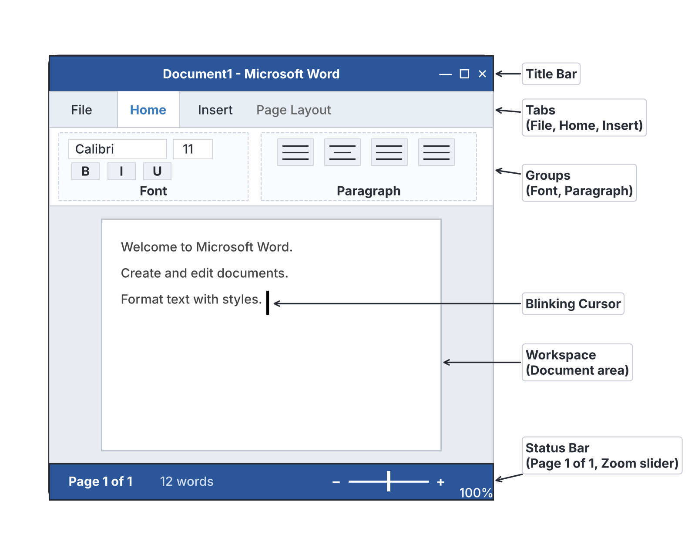
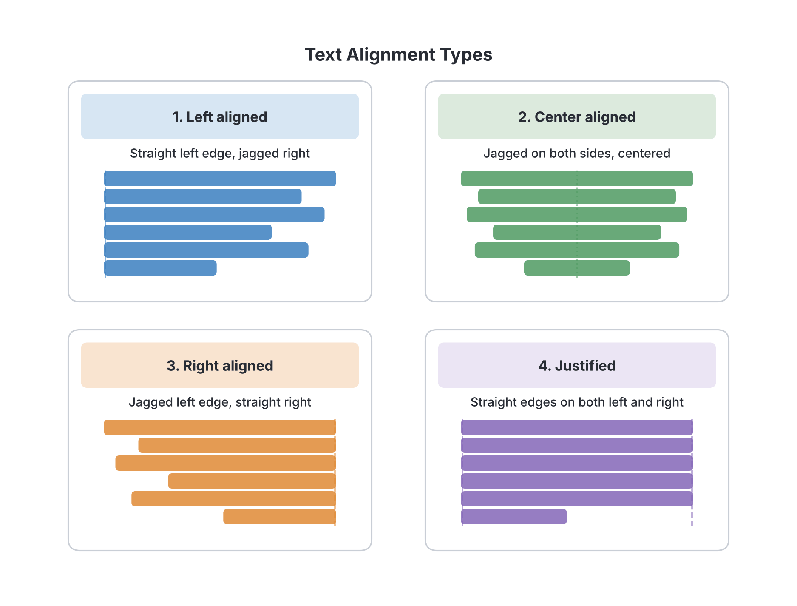

# JAMB Computer Studies Notes: Word Processing Package

## What JAMB expects

This topic is Section C, Topic 1 of the JAMB Computer Studies syllabus: Word Processing package. 

It covers the following content items:
- (a) General concept
- (b) Creating and saving documents
- (c) Editing, formatting and insertion
- (d) Printing
- (e) MS Word (i. Features, ii. Launch MS Word, iii. Basic operations, iv. Other operations)

By the end of these notes, you should be able to:
1. Define word processing, and give examples of word processing packages. (MS Word, WordStar, WordPerfect, Open Word, etc.)
2. Identify features of Word Processing packages in general (create, save, edit, insert, print, share etc.)
3. List the application areas of Word Processing packages (Office, Publishing, Journalism, Education, etc.)
4. Launch effectively MS Word.
5. Perform MS Word basic operations - create, edit, save, retrieve, print, copy and move, etc.
6. Use different types and sizes of fonts.
7. Perform MS Word operations of:
8. Format, justify, search/explore, etc. - Carry out spell checking and file merging operations.
9. Close MS Word.

**Note on the syllabus wording:** 
- The syllabus lists two sets of objectives numbered with Roman numerals. The first set (i to iii) covers general concepts, while the second set (i to vi) covers specific Microsoft Word (MS Word) operations. 
- In the second set of objectives, objective "iv. Perform MS Word operations of:" is printed as an incomplete sentence, immediately followed by objective "v. Format, justify, search/explore...". In these notes, they are treated as connected concepts but are given their own sections to ensure full coverage. 
- The syllabus lists older software like **WordStar** and **WordPerfect**. Even though these programs are mostly outdated (WordStar was a popular text-based program in the 1980s), you must know them because they frequently appear as options in JAMB questions. "Open Word" likely refers to open-source alternatives like Apache OpenOffice Writer or LibreOffice Writer.

---

## General concept of word processing

Before personal computers became common in Nigerian homes and offices, people typed letters and documents using mechanical **typewriters**. If you made a mistake on a typewriter, you often had to use correction fluid (Tipp-Ex) or re-type the entire page. 

**Word processing** changed this by allowing users to type, correct, change the appearance of, save, and print documents electronically on a screen before putting them on paper.

### Defining word processing and giving examples

**Word processing** is the act of using a computer (or a specialized electronic device) to create, edit, format, save, and print text-based documents. 

A **word processor** (or word processing package) is the application software used to carry out word processing. 

**Note for exams:** Do not confuse the *activity* with the *software*. "Word processing" is the process; a "word processor" is the tool (the software package).

**Examples of Word Processing Packages:**
- **Microsoft Word (MS Word):** The most popular and widely used word processor globally.
- **WordStar:** One of the earliest and most popular word processing programs for personal computers (now discontinued).
- **WordPerfect:** A word processor that was highly popular in the late 1980s and 1990s, especially in law offices.
- **Open Word / OpenOffice Writer:** A free, open-source word processor.
- **Google Docs:** A modern, cloud-based word processor used online.
- **Corel WordPerfect:** The modern version of WordPerfect.
- **Apple Pages:** The default word processor for Apple Mac computers.

## Features of Word Processing packages in general

Almost all word processing packages, whether old like WordStar or modern like MS Word, share standard features that make working with text easy.

1. **Create:** Opening a new, blank document to start typing from scratch, or using a pre-designed template (like a CV template).
2. **Save and Retrieve:** Storing a document on a storage device (like a hard drive or flash drive) permanently, and retrieving (opening) it later to read or continue working.
3. **Edit:** Making changes to the content of the text. This includes correcting spelling mistakes, deleting words, or moving paragraphs around.
4. **Format:** Changing the appearance of the document to make it look attractive. This includes changing font colors, making text bold, or adjusting margins.
5. **Insert:** Adding non-text elements into the document, such as pictures, tables, charts, symbols, or page numbers.
6. **Print:** Sending the soft copy (electronic document) to a printer to produce a hard copy (physical paper).
7. **Share:** Sending the document to others via email, local networks, or cloud sharing.
8. **Word Wrap:** A crucial automatic feature. When you reach the right edge of the page while typing, the word processor automatically moves the cursor to the next line. You do not need to press the `Enter` key at the end of every line (unlike a manual typewriter).
9. **Spell Check:** A built-in dictionary that highlights misspelled words (often with a red wavy line) and suggests corrections.

## Application areas of Word Processing packages

Word processors are used in almost every sector of the Nigerian economy for producing documents.

1. **Office and Business:** Used extensively by secretaries, managers, and clerks to write memos, business letters, reports, invoices, and circulars. For example, typing an application letter to a bank in Lagos.
2. **Publishing:** Used by authors and publishers to type the initial manuscripts for novels, textbooks, and manuals before they are sent for graphic design and mass printing.
3. **Journalism:** Reporters and editors for newspapers (like *The Punch* or *Vanguard*) use word processors to draft news articles, format columns, and check word counts before publication.
4. **Education:** Teachers use word processing software to prepare lesson notes, type examination questions (like WAEC or JAMB past questions), and print student report cards. Students use it to type assignments and final-year project reports.
5. **Everyday / Personal Use:** Individuals use word processors to write personal letters, design personal CVs (Curriculum Vitae), or make shopping lists.

---

## Introduction to MS Word

**Microsoft Word (MS Word)** is a graphical word processing program developed by Microsoft Corporation. It is part of the Microsoft Office suite (which also includes Excel and PowerPoint). Because it uses a Graphical User Interface (GUI), you interact with it using a mouse to click icons, tabs, and menus.

**Key visual features of the MS Word screen:**
- **Title Bar:** Located at the very top, it displays the name of the document and the program (e.g., `Document1 - Word`).
- **Ribbon:** The wide band at the top (just below the title bar) that contains most of the commands. It is organized into **Tabs** (Home, Insert, Design, Layout, etc.).
- **Groups:** Each tab on the Ribbon is divided into groups. For example, the *Home* tab has groups for *Clipboard*, *Font*, and *Paragraph*.
- **Workspace (Document Area):** The large white space in the middle where you type your text. It looks like a blank sheet of paper.
- **Cursor / Insertion Point:** A blinking vertical line in the workspace that shows where the next letter you type will appear.
- **Status Bar:** Located at the bottom of the screen. It shows information like the current page number, total word count, and zoom slider.

### Launching MS Word

**Objective i (second set): Launch effectively MS word.**

Because operating systems vary, the exact steps can differ slightly, but the standard way to launch (open) MS Word on a Windows computer is:
1. Click on the **Start** button (the Windows logo) at the bottom-left corner of the screen.
2. Scroll through the list of installed programs or type "Word" into the search bar.
3. Click on the **Word** icon (usually a blue icon with a white letter 'W').
4. When the program opens, click on **Blank document** to start a new file, or select a template.

Alternatively, if there is an MS Word shortcut icon on the computer's Desktop, you can **double-click** it to launch the application immediately.

---

### Basic MS Word operations

**Objective ii (second set): Perform MS Word basic operations - create, edit, save, retrieve, print, copy and move, etc.**

JAMB sets written (objective) questions on these practical topics, so you need to know the concepts, the steps to perform them using menus, and their standard keyboard shortcuts.

#### Creating and saving documents

- **Creating a new document:** 
  - **Steps:** Click the **File** tab, select **New**, and click **Blank document**.
  - **Shortcut:** `Ctrl + N`.
- **Saving a document:** Storing your work so it is not lost when the computer goes off.
  - **Save As:** Used the *very first time* you save a document, or when you want to save an existing document with a *new name* or in a *new location*.
    - **Steps:** Click **File** > **Save As** > Choose location > Type file name > Click Save.
    - **Shortcut:** `F12`.
  - **Save:** Used to update an already saved document with your latest changes.
    - **Steps:** Click the Save icon (a small floppy disk) on the Quick Access Toolbar, or click **File** > **Save**.
    - **Shortcut:** `Ctrl + S`.
- **Retrieving (Opening) a document:** Opening a file you previously saved.
  - **Steps:** Click **File** > **Open**, browse to where the file is stored, select it, and click Open.
  - **Shortcut:** `Ctrl + O`.

#### Editing, formatting and insertion

**Editing** means modifying the content of the document (correcting errors, adding words, or rearranging paragraphs). 
Before you can edit or format text, you usually have to **select (highlight)** it by clicking and dragging the mouse over the text.

- **Copy and Paste (Duplicating text):**
  - **Copy:** Takes a copy of the selected text and places it in the computer's temporary memory (the **Clipboard**), leaving the original text in place. 
  - **Shortcut for Copy:** `Ctrl + C`.
  - **Paste:** Inserts the copied text from the Clipboard into the document at the cursor's current position.
  - **Shortcut for Paste:** `Ctrl + V`.
- **Cut and Paste (Moving text):**
  - **Cut:** Removes the selected text entirely from its original location and places it in the Clipboard.
  - **Shortcut for Cut:** `Ctrl + X`.
  - **Shortcut for Paste:** `Ctrl + V`.
- **Undo and Redo:**
  - **Undo:** Reverses your last action (e.g., if you accidentally delete a paragraph, Undo brings it back). Shortcut: `Ctrl + Z`.
  - **Redo:** Reverses an Undo action. Shortcut: `Ctrl + Y`.

**Insertion operations** involve putting objects other than plain text into your document.
- **Steps to insert:** Go to the **Insert** tab on the Ribbon.
- **Common insertions:**
  - **Tables:** Grids of rows and columns used to organize data.
  - **Pictures/Images:** Inserting photos from your computer or the internet.
  - **Headers and Footers:** Text that repeats at the very top (header) or very bottom (footer) of every page, often used for document titles or author names.
  - **Page Numbers:** Automatically numbers the pages in the document.

---

### Using different types and sizes of fonts

**Objective iii (second set): Use different types and sizes of fonts.**

**Formatting** means changing the appearance of text to make the document attractive and easy to read. The most basic formatting involves changing the **font** (the design of the characters).

1. **Font Type (Font Face):** The specific design of the letters. 
   - Examples include *Times New Roman*, *Arial*, *Calibri*, and *Comic Sans*.
   - **How to change:** Select the text, go to the **Home** tab, click the Font drop-down arrow, and choose a font.
2. **Font Size:** How large or small the text is. Font size is measured in **points** (pt). A standard document uses 11 pt or 12 pt size. Main headings might use 16 pt or 18 pt.
   - **How to change:** Next to the Font Type box on the Home tab, click the number drop-down and select a size.
3. **Font Style / Weight:** 
   - **Bold:** Makes text thicker and darker. Shortcut: `Ctrl + B`.
   - **Italic:** Slants text to the right. Shortcut: `Ctrl + I`.
   - **Underline:** Draws a line under the text. Shortcut: `Ctrl + U`.

---

### Advanced MS Word operations

**Objective iv (second set): Perform MS Word operations of:** (This acts as an introductory syllabus heading for the operations below).

### Format, justify, search, explore, spell check and file merging

**Objective v (second set): Format, justify, search/explore, etc. - Carry out spell checking and file merging operations.**

#### Justification (Text Alignment)
Alignment (or justification) determines how text lines up with the left and right margins of the page. You find these options in the **Paragraph** group on the **Home** tab.

- **Left Align:** Text aligns flat against the left margin, leaving the right edge uneven (ragged). This is the default setting. Shortcut: `Ctrl + L`.
- **Center Align:** Text is placed exactly in the middle of the line. Often used for titles or headings. Shortcut: `Ctrl + E`.
- **Right Align:** Text aligns flat against the right margin, leaving the left edge uneven. Often used for dates or addresses in letters. Shortcut: `Ctrl + R`.
- **Justify:** Text is spaced out so that it is flat against *both* the left and right margins, creating clean, straight boxes of text (common in newspapers and textbooks). Shortcut: `Ctrl + J`.

#### Search / Explore (Find and Replace)
When working with a long document, you may need to find a specific word or change a word throughout the entire text.
- **Find (Search):** Locates a specific word or phrase. 
  - **Shortcut:** `Ctrl + F`. This opens a navigation pane where you type the word you are looking for.
- **Replace:** Locates a word and replaces it with another word automatically (e.g., changing every instance of "colour" to "color").
  - **Shortcut:** `Ctrl + H`. This opens a dialog box with "Find what" and "Replace with" fields.

#### Spell Checking
MS Word has a built-in dictionary and grammar rules. 
- **Red wavy line:** Indicates a misspelled word (a word not in the dictionary).
- **Blue (or green in older versions) wavy line:** Indicates a grammatical or formatting error.
- **How to fix:** Right-click the underlined word to see a menu of suggested corrections.
- **How to run a full check:** Go to the **Review** tab and click **Spelling & Grammar**, or press the shortcut key **F7**.

#### File Merging Operations (Mail Merge)
"File merging" in word processing almost always refers to **Mail Merge**, a powerful feature used to send personalized letters to many people without retyping the letter each time.

It merges two files:
1. **Main Document:** The main letter containing the standard text that goes to everyone.
2. **Data Source:** A list or database containing the names, addresses, and personal details of the recipients.

When merged, MS Word automatically generates a separate, personalized letter for every person on the list.
- **Steps:** Go to the **Mailings** tab on the Ribbon, click **Start Mail Merge**, and follow the step-by-step wizard to select your main document and your recipient list.

*(Note: File merging can sometimes simply mean inserting the entire text of another file into your current document. This is done by clicking **Insert** > **Object** drop-down arrow > **Text from File**).*

---

### Printing documents

Printing is the process of generating a hard copy of your soft copy document using a printer. 

Before printing, it is always a good practice to use **Print Preview**. Print Preview allows you to see exactly how the document will look on the physical paper so you can fix margins or alignment issues before wasting paper and ink. In modern versions of MS Word, the Print screen automatically shows a preview.

**Steps to Print:**
1. Click the **File** tab and select **Print**.
   *(Shortcut: Press `Ctrl + P`)*.
2. In the Print menu, you can configure settings:
   - **Printer selection:** Choose which connected printer to use.
   - **Copies:** Select how many copies of the document you want.
   - **Pages to print:** Choose whether to print all pages, only the current page, or a specific range (e.g., Pages 2-5).
3. Click the large **Print** button to send the job to the printer.

---

### Closing MS Word

**Objective vi (second set): Close MS Word.**

When you are finished with your work, you must close the application to free up computer memory. If you try to close without saving your recent changes, MS Word will display a warning box asking if you want to save first.

**Steps to close MS Word:**
- **Method 1:** Click the **Close button** (the red 'X' at the top-right corner of the window).
- **Method 2:** Click the **File** tab, then select **Close** (this closes the document but keeps the Word program open).
- **Method 3 (Keyboard Shortcut):** Press `Alt + F4` to close the entire application, or `Ctrl + W` to close just the current document.

---

## Key terms

| Term | Meaning |
| --- | --- |
| **Word Processing** | The activity of creating, editing, formatting, and printing text documents using a computer. |
| **Word Processor** | The application software used for word processing (e.g., MS Word, WordStar). |
| **Ribbon** | The command bar at the top of the MS Word screen containing tabs and groups of tools. |
| **Word Wrap** | A feature that automatically moves a word to the next line when it reaches the right margin. |
| **Formatting** | Changing the appearance and layout of text (fonts, colors, alignment) to improve its look. |
| **Editing** | Making changes to the content of a document, such as adding, deleting, or moving text. |
| **Justification** | The alignment of text along the left, right, or both margins of a page. |
| **Mail Merge** | A feature that combines a standard main document with a list of data to create personalized letters. |
| **Clipboard** | A temporary storage area in the computer memory where cut or copied text is kept before pasting. |
| **Print Preview** | A feature that lets you see how a document will look on paper before it is actually printed. |

---

## Exam tips and common mistakes

- **Word Processing vs. Word Processor:** Examiners love to test this difference. Word *processing* is the action/concept. A Word *processor* is the software package.
- **Copy vs. Cut:** Remember that **Copy** (`Ctrl + C`) duplicates text (keeps the original), while **Cut** (`Ctrl + X`) moves the text (deletes it from the original spot).
- **Save vs. Save As:** Use `Save As` for a new file name or new location. Use `Save` to update a file you are already working on.
- **Shortcuts are heavily tested:** Memorize `Ctrl + S` (Save), `Ctrl + P` (Print), `Ctrl + Z` (Undo), `Ctrl + V` (Paste), `Ctrl + J` (Justify), and `Ctrl + E` (Center Align). Note that Center is `E`, not `C` (`Ctrl + C` is Copy).
- **Red vs. Blue lines:** A red wavy line means a spelling mistake. A blue (or green) wavy line means a grammar error.
- **Justify vs. Align:** "Justify" specifically means aligning text straight on *both* the left and right margins.
- **Know the old software:** If a question asks "Which of the following is a word processing package?" and options are Excel, Access, WordStar, and CorelDraw, the answer is **WordStar**.

---

## Quick summary

1. Word processing is the creation, editing, formatting, and printing of electronic documents.
2. Common word processing packages include MS Word, WordStar, WordPerfect, Google Docs, and Open Word.
3. Key features of all word processors include word wrap, spell checking, editing, formatting, inserting images, and saving files.
4. Word processors are used in offices for memos, in education for lesson notes, and in journalism for articles.
5. In MS Word, editing refers to changing the content (Cut, Copy, Paste), while formatting refers to changing the appearance (Font size, Bold, Italic).
6. Text alignment determines how text sits between margins: Left, Center, Right, and Justified.
7. Mail Merge allows users to send a standardized letter to many different people by combining a main document with a data source.
8. Standard keyboard shortcuts are vital for exams: `Ctrl+N` (New), `Ctrl+S` (Save), `Ctrl+X` (Cut), `Ctrl+V` (Paste), `Ctrl+P` (Print).

---

## Practice questions

**1. Which of the following is NOT an example of a word processing package?**

- A. Microsoft Word
- B. WordPerfect
- C. WordStar
- D. Microsoft Excel

**Answer: D.** Microsoft Excel is a spreadsheet package, not a word processing package. The most tempting wrong option is C (WordStar) because it is old and no longer commonly used, but it was historically a very popular word processor.

**2. The automatic moving of text to the next line when the right margin is reached is known as:**

- A. Word dropping
- B. Text wrapping
- C. Word wrap
- D. Line feed

**Answer: C.** Word wrap is the standard feature in word processors that automatically moves the cursor to the next line when you reach the edge of the page. The most tempting wrong option is B (Text wrapping) because the term sounds similar, but "text wrapping" usually refers to how text flows around images, whereas moving to the next line automatically is "word wrap".

**3. Which keyboard shortcut is used to move text from one location to another?**

- A. `Ctrl + C` then `Ctrl + V`
- B. `Ctrl + X` then `Ctrl + V`
- C. `Ctrl + V` then `Ctrl + X`
- D. `Ctrl + C` then `Ctrl + X`

**Answer: B.** To move text, you must first "Cut" it (`Ctrl + X`) and then "Paste" it (`Ctrl + V`) in the new location. The most tempting wrong option is A (`Ctrl + C` then `Ctrl + V`) because it is the most commonly used shortcut pair, but that is used to *copy* (duplicate) text rather than move it.

**4. A red wavy line under a word in MS Word indicates a:**

- A. Grammatical error
- B. Formatting error
- C. Spelling error
- D. Printing error

**Answer: C.** A red wavy line means the word is not recognized by the word processor's built-in dictionary, indicating a spelling error. The most tempting wrong option is A (Grammatical error), but grammar errors are indicated by a blue (or green in older versions) wavy line, not red.

**5. What is the main difference between "Save" and "Save As"?**

- A. Save is used for text, Save As is used for images.
- B. Save is used to close the document, Save As is used to open it.
- C. Save updates an existing file, while Save As allows you to save a file with a new name or in a new location.
- D. There is no difference; they perform the exact same function.

**Answer: C.** "Save As" prompts you for a file name, location, and file format, which is necessary the very first time you save or when creating a duplicate. "Save" simply overwrites the current file. The most tempting wrong option is D (There is no difference) because clicking "Save" on a brand-new, unsaved document will automatically act like "Save As", confusing users into thinking they are the same.

**6. Which alignment option distributes text evenly between both the left and right margins?**

- A. Center alignment
- B. Left alignment
- C. Right alignment
- D. Justified alignment

**Answer: D.** Justified alignment adds precise spaces between words so that the text lines up perfectly flat against both the left and the right margins. The most tempting wrong option is A (Center alignment) because users often think "center" balances the text, but center alignment leaves both the left and right edges uneven (jagged).

**7. In MS Word, changing the font size, applying bold text, and changing the font color are examples of:**

- A. Editing
- B. Formatting
- C. Inserting
- D. Merging

**Answer: B.** Formatting refers to changing the appearance or layout of a document. The most tempting wrong option is A (Editing), but editing refers to modifying the actual textual content (correcting words, adding sentences, copying or deleting), not changing how it looks.

**8. The MS Word feature used to send a standard personalized letter to many different people is called:**

- A. Find and Replace
- B. Spelling and Grammar
- C. Mail Merge
- D. Print Preview

**Answer: C.** Mail Merge combines a main document (the letter) with a data source (a list of names and addresses) to produce multiple personalized letters automatically. The most tempting wrong option is A (Find and Replace) because it also automates text changes throughout a document, but it does not merge two files to generate personalized copies.

**9. Which of the following keyboard shortcuts is used to center align a paragraph?**

- A. `Ctrl + C`
- B. `Ctrl + J`
- C. `Ctrl + A`
- D. `Ctrl + E`

**Answer: D.** `Ctrl + E` is the shortcut for Center align. The most tempting wrong option is A (`Ctrl + C`) because the word "Center" starts with a C, but `Ctrl + C` is actually the shortcut for Copy.

**10. Before printing a document, it is highly recommended to use which feature to see how it will appear on paper?**

- A. Page Setup
- B. Print Preview
- C. Page Layout
- D. Document View

**Answer: B.** Print Preview lets you see exactly how the soft copy will look as a hard copy, helping you avoid wasting paper on formatting mistakes. The most tempting wrong option is C (Page Layout) because it is a view mode that shows margins and page edges while editing, but Print Preview is specifically used in the print menu immediately before printing to confirm the final output.

<!-- COVERAGE
obj i | Defining word processing and giving examples
obj ii | Features of Word Processing packages in general
obj iii | Application areas of Word Processing packages
obj i | Launching MS Word
obj ii | Basic MS Word operations
obj iii | Using different types and sizes of fonts
obj iv | Advanced MS Word operations
obj v | Format, justify, search, explore, spell check and file merging
obj vi | Closing MS Word
item a | General concept of word processing
item b | Creating and saving documents
item c | Editing, formatting and insertion
item d | Printing documents
item e | Introduction to MS Word
-->
