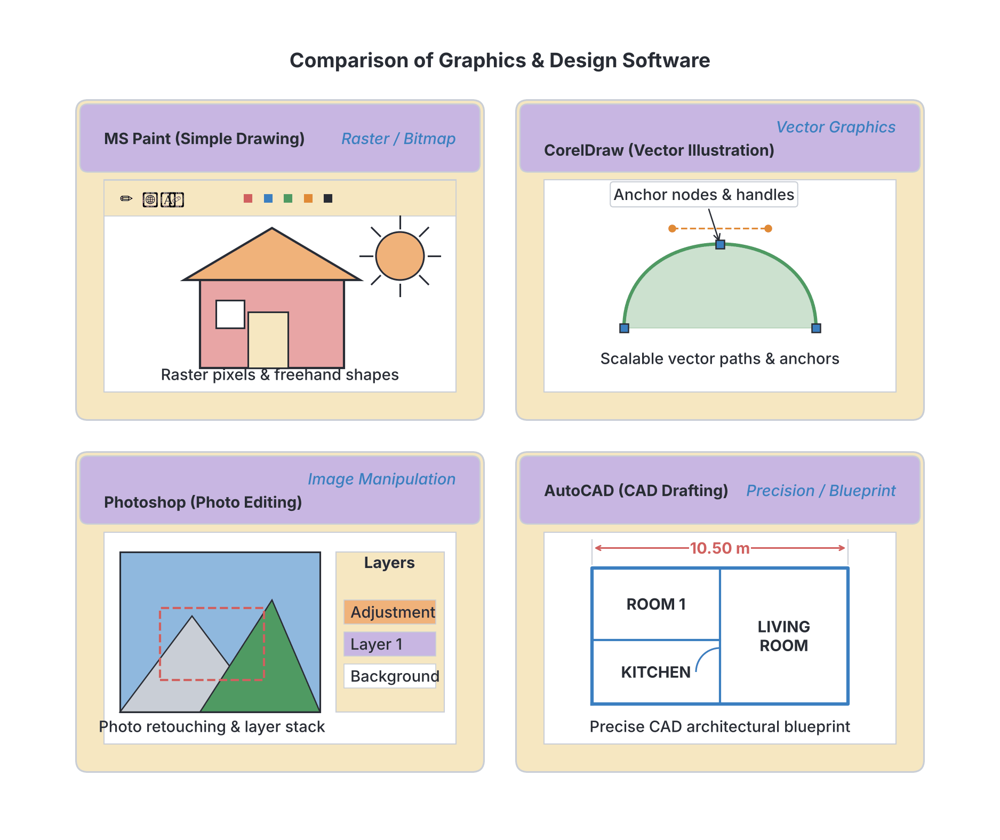
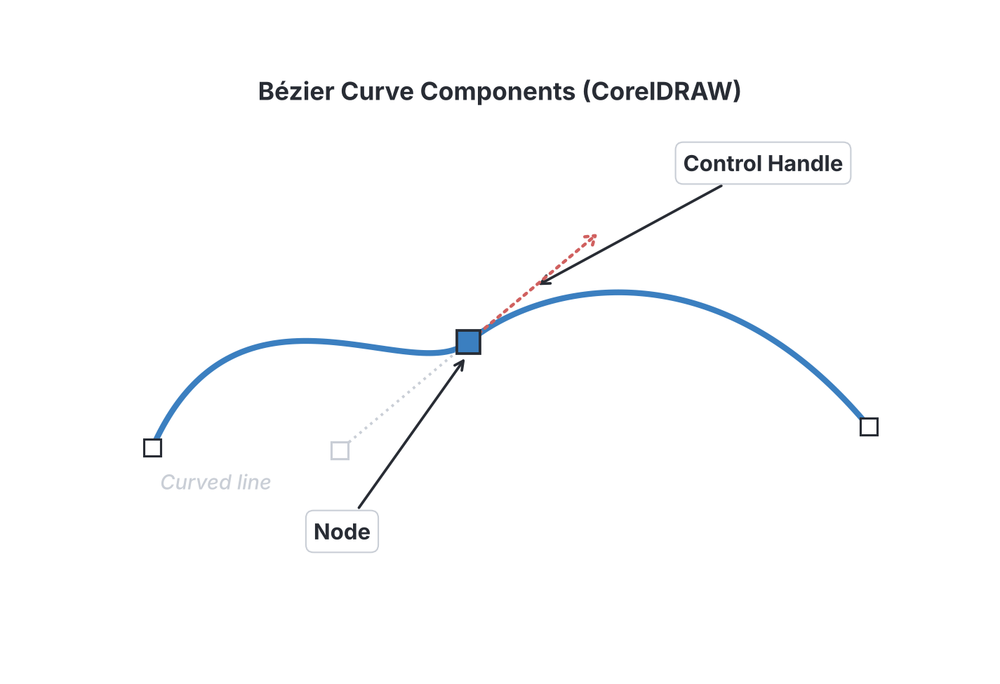

# JAMB Computer Studies Notes: Graphics Package

## What JAMB expects

This topic is Section C, Topic 4 of the JAMB Computer Studies syllabus: Graphics Package. It covers the following content items:
* (a) Definitions and examples of Graphic packages
* (b) Features of CorelDraw
* (c) Simple design using CorelDraw

By the end of these notes, you should be able to:
1. Define Graphics and give examples of Graphic packages (Paint, Harvard Graphics, Photoshop, CorelDraw, Autocad etc)
2. Explain features of CorelDraw (LiveSketch Tool, Multi-Monitor, Healing Clone Tools, Copy Curve Segments, Gaussian Blur Feature, Touch-Friendly GU Interface, Powerful Stylus Enhancements, Import Legacy Workspaces, Prominent Interactive Sliders, Custom Node Shapes, Font Filtering and Search, Corel Font Manager, Enhanced Vector Previews, Handles and Node etc.)
3. Use features of CorelDraw to activate existing CorelDraw file
4. Use CorelDraw to design 
    - Business Card
    - School Logo
    - National Flag
    - Invitation Card
    - Certificates etc.

**Note on the syllabus wording:** 
The syllabus asks you to explain the "Touch-Friendly GU Interface". "GU" is a typing error in the syllabus; the correct term is **GUI** (Graphical User Interface). The syllabus also lists "Harvard Graphics", which is a very old software package from the 1980s that is no longer sold or used, but you must know it for the exam because JAMB lists it. Finally, the long list of CorelDraw features (like the LiveSketch tool and Custom Node Shapes) is taken directly from the release notes of *CorelDraw 2017*. Software features and menus change with newer versions, but we will explain exactly what the syllabus asks for.

---

## Definitions and examples of graphic packages

**Objective i: Define Graphics and give examples of Graphic packages**

### What are graphics?
In computing, **graphics** refers to visual images, drawings, and designs generated, displayed, or manipulated on a computer screen. Graphics are used to illustrate ideas, entertain, inform, and make digital environments visually appealing. They include everything from simple line drawings and company logos to complex 3D architectural models and digital photographs.

Computer graphics are generally divided into two types:
1. **Raster (Bitmap) Graphics:** Images made up of tiny colored dots called **pixels** (like photographs). If you zoom in too much, they become blurry and blocky (pixelated).
2. **Vector Graphics:** Images made up of mathematical lines, curves, and shapes. They can be scaled up to any size (like a giant billboard) without losing quality or becoming blurry.

### What is a graphics package?
A **graphics package** (or graphics application software) is a program used to create, edit, manipulate, and save visual images and designs on a computer. 

### Examples of Graphic Packages
The syllabus lists the following specific examples that you must know:

1. **CorelDraw:** A popular **vector graphics editor** widely used in Nigeria by printers, sign-makers, and graphic designers to create logos, banners, business cards, and flyers.
2. **Photoshop (Adobe Photoshop):** The industry standard for editing **raster (bitmap) graphics**. It is heavily used by photographers and designers for photo retouching, color correction, and digital painting.
3. **Paint (Microsoft Paint):** A very simple raster graphics drawing program that comes built into the Microsoft Windows operating system. It is used for basic drawing, cropping, and saving images.
4. **AutoCAD:** A computer-aided design (CAD) package. (The "Auto" in the name comes from its maker, Autodesk. Some textbooks expand it as "Automatic Computer-Aided Design", but that is not its official meaning.) It is a complex software used mostly by architects, engineers, and drafters to create precise 2D and 3D technical drawings (like building plans and machine parts).
5. **Harvard Graphics:** An early presentation and graphics software originally created for MS-DOS computers in the 1980s. Though it is obsolete today, JAMB still lists it as a classic example of a graphics package.

---

## Features of CorelDraw

**Objective ii: Explain features of CorelDraw**

CorelDraw is a powerful application for vector illustration and page layout. The JAMB syllabus highlights specific features that were introduced around the 2017 version. As of the mid-2020s, newer versions exist, but these specific tools and features remain important for the exam.

### Drawing and Editing Tools
*   **LiveSketch Tool:** An innovative tool powered by Artificial Intelligence (AI). It allows a designer to sketch freely by hand using a stylus, and the software automatically converts these rough, hand-drawn strokes into clean, precise vector curves in real-time.
*   **Healing Clone Tools:** A photo-editing feature (often used within Corel PHOTO-PAINT, which comes with CorelDraw) used to remove imperfections. It lets you paint over an unwanted mark (like a spot on a face) by copying texture and color from another part of the image, blending it seamlessly.
*   **Copy Curve Segments:** A time-saving feature that allows you to copy, paste, or duplicate a specific piece (segment) of a curved line without having to take the entire shape apart.
*   **Gaussian Blur Feature:** A visual effect that smoothly blurs an image or a drop shadow. It is used to soften the edges of an object, making it look like it is glowing or fading into the background.

### User Interface and Workspace
*   **Touch-Friendly GU Interface (GUI):** The syllabus calls this "GU Interface". It means **Graphical User Interface**. CorelDraw has a mode that makes the screen buttons larger and easier to tap for people using touch-screen laptops or tablets.
*   **Multi-Monitor Support:** The ability to work across more than one computer screen at the same time. You can have your drawing on one monitor and your tools or color palettes dragged over to a second monitor.
*   **Import Legacy Workspaces:** A feature that allows designers who upgrade to a new version of CorelDraw to bring in (import) their customized screen layouts (workspaces) from older versions (legacy versions) so they do not have to set up their tools all over again.

### Nodes, Handles, and Drawing Precision
*   **Nodes and Handles:** These are the most basic elements of vector graphics.
    *   **Nodes** are the anchor points that connect the segments of a line or curve. 
    *   **Handles** (or control handles) are invisible lines that extend out from a node. By pulling and turning the handles, you change the depth and direction of the curve.
*   **Custom Node Shapes:** CorelDraw allows nodes to display as different shapes (like squares, circles, or diamonds). This visual clue tells the designer what type of node it is (e.g., a smooth node, a cusp node, or a symmetrical node) just by looking at its shape.
*   **Enhanced Vector Previews:** This feature ensures that complex designs with hundreds of overlapping lines and colors render (display) very quickly and cleanly on the screen without lagging.
*   **Prominent Interactive Sliders:** On-screen controls (sliders) for object fills, transparencies, and drop shadows that are made thicker and more visible, making them easier to grab and adjust with a mouse or touch screen.

### Hardware Integration and Typography
*   **Powerful Stylus Enhancements:** Improved support for digital drawing pens (styluses), such as the Microsoft Surface Pen or Wacom tablets. The software responds to how hard you press (pressure), how you angle the pen (tilt), and the direction you hold it (bearing).
*   **Font Filtering and Search:** A feature that saves time by letting you search for fonts based on categories. Instead of scrolling through hundreds of fonts, you can filter by "Handwritten", "Bold", or "Serif" to find the exact text style you need.
*   **Corel Font Manager:** A standalone application included in the Corel package that lets designers explore, organize, and manage their font collections without having to install all the fonts into the Windows operating system.

---

## Activating an existing CorelDraw file

**Objective iii: Use features of CorelDraw to activate existing CorelDraw file**

In computer terms, to "activate" a file means to open an existing saved document so you can view or edit it. CorelDraw files usually have the file extension **`.cdr`** (CorelDraw format).

JAMB exam questions focus on the standard steps to do this. Because software changes, focus on these general steps:

**Step-by-step process to open a file:**
1. **Launch the software:** Open CorelDraw from your computer's Start menu or desktop shortcut.
2. **Use the Welcome Screen:** When CorelDraw opens, a Welcome Screen usually appears. It often has a section called "Get Started" which lists your recently saved files. You can click on the file name there to activate it.
3. **Using the Menu Bar:** 
   * Click on **File** on the top menu bar.
   * Select **Open...** from the drop-down list.
4. **Using the Keyboard Shortcut:** Press **Ctrl + O** on your keyboard.
5. **Browse and Select:** An "Open Drawing" dialog box will appear. Navigate through your folders (e.g., Documents or Desktop) to find your `.cdr` file.
6. **Open:** Click on the file to select it, then click the **Open** button. The design will load onto the workspace.

---

## Simple design workflows using CorelDraw

**Objective iv: Use CorelDraw to design Business Card, School Logo, National Flag, Invitation Card, Certificates etc.**

Because the JAMB UTME is a written (objective) exam, you will not be asked to actually draw these items during the test. Instead, you will be tested on the **tools**, **commands**, and **sequence of steps** required to create them.

Below are the standard workflows for designing these common items.

### 1. Designing a Business Card
A business card provides a person's contact information and company details. It is usually printed on thick card stock.

**Steps:**
1. **Set the Page Size:** Open a new document and set the page size to standard business card dimensions (usually **3.5 inches by 2.0 inches**).
2. **Create the Background:** Use the **Rectangle Tool** to draw a box that fills the page. Give it a background color using the **Interactive Fill Tool** or the color palette on the right side of the screen.
3. **Add Text:** Select the **Text Tool** (the icon shaped like an 'A' or 'F8' on the keyboard). Click on the page and type the name, job title, phone number, email, and address.
4. **Format the Text:** Highlight the text and use the property bar at the top to change the font style and size (make the person's name the largest).
5. **Import a Logo:** Go to `File > Import` (Ctrl + I) to bring in the company's logo. Resize it and position it neatly in the corner.
6. **Group and Save:** Select all the elements by dragging a box over them, press **Ctrl + G** to group them, and then save the file.

### 2. Designing a School Logo
Logos are symbols made of shapes and text. School logos are often circular (badges) or shield-shaped.

**Steps:**
1. **Draw the Main Shape:** Use the **Ellipse Tool** (F7) to draw a perfect circle (hold the `Ctrl` key while dragging to make it a perfect circle). Draw a slightly smaller circle inside it to create a border ring.
2. **Add Colors:** Click on the circles and use the color palette to apply the school's colors (e.g., blue and white).
3. **Fit Text to Path:** This is a crucial CorelDraw skill! Type the school's name using the **Text Tool**. Select the text, go to the menu, and choose **Text > Fit Text to Path**. Click on the outer circle. The text will curve perfectly around the circle's edge.
4. **Add Symbols:** Use the **Polygon Tool** or import images like an open book or a lit torch (symbols of education) and place them in the center of the circle.
5. **Weld or Group:** Once arranged, group all the parts together so the logo acts as one solid object.

[IMAGE: A step-by-step visual showing three stages of a logo: 1. Two concentric circles. 2. The words "KINGS COLLEGE LAGOS" curved around the top path. 3. A book icon placed in the center. Clean flat textbook illustration, white background.]

### 3. Designing a National Flag
Flags are excellent practice for learning basic shapes and coloring. For example, the Nigerian National Flag (Green, White, Green).

**Steps:**
1. **Draw the Flag Boundary:** Select the **Rectangle Tool** (F6) and draw a large rectangle for the flag.
2. **Divide the Flag:** You need three equal vertical sections. You can draw one narrow vertical rectangle to cover the left third of the flag.
3. **Duplicate the Shape:** Copy the narrow rectangle and paste it to the right side (or press `Ctrl + D` to duplicate), leaving an equal-sized empty space in the middle.
4. **Apply Colors:** Click the left rectangle and click the **Green** color on the palette. Click the right rectangle and color it **Green**. Click the middle section (or background rectangle) and color it **White**.
5. **Remove Outlines:** To make it look like a real flag, select all the rectangles, go to the color palette, and right-click on the "X" (no color) box at the top to remove the black outline borders.

### 4. Designing an Invitation Card
Invitation cards (for weddings, birthdays, or school events) rely heavily on decorative borders, artistic text, and page layout.

**Steps:**
1. **Set Page Size and Orientation:** Create a new document and set the size to a standard card size like **A5** (half of A4). Choose either **Portrait** (tall) or **Landscape** (wide) orientation.
2. **Create a Decorative Border:** Draw a rectangle just inside the page edges. Increase the **Outline Width** in the property bar. You can use the **Pen Tool** or import floral vectors to place in the corners.
3. **Add Artistic Text:** Use the **Text Tool** to write "You are invited". Change the font to an elegant, curly script using the font drop-down menu.
4. **Add Details:** Type the specific details: the host, the event, the date, time, and venue (e.g., "At the School Main Hall"). Keep this text in a clear, easy-to-read font.
5. **Center Align:** Select all your text elements and use the alignment tools (press `C` on the keyboard) to align them perfectly down the center of the card.

### 5. Designing a Certificate
Certificates of merit or attendance require a formal layout, usually in landscape mode, with lines for signatures.

**Steps:**
1. **Set Up the Document:** Set the page size to **A4** and the orientation to **Landscape**.
2. **Create the Border:** Use the **Rectangle Tool** to draw a thick border. You can draw a slightly smaller rectangle inside it with a thinner line to create a double-border effect.
3. **Add the Heading:** Use the **Text Tool** to type the name of the school or organization at the top. Below that, in a large, formal font (like Old English or a bold Serif font), type **"CERTIFICATE OF EXCELLENCE"**.
4. **Add the Recipient's Name:** Type "This is awarded to:" in a smaller font, followed by the recipient's name in a large, bold font.
5. **Draw Signature Lines:** Use the **Freehand Tool** or **2-Point Line Tool** to draw horizontal straight lines at the bottom for the Principal and the Date. Type "Principal" under one line and "Date" under the other.
6. **Add a Seal:** You can draw a gold seal using the **Star/Polygon Tool** with many points, color it gold, and place it in the bottom corner to make the certificate look official.

---

## Key terms

| Term | Meaning |
| --- | --- |
| **Graphics** | Visual images, designs, or drawings generated or edited on a computer. |
| **Graphics Package** | Application software used to create, edit, and manipulate digital images. |
| **Vector Graphics** | Images made of mathematical curves and lines that can be resized without losing quality (e.g., CorelDraw files). |
| **Raster Graphics** | Images made up of tiny colored squares called pixels; they blur when zoomed in (e.g., MS Paint, Photoshop). |
| **Node** | A point on a vector path or curve that determines its shape. |
| **Handle (Control Handle)** | Invisible lines extending from a node used to adjust the angle and depth of a curve. |
| **GUI** | Graphical User Interface; the visual way users interact with a computer using windows, icons, and menus. |
| **LiveSketch Tool** | A CorelDraw AI tool that turns hand-drawn strokes into perfect vector curves. |
| **Workspace** | The layout of the software screen, including where the tools, toolbars, and palettes are placed. |

---

## Exam tips and common mistakes

*   **Software Classification:** Know the difference between vector editors (CorelDraw, AutoCAD) and raster editors (Photoshop, Paint).
*   **Text to Path:** If a JAMB question asks how to make text wrap in a circle (like for a school logo), the answer is always **Fit Text to Path**.
*   **Nodes vs Pixels:** Remember that *CorelDraw* relies on **nodes and handles** (vectors), while *Photoshop* and *Paint* rely on **pixels** (raster/bitmap).
*   **The "GU" typo:** If you see "GU Interface" in an exam question, understand it means GUI (Graphical User Interface).
*   **Obsolete Software:** Do not get tricked if an option asks for an example of a graphics package and lists *Harvard Graphics*. Even though it is ancient, it is correctly identified in the syllabus as a graphics/presentation package.
*   **File Extension:** The default file format for saving an active CorelDraw project is **`.cdr`**.
*   **Shortcuts:** Memorize basic shortcuts. `Ctrl + O` opens an existing file, `Ctrl + N` creates a new document, and `Ctrl + I` imports an image into the current file.

---

## Quick summary

1. Graphics packages are application software used to create and edit visual designs. Examples include CorelDraw, AutoCAD, MS Paint, Adobe Photoshop, and Harvard Graphics.
2. CorelDraw is a vector graphics editor heavily used for logos, flyers, and business cards. 
3. Key CorelDraw features mentioned in the syllabus include the LiveSketch Tool, Custom Node Shapes, Healing Clone Tools, Touch-Friendly GUI, and Font Filtering.
4. To activate an existing CorelDraw file, you use the File > Open menu, or the keyboard shortcut `Ctrl + O`, and select the `.cdr` file.
5. In CorelDraw, lines and shapes are controlled mathematically using Nodes (points) and Control Handles.
6. When designing a School Logo, the "Fit Text to Path" command is essential for wrapping text around a circular badge.
7. Business cards, certificates, and invitation cards require setting the correct page size (e.g., 3.5"x2" for a card, A4 landscape for a certificate) before drawing borders and adding formatted text.

---

## Practice questions

**1. Which of the following is NOT an example of a graphics package?**
- A. CorelDraw
- B. Adobe Photoshop
- C. Microsoft Access
- D. AutoCAD

**Answer: C.** Microsoft Access is a Database package, not a graphics package. CorelDraw, Photoshop, and AutoCAD are all used for creating and editing graphics.

**2. The basic elements used to manipulate and change the shape of curves in CorelDraw are called:**
- A. Pixels and grids
- B. Nodes and handles
- C. Bits and bytes
- D. Columns and rows

**Answer: B.** CorelDraw is a vector graphic editor. Vector shapes are altered by moving the anchor points (nodes) and pulling the control lines (handles).

**3. In CorelDraw, the AI-powered feature that converts hand-drawn strokes into precise vector curves is the:**
- A. Gaussian Blur Feature
- B. LiveSketch Tool
- C. Healing Clone Tool
- D. Interactive Slider

**Answer: B.** The LiveSketch Tool uses artificial intelligence to interpret freehand stylus strokes and convert them instantly into clean vector curves.

**4. A student wants to design a circular school badge and needs the name of the school to curve neatly around the edge of the circle. Which CorelDraw feature should they use?**
- A. Fit Text to Path
- B. Gaussian Blur
- C. Custom Node Shapes
- D. Copy Curve Segments

**Answer: A.** "Fit Text to Path" is the standard command used to attach a line of text to the outline of an object, causing the text to follow the object's curve.

**5. Which keyboard shortcut is used to activate or open an existing CorelDraw file?**
- A. Ctrl + N
- B. Ctrl + C
- C. Ctrl + S
- D. Ctrl + O

**Answer: D.** `Ctrl + O` is the universal shortcut for "Open" in Windows applications, allowing you to browse and activate an existing file. `Ctrl + N` is for New, `Ctrl + C` for Copy, and `Ctrl + S` for Save.

**6. Which of the following software packages is heavily used by architects and engineers for 2D and 3D technical drawing?**
- A. Microsoft Paint
- B. Harvard Graphics
- C. AutoCAD
- D. Adobe Photoshop

**Answer: C.** AutoCAD (a computer-aided design package) is specifically built for technical drafting, engineering, and architectural modeling.

**7. When designing the Nigerian National Flag in CorelDraw, a designer draws a large rectangle. What is the most efficient next step?**
- A. Divide it into two equal vertical sections and color both green.
- B. Divide it into three equal vertical sections and color the left and right sections green.
- C. Draw a circle in the middle and color it green.
- D. Use the LiveSketch tool to draw the flag freehand.

**Answer: B.** The Nigerian flag consists of three equal vertical bands (Green, White, Green). Using rectangles to create these three sections is the correct design workflow.

**8. The syllabus references a "Touch-Friendly GU Interface" in CorelDraw. What does GUI stand for in computer science?**
- A. General User Integration
- B. Graphic Utility Interaction
- C. Graphical User Interface
- D. Guided User Internet

**Answer: C.** GUI stands for Graphical User Interface. It allows users to interact with software using visual elements like windows, icons, menus, and touch sliders instead of typing text commands.

**9. Which of the following CorelDraw features is used to soften the edges of a shape or create a smooth drop shadow?**
- A. Gaussian Blur Feature
- B. Corel Font Manager
- C. Custom Node Shapes
- D. Healing Clone Tool

**Answer: A.** A Gaussian Blur is a mathematical algorithm used in graphic design to blur or soften an image, creating a glowing or shadowed effect.

**10. You are designing a standard Certificate of Excellence. What is the most appropriate page orientation to set before you begin?**
- A. Portrait
- B. Square
- C. Landscape
- D. Banner

**Answer: C.** Certificates are traditionally designed in a wide, horizontal layout, which is called Landscape orientation (typically A4 size).

<!-- COVERAGE
obj i | Definitions and examples of graphic packages
obj ii | Features of CorelDraw
obj iii | Activating an existing CorelDraw file
obj iv | Simple design workflows using CorelDraw
item a | Definitions and examples of graphic packages
item b | Features of CorelDraw
item c | Simple design workflows using CorelDraw
-->
