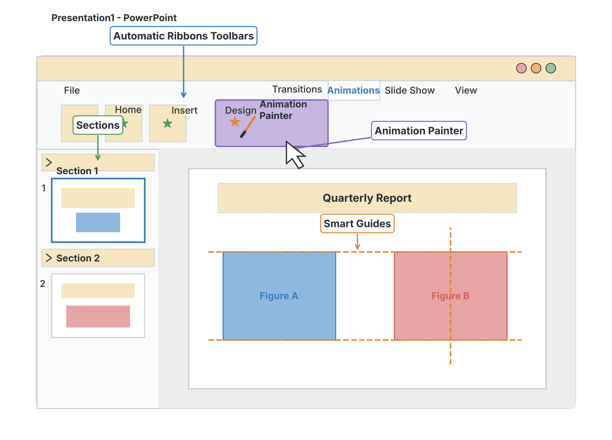

# JAMB Computer Studies Notes: Presentation Package

## What JAMB expects

This topic is Section C, Topic 5 of the JAMB Computer Studies syllabus: Presentation Package. It covers the following content items:
* (a) Definition of Presentation package and examples of Presentation packages
* (b) PowerPoint
    * i. Features of PowerPoint Environment
    * ii. Steps in activating an existing PowerPoint
    * iii. PowerPoint operations

By the end of these notes, you should be able to:
1. Define Presentation and give examples of Presentation packages (MS PowerPoint, Windows Movie Maker, Micromedia Flash, impress, Apple keynotes, etc.) 
2. Explain features of PowerPoint Environment (Animation Painter, Video Editor, create a video of you presentation, Automatic Ribbons Toolbars, Transitions, Sections, Cropped Tool, Mask Feature, Effective Preview, Screen Shot, Smart Guides,)
3. Explain steps in activating a PowerPoint presentation
4. Perform PowerPoint operations to:
    - Create new presentation
    - Insert pictures, text, graphs, animated contents, add new slide etc.
    - Save presentation, run slide show, print presentation, close presentation etc.

**Note on the syllabus wording:** The syllabus lists some software names with unusual spellings: "Micromedia Flash" is actually Macromedia Flash (now discontinued and replaced by Adobe Animate), "impress" refers to LibreOffice or OpenOffice Impress, and "Apple keynotes" is Apple Keynote. It also contains typing errors like "create a video of you presentation" (your presentation) and refers to the Crop tool as the "Cropped Tool". Furthermore, the syllabus lists specific features (like Animation Painter and Sections) that were introduced as "new features" in specific older versions of Microsoft PowerPoint (like PowerPoint 2010 and 2013). Software menus change frequently, so these notes will teach the general concepts behind these features and explain them as they are usually tested in exams.

## Definition and examples of Presentation packages

**Objective i: Define Presentation and give examples of Presentation packages**
**Content a: Definition of Presentation package and examples of Presentation packages**

### What is a Presentation?
A **presentation** is the process of communicating information, ideas, or research to an audience. In schools and businesses, this is often done by a speaker standing in front of a room, speaking and showing visual aids to support their message. For example, a student defending their final year project at a Nigerian university, or a business manager explaining sales figures to their team, is delivering a presentation.

### What is a Presentation Package?
A **presentation package** is a type of application software used to create sequences of words, pictures, charts, and multimedia (audio and video) that tell a story or support a speech. 

These packages allow you to create individual pages called **slides**. A collection of these slides is called a **slide show**. When the speaker talks, they project the slide show onto a screen using a multimedia projector or a large monitor, moving from one slide to the next.

### Examples of Presentation Packages
The syllabus lists several specific examples. It is important to know them by name:

1. **Microsoft (MS) PowerPoint:** The most widely used presentation software in the world. It is part of the Microsoft Office suite. Most JAMB questions about presentation software focus on PowerPoint.
2. **Windows Movie Maker:** Older software created by Microsoft for basic video editing. While mostly a video editor, it was often used to string together images and videos with text to create multimedia presentations. It is now discontinued.
3. **Macromedia Flash (Syllabus: Micromedia Flash):** Originally created by Macromedia (later bought by Adobe), this was a popular tool for creating highly animated, interactive presentations and web animations. It is now discontinued.
4. **LibreOffice / OpenOffice Impress (Syllabus: impress):** A free, open-source presentation program that works very much like PowerPoint. It is part of the LibreOffice and Apache OpenOffice suites.
5. **Apple Keynote (Syllabus: Apple keynotes):** The presentation software developed by Apple for Mac computers, iPhones, and iPads. It is known for its smooth animations and clean design.

Other modern examples not explicitly listed in the syllabus include Google Slides and Canva.

## Features of PowerPoint Environment

**Objective ii: Explain features of PowerPoint Environment**
**Content b(i): Features of PowerPoint Environment**

Microsoft PowerPoint has a rich environment designed to help you create visual slides. The syllabus asks you to understand several specific features. Because software versions change, keep in mind that the exact location of these tools may differ slightly depending on the version of PowerPoint installed on the computer.

### Standard Interface Features
* **Automatic Ribbons Toolbars:** Instead of old-fashioned drop-down menus, modern PowerPoint uses a "Ribbon" at the top of the screen. The Ribbon automatically organizes commands into **Tabs** (like Home, Insert, Design, Animations) and **Groups** (like Font, Paragraph). The Ribbon automatically adjusts its tools depending on what you click on (for example, clicking a picture opens a special "Picture Format" toolbar).

### Organization and Layout Features
* **Sections:** When you have a very long presentation (for example, 50 slides), managing them can be difficult. The **Sections** feature allows you to divide the presentation into logical groups (like folders) such as "Introduction", "Main Body", and "Conclusion". You can collapse or expand these sections to keep your workspace tidy.
* **Smart Guides:** When you click and drag a picture or a text box around a slide, you will see temporary dashed lines appear on the screen. These are **Smart Guides**. They help you align objects perfectly with other objects on the slide (for example, making sure two pictures are exactly level with each other) and space them evenly.

### Image and Media Editing Features
* **Cropped Tool (Crop tool):** If you insert a photograph but only want to show a specific part of it, you use the Crop tool. It allows you to cut away the unwanted outer edges of the picture without deleting the picture itself.
* **Mask Feature:** In PowerPoint, this is often called "Crop to Shape". It allows you to place an image inside a specific shape (like a circle, a star, or an arrow). The shape acts as a "mask," hiding the parts of the image that fall outside the shape.
* **Screen Shot:** This is a built-in tool (found on the Insert tab) that lets you capture an image of any window currently open on your computer screen and insert it directly into your slide, without needing external snipping tools.
* **Video Editor:** Modern PowerPoint allows you to insert a video and perform basic editing directly inside the presentation package. You can trim the start and end of the video, adjust its volume, or apply visual styles to the video frame.

### Animation and Effects Features
* **Transitions:** A slide transition is the visual effect that occurs when you move from one slide to the next during a slide show. Examples include fading, wiping, or dissolving into the next slide. Transitions affect the **whole slide**.
* **Animation Painter:** If you have spent time adding complex animations to a piece of text or an image (e.g., making it fly in from the left and then pulse), you can use the Animation Painter. You click the object with the animations, click the Animation Painter button, and then click another object. It instantly copies all the animation effects to the new object, saving you time. (It works just like the Format Painter does for text).
* **Effective Preview (Live Preview):** Before you actually apply a design, a font change, or a transition, PowerPoint lets you hover your mouse over the option in the menu. The slide on your screen will temporarily change to show you what it would look like. This "live preview" helps you make decisions without clicking "Undo" repeatedly.

### Output Features
* **Create a video of your presentation:** Instead of just saving the file as a presentation for a live speaker, you can export the entire slideshow as a video file (like MP4). This video will record all your slide timings, animations, transitions, and even recorded voice narration, turning your presentation into a standalone movie.

## Steps in activating an existing PowerPoint

**Objective iii: Explain steps in activating a PowerPoint presentation**
**Content b(ii): Steps in activating an existing PowerPoint**

"Activating" an existing PowerPoint presentation simply means opening a file that has already been created and saved on the computer (usually saved with a `.pptx` or `.ppt` file extension) so that you can view, edit, or present it. 

There are two common manual methods to do this:

**Method 1: From within the PowerPoint Application**
1. Turn on the computer and launch the Microsoft PowerPoint application (from the Start menu or desktop shortcut).
2. Click on the **File** tab on the Ribbon.
3. Click on **Open**.
4. Browse to the location (folder, flash drive, or cloud storage) where the presentation file is saved.
5. Click on the file name to select it.
6. Click the **Open** button. The presentation will now appear on your screen ready for editing.

**Method 2: From the File Explorer**
1. Open Windows File Explorer (or "My Computer").
2. Navigate to the folder (e.g., Documents, or a USB flash drive) containing the presentation file.
3. **Double-click** the PowerPoint file (it will usually have an orange icon with a "P").
4. The PowerPoint software will automatically launch and open the file.

## PowerPoint operations

**Objective iv: Perform PowerPoint operations**
**Content b(iii): PowerPoint operations**

JAMB expects you to know the sequence of steps to perform basic tasks in a presentation package. Because the exam is written, you will be tested on which tabs, menus, or shortcut keys are used for these operations.

### 1. Create a new presentation
When you want to start a presentation from scratch:
1. Open the PowerPoint application.
2. Click the **File** tab and select **New**.
3. Click on **Blank Presentation** (to start with a white, unformatted slide) or choose one of the pre-designed **Templates/Themes**.
4. A new presentation file (usually named "Presentation1") will open.

*Keyboard shortcut:* `Ctrl + N`

### 2. Add a new slide
A presentation needs multiple slides.
1. Go to the **Home** tab or the **Insert** tab on the Ribbon.
2. Click the **New Slide** button.
3. A drop-down menu will appear allowing you to choose a **Slide Layout** (e.g., Title Slide, Title and Content, Two Content, Blank).
4. Click the desired layout, and it will be inserted below your current slide.

*Keyboard shortcut:* `Ctrl + M` (Do not confuse this with `Ctrl + N`, which opens a whole new presentation file).

### 3. Insert text
1. If you chose a layout with placeholders (boxes with dashed borders that say "Click to add text"), simply click inside the box and type.
2. If you want to put text on a blank area, go to the **Insert** tab.
3. Click on **Text Box**.
4. Click and drag on the slide to draw the box, then type your text.

### 4. Insert pictures
1. Go to the **Insert** tab.
2. Click on **Pictures** (or Images).
3. Choose where to find the picture (e.g., "This Device" for files on your computer, or "Online Pictures").
4. Select the image file and click **Insert**. You can then resize it by dragging its corners.

### 5. Insert graphs (Charts)
To present numerical data visually (like a bar chart or pie chart):
1. Go to the **Insert** tab.
2. Click on **Chart**.
3. Choose the type of chart you want (e.g., Column, Pie, Line) and click OK.
4. A small spreadsheet window (like Excel) will pop up. Type your data into this window.
5. Close the spreadsheet window, and the chart will update on your slide.

### 6. Insert animated contents
**Animations** govern how individual elements (text, pictures, charts) appear, move, or disappear on a single slide.
1. Click on the text box or picture you want to animate.
2. Go to the **Animations** tab on the Ribbon.
3. Choose an animation effect from the gallery. They are grouped into:
   - **Entrance effects** (Green): How the object enters the slide (e.g., Fly In, Fade).
   - **Emphasis effects** (Yellow): Drawing attention to an object already on the slide (e.g., Spin, Grow/Shrink).
   - **Exit effects** (Red): How the object leaves the slide (e.g., Disappear, Float Out).

[IMAGE: A close-up illustration of the PowerPoint Ribbon showing the 'Animations' tab. A drop-down menu is visible, showing green stars labeled 'Entrance', yellow stars labeled 'Emphasis', and red stars labeled 'Exit'. Clean flat textbook style, white background.]

### 7. Save presentation
To store your work permanently on a hard drive or flash drive:
1. Click the **File** tab and select **Save** (or **Save As** if it is your first time saving it).
2. Choose a storage location.
3. Type a name in the "File name" box.
4. Click **Save**. 

*Keyboard shortcut:* `Ctrl + S`. The default format for modern PowerPoint is `.pptx`.

### 8. Run slide show (Delivery)
This is how you present your slides to the audience full-screen.
1. Go to the **Slide Show** tab.
2. To start from the very first slide, click **From Beginning**.
3. To start from the slide you are currently editing, click **From Current Slide**.
4. Once the show is running, click the mouse or press the Right Arrow / Spacebar to advance to the next slide or trigger the next animation. Press the **Esc** key to exit the slide show and return to the editing view.

*Keyboard shortcuts:* 
* Run from beginning: `F5`
* Run from current slide: `Shift + F5`

### 9. Print presentation
Sometimes you want paper copies for yourself or your audience.
1. Click the **File** tab and select **Print** (or press `Ctrl + P`).
2. Choose your printer.
3. In the Settings, you can choose to print:
   - **Full Page Slides:** One slide per page.
   - **Notes Pages:** One slide per page, with the speaker notes printed below it.
   - **Handouts:** Multiple miniature slides on a single page (e.g., 3 slides, 4 slides, or 6 slides per page) for the audience to take home.
4. Click the Print button.

### 10. Close presentation
To close the current file without closing the entire PowerPoint application:
1. Click the **File** tab.
2. Click **Close**. (If you haven't saved your recent changes, a box will pop up asking if you want to save).
Alternatively, clicking the "X" at the top right of the screen will close the presentation and the PowerPoint application itself.

*Keyboard shortcut to close current file:* `Ctrl + W`.

## Key terms

| Term | Meaning |
| --- | --- |
| **Presentation Package** | Application software used to create sequences of slides containing text, images, and media to support a speech or tell a story. |
| **Slide** | A single page of a presentation created in a presentation package. |
| **Slide Show** | A collection of slides played in sequence to an audience, usually in full-screen mode. |
| **Ribbon** | The graphical control element at the top of the window that organizes commands into tabs and groups. |
| **Transitions** | The visual movement or effect applied to the **entire slide** as you move from one slide to the next. |
| **Animations** | Visual effects applied to **individual objects** (text, pictures) on a slide to control how they enter, emphasize, or exit. |
| **Animation Painter** | A tool that copies animation effects from one object and applies them to another. |
| **Smart Guides** | Automatic dashed lines that help you align and space objects on a slide perfectly. |
| **Sections** | A feature used to divide and organize a long presentation into smaller, manageable groups of slides. |
| **Crop** | A tool used to trim or remove the unwanted outer edges of an image. |

## Exam tips and common mistakes

- **Transitions vs Animations:** This is the most common exam trap. **Transitions** affect how whole slides move (e.g., moving from slide 1 to slide 2). **Animations** affect objects *inside* the slide (e.g., making text fly in).
- **Shortcuts:** Memorize that `Ctrl + M` creates a **new slide**, while `Ctrl + N` creates a **new presentation** file. Also, `F5` runs the slide show from the beginning.
- **Syllabus names:** If JAMB asks for an example of a presentation package and lists "Micromedia Flash", "impress", or "Apple keynotes", choose them. Do not let the unusual spelling confuse you.
- **Printing options:** Remember that "Handouts" are printed sheets with multiple slides per page, meant for the audience. "Notes Pages" are for the speaker, showing one slide with their private notes below.
- **Save vs Save As:** "Save" updates the current file. "Save As" is used to save an existing file with a new name or in a new location.

## Quick summary

1. A presentation package is software used to create slides combining text, images, and multimedia for speeches and displays. 
2. Examples include MS PowerPoint, LibreOffice Impress, Apple Keynote, and the discontinued Macromedia Flash and Windows Movie Maker.
3. The PowerPoint environment uses an Automatic Ribbon Toolbar, Smart Guides for alignment, and Sections to organize long slideshows.
4. Images can be edited directly in PowerPoint using the Crop tool and Mask feature (crop to shape).
5. Animations are effects applied to objects on a slide (copied using Animation Painter), while Transitions are effects applied between slides.
6. A presentation file can be exported as a video file (MP4/WMV) that includes all timings, narration, and animations.
7. To activate an existing presentation, launch the software and use the File > Open command, or double-click the file in File Explorer.
8. Basic operations include using the Ribbon tabs: Home to insert a new slide, Insert for pictures and charts, and Animations for object effects.

## Practice questions

**1. Which of the following is an example of a presentation package?**
- A. Microsoft Access
- B. Adobe Dreamweaver
- C. LibreOffice Impress
- D. CorelDraw

**Answer: C.** LibreOffice Impress (written as "impress" in the syllabus) is an open-source presentation package. Access is a database, Dreamweaver is for web design, and CorelDraw is for graphics.

**2. The visual effect applied when moving from one slide to another during a presentation is called:**
- A. Animation
- B. Transition
- C. Smart Guide
- D. Live Preview

**Answer: B.** Transitions affect the movement between whole slides. Animations apply to the objects within a single slide. This is a very common point of confusion.

**3. What is the keyboard shortcut to start a slide show from the very first slide in MS PowerPoint?**
- A. F5
- B. Shift + F5
- C. Ctrl + P
- D. F7

**Answer: A.** F5 starts the presentation from the beginning. Shift + F5 starts it from the currently active slide.

**4. The tool in PowerPoint that allows you to copy an animation effect from one object and apply it to another is the:**
- A. Format Painter
- B. Animation Painter
- C. Smart Guide
- D. Slide Sorter

**Answer: B.** The Animation Painter acts exactly like the Format Painter, but instead of copying text formatting (like fonts and colors), it copies animation effects.

**5. Which keyboard shortcut is used to insert a new slide into an existing presentation?**
- A. Ctrl + N
- B. Ctrl + S
- C. Ctrl + M
- D. Ctrl + O

**Answer: C.** Ctrl + M inserts a new slide. A common mistake is selecting Ctrl + N, but Ctrl + N creates a completely new presentation file.

**6. If a user wants to print miniature versions of their slides (e.g., 4 slides per page) to give to the audience, which print option should they choose?**
- A. Notes Pages
- B. Full Page Slides
- C. Handouts
- D. Outline View

**Answer: C.** Handouts are specifically designed to print multiple slides on a single page so the audience can take them home or make notes on them.

**7. Which feature helps a user precisely align text boxes and pictures by displaying temporary dashed lines on the screen?**
- A. Sections
- B. Transitions
- C. Cropped Tool
- D. Smart Guides

**Answer: D.** Smart Guides appear automatically when you drag an object, helping you snap it into alignment with other objects on the slide.

**8. According to the JAMB syllabus, which of the following older software packages was commonly used to combine media for presentations before being discontinued?**
- A. Microsoft Excel
- B. Macromedia Flash (Micromedia Flash)
- C. SPSS
- D. Microsoft Word

**Answer: B.** Macromedia Flash (printed as Micromedia Flash in the syllabus) was used for interactive and animated presentations and web content. Excel is a spreadsheet, Word is a word processor, and SPSS is for statistics.

**9. To remove the unwanted outer edges of an image inserted into a slide, which tool should be used?**
- A. Mask Feature
- B. Animation Painter
- C. Crop tool (Cropped Tool)
- D. Sections

**Answer: C.** The Crop tool is used to trim the edges of an image. The Mask feature (Crop to Shape) fits an image into a specific shape.

**10. What is the main purpose of the "Sections" feature in the PowerPoint environment?**
- A. To cut a video into smaller pieces
- B. To divide a large presentation into manageable groups of slides
- C. To separate text into columns on a slide
- D. To prevent unauthorized users from opening the file

**Answer: B.** Sections act like folders for your slides, allowing you to organize a long presentation into logical parts like Introduction, Body, and Conclusion.
