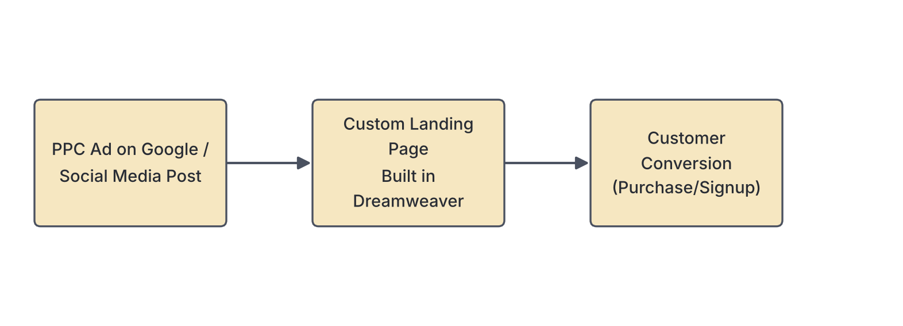

# JAMB Computer Studies Notes: Web Design Package

## What JAMB expects

This topic is Section C, Topic 6 of the JAMB Computer Studies syllabus: Web Design Package. 

It covers three main content items:
* (a) Definition and examples of Web Design Packages
* (b) Uses of Web Design Packages
* (c) Elements of Web design using Dreamweaver (printed as "Dreamview" in the syllabus contents)

By the end of these notes, you should be able to:
1. Define and give examples of Web design packages (HTML, XML, Dreamweaver, Rapid weaver, Google Web Designer, Microsoft Sharepoint Designer, Net Object Fusion, Xara Web Designer etc.)
2. List Elements of Web Design (Navigation, Visual design, Content, Web friendly, Interaction, Information Accessibility, Intuitiveness, Branding, Turnaround time, Conversion etc.)
3. Use Dreamweaver for: Social Media Management, Social Media Marketing, Website Design & Web Development, Pay Per Click (PPC) Management and Advert Consulting etc.

**Note on the syllabus wording:** 
The syllabus contains a few typing errors and odd classifications that you must be aware of for your exam:
1. **Dreamview vs. Dreamweaver:** The syllabus contents list "Dreamview", but the objectives correctly call it **Dreamweaver** (Adobe Dreamweaver). 
2. **Languages vs. Packages:** The syllabus lists HTML and XML as examples of "web design packages". In reality, HTML and XML are **markup languages** used to write web pages, not application packages (software). We will teach them as the syllabus lists them, but you must know the true definition.
3. **Uses of Dreamweaver:** The syllabus states that Dreamweaver is used for Social Media Management, Pay Per Click (PPC) Management, and Advert Consulting. Dreamweaver is actually just a tool for building web pages. It does not manage social media or ads directly. However, because the syllabus demands it, we will explain how web design in Dreamweaver *connects* to marketing and PPC campaigns (e.g., designing the landing pages for those ads).

## Definition and examples of Web Design Packages

**Objective i: Define and Give examples of Web design package**  
**Content a: Definition and examples of Web Design Packages**

### What is a Web Design Package?
A **Web Design Package** is application software used to create, edit, design, and manage web pages and websites. 

In the early days of the Internet, creating a website meant typing long lines of complex code manually. Today, web design packages often provide a **WYSIWYG** (What You See Is What You Get) interface. This means the designer can drag and drop images, type text, and change colours directly on the screen exactly as it will appear on the internet, and the software automatically writes the complex code in the background.

### Examples of Web Design Packages (as listed in the syllabus)

1. **Adobe Dreamweaver:** One of the most popular and powerful professional web design packages. It offers both a visual WYSIWYG interface and a code editor.
2. **Google Web Designer:** A free program from Google used primarily to create interactive HTML5 ads, animations, and simple web designs.
3. **Microsoft SharePoint Designer:** A discontinued Microsoft program used for creating and customising Microsoft SharePoint websites and workflows.
4. **RapidWeaver (printed as Rapid weaver):** A web design software created specifically for Mac computers, allowing users to build websites without writing code.
5. **NetObjects Fusion (printed as Net Object Fusion):** An early, widely used web design tool that works like a desktop publishing program for the web.
6. **Xara Web Designer:** A template-based web design package that focuses heavily on graphics and page layout without requiring coding skills.

*As noted earlier, the syllabus also lists the following two, which are actually languages, not software packages:*
7. **HTML (HyperText Markup Language):** The standard language used to create and structure the basic content of a web page. 
8. **XML (eXtensible Markup Language):** A markup language designed to store and transport data, rather than to display it like HTML.

## Uses of Web Design Packages

**Content b: Uses Web Design Packages**

Web design packages are essential tools for web developers. Their main uses include:
1. **Website Creation:** Building web pages from scratch using templates or drag-and-drop tools.
2. **Code Editing:** Providing advanced text editors that highlight errors and auto-complete code for HTML, CSS, JavaScript, and PHP.
3. **Website Maintenance:** Updating text, changing images, and managing the files of an existing website easily.
4. **File Transfer:** Most web design packages have built-in FTP (File Transfer Protocol) tools to upload the finished web pages from the designer's local computer to the live internet server.
5. **Testing and Previewing:** Allowing designers to see how a website will look on different devices (mobile phones, tablets, desktop computers) and on different web browsers before publishing it.

[IMAGE: A split-screen view of a modern web design package like Dreamweaver. The left side shows HTML code with colourful syntax highlighting. The right side shows the visual WYSIWYG output: a simple webpage with a heading, an image of a school, and some text. Style: clean flat textbook illustration, white background.]

## Elements of Web design using Dreamweaver

**Content c: Elements of Web design using Dreamview**  
**Objective ii: List Elements of Web Design**

Whether you are using Dreamweaver or writing code from scratch, a good website must possess certain core elements. If a website lacks these, visitors will get frustrated and leave. 

The syllabus lists the following essential elements of web design:

1. **Navigation:** This is how users move around a website. Good navigation requires clear menus, visible links, and a logical structure so visitors can find what they are looking for quickly (e.g., a "Home", "About Us", and "Contact" menu at the top of the page).
2. **Visual Design:** This refers to the overall look and feel of the website. It includes the layout, the choice of colours, typography (fonts), and images. The visual design should be attractive but not overwhelming.
3. **Content:** This is the actual information on the website—text, images, videos, and audio. Content is king; it must be relevant, accurate, and useful to the person visiting the site.
4. **Web Friendly (Responsiveness and Compatibility):** A web-friendly site works well on all devices. It must automatically adjust its layout to fit a small mobile phone screen just as well as a large desktop monitor. It must also work smoothly across different browsers (Chrome, Firefox, Safari).
5. **Interaction:** This involves features that allow the user to engage with the website. Examples include contact forms, comment sections, clickable buttons, animations that play when you hover over an image, and search bars.
6. **Information Accessibility:** The website must be usable by everyone, including people with disabilities. This includes adding "alt text" (descriptive text) to images so that screen reading software can describe the picture to blind users, and ensuring high colour contrast for people with poor vision.
7. **Intuitiveness:** The website should be easy to figure out. A user should not need instructions to know how to use the site. Buttons should look like buttons, and standard web conventions (like clicking the top-left logo to return home) should be followed.
8. **Branding:** The website must reflect the identity of the company or organization. This involves using the official company logo, matching the company's official colours (e.g., using MTN's specific yellow or GTBank's orange), and keeping a consistent tone of voice.
9. **Turnaround Time (Loading Speed):** This refers to how fast the website loads when a user types in the address. If a website takes too long to load (often due to heavy, uncompressed images or bad coding), users will close it before it even opens.
10. **Conversion:** Conversion is the ultimate goal of many websites. It means turning a casual visitor into a customer or subscriber. If a Nigerian fashion store has a website, the "conversion" happens when the visitor successfully clicks "Buy Now" and pays for a dress. Good design guides the user toward making that conversion.

## Using Dreamweaver and its Applications

**Objective iii: Use Dreamweaver for: Social Media Management, Social Media Marketing, Website Design & Web Development, Pay Per Click (PPC) Management and Advert Consulting etc.**

Adobe Dreamweaver is a powerful software tool. Below is an explanation of how it is used for the tasks listed in the syllabus.

### 1. Website Design & Web Development
This is the true, primary purpose of Dreamweaver. 
* **How it works:** A designer opens Dreamweaver to create web pages. They can use the **Design View** (to drag and drop text and images) or the **Code View** (to type HTML, CSS, and JavaScript). 
* **Steps to create a basic page:**
  1. Open Dreamweaver and click **File > New**.
  2. Select **HTML** and click Create.
  3. Type the content into the workspace.
  4. Use the Properties panel to format text (make it bold, change colours).
  5. Save the file (e.g., `index.html`).
  6. Use the built-in FTP feature to upload the file to a web hosting server.

### 2. Social Media Management & Marketing
*Note: Dreamweaver is not a social media app like Facebook or X (Twitter), nor is it a dashboard like Hootsuite. However, in web development, you use Dreamweaver to prepare a website for social media.*
* **Integration:** A web designer uses Dreamweaver to embed social media timelines (like a live Twitter feed) directly onto the company's webpage.
* **Social Sharing:** The designer writes special meta tags (like Open Graph tags) in Dreamweaver. When someone shares the website link on WhatsApp or Facebook, these tags tell the social media platform exactly which picture and summary text to display in the link preview, helping with social media marketing.

### 3. Pay Per Click (PPC) Management and Advert Consulting
*Note: PPC is an advertising model where a company pays a publisher (like Google or Facebook) every time someone clicks on their advert. Dreamweaver does not manage the financial bids for these ads, but it is vital for creating the destination pages.*
* **Landing Pages:** When an advert consultant runs a PPC campaign, they need the advertisement to link to a highly specific, optimized web page (called a **landing page**). 
* **The Process:** The web designer uses Dreamweaver to design this landing page. They will use Dreamweaver to arrange the **Content**, improve the **Visual design**, and add strong **Interaction** features (like an email signup form) to ensure high **Conversion** (turning the ad clicker into a paying customer).

## Key terms

| Term | Meaning |
| --- | --- |
| Web Design Package | Application software used to create, edit, and manage websites. |
| WYSIWYG | "What You See Is What You Get"; an interface that lets you design visually without seeing the raw code. |
| Adobe Dreamweaver | A popular professional web design package that offers both visual design and code editing. |
| HTML | HyperText Markup Language; the standard language used to create the structure of web pages. |
| Navigation | The system of menus and links that helps users move around a website. |
| Information Accessibility | Designing a website so that people with disabilities (e.g., blindness) can use it using assistive technology. |
| Conversion | When a website visitor takes a desired action, such as buying a product or filling out a contact form. |
| Landing Page | A specific web page designed specifically to receive traffic from a marketing or PPC advertising campaign. |
| PPC | Pay Per Click; an online advertising model where an advertiser pays a fee each time one of their ads is clicked. |

## Exam tips and common mistakes

* **Syllabus trap:** If a JAMB question asks you to identify a "web design package" and your options include HTML, choose HTML if no actual software package (like Dreamweaver) is listed, because the syllabus incorrectly groups HTML and XML under packages.
* **Know the elements:** Be ready to define terms like *Navigation* (moving around), *Conversion* (turning visitors into customers), and *Accessibility* (helping disabled users). Do not confuse them. 
* **Function of Dreamweaver:** Dreamweaver is primarily for *Website Design and Web Development*. Do not be confused if asked about PPC—remember that Dreamweaver builds the *landing pages* for those PPC adverts.
* **WYSIWYG:** Memorize what this acronym stands for (What You See Is What You Get). It is a very common exam question.

## Quick summary

1. A Web Design Package is software used to create, design, edit, and publish web pages.
2. The syllabus lists Adobe Dreamweaver, Google Web Designer, RapidWeaver, Microsoft SharePoint Designer, NetObjects Fusion, and Xara Web Designer as examples of packages.
3. HTML and XML are markup languages, though the syllabus categorises them alongside web design packages.
4. Web design packages are used for website creation, code editing, maintenance, and uploading files to a server.
5. Good web design requires elements like clear Navigation, attractive Visual design, relevant Content, and fast Turnaround time (loading speed).
6. Information accessibility ensures a website can be used by people with disabilities.
7. Conversion is the design element focused on turning a website visitor into a customer.
8. Dreamweaver is primarily used for Web Development, but designers use it to build optimized landing pages to support Social Media Marketing and PPC (Pay Per Click) ad campaigns.

## Practice questions

**1. Which of the following is an example of a web design package?**
- A. Microsoft Excel
- B. Adobe Dreamweaver
- C. CorelDraw
- D. Mozilla Firefox

**Answer: B.** Adobe Dreamweaver is a popular web design package used to create and edit web pages. Excel is a spreadsheet, CorelDraw is for graphics, and Firefox is a browser.

**2. According to the JAMB syllabus, which of the following markup languages is classified as a web design package?**
- A. Python
- B. Java
- C. HTML
- D. C++

**Answer: C.** The syllabus explicitly lists HTML (and XML) under web design packages, even though it is fundamentally a markup language.

**3. In web design, WYSIWYG stands for:**
- A. What You See Is What You Give
- B. What You See Is What You Get
- C. Where You See Information Web Gets
- D. Web Yields Simple Information With Graphics

**Answer: B.** WYSIWYG (What You See Is What You Get) refers to editing software that allows content to be edited in a form that resembles its appearance when printed or displayed as a finished product.

**4. The element of web design that ensures users can easily move from one page of a website to another is called:**
- A. Conversion
- B. Turnaround time
- C. Navigation
- D. Branding

**Answer: C.** Navigation involves the menus and links that allow users to easily find their way around a website.

**5. Making a website usable for visually impaired individuals through features like screen reader support is an example of:**
- A. Information Accessibility
- B. Intuitiveness
- C. Web friendly
- D. Visual design

**Answer: A.** Information Accessibility focuses on making web content available and usable for all people, including those with disabilities.

**6. When an online shopper adds a shoe to their cart and successfully pays for it, which web design goal has been achieved?**
- A. Turnaround time
- B. Conversion
- C. Intuitiveness
- D. Branding

**Answer: B.** Conversion means a visitor has taken the desired action on the website, such as making a purchase or signing up. 

**7. Which element of web design involves the use of the company's official logos and standard colour schemes?**
- A. Interaction
- B. Navigation
- C. Branding
- D. Content

**Answer: C.** Branding ensures that the website accurately reflects the company's identity using consistent colours, logos, and style.

**8. How is a web design package like Dreamweaver utilized in Pay Per Click (PPC) Management?**
- A. It automatically pays Google for the advertisements.
- B. It calculates the financial budget for the advert campaign.
- C. It is used to design the optimized landing pages that users visit when they click the ad.
- D. It blocks competitors from clicking on the advertisements.

**Answer: C.** While Dreamweaver does not handle the financial side of PPC, web designers use it to build the landing pages that convert users who click on the PPC ads.

**9. The time it takes for a web page to fully open and display its contents to a user is referred to as:**
- A. Turnaround time
- B. Visual design
- C. Conversion
- D. Interaction

**Answer: A.** In the context of the web design elements listed in the syllabus, turnaround time refers to the loading speed and responsiveness of the website.

**10. Which of the following is NOT listed as a web design package in the syllabus?**
- A. Google Web Designer
- B. Microsoft SharePoint Designer
- C. RapidWeaver
- D. Adobe Photoshop

**Answer: D.** Adobe Photoshop is a graphics package (image editor), not a web design package. The others are explicitly listed as web design packages in the syllabus.

<!-- COVERAGE
obj i | ### Definition and examples of Web Design Packages
obj ii | ### Elements of Web Design
obj iii | ### Using Dreamweaver and its Applications
item a | ### Definition and examples of Web Design Packages
item b | ## Uses of Web Design Packages
item c | ## Elements of Web design using Dreamweaver
-->
