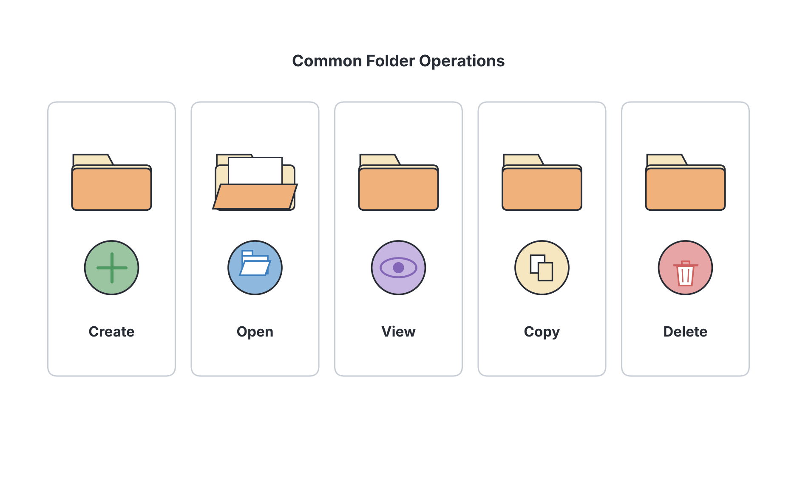
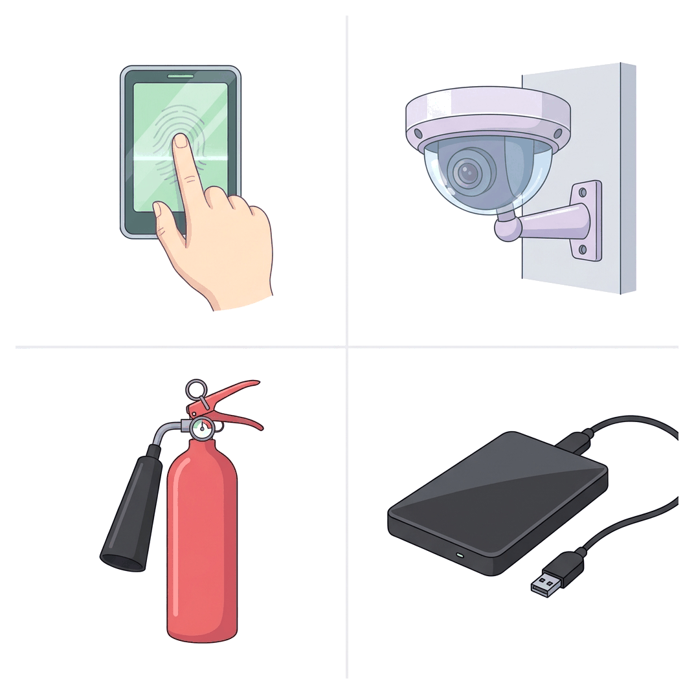

# JAMB Computer Studies Notes: Handling Computer Files

## What JAMB expects

This topic is Section D, Topic 2 of the JAMB Computer Studies syllabus: Handling Computer Files. It covers the following content areas:

- **a. Basic operations**
- **b. Data Loss**
- **c. Security**
- **d. Computer versus manual files**

By the end of these notes, you should be able to:

1. Perform basic file operations (Create, Delete, Retrieve, Insert, Copy, View, Update, Open, Close, etc.).
2. Identify causes of data loss (Overwriting, Inadvertent deletion, Hardware malfunction, Virus attack, Theft, Arson, Natural Disaster, etc.).
3. Use different methods of securing data and maintaining its integrity (Backup, Antivirus, Personal Identification Number, Biometrics, Passwords, Proper labelling of storage devices, CCTV, Physical Security, Fire Extinguisher, Smoke Alarms, etc.).
4. Compare the advantages and disadvantages of computer and manual file (security, speed of access and creation, cost of setup and maintenance, electricity supply, etc.).

**Note on the syllabus wording:** In the official JAMB syllabus, the objectives for this topic are numbered i, ii, iii, and v. There is no objective iv printed in the document. These notes cover every required item exactly as listed.

## Basic file operations

**Objective i: Perform basic file operations** and **Content a: Basic operations**

A computer file is a collection of related data or information stored on a computer system under a single name. Just like you can write, read, or throw away a physical piece of paper, you can perform specific actions on computer files. These are known as **file operations**. 

Here are the basic operations you perform on computer files every day:

1. **Create:** This is the act of making a new, empty file. For example, opening Microsoft Word and clicking "Blank document" creates a new text file.
2. **Open:** Accessing an existing file so that its contents are loaded into the computer's temporary memory (RAM) and displayed by a software application. 
3. **View:** Looking at the contents of a file without making any changes to it. This is often called "read-only" access.
4. **Insert:** Adding new data or records into a file that is already open. For example, typing a new paragraph into an existing essay, or adding a new student's name into a class database.
5. **Update:** Modifying or changing the existing information in a file to keep it current. For example, changing a student's age from 15 to 16 in a school record file.
6. **Save / Close:** Saving writes any updates permanently to the storage device. **Close** is the command that safely removes the file from active memory (RAM) after you have finished working on it, freeing up computer resources.
7. **Copy:** Making an exact duplicate of a file in another location (like on a flash drive) while leaving the original file exactly where it is.
8. **Retrieve:** Fetching a specific stored file from secondary storage (like a hard drive or flash drive) so that it can be processed or opened. It involves searching for the file and loading it.
9. **Delete:** Removing a file from the computer's storage to free up space. On most systems, deleted files first go to a "Recycle Bin" or "Trash" before they are permanently erased.

## Causes of data loss

**Objective ii: Identify causes of data loss** and **Content b: Data Loss**

**Data loss** occurs when valuable information on a computer is destroyed, corrupted, or made unreadable. Losing important files—like project work, financial records, or hospital patient details—can be disastrous.

Here are the main causes of data loss:

- **Inadvertent deletion:** This simply means accidental deletion. It happens due to human error, such as mistakenly pressing the "Delete" key or formatting the wrong flash drive.
- **Overwriting:** This occurs when a user saves a new file with the exact same name as an existing file in the same folder. The computer replaces the old file with the new one, and the original data is permanently lost.
- **Hardware malfunction:** Physical computer parts can fail. A hard disk can crash due to wear and tear, or sudden power cuts and surges (common with unstable NEPA/PHCN electricity or switching generators) can burn out storage components.
- **Virus attack:** Malicious software (malware) can infect a computer. Some viruses are designed specifically to delete files, while others (like ransomware) lock the files and demand money to release them.
- **Theft:** Laptops, hard drives, and flash drives are easy to steal. If a device is stolen and the files are not saved anywhere else, the data is gone.
- **Arson:** Arson is the criminal act of deliberately setting fire to property. If a school's computer room or a business office is intentionally burned down, all the physical computers and the data inside them are destroyed.
- **Natural Disaster:** Extreme weather events such as floods (which frequently happen during heavy rainy seasons), powerful storms, or earthquakes can destroy physical computer hardware and the files they contain. 

## Securing data and maintaining its integrity

**Objective iii: Use different methods of securing data and maintaining its integrity** and **Content c: Security**

**Data security** means protecting data from unauthorized access, theft, or destruction. **Data integrity** means ensuring that the data is accurate, correct, and has not been changed or tampered with by unauthorized people.

To protect computer systems, we use a mixture of software controls, hardware controls, and physical room security.

### 1. Digital and Software Security
- **Passwords:** A secret string of characters (letters, numbers, and symbols) that a user must type to prove their identity before accessing a file or system. 
- **Personal Identification Number (PIN):** A numeric code used for authentication. It is similar to a password but consists only of numbers, much like the 4-digit PIN used at an ATM or on a mobile phone.
- **Biometrics:** The use of unique human physical characteristics to grant access. Because everyone's body is different, biometrics are highly secure. Common examples include **fingerprint scanners** (used during JAMB CBT registration and for bank BVNs), facial recognition, and iris (eye) scanners.
- **Antivirus:** A software program designed to search for, detect, prevent, and remove computer viruses and other malicious software that could corrupt data integrity.
- **Backup:** The process of making copies of data and storing them in a different location (like an external hard drive, or on the internet/cloud). If the original data is lost to a virus or hardware failure, the backup can be used to **restore** it.

### 2. Physical Security and Environmental Controls
- **Physical Security:** This involves putting physical barriers in place to stop unauthorized people from entering the room where servers or computers are kept. Examples include iron doors, burglar proofs on windows, security guards, and heavy-duty padlocks.
- **CCTV (Closed-Circuit Television):** Video cameras placed in and around the computer room. They record everything that happens, which discourages theft and helps identify anyone who damages or steals equipment.
- **Proper labelling of storage devices:** Clearly writing what is inside a CD, flash drive, or external hard drive (e.g., "Maths Results 2023"). This simple manual step stops people from accidentally formatting the drive or overwriting important files because they did not know what was on it.
- **Smoke Alarms:** Electronic devices mounted on the ceiling that detect smoke. They sound a loud alarm to give early warning of a fire so it can be stopped before it destroys the computers.
- **Fire Extinguisher:** Portable cylinders used to put out small fires. **Important note:** You must never use water on an electrical fire. Computer rooms must be equipped with **Carbon dioxide ($CO_2$)** fire extinguishers, which smother the fire without damaging the delicate electronic circuits.

## Comparing computer and manual files

**Objective v: Compare the advantages and disadvantages of computer and manual file** and **Content d: Computer versus manual files**

Before computers became common, all information was kept in **manual files**. A manual file is a physical paper document kept in a paper folder, stored in a metal or wooden filing cabinet. You can still see manual files in traditional school offices or older hospital record rooms. 

A **computer file** is digital data stored on a computer's electronic storage device. 

JAMB expects you to know the differences between the two, especially regarding their advantages and disadvantages.

| Feature | Computer Files | Manual (Paper) Files |
| :--- | :--- | :--- |
| **Speed of creation and access** | **Very fast.** You can create a file instantly. Finding a file takes seconds using the computer's search function. | **Very slow.** Finding a file requires physically walking to a room, opening cabinets, and searching through paper folders by hand. |
| **Security** | Secured using digital methods like **passwords, encryption, and biometrics**. Can be hacked remotely if connected to the internet. | Secured using physical methods like **padlocks, keys, and security guards**. Cannot be hacked over the internet. |
| **Cost of setup and maintenance** | **High initial cost.** Buying computers, software, and paying for electricity is expensive. However, storing millions of records is cheap long-term. | **Low initial cost.** Buying paper, folders, and a cabinet is cheap initially. But storing large amounts of data becomes very expensive because it requires large rooms and many staff. |
| **Electricity supply** | **Completely dependent** on electricity. If there is a power cut (no grid power, generator, or UPS), you cannot access your files at all. | **Independent of electricity.** You can open a cabinet and read a paper file anywhere, as long as there is natural light. |
| **Storage space** | **Highly compact.** A small flash drive or hard disk can hold millions of documents. | **Very bulky.** Takes up a massive amount of physical office space. |
| **Modification and updating** | **Easy and neat.** You can delete, type new data, and save without leaving a mess. | **Messy and difficult.** Updating paper requires crossing out old information, using correction fluid, or writing a completely new document. |
| **Backup and recovery** | **Easy.** You can copy thousands of files to a flash drive or the cloud in minutes. If the office burns down, off-site backups save the data. | **Difficult.** Creating backups means physically photocopying thousands of pages. If a fire destroys the single original copy, the data is lost forever. |

## Key terms

| Term | Meaning |
| :--- | :--- |
| **File** | A collection of related data stored on a computer under a single name. |
| **Retrieve** | Fetching a saved file from a storage device into the computer's main memory to use it. |
| **Data loss** | The accidental or malicious destruction, corruption, or misplacement of information. |
| **Overwriting** | Accidentally replacing an old file by saving a new file with the exact same name. |
| **Inadvertent deletion** | Accidentally erasing a file due to human error. |
| **Data integrity** | The accuracy, completeness, and reliability of data, ensuring it hasn't been tampered with. |
| **Biometrics** | Using unique physical human traits (like fingerprints or facial recognition) for security access. |
| **Backup** | Making a duplicate copy of files in a separate location to prevent data loss. |
| **Manual file** | A physical paper record stored in a folder and filing cabinet. |
| **Arson** | The criminal act of intentionally setting fire to a building or property. |

## Exam tips and common mistakes

- **Copying vs. Moving:** Remember that *copying* a file leaves the original untouched, creating a duplicate. *Moving* a file transfers it to a new location and deletes the original.
- **Accidental deletion vs. Overwriting:** Both are human errors, but they are different. Deletion is putting the file in the recycle bin. Overwriting is saving a new document on top of an old one.
- **The biggest weakness of computer files:** Exam questions often ask for the main disadvantage of computer files compared to manual files. The answer is usually their **complete dependence on electricity**.
- **Fire extinguishers:** Remember that water is never used for computer room fires. Always choose the option that says **Carbon (IV) oxide ($CO_2$)** extinguisher.
- **Biometrics:** If a question asks about fingerprint scanners or retinal scans, the correct security term is *biometrics*.

## Quick summary

1. Basic file operations include creating, opening, inserting, updating, viewing, copying, retrieving, closing, and deleting files.
2. Data loss can be caused by human error (inadvertent deletion, overwriting), hardware failure, malicious acts (virus attacks, theft, arson), or natural disasters.
3. Data security prevents unauthorized access, while data integrity ensures the information remains accurate and unchanged.
4. Digital security methods include passwords, PINs, biometrics (fingerprints), and antivirus software.
5. Physical security methods include CCTV, smoke alarms, $CO_2$ fire extinguishers, iron doors, and properly labelling storage devices.
6. Backing up data is the most reliable way to recover from data loss.
7. Computer files are faster to search, easier to update, and take up less physical space than manual (paper) files, but they cost more to set up and rely entirely on an electricity supply.

## Practice questions

**1. The process of bringing a saved file from a secondary storage device into the computer's memory so it can be read is known as?**
- A. Deleting
- B. Retrieving
- C. Inserting
- D. Updating

**Answer: B.** Retrieving is the action of fetching and loading a stored file so the user can access it. (Updating means changing its contents).

**2. Which of the following is a major disadvantage of computer files when compared to manual files?**
- A. They require large physical cabinets.
- B. They are very slow to search.
- C. They depend entirely on an electricity supply.
- D. They are difficult to update neatly.

**Answer: C.** Computer files require electricity (from the grid, a generator, or a UPS) to be accessed, whereas manual paper files do not. The other options describe disadvantages of manual files.

**3. Using a fingerprint scanner to grant access to a computer system is an example of?**
- A. Password protection
- B. Biometrics
- C. Personal Identification Number
- D. Physical security

**Answer: B.** Biometrics uses unique physical human characteristics, such as fingerprints or iris scans, to authenticate a user.

**4. What is the term for accidentally saving new data over an existing file, causing the original data to be permanently lost?**
- A. Overwriting
- B. Inadvertent deletion
- C. Hardware malfunction
- D. Formatting

**Answer: A.** Overwriting happens when a new file is saved with the exact same name as an old file in the same location, replacing it. Inadvertent deletion is mistakenly sending a file to the recycle bin.

**5. Which of the following devices is used to give early warning of a fire in a computer room?**
- A. Fire extinguisher
- B. CCTV
- C. Smoke alarm
- D. Biometric scanner

**Answer: C.** A smoke alarm detects smoke and sounds a warning before a fire spreads. A fire extinguisher is used to fight the fire after it has been discovered.

**6. Making an exact duplicate of a file on a flash drive without altering the original file is known as?**
- A. Updating
- B. Moving
- C. Copying
- D. Inserting

**Answer: C.** Copying duplicates the file. Moving would delete the original file from its first location.

**7. A student was working on a project but mistakenly dragged the document to the Recycle Bin and emptied it. What cause of data loss is this?**
- A. Virus attack
- B. Arson
- C. Hardware malfunction
- D. Inadvertent deletion

**Answer: D.** Inadvertent deletion means accidentally erasing a file due to human error.

**8. To maintain data integrity against malicious software that destroys files, a computer must have an updated?**
- A. Word processor
- B. Antivirus
- C. BIOS
- D. Spreadsheet package

**Answer: B.** Antivirus software protects data integrity by detecting and removing malicious software (viruses) before they can corrupt or destroy files.

**9. Which of the following is a purely physical security measure for a computer room?**
- A. Strong passwords
- B. Data encryption
- C. CCTV cameras and iron doors
- D. Cloud backup

**Answer: C.** CCTV cameras and iron doors are physical barriers and surveillance methods used to secure the actual room. Passwords and encryption are software/digital security measures.

**10. In a manual file system, information is typically secured using?**
- A. Fingerprint scanners
- B. Locks and keys on filing cabinets
- C. Antivirus software
- D. PIN codes

**Answer: B.** Manual files are paper records, so they are secured physically by locking the cabinets and the rooms they are stored in.

<!-- COVERAGE
obj i | Basic file operations
obj ii | Causes of data loss
obj iii | Securing data and maintaining its integrity
obj v | Comparing computer and manual files
item a | Basic file operations
item b | Causes of data loss
item c | Securing data and maintaining its integrity
item d | Comparing computer and manual files
-->
