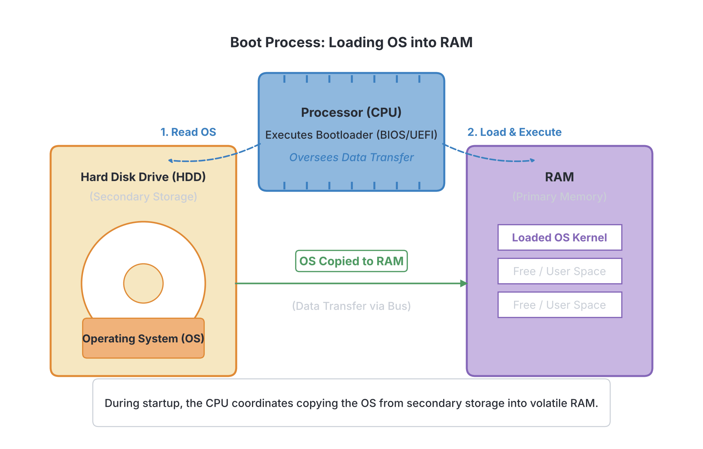
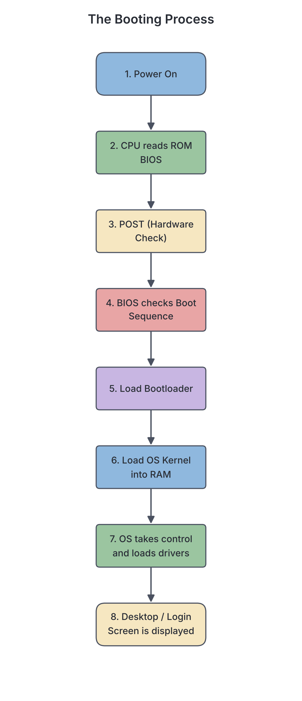

# JAMB Computer Studies Notes: Booting and Shutting Down Process

## What JAMB expects

This topic is Section E, Topic 1 of the JAMB Computer Studies syllabus: Booting and Shutting Down Process. 

By the end of these notes, you should be able to:

1. Define booting (objective i).
2. List the two types of booting process (cold and warm booting) (objective ii).
3. Explain the difference between cold and warm booting (objective iii).
4. Explain the steps involved in booting and shutting down a computer system (objective iv).

## Defining booting

**Objective i: Define booting**

When a computer is completely turned off, its main memory (RAM) is empty because RAM is volatile (it loses its contents when power is removed). The Operating System (OS), which is the master software that controls the computer, is stored safely on the hard drive or SSD. For the computer to be useful, the Operating System must be copied from the storage drive into the RAM so the processor can execute it. 

**Booting** is the process of starting or restarting a computer system and loading the operating system into the computer's main memory (RAM). 

You can think of booting like a person waking up in the morning. Before you can start doing your daily tasks (running application software), your brain needs to wake up, check that your body parts are working (POST), and remember who and where you are (loading the Operating System). The term "booting" comes from the old phrase "pulling oneself up by one's own bootstraps," because the computer runs a tiny program just to load the much larger operating system program.

## Types of booting

**Objective ii: List the two types of booting process (cold and warm booting)**

There are two main types of booting process, depending on the state of the computer before the boot begins. 

1. **Cold booting** (also called a Hard boot)
2. **Warm booting** (also called a Soft boot)

### Cold booting
Cold booting happens when you turn on a computer that has been completely powered off. The power supply to the system was totally cut off. When you press the physical power button on the system unit to start the machine, you are performing a cold boot. 

### Warm booting
Warm booting happens when you restart a computer that is already powered on and running. The computer does not completely lose electrical power during a warm boot. You perform a warm boot when you click "Restart" in your operating system menu, when you press a dedicated "Reset" button on the system unit, or when you use a special keyboard shortcut (such as `Ctrl + Alt + Delete` on Windows computers) to force the system to restart after it freezes.

## Differences between cold and warm booting

**Objective iii: Explain the difference between cold and warm booting**

Although both processes end with the operating system being loaded into the RAM, they start differently and behave differently internally. The most important technical difference is the **Power-On Self-Test (POST)**. During a cold boot, the computer runs a full hardware check (POST). During a warm boot, the computer usually skips the full POST because it already knows the hardware is functioning and powered on, which makes warm booting faster.

| Feature | Cold Booting (Hard Boot) | Warm Booting (Soft Boot) |
| :--- | :--- | :--- |
| **Initial state** | The computer is completely powered off. | The computer is already powered on and running. |
| **How it is triggered** | Pressing the main power button on the system unit. | Clicking "Restart" in the OS, pressing the Reset button, or pressing `Ctrl + Alt + Delete`. |
| **Power cycle** | Electricity flows into the components from a zero-power state. | Electricity is not completely cut off; the system merely resets its operations. |
| **Hardware check (POST)** | Performs a full and complete Power-On Self-Test (POST) to check all hardware components. | Usually skips the full POST to save time, as the hardware was just working. |
| **Speed** | Slower, because the system has to power up hardware and run all diagnostic checks. | Faster, because hardware checks are skipped and power is already flowing. |
| **When to use it** | Used when starting the computer for the day or after it has been completely shut down. | Used when the computer crashes, freezes, or after installing new software/updates that require a restart. |

[IMAGE: A side-by-side comparison diagram. On the left (Cold Boot): A hand pressing the main power button on a powered-off desktop computer case, with a thermometer showing "cold" or a completely dark screen turning on. On the right (Warm Boot): A finger pressing Ctrl+Alt+Del on a keyboard or clicking a "Restart" icon on a computer screen that is already lit. Clean flat textbook illustration, white background.]

## The booting and shutting down process

**Objective iv: Explain the steps involved in booting and shutting down a computer system**

### Steps involved in the booting process

Booting might seem like it happens in one simple step, but behind the scenes, the computer goes through a strict sequence of events. Here is the step-by-step process of what happens when a computer boots:

1. **Powering On:** You press the power button. The power supply unit (PSU) converts the alternating current (AC) from the wall socket (or generator/inverter) into the direct current (DC) needed by the computer. Power is sent to the motherboard and the CPU.
2. **CPU wakes up and reads the ROM BIOS:** The CPU needs instructions, but the RAM is empty. So, the CPU automatically looks at a specific chip called the ROM (Read-Only Memory), which contains the **BIOS** (Basic Input/Output System) or the newer **UEFI** (Unified Extensible Firmware Interface).
3. **Power-On Self-Test (POST):** The BIOS runs a diagnostic test called the POST. It checks if the essential hardware components are present and working properly. It checks the RAM, the keyboard, the mouse, and the storage drives. If there is a major hardware problem (like missing RAM), the computer will halt and emit a series of warning beeps.
4. **Checking the Boot Sequence (Boot Order):** If the POST is successful, the BIOS looks for the Operating System. It checks the computer's CMOS setup to find the "boot sequence" (the order of drives to check, such as USB drive first, CD/DVD second, Hard Drive third). 
5. **Loading the Bootloader:** Once the BIOS finds the correct storage drive (usually the internal hard drive or SSD), it looks for a small program in the drive's first sector (the Master Boot Record or EFI System Partition). This small program is called the **bootloader** (e.g., BOOTMGR for Windows).
6. **Loading the Operating System Kernel:** The bootloader's only job is to locate the main core of the Operating System (the kernel) on the hard drive and load it into the main memory (RAM).
7. **OS takes control:** Once the kernel is in the RAM, the Operating System takes over control of the computer from the BIOS. The OS loads device drivers (small programs that tell the OS how to communicate with hardware like printers and graphics cards).
8. **Loading system utilities and user interface:** Finally, the OS loads background services and the graphical user interface (GUI). The boot process is complete when you see the login screen or the desktop, and the computer is ready to accept your commands.

### Shutting down a computer system

Shutting down is the process of safely closing all programs, saving necessary system data, and turning off the computer's power. 

You must never turn off a computer by simply pulling the plug from the wall or turning off the socket while the computer is running. In Nigeria, sudden power cuts from the grid (NEPA/PHCN) can cause improper shutdowns if the computer is not connected to a UPS (Uninterruptible Power Supply). An improper shutdown can corrupt (damage) the operating system files, cause you to lose unsaved work, and even damage the hard drive physically.

#### Steps for safely shutting down (User Action)
At the time of writing, on most modern Windows systems, the user takes these steps:
1. Save all your work and close all open application programs.
2. Click on the **Start** button (or press the Windows key on the keyboard).
3. Click on the **Power** icon.
4. Select **Shut down** from the menu that appears.
*(Note: Mac and Linux systems have similar menus, usually located in the top corner of the screen).*

#### Internal steps of the shutting down process (What the OS does)
Once you click "Shut down", the Operating System takes over and performs a safe closing sequence:
1. **Closing Applications:** The OS checks if any applications are still running. If you have unsaved work, it will prompt you to save it. It then safely closes all open programs.
2. **Stopping Background Services:** The OS stops all background processes, network connections, and system services in an orderly manner.
3. **Flushing Data to the Disk:** The OS ensures that any data temporarily held in the RAM or cache is permanently written and saved to the hard drive so nothing is lost.
4. **Saving System Settings:** The OS updates its registry and configuration files with any changes made during the session.
5. **Sending the Power-Off Signal:** Once the OS has safely packed everything away, it sends an ACPI (Advanced Configuration and Power Interface) signal to the motherboard. 
6. **Power Cut:** The motherboard instructs the Power Supply Unit (PSU) to cut the electrical power to the system components. The computer is now safely off.

## Key terms

| Term | Meaning |
| :--- | :--- |
| **Booting** | The process of starting or restarting a computer and loading its Operating System into RAM. |
| **Cold Boot (Hard Boot)** | Starting a computer from a completely powered-off state by pressing the main power button. |
| **Warm Boot (Soft Boot)** | Restarting a computer that is already turned on, usually using a restart menu or `Ctrl + Alt + Delete`. |
| **POST** | Power-On Self-Test. A diagnostic test run by the BIOS during booting to ensure hardware components are working. |
| **BIOS** | Basic Input/Output System. Firmware stored on a ROM chip that initializes hardware during the boot process. |
| **Bootloader** | A small program that locates the operating system on the hard drive and loads it into the RAM. |
| **RAM** | Random Access Memory. The volatile main memory where the operating system and running programs are kept during use. |
| **ROM** | Read-Only Memory. Non-volatile memory that stores the BIOS so it is never lost when power goes off. |

## Exam tips and common mistakes

*   **Booting direction:** Remember that booting copies the OS *from* the hard drive (secondary storage) *to* the RAM (primary storage). A common mistake is thinking it moves from RAM to ROM.
*   **Cold vs. Warm:** JAMB often tests the difference based on the POST. Cold booting performs a full POST; warm booting typically skips the full POST.
*   **Shortcut for Warm Boot:** `Ctrl + Alt + Delete` is the classic Windows keyboard shortcut for triggering a warm boot or bringing up the system interrupt menu.
*   **POST meaning:** Memorize that POST stands for Power-On Self-Test, not "Power-On System Test" or "Power-Off Self-Test".
*   **Why we shut down properly:** You must shut down through the OS menu to prevent data loss and file corruption. Simply yanking the power cable is dangerous to the computer's software and hardware.

## Quick summary

1. Booting is the process of turning on a computer and loading the Operating System into the RAM.
2. Cold booting (hard boot) occurs when the computer is started from a completely powered-off state.
3. Warm booting (soft boot) is restarting a computer that is already powered on.
4. A major difference is that a cold boot runs a full Power-On Self-Test (POST), while a warm boot usually skips it, making warm booting faster.
5. The booting sequence involves: powering on, CPU reading the ROM BIOS, running the POST, finding the bootloader, and loading the OS into RAM.
6. Shutting down safely is essential to prevent data corruption and hardware damage.
7. During shutdown, the OS closes applications, saves temporary data to the hard drive, stops services, and finally tells the motherboard to turn off the power.

## Practice questions

**1. Booting a computer system can best be defined as the process of:**
- A. turning off the monitor to save power
- B. starting the computer and loading the operating system into RAM
- C. loading application software into the hard disk
- D. deleting temporary files from the system

**Answer: B.** Booting is the initialization process of starting a computer, which includes loading the operating system from secondary storage into the main memory (RAM).

**2. The two types of booting are:**
- A. slow and fast booting
- B. high and low booting
- C. hard and soft booting
- D. internal and external booting

**Answer: C.** The two types of booting are cold booting (also known as hard booting) and warm booting (also known as soft booting).

**3. Which of the following actions results in a cold boot?**
- A. Pressing `Ctrl + Alt + Delete` on the keyboard
- B. Clicking the "Restart" option in the Start menu
- C. Pressing the main power button on a computer that is completely turned off
- D. Pressing the reset button on the system unit

**Answer: C.** A cold boot starts the computer from a completely unpowered state, which is done by pressing the main physical power button on the system unit. The other options trigger a warm boot.

**4. A user whose computer freezes decides to press `Ctrl + Alt + Delete` to restart the system. This process is called:**
- A. cold booting
- B. hard booting
- C. warm booting
- D. formatting

**Answer: C.** Restarting a computer that is already on, using a keyboard shortcut like `Ctrl + Alt + Delete`, is called a warm boot (or soft boot). 

**5. What is the major technical difference between a cold boot and a warm boot?**
- A. A cold boot loads the OS into ROM, while a warm boot loads it into RAM.
- B. A cold boot performs a full Power-On Self-Test (POST), while a warm boot usually skips the full POST.
- C. A warm boot takes longer to complete than a cold boot.
- D. A warm boot requires the power cable to be unplugged first.

**Answer: B.** Because the hardware is already powered and was recently functioning during a warm boot, the system usually skips the full POST diagnostic to save time. Option A is wrong because the OS is always loaded into RAM, never ROM.

**6. During the booting process, where does the CPU first look for instructions as soon as the power is turned on?**
- A. The Hard Disk Drive
- B. The RAM
- C. The ROM BIOS
- D. The CD-ROM

**Answer: C.** The RAM is empty when the computer is turned on, so the CPU is hardwired to fetch its very first startup instructions from the ROM chip, which contains the BIOS.

**7. What does the acronym POST stand for in the computer booting process?**
- A. Power-On System Test
- B. Power-On Self-Test
- C. Program-On System Test
- D. Power-Off Self-Test

**Answer: B.** POST stands for Power-On Self-Test. It is a diagnostic routine run by the BIOS to check that essential hardware components are working properly.

**8. At the end of the booting process, where is the operating system successfully loaded so that the CPU can execute it?**
- A. The Hard Disk
- B. The Flash Drive
- C. The ROM
- D. The RAM

**Answer: D.** Programs and data must be in the primary memory (RAM) for the CPU to process them. The OS is copied from the hard disk into the RAM during booting.

**9. Why is it necessary to properly shut down a computer through the operating system rather than just disconnecting the power source?**
- A. To allow the computer to cool down slowly
- B. To prevent the monitor from blowing a fuse
- C. To ensure all data is saved from RAM to the hard drive and prevent file corruption
- D. To stop the BIOS from being erased

**Answer: C.** Properly shutting down gives the OS time to flush temporary data from the volatile RAM to the non-volatile hard drive, close files safely, and update settings, preventing data loss and corruption.

**10. Which of the following represents the correct user steps to properly shut down a Windows computer?**
- A. Unplug the UPS -> Turn off the monitor -> Press the system power button
- B. Press the Reset button -> Wait for the screen to go black -> Unplug from the wall
- C. Save open files -> Click Start -> Click Power -> Select Shut down
- D. Press `Ctrl + Alt + Delete` -> Select Restart -> Pull the power cable

**Answer: C.** The safe user procedure involves saving work, accessing the OS menu (Start), and selecting the Shut down command so the software can safely halt operations.

<!-- COVERAGE
obj i | Defining booting
obj ii | Types of booting
obj iii | Differences between cold and warm booting
obj iv | The booting and shutting down process
-->
