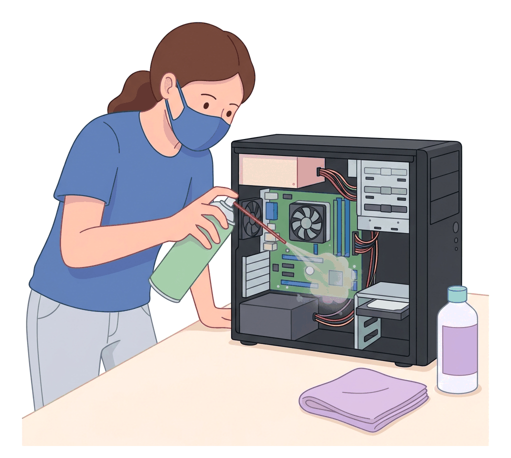
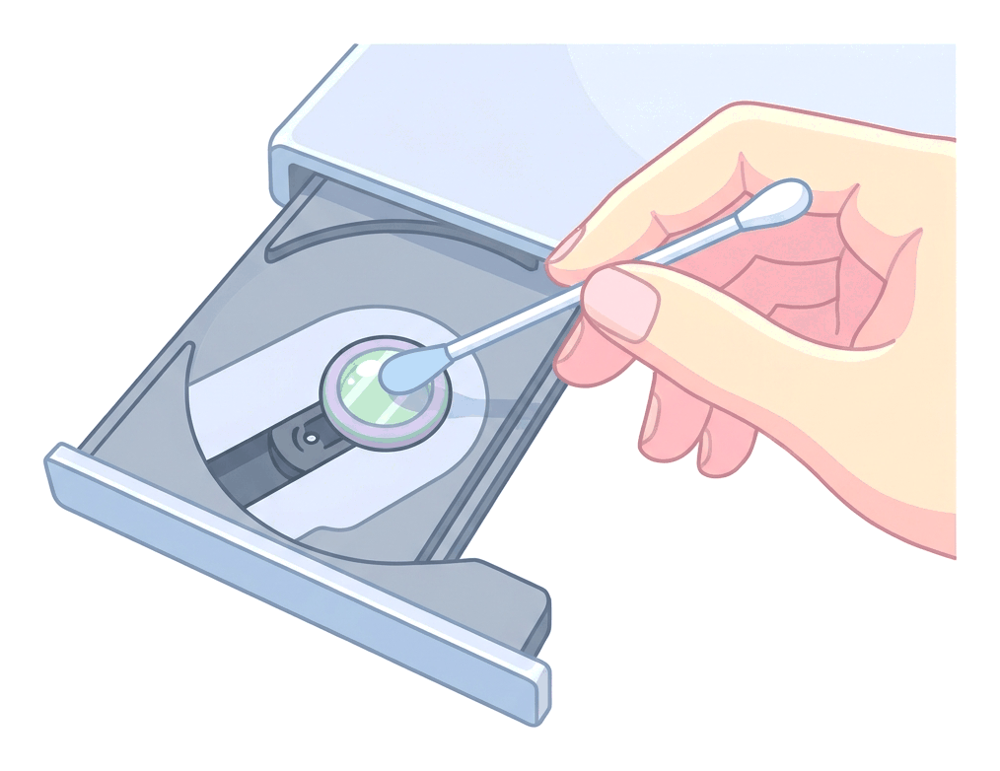
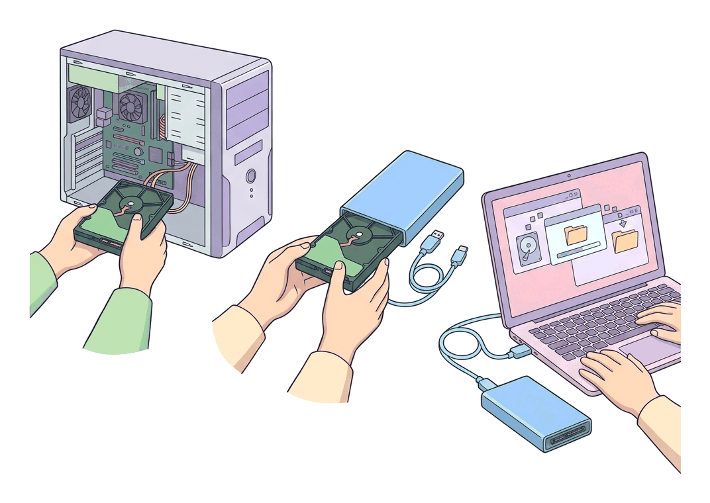

# JAMB Computer Studies Notes: Computer Maintenance

## What JAMB expects

This topic is Section E, Topic 2 of the JAMB Computer Studies syllabus: Computer Maintenance.

By the end of these notes, you should be able to:
1. Perform general cleaning of the computer system
2. Charge and replace battery for portable systems and UPS
3. Clean drive lens
4. Perform simple hardware and software maintenance
5. Recover data from a crashed system

## Introduction to Computer Maintenance

**Computer maintenance** is the practice of keeping computers in a good state of repair. Just like a car needs regular servicing, a computer needs regular care to prevent breakdowns, improve speed, and ensure data is safe. In Nigeria, environmental factors like harmattan dust, high temperatures, and frequent power fluctuations (from the national grid or generators) make regular computer maintenance especially important.

Maintenance is generally divided into two types:
- **Preventive maintenance:** Routine tasks done to prevent problems from happening (e.g., cleaning dust, updating software).
- **Corrective maintenance:** Fixing or replacing things after they have broken down (e.g., replacing a dead battery, recovering data from a crashed system).

---

## General Cleaning of the Computer System

**Objective i: Perform general cleaning of the computer system.**

Dust is one of the biggest enemies of a computer system. When dust builds up inside a computer, it clogs cooling fans and coats the components. This traps heat, causing the computer to overheat, slow down, or shut off unexpectedly. General cleaning ensures the hardware lasts longer.

### Tools needed for cleaning
- **Microfibre cloth:** A soft, lint-free cloth that will not scratch screens.
- **Compressed air (or a manual blower):** Used to blow dust out of tight spaces without touching delicate parts.
- **Isopropyl alcohol (rubbing alcohol):** Used for cleaning stubborn dirt; it evaporates quickly and does not contain water that could cause rust or short circuits.
- **Cotton swabs (cotton buds):** For cleaning small crevices.

*Note: Never use a standard household vacuum cleaner inside a computer case. Vacuum cleaners generate static electricity, which can instantly destroy computer chips.*

### Step-by-step cleaning process

1. **Power off and unplug:** Always shut down the computer completely and unplug it from the wall socket before cleaning.
2. **Cleaning the System Unit (Case):**
   - Open the side panel of the desktop case.
   - Take the system outside (especially during dusty harmattan periods).
   - Use short bursts of **compressed air** to blow dust out of the fans, the power supply, and the motherboard.
   - Keep the can of compressed air upright so no cold liquid sprays onto the parts.
3. **Cleaning the Keyboard:**
   - Turn the keyboard upside down and shake it gently to remove loose crumbs and dirt.
   - Use compressed air to blow out debris stuck between the keys.
   - Wipe the keys with a slightly damp microfibre cloth or a cotton swab lightly dipped in isopropyl alcohol.
4. **Cleaning the Monitor (Screen):**
   - Use a dry microfibre cloth to gently wipe the screen.
   - If there are smudges, slightly dampen the cloth with water or a special screen cleaner. **Never spray liquid directly onto the screen**, as it can run down into the electronics. Do not use window cleaners (like glass cleaners with ammonia), as they strip the protective coating off the screen.
5. **Cleaning the Mouse:**
   - For a modern optical mouse, use a cotton bud to gently wipe the sensor hole at the bottom.
   - Wipe the top surface and click-buttons with a microfibre cloth.

---

## Charging and Replacing Batteries for Portable Systems and UPS

**Objective ii: Charge and replace battery for portable systems and UPS.**

Because of frequent power cuts, batteries are essential for keeping our devices running and protecting them from sudden shutdowns. 

### 1. Portable Systems (Laptops)

**Charging best practices:**
- **Avoid extreme heat:** Heat degrades laptop batteries quickly. Do not leave a laptop in a hot car or block its cooling vents by using it on a bed or pillow.
- **Do not let it drain to 0% often:** Modern lithium-ion batteries last longer if they are recharged before they completely run out of power (ideally plugging them in when they drop to about 20%).
- **Use the correct charger:** Always use the charger that came with the laptop or an exact replacement with the correct voltage.

**Replacing a laptop battery:**
Modern laptops often have internal batteries, while older ones have external, easily removable batteries.
1. **Turn off the laptop** and unplug it from the charger.
2. **For external batteries:** Slide the release latches on the bottom of the laptop and pull the battery out. Slide the new battery in until it clicks into place.
3. **For internal batteries:** Unscrew the bottom cover of the laptop. Disconnect the battery cable from the motherboard. Unscrew the battery holding screws, lift out the old battery, and place the new one in. Reconnect the cable and screw the cover back on.

### 2. Uninterruptible Power Supply (UPS)

A UPS provides emergency power when the main power source fails, giving you time to save your work and shut down the computer properly. It also acts as a surge protector. 

**Charging a UPS:**
- A UPS charges its internal lead-acid battery automatically whenever it is plugged into a wall socket with electricity, even if the UPS itself is turned off. 
- A new UPS should be plugged in to charge for at least 8 to 12 hours before connecting a computer to it for the first time.

**Replacing a UPS battery:**
UPS batteries usually wear out after 2 to 3 years and need replacement.
1. **Safety first:** Turn off the UPS, unplug it from the wall, and unplug all computers connected to it.
2. **Open the casing:** Unscrew and remove the battery compartment cover (usually at the bottom or back of the UPS).
3. **Disconnect the old battery:** Slide the battery out partially. You will see two wires connected to it: a red wire (positive) and a black wire (negative). Gently pull the connectors off the battery terminals.
4. **Remove and replace:** Take the old battery out. Slide the new battery in.
5. **Reconnect the wires:** Connect the red wire to the red (positive) terminal and the black wire to the black (negative) terminal of the new battery.
6. **Close and charge:** Close the casing, screw it back, and plug the UPS into the wall to charge the new battery.

*Note: Old UPS and laptop batteries contain toxic chemicals (lead, lithium, acids) and must be disposed of properly at an electronic waste center, not in regular household trash.*

---

## Cleaning the Drive Lens

**Objective iii: Clean drive lens.**

*Note on technology:* The syllabus specifically asks about cleaning the "drive lens." This refers to the optical lens inside CD, DVD, or Blu-ray drives. While these drives are becoming rare in modern computers, you must know how to maintain them for the exam.

An optical drive uses a tiny laser lens to read the data stored on the shiny surface of a CD or DVD. If this lens gets covered in dust or smoke particles, the drive will fail to read the disc, skip, or show read/write errors.

### How to clean the drive lens

There are two main methods to clean an optical drive lens:

**1. Using a Lens Cleaning Disc (Automatic Method)**
This is the safest and easiest method.
- A lens cleaning disc looks like a normal CD, but it has tiny, soft brushes attached to its bottom surface.
- Insert the cleaning disc into the drive.
- The drive spins the disc, and the tiny brushes gently sweep the dust off the laser lens.
- Some cleaning discs come with a software program that guides you or plays audio while it cleans.

**2. Manual Cleaning (Advanced Method)**
If a cleaning disc does not work, the lens must be cleaned manually.
- Eject the drive tray and turn off the computer.
- For desktop drives, you may need to open the computer case and remove the drive to access the inside. For laptop drives, the lens is often visible as a tiny glass bubble once the tray pops out.
- Lightly moisten a **clean cotton swab** with a drop of **isopropyl alcohol**.
- Very gently wipe the tiny glass lens with the swab in a circular motion. Do not press hard, as the lens is mounted on delicate springs.
- Use a dry cotton swab to gently dry the lens.
- Close the drive and test it with a disc.

---

## Simple Hardware and Software Maintenance

**Objective iv: Perform simple hardware and software maintenance.**

Computer maintenance is divided into caring for the physical parts (hardware) and the programs and data (software).

### Simple Hardware Maintenance

Hardware maintenance ensures the physical components are working optimally and are protected from damage.

1. **Cable Management:** Regularly check that all cables (power cables, VGA/HDMI cables, USB cords) are firmly plugged in. Replace cables that have exposed wires or are frayed to prevent electrical shocks or fires.
2. **Ventilation:** Ensure the computer has enough room to "breathe." Do not push a desktop system unit flat against a wall; leave a gap so the hot air can escape from the back vents.
3. **Power Protection:** Always plug computer equipment into a **Surge Protector** or **Voltage Stabilizer**. This protects the delicate hardware from sudden high-voltage power spikes when the electricity is restored after a blackout.
4. **Routine Cleaning:** (As discussed in the General Cleaning section).

### Simple Software Maintenance

Software maintenance keeps the operating system running fast, secure, and error-free.

| Maintenance Task | What it does | How to do it |
| :--- | :--- | :--- |
| **Updating Software (Patching)** | Fixes bugs, adds new features, and closes security holes that hackers could use. | Go to system settings and run "Windows Update" or "System Update." Also update application software like browsers. |
| **Antivirus Scanning** | Detects and removes malicious software (viruses, trojans, worms) that can destroy data. | Ensure Windows Defender or a third-party antivirus is active, updated, and schedule a full system scan weekly. |
| **Disk Cleanup** | Deletes temporary files, empty recycle bin, and web cache that are taking up unnecessary space on the hard drive. | Use the built-in "Disk Cleanup" tool in Windows to scan for and delete unnecessary files safely. |
| **Disk Defragmentation** | Reorganizes fragmented (scattered) files on a Hard Disk Drive (HDD) so they are stored together, making the computer read them faster. | Run the "Defragment and Optimize Drives" tool. *(Note: Do **not** defragment a Solid State Drive (SSD), as it does not improve speed and can wear out the SSD).* |
| **Data Backup** | Creating copies of important files in case the computer crashes or is stolen. | Copy files to an external hard drive, a USB flash drive, or cloud storage (like Google Drive or OneDrive). |

---

## Recovering Data from a Crashed System

**Objective v: Recover data from a crashed system.**

A "crashed system" is a computer that suddenly stops working or refuses to turn on. This can be caused by a software crash (the Operating System is corrupted) or a hardware crash (the motherboard or power supply has died).

As long as the **Hard Drive** or **SSD** (where the data is stored) is not physically destroyed, the data can usually be recovered.

### 1. Recovery from a Software Crash (OS won't boot)

If the computer turns on but Windows will not load, or it keeps showing a Blue Screen of Death (BSOD), the hardware is likely fine, but the software has crashed.

**Step 1: Use Safe Mode**
- Restart the computer and press the boot key (often F8 or Shift+F8 on older systems, or access via the automatic repair screen in Windows 10/11).
- Select **Safe Mode**. This loads the computer with minimal drivers.
- If it boots, you can insert a USB flash drive and copy your important files.

**Step 2: Use a Live USB (Bootable USB)**
- If Safe Mode fails, you can bypass the broken Operating System using a "Live USB."
- On a working computer, download a Live Operating System (like Ubuntu Linux or Windows PE) and burn it to a USB flash drive.
- Plug this USB into the crashed computer.
- Turn on the computer and enter the BIOS to boot from the USB drive.
- The computer will run the OS directly from the USB without touching the broken Windows.
- You can now browse your hard drive, find your files, and copy them to an external hard drive.

### 2. Recovery from a Hardware Crash (Computer is completely dead)

If the computer will not power on at all, or the motherboard is burnt, you must physically remove the storage drive to get your data.

**Step 1: Remove the hard drive**
- Open the computer casing.
- Locate the Hard Disk Drive (HDD) or Solid State Drive (SSD).
- Unplug the power and data (SATA) cables from the drive.
- Unscrew the drive and take it out of the crashed computer.

**Step 2: Connect it to a working computer**
- Purchase a **SATA-to-USB enclosure** (or an adapter cable).
- Place the removed drive into the enclosure, which turns it into an external hard drive.
- Plug the USB cable of the enclosure into a completely working computer.

**Step 3: Copy the data**
- The working computer will detect the drive just like a normal flash drive.
- Open File Explorer, navigate to the "Users" folder on the old drive, and copy your important documents, pictures, and desktop files to the new computer.

*Note: If the hard drive itself is physically damaged (e.g., making loud clicking or scratching noises, or dropping it on the floor), do not attempt to run it. Software tools cannot fix physical damage. The drive must be sent to a professional data recovery laboratory with a "clean room," which is a very expensive process.*

---

## Key terms

| Term | Meaning |
| :--- | :--- |
| **Preventive maintenance** | Routine tasks performed to prevent computer breakdowns (e.g., cleaning, updates). |
| **Compressed air** | Air stored under high pressure in a can, used to blow dust out of delicate electronics. |
| **Microfibre cloth** | A soft, lint-free cloth used to clean screens without scratching them. |
| **UPS** | Uninterruptible Power Supply; a device with a battery that keeps a computer running temporarily during a power cut. |
| **Lens cleaning disc** | A CD or DVD with tiny brushes attached, used to clean the laser lens inside an optical drive. |
| **Disk Cleanup** | A software utility used to delete unnecessary temporary files to free up storage space. |
| **Disk Defragmentation**| Reorganizing scattered file fragments on a hard drive so files open faster. |
| **Safe Mode** | A diagnostic mode of a computer operating system that loads with limited files and drivers. |
| **Live USB** | A USB flash drive containing a complete operating system that can be booted directly, without installing it on the hard drive. |
| **SATA-to-USB enclosure**| A casing that converts an internal hard drive into an external USB drive. |

## Exam tips and common mistakes

- **Vacuuming:** Never pick an option that says to use a household vacuum cleaner to clean the inside of a system unit. It creates static electricity. Always use **compressed air** or a blower.
- **Defragmentation trick:** Remember that **Disk Defragmentation** is for Hard Disk Drives (HDDs). It does *not* speed up Solid State Drives (SSDs) and can actually shorten an SSD's lifespan.
- **Drive Lens:** When a question asks about cleaning the "drive lens," it is specifically referring to the optical lens in a CD/DVD/Blu-ray drive, not the hard drive. 
- **UPS Battery replacement:** UPS batteries *can* be replaced. Do not assume you must throw away the entire UPS when it stops holding a charge. Just change the internal lead-acid battery.
- **Crashed systems:** A crashed motherboard does not mean the data is lost. The data lives on the hard drive. As long as the hard drive is physically intact, the data can be recovered.

## Quick summary

1. Computer maintenance involves both preventive care (cleaning, updating) and corrective care (replacing parts, recovering data).
2. General cleaning requires a microfibre cloth, isopropyl alcohol, and compressed air to safely remove dust and prevent overheating.
3. Laptop batteries should not be exposed to extreme heat and should be charged properly. UPS batteries need to be charged for hours before first use and replaced every few years safely.
4. Optical drive lenses (CD/DVD) can be cleaned using a specialized lens cleaning disc with tiny brushes, or carefully with a cotton swab and isopropyl alcohol.
5. Simple hardware maintenance includes checking cables, ensuring ventilation, and using surge protectors.
6. Simple software maintenance involves running antivirus scans, installing updates, performing disk cleanup, and defragmenting hard drives.
7. Data can be recovered from a software-crashed system by booting into Safe Mode or using a Live USB. 
8. Data can be recovered from a hardware-crashed system by removing the hard drive and connecting it to a working computer using a SATA-to-USB enclosure.

## Practice questions

**1. Which of the following tools is most appropriate for removing dust from the internal components of a computer system unit?**
- A. A damp sponge
- B. A household vacuum cleaner
- C. A can of compressed air
- D. A dry tissue paper

**Answer: C.** Compressed air blows dust out safely without touching the delicate components or creating static electricity like a vacuum cleaner.

**2. Which of the following software maintenance tools is used to reorganize scattered files on a magnetic hard disk to improve access speed?**
- A. Disk Cleanup
- B. Disk Defragmenter
- C. Antivirus scanner
- D. System Restore

**Answer: B.** Disk Defragmenter brings fragmented pieces of files together so the read/write head of the hard drive can access them continuously and faster.

**3. If a computer's motherboard gets completely burnt, which of the following is the best way to recover the user's files?**
- A. Boot the computer into Safe Mode
- B. Use a Live USB flash drive on the burnt computer
- C. Remove the hard drive and connect it to a working computer
- D. Run a system repair installation

**Answer: C.** Because the motherboard is burnt, the computer cannot turn on at all (Safe Mode and Live USB will not work). The hard drive must be physically removed and connected to another PC.

**4. The tiny laser component inside a CD/DVD drive that reads data is called the:**
- A. Read/write head
- B. Drive lens
- C. Optical sector
- D. Spindle motor

**Answer: B.** The drive lens is the optical part of the CD/DVD drive that focuses the laser to read the disc. It can be cleaned using a lens cleaning disc.

**5. What is the primary reason for strictly using a microfibre cloth on a computer monitor instead of a paper towel?**
- A. Microfibre cloths contain built-in cleaning chemicals
- B. Paper towels leave static charges on the screen
- C. Microfibre cloths are lint-free and will not scratch the screen
- D. Paper towels cannot absorb isopropyl alcohol

**Answer: C.** Microfibre cloths are soft and do not leave lint behind, whereas paper towels have abrasive wood fibers that can permanently scratch delicate monitor screens.

**6. Which of the following practices will help prolong the lifespan of a laptop battery?**
- A. Keeping the laptop in a hot car
- B. Blocking the cooling vents to keep the battery warm
- C. Avoiding extreme heat and not letting the battery drain to 0% frequently
- D. Always using a charger with a higher voltage than recommended

**Answer: C.** Extreme heat and frequent full discharges degrade lithium-ion batteries faster.

**7. When replacing the battery inside a Uninterruptible Power Supply (UPS), which color of wire is usually connected to the positive terminal?**
- A. Black
- B. Green
- C. White
- D. Red

**Answer: D.** In DC electronics and UPS batteries, the red wire always connects to the positive terminal, and the black wire connects to the negative terminal.

**8. Which of the following correctly describes "Disk Cleanup"?**
- A. Opening the system unit to wipe dust off the hard drive
- B. A utility that removes viruses from the computer
- C. A utility that deletes temporary files and empties the recycle bin to free up space
- D. A process that recovers files from a crashed system

**Answer: C.** Disk Cleanup is a software maintenance tool that searches the hard drive for unnecessary files (like temporary internet files) and deletes them to free up storage space.

**9. What is a "Live USB" used for in computer maintenance?**
- A. To supply emergency power to the computer
- B. To boot the computer directly from the USB drive to recover files when the main OS crashes
- C. To clean the USB ports of dust
- D. To permanently replace the computer's hard drive

**Answer: B.** A Live USB contains a bootable operating system, allowing you to bypass a corrupted Windows installation and access the files on the hard drive.

**10. Which liquid is highly recommended for cleaning stubborn dirt on a computer keyboard or drive lens because it evaporates quickly without causing short circuits?**
- A. Window cleaner
- B. Tap water
- C. Isopropyl alcohol
- D. Soapy water

**Answer: C.** Isopropyl alcohol (rubbing alcohol) is the standard liquid for cleaning electronics because it dries very fast and contains almost no water, preventing rust and electrical shorts.

<!-- COVERAGE
obj i | General Cleaning of the Computer System
obj ii | Charging and Replacing Batteries for Portable Systems and UPS
obj iii | Cleaning the Drive Lens
obj iv | Simple Hardware and Software Maintenance
obj v | Recovering Data from a Crashed System
-->
