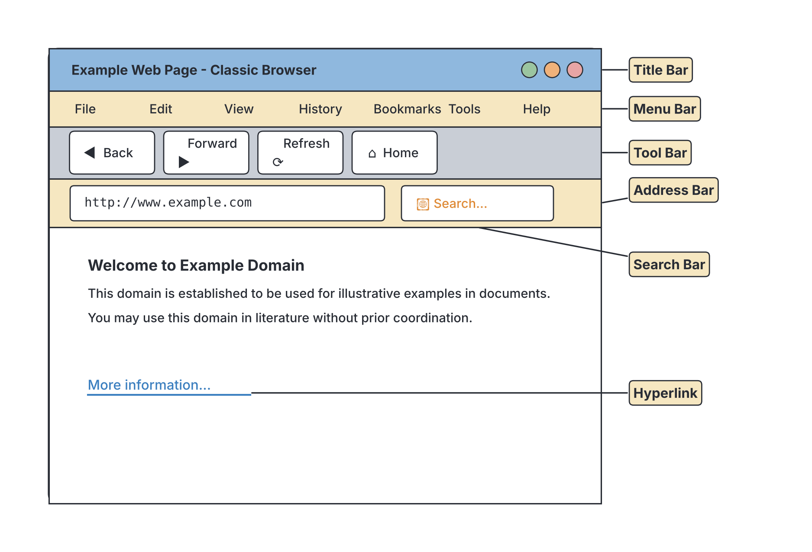

# JAMB Computer Studies Notes: The Internet

## What JAMB expects

This topic is Section F, Topic 3 of the JAMB Computer Studies syllabus: Information & Communication Technology (ICT) – Internet. It covers the following content items:

* (a) Definition of terms
* (b) Internet Browsers
* (c) Features of Internet Browsers
* (d) Internet Services

By the end of these notes, you should be able to:

1. Define Internet
2. Define and illustrate use of: Home page, Browse, Browser, Chatroom, Cybercafe, Http, Html, ISP, Webpage, Website etc.
3. Access the Internet through any of the browsers: Internet Explorer, Opera, Firefox, Cometbird, Ubuntu, Google Chrome, Phoenixetc.
4. Explain features of the Internet Browsers: Title Bar, Menu Bar, Tool Bar, Address Bar, Icons, Search Bar, Uniform Resource Locator (URL)/Hypertext link etc.
5. Describe the use of different types of Internet services: Electronic Mail (e-mail), E-mail Discussion Group, Instant Messaging/Chats, Virtual meeting platforms, File Transfer Protocol (FTP), World Wide Web (WWW), Search Engines, Chatting etc.

**Note on the syllabus wording:** Fast-changing technology means that some terms in the JAMB syllabus are outdated or contain typing errors. 
* The syllabus lists **Ubuntu** as an internet browser. In reality, Ubuntu is a popular Linux-based Operating System (System Software), not a web browser. 
* It lists **Phoenixetc.**, which is a typing error for "Phoenix, etc." (Phoenix was the original name for the Firefox browser in 2002). 
* **Cometbird** and **Internet Explorer** are discontinued browsers that are no longer supported. 
You must learn them because they are in the syllabus, but always remember their correct, real-world meanings.

## What is the Internet?

**Objective i: Define Internet.**

The **Internet** is a massive, global network of interconnected computers and computer networks that communicate with each other using standardized rules (called protocols). It is often described as a "network of networks."

If you connect your smartphone or laptop to a Wi-Fi network or use mobile data, your device joins this global network. This connection allows you to send emails across the world, stream videos, read the news, or register for your JAMB UTME on the portal.

**Important distinction:** The Internet is the physical and logical infrastructure (the cables, routers, servers, and wireless signals) that connects computers worldwide. The **World Wide Web (WWW)** is just one service that runs *on top of* the Internet. They are not the same thing.

## Definition of Internet Terms

**Content (a): Definition of terms**
**Objective ii: Define and illustrate use of: Home page, Browse, Browser, Chatroom, Cybercafe, Http, Html, ISP, Webpage, Website etc.**

To understand the Internet, you need to know its basic vocabulary.

### 1. Home page
A **Home page** is the main or introductory page of a website. It usually acts as a table of contents or a starting point for exploring the rest of the site. 
* *Illustration:* When you visit `jamb.gov.ng`, the first page you see with the latest news, portals, and menus is the home page. The term also refers to the default page that loads automatically when you first open your web browser.

### 2. Browse
To **browse** (or "surf") means to explore the World Wide Web by moving from one webpage to another, usually by clicking on links or scrolling through content, without a very strict destination in mind.

### 3. Browser
A **Browser** (or Web Browser) is an application software used to access, retrieve, and display webpages on the World Wide Web. 
* *Illustration:* Without a browser, you cannot view websites. Popular examples are Google Chrome, Mozilla Firefox, and Opera.

### 4. Chatroom
A **Chatroom** is a website, or a section of a website, where users can communicate with each other in real-time by typing text messages. Everyone in the "room" can see the messages being sent. Chatrooms were very popular in the early days of the internet, though today, most people use instant messaging apps or social media groups instead.

### 5. Cybercafe
A **Cybercafe** (or Internet Cafe) is a physical shop or business where people pay to use computers connected to the Internet. 
* *Illustration:* Before smartphones and mobile data became cheap in Nigeria, cybercafes were the main places people went to browse the internet, check emails, or register for exams. Today, many JAMB Computer-Based Test (CBT) centres evolved from, or function similarly to, large cybercafes.

### 6. Http (Hypertext Transfer Protocol)
**HTTP** is the set of rules (protocol) used to transfer data (like text, images, and video) over the World Wide Web. It tells the web server and your browser how to communicate.
* *Note:* You will often see **HTTPS**, where the "S" stands for Secure. This means the data sent between your browser and the website is encrypted (locked) so hackers cannot easily read it.

### 7. Html (Hypertext Markup Language)
**HTML** is the standard computer language used to create and design webpages. It uses "tags" to tell the browser how to display text, images, and links.
* *Illustration:* A simple HTML code looks like this:
```html
<h1>Welcome to Miyagi Labs</h1>
<p>This is a paragraph of text on a webpage.</p>
```

### 8. ISP (Internet Service Provider)
An **ISP** is a company that provides access to the Internet for a fee. They have the large-scale equipment needed to connect to the global internet backbone and provide that connection to homes and mobile phones.
* *Illustration:* In Nigeria, popular ISPs include telecom operators like **MTN, Airtel, Glo, and 9mobile**, as well as dedicated broadband providers like Spectranet, Smile, or Starlink.

### 9. Webpage
A **Webpage** is a single electronic document on the Internet, usually written in HTML, that can be viewed in a web browser. It can contain text, images, audio, video, and links to other pages.

### 10. Website
A **Website** is a collection of related webpages that share a single domain name and are hosted on at least one web server. 
* *Illustration:* Just like a book is made of many individual pages, a **website** (like Wikipedia) is made of millions of individual **webpages**.

## Internet Browsers

**Content (b): Internet Browsers**
**Objective iii: Access the Internet through any of the browsers...**

Web browsers are application software. Without them, the code of a website (HTML) would just look like confusing text, instead of nicely arranged pictures and text.

The syllabus lists the following software under browsers. You must recognize them for the exam, but be aware of the "Note on the syllabus wording" mentioned earlier:

1. **Internet Explorer:** A very famous early web browser developed by Microsoft. It is now discontinued and replaced by Microsoft Edge.
2. **Opera:** A popular web browser known for saving data and having a built-in VPN, very widely used on mobile phones in Africa (Opera Mini).
3. **Firefox:** A free and open-source web browser created by Mozilla. It is known for strong privacy features.
4. **Cometbird:** An old, discontinued web browser that was based on the same code as Firefox.
5. **Ubuntu:** *Syllabus quirk!* Ubuntu is widely known as a Linux Operating System, not a browser. However, because it is listed here, if a JAMB question asks which of the options is a browser (and no better options exist), you may have to select it based on the syllabus.
6. **Google Chrome:** The most widely used web browser in the world today, developed by Google.
7. **Phoenixetc (Phoenix, etc.):** "Phoenix" was the original name for the Mozilla Firefox browser when it was first created in 2002. It was later renamed because of trademark issues.

### Steps to access the Internet using a browser

To access a website (for example, to check a result), follow these steps:
1. Ensure your computer or phone is connected to the internet (via Wi-Fi, LAN, or a mobile ISP).
2. Locate the browser icon (e.g., Google Chrome) on your desktop or menu and double-click to launch (open) it.
3. Click inside the **Address Bar** at the top of the browser window.
4. Type the exact web address (URL) of the site you want to visit (e.g., `www.jamb.gov.ng`).
5. Press the **Enter** key on your keyboard. The browser will request the page and display it on your screen.

## Features of Internet Browsers

**Content (c): Features of Internet Browsers**
**Objective iv: Explain features of the Internet Browsers...**

When you open a web browser on a desktop computer, the window has several specific parts. While modern browsers (as of the 2020s) try to hide many of these to make the screen look clean, standard textbooks and JAMB questions use the classic browser layout.



### 1. Title Bar
The topmost horizontal bar of the browser window. It displays the title of the webpage you are currently viewing and the name of the browser software (e.g., "JAMB eFacility - Google Chrome"). It also holds the minimize, maximize, and close buttons.

### 2. Menu Bar
A horizontal bar usually located just below the Title Bar. It contains drop-down menus with text labels such as **File, Edit, View, History, Bookmarks, Tools,** and **Help**. These menus contain commands to print the page, view history, or change settings.

### 3. Tool Bar (or Navigation Toolbar)
This bar contains buttons with icons that help you navigate the web easily. Common buttons on the Tool Bar include:
*   **Back (Left Arrow):** Takes you to the previous webpage you just visited.
*   **Forward (Right Arrow):** Takes you to the next page (only works if you have already clicked "Back").
*   **Refresh/Reload (Circular Arrow):** Reloads the current page to get the most updated version or fix a loading error.
*   **Stop (X or Cross):** Stops a webpage from loading.
*   **Home (House icon):** Takes you directly to your set Home page.

### 4. Address Bar
A long rectangular box near the top of the browser where you type in the exact web address (URL) of the website you want to visit. When a page loads, its web address is displayed here.

### 5. Icons
Icons are small graphical symbols on the browser interface that represent different tools or functions. For example, a star icon represents "Bookmark/Favorite" (to save a page for later), and a house icon represents the "Home" button.

### 6. Search Bar
In older browsers, this was a separate rectangular box next to the address bar, dedicated specifically to searching the web using search engines like Google or Yahoo. If you typed "JAMB past questions" here, it would search for it. *Note: In modern browsers like Chrome, the Address Bar and Search Bar are combined into one box called an "Omnibox".*

### 7. Uniform Resource Locator (URL) / Hypertext link
*   **URL:** The uniform resource locator is the unique global address of a specific webpage or file on the Internet. It tells the browser exactly where to go. 
    *   Example: `https://www.jamb.gov.ng/ibass`
    *   It consists of the protocol (`https`), the domain name (`www.jamb.gov.ng`), and sometimes a specific path or page (`/ibass`).
*   **Hypertext link (Hyperlink):** A clickable word, phrase, or image on a webpage that takes you to a different webpage or a different part of the same page. Text links are usually underlined and coloured blue. When you hover your mouse pointer over a hyperlink, the arrow pointer typically changes into a **hand icon**.

## Internet Services

**Content (d): Internet Services**
**Objective v: Describe the use of different types of Internet services...**

The internet is not just websites. It provides a wide variety of services that allow people to communicate, share files, and find information.

### 1. Electronic Mail (E-mail)
E-mail is a service that allows people to send and receive electronic text messages and attached files (like pictures or documents) over the internet. It is much faster than traditional paper mail (which computer users jokingly call "snail mail"). To use it, you need an email address, such as `student@gmail.com` or `xyz@jamb.gov.ng`. *(E-mail is covered more deeply in `F4-electronic-mail.md`)*.

### 2. E-mail Discussion Group (Mailing List)
An e-mail discussion group is a service where an email sent to one central address is automatically copied and sent out to all members subscribed to that group. It is used for group discussions, newsletters, and announcements. If you reply to the group address, everyone in the group receives your reply.

### 3. Instant Messaging (IM) / Chats
Instant Messaging is a service that allows real-time, text-based communication between two or more people over the internet. Unlike email, where you might wait hours for a reply, IM is immediate. Modern IM apps also support sending voice notes, images, and videos. Popular examples are **WhatsApp, Telegram, and Facebook Messenger**.

### 4. Virtual Meeting Platforms
Also known as video conferencing tools, these platforms allow people in different physical locations to hold face-to-face meetings using video, audio, and text chat over the internet. They often include features for sharing your computer screen with others. They became extremely popular for remote work and online schooling. Examples include **Zoom, Microsoft Teams, and Google Meet**.

### 5. File Transfer Protocol (FTP)
**FTP** is an internet standard/service used specifically for moving large files from one computer to another (usually from a client computer to a server, or vice versa). 
*   **Uploading:** Transferring a file from your personal computer to an internet server.
*   **Downloading:** Transferring a file from an internet server down to your personal computer.
Web designers frequently use FTP software (like FileZilla) to upload their HTML files to the internet so the world can see their websites.

### 6. World Wide Web (WWW)
As defined earlier, the WWW is an information system built *on top* of the internet. It is a massive collection of interconnected hypertext documents (webpages) stored on web servers all over the world. When you use a browser to read news, shop online, or watch a video on a webpage, you are using the WWW.

### 7. Search Engines
A search engine is a specialized software system accessed over the internet that is designed to help users find information on the World Wide Web. Because there are billions of webpages, you cannot memorize all their URLs. Instead, you type a "keyword" or "search query" into a search engine, and it gives you a list of links to webpages that contain your answer.
*   **Examples:** Google, Microsoft Bing, Yahoo Search, DuckDuckGo.
*   *Do not confuse a browser with a search engine.* A browser (like Chrome) is the software installed on your phone. A search engine (like Google) is a website/service you visit *using* your browser to search for other websites.

### 8. Chatting
Similar to instant messaging, "chatting" refers to any informal, real-time electronic communication over a network. The syllabus lists this separately, but in practice, chatting happens within Chatrooms, Instant Messaging apps, or the chat boxes attached to Virtual Meeting platforms.

## Key terms

| Term | Meaning |
| --- | --- |
| **Internet** | A global network of interconnected computers communicating via standardized rules. |
| **World Wide Web (WWW)** | A system of linked hypertext documents (webpages) accessed over the Internet. |
| **Browser** | Application software used to access, view, and navigate websites (e.g., Chrome, Firefox). |
| **Search Engine** | A web-based tool used to search for information on the WWW using keywords (e.g., Google, Bing). |
| **URL** | Uniform Resource Locator; the unique web address of a specific webpage or file. |
| **ISP** | Internet Service Provider; a company that sells internet access to the public (e.g., MTN, Glo). |
| **HTML** | Hypertext Markup Language; the standard code language used to create webpages. |
| **HTTP** | Hypertext Transfer Protocol; the rules governing how web data is transmitted over the internet. |
| **FTP** | File Transfer Protocol; a standard for transferring files between computers on a network. |
| **Hyperlink** | Clickable text or image that connects to another webpage or file. |

## Exam tips and common mistakes

*   **Internet vs. WWW:** The biggest mistake students make is treating them as the exact same thing. The Internet is the network (the roads). The WWW is the collection of linked web pages (the shops and buildings on the roads).
*   **Browser vs. Search Engine:** Know the difference! Chrome, Firefox, Opera, and Safari are **browsers** (software). Google, Bing, and Yahoo are **search engines** (websites).
*   **Syllabus quirk alert:** Remember that JAMB specifically lists **Ubuntu** and **Phoenixetc** as browsers in its syllabus. Though Ubuntu is truly an Operating System, if a question strictly follows this old syllabus, keep this quirk in mind.
*   **Address Bar vs. Search Bar:** The Address Bar is for typing exact URLs (like `www.waecdirect.org`). The Search Bar is for typing keywords (like `how to check WAEC result`).
*   **FTP (File Transfer Protocol):** If a question asks about the protocol for *uploading* or *downloading* large files, the answer is FTP, not HTTP.

## Quick summary

1. The Internet is a global system of interconnected computer networks, whereas the World Wide Web (WWW) is a service of interlinked documents running on the Internet.
2. To view webpages, you must use a Web Browser (e.g., Google Chrome, Mozilla Firefox, Opera, or older ones like Internet Explorer and Cometbird).
3. A browser's interface has specific features: a Title Bar, Menu Bar, Tool Bar (with Back/Forward buttons), Address Bar (for URLs), and a Search Bar.
4. URLs (Uniform Resource Locators) provide the exact web address to reach a specific webpage, and clicking a Hyperlink takes you there directly.
5. HTML is the language used to write web pages, while HTTP is the protocol used to transfer them across the web.
6. Internet Service Providers (ISPs), like local telecom companies, are businesses that charge a fee to connect your devices to the Internet.
7. Internet services range beyond websites; they include E-mail, FTP (for file transfers), Virtual Meetings (Zoom), and Instant Messaging (WhatsApp).

## Practice questions

**1. The global network of interconnected computers that communicate using standard protocols is called the:**
- A. World Wide Web
- B. Internet
- C. Wide Area Network
- D. Search Engine

**Answer: B.** The Internet is the global physical and logical network of networks. The World Wide Web is just one of the services hosted on it.

**2. Which of the following is used to access and display webpages?**
- A. Web server
- B. Search engine
- C. Web browser
- D. Operating system

**Answer: C.** A web browser is the application software (like Chrome or Firefox) designed to retrieve, render, and display HTML webpages.

**3. In the context of the JAMB syllabus, which of the following is strangely listed as a web browser?**
- A. Windows
- B. Ubuntu
- C. Android
- D. CorelDraw

**Answer: B.** Ubuntu is listed under internet browsers in the syllabus, even though in the real world, it is a Linux-based operating system. 

**4. The exact, unique web address of a document on the Internet is known as its:**
- A. HTML
- B. ISP
- C. URL
- D. HTTP

**Answer: C.** URL stands for Uniform Resource Locator, which serves as the specific address (e.g., www.jamb.gov.ng) for a webpage or file on the internet.

**5. What is the primary function of a search engine?**
- A. To provide a physical connection to the internet.
- B. To help users find information on the World Wide Web using keywords.
- C. To protect the computer from internet viruses.
- D. To design and create new HTML webpages.

**Answer: B.** Search engines (like Google and Bing) are web-based tools designed to search the WWW for information matching the user's keywords. (Option A describes an ISP, and Option D describes web design software).

**6. The standard protocol for uploading and downloading files between a computer and a web server is:**
- A. HTTP
- B. HTML
- C. WWW
- D. FTP

**Answer: D.** FTP (File Transfer Protocol) is the specific internet protocol used for transferring (uploading and downloading) files. 

**7. A clickable text or image on a webpage that directs the user to another page is called a:**
- A. Title bar
- B. Search bar
- C. Hyperlink
- D. Home page

**Answer: C.** A hyperlink (or hypertext link) connects different webpages or sections of a webpage together. When clicked, it navigates the browser to a new URL.

**8. Which part of the browser window is used to type the URL of a website?**
- A. Tool bar
- B. Address bar
- C. Menu bar
- D. Title bar

**Answer: B.** The Address bar is the rectangular text box where the URL (web address) is entered and displayed.

**9. MTN, Airtel, and Glo provide individuals and businesses access to the internet. They are examples of:**
- A. HTTPs
- B. ISPs
- C. URLs
- D. Browsers

**Answer: B.** ISP stands for Internet Service Provider, which is a company that provides access to the internet.

**10. Which of the following acronyms represents the standard language used for creating webpages?**
- A. HTTP
- B. URL
- C. FTP
- D. HTML

**Answer: D.** HTML (Hypertext Markup Language) is the standard markup language used to structure and create content on the World Wide Web. (HTTP is a protocol, not a markup language).

<!-- COVERAGE
obj i | What is the Internet?
obj ii | Definition of Internet Terms
obj iii | Internet Browsers
obj iv | Features of Internet Browsers
obj v | Internet Services
item a | Definition of Internet Terms
item b | Internet Browsers
item c | Features of Internet Browsers
item d | Internet Services
-->
