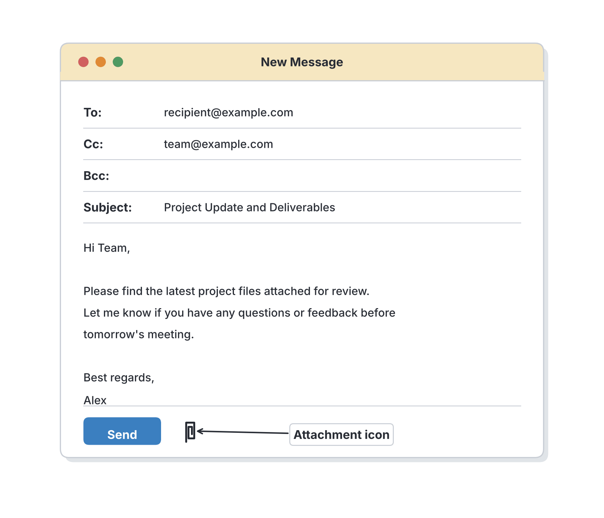
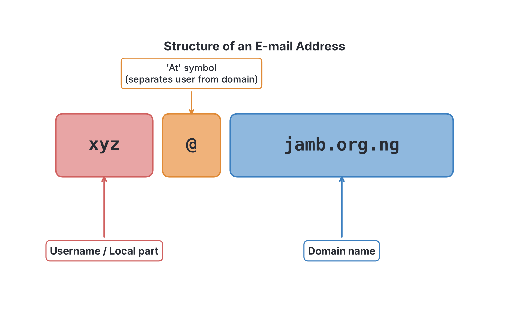

# JAMB Computer Studies Notes: Electronic Mail

## What JAMB expects

This topic is Section F, Topic 4 of the JAMB Computer Studies syllabus: Electronic Mail. It covers the following content items:

* (a) Definition
* (b) E-mail Service
* (c) Steps involved in creating and opening mail (email box, and chatting)
* (d) Features of e-mail address

By the end of these notes, you should be able to:

1. Define Electronic Mail and Chatting. (Objective i)
2. List e-mail services (Creating e-mail address, Composing e-mail, Sending/receiving e-mail, Adding attachments, Chatting, Creating mailing list/group, etc.). (Objective ii)
3. Explain the features in an e-mail address e.g. xyz@jamb.org.ng (user@Domainname) and explain the components of a domain name. (Objective iii)

## Definition of Electronic Mail and Chatting

**Electronic Mail (E-mail)** is the transmission of digital messages from one person to one or more recipients over the Internet or other computer networks. It is the digital equivalent of sending a traditional letter through the post office. With e-mail, you can send text, pictures, documents, and videos to anyone anywhere in the world almost instantly. 

**Chatting** (or instant messaging) is a form of real-time communication over the Internet where users exchange typed text messages back and forth. When you send a chat message, it appears immediately on the receiver's screen, and they can reply instantly, making it feel like a live conversation.

### Comparing E-mail and Chatting

Although both are used to send electronic messages, they have key differences:

| Feature | Electronic Mail (E-mail) | Chatting (Instant Messaging) |
| --- | --- | --- |
| **Timing** | **Asynchronous**: The receiver does not need to be online at the same time. The message sits in their inbox until they log in. | **Synchronous (Real-time)**: Usually requires both users to be online simultaneously for a live conversation. |
| **Format** | Structured like a formal letter (has a sender, recipient, subject line, and body). | Casual and short, like talking (usually just the message text in speech bubbles). |
| **Length** | Better for long, detailed messages and official documents. | Best for quick, short exchanges. |
| **Examples** | Gmail, Yahoo Mail, Outlook mail. | WhatsApp, Telegram, Google Chat, Facebook Messenger. |

## E-mail Services and Operations

E-mail providers (like Google, Yahoo, and Microsoft) offer various services that allow you to manage your electronic communication. These services include creating an account, sending and receiving messages, chatting, and managing groups. 

### Steps involved in creating and opening mail

To use e-mail, you must first create an account and know how to navigate your mailbox.

**1. Creating an e-mail address**
Before you can send or receive emails, you need an e-mail account from an e-mail service provider (such as Gmail, Yahoo, or Outlook).
1. Open a web browser and go to the provider's website (e.g., `www.gmail.com`).
2. Click on the button that says **"Create account"** or **"Sign up"**.
3. Fill out the registration form with your details (first name, last name, date of birth).
4. Choose a unique **username** (this will become the first part of your e-mail address).
5. Create a strong, secure **password**.
6. Provide a recovery phone number or alternate e-mail address (for security purposes).
7. Agree to the Terms of Service and click **Submit** or **Next** to finish creating the account.

**2. Opening your mail (The Email Box)**
When someone sends you an e-mail, it is stored in your electronic mailbox (specifically, the **Inbox**).
1. Go to your provider's website and click **"Log in"** or **"Sign in"**.
2. Enter your e-mail address and your password.
3. Once logged in, click on the **Inbox** folder to see a list of your received messages. New, unread messages are usually highlighted in bold text.
4. Click on a specific message to open and read it.

### Other key e-mail services

Beyond just opening messages, e-mail platforms offer several features to compose and organize communication. Note that menus and button positions differ between versions and providers, but the general steps remain the same.

**3. Composing an e-mail**
Composing means writing a new message. 
1. Click the **"Compose"** or **"New Message"** button.
2. In the **"To"** field, type the exact e-mail address of the person you are sending the message to.
3. In the **"Subject"** field, type a short title explaining what the message is about (e.g., "JAMB Registration Details").
4. In the large empty box (the **Body**), type your full message.

You can also use special recipient fields:
*   **Cc (Carbon Copy):** Sends a copy of the e-mail to someone else. The main recipient can see who was copied.
*   **Bcc (Blind Carbon Copy):** Sends a copy to someone without the other recipients knowing. Their e-mail address is hidden from everyone else.

**4. Adding attachments**
An attachment is a computer file (like a Word document, a photograph, or a PDF) sent along with an e-mail message.
1. While composing a message, click the **Attachment icon** (which almost always looks like a **paperclip**).
2. A window will open showing the files on your computer or phone.
3. Select the file you want to send and click "Open" or "Upload".
4. Wait for the file to finish uploading to the e-mail server before sending.

**5. Sending and receiving e-mail**
*   **Sending:** Once your message is composed and attachments are added, click the **"Send"** button. The e-mail server transfers it across the Internet to the recipient's server.
*   **Receiving:** Your e-mail provider automatically receives and stores incoming messages on their server. You access them by logging into your Inbox. If you are already logged in, you can click a "Refresh" icon to fetch the newest messages.

**6. Chatting**
Many e-mail providers integrate chatting directly into the e-mail window (for example, Google Chat inside Gmail). This allows you to see which of your contacts are currently online and send them instant, real-time messages without having to compose a formal e-mail.

**7. Creating a mailing list/group**
A mailing list (or contact group) is a single e-mail address or group name that contains multiple individual e-mail addresses. 
*   **Use:** Instead of typing 50 different addresses one by one when sending a class announcement, you can send one e-mail to the group name (e.g., `ss3-science-class`), and the server automatically distributes copies to everyone on the list.
*   **Steps:** Go to the "Contacts" or "Address Book" section of your e-mail service, click "Create Group" or "Create Label", name it, and add the e-mail addresses of the members.

## Features of an E-mail Address

Every e-mail address is unique. An e-mail address specifies exactly where a message should be delivered, much like a post office box number. 

An e-mail address is strictly formatted as **user@Domainname**. There are no spaces in an e-mail address.

### The structure of an e-mail address

Let us break down the syllabus example: `xyz@jamb.org.ng`

1.  **Username (`xyz`)**
    *   This is the **local part** of the address.
    *   It identifies the specific person, department, or account at that organization.
    *   In `xyz@jamb.org.ng`, the username is `xyz`.
2.  **The `@` symbol**
    *   Pronounced "at".
    *   This symbol separates the username from the domain name. It literally means that the user `xyz` is located "at" the domain `jamb.org.ng`.
3.  **The Domain name (`jamb.org.ng`)**
    *   This is the address of the server that hosts the e-mail account.
    *   It tells the Internet where to send the message.

### Components of a domain name

The domain name itself is broken down into different parts, separated by periods (dots). Reading from left to right in the domain `jamb.org.ng`:

*   **Host/Organization name (`jamb`)**: This is the specific name registered by the company or organization. Here, it stands for the Joint Admissions and Matriculation Board.
*   **Generic Top-Level Domain (`org`)**: This describes the *type* of organization. Common ones include:
    *   `.com` (Commercial businesses)
    *   `.org` (Non-profit or government-related organizations)
    *   `.edu` (Educational institutions like universities)
    *   `.gov` (Government agencies)
    *   `.net` (Network providers)
*   **Country Code Top-Level Domain (`ng`)**: This describes the *country* where the domain is registered. It is an optional part of a domain name (many domains like `gmail.com` do not have one). 
    *   `.ng` stands for **Nigeria**.
    *   `.uk` stands for the United Kingdom.
    *   `.za` stands for South Africa.

When you combine `.org` and `.ng`, it tells you that the address belongs to an organization based in Nigeria. Therefore, `jamb.org.ng` is the Nigerian organization domain for JAMB.

## Key terms

| Term | Meaning |
| --- | --- |
| **E-mail** | Electronic Mail; the digital exchange of messages over a computer network. |
| **Chatting** | Synchronous (real-time) text communication over the Internet. |
| **Inbox** | The main folder in an e-mail account where incoming messages are received and stored. |
| **Attachment** | A file (such as a document or image) sent along with an e-mail message. |
| **Cc (Carbon Copy)** | Sending a copy of an e-mail to secondary recipients whose addresses are visible to everyone. |
| **Bcc (Blind Carbon Copy)** | Sending a copy of an e-mail to secondary recipients while hiding their addresses from everyone else. |
| **Mailing List** | A single group address used to send messages to many users at the same time. |
| **Username** | The first part of an e-mail address, identifying the specific account. |
| **Domain Name** | The part of an e-mail address after the @ symbol, identifying the hosting server and organization. |

## Exam tips and common mistakes

*   **The @ symbol:** Remember that the `@` (at) symbol is the mandatory separator in every valid e-mail address. If it does not have an `@`, it is not an e-mail address.
*   **Website vs. E-mail:** Students often confuse e-mail addresses with website URLs. `www.jamb.gov.ng` is a website URL. `info@jamb.gov.ng` is an e-mail address. Websites start with `www` or `http`, while e-mail addresses contain an `@`.
*   **Cc vs. Bcc:** Know the difference. "Bcc" stands for *Blind* Carbon Copy. Use it when you want to protect privacy and hide someone's e-mail address from other receivers.
*   **Asynchronous vs. Synchronous:** E-mail is asynchronous (send it now, read it later). Chatting is synchronous (live conversation).
*   **Attachment icon:** Exam questions frequently ask what the attachment icon looks like. The answer is always a **paperclip**.

## Quick summary

1. Electronic mail (e-mail) is a method of exchanging digital messages across the Internet, while chatting is a real-time, text-based conversation.
2. An e-mail service provider (like Gmail or Yahoo) allows you to create an account, open your inbox, and compose messages.
3. You can attach files such as documents or pictures to your e-mails using the attachment feature, usually represented by a paperclip icon.
4. E-mails can be sent to multiple people at once using Cc, Bcc, or by setting up a mailing list (a group contact).
5. An e-mail address strictly follows the format `username@domainname`.
6. The `@` symbol separates the specific user's name from the domain name of the hosting server.
7. Domain names contain components that show the organization name (e.g., `jamb`), the type of organization (e.g., `.org` or `.com`), and sometimes the country code (e.g., `.ng` for Nigeria).

## Practice questions

**1. Electronic mail (e-mail) is best defined as:**
- A. A real-time voice call over the internet.
- B. A method of transmitting digital messages across networks.
- C. A hardware device used to type messages.
- D. A physical letter delivered by a courier.

**Answer: B.** E-mail is the transmission of digital messages from one person to another over the Internet or computer networks.

**2. Which of the following differentiates chatting from standard e-mail?**
- A. Chatting requires the use of a paperclip icon.
- B. Chatting can only send text, while e-mail cannot send text.
- C. Chatting is typically a synchronous, real-time conversation.
- D. Chatting uses the Bcc field for privacy.

**Answer: C.** Chatting is synchronous (both users usually online at the same time for instant replies), whereas e-mail is asynchronous (messages are stored in the inbox until read).

**3. In the e-mail address `student@school.edu.ng`, what does the `@` symbol do?**
- A. It indicates the country code of the sender.
- B. It separates the username from the domain name.
- C. It encrypts the message for security.
- D. It attaches a file to the message.

**Answer: B.** The `@` (at) symbol is the mandatory separator in all e-mail addresses, placed directly between the local username and the domain name.

**4. When composing an e-mail, what is the purpose of the Bcc field?**
- A. To add a title to the message.
- B. To send a copy to someone without the other recipients knowing.
- C. To format the text in bold characters.
- D. To ensure the message is delivered faster.

**Answer: B.** Bcc stands for Blind Carbon Copy. It hides the recipient's e-mail address from other people who receive the same message.

**5. Which icon is universally used to represent the "Attachment" feature in e-mail services?**
- A. A magnifying glass
- B. A gear wheel
- C. A paperclip
- D. A padlock

**Answer: C.** The paperclip icon is standard across almost all e-mail clients to indicate adding a file attachment to a message.

**6. What is the primary function of an e-mail Inbox?**
- A. To store newly received messages.
- B. To store messages that failed to send.
- C. To hold a list of all website passwords.
- D. To permanently delete old messages.

**Answer: A.** The Inbox is the main folder where incoming e-mail messages are received and stored by the e-mail server.

**7. In the domain name `jamb.org.ng`, what does the `.ng` represent?**
- A. Non-Governmental
- B. The username
- C. The country code for Nigeria
- D. Network Gateway

**Answer: C.** `.ng` is the Country Code Top-Level Domain (ccTLD) representing Nigeria.

**8. Which of the following allows a user to send a single e-mail to fifty people without typing all fifty addresses individually?**
- A. An attachment
- B. A mailing list
- C. The Subject line
- D. A domain name

**Answer: B.** A mailing list (or contact group) is a single group address that distributes an e-mail to multiple stored contacts at once.

**9. Which of the following is a valid format for an e-mail address?**
- A. www.myname.yahoo.com
- B. myname@yahoo.com
- C. my name @ yahoo . com
- D. http://myname.yahoo.com

**Answer: B.** An e-mail address must strictly be in the format `username@domainname` without any spaces. Options A and D look like website URLs, and Option C contains spaces.

**10. In the e-mail address `xyz@jamb.org.ng`, what does `.org` indicate about the domain?**
- A. It is a commercial business.
- B. It is a non-profit or organizational domain.
- C. It is a military institution.
- D. It is an educational university.

**Answer: B.** The generic top-level domain `.org` typically stands for an organization, mostly non-profits, government bodies, or community groups. Commercial businesses use `.com`.

<!-- COVERAGE
obj i | ## Definition of Electronic Mail and Chatting
obj ii | ## E-mail Services and Operations
obj iii | ## Features of an E-mail Address
item a | ## Definition of Electronic Mail and Chatting
item b | ## E-mail Services and Operations
item c | ### Steps involved in creating and opening mail
item d | ## Features of an E-mail Address
-->
