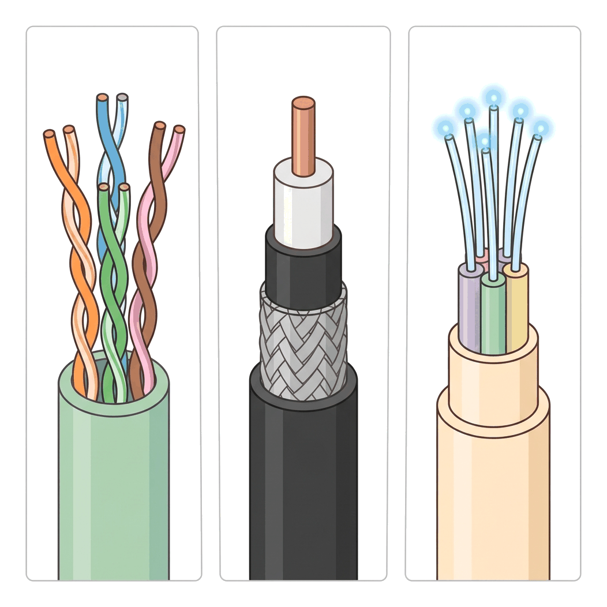
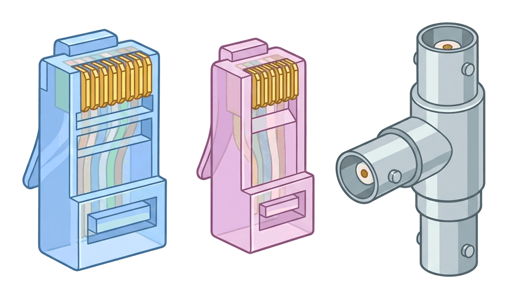
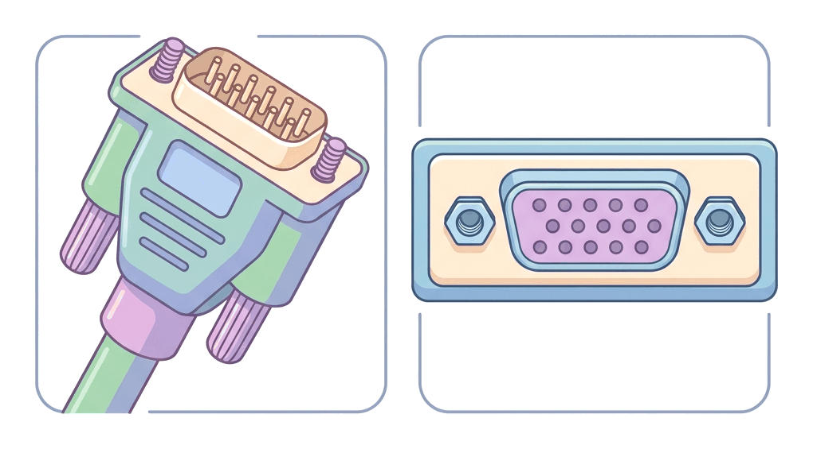
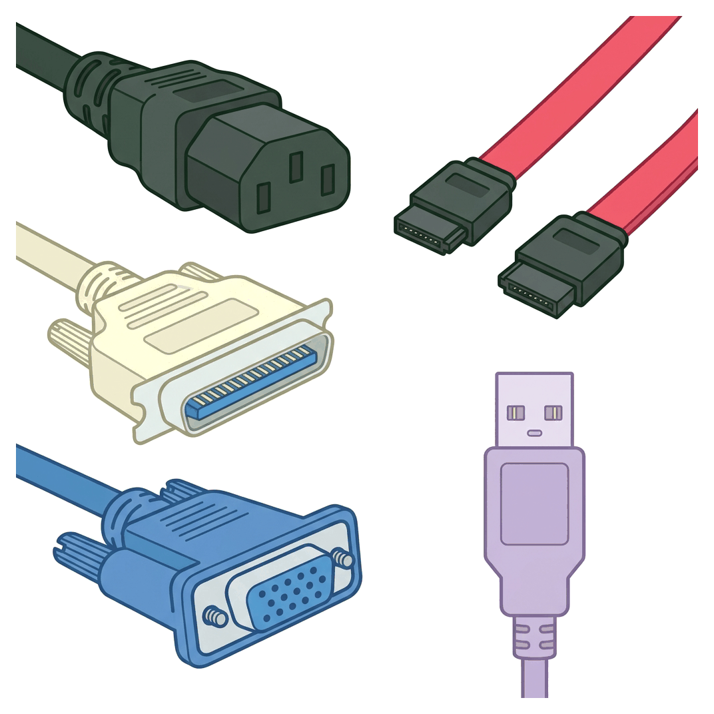

# JAMB Computer Studies Notes: Cables and Connectors

## What JAMB expects

This topic is Section F, Topic 7 of the JAMB Computer Studies syllabus: Cables and Connectors. It covers the physical wires and plugs used to link computers, networks, and peripheral devices.

The syllabus includes two main contents:
* (a) Network cables and connectors
* (b) Computer cables and connectors

By the end of these notes, you should be able to:
1. Identify different network cables and connectors (Twisted Pair, Coaxial, Fibre Optics, RJ45, RJ11, T-Connectors).
2. Identify different types of Computer Cables and Connectors (Power, Data, Printer, USB, Monitor, Serial, Parallel) and the difference between Male and Female connectors.

## Network Cables and Connectors

For a computer to share information with another computer, they must be linked together. In wired networks, this link is provided by physical cables. The type of cable affects how fast data travels, how far it can go, and how easily it can be interrupted by electrical noise. 

### Identifying Network Cables and Connectors

**Objective i: Identify different network cables and connectors.**

#### 1. Network Cables

There are three main types of network cables tested by JAMB:

* **Twisted Pair Cable:**
  * **What it is:** This cable contains pairs of insulated copper wires that are twisted around each other. 
  * **Why it is twisted:** Twisting the wires reduces **electromagnetic interference (EMI)** and "crosstalk" (signals bleeding from one wire to another).
  * **Uses:** It is the most common cable used for Local Area Networks (LANs), such as connecting computers in a school laboratory or office.
  * **Types:** It comes in two main varieties: **Unshielded Twisted Pair (UTP)** (the standard, cheaper type, like Cat5e or Cat6) and **Shielded Twisted Pair (STP)** (which has an extra metal foil wrapper for environments with high electrical interference).
* **Coaxial Cable:**
  * **What it is:** A thick cable featuring a central solid copper core (the conductor), surrounded by a plastic insulator, a braided metal shield, and a tough outer plastic jacket.
  * **Features:** The metal shield makes it highly resistant to electrical interference.
  * **Uses:** Historically, it was used in older computer networks (specifically the bus topology). Today, you will most commonly see coaxial cables used to connect television antennas or satellite dishes (like a DSTV or GOTV dish) to decoders, and for cable broadband internet.
* **Fibre Optic Cable:**
  * **What it is:** A cable made of very thin, flexible strands of glass or clear plastic.
  * **Features:** Instead of carrying electrical signals, it transmits data as **pulses of light** (photons). 
  * **Advantages:** Because it uses light, it is completely immune to electrical interference. It is extremely fast, has an enormous bandwidth, and can carry data over very long distances without losing signal strength.
  * **Uses:** Used for high-speed internet backbones and telecommunications (for example, the heavy undersea cables like MainOne or Glo-1 that bring international internet traffic to Nigeria).

**Comparison of Network Cables**

| Feature | Twisted Pair | Coaxial | Fibre Optic |
| --- | --- | --- | --- |
| **Signal type** | Electrical | Electrical | Pulses of light |
| **Speed/Bandwidth** | Moderate to High | Moderate | Very High |
| **Cost** | Lowest (cheap) | Moderate | Highest (expensive) |
| **Interference** | Most susceptible | Resistant | Completely immune |
| **Main use** | Ethernet LANs | Cable TV, older bus networks | High-speed internet backbones |

#### 2. Network Connectors

A connector is the physical plug or socket at the end of a cable that allows it to attach to a device (like a router, switch, or computer network card).

* **RJ45 (Registered Jack 45):**
  * An 8-pin plastic connector used at the ends of **twisted pair cables**.
  * It is slightly wider than a standard telephone plug. It clicks securely into the Ethernet port of a computer or router to form a Local Area Network (LAN).
* **RJ11 (Registered Jack 11):**
  * A smaller, 4-pin or 6-pin plastic connector.
  * It is the standard connector used for **landline telephone cables** and older ADSL internet modems. It looks very similar to an RJ45 but is noticeably narrower.
* **T-Connectors:**
  * A small metallic connector shaped like the letter "T".
  * It is used exclusively with **coaxial cables** in older networks that used a bus topology (specifically networks called Thinnet or 10Base2). 
  * The middle peg of the "T" plugs into the computer's network card, while the two horizontal ends allow the main network cable to connect and continue travelling to the next computer in the line.

## Computer Cables and Connectors

Beyond networking, computers rely on many other cables to receive power, communicate with internal parts, and connect to external peripherals (like monitors, mice, and printers). 

### Identifying Computer Cables and Connectors

**Objective ii: Identify different types of Computer Cables and Connectors.**

#### 1. Connectors: Male and Female

In electronics, connectors are designed with specific physical shapes to ensure that cables are plugged in correctly and safely. They are classified as either male or female.

* **Male Connectors (Plugs):**
  * A male connector has solid, protruding **metal pins** or prongs.
  * It is designed to be inserted into a matching female socket.
  * *Example:* The standard 3-pin plug at the end of your television or phone charger cable is a male connector.
* **Female Connectors (Sockets, Ports, or Receptacles):**
  * A female connector has hollow **holes** or receptacles designed to receive the pins of a male connector.
  * These are usually built into the wall, or mounted onto the side or back of a computer casing.
  * *Example:* The wall socket in your house or the USB port on the side of a laptop is a female connector.

*Note:* When you connect a peripheral to a computer, you are almost always inserting a male cable end into a female computer port.

#### 2. Types of Computer Cables

The JAMB syllabus expects you to be familiar with the following specific computer cables:

* **Power Cables:**
  * These deliver electrical power from a wall socket, generator, or UPS (Uninterruptible Power Supply) to the computer's Power Supply Unit (PSU) or the monitor.
  * They carry Alternating Current (AC). A common example is the thick black cable with a three-pin plug on one end and a socket on the other (often called a "kettle lead").
* **Data Cables:**
  * While "data cable" is a broad term for any cable that carries information, in hardware maintenance, it often refers to the **internal cables** that connect the motherboard to storage devices like hard drives and CD/DVD drives.
  * *Examples:* The older, wide grey ribbon cables known as **IDE (Integrated Drive Electronics)**, and the modern, narrow, usually red cables known as **SATA (Serial Advanced Technology Attachment)**.
* **Universal Serial Bus (USB) Cable:**
  * USB is the most widespread modern standard for connecting external devices.
  * It carries **both data and low-voltage electrical power** simultaneously. This is why you can use a USB cable to transfer files to your smartphone and charge its battery at the same time.
  * USB cables replace many older types of cables. They are used for mice, keyboards, flash drives, and external hard drives. 
  * Connectors come in various shapes, including standard USB Type-A (rectangular), USB Type-B (square), Micro-USB, and the newer reversible USB Type-C.
* **Printer Cable:**
  * A cable dedicated to linking a computer to a printer.
  * In the past, this was a bulky parallel cable. Today, almost all modern wired printers use a **USB cable** (specifically, a cable with a rectangular Type-A connector on the computer end and a square Type-B connector on the printer end).
* **Monitor Cable:**
  * These carry video (and sometimes audio) signals from the computer's graphics card to a display monitor or projector.
  * *Examples include:*
    * **VGA (Video Graphics Array):** An older, usually blue cable with 15 pins that carries analog video signals.
    * **HDMI (High-Definition Multimedia Interface):** A modern digital cable commonly used today for TVs and monitors. HDMI has the advantage of carrying both high-quality video and audio over a single cable.
* **Serial Cable:**
  * An older standard that transmits data **sequentially, one bit at a time**, over a single wire channel.
  * Because it sends data one bit after another in a single line, it is relatively slow. 
  * It was historically used for devices that did not require fast data transfer, such as early computer mice and dial-up modems. Today, it is mostly used by IT professionals to configure network routers.
* **Parallel Cable:**
  * An older standard that transmits **multiple bits of data simultaneously** (for example, 8 bits at a time) over several parallel wires.
  * By sending multiple bits at once, it was much faster than serial cables in its era.
  * It was historically the standard for connecting printers (often using a large 25-pin connector). It has now been entirely replaced by USB.

**Comparison of Serial and Parallel Cables**

| Feature | Serial Cable | Parallel Cable |
| --- | --- | --- |
| **Data transmission** | One bit at a time | Multiple bits simultaneously |
| **Speed (Historically)** | Slower | Faster |
| **Number of data wires** | Fewer | Many |
| **Main historical use** | Old mice, modems | Old printers |
| **Replaced today by** | USB | USB |

## Key terms

| Term | Meaning |
| --- | --- |
| **Twisted Pair Cable** | A network cable made of intertwined insulated copper wires used to reduce electromagnetic interference. |
| **Coaxial Cable** | A network and TV cable with a solid central copper core, insulation, and a braided metal shield. |
| **Fibre Optic Cable** | A very fast network cable that transmits data over long distances using pulses of light. |
| **RJ45** | An 8-pin connector used at the ends of twisted pair cables for Ethernet networks. |
| **RJ11** | A 4-pin or 6-pin connector used for telephone lines and older ADSL modems. |
| **T-Connector** | A T-shaped metal connector used to link coaxial cables in a bus network topology. |
| **Male Connector** | A plug featuring solid, protruding metal pins. |
| **Female Connector** | A socket or port featuring hollow holes to receive pins. |
| **USB** | Universal Serial Bus; a standard modern cable that supplies both data and electrical power to peripherals. |
| **Serial Cable** | An older type of data cable that transmits information sequentially, one bit at a time. |
| **Parallel Cable** | An older type of data cable that transmits multiple bits of information simultaneously. |

## Exam tips and common mistakes

* **RJ45 vs RJ11:** This is a very common exam trap. Remember that **RJ45** has 8 pins and is for computer networking (Ethernet). **RJ11** has 4 or 6 pins and is for telephones.
* **Fibre Optic mechanism:** If a question asks which cable uses light, photons, or glass strands, the answer is always Fibre Optic. It does not use electricity.
* **Male vs Female:** Do not confuse the two. Male connectors have the **pins**; female connectors have the **holes**. 
* **Serial vs Parallel transmission:** Memorise that **serial** means "one by one" (one bit at a time), while **parallel** means "side by side" (multiple bits at once).
* **Power vs Data:** Power cables only provide electricity (AC power). Data cables (like SATA, HDMI, or Ethernet) transmit information. USB is special because it transmits *both*.

## Quick summary

1. Network cables link computers together. The main types are twisted pair, coaxial, and fibre optic cables.
2. Twisted pair cables use twisted copper wires to reduce interference; coaxial cables use a braided metal shield; fibre optic cables use pulses of light for extremely fast, interference-free transmission.
3. Common network connectors include RJ45 (for twisted pair Ethernet), RJ11 (for telephones), and T-Connectors (for older coaxial bus networks).
4. Physical connectors are classified as male (having protruding metal pins) or female (having receiving holes).
5. Power cables supply AC electricity to the system, while internal data cables (like SATA and IDE) carry information between the motherboard and storage drives.
6. A serial cable sends data slowly, one bit at a time. A parallel cable sends data faster by transmitting multiple bits simultaneously.
7. The Universal Serial Bus (USB) is the standard modern cable for peripherals. It has replaced older serial and parallel cables and carries both data and power.
8. Monitor cables, such as VGA and HDMI, are responsible for sending visual signals from the computer to the display screen.

## Practice questions

**1. Which of the following network cables uses pulses of light to transmit data?**
- A. Coaxial cable
- B. Twisted pair cable
- C. Fibre optic cable
- D. Serial cable

**Answer: C.** Fibre optic cable is made of thin strands of glass or plastic and uses pulses of light (photons) to transmit data, making it very fast and immune to electrical interference.

**2. What is the primary physical difference between a male and a female connector?**
- A. Male connectors carry data, while female connectors carry power
- B. Male connectors have protruding pins, while female connectors have receiving holes
- C. Male connectors are used exclusively for networking, while female connectors are for monitors
- D. Male connectors are always faster than female connectors

**Answer: B.** In hardware terminology, a male connector is a plug with protruding pins, while a female connector is a socket or port with holes designed to receive those pins.

**3. The RJ45 connector is most commonly associated with which type of cable?**
- A. Fibre optic cable
- B. Coaxial cable
- C. Telephone cable
- D. Twisted pair cable

**Answer: D.** RJ45 is an 8-pin connector attached to the ends of twisted pair cables (like Cat5e or Cat6) to create Ethernet networks. RJ11 is used for telephone cables.

**4. In computer networking, what is a T-connector typically used for?**
- A. Connecting fibre optic cables over long distances
- B. Connecting coaxial cables in a bus network topology
- C. Connecting a telephone to a dial-up modem
- D. Supplying electrical power to a network switch

**Answer: B.** A T-connector is a metal attachment used in older networks that relied on a bus topology to connect a coaxial cable to the computer while allowing the network line to continue.

**5. Which of the following computer cables transmits data sequentially, one bit at a time?**
- A. Parallel cable
- B. Monitor cable
- C. Serial cable
- D. Power cable

**Answer: C.** A serial cable sends data one bit after another over a single channel. This makes it different from a parallel cable, which sends multiple bits simultaneously.

**6. The older bulky cable used mainly to connect a computer to a printer, which transmits multiple bits at once, is known as the:**
- A. Parallel cable
- B. Serial cable
- C. VGA cable
- D. RJ11 cable

**Answer: A.** A parallel cable transmits multiple bits at the same time (in parallel), which made it suitable for older printers before USB became the standard.

**7. Which modern computer cable is widely used to connect peripherals like mice and keyboards, and has the advantage of carrying both data and electrical power?**
- A. HDMI cable
- B. Universal Serial Bus (USB) cable
- C. SATA data cable
- D. Fibre optic cable

**Answer: B.** USB (Universal Serial Bus) is the standard connection for most external peripherals today because it is versatile and provides both data transfer and power.

**8. The primary function of a power cable in a desktop computer is to:**
- A. Transfer data between the hard drive and the motherboard
- B. Deliver Alternating Current (AC) from the wall socket to the power supply unit
- C. Send video and audio signals to the monitor
- D. Connect the computer to a Local Area Network

**Answer: B.** The power cable (often a heavy, thick cable) is responsible solely for delivering electrical AC power from a wall outlet or UPS to the computer's Power Supply Unit (PSU).

**9. Which connector is typically used for landline telephones and older internet modems?**
- A. T-Connector
- B. USB Type-C
- C. RJ45
- D. RJ11

**Answer: D.** The RJ11 is a small 4-pin or 6-pin connector specifically designed for telephone lines. Do not confuse it with the wider RJ45 used for computer networks.

**10. SATA and IDE are examples of:**
- A. External monitor cables
- B. Internal data cables used for storage drives
- C. Network cables used for the internet
- D. Power cables for laptops

**Answer: B.** SATA (Serial Advanced Technology Attachment) and the older IDE (Integrated Drive Electronics) are internal data cables used to connect a computer's motherboard to storage devices like hard drives.

<!-- COVERAGE
obj i | Identifying Network Cables and Connectors
obj ii | Identifying Computer Cables and Connectors
item a | Network Cables and Connectors
item b | Computer Cables and Connectors
-->
